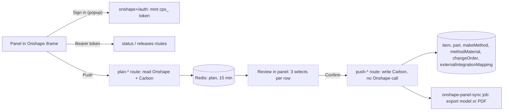

# Onshape panel: push CAD data into Carbon from inside Onshape

> Status: in-progress (built on `feat/onshape-app`, PR #1764 open)
> Author: Raul Soonawala
> Date: 2026-08-28; rewritten 2026-10-12 to match the build

## TLDR

Carbon adds a panel to Onshape's element right panel. An engineer opens a Part Studio, an assembly or a drawing and sees which parts Carbon already has. The engineer then pushes parts, an assembly's BOM or a whole release into Carbon. Every push shows a review first and writes only when the engineer confirms it. The panel is its own integration, `onshape-v2`, beside the existing sync integrations. Carbon never pulls from Onshape on its own. Engineering detail: `.claude/rules/onshape-panel.md`. User docs: `docs/content/docs/integrations/cad.mdx`.

## Overview diagram

## Problem Statement

Carbon's Onshape integration on main pulls from inside Carbon. The BoM Explorer imports a BOM, and a release webhook attaches models and drawings to items that already exist. The engineers who decide when CAD data is ready work in Onshape. They have no view there of what Carbon holds, and no control over when data goes in. Pulling also spends API quota on reads that nobody asked for.

## Proposed Solution

| Capability | What it does |
|---|---|
| Status | Shows each part or BOM line as Linked, Conflict, Unlinked or Released, and each release as In Carbon, Partial or Not in Carbon. |
| Push a part | Creates or updates the item, links it to the Onshape part, and exports the model and thumbnail. |
| Push an assembly | Creates missing items and writes the BOM into each make method, sub-assemblies included. An Active method gets a Draft version. |
| Push a release | Creates a revision of each released item at the released letter, writes the released BOM, and stages the new revisions on one Draft change notice. Released drawings attach as PDF. |
| Fields | Maps Onshape properties to six item fields and to part custom fields, and sets the push defaults for new items. |
| Item page | One card on the part page: the Onshape link, the fields a push replaces, Open in Onshape and Detach. |

### Design Decisions

| Decision | Choice | Rationale |
|---|---|---|
| Integration identity | Separate id `onshape-v2`, with its own grant, `companyIntegration` row and mapping namespace | A company can run the panel beside either sync connection. Disconnecting one never affects the other. |
| Direction | Push only, started by a person in Onshape | The engineer decides when data is ready. No background reads spend quota. |
| Write model | Two requests: PLAN stores a plan in Redis, APPLY writes it | The review shows exactly what the push writes. APPLY makes no Onshape call, and a double submit writes once. |
| Panel credential | Opaque `cps_` token minted in a same-origin popup, held in Redis for 12 hours | The `SameSite=Lax` session cookie never reaches a cross-site iframe. The token holds identity only, never a Supabase token. |
| Released methods | Never edited; the push writes into a Draft version | A push must not change what production uses. This matches a Version change in Carbon. |
| Release revisions | New revisions are inactive on a Draft change notice | Carbon's change process decides when a revision becomes live. |
| Field ownership | No field is locked. Each mapping is "Set at creation" or "Update on every push" | A linked item is a normal Carbon item. The mode decides what a later push overwrites. |
| Property map location | The panel's Fields page | Onshape lists properties only from inside a document. |
| Drawing record | The PDF document `<partNumber>-<revision>.pdf` on the model's item | No extra table. The Releases tab reads the drawing state back by file name. |
| Item page footprint | One self-loading card, no Onshape fields on the form | Upstream changes to the item page stay free of merges. |
| Write location | Route actions in `apps/erp` plus two server modules | Open: see Open Questions. Main's `sync` server function already writes items and BOMs for the BoM Explorer. |

## Data Model Changes

No new tables or columns.

- Migration `20261016051650_onshape-v2-integration.sql` inserts the `onshape-v2` row into `integration`.
- Migration `20261016051651_onshape-v2-vault-secrets.sql` moves plaintext tokens in `onshape-v2` metadata into Vault. `SECRET_KEYS["onshape-v2"]` names the access and refresh token.
- `companyIntegration.metadata` for `onshape-v2` holds `credentials` (type, expiry), `propertyMap`, `descriptionModes` and five `default*` push-default keys.
- `externalIntegrationMapping` rows with integration `onshape-v2` record identity:

| Entity | `externalId` |
|---|---|
| Part item | `documentId:elementId:partId[:configuration]` |
| Assembly item | `documentId:elementId:assembly[:configuration]` |
| Release revision item | `release:<releaseId>:<partNumber>` |
| BOM line the push wrote | entityType `methodMaterial` |
| Draft the push made | entityType `makeMethod`, with the source Active method in metadata |

## API / Service Changes

All panel routes use `requireOnshapePanelPermissions` (bearer token, employees only, 401 or 403, no redirect).

| Route | Method | Permission | Does |
|---|---|---|---|
| `api+/integrations.onshape.panel.status` | GET | parts view | Reads the element and its Carbon state |
| `api+/integrations.onshape.panel.releases` | GET | parts view | Lists the 20 newest releases and their state |
| `api+/integrations.onshape.panel.plan-part` | POST | parts create, update | Plans 1 to 50 parts |
| `api+/integrations.onshape.panel.plan-assembly` | POST | parts create, update, delete | Plans an assembly at depth `all` (up to 1500 part numbers) or `top` |
| `api+/integrations.onshape.panel.plan-release` | POST | parts create, update, delete | Plans one release |
| `api+/integrations.onshape.panel.push-{part,assembly,release}` | POST | as the plan | Applies a stored plan |
| `api+/integrations.onshape.panel.fields` | GET, POST | settings update | Reads and saves the property map and push defaults |
| `api+/integrations.onshape.panel.me` | GET | employee | Returns the user, company and `canEditFields` |
| `api+/integrations.onshape.panel.session` | DELETE | employee | Signs the panel out |
| `api+/integrations.onshape.detach` | POST | parts update (cookie) | Removes the item's `onshape-v2` link |
| `api+/integrations.onshape-v2.install`, `.oauth` | GET, POST | settings update | Starts and completes the OAuth grant |

- Server modules: `modules/settings/onshape-push.server.ts` (field writers, BOM line writes, change notice staging) and `modules/settings/onshape-draft-method.server.ts` (Draft versions).
- Background job: `onshape-panel-sync` exports a model, thumbnail or drawing PDF for one item.
- `@carbon/kv` gains `acquireLease` and `withLease`. The Onshape token refresh uses them, because Onshape rotates refresh tokens.

## UI Changes

- Panel routes: `onshape+/panel` (framable by `*.onshape.com` only), `onshape+/auth` (sign-in popup), `onshape+/_layout` (owns the scroll and follows Onshape's theme).
- Panel pages: the push page (Parts, Assembly or Push), Releases and Fields.
- Settings → Integrations: an Onshape V2 card. Connect opens a popup for both Onshape connections; Reconnect goes to Onshape's consent page and back.
- Part page: `ExternalSourceCard` after the CAD model.

## Acceptance Criteria

- [x] A part push creates the item with its model and thumbnail; a second push of an unchanged part writes nothing.
- [x] Push all writes every numbered part of a Part Studio, with mapped item fields and custom fields.
- [x] An assembly push writes the BOM into the assembly's make method.
- [ ] An assembly push takes over matching manual lines and keeps the others (untested).
- [ ] An assembly push with an Active method writes into a Draft version and reuses it on the next push (untested).
- [x] A release push creates revisions at the released letters under one Draft change notice; a second push creates nothing.
- [x] A release with a drawing attaches the PDF and reads In Carbon once the PDF lands.
- [x] A user without settings view gets status and a review (checked over the API).
- [x] Fields saves the map and push defaults; a push applies them.
- [ ] A person signs in from inside Onshape's iframe by hand once (automation cannot complete the popup).
- [ ] The write path has tests that run without Onshape.

## Risks

| Risk | Severity | Mitigation |
|---|---|---|
| The write path (push routes, server modules, client) has no tests; 338 tests cover the pure modules only | High | Add module-boundary tests before the next live run. |
| The push routes duplicate decisions that main's `sync` server function and the item page also make | High | Decide the write location (Open Questions). |
| A private Onshape app bills the owner's yearly quota; a spent quota answers 402 | Medium | The panel names the cause. Dev mode caches stable reads. |
| Onshape's panel is often under 768px wide, so Carbon inputs render at phone size | Low | Container-width styles in `@carbon/react`. |

## Open Questions

> HARD STOP: Do not proceed with implementation until these are answered.

- [ ] Where do the writes live? Options: a thin panel over main's `sync` server function; landable slices of this branch; or this branch as is, with write-path tests first.
- [ ] Which of the 19 open edge-case findings must be fixed before merge?
- [ ] Can Onshape Government private apps host the panel, and from which domain?

## Changelog

- 2026-08-28: Created.
- 2026-10-12: Rewritten to match the build. The field-mapping spec (`2026-10-07-onshape-standard-field-mapping.md`) is folded in and deleted.
