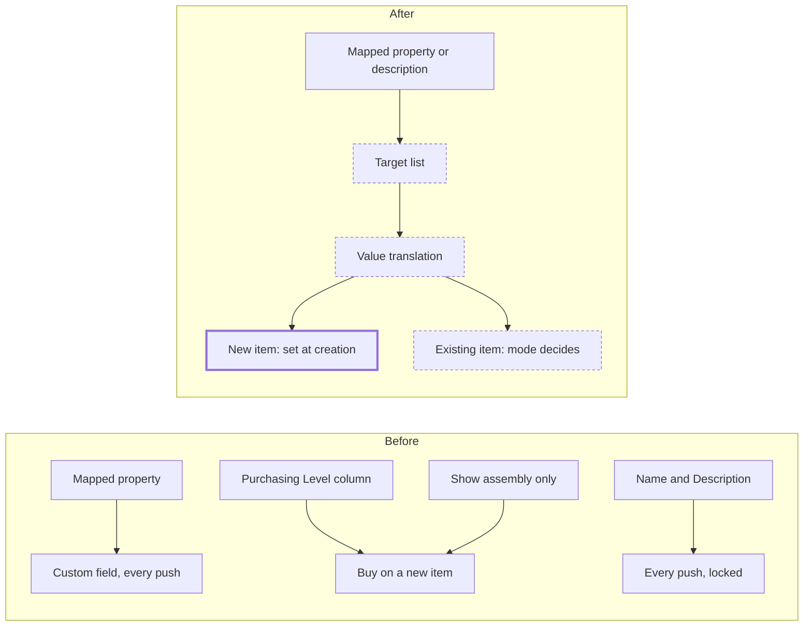

# Onshape: map properties to Carbon item fields

> Status: built; live spikes S1-S5 and the live push pending
> Author: Raul (with Claude)
> Date: 2026-10-07
> Builds on: `.ai/specs/2026-08-28-onshape-app.md` (section "Custom fields")
> Delivered in: PR #1764 (`feat/onshape-app`)

## TLDR

The Onshape panel's property map writes Onshape properties into part custom
fields only. This change lets a mapping also set six Carbon item fields: MPN,
Replenishment, Default Method, Sourcing, Tracking Type and Unit of Measure.
One hand-kept target list in `packages/ee` declares each item field, its type,
its valid values and its writer. A mapping to a list field carries a value
translation from Onshape values to Carbon values.

Every mapping has a mode: "Set at creation" (the default) or "Update on every
push". The two descriptions get the same two modes. After the first push, an
item belongs to Carbon, and Carbon locks no field. Replenishment comes from a
mapping. The panel stops reading the "Purchasing Level" column, and "Show
assembly only" stops meaning Buy.

## Overview diagram



## Problem Statement

- A company keeps purchasing data in Onshape properties. Examples are a
  manufacturer part number, or whether a part is bought or made. The panel
  can send these values only into custom fields. The item fields that drive
  purchasing and production stay at the push defaults.
- Onshape has no built-in Buy or Make property. The panel reads a BOM column
  with the exact name "Purchasing Level" and the exact value "Purchased".
  Onshape does not supply this column. No setup step tells a company to
  create it.
- The panel also reads "Show assembly only" as Buy. Onshape offers that
  setting for a sub-assembly that is bought or built as one unit. So a
  sub-assembly that the company builds arrives as Buy.
- Every push overwrites the two descriptions and every mapped custom field.
  Carbon also refuses edits to the descriptions of a linked item. After the
  first push, an item must behave like any other Carbon item.

## Proposed Solution

Terms used in this spec:

| Term | Meaning |
|------|---------|
| mapping | One entry of the property map: one Onshape property to one target |
| target | What a mapping writes: a part custom field or an item field |
| item field | One of the 6 targets in the target list |
| problem | A mapped value that the push cannot write. The review shows it. |
| kept difference | An Onshape value that differs from Carbon's value, which the push does not write |

### The target list

`packages/ee/src/onshape/panel/standard-fields.ts` holds the target list.
Nothing else declares an item field. A mapping goes to a custom field of table
`part` or to an item field in this list.

| Item field | Kind | Valid values | Onshape value types | Writer for an existing item |
|------------|------|--------------|---------------------|-----------------------------|
| `mpn` (MPN) | text | free text | STRING, ENUM, OBJECT | `itemColumn` |
| `replenishmentSystem` | list | Buy, Make, Buy and Make | STRING, ENUM, BOOL | `itemMethod` |
| `defaultMethodType` | list | Purchase to Order, Pull from Inventory, Make to Order | STRING, ENUM, BOOL | `itemMethod` |
| `sourcingType` | list | Specified, Drop Ship, Ship from Inventory | STRING, ENUM, BOOL | `itemMethod` |
| `itemTrackingType` | list | Inventory, Non-Inventory, Serial, Batch | STRING, ENUM, BOOL | `itemTracking` |
| `unitOfMeasureCode` | list | the company's unit codes, read at plan time | STRING, ENUM | `itemColumn` |

Each writer key names one function in
`apps/erp/app/modules/settings/onshape-push.server.ts`. A typed
`Record<StandardFieldWriter, …>` holds the functions. So a new writer key
fails the typecheck until it has a function.

| Writer | Function | What it also changes |
|--------|----------|----------------------|
| `itemMethod` | `updateItemMethodAndSourcing` | `methodMaterial` rows on Draft make methods |
| `itemTracking` | item update, then `cascadeItemTrackingType` | Draft and Planned jobs; Draft receipt and shipment lines |
| `itemColumn` | `updateItemColumns` (new) | nothing |

The plan applies the rules of `deriveItemMethodUpdate` before the apply (see
"Interlocked fields"). So the `itemMethod` writer gets final values and
derives nothing. `applyItemFieldWrites` runs the writers in this order:
`itemMethod`, `itemTracking`, `itemColumn`.

Carbon has no service function for MPN or Unit of Measure. The Properties
panel (`x+/items+/update.tsx`) updates these columns directly.
`updateItemColumns` copies that update into a named function. It adds no rule
of its own.

MPN shows in the Properties panel only for Buy items. The push writes a mapped
MPN on every item. The value stays hidden on a Make item.

Vendor to preferred supplier is out of scope. A later change can add it as a
third kind of item field: a record match.

### The property map

The map stays on `companyIntegration.metadata.propertyMap`. No migration is
necessary. One mapping:

```ts
type PropertyMapEntry = {
  onshapePropertyId: string;
  onshapeName: string;          // display only
  valueType: string;
  target:
    | { kind: "customField"; fieldId: string }
    | { kind: "item"; field: StandardFieldId };
  mode: "create" | "everyPush";
  /** List item fields only. Onshape value → Carbon value, or null for "No value". */
  translations?: Array<{ onshape: string; carbon: string | null }>;
};
```

`parsePropertyMap` reads the earlier shape too:

1. If a mapping has `carbonFieldId`, read it as a `customField` target.
2. If the stored mode is `owned`, read it as `everyPush`. The panel saved that
   mapping when every push overwrote.
3. If the stored mode is `default` or missing, read it as `create`.

Two rules apply to the whole map:

- A target takes one property. The save refuses a second property on the same
  target.
- A property feeds one target. This rule exists today.

The two descriptions are not mappings. The panel reads them from Onshape's
Name and Description on every push. Their modes are on
`metadata.descriptionModes: { name, description }`. Each mode defaults to
`create`.

### Value translation

A mapping to a list item field needs a translation.

1. The Fields page fills the translation with one row per Carbon value. The
   Onshape side of each row starts as the Carbon value's own text. So a list
   property with the options Buy, Make and Buy and Make needs no setup.
2. The user can change the Onshape side of a row, or add a row.
3. The user can set the Carbon side of a row to "No value". "No value" lets
   the next rule in the precedence order decide.
4. The match ignores case and the spaces at the two ends.
5. For Unit of Measure, the match also accepts the unit's name.
6. For a BOOL property, the Onshape side is "Yes" or "No". Example: Yes →
   Buy, No → No value.

An empty Onshape value gives no value. It is never a problem. An Onshape value
that matches no row is a problem, and the push skips that target. Custom-field
conversion problems work the same way today.

### Mode: "Set at creation" or "Update on every push"

| | Set at creation (default) | Update on every push |
|---|---|---|
| The push creates the item | writes the value | writes the value |
| The item exists, and the push links it or it is linked to this source (update, adopt, reuse, new revision) | writes nothing; the review shows a kept difference | writes the value with the target's writer |
| Edits in Carbon | Carbon keeps them | the next push replaces them |
| An empty Onshape value | writes nothing | clears a custom field; writes nothing for an item field or a description |

An assembly push writes no mapped value to an item that is linked to another
Onshape part. A part push links the item it adopts, so that item takes the
"Update on every push" values. A release push does not link a reused BOM
child, so that child takes no mapped value.

A new revision from a release push copies the base revision's Carbon values,
as `createRevision` does today. Then each mapping in "Update on every push"
mode writes its value on the new revision. Custom fields belong to the part
number, and all its revisions share them. So a new revision does not count as
a creation for a custom field.

Carbon locks no field in either mode. This change deletes
`apps/erp/app/modules/items/onshape-lock.ts` and `onshapeOwnedFieldConflicts`
(`items.models.ts`). It removes the 3 calls to `checkItemIdentityEdit` in
`upsertPart`, `updateItem` and `x+/items+/update.tsx`. Detach stays. Detach
deletes the item's link. A later push can link the item again by its part
number, as today.

### Precedence for a new item

For each item field, the first rule that gives a value wins:

1. The reviewer's choice in the review. The review starts each choice at the
   value that rules 2 to 5 give.
2. The mapped Onshape value, after translation.
3. Replenishment only: a BOM row with children is Make.
4. Replenishment only: a BOM row from Onshape Standard content is Buy. This
   rule depends on spike S4.
5. The push defaults on the Onshape V2 integration page.

If a new item has a mapped Replenishment and no mapped Default Method, the
push default for that Replenishment gives the method. `proposeItem` does this
today for a bought BOM row.

The review sends no value back to Onshape. The review says so in one line.

### Interlocked fields on an existing item

In one push, an existing item can get a new Replenishment, Default Method and
Sourcing. The plan (`interlockItemFields`) does these steps in order:

1. Set Replenishment, and the method that goes with it. The rule is the one
   in `deriveItemMethodUpdate`. Make gives Make to Order. Buy gives Purchase
   to Order. Buy and Make keeps the method.
2. Check the mapped Default Method against the final Replenishment with
   `VALID_METHOD_TYPES_BY_REPLENISHMENT`. If the pair is not valid, report a
   problem and skip the method.
3. If the final Replenishment is "Buy and Make", set Sourcing and the method
   it sets. Drop Ship gives Purchase to Order. Ship from Inventory gives Pull
   from Inventory.
4. If the final Replenishment is not "Buy and Make", skip Sourcing. The review
   shows "Sourcing applies only to Buy and Make items. Not written."
5. Set Tracking Type, Unit of Measure and MPN.

The result is the row's `target`. The apply puts the reviewer's edits over
`target` (`mergeExistingItemEdits`). Then it writes each field that differs
from Carbon's value, with the field's writer.

A new item follows the same checks (`proposeMappedItem`). For a new item, a
mapped Replenishment takes the push default method for it, not the method
`deriveItemMethodUpdate` pins. `upsertPart` writes Replenishment, Default
Method, Tracking Type and Unit of Measure in one insert. It does not write
`mpn` or `sourcingType`. So the apply writes these two values right after the
insert, with their writers (`createdItemExtras`).

The apply writes all item fields before it writes BOM lines. A new BOM line
copies `defaultMethodType` from its item. Today the apply reads that value
before a reviewer edit, so a line written in the same push can show the old
method. After this change, the apply reads the method from the edited item.

### Where the push reads mapped values

| Push | Rows | Source of the values |
|------|------|----------------------|
| Part push | each part | the part's properties (`readPartProperties`), as today |
| Assembly push | the root | the element metadata, as today |
| Assembly push | each BOM row | the BOM cells (new) |
| Release push | each released part or assembly | the part properties or the element metadata at the released version (new) |
| Release push | each BOM row | the BOM cells (new) |

The BOM read already asks for `onlyVisibleColumns=false`. If spike S1 shows
that this returns every property, the BOM template needs no column for a
mapped property. `parseBomTree` keeps each non-empty cell on its row as a
property. The resolver finds a mapped property by the column id first, then by
the column name. The stored plan keeps no cells (`withoutProperties`).

A release push reads each released element's metadata at the released version
once. It reads only when the map has an entry or a description mode is
"Update on every push". A failed read is a review warning; that item then
takes no mapped value.

Today a BOM row and a release push get no mapped values. After this change,
every row that a push can create gets the same mapped values.

### "Purchasing Level" and "Show assembly only"

- `parseBomTree` stops reading the "Purchasing Level" column. The `purchased`
  flag goes. The plan uses the Replenishment that the precedence gives.
- "Show assembly only" controls structure only. The push writes no BOM for
  that sub-assembly. Its Replenishment comes from the precedence order.
- The review keeps this warning: "X is one unit in Onshape (Show Assembly
  only), so no BOM is written for it, but Carbon makes it".
- The original `onshape` integration keeps its own "Purchasing Level" read.
  This change does not touch it.

### Messages

The user must see what each mode does before a push changes Carbon data.

| Place | Text |
|-------|------|
| Fields page, top | "Map an Onshape property to a Carbon item field or a part custom field. Mappings apply to the whole company." |
| Fields page, mode select | "Set at creation" / "Update on every push" |
| Help under "Set at creation" | "Onshape fills this field when a push creates the item. After that, Carbon owns the field. Later pushes don't change it. Items already in Carbon don't get it." |
| Help under "Update on every push" | "Every push replaces Carbon's value with Onshape's, including edits made in Carbon." |
| Extra help for Replenishment, Default Method, Sourcing and Tracking Type in "Update on every push" | "A change also updates this item on Draft BOMs and Draft or Planned jobs, the same as editing it in Carbon." |
| Fields page, translation | "Onshape value → Carbon value. A value with no row shows as a problem in the review and isn't written." |
| Review, a mapped value | "Replenishment: Buy · from Onshape "Make or buy"" |
| Review, footer of the item choices | "Changes here apply to Carbon only. Onshape keeps its values." |
| Review, kept difference | "Replenishment: Onshape has Buy. Carbon keeps Make (set at creation only)." |
| Review, existing item in "Update on every push" | "Replenishment: Replaces Make with Buy (updated on every push)." |
| Review, a method that goes with a change | "Default Method Type: Replaces Make to Order with Purchase to Order (goes with the change above)." |
| Review, a translation problem | "Make or buy: "Outsourced" has no Carbon value. Replenishment not written." |
| Item card (`ExternalSource.tsx`), no mapping in "Update on every push" | "Pushes don't change this item's fields, so edits made here stay." |
| Item card, one or more mappings in "Update on every push" | "Each push replaces: Long Description, Replenishment. Other edits stay." |
| Item card, the user cannot read the integration's settings | "Pushes replace only the fields that Onshape's Fields page sets to Update on every push." |
| Assembly review, descriptions an assembly push replaces | "These items are linked to their Onshape parts, and their descriptions are set to Update on every push. You can edit every other field in Carbon." |

### Design Decisions

| Decision | Choice | Rationale |
|----------|--------|-----------|
| Scope | Phase 1 (MPN) and phase 2 (5 list item fields) in one change, inside PR #1764 | Raul, 2026-10-06. Replenishment replaces "Purchasing Level", and #1764 has had no human review yet. |
| Where item fields are declared | One list in `standard-fields.ts`, with writers in a typed record in `onshape-push.server.ts` | The brief asks for one hand-kept list. `packages/ee` cannot import ERP services. |
| A write to an item field | Always through the item field's writer | A generic column write would skip the cascades. |
| Mode | Per mapping: "Set at creation" (default) or "Update on every push" | Raul, 2026-10-07. A company can keep descriptions in step and set Replenishment once. |
| Locking | No lock on any field; `checkItemIdentityEdit` goes | Raul, 2026-10-07: after the push, an item is its own Carbon entity. |
| Descriptions | The same two modes, as 2 fixed rows on the Fields page | Raul, 2026-10-07: one rule for every value. |
| Precedence | Reviewer, then mapped value, then children → Make, then Standard content → Buy, then push defaults | Raul, 2026-10-06, with the review saying that a choice stays in Carbon. Children → Make is today's rule. |
| Unknown list value | A problem; the push skips the target | The same as a custom-field conversion problem. |
| "Show assembly only" | Structure only | Raul, 2026-10-07. Designers also collapse sub-assemblies that they build. |
| Vendor to supplier | Out of scope | Raul, 2026-10-07. It needs a record match and a supplier part. |
| Existing item in "Update on every push" | The same writers and cascades as the Properties panel | The brief requires that cascades run. |
| Line method in the same push | The apply writes item fields before BOM lines | It closes the gap where a new line keeps the old method. |
| Multi-tenancy (heuristic 1) | No new table | The map is JSON on `companyIntegration`, keyed by `companyId`. |
| Service shape (heuristic 2) | `updateItemColumns` takes `client` first and returns `{ data, error }` | It copies the Properties panel's update. |
| RLS (heuristic 3) | No new table, so no new policy | The writers use the user's client or the existing Kysely writers. |
| Permissions (heuristic 4) | Fields page: `update: "settings"`. Push: the existing `parts` scopes | No change. |
| Form pattern (heuristic 5) | The panel posts JSON to the existing fields route | The panel runs inside Onshape and uses no `ValidatedForm`. |
| Module layout (heuristic 6) | Writers in `settings/onshape-push.server.ts`; pure logic in `packages/ee/src/onshape/panel/` | It follows the existing panel layout. |
| Backward compatibility (heuristic 7) | `parsePropertyMap` reads the earlier mapping shape | No production company has a map yet. Local maps still load. |
| Research | N/A | The change moves values between Onshape and Carbon. It adds no ERP domain logic. |

## Data Model Changes

No migration. The change affects two keys on `companyIntegration.metadata` for
integration `onshape-v2`:

| Key | Change |
|-----|--------|
| `propertyMap` | Mappings get `target`, `mode: "create" \| "everyPush"` and `translations`. `parsePropertyMap` reads the earlier shape. |
| `descriptionModes` | New: `{ name: "create" \| "everyPush", description: "create" \| "everyPush" }`. A missing key reads as `create`. |

The fields route saves both keys with `jsonb_set`. It touches no other key.

## API / Service Changes

`packages/ee/src/onshape/panel/`:

| File | Change |
|------|--------|
| `standard-fields.ts` (new) | The target list, `StandardFieldId`, `StandardFieldWriter`, `translateValue`, `defaultTranslations`, `translationErrors` |
| `item-values.ts` (new) | The item enums and `VALID_METHOD_TYPES_BY_REPLENISHMENT`, as a leaf module. `plan.ts` and `standard-fields.ts` both read it, with no import cycle. |
| `properties.ts` | The new mapping shape, `descriptionModes` and the legacy read. `resolveMappedFields` returns custom fields (`PlanCustomField`) and item fields (`PlanItemField`), each with its source property and mode. `customFieldWrites`, `customFieldKeptDifferences`, `everyPushTargets`. |
| `bom.ts` | Removes "Purchasing Level" and `purchased`. Adds `properties` (the row's cells) and `standardContent` (S4) to each node, and `withoutProperties`. |
| `plan.ts` | `proposeMappedItem` applies the precedence. `planCreatedItem` and `planExistingItem` give each row a `MappedRowPlan`: `customFields`, `itemFields`, `itemFieldChanges`, `target`, `keptDifferences`, `mappedFieldProblems`, `unmappedProperties`. `interlockItemFields` holds the interlock order. The release plan takes mapped values. |
| `review.ts` | `replenishmentMismatches` uses the row's `target`. `mappedValueText`, `keptDifferenceText`, `itemFieldChangeText`, `CARBON_ONLY_NOTE`. |
| `lib/panel-plan-data.ts` | `loadPlanMapping`: the map, the modes, the definitions and the held `part.customFields` for the plan routes |

`apps/erp/`:

| File | Change |
|------|--------|
| `modules/settings/onshape-push.server.ts` | `STANDARD_FIELD_WRITERS`, `updateItemColumns`, `applyItemFieldWrites` (the writers in order), `applyExistingItemFields` (descriptions, then the item fields with the reviewer's edits) |
| `routes/api+/integrations.onshape.panel.fields.ts` | GET adds the target list, the company's units and `descriptionModes`. POST checks the target, the value type, each translation and the modes. |
| `routes/api+/integrations.onshape.panel.plan-part.ts` | Resolves item fields. Plans no write for an existing item in "Set at creation" mode. |
| `routes/api+/integrations.onshape.panel.plan-assembly.ts` | Resolves mapped values for each BOM row from the BOM cells |
| `routes/api+/integrations.onshape.panel.plan-release.ts` | Reads the property map. Resolves released items and BOM rows. |
| `routes/api+/integrations.onshape.panel.push-*.ts` | Write mapped item fields with their writers, before BOM lines. Write descriptions only in "Update on every push" mode. |
| `modules/items/onshape-lock.ts` | Deleted. `onshapeOwnedFieldConflicts` and the 3 calls go too. |
| `components/ExternalSource.tsx` | The card also reads the property map and `descriptionModes`, and shows the item card text from the Messages table. |

## UI Changes

Fields page (`FieldsSection` and `FieldsRow` in `Panel.tsx`):

1. Rename the column label "Carbon custom field" to "Carbon field".
2. Group the target select: "Item fields" first, then "Custom fields".
3. Show only the targets that accept the property's value type.
4. Under a mapped row, show the mode select and its help text.
5. Under a mapping to a list item field, show the translation rows.
6. Show Name and Description at the top as 2 fixed rows. Each row has the mode
   select only.

Review:

1. Show each mapped value with its source property.
2. Show kept differences and problems in the row details.
3. Keep the 3 selects in `ItemFieldSelects.tsx`. Start each select at the
   precedence value.
4. Show MPN, Sourcing and Unit of Measure as read-only text.

Standard item page: only the item card text changes. The description fields
become editable for a linked item because the lock goes.

## Acceptance Criteria

- [ ] A company maps "Make or buy" to Replenishment. An assembly push creates a
      BOM leaf whose value is "Buy" as a Buy item. The item gets the push
      default method for bought parts.
- [ ] A BOM leaf has "Outsourced", and no translation row matches it. The
      review shows a problem. The push creates the item with the push default
      Replenishment.
- [ ] With Replenishment in "Set at creation" mode, a push keeps an existing
      item's Replenishment. The review shows "Onshape has Buy. Carbon keeps
      Make".
- [ ] With Replenishment in "Update on every push" mode, a push moves a linked
      item from Make to Buy. Its lines on another assembly's Draft make method
      change method type.
- [ ] A user edits the long description of a linked item in Carbon. Carbon
      saves it. The next push in "Set at creation" mode keeps it.
- [ ] A mapped MPN reaches a new item from a part push and from a BOM row.
- [ ] A mapped Sourcing of "Drop Ship" on a "Buy and Make" item sets Sourcing
      and the method "Purchase to Order".
- [ ] A mapped Sourcing on a Make item shows "Sourcing applies only to Buy and
      Make items". The push writes no Sourcing.
- [ ] A mapped Default Method that does not fit the Replenishment shows a
      problem. The push skips the method.
- [ ] A sub-assembly with "Show assembly only" and no mapped value becomes a
      Make item with no BOM. The review shows the "one unit in Onshape"
      warning.
- [ ] A BOM row whose "Purchasing Level" column says "Purchased" is no longer
      Buy because of that column.
- [ ] In one push, a reviewer changes an existing child from Buy to Make. The
      new BOM line for that child shows "Make to Order".
- [ ] A map saved before this change loads. Its mappings keep their custom
      field. Their mode shows as "Update on every push".
- [ ] The fields route refuses 3 cases. They are 2 properties on one
      target, an unknown target, and a translation value outside the field's
      list.
- [ ] `pnpm --filter @carbon/ee typecheck`, `pnpm --filter erp typecheck` and
      the Onshape tests pass.
- [ ] A live push on the local stack shows the mapped values, the problems
      and the kept differences in the review. After the push, Carbon holds
      the expected values.

## Tests

| File | Covers |
|------|--------|
| `standard-fields.test.ts` (new, next to `properties.test.ts`) | Translation: case, end spaces, unit names, BOOL, "No value", no match |
| `properties.test.ts` | The legacy read, target checks, and the resolution of item fields and custom fields with mode and source |
| `plan.test.ts` | The precedence for a part, a BOM row, a release item, a sub-assembly with "Show assembly only" and Standard content. Kept differences and writes per mode. The interlock order and the Sourcing rule. |
| `bom.test.ts` | Each row's cells as properties, Standard content and "Show assembly only". "Purchasing Level" has no effect. The resolver's match by column name is in `properties.test.ts`. |
| `review.test.ts` | The text for a mapped value, a kept difference and a problem. Mismatch warnings with the resolved Replenishment. |

## Live verification spikes

Do these on a test document in the development Onshape account before the BOM
code is final. Use an existing release. Create no release.

| # | Question | If the answer is no |
|---|----------|---------------------|
| S1 | With `onlyVisibleColumns=false`, does the BOM return a column for every custom property, with the property id as the header id? | If no column comes back, the docs tell the user to add the property to the BOM template. If the id differs, match the header by name. |
| S2 | Does the API return a list property's options? Does a cell carry the display name or the internal value? | The user types the Onshape side of each translation row. The match uses the value that the cell carries. |
| S3 | Does the API return a list property's default for a part that never had the property set? Does a default added later apply to existing parts? | The docs tell the user to set the value on existing parts. |
| S4 | Does a BOM row show that it comes from Standard content? | Remove precedence rule 4. The docs say so. |
| S5 | Does the element metadata at a released version return the custom properties? | Released items use the push defaults. The docs say so. |

## Documentation

- `docs/content/docs/integrations/cad.mdx`: add a section on mapping item
  fields. Cover the two modes and the translation. Describe the list property
  convention: the options Buy, Make, and Buy and Make, with the default Make.
  Remove "Purchasing Level", the "Show assembly only" Buy rule and the
  description lock.
- `.claude/rules/onshape-panel.md`: describe the target list, the modes, the
  precedence and the writer order. Remove the item ownership lock section.
- `.ai/specs/2026-08-28-onshape-app.md`: point the "Custom fields" section to
  this spec.

## Risks

| Risk | Severity | Mitigation |
|------|----------|------------|
| "Update on every push" on Tracking Type changes Draft and Planned jobs on each push | Med | The help text and the review say it before the push. The default mode is "Set at creation". |
| "Update on every push" on Unit of Measure changes the unit of an item that has stock | Med | The Properties panel allows the same change today. The review shows the change before the push. |
| A BOM header id is not the property id (S1) | Low | The match by header name is the fallback. |
| The review gets long for an assembly with many kept differences | Low | Kept differences show in the row details, not as alerts. |
| Release pushes make more Onshape calls (S5) | Low | One metadata call for each released element. |
| The change makes PR #1764 larger | Med | Separate commits for the target list, the modes, BOM reading and the lock removal |

## Open Questions

> HARD STOP: Do not proceed with implementation until these are answered.

- [x] Phase 2 in this change? — **Answer:** Yes. Phases 1 and 2 go into PR
      #1764 as one change (Raul, 2026-10-06).
- [x] Precedence between the reviewer, the mapped value and the push
      defaults? — **Answer:** Reviewer, then mapped value, then Standard
      content → Buy, then push defaults. The review must say that a choice
      stays in Carbon (Raul, 2026-10-06).
- [x] Lock mapped item fields? — **Answer:** No. After the push an item is its
      own Carbon entity. Carbon keeps edits (Raul, 2026-10-07).
- [x] Does "one-time push" apply to descriptions and custom fields too? —
      **Answer:** Yes. The description lock goes. Pushes overwrite only where
      the integration says so (Raul, 2026-10-07).
- [x] Overwrite setting per mapping or for the whole company? — **Answer:**
      Per mapping, descriptions included, with clear help text (Raul,
      2026-10-07).
- [x] Vendor to preferred supplier in scope? — **Answer:** No. Leave it for a
      later change (Raul, 2026-10-07).
- [x] What does "Show assembly only" mean? — **Answer:** Structure only. It
      never means Buy (Raul, 2026-10-07).

## Changelog

- 2026-10-07: Created after the 7 decisions above.
- 2026-10-07: Built. The spec now names the functions as built. Three changes
  came from the build:
  1. The plan applies the interlock, so the apply writes final values.
  2. The assembly rule names an item linked to another Onshape part, not a
     review conflict.
  3. The item card text drops "Linked to Onshape". The card's badge already
     says it.
