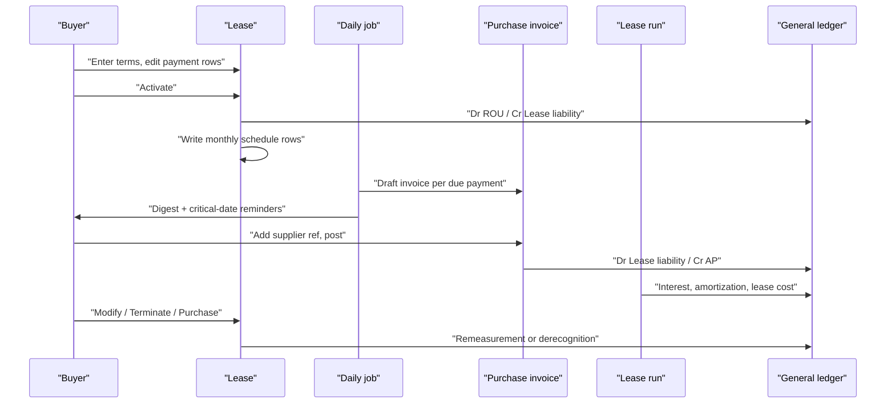

# Lessee Leases (ASC 842) in Purchasing, and the Lease Run

> Status: in-progress (plan `.ai/plans/2026-10-11-lessee-leases.md`; all questions resolved)
> Author: Claude (with Brad Barbin)
> Date: 2026-10-11
> Tracking issue: crbnos/carbon#1056 (leases)
> Research: `.ai/research/2026-10-11-lessee-lease-accounting.md`
> Run log: `.ai/runs/2026-10-11-lessee-leases.md`
> Related specs: `.ai/specs/implemented/2026-09-22-revenue-recognition-rentals-and-contracts.md` (the lessor side; this spec mirrors its rental agreement, its billing job and its period run), `.ai/specs/2026-07-04-lease-accounting.md` (the older unbuilt lessee design; this spec supersedes its lessee slice), `.ai/specs/implemented/2026-10-08-accounting-cutover.md` (Provisional journals and opening open items)

## TLDR

Carbon can rent equipment OUT (rental agreements, sales module) but cannot account for equipment, vehicles or buildings it rents IN. This spec adds a **lease** document to purchasing for the lessee side of ASC 842. A lease names a supplier, a term, payment terms that generate editable payment rows, and a discount rate. At activation Carbon classifies the lease (Operating, Finance or Short-Term), books the right-of-use (ROU) asset and the lease liability, and writes a monthly effective-interest schedule. A daily job drafts a purchase invoice for each due payment, with a new **Lease** line type that debits the lease liability. A new **lease run** posts the monthly interest, ROU amortization and operating lease cost. The lease run is the existing period-run engine with a `type` column, so it also takes over every rental-agreement row (operating rent deferral and accrual, sales-type interest) from the revenue recognition run. Revenue recognition keeps service-dated invoice lines and contracts. v1 includes Modify (remeasurement), early termination, purchase option exercise into a fixed asset, opening balances at the accounting cutover, a Lease Liabilities disclosure report, a drafted-invoice digest and critical-date reminders.

## Overview diagram



## Problem Statement

1. **Leased assets are off the books.** ASC 842 puts every lease longer than 12 months on the balance sheet as an ROU asset and a lease liability. Carbon has no lessee tables, no lessee accounts in `accountDefault`, and no posting path. A manufacturer with a leased plant, forklifts or vehicles keeps the schedule in a spreadsheet and keys journals by hand.
2. **Rent invoices post to the wrong place.** Today AP keys a rent invoice as a G/L Account line to an expense account. For a capitalized lease the payment must reduce the liability instead, and the expense must come from the schedule.
3. **No recurring purchase invoices exist.** The sales side drafts rental invoices daily (`create-rental-invoices`). Purchasing has no equivalent, so every rent bill is keyed from scratch.
4. **The period run mixes two standards.** Rental (lessor, ASC 842) rows post in the *revenue recognition* run beside ASC 606 service and contract rows. Accountants close leases and revenue separately, and every ERP the research surveyed posts lease entries in a lease-specific run.
5. **No disclosure data.** ASC 842-20-50 asks for a maturity analysis, weighted-average remaining term and discount rate, and lease cost by type. Nothing in Carbon computes them for leases Carbon pays.

## Research Basis

`.ai/research/2026-10-11-lessee-lease-accounting.md`. The findings that shape this spec:

| Finding | Source | Effect here |
|---|---|---|
| The lease is a subledger document with dated payment rows | SAP, D365, NetSuite, Sage Intacct | `lease` + `leasePayment` rows |
| A periodic batch run posts interest and amortization; the invoice never does | all ERPs surveyed | lease run |
| The AP invoice debits the lease liability; integrated ERPs draft it from the schedule | D365 ("Pay to vendor"), Sage Intacct | daily job + `Lease` invoice line type |
| Automatic five-test classification with override | D365, Infor | reuse `classifyLessorLease` math |
| ROU in the lease subledger; a fixed asset only when owned | Sage Intacct, D365 default | ROU accounts in `accountDefault`; purchase option creates a `fixedAsset` |
| Critical-date alerts and a disclosure report are table stakes | Visual Lease, FinQuery, Sage Intacct | reminders + Lease Liabilities report |

## Proposed Solution

### 1. The lease document (purchasing)

A `lease` belongs to one supplier and covers one leased asset or one group of assets with one payment stream. Its readable id comes from the sequence `lease` (prefix `LSE`). The nav entry is **Purchasing → Manage → Leases**. The page uses the rental agreement shell: a header with status and actions, an explorer, the center outlet, and a properties panel that is editable while Draft and read-only after.

| Group | Fields |
|---|---|
| Party | `supplierId`, `supplierLocationId`, `supplierContactId`, `assignee` (owner for notifications) |
| What | `name` (for example "Forklift FL-12" or "Plant 2 building"), `description`, `locationId` (where the asset is used) |
| Term | `commencementDate`, `endDate` (last day of the lease term; the user includes renewals that are reasonably certain), `noticeDate` (last day to give renewal or termination notice, optional) |
| Payment terms | `paymentAmount`, `paymentFrequency` (Monthly / Quarterly / Annual), `paymentTiming` (Advance / Arrears), `annualEscalationPercent` |
| Measurement | `discountRate` (annual %, prefilled from `companySettings.leaseIncrementalBorrowingRate`), `currencyCode` (base currency only in v1) |
| Classification inputs | `fairValue`, `economicLifeMonths`, `ownershipTransfers`, `specializedAsset`, `purchaseOptionAmount`, `purchaseOptionReasonablyCertain` |
| Set at activation | `lesseeClassification`, `classificationInputs` (JSON), `initialLiability`, `initialRouAsset`, `commencementJournalId`, `activatedAt` |
| Override | `classificationOverride`, `classificationOverrideReason` (Draft only, needs `update: accounting`) |
| End | `closedAt`, `closedReason` via `status` |

**Status:** `Draft` → `Active` → `Expired` | `Terminated` | `Purchased`; `Draft` or an untouched `Active` lease → `Cancelled`.

**Payment rows.** The payment terms generate `leasePayment` rows from `commencementDate` to `endDate`: one row per period, with `periodStart`, `periodEnd`, `dueDate` (period start for Advance, period end for Arrears) and `amount`. The escalation applies on each anniversary of `commencementDate`. A reasonably certain purchase option adds one row on `endDate` with `paymentType = 'Purchase Option'`. While the lease is Draft the user can change a row's amount, add a row or delete a row (a rent holiday, an irregular step). A change to the terms regenerates the rows and warns that edits are lost. The PV, the schedule and the invoice job read the rows, never the terms. This is the rental pattern: terms cut persisted billing periods, and the job and the accounting read the periods.

### 2. Classification

Activation runs the five ASC 842-10-25-2 tests with the existing company thresholds (`leaseMajorPartThresholdPercent` 75, `leaseSubstantiallyAllThresholdPercent` 90). The math is the lessor's: `presentValue` and the tests of `classifyLessorLease` in `packages/utils/src/lessor-lease.ts`, moved into a shared `lease-math.ts` and called by both sides.

| Result | When |
|---|---|
| `Short-Term` | The term is 12 months or less, no purchase option is reasonably certain, and `companySettings.leaseShortTermExpedient` is on (default on) |
| `Finance` | Any test is true: ownership transfers; purchase option reasonably certain; term ≥ 75% of `economicLifeMonths`; PV of payments ≥ 90% of `fairValue`; specialized asset |
| `Operating` | Otherwise. A test with a missing input (no fair value, no economic life) counts as false and the preview says so |

The Draft page shows the preview: each test, its inputs, the PV and the result. The override route (`update: accounting`, Draft only, reason required) mirrors `$lineId.classification.tsx`.

### 3. Measurement and the monthly schedule

At activation (not Short-Term):

- **Lease liability** = PV of every `leasePayment` row, each discounted from its due month at `discountRate / 12`. An Advance payment due in the commencement month is not discounted.
- **ROU asset** = the lease liability. Initial direct costs and incentives are out of v1 (see Out of scope).
- **Schedule** = one `leaseScheduleLine` per calendar month of the term, built by a new pure `buildLesseeSchedule` in `lease-math.ts`:

| Column | Meaning |
|---|---|
| `periodDate` | month end |
| `openingLiability`, `paymentAmount`, `interestAmount`, `principalAmount`, `closingLiability` | effective interest. The payments due in the month land first for Advance, last for Arrears. The last month absorbs the rounding so `closingLiability` is exactly 0. A reasonably certain purchase option is a payment row in the last month, so it is in the liability |
| `leaseCost` | Operating: (total payments) ÷ months, straight line, the last month absorbing rounding. Finance: interest + amortization |
| `rouAmortization` | Finance: ROU ÷ months (÷ `economicLifeMonths` when ownership transfers or the purchase option is reasonably certain). Operating: `leaseCost − interestAmount` |
| `closingRouAsset` | net ROU after the month |
| `journalId`, `postedAt` | stamped by the lease run |

Each schedule line spawns two Planned rows in `revenueRecognitionSchedule` (the shared "what to post when" table), each with its own accounts captured at activation:

| Row `type` | Operating | Finance |
|---|---|---|
| `Interest` | Dr Operating lease expense / Cr Lease liability (`interestAmount`) | Dr Lease interest expense / Cr Lease liability |
| `Amortization` (new enum value) | Dr Operating lease expense / Cr Accumulated ROU amortization (`rouAmortization`) | Dr ROU amortization expense / Cr Accumulated ROU amortization |

So an operating lease posts one lease cost per month (interest + plug), and a finance lease posts interest and amortization separately. A negative plug swaps sides, as `buildRecognitionJournals` already does.

**Worked example (acceptance baseline).** 36 months, $10,000 a month in Arrears, 6% → liability = ROU = $328,710.16. Month 1: interest $1,643.55, principal $8,356.45, closing $320,353.71. Operating: lease cost $10,000.00 = interest $1,643.55 + amortization $8,356.45. Finance: interest $1,643.55 + amortization $9,130.84.

### 4. Journals

| Event | Entry | Source |
|---|---|---|
| Activation (Operating / Finance) | Dr ROU asset / Cr Lease liability | `'Lease'`, server function `post-lease` |
| Lease invoice, fixed payment | Dr Lease liability / Cr AP | `post-purchase-invoice`, Lease line with a `leasePaymentId` |
| Lease invoice, Short-Term lease | Dr Operating lease expense / Cr AP | same line, no schedule |
| Lease invoice, variable charge | Dr Variable lease expense / Cr AP | Lease line without a `leasePaymentId` |
| Month end | the two rows above | lease run, `'Lease Run'` (new source type) |
| Modify | Dr ROU / Cr Lease liability for an increase; the reverse for a decrease; a decrease beyond net ROU goes to gain | `post-lease` modify |
| Early termination | Dr Lease liability (carrying − penalty), Dr Accumulated ROU amortization, Cr ROU asset, gain or loss to `assetGainOnDisposalAccount` / `assetLossOnDisposalAccount`. The penalty stays in the liability as a final payment row that the next invoice settles | `post-lease` terminate |
| Purchase option | Dr fixed asset class asset account (net ROU + price − carrying liability), Dr Accumulated ROU amortization, Cr ROU asset, Dr Lease liability (carrying), Cr Lease liability (price). The price is a payment row the next invoice settles. A new `fixedAsset` takes the cost and depreciates from the exercise date | `post-lease` purchase |

Every journal is Provisional before the accounting cutover and Posted after it (`journalPostingStatus`), and its lines carry `documentType 'Lease'` (new `journalLineDocumentType` value), `documentId` = lease id, and the Supplier and Location dimensions. `getJournalEntryRelatedItems` gains a `Lease` branch so the journal links back to the lease.

### 5. Lease payments through AP

- **New line type.** `payableLineType` gains `'Lease'`. `purchaseInvoiceLine` gains `leaseId` and `leasePaymentId`. A Lease line needs an Active (or ended, for the final row) lease of the invoice's supplier. A line with `leasePaymentId` has its amount locked to the row. A line without it is a variable charge (maintenance, common area costs, usage). A Lease line never carries a `projectId`: it debits the lease liability, so it is never a project cost. The posting branch lives in `posting-lines.ts` beside `glAccount` and is pinned by unit tests.
- **Daily drafting.** New server function `create-lease-invoices` (mirror of `create-rental-invoices`, permissions `update: purchasing` + `create: invoicing`) runs from the existing `recurring-billing` Inngest cron. For each Active lease it groups the `Pending` payment rows with `dueDate <= today` into one Draft purchase invoice per lease and due date, with one Lease line per row, and stamps each row `Invoiced` with its `purchaseInvoiceLineId`. The invoice takes the supplier's payment term, currency and the lease's location. The buyer adds the supplier's invoice number and posts it.
- **Invoice now.** The lease header has **Invoice now** for due rows (mirror of `generateRentalInvoicesNow`).
- **Delete and void release the rows.** Deleting a Draft invoice or line puts its rows back to `Pending` (`deletePurchaseInvoiceReleasingLeases`, mirror of `deleteSalesInvoiceReleasingRentals`). VOID of a posted invoice does the same and stamps `voidedPurchaseInvoiceId`. The MCP tools for a plain purchase invoice delete are blocked, as on the sales side.
- **Notifications.** The job adds its drafted invoices to the existing "Recurring invoicing" digest (`buildRecurringInvoicingDigests`, `NotificationEvent.RecurringInvoicing`): the lease `assignee` (else its creator) gets one digest over their leases, and `companySettings.invoiceNotificationGroup` ("Also notify") gets one over all of them. A new outcome `drafted` reads "N drafted, need a supplier reference".

### 6. The lease run (shared engine, `type` column)

The revenue recognition run engine becomes two runs that the user sees as separate documents:

| | Revenue recognition run | Lease run |
|---|---|---|
| Rows it claims | rows with neither `rentalAgreementLineId` nor `leaseId` (service-dated invoice lines, contracts) | rows with `rentalAgreementLineId` or `leaseId` |
| Synthesizers | `synthesizeContractRevenue` | `synthesizeRentalAccruals` (moved) |
| Sequence | `RR` | `LR` (new sequence `leaseRun`) |
| Journal `sourceType` | `Revenue Recognition` | `Lease Run` (new `journalEntrySourceType` value) |
| List | Accounting → Closing → Revenue Recognition | Accounting → Closing (lease runs) |
| Close task | "Recognize revenue for the period" (`unposted-revenue-schedules`) | "Post lease journals" (`unposted-lease-schedules`, new) |

- `revenueRecognitionRun` gains `type` (`runType` enum: `Revenue Recognition` | `Lease`, NOT NULL, default `Revenue Recognition` for existing rows). One Draft per period per type.
- `propose-`, `preview-` and `recalculate-revenue-recognition-run` take `type` and route rows with one shared predicate (`runTypeFilter`). `postRevenueRecognitionRun`, `reverseRevenueRecognitionRun` and `deleteRevenueRecognitionRun` read the run's type. Post stamps `leaseScheduleLine` as it already stamps `rentalLeaseScheduleLine`; Reverse clears both stamps.
- `buildRecognitionJournals` takes the source type and description per run type; `recognitionSource` maps a `leaseId` row to `documentType 'Lease'` with Supplier and Location dimensions.
- The monthly proposal job (`revenue-recognition-proposal`) proposes both types.
- The period close wizard (`periods.$periodId.close.tsx`) shows a run preview for each type, and each close task fails while its preview has rows or its Draft run is unposted.
- `getDeferredRevenueWaterfall` excludes `leaseId` rows (lessee rows are not revenue). Rental deferrals stay in it, since they are deferred rental income.
- **Migration of in-flight rental rows.** Posted revenue runs keep their rental rows (history is immutable; Reverse Run still works, and the reversed rows then route to lease runs). A Draft revenue run that holds rental rows releases them; a Draft run left empty is deleted. Planned rental rows need no change: the predicate routes them.
- **Why `Lease Run` and not `Lease`.** Rental commencement and residual-return journals already post as `'Lease'`, and they are not run journals. A run journal must refuse a plain reversal (`RUN_JOURNAL_SOURCES`), must resolve to its run in the journal's related documents, and has its own switch in the external sync policy. A separate source type keeps those three rules exact. `POSTING_POLICY` gains `'Lease Run'` (`defaultEnabled: false`), and a data migration copies each integration's `Revenue Recognition` setting to `Lease Run`, so rental accruals keep syncing as before.
- **Every Draft check filters on the type.** The unique index `revenueRecognitionRun_one_draft_per_period` moves to `("companyId", "type", "periodEnd")`. The Draft lookups in the new-run route, the repeat route, the close page, the monthly job, the proposal and Reverse Run all add the type.
- **Post checks only its own family.** The "out of date" check in `postRevenueRecognitionRun` counts only unclaimed rows of the run's type. The unsynthesized-contract check runs only for revenue runs.
- **Reverse Run releases the other family.** When a Posted revenue run that holds rental rows is reversed, the reversal releases those rows from the Draft it re-opens, so the next lease run claims them.
- Rental messages that say "revenue recognition run" (`post-rental-agreement/validators.ts`, `return-unit.ts`, `post-memo/index.ts`) say "lease run".
- Table names stay `revenueRecognition*` (decision Q2). The rentals spec's N16 rename stays deferred.

### 7. Modify, terminate, purchase, expire

All four are actions of `post-lease` (permissions `update: purchasing`; the journal parts need the accounting defaults). Each writes one `leaseEvent` row (`eventType`, `effectiveDate`, liability and ROU before and after, gain or loss, `journalId`, `fixedAssetId`, `notes`) — the audit trail of the lease.

| Action | Rules |
|---|---|
| **Modify** | Effective date = the first day of a month after the last month a lease run posted. The user edits the remaining payment rows (or regenerates them from new terms), the end date and the rate (prefilled with the current rate; ASC 842 uses a revised rate). Carbon re-PVs the remaining rows, re-runs the classification, posts the ROU / liability adjustment, deletes the unposted schedule lines and their Planned rows, and writes new ones from the effective month. Operating lease cost after the change = (remaining payments + net ROU − new liability) ÷ remaining months. Refused while a Draft lease run holds a row of the lease from the effective month; the error names the run |
| **Terminate** | Termination date = a month end after the last posted month. Optional penalty. Rows after the date are deleted (schedule and Pending payments). Invoiced rows stay |
| **Purchase** | Only when the lease has a purchase option. Needs a fixed asset class and an exercise date (a month end after the last posted month, on or before `endDate`). Carbon deletes the Pending payment rows after the date, the Purchase Option row and the unposted schedule lines after the date. Then it adds one Purchase Option row for the price and posts the entry in section 4, with the carrying liability at the date. Creates the `fixedAsset` (status Active, `acquisitionDate` = exercise date, `acquisitionCost` = net ROU + price − carrying liability, depreciation from the class) |
| **Expire** | When the last schedule line is posted and every payment row is Invoiced, the daily job sets `Expired`. No journal: the liability and the net ROU are both 0 |
| **Cancel** | Draft, or Active with no posted invoice and no Posted schedule row. Voids the commencement journal with a negated `VOID` entry (pattern: `post-charge/post-charge-void.ts`) and deletes the rows |

### 8. Short-term leases

A Short-Term lease has payment rows and a daily job like any lease, but no commencement journal, no schedule and no run rows. Its Lease lines debit the operating lease expense account. Straight-lining a short-term lease with an escalation inside 12 months is out of v1; the expense follows the invoices.

### 9. Opening balances at the accounting cutover

A lease activated before the company enables accounting posts Provisional journals, exactly as a sales-type rental does today. At the enable, the cutover open items read the lease rows (pattern: `getLeaseNetInvestmentItems` in `packages/database/src/accounting-cutover/open-items.ts`):

| Open item type (new) | Basis | Amount | Account |
|---|---|---|---|
| `Lease Liability` | credit | `closingLiability` of the last schedule line before the cutover, else `initialLiability`, per lease | `leaseLiabilityAccount` |
| `Right-of-Use Asset` | debit | `initialRouAsset` (± Modify adjustments), per lease | `rightOfUseAssetAccount` |
| `Accumulated ROU Amortization` | credit | Σ `rouAmortization` of schedule lines before the cutover | `accumulatedRightOfUseAmortizationAccount` |

Schedule rows dated before the cutover need no new code: the enable's step 5 (`activate-accounting/index.ts`) already sets every Planned `revenueRecognitionSchedule` row before the cutover to Posted with no journal, so no run posts them. The lease's own rule for "posted" reads those rows' status, not `leaseScheduleLine.postedAt`.

A lease entered AFTER the enable whose commencement is before the cutover date (Q8): activation posts one opening journal dated the as-of date — the later of the cutover date and the first day of the earliest open period — Dr ROU asset / Cr Accumulated ROU amortization / Cr Lease liability, with the difference to `retainedEarningsAccount`. Schedule rows before the as-of date are inserted Posted with no journal. The lease field `invoiceFromDate` (default `commencementDate`) stops the daily job from drafting invoices for payments made before Carbon: rows due before it are created with status `Skipped` ("Paid outside Carbon").

### 10. Critical-date reminders

A new `NotificationEvent.LeaseCriticalDate`. The daily job notifies the lease `assignee` (else its creator) and the "Also notify" group when one of these dates is `companySettings.leaseReminderDays` (default 90) days away: `noticeDate`, `endDate`, and the purchase option date (`endDate`). Each reminder is sent once per (lease, date kind, date): the lease stores `noticeRemindedFor`, `endRemindedFor` (the date it reminded about). A Modify that moves the date makes the reminder due again.

### 11. Lease Liabilities report (disclosures)

Route `x+/reports+/lease-liabilities.tsx` (`view: accounting` and `view: purchasing`, since the lease tables' RLS is `purchasing_view`), a card on the accounting reports hub, built like `lease-net-investment.tsx` with CSV export. As of a date, from the lease rows:

- Per leased asset: classification, supplier, remaining months, rate, liability, current portion (the principal of the next 12 schedule lines; all of it when the asset ends within them, by its own Termination or Purchase date), non-current portion, net ROU.
- The figures are the schedule's. When a lessee month due by the as-of date is not posted yet, the report says how far the lease run is posted.
- Maturity analysis: undiscounted remaining payments for each of the next 5 fiscal years and thereafter, less imputed interest, equal to the total liability. Operating and Finance shown apart.
- Weighted-average remaining lease term (weighted by liability) and weighted-average discount rate (weighted by remaining payments), Operating and Finance apart.
- For a date range: operating lease cost, finance lease amortization and interest, short-term lease cost, variable lease cost (from posted Lease lines without a payment row), and cash paid for amounts in the liability.

### Design Decisions

| # | Decision | Choice | Rationale |
|---|---|---|---|
| D1 | Where the lease lives | A `lease` document in purchasing; nav Purchasing → Manage → Leases | User decision. Mirror of the rental agreement in sales; the counterparty is a supplier and the payments run through AP |
| D2 | Period posting | A separate **lease run** to the user, on the shared run engine with a `type` column; rental rows move to it | User decision (Q1, Q2). Every ERP surveyed posts lease entries in a lease-specific run; sharing the engine avoids a second copy of propose / preview / post / reverse |
| D3 | AP flow | A daily job drafts purchase invoices from Pending payment rows with a `Lease` line type that debits the liability | User decision (Q3). D365 and Sage Intacct pattern; mirrors `create-rental-invoices`; no clearing balance to reconcile |
| D4 | Payment structure | Terms generate persisted, editable `leasePayment` rows | User decision (Q4). Same as rental billing periods; handles escalations, rent holidays and irregular steps |
| D5 | ROU asset | Lease subledger + `accountDefault` accounts; a `fixedAsset` only on purchase | The operating-lease plug fits no depreciation method; Sage Intacct and D365 default |
| D6 | GL mapping | New `accountDefault` columns, seeded per company group | Lessor precedent (`20261006220201`); not the older spec's `leaseClass`. One set of accounts; the report splits Operating and Finance |
| D7 | Standard | ASC 842 only, base currency only | Rental precedent refuses a foreign currency; IFRS 16 needs the multi-book work that does not exist |
| D8 | Classification math | Share the lessor's `presentValue` and the five tests through `lease-math.ts` | One implementation of the standard's tests; the same thresholds |
| D9 | Discount rate default | New `companySettings.leaseIncrementalBorrowingRate` (default 6) | A lessee discounts at its IBR; the lessor's `leaseDefaultDiscountRate` is a rate implicit in the lease, a different number |
| D10 | Schedule granularity | One schedule line per calendar month, payments placed in their due month | The run posts by month; quarterly and annual payments then need no special case |
| D11 | Lifecycle in v1 | Modify, Terminate, Purchase, cutover open items | User decision (Q5) |
| D12 | Notifications | Reuse the Recurring invoicing digest; add critical-date reminders | User decision (Q6); the owner + "Also notify" rule already exists |
| D13 | Permissions | Lease tables `purchasing_*`; override needs `update: accounting`; runs `accounting_*` | Rental tables use `sales_*`; classification override and runs are accounting acts |
| D14 | Gain / loss account | Reuse `assetGainOnDisposalAccount` / `assetLossOnDisposalAccount` | Termination and disposal are both derecognition; no new default to configure |
| D15 | Multi-tenancy, service shape, forms, layout | `companyId` + composite PK + `id('prefix')` on every table; services `(client, …) → {data, error}` in `purchasing.service.ts`; Kysely in `purchasing.server.ts`; `ValidatedForm` + zod in `purchasing.models.ts`; UI in `purchasing/ui/Leases/` | House rules; heuristics 1–6 |
| D16 | Backward compatibility | Additive except the run routing. Revenue recognition runs stop taking rental rows | Approved by the user (Q1); posted history is unchanged |

## Data Model Changes

Migrations: one for enum values (enum adds go in their own migration), one for tables and seeds, one for the generated RLS.

```sql
-- 1) Enums
ALTER TYPE "payableLineType" ADD VALUE IF NOT EXISTS 'Lease';
ALTER TYPE "journalLineDocumentType" ADD VALUE IF NOT EXISTS 'Lease';
ALTER TYPE "revenueScheduleType" ADD VALUE IF NOT EXISTS 'Amortization';
ALTER TYPE "journalEntrySourceType" ADD VALUE IF NOT EXISTS 'Lease Run';
CREATE TYPE "leaseStatus" AS ENUM ('Draft', 'Active', 'Expired', 'Terminated', 'Purchased', 'Cancelled');
CREATE TYPE "lesseeClassification" AS ENUM ('Operating', 'Finance', 'Short-Term');
CREATE TYPE "leasePaymentFrequency" AS ENUM ('Monthly', 'Quarterly', 'Annual');
CREATE TYPE "leasePaymentStatus" AS ENUM ('Pending', 'Invoiced', 'Skipped');
CREATE TYPE "leasePaymentType" AS ENUM ('Rent', 'Purchase Option', 'Termination Penalty');
CREATE TYPE "leaseEventType" AS ENUM ('Modification', 'Termination', 'Purchase');
CREATE TYPE "runType" AS ENUM ('Revenue Recognition', 'Lease');
-- paymentTiming reuses "rentalBillingTiming" (Advance / Arrears).

-- 2) Settings and account defaults
ALTER TABLE "companySettings"
  ADD COLUMN "leaseIncrementalBorrowingRate" NUMERIC NOT NULL DEFAULT 6,
  ADD COLUMN "leaseShortTermExpedient" BOOLEAN NOT NULL DEFAULT TRUE,
  ADD COLUMN "leaseReminderDays" INTEGER NOT NULL DEFAULT 90;
ALTER TABLE "accountDefault"
  ADD COLUMN "rightOfUseAssetAccount" TEXT,                     -- 1450 Right-of-Use Assets
  ADD COLUMN "accumulatedRightOfUseAmortizationAccount" TEXT,   -- 1460 Accumulated Amortization – ROU
  ADD COLUMN "leaseLiabilityAccount" TEXT,                      -- 2440 Lease Liabilities
  ADD COLUMN "operatingLeaseExpenseAccount" TEXT,               -- 6140 Operating Lease Expense
  ADD COLUMN "variableLeaseExpenseAccount" TEXT,                -- 6130 Variable Lease Expense
  ADD COLUMN "rightOfUseAmortizationExpenseAccount" TEXT,       -- 6330 Amortization – ROU Assets
  ADD COLUMN "leaseInterestExpenseAccount" TEXT;                -- 7020 Interest Expense – Leases
-- FKs to "account" ON DELETE RESTRICT; accounts inserted per company group and
-- backfilled by number then name, as 20261006220201 lines 5-121 do.

-- 3) lease
CREATE TABLE "lease" (
  "id" TEXT NOT NULL DEFAULT id('lse'),
  "companyId" TEXT NOT NULL,
  "leaseId" TEXT NOT NULL,
  "status" "leaseStatus" NOT NULL DEFAULT 'Draft',
  "name" TEXT NOT NULL,
  "description" TEXT,
  "supplierId" TEXT NOT NULL,
  "supplierLocationId" TEXT,
  "supplierContactId" TEXT,
  "locationId" TEXT,
  "assignee" TEXT REFERENCES "user"("id"),
  "commencementDate" DATE NOT NULL,
  "endDate" DATE NOT NULL,
  "noticeDate" DATE,
  "paymentAmount" NUMERIC NOT NULL,
  "paymentFrequency" "leasePaymentFrequency" NOT NULL DEFAULT 'Monthly',
  "paymentTiming" "rentalBillingTiming" NOT NULL DEFAULT 'Advance',
  "annualEscalationPercent" NUMERIC NOT NULL DEFAULT 0,
  "discountRate" NUMERIC NOT NULL,
  "currencyCode" TEXT NOT NULL,
  "invoiceFromDate" DATE NOT NULL,                       -- payments due earlier are Skipped
  "rouAssetCost" NUMERIC,                                -- initial ROU + every Modify adjustment
  "fairValue" NUMERIC,
  "economicLifeMonths" INTEGER,
  "ownershipTransfers" BOOLEAN NOT NULL DEFAULT FALSE,
  "specializedAsset" BOOLEAN NOT NULL DEFAULT FALSE,
  "purchaseOptionAmount" NUMERIC,
  "purchaseOptionReasonablyCertain" BOOLEAN NOT NULL DEFAULT FALSE,
  "lesseeClassification" "lesseeClassification",
  "classificationInputs" JSONB,
  "classificationOverride" "lesseeClassification",
  "classificationOverrideReason" TEXT,
  "initialLiability" NUMERIC,
  "initialRouAsset" NUMERIC,
  "commencementJournalId" TEXT REFERENCES "journal"("id") ON DELETE SET NULL,
  "fixedAssetId" TEXT,                                   -- set by Purchase
  "noticeRemindedFor" DATE,
  "endRemindedFor" DATE,
  "activatedAt" TIMESTAMP WITH TIME ZONE,
  "closedAt" TIMESTAMP WITH TIME ZONE,
  "createdBy" TEXT NOT NULL REFERENCES "user"("id"),
  "createdAt" TIMESTAMP WITH TIME ZONE NOT NULL DEFAULT NOW(),
  "updatedBy" TEXT REFERENCES "user"("id"),
  "updatedAt" TIMESTAMP WITH TIME ZONE,
  "customFields" JSONB,
  CONSTRAINT "lease_pkey" PRIMARY KEY ("id", "companyId"),
  CONSTRAINT "lease_leaseId_key" UNIQUE ("leaseId", "companyId"),
  CONSTRAINT "lease_supplier_fkey" FOREIGN KEY ("supplierId", "companyId") REFERENCES "supplier"("id", "companyId"),
  CONSTRAINT "lease_dates_check" CHECK ("endDate" >= "commencementDate"),
  CONSTRAINT "lease_override_reason_check" CHECK ("classificationOverride" IS NULL OR "classificationOverrideReason" IS NOT NULL),
  CONSTRAINT "lease_companyId_fkey" FOREIGN KEY ("companyId") REFERENCES "company"("id") ON DELETE CASCADE ON UPDATE CASCADE
);

-- 4) leasePayment — editable while Draft; read by PV, schedule and the invoice job
CREATE TABLE "leasePayment" (
  "id" TEXT NOT NULL DEFAULT id('lpay'),
  "companyId" TEXT NOT NULL,
  "leaseId" TEXT NOT NULL,
  "paymentType" "leasePaymentType" NOT NULL DEFAULT 'Rent',
  "periodStart" DATE NOT NULL,
  "periodEnd" DATE NOT NULL,
  "dueDate" DATE NOT NULL,
  "amount" NUMERIC NOT NULL CHECK ("amount" >= 0),
  "status" "leasePaymentStatus" NOT NULL DEFAULT 'Pending',
  "purchaseInvoiceLineId" TEXT,
  "voidedPurchaseInvoiceId" TEXT,
  -- audit columns, composite PK, FK (leaseId, companyId) ON DELETE CASCADE
  CONSTRAINT "leasePayment_pkey" PRIMARY KEY ("id", "companyId")
);

-- 5) leaseScheduleLine — one per month (section 3)
CREATE TABLE "leaseScheduleLine" (
  "id" TEXT NOT NULL DEFAULT id('lssl'),
  "companyId" TEXT NOT NULL,
  "leaseId" TEXT NOT NULL,
  "periodDate" DATE NOT NULL,
  "openingLiability" NUMERIC NOT NULL,
  "paymentAmount" NUMERIC NOT NULL,
  "interestAmount" NUMERIC NOT NULL,
  "principalAmount" NUMERIC NOT NULL,
  "closingLiability" NUMERIC NOT NULL,
  "leaseCost" NUMERIC NOT NULL,
  "rouAmortization" NUMERIC NOT NULL,
  "closingRouAsset" NUMERIC NOT NULL,
  "journalId" TEXT REFERENCES "journal"("id") ON DELETE SET NULL,
  "postedAt" TIMESTAMP WITH TIME ZONE,
  -- audit columns, composite PK, FK (leaseId, companyId) ON DELETE CASCADE
  CONSTRAINT "leaseScheduleLine_unique" UNIQUE ("companyId", "leaseId", "periodDate")
);

-- 6) leaseEvent — Modify / Terminate / Purchase audit trail
CREATE TABLE "leaseEvent" (
  "id" TEXT NOT NULL DEFAULT id('lev'),
  "companyId" TEXT NOT NULL,
  "leaseId" TEXT NOT NULL,
  "eventType" "leaseEventType" NOT NULL,
  "effectiveDate" DATE NOT NULL,
  "liabilityBefore" NUMERIC NOT NULL,
  "liabilityAfter" NUMERIC NOT NULL,
  "rouAssetBefore" NUMERIC NOT NULL,
  "rouAssetAfter" NUMERIC NOT NULL,
  "gainLoss" NUMERIC NOT NULL DEFAULT 0,
  "classificationBefore" "lesseeClassification" NOT NULL,
  "classificationAfter" "lesseeClassification" NOT NULL,
  "fixedAssetId" TEXT,
  "journalId" TEXT REFERENCES "journal"("id") ON DELETE SET NULL,
  "notes" TEXT
  -- audit columns, composite PK, FK (leaseId, companyId) ON DELETE CASCADE
);

-- 7) Links
ALTER TABLE "purchaseInvoiceLine" ADD COLUMN "leaseId" TEXT, ADD COLUMN "leasePaymentId" TEXT;
  -- CHECK: invoiceLineType = 'Lease' ⇔ leaseId IS NOT NULL; leasePaymentId ⇒ leaseId
ALTER TABLE "revenueRecognitionSchedule" ADD COLUMN "leaseId" TEXT, ADD COLUMN "leaseScheduleLineId" TEXT;
ALTER TABLE "revenueRecognitionRun" ADD COLUMN "type" "runType" NOT NULL DEFAULT 'Revenue Recognition';
  -- unique Draft per (companyId, periodEnd, type)

-- 8) Seeds: sequences 'lease' (LSE) and 'leaseRun' (LR) per company; the 7 accounts;
--    close task 'Post lease journals' (autoCheckKey 'unposted-lease-schedules');
--    mirrored in seed-data.ts and seed-company.
-- 9) Release rental rows held by Draft revenue recognition runs (section 6).
```

RLS: every new table through `packages/database/src/authz/manifest.ts`: `company("purchasing", { read: "purchasing_view" })` for `lease`, `leasePayment`, `leaseScheduleLine`, `leaseEvent`. The schedule and events are written only by service-role posting paths.

## API / Service Changes

| Layer | Additions |
|---|---|
| `packages/utils/src/lease-math.ts` | `presentValueOfPayments`, `buildLesseeSchedule`, `classifyLesseeLease`, `generateLeasePayments`; the five tests shared with `lessor-lease.ts` |
| `purchasing.models.ts` | `leaseValidator`, `leasePaymentValidator`, `leaseClassificationValidator`, `leaseModifyValidator`, `leaseTerminateValidator`, `leasePurchaseValidator`; option arrays |
| `purchasing.service.ts` (Leases section) | `getLeases`, `getLease`, `insertLease`, `updateLeaseDetails` (name, notes, owner, notice date — any status), `deleteLease`, `getLeasePayments`, `upsertLeasePayment`, `deleteLeasePayment`, `getLeaseSchedule`, `getLeaseEvents`, `getLeaseRelatedDocuments` |
| `purchasing.server.ts` | `updateDraftLease` / `saveDraftLeaseLine` (write and re-cut the rows in one Kysely transaction), `regenerateLeasePayments`, `generateLeaseInvoicesNow`, `draftLeaseSetupPath` |
| `invoicing.server.ts` | `deletePurchaseInvoiceReleasingLeases`, `deletePurchaseInvoiceLineReleasingLeases` |
| server function `post-lease` | `activate`, `modify`, `terminate`, `purchase`, `cancel` |
| server function `create-lease-invoices` | daily drafting, expiry, critical-date reminders |
| `post-purchase-invoice` | Lease line branch; VOID releases payment rows |
| period run engine | `type` on propose / preview / recalculate / post / reverse / delete; `runTypeFilter` |
| `accounting.service.ts` | `getLeaseLiabilities` (report), close evaluator `unposted-lease-schedules` |
| accounting cutover | `getLeaseLiabilityItems`, `getRightOfUseItems` in `open-items.ts`; 3 `OpenItemType` values |
| `settings.service.ts` | lease policy adds IBR, short-term election, reminder days |
| notifications | `LeaseCriticalDate` event; `drafted` outcome in the digest |

## UI Changes

- **Leases list** (`x+/purchasing+/leases.tsx`): id, name, supplier, status, classification, commencement, end, monthly payment, liability, next due.
- **New lease** (`x+/lease+/new.tsx`) and the **lease shell** (`x+/lease+/$id.tsx`): header (status, Activate, Invoice now, Modify, Terminate, Purchase, Cancel), properties panel, and these sections:
  - **Summary**: the terms, the accounting treatment preview (Draft) or the result (Active), liability and net ROU today, next payment.
  - **Payments**: the payment rows, editable while Draft (edit amount, add, delete, regenerate from terms); status and invoice link after.
  - **Schedule**: the monthly lines with posted badges.
  - **Events**: Modify / Terminate / Purchase history with journal links.
  - **Documents**: the lease's purchase invoices and journals.
- **Modify / Terminate / Purchase** open modals that preview the journal before confirming.
- **Purchase invoice**: the line type picker offers Lease (lease picker filtered to the supplier); a payment line shows "Payment 7 of 36 · LSE000004".
- **Accounting → Closing → Leases** list and run page (shared components with revenue recognition, run type as a prop); close wizard shows both previews.
- **Settings → Accounting → Lease policy**: incremental borrowing rate, short-term election, reminder days. **Account defaults**: a Leases (lessee) group with the 7 accounts.
- **Reports → Lease Liabilities**.
- **Docs**: `docs/content/docs/reference/leases.mdx`; glossary terms Lease (lessee), Right-of-Use Asset, Lease Liability, Lease Run; `rental-agreements.mdx` and `accounting.mdx` updated for the lease run.

## Acceptance Criteria

- [ ] Purchasing → Manage → Leases lists leases; New Lease creates a Draft `LSE…` with payment rows generated from the terms.
- [ ] A Draft lease of 36 months at $10,000 Monthly in Arrears from 2027-01-01 has 36 payment rows; changing row 4 to $0 and saving keeps the change; changing the terms regenerates the rows after a warning.
- [ ] Activating that lease (6%, no classification inputs) gives `Operating`, liability = ROU = $328,710.16 (±0.01), a Posted (or Provisional before the cutover) journal Dr ROU / Cr Lease liability, and 36 schedule lines; line 1 = interest 1,643.55, principal 8,356.45, closing 320,353.71; line 36 closes at 0.00.
- [ ] The same lease with fair value $340,000 classifies `Finance` (PV ≥ 90%); its month-1 lease run journal is Dr Lease interest expense 1,643.55 / Cr Lease liability, Dr ROU amortization expense 9,130.84 / Cr Accumulated ROU amortization.
- [ ] As `Operating`, the month-1 lease run journal debits Operating lease expense 10,000.00 in total; over 36 months both classifications expense $360,000.00.
- [ ] A 12-month lease with the election on classifies `Short-Term`, posts nothing at activation, and its invoice debits Operating lease expense.
- [ ] Advance timing and Quarterly frequency produce the annuity-due and quarterly PVs pinned in `lease-math.test.ts`; a 3% escalation raises the payment rows on each anniversary.
- [ ] The daily job drafts one purchase invoice per lease and due date with Lease lines; posting it debits Lease liability 10,000.00 / credits AP; deleting the Draft returns the rows to Pending; VOID of a posted one does the same.
- [ ] The assignee receives a "Recurring invoicing" digest naming the drafted lease invoices; the "Also notify" group receives the company digest.
- [ ] 90 days before `noticeDate` the assignee gets one `LeaseCriticalDate` notification, and not a second one the next day.
- [ ] Proposing a lease run for a month claims every due lessee row AND every due rental-agreement row; the revenue recognition run for the same month claims neither; each posts with its own source type (`Lease Run` / `Revenue Recognition`); Reverse Run clears `leaseScheduleLine` stamps.
- [ ] The close wizard shows "Post lease journals" failing while the month has unposted lease rows, and passing after the lease run posts.
- [ ] A Draft revenue run holding rental rows before the migration holds none after it; a Posted one is unchanged.
- [ ] Modify at month 13 (extend 12 months, new rate 7%) posts one adjustment equal to the liability change, replaces only unposted schedule lines, and the new schedule closes at 0.00. Modify is refused while a Draft lease run holds a row of the lease from month 13, and the message names the run.
- [ ] Terminate at the end of month 24 with a $5,000 penalty derecognizes ROU and liability, posts the gain or loss, and adds a $5,000 Termination Penalty payment row that the next invoice settles.
- [ ] Purchase on a finance lease with a $20,000 reasonably certain option creates an Active fixed asset whose cost = net ROU + price − carrying liability, clears the ROU asset and its accumulated amortization, adds a $20,000 Purchase Option row for the next invoice, and sets the lease `Purchased`.
- [ ] Enabling accounting with an Active lease produces Lease Liability, Right-of-Use Asset and Accumulated ROU Amortization open items that equal the lease rows at the cutover.
- [ ] The Lease Liabilities report reconciles: Σ maturity buckets − imputed interest = Σ liability; weighted-average term and rate match a hand calculation for two leases.
- [ ] `pnpm run generate:types`, scoped typecheck (`erp`, `@carbon/server-functions`, `@carbon/utils`, `@carbon/database`, `@carbon/jobs`), Biome, the unit tests, and `pnpm db:check:datasets` / `db:check:backups` pass.

## Out of scope (v1)

| Item | Why |
|---|---|
| Initial direct costs, incentives, prepaid rent before commencement | Rare in equipment leases; the ROU = liability. Add as ROU adjustments later |
| IFRS 16, low-value exemption | Needs multi-book; ASC 842 only (D7) |
| Foreign-currency leases | Rental precedent; needs liability remeasurement |
| Partial termination (less space), impairment | Rare; Modify covers term and payment changes |
| Posted current / non-current reclass | The report shows the split |
| IBR rate tables, CPI index payments | The excess over the fixed rent goes on the invoice as a variable Lease line |
| Straight-lining short-term leases | The expense follows the invoices |
| Demo dataset leases | The rental side has none either; a follow-up can add both |
| Renaming `revenueRecognition*` tables | User decision (Q2) |

## Risks

| Risk | Severity | Mitigation |
|---|---|---|
| Routing rental rows to the lease run breaks the revenue close for a company mid-period | Med | The migration releases only Draft runs; the close wizard shows both runs; acceptance criterion covers it |
| Modify races a Draft lease run | Med | Refuse while a Draft run holds the lease's future rows (same rule as rental credits) |
| Rounding drift over 60–120 months | Low | Last line absorbs the residual; tests assert exact close |
| A user edits payment rows to nonsense (a gap, an overlap) | Low | `leasePaymentValidator` refuses overlaps and rows outside the term; gaps are allowed (rent holidays) |
| The `revenueRecognition*` names now hold lease rows | Low | Documented in the accounting AGENTS.md; the rename stays an option |
| A purchase invoice for a lease is posted by hand without a Lease line | Low | It posts as before (G/L Account). The lease page shows payment rows still Pending, so the gap is visible |

## Open Questions

> HARD STOP: Do not proceed with implementation until these are answered.

- [x] **Q1 — Monthly posting vehicle.** — **Answer (Brad, 2026-10-11):** a separate lease run, added to the close wizard. Move the rental agreement postings from the revenue recognition run to the lease run. Keep revenue recognition for service lines and contracts.
- [x] **Q2 — How to store the lease run.** — **Answer (Brad):** shared engine with a run `type` column; no table rename.
- [x] **Q3 — Lease payments through AP.** — **Answer (Brad):** draft invoices from the schedule, with notifications.
- [x] **Q4 — Payment structure.** — **Answer (Brad):** like rental agreements — terms generate persisted payment rows, editable while Draft.
- [x] **Q5 — Lifecycle in v1.** — **Answer (Brad):** Modify (remeasure), early termination, purchase option → fixed asset, leases live at the cutover.
- [x] **Q6 — Notifications.** — **Answer (Brad):** the drafted-invoices digest and critical-date reminders.
- [x] **Q7 — How NetSuite does it.** — **Answer (research):** NetSuite makes the ROU a Fixed Assets Management asset (depreciated by the FAM run), posts interest with a separate "Record Lease Interest" process, and asks the user to tick "Finance Lease". It does not document bill creation. Carbon follows the D365 / Sage Intacct pattern for AP and its own run engine for the periodic entries.
- [x] **Q8 (re-opened 2026-10-11) — A lease entered after go-live that started before the cutover.** The accepted answer posted the difference to `migrationClearingAccount`. Planning found that this breaks a rule of the cutover: only the enable's opening journal and the trial balance post there (`assertNoMigrationClearing`, `lib/cutover-void.ts`), so Migration Clearing proves the opening ties out. Also, the lease accounts become control accounts at the enable, so a lease that was in the legacy trial balance MUST be entered before the enable, or the enable refuses. So this case is only a lease that was never booked. Recommended: activation posts one opening journal dated the as-of date — the later of the cutover date and the first day of the earliest open period — Dr ROU asset / Cr Accumulated ROU amortization (to the as-of date) / Cr Lease liability (carrying at the as-of date), and the difference to `retainedEarningsAccount` (a prior-period correction). Schedule rows before the as-of date are inserted Posted with no journal (as the enable's step 5 does). **Answer (Brad, 2026-10-11: "do a little research and if it's not conclusive, do the recommendation"):** the recommendation. Research: ASC 250 corrects an error that predates the periods presented through opening retained earnings. The ERPs do not agree with each other: NetSuite's "mid-life lease" makes the user post their own source journal (Dr ROU / Cr liability) and enter the prior interest periods already recognized; D365 computes opening ROU and liability balances on import. Neither posts to a migration clearing account after go-live. So Carbon posts the difference to `retainedEarningsAccount`.

## Changelog

- 2026-10-11: Created. Q1–Q7 resolved with Brad; Q8 resolved (recommendation accepted), then re-opened during planning. Supersedes the lessee slice of `.ai/specs/2026-07-04-lease-accounting.md`.
- 2026-10-11 (planning): lease runs post as a new source type `Lease Run`; the Draft index, Post and Reverse Run take the run type; Cancel voids inline; added `invoiceFromDate`, `rouAssetCost` and payment status `Skipped`; Q8 re-opened (Migration Clearing conflict).
- 2026-10-11 (overlap with the projects branch): Operating Lease Expense moves from 6120 (taken by Warranty Expense there) to 6140; Lease lines refuse `projectId`; the run synthesizers take the run type in a merge-friendly signature.
- 2026-10-11: Q8 resolved — the difference goes to retained earnings (research: ASC 250; NetSuite mid-life leases; D365 opening balance import).
- 2026-10-12 (review fixes): the report's current portion is the next 12 schedule lines, not a 12-month date window; an asset ends on its own Termination / Purchase date; the report requires purchasing view and warns when the lease run is not posted through the as-of date. Acceptance: a lease run posts as `Lease Run`.

## Addendum (2026-10-11): several assets per lease

The user asked for several assets on one lease. Research: `.ai/research/2026-10-11-lessee-lease-accounting.md` → Addendum. The design copies the rental agreement (header + lines) and follows ASC 842's unit of account: each asset is a separate lease component.

| # | Decision | Per lease (`lease`) | Per asset (`leaseLine`) |
|---|---|---|---|
| A1 | Split | supplier, location, owner, commencement / end / notice / invoice-from dates, payment frequency, timing, annual escalation, discount rate, currency | description, serial number, location (defaults to the lease's), payment amount, fair value, economic life, ownership transfers, specialized asset, purchase option amount and "reasonably certain", status, classification (+ override and reason), initial liability, initial ROU asset, ROU cost, fixed asset (after a purchase) |
| A2 | Term | All assets share the lease's term in v1. A master lease with a later delivery is a second lease. | — |
| A3 | Payment rows, schedule, run rows | Summed for display | One set per asset: `leasePayment.leaseLineId`, `leaseScheduleLine.leaseLineId` |
| A4 | Journals | One commencement (or opening balance) journal per lease, with lines per asset (`documentLineReference` = the asset line) | — |
| A5 | Modify | Acts on the lease: new end date, rate, frequency, escalation, and a payment amount per asset; every active asset is remeasured from the effective date | — |
| A5a | Events | — | One `leaseEvent` per asset (`leaseEvent.leaseLineId` NOT NULL). A Modify writes one event per active asset, all naming the same journal. |
| A6 | Terminate, Purchase | — | Act on one asset. The asset's liability and ROU leave the books (25-13, full decrease for that component); the other assets do not change unless the user also modifies the lease. The lease ends when its last asset ends. |
| A7 | Invoices | One Draft purchase invoice per lease and due date | One Lease line per asset payment row, described with the asset |
| A8 | Lease status | Active while any asset is Active; Expired, Terminated or Purchased after the last asset ends, taking the last asset's end | `leaseLineStatus`: Active, Terminated, Purchased, Expired |

Out of scope: a different commencement date per asset; allocating a lump-sum payment by standalone price (the user enters each asset's payment).

### Duration, open-ended leases, a shorter Details step (2026-10-12)

The user asked for open-ended leases and for the contract's Duration field. Plan: `.ai/plans/2026-10-12-lease-duration-open-ended.md`.

| # | Decision |
|---|---|
| A9 | The Details step asks for a **Duration**, as the AR contract does: 1 to 5 years, Open-ended, or Custom (an End Date). A preset ends the day before the same date N months on. Nothing stores the duration: `leaseDurationOf` reads it back from the dates. |
| A10 | An **open-ended** lease (`endDate` NULL) can be ended on notice, so its term is short (ASC 842-10-30-1) and every asset is Short-Term. Activation posts no journal and writes no schedule. Payment rows roll forward in whole periods through the period after the current one (`openEndedLeaseHorizon`). Setup cuts the first ones; the daily job and Invoice Now cut the next ones before they draft. It has no purchase option row. Modify and Purchase do not apply, and Terminate ends it. It never expires on its own. |
| A10a | If the company's short-term expedient is off, an open-ended lease cannot activate. The refusal names both fixes: turn on the expedient in Settings → Accounting, or give the lease a fixed duration. The Accounting and Review steps and the Activate dialog link both. |
| A11 | The Details step has no Name and no Leased Asset section: the assets are step 2. `lease.name` is optional, and the page shows the lease number and the supplier. Description is Notes under More Details. Location is in the first section. |
