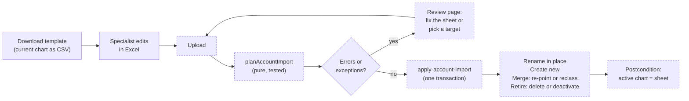

# Chart of Accounts Import

> Status: in-progress
> Author: Brad Barbin (with Claude)
> Date: 2026-10-12

## TLDR

A new company starts on Carbon's default chart of accounts, but the customer keeps books on their own chart. This spec adds **Accounting → Chart of Accounts → Import**. An implementation specialist downloads the current chart as a CSV, edits it in Excel to match the customer's chart, and uploads it. The upload is the whole chart. A row that names a Carbon account renames that account in place, so every default role, document and journal line follows it. A Carbon account that no row names retires automatically. The import deletes it if nothing refers to it. If its references can move, the import moves them to the account that replaces it, then deletes it. If it has posted history, a reclass journal moves its balance and the import deactivates it. A new company now stays Provisional until accounting is activated, so on a new company the import runs before anything is Posted and the result matches the sheet exactly. Two safety changes ship with it: journal lines and document lines refuse an account delete (`ON DELETE RESTRICT`), and an account can be deactivated from the UI.

Research: `.ai/research/chart-of-accounts-remap.md` (Odoo, NetSuite, SAP).

## Overview diagram

## Problem Statement

1. `seed-company` gives every new company group the 113-row default chart (`packages/database/src/seed-data.ts:729-2137`). It points 61 `accountDefault` columns and 5 fixed asset classes at those accounts.
2. The customer arrives with a chart from QuickBooks, Xero or Sage. Its numbers, names and grouping differ. A default account can have no match in it. A customer account can have no default to replace.
3. Today the only tool is one account at a time on the Chart of Accounts page. A specialist must work out by hand which defaults to rename, which to merge, which to add and which to remove. A mistake breaks a default role or loses history.
4. Delete is unsafe. `journalLine_accountId_fkey` is `ON DELETE SET NULL` (`20260315000000_reset-chart-of-accounts.sql:461`). If a Draft or Provisional line refers to the account, the delete succeeds and the line silently loses its account. The order and invoice line foreign keys do the same.
5. Nothing can deactivate an account. `accountValidator` has no `active` field.
6. A new company gets its cutover on the day it is created (`seed-company/index.ts:492-506`). Its first receipt writes a Posted journal on a default account, so any later merge of that account must reclass posted history.

## Proposed Solution

### The sheet is the chart

The template is the current chart, one row per leaf account. An unchanged upload is a no-op.

| Column | On download | On upload |
|---|---|---|
| `Number` | the account number | the customer's number. Required. Unique. |
| `Name` | the account name | the customer's name. Required. Unique. |
| `Class` | the account class | Required on a new row. If empty on a row with a Carbon account, the planner keeps that account's class. |
| `Type` | the account type | Optional. |
| `Group` | the parent group's name | Required. Names an existing group or a new group. |
| `Carbon Account` | the account's own number | Which Carbon account or accounts this row replaces. Empty means a new account. Holds account numbers or role names (`Inventory`, `Accounts Receivable`), separated by `;`. |
| `Used For` | the default roles that point at the account | Ignored. It tells the specialist what the account does. |

The specialist edits the sheet in one of 4 ways. The planner turns each edit into one action. The specialist decides nothing row by row in the UI.

| The specialist… | The planner… |
|---|---|
| changes `Number`, `Name` or `Group` on a row | **renames** the Carbon account in place |
| puts 2 or more Carbon accounts in one row's `Carbon Account` cell | **renames** the first one and **merges** the others into it |
| adds a row with an empty `Carbon Account` | **creates** a new account |
| deletes a row, so no row names a Carbon account | **retires** that account |

### Rules for each action

**Rename.** The account keeps its id, so every reference follows it. Defaults, fixed asset classes, documents, journal lines, provider mappings and posted history all follow. The planner refuses a class change if the account has posted lines (NetSuite does the same).

**Merge** (sources into a target):

1. The apply re-points every reference that is not posted history from each source to the target. The Reference policy table lists them.
2. If a source has posted lines in a company, the apply posts one reclass journal in that company. The journal moves the source's balance to the target. The apply dates it today.
3. The apply then retires each source by the Retire rules.

The target and the sources must have the same class.

**Retire.** The planner looks at each active leaf account that no row names. It sorts the account into one of 2 cases:

| The account has… | The planner… |
|---|---|
| a movable reference (a Draft or Provisional journal line, an open order line, a Draft document, a fixed asset class), **or** a required role in any company, **or** a posted balance in any company | reports the exception **"This account needs a target"**. The specialist picks a row on the review page. The account then becomes a merge source into that row, so its references, roles and balance move together. |
| none of those | clears each role that has a fallback, then retires the account |

A required role is every `ACCOUNT_DEFAULT_COLUMNS` entry with no `DEFAULT_FALLBACKS` entry, because activation readiness demands exactly those.

The apply retires an account in one of 2 ways:

1. If the account has no posted lines and no history reference, the apply deletes it.
2. Else the apply sets `active = false`. Posted lines, Superseded lines and non-Draft documents keep the account.

**Two meanings of "posted".** `hasPostedLines` counts lines on Posted, Reversed and Superseded journals. It blocks a class change and a control-account merge, and it forces a deactivate instead of a delete. The reclass balance counts only `GL_JOURNAL_STATUSES` (Posted and Reversed). Activation replaced the Superseded journals with the opening journal, so a reclass that counted them would move the pre-cutover balance a second time.

**Inactive accounts.** `account_number_key` and `account_name_key` include inactive accounts. So the planner reads the inactive accounts too:

1. A row can name an inactive account in `Carbon Account`. The apply then renames it and sets `active = true`.
2. A row whose `Number` or `Name` equals an inactive account that no row names is an error. The same is true for an account that this import deactivates. The specialist names that account to reactivate it, or picks another number.

**Control accounts.** An account behind a control role has posted history that a subledger ties out to. If it has posted lines, the specialist can rename it but cannot merge or retire it. `CONTROL_ROLES` holds 14 roles: `receivablesAccount`, `payablesAccount`, `rawMaterialsAccount`, `finishedGoodsAccount`, `workInProgressAccount`, `costOfGoodsSoldAccount`, `goodsReceivedNotInvoicedAccount`, `retainedEarningsAccount`, `migrationClearingAccount`, `intercompanyReceivablesAccount`, `intercompanyPayablesAccount`, `bankCashAccount`, `bankLocalCurrencyAccount` and `bankForeignCurrencyAccount`. Before the first Posted journal, the specialist can merge them freely. For example, a customer with one Inventory account merges Raw Materials, Finished Goods and Work in Progress into it.

**Groups.**
- The planner matches the `Group` column to an existing group by name.
- If no group has that name, the apply creates one under the root for the row's class.
- After the apply, it deletes every non-system group that has no children.
- To rename a group, the specialist writes the new name. The apply creates the new group, moves its accounts, and deletes the old one.

**Errors** stop the upload. The review page lists them with their row numbers:

- A duplicate `Number` or `Name`.
- A `Carbon Account` value that matches no account and no role.
- One Carbon account named on 2 rows.
- A class mismatch between a row and its Carbon accounts.
- A new row with no `Class`.
- A class change on an account with posted lines.
- A merge or retire of a control account with posted lines.
- A row that names `migrationClearingAccount` but whose class is not Equity.
- A `Number` or `Name` that an inactive account holds, or that an account this import deactivates holds.

**Exceptions** are what the sheet cannot express. There is one kind: **"This account needs a target"**. The review page shows why (references, a required role, a posted balance) and which companies it touches. The specialist picks a row. The pick becomes a merge into that row.

### Reference policy

When an account is a merge source, every column that refers to it falls into one of 3 policies. `REFERENCE_POLICY` in `packages/database/src/account-import.ts` declares the policy of each column. A live-database test (`packages/server-functions/src/apply-account-import/apply-account-import.test.ts`) compares that list with every foreign key that refers to `account` in the catalog. So a new account column fails the test until someone classifies it.

| Column | Policy |
|---|---|
| `accountDefault.*` (all companies in the group) | re-point |
| `fixedAssetClass.*` | re-point |
| `shippingMethod.carrierAccountId` | re-point |
| `purchaseOrderLine`, `salesOrderLine`, `supplierQuoteLine` `.accountId` | re-point |
| `salesInvoiceLine`, `purchaseInvoiceLine` `.accountId` | re-point if the invoice is Draft |
| `charge.*Account*`, `chargeLine.accountId` | re-point if the charge is Draft |
| `reimbursement.payableAccountId`, `reimbursementLine.accountId` | re-point if the reimbursement is Draft |
| `payment.bankAccount`, `memo.reasonAccount` | re-point if the document is Draft |
| `revenueRecognitionSchedule.debitAccountId` / `creditAccountId` | re-point |
| `journalLine.accountId` | re-point if the journal is Draft or Provisional |
| `intercompanyEliminationLine.accountId` (no FK) | re-point with its journal line |
| `externalIntegrationMapping` (`entityType = 'account'`, no FK) | delete the source's row; the target keeps its own |
| `companyIntegration.metadata.paymentFeeAccount` (no FK) | re-point |
| `accountingPeriodBalance`, `accountingSyncTieOut` | never (history) |
| `journalLine.accountId` on Posted, Reversed or Superseded journals | never (history; the reclass moves the balance) |

The `projects-wbs-research-spec` branch adds 5 more account columns. Whichever branch merges second adds them to `REFERENCE_POLICY`:

| Column | Policy |
|---|---|
| `project.costAccountId`, `projectElement.costAccountId` | re-point |
| `indirectPool.appliedAccountId` | re-point |
| `indirectPoolAccount.accountId` | re-point, then delete the rows that became duplicates (same pool, account, dimension value and role) |
| `indirectExpenseStatement.accountId` | never (history: a period snapshot) |

That branch also adds 4 `accountDefault` columns. `ACCOUNT_DEFAULT_COLUMNS` already fails the build until they are listed.

**Every company of the group.** The chart is group-scoped, so a re-point moves references in every company that uses the account. The review page lists each company that the import touches: its re-pointed references, its role moves and its reclass journals. It marks each company that has a cutover as live.

### New companies stay Provisional until activation

`seed-company` stops setting `accountingCutoverDate`, `accountingActivatedAt` and `accountingActivatedBy`. A new company writes Provisional journals until the specialist runs the activation wizard. The wizard gets a first step, **Chart of accounts**. It links to the import and also has a "Keep Carbon's chart" choice. So the order is: import the chart → readiness → inventory → fixed assets → trial balance → enable. The trial balance CSV matches on account number, so after the import it takes the customer's numbers.

These things change with it:

1. The Implementation Hub stops hiding the Accounting module before cutover (`get-started+/_layout.tsx:239`). It adds 2 steps: "Import your chart of accounts" and "Activate accounting".
2. Demo-template companies keep their cutover, because dataset tier 01 sets it.
3. `seed-company` no longer looks up a subsidiary's defaults by account number (`seed-company/index.ts:394-442`). After an import, those numbers no longer exist. A subsidiary copies the account ids from the `accountDefault` row of a company already in the group.
4. The implemented cutover spec gets a changelog line. Its §7 ("a new company keeps its ledger in Carbon from day one") no longer holds.

### Delete safety

1. A migration changes these foreign keys from `ON DELETE SET NULL` to `ON DELETE RESTRICT`: `journalLine.accountId`, `purchaseOrderLine.accountId`, `salesOrderLine.accountId`, `salesInvoiceLine.accountId`, `purchaseInvoiceLine.accountId` and `supplierQuoteLine.accountId`. `shippingMethod.carrierAccountId` keeps `SET NULL`, because a shipping method only proposes an account.
2. `accountValidator` gets `active`. The edit form shows an Active switch.
3. The delete route's loader checks for references. If the account has any, the modal says "This account has postings. Deactivate it instead." and the button deactivates it.
4. The action maps a `23503` foreign key error to the same message.
5. The Chart of Accounts page hides inactive accounts by default. A "Show inactive" filter shows them.

### Design Decisions

| Decision | Choice | Rationale |
|---|---|---|
| What the import replaces | The whole chart: rows not named retire | The user's call. No surveyed product does this. It is safe only because of the retire rules: delete when unused, deactivate when used, and never a required role or a control account with history. |
| How a row finds its Carbon account | A `Carbon Account` column with account numbers or role names | It plays the role of Odoo's External ID and NetSuite's internal id. A role name lets a specialist write "Accounts Receivable" without knowing Carbon's numbers. |
| Rename or replace a default account | Rename in place | Every reference is by `account.id` (93 foreign keys). Odoo implementers, NetSuite and SAP all rename the delivered accounts. |
| Merge with posted history | Reclass journal, then deactivate | Posted lines are immutable (`check_posted_record_immutable`). NetSuite and Odoo 18 rewrite history. SAP does not. Carbon follows SAP. |
| Control accounts with posted lines | Rename only | NetSuite refuses to merge AR, AP, Inventory, COGS and GRNI. Subledger tie-outs read these accounts. |
| Class change with posted lines | Refused | NetSuite refuses a type change once an account has transactions. |
| Hierarchy | A `Group` column under the existing roots | NetSuite's "Subaccount Of" works this way. Odoo's prefix ranges need a numbering scheme that customer charts do not always follow. The 2 system roots stay. |
| Scope | One import per company group | The chart is group-scoped (`account.companyGroupId`). Odoo, NetSuite and SAP all share one chart across the group. Re-pointing maps account id to account id, so it is the same for every company. |
| New companies | Provisional until activation | The user's call. On a new company the import then runs before the first Posted journal, so a merge never needs a reclass and the result matches the sheet exactly. |
| File format | CSV | The import modal already parses CSV with PapaParse. Excel opens and saves CSV. |
| Draft between visits | None. The sheet is the draft. | The specialist keeps the CSV. A re-upload runs the planner again. This needs no new table for draft state. |
| Audit record | No new table. The reclass journals and the account audit log are the record. | A new table also needs demo data in 4 datasets and a coverage floor. A header row adds little that the journals do not show. |
| CSV transport | The browser reads the file and posts its text as a form field | The trial balance import does the same (`activation.trial-balance.tsx`, intent `import-tb`). No storage upload is necessary. |
| Where the logic lives | A pure planner in `@carbon/database` and a server function for the write | The supersession pattern: a pure function with vitest tests, and a Kysely transaction for the multi-table write (root `AGENTS.md`: never chain Supabase writes). |
| Reference completeness | A live-database test compares `REFERENCE_POLICY` with the catalog | A new account column must declare its policy, or it would be silently skipped. |

## Data Model Changes

1. **Foreign keys.** One migration swaps `ON DELETE SET NULL` for `ON DELETE RESTRICT` on the 6 columns listed under Delete safety. It drops and re-adds each constraint and changes no data.
2. **`seed-company`.** A code change only, with no migration. Existing companies keep their current cutover state.
No new table.

## API / Service Changes

| Piece | Location | What it does |
|---|---|---|
| `parseAccountImportCsv` | `apps/erp/app/modules/accounting/account-import-csv.ts` | Parses and normalizes rows. Returns error codes, as `trial-balance-csv.ts` does. |
| `planAccountImport(rows, chart, references, defaults, resolutions)` | `packages/database/src/account-import.ts` | Pure. Returns `{ renames, creates, merges, retires, groupCreates, groupDeletes, roleMoves, reclasses, errors, exceptions }`. Pinned by `account-import.test.ts`. |
| `REFERENCE_POLICY`, `CONTROL_ROLES` | same file | Declared constants. Both the planner and the apply read them. |
| `loadAccountImportContext(db, companyGroupId)` | `packages/database/src/account-import.ts` | Loads the chart, the defaults of every company in the group, posted balances per account and company, and reference counts per account. It runs one query per table, never one per account. |
| `apply-account-import` | `packages/server-functions/src/apply-account-import/` | Steps listed below. |
| `getAccountImportTemplate` | `accounting.service.ts` | Builds the template CSV from the chart and the defaults. |
| `upsertAccount` / `accountValidator` | existing | Adds `active`. |
| `deleteAccount` route | `charts.delete.$accountId.tsx` | Checks references and offers Deactivate. Maps `23503` to the same message. |
| `seed-company` | existing | Stops setting the cutover. Copies a subsidiary's defaults from a company in the group. |

`apply-account-import` runs these steps in one Kysely transaction:

1. Lock the group's `account` rows `FOR UPDATE`.
2. Load the context. Run the planner again on the server. Refuse if any errors or unresolved exceptions remain.
3. Create the new groups.
4. Rename in 2 passes: first give every renamed account a temporary number and name, then the final ones. A swap such as 4010 ↔ 5010 would otherwise hit `account_number_key`.
5. Create the new accounts.
6. For each merge, re-point by `REFERENCE_POLICY`.
7. Post one reclass journal per company that has a posted balance on a source. Use the manual-journal builder. Date it today and put it in the open period.
8. Move the default roles. Clear the optional roles that have no target.
9. Retire: delete each account with no reference left; set `active = false` on the others.
10. Delete the empty non-system groups.
11. Check the postcondition. If it fails, throw, so the transaction rolls back:
    1. The active leaf accounts equal the sheet's rows by number, name, class and group.
    2. Every required default in every company of the group points at an active leaf account.
    3. `migrationClearingAccount` is Equity.
12. Return the counts per action and the reclass journal ids.

## UI Changes

| Where | Change |
|---|---|
| Chart of Accounts page (`charts.tsx`) | An **Import** button (needs `update: accounting`) and a "Download template" action. Inactive accounts are hidden by default, with a "Show inactive" filter. |
| New route `chart-import.tsx` (`/x/accounting/chart-import`) | A `SetupFrame` page with 2 steps: Upload, then Review. |
| Review step | A summary line ("38 renamed · 6 merged · 21 new · 12 retired · 2 reclass journals"). Errors and exceptions come first: errors list the row numbers, and each "needs a target" exception has a picker and its reasons. Then a list of the companies the import touches, with live companies marked. Below them, one read-only `Table` per action. Apply is disabled while any error or exception remains. |
| Account edit form | An **Active** switch. |
| Delete modal | Offers Deactivate when the account is in use. |
| Activation wizard | A new first step, `chart`, in `activationSteps`. It has 2 choices: "Import your chart" (opens the import) or "Keep Carbon's chart". |
| Implementation Hub | Shows the Accounting module before cutover, with the 2 new steps. |
| Integrations page | On an installed accounting provider, when the company has no cutover, a callout: "Invoices and bills sync after you activate accounting." |

The UI copies existing screens: the activation wizard's `SetupFrame` and `SetupFooter`, the trial balance CSV import, and the read-only `Table`.

## Acceptance Criteria

- [ ] A new company has no `accountingCutoverDate`. Its first receipt writes a Provisional journal.
- [ ] Downloading the template and uploading it again unchanged gives a plan with 0 actions.
- [ ] Changing a number and a name renames the account. `accountDefault`, `fixedAssetClass` and journal lines keep the same `accountId`.
- [ ] Swapping 2 account numbers in one upload succeeds.
- [ ] A cell `4010; 4050` merges 4050 into 4010. Provisional lines, open order lines and the default role move to 4010. 4050 is deleted.
- [ ] A deleted row retires its account. With no references the account is deleted. With posted lines a reclass journal moves the balance and the account is inactive.
- [ ] A required role whose account retires without a target blocks Apply until the specialist picks a row.
- [ ] A deleted row whose account has a Provisional journal line shows "needs a target". After a pick, the line moves to the target and the account is deleted.
- [ ] On an activated company, a reclass never includes Superseded lines.
- [ ] A new row that reuses an inactive account's number shows an error. A row that names the inactive account reactivates it.
- [ ] The review page lists every company whose references the import moves.
- [ ] A control account with posted lines cannot be merged or retired. A rename works.
- [ ] After Apply, the active leaf accounts match the sheet exactly. On a company with no Posted journals, no account is left inactive.
- [ ] A row's `Carbon Account` can say `Accounts Receivable` and resolves to the receivables default.
- [ ] Deleting an account that has a Provisional journal line fails with "This account has postings. Deactivate it instead."
- [ ] An account can be deactivated from its edit form and disappears from the account pickers.
- [ ] A subsidiary added to a group after an import gets valid defaults.
- [ ] The reference test fails when a new foreign key to `account` has no `REFERENCE_POLICY` entry.
- [ ] The activation wizard's first step is Chart of accounts. The trial balance step accepts the customer's numbers.

## Risks

| Risk | Severity | Mitigation |
|---|---|---|
| A Provisional company cannot sync invoices or bills to Xero, QuickBooks or Rillet, because those syncers read Posted journals only (`sales-invoice-source.ts:137`, `document-costing.ts:195`). | High | The Integrations page shows the callout. Activation is the go-live step. Revisit if a customer needs sync before go-live. |
| The import changes the chart for every company in the group. One of them can already be live. | Med | The planner runs on all companies' references and balances. It posts a reclass per company. Control accounts with history cannot merge. The review page names the companies that get a reclass. |
| `REFERENCE_POLICY` misses a column without a foreign key. | Med | The table lists the known soft references. The reference test covers every real foreign key. Code review covers new soft references. |
| Applying a demo template to a company whose chart was imported fails, because tier 09 resolves accounts by number. | Low | Demo templates are for internal and trial companies. The template job already marks the run `failed` with the error. |
| A swap in the 2-pass rename leaves a temporary name if the transaction fails halfway. | Low | Everything runs in one transaction, so a failure rolls back. |
| A large group chart (thousands of rows) makes the planner slow. | Low | The planner is linear in rows. The context loads with one query per table. |

## Open Questions

- [x] Should the import be the whole chart, so that rows left out retire? — **Answer (user):** Yes. Accounts not on the import retire automatically. Accounts named as the same default account rename in place.
- [x] Can the import delete an account that has postings? — **Answer (user):** No. Retire deletes only unused accounts and deactivates the rest. `ON DELETE RESTRICT` enforces this in the database.
- [x] Should new companies stay Provisional until accounting is activated? — **Answer (user):** Yes, for now.
- [x] How does a merge treat posted history? — **Answer (recommendation, not challenged by the user):** A reclass journal moves the balance, then the apply deactivates the source. Posted lines stay immutable.
- [x] How is the hierarchy set? — **Answer (recommendation, not challenged by the user):** A `Group` column under the existing roots. The apply deletes empty groups.
- [x] What is the scope of one import? — **Answer (recommendation, not challenged by the user):** The company group, with a reclass per company where needed.

## Changelog

- 2026-10-12: Created. Research in `.ai/research/chart-of-accounts-remap.md`.
- 2026-10-12: Planning corrections. Dropped the `accountImport` table. A required role is now every default without a fallback, to match activation readiness. The reference test is a live-database vitest test in server-functions, not pgTAP. The CSV travels as a form field.
- 2026-10-12: Review fixes. An unclaimed account with movable references, a required role or a posted balance needs a target, and the pick makes it a merge source (one exception type). The reclass balance counts only Posted and Reversed lines; `hasPostedLines` still counts Superseded. The planner checks numbers and names against inactive accounts and can reactivate one. The projects branch's 5 account columns are classified. The review page lists the touched companies.
- 2026-10-12: Implementation notes. The import page is `x+/accounting+/chart-import.tsx`, not `charts.import.tsx`: under `charts` it would render in the chart page's drawer outlet. The planner also refuses an unknown account `Type` (`invalid-type`) and a row whose class differs from its group's (`group-class-mismatch`), and returns `claims` (the account each row keeps) for the apply. The reads live in `@carbon/database/account-import-reads`, so the client-safe planner never imports Kysely. `account` joins `GROUP_SCOPED_TABLES` in the `no-unscoped-kysely-write` check, because it has no `companyId`. The integration callout is a link in the provider header, not an `Alert`.
