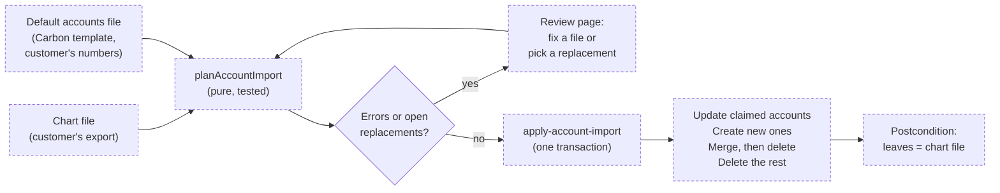

# Chart of Accounts Import

> Status: in-progress
> Author: Brad Barbin (with Claude)
> Date: 2026-10-12

## TLDR

A new company starts on Carbon's default chart of accounts, but the customer keeps books on their own chart. This spec adds **Accounting → Chart of Accounts → Import**. An implementation specialist uploads 2 CSV files. The chart file is the customer's chart, exported from their current system. The default accounts file is a Carbon template: one row per default account, with the customer's account number for each. Both files are required. The default accounts file says which Carbon account becomes which customer account, so every default role, document and journal line follows it. The chart file says which accounts exist: the import creates the accounts that are new and deletes the Carbon accounts that are not in it. The import runs only while no company of the group has an accounting cutover. So no account has Posted history, and the result matches the chart file exactly. A new company now stays Provisional until accounting is activated. Journal lines and document lines refuse an account delete (`ON DELETE RESTRICT`). Carbon has no inactive accounts in the UI.

Research: `.ai/research/chart-of-accounts-remap.md` (Odoo, NetSuite, SAP). Reference tool: `~/Documents/carbon-coa-import` (the same 2-file split, as a script).

## Overview diagram

## Problem Statement

1. `seed-company` gives every new company group the default chart (`packages/database/src/seed-data.ts`). It points 61 `accountDefault` columns and the fixed asset classes at those accounts.
2. The customer arrives with a chart from QuickBooks, Xero, Sage or Rillet. Its numbers, names and grouping differ. A default account can have no match in it. A customer account can have no default to replace.
3. Today the only tool is one account at a time on the Chart of Accounts page. A specialist must work out by hand which defaults to rename, which to merge, which to add and which to remove. A mistake breaks a default role or loses history.
4. Delete was unsafe. `journalLine_accountId_fkey` was `ON DELETE SET NULL`. If a Draft or Provisional line referred to the account, the delete succeeded and the line silently lost its account. The order and invoice line foreign keys did the same.
5. A new company got its cutover on the day it was created. Its first receipt wrote a Posted journal on a default account, so any later merge of that account had to reclass posted history.

## Proposed Solution

### Two files, both required

One file cannot say both things the import needs. The chart file names the accounts that exist, but it cannot say which Carbon account each one replaces. The default accounts file says that, but it cannot list the accounts no default uses. So Apply needs both.

**The chart file** is the customer's export, one row per account.

| Field | Header names the parser reads | Rule |
|---|---|---|
| Number | `Account Number`, `Account Code`, `Account No`, `GL Account`, `Code`, `Number`, `Account` | Required. Unique. |
| Name | `Account Name`, `Name`, `Description`, `Title` | Required. Unique. |
| Class | `Class`, `Account Type`, `Category`, `Classification`, `Type` | Optional when a type or a claimed account gives the class. A value that is a type (`Bank`) gives that type and its class. |
| Type | `Account Subtype`, `Subtype`, `Detail Type`, `Type` | Optional. A detail type Carbon has no type for falls back to the class's default type. |
| Group | `Group`, `Group Name`, `Parent Grouping`, `Parent Group`, `Parent` | Required. Names an existing group or a new group. |
| Status | `Status`, `Active` | Optional. The parser leaves out a row whose status is `Inactive`, `Archived`, `false`, `no` or `0`. |

The parser takes the first header that matches each field, and uses a column once.

**The default accounts file** is a template that Carbon makes (`api+/accounting.default-accounts[.]csv.tsx`).

| Column | On download | On upload |
|---|---|---|
| `Key` | the `accountDefault` column, or `asset-class:<class name>:<column>` | Required. The parser also accepts the label in `Default` when there is no `Key` column. |
| `Default` | the label (`Receivables`, `Vehicles – Asset`) | Ignored. |
| `Required` | `Yes` for a role with no fallback and for every fixed asset class account | Ignored. |
| `Current Account` | the number and name of the account the role uses now | Ignored. |
| `Account Number` | blank | The number of the chart row that takes the role. Blank clears an optional role. |

The template lists every role in `ACCOUNT_DEFAULT_COLUMNS` order, then the 7 accounts of each fixed asset class name in the group.

### How the planner decides

The planner reads the importing company's defaults and fixed asset classes, in template order.

1. **Claim.** The Carbon account behind a default becomes the chart row that the default names. If a later default names the same row through another Carbon account, that account merges into the row.
2. **Match by number.** A Carbon account whose number matches a row that nothing claimed becomes that row.
3. **The rest.** Every other leaf account goes:
   - If no document or journal uses it, the apply deletes it.
   - Else the review shows **"These accounts need a replacement"**. The specialist picks a chart row. The account then merges into that row. The pick stays on the list (`plan.replacements`, with its `targetLine`), so the specialist can change it.
4. **Update.** A claimed account takes the row's number, name, class, type and group. The apply skips an account that does not change.
5. **Create.** A row that no account became is a new account.
6. **Defaults.** Every company of the group gets the account the defaults file names for each role and each fixed asset class account. A blank optional role is cleared.

A required role is every `ACCOUNT_DEFAULT_COLUMNS` entry with no `DEFAULT_FALLBACKS` entry, because activation readiness demands exactly those. Every fixed asset class account is required, because the columns are `NOT NULL`.

**Groups.**
- The planner matches a row's group to an existing group by name.
- If no group has that name, the apply creates one under the root for the row's class.
- After the apply, it deletes every non-system group that has no children.

**Errors** stop the upload. The review page lists them with the file and the line number:

| Code | File | Meaning |
|---|---|---|
| `accounting-activated` | – | A company of the group has a cutover. |
| `duplicate-number`, `duplicate-name` | chart | 2 rows share a number or a name. |
| `missing-class` | chart | A new row has no class, no type and no claimed account. |
| `group-class-mismatch` | chart | A group, existing or new, would hold accounts of 2 classes. |
| `migration-clearing-not-equity` | chart | The row that takes `migrationClearingAccount` is not Equity. |
| `unknown-default` | defaults | A key that is no role and no fixed asset class account. |
| `duplicate-default` | defaults | One key on 2 lines. |
| `default-not-in-chart` | defaults | An account number that is not in the chart file. |
| `default-missing` | defaults | A required key that is absent or blank. |
| `class-type-mismatch` | chart | The row's type belongs to another class. |
| `account-has-history` | – | An account to delete has posted history: a period balance, a sync tie-out, a Posted journal line or a Posted recognition row. Before the cutover none exists; the error is a guard. |
| `target-not-in-chart` | – | A picked replacement is no longer in the chart file. |

### Reference policy

When an account merges, every column that refers to it falls into one of the policies below. `REFERENCE_POLICY` in `packages/database/src/account-import.ts` declares the policy of each column. A live-database test (`packages/server-functions/src/apply-account-import/apply-account-import.test.ts`) compares that list with every foreign key that refers to `account` in the catalog. So a new account column fails the test until someone classifies it. `accountDefault`, `fixedAssetClass` and `account.parentId` are not in the list: the defaults file sets the first 2, and a leaf has no children.

| Column | Policy |
|---|---|
| `shippingMethod.carrierAccountId` | re-point |
| `purchaseOrderLine`, `salesOrderLine`, `supplierQuoteLine` `.accountId` | re-point |
| `salesInvoiceLine`, `purchaseInvoiceLine` `.accountId` | re-point, posted invoices included |
| `charge.*Account*`, `chargeLine.accountId` | re-point, posted charges included |
| `reimbursement.payableAccountId`, `reimbursementLine.accountId` | re-point, posted reimbursements included |
| `payment.bankAccount`, `memo.reasonAccount` | re-point, posted documents included |
| `revenueRecognitionSchedule.debitAccountId` / `creditAccountId` | re-point if the row is Planned |
| `journalLine.accountId` | re-point if the journal is Draft or Provisional |
| `intercompanyEliminationLine.accountId` (no FK) | re-point with its journal line |
| `externalIntegrationMapping` (`entityType = 'account'`, no FK) | delete the source's row; the target keeps its own |
| `companyIntegration.metadata.paymentFeeAccount` (no FK) | re-point |
| `accountingPeriodBalance`, `accountingSyncTieOut` | never (history) |

**Posted documents move.** Before the cutover a posted document's journal is Provisional. So the apply moves the document's account together with its journal lines, and the two stay consistent. The charge and reimbursement guards refuse every change to a non-Draft row. Migration `20261013035046` gives each guard one branch: while `app.account_import` is set, a row may change its account columns and nothing else. The branch never applies to an API role or to a company with a cutover. The apply sets the flag with `set_config(…, true)`, so it ends with the transaction. Payments, memos and invoice lines have no such guard.

The `projects-wbs-research-spec` branch adds 5 more account columns. Whichever branch merges second adds them to `REFERENCE_POLICY`:

| Column | Policy |
|---|---|
| `project.costAccountId`, `projectElement.costAccountId` | re-point |
| `indirectPool.appliedAccountId` | re-point |
| `indirectPoolAccount.accountId` | re-point, then delete the rows that became duplicates (same pool, account, dimension value and role) |
| `indirectExpenseStatement.accountId` | never (history: a period snapshot) |

**Every company of the group.** The chart is group-scoped, so a re-point moves records in every company that uses the account. The review page lists each company whose records move.

### New companies stay Provisional until activation

`seed-company` stops setting `accountingCutoverDate`, `accountingActivatedAt` and `accountingActivatedBy`. A new company writes Provisional journals until the specialist runs the activation wizard. The wizard gets a first step, **Chart of accounts**. It links to the import, and Next keeps Carbon's chart. So the order is: import the chart → readiness → inventory → fixed assets → trial balance → enable. The trial balance CSV matches on account number, so after the import it takes the customer's numbers.

These things change with it:

1. The Implementation Hub shows the Accounting module before cutover. Its chart of accounts step opens the import.
2. Demo-template companies keep their cutover, because dataset tier 01 sets it.
3. A subsidiary copies the `accountDefault` ids and the fixed asset class accounts of a company already in the group. The seeded account numbers are only the fallback for a group with none, because after an import those numbers no longer exist.
4. The implemented cutover spec gets a changelog line. Its §7 ("a new company keeps its ledger in Carbon from day one") no longer holds.

### Delete safety and inactive accounts

1. A migration changes these foreign keys from `ON DELETE SET NULL` to `ON DELETE RESTRICT`: `journalLine.accountId`, `purchaseOrderLine.accountId`, `salesOrderLine.accountId`, `salesInvoiceLine.accountId`, `purchaseInvoiceLine.accountId` and `supplierQuoteLine.accountId`. `shippingMethod.carrierAccountId` keeps `SET NULL`, because a shipping method only proposes an account.
2. The delete route's loader asks `isAccountInUse` (`@carbon/database/account-import-reads`). It checks every company of the group, against the same list the import reads, which covers every foreign key to `account`. If anything uses the account, the modal says so and the Delete button is disabled.
3. The action maps a `23503` foreign key error to the same message.
4. The Chart of Accounts page shows active accounts only. There is no Active switch and no "Show inactive" filter. The import never deactivates an account: before the cutover it can delete every account it removes.

### Design Decisions

| Decision | Choice | Rationale |
|---|---|---|
| What the import replaces | The whole chart: accounts not in the chart file go | The user's call. It is safe because the import runs before the cutover, so nothing it deletes has Posted history. |
| How a Carbon account finds its customer account | The default accounts file | The user's call. A default is what Carbon posts to, so the default is the stable link between the 2 charts. The reference tool uses the same split. |
| Both files required | Yes | The user's call. The chart file alone cannot say which account replaces which; the defaults file alone cannot say which accounts exist. |
| One customer account behind several defaults | The first default's Carbon account becomes it; the others merge into it | Confirmed by the user. Template order is stable, so the result does not depend on file order. |
| Rename or replace a default account | Rename in place | Every reference is by `account.id`. Odoo implementers, NetSuite and SAP all rename the delivered accounts. |
| When the import runs | Only before any company of the group has a cutover | With no Posted history there is no reclass, no deactivate, and no control-account rule. |
| Inactive accounts | None in the UI | The user's call. Before the cutover the import deletes what it removes, so nothing needs to be inactive. |
| Hierarchy | A `Group` column under the existing roots | NetSuite's "Subaccount Of" works this way. The 2 system roots stay. |
| Scope | One import per company group | The chart is group-scoped (`account.companyGroupId`). Re-pointing maps account id to account id, so it is the same for every company. |
| File format | CSV, with the header names other systems export | Excel opens and saves CSV. The parser reads Rillet, QuickBooks and Xero headers without edits. |
| Draft between visits | None. The files are the draft. | A re-upload runs the planner again. No table holds draft state. |
| CSV transport | The browser reads each file and posts its text as a form field | The trial balance import does the same. No storage upload is necessary. |
| Where the logic lives | A pure planner in `@carbon/database` and a server function for the write | A pure function with vitest tests, and a Kysely transaction for the multi-table write. |
| Reference completeness | A live-database test compares `REFERENCE_POLICY` with the catalog | A new account column must declare its policy, or a merge would silently skip it. |

## Data Model Changes

1. **Foreign keys.** Migration `20261013005642` swaps `ON DELETE SET NULL` for `ON DELETE RESTRICT` on the 6 columns listed under Delete safety. It adds each constraint `NOT VALID`, under a 5 s `lock_timeout`, and changes no data. Migration `20261013005913` validates them in its own transaction, so the scan of existing rows does not block writes.
2. **Charge and reimbursement guards.** Migration `20261013035046` adds the `app.account_import` branch to `check_charge_draft_mutation` and `check_reimbursement_draft_mutation`.
3. **`seed-company`.** A code change only, with no migration. Existing companies keep their current cutover state.

No new table.

## API / Service Changes

| Piece | Location | What it does |
|---|---|---|
| `parseChartCsv`, `parseDefaultsCsv` | `apps/erp/app/modules/accounting/account-import-csv.ts` | Parse each file through `parseCsvLines` (`@carbon/files/csv`), which skips blank and comma-only rows and keeps each record's real line. Return error codes, as `trial-balance-csv.ts` does. |
| `defaultAccountsTemplate(ctx)` | same file | The rows of the default accounts template. |
| `planAccountImport(chartRows, defaultRows, ctx, resolutions)` | `packages/database/src/account-import.ts` | Pure. Returns `{ claims, updates, creates, merges, deletes, replacements, roleMoves, assetClassMoves, groupCreates, companies, errors }`. `deletes` holds only accounts nothing uses; merge sources are in `merges`. Pinned by `account-import.test.ts`. |
| `REFERENCE_POLICY` | same file | Every foreign key to `account`, as a policy union. The reads and the apply also handle the references with no foreign key. |
| `loadAccountImportContext(db, companyGroupId, companyId)` | `packages/database/src/account-import-reads.ts` | Loads the chart, the group's companies with their cutover, every company's defaults and fixed asset classes, and per account the records a merge moves and the Posted ones it cannot. One query per table, never one per account. |
| `apply-account-import` | `packages/server-functions/src/apply-account-import/` | Input `{ chart, defaults, resolutions }`. Steps listed below. |
| `isAccountInUse(db, companyGroupId, accountId)` | `packages/database/src/account-import-reads.ts` | True when anything in the group refers to the account. The delete route reads it. |
| `seed-company` | existing | Stops setting the cutover. Copies a subsidiary's defaults and fixed asset class accounts from a company in the group. |

`apply-account-import` runs these steps in one Kysely transaction:

1. Lock every company's `companySettings` `FOR SHARE`, then the group's `account` rows `FOR UPDATE`.
2. Load the context. Run the planner again on the server. Refuse if any error or open replacement remains.
3. Create the new groups. A group's name is unique among groups only (`account_name_key` includes `isGroup`), so a new group never meets a leaf's name.
4. Give every updated, merged and deleted account a temporary number and name. A swap such as 4010 ↔ 5010, or a created row that reuses a removed account's number, would otherwise hit `account_number_key`.
5. Update the kept accounts.
6. Create the new accounts.
7. Set every company's defaults in one statement, and every fixed asset class in one.
8. For each merge, re-point by `REFERENCE_POLICY`, then the references with no foreign key.
9. Delete the merged and unused accounts and their `externalIntegrationMapping` rows.
10. Delete the empty non-system groups.
11. Check the postcondition. If it fails, log it and throw a 500, so the transaction rolls back:
    1. Every chart row is a leaf with its number, name, class, type and group.
    2. No empty non-system group is left.
    3. Every required default in every company of the group points at a leaf.
    4. `migrationClearingAccount` is Equity.
    5. Every fixed asset class account is a leaf.
12. Return the counts: updated, created, merged, deleted.

## UI Changes

| Where | Change |
|---|---|
| Chart of Accounts page (`charts.tsx`) | An **Import** button, shown only while the company has no cutover and the user can update accounting. No download button, no "Show inactive" filter. |
| New route `chart-import.tsx` (`/x/accounting/chart-import`) | A `SetupFrame` page with no steps, so no rule under its header. A **Chart of accounts** section with an upload button. A **Default accounts** section with **Download template** and an upload button. Each section shows the file name, its row count and its parse errors. |
| Review | Shows once both files parse. Errors first, then each "needs a replacement" account with a chart-row picker, then the companies whose records move, then one read-only `Table` each for Updated, Merged, New and Deleted. The footer shows "N updated · N new · N merged · N deleted". Apply is disabled until both files are uploaded and no error or open replacement remains. Pickers are read-only while a plan loads. |
| Delete modal | The Delete button is disabled when anything in the group uses the account. |
| Activation wizard | A new first step, `chart`, in `activationSteps`. It links to the import; Next keeps Carbon's chart. |
| Implementation Hub | Shows the Accounting module before cutover. The chart of accounts step opens the import. |
| Integrations page | On an installed accounting provider, when the company has no cutover, a link: "Invoices and bills sync after you activate accounting." |

The UI copies existing screens: the activation wizard's `SetupFrame` and `SetupFooter`, the trial balance CSV import, and the read-only `Table`.

## Acceptance Criteria

- [ ] A new company has no `accountingCutoverDate`. Its first receipt writes a Provisional journal.
- [ ] Apply stays disabled until both files are uploaded.
- [ ] The default accounts template lists every role and every fixed asset class account, with the current account and a blank Account Number.
- [ ] A chart exported from Rillet or QuickBooks parses without edits to its headers.
- [ ] A default that names a chart row updates the Carbon account behind it. `accountDefault`, `fixedAssetClass` and journal lines keep the same `accountId`.
- [ ] Swapping 2 account numbers in one import succeeds.
- [ ] 2 defaults naming one row: the first default's account takes the row, and the second merges into it. Its Provisional lines, open order lines and default roles move.
- [ ] A Carbon account in neither file is deleted when nothing uses it.
- [ ] A Carbon account in neither file that a Provisional journal line uses shows "needs a replacement". After a pick, the line moves and the account is deleted.
- [ ] A merged account that a posted payment and a posted charge use moves to the target. Both documents stay Posted. Outside the import, the charge guard still refuses the change.
- [ ] A required default left blank, or a number not in the chart, is an error with its line.
- [ ] Any company of the group with a cutover refuses the import, on the review and in the apply.
- [ ] After Apply, the leaf accounts match the chart file exactly.
- [ ] The Import button is hidden after the cutover. No page shows inactive accounts.
- [ ] Deleting an account that a document, a journal or a default account uses is refused, in any company of the group.
- [ ] A comma-only row in a file is skipped, and every error names its real line.
- [ ] A subsidiary added to a group after an import gets valid defaults and fixed asset class accounts.
- [ ] The reference test fails when a new foreign key to `account` has no `REFERENCE_POLICY` entry.
- [ ] The activation wizard's first step is Chart of accounts. The trial balance step accepts the customer's numbers.

## Risks

| Risk | Severity | Mitigation |
|---|---|---|
| A Provisional company cannot sync invoices or bills to Xero, QuickBooks or Rillet, because those syncers read Posted journals only. | High | The Integrations page shows the link. Activation is the go-live step. Revisit if a customer needs sync before go-live. |
| The import changes the chart for every company in the group. | Med | It refuses once any company has a cutover. The review page names the companies whose records move. |
| `REFERENCE_POLICY` misses a column without a foreign key. | Med | The table lists the known soft references. The reference test covers every real foreign key. Code review covers new soft references. |
| A customer's export uses a header the parser does not know. | Low | The error names the missing field. The specialist renames one header. |
| Applying a demo template to a company whose chart was imported fails, because tier 09 resolves accounts by number. | Low | Demo templates are for internal and trial companies. The template job already marks the run `failed` with the error. |
| A large group chart (thousands of rows) makes the planner slow. | Low | The planner is linear in rows. The context loads with one query per table. |

## Open Questions

- [x] Should the import be the whole chart, so that accounts left out go? — **Answer (user):** Yes. Accounts not on the import go automatically. An account named as the same default account is renamed in place.
- [x] Can the import delete an account that has postings? — **Answer (user):** No. `ON DELETE RESTRICT` enforces this in the database, and the import runs only before the cutover.
- [x] Should new companies stay Provisional until accounting is activated? — **Answer (user):** Yes, for now.
- [x] One file or two? — **Answer (user):** Two: the chart of accounts and the default accounts. Both are required.
- [x] Should the UI show inactive accounts? — **Answer (user):** No. The chart never shows inactive accounts, and the import button shows only before activation.
- [x] Several defaults on one customer account? — **Answer (user, confirming the proposal):** The first default's Carbon account becomes it; the others move.

## Changelog

- 2026-10-12: Created. Research in `.ai/research/chart-of-accounts-remap.md`.
- 2026-10-12: Planning corrections. Dropped the `accountImport` table. A required role is now every default without a fallback, to match activation readiness. The reference test is a live-database vitest test in server-functions, not pgTAP. The CSV travels as a form field.
- 2026-10-12: Review fixes. An unclaimed account with movable references, a required role or a posted balance needs a target, and the pick makes it a merge source. The review page lists the touched companies.
- 2026-10-12: Implementation notes. The import page is `x+/accounting+/chart-import.tsx`, not `charts.import.tsx`: under `charts` it would render in the chart page's drawer outlet. The reads live in `@carbon/database/account-import-reads`, so the client-safe planner never imports Kysely. `account` joins `GROUP_SCOPED_TABLES` in the `no-unscoped-kysely-write` check, because it has no `companyId`.
- 2026-10-12: Redesign after user review. One sheet with a `Carbon Account` column became 2 required files: the customer's chart and the default accounts template. The import refuses once any company of the group has a cutover, so the reclass journal, deactivation, control-account rules, `CONTROL_ROLES` and inactive-account handling are gone. The Active switch, the "Show inactive" filter, the deactivate intent and the chart download are removed. The delete modal disables Delete for an account with journal lines. A setup page with no steps draws no rule under its header. A subsidiary also copies its fixed asset class accounts from the group.
- 2026-10-13: Posted documents move with a merge. Before the cutover their journals are Provisional, so `REFERENCE_POLICY` re-points invoice lines, payments, memos, charges and reimbursements whatever their status. Before, a posted document made its account history, and the import refused. Migration `20261013035046` lets the charge and reimbursement guards accept the account change while `app.account_import` is set.
- 2026-10-13: Self-review fixes. `plan.replacements` replaces `exceptions` and keeps a pick, so the review can change it. `deletes` holds only accounts nothing uses. New error `class-type-mismatch`; a new group is checked for one class, as an existing one is. The references with no foreign key count as usage, and a deleted account's integration mappings go with it. The delete route checks every reference across the group (`isAccountInUse`). The parsers read through `parseCsvLines`. The RESTRICT migration is non-blocking (`20261013005913` validates). The postcondition checks class, type and group, and fails with a 500. The import returns to the activation wizard when opened from it, and redirects to the chart once accounting is set up.
