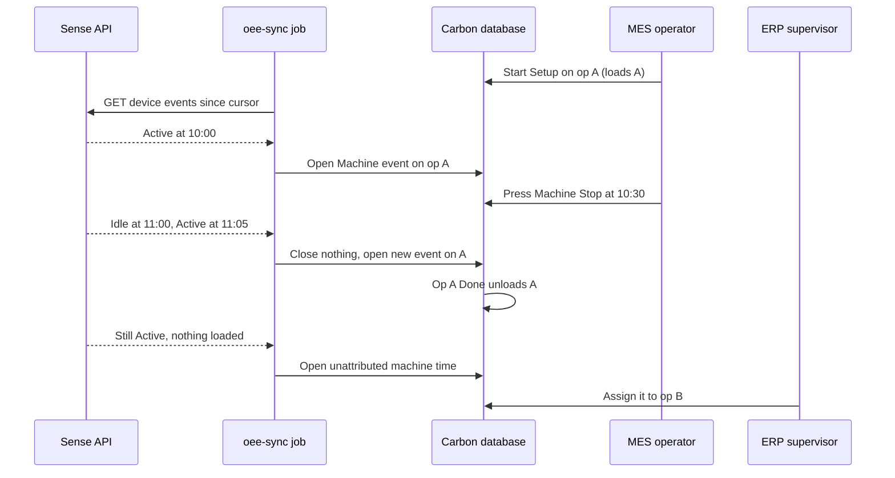
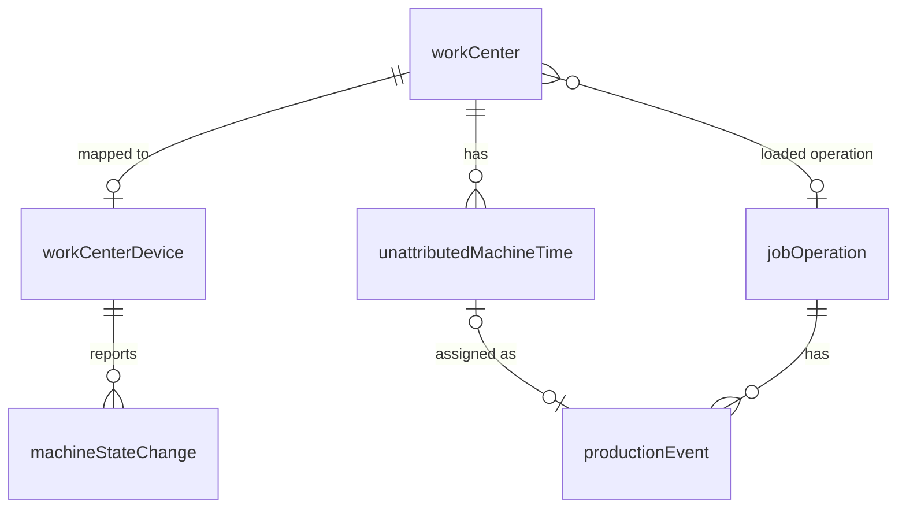

# OEE Provider integration (first provider: Sense)

> Status: implemented (PR #1909)
> Author: barbinbrad
> Date: 2026-10-12

> **Where the build differs from this spec (the code wins; `.claude/rules/oee-provider.md`):**
> - Unattributed machine time is a review queue with no status: assigning (a
>   Machine event) or dismissing deletes the row, and rows are purged 30 days
>   after the machine stopped. The drawer walks the queue one row at a time
>   with suggestion cards for what ran on the work center that day. There is
>   no Assigned / Dismissed state, no dismiss reason and no Reopen.
> - The MES operation page shows no device badge (the Machine toggle's dot
>   already does); only the work center display shows the device state.
> - Maintenance blocks from `blockedSince`: a Down dispatch from when it is
>   reported, a Planned one once In Progress. An event running when the block
>   begins stops there and the run continues as unattributed time.
> - `workCenter."loadedJobOperationId"` has no foreign key; the unload
>   interceptor also clears it when the operation is deleted.
> - The OEE tables are read-only through the API, a device maps only to its
>   own company's work center (composite FK), and Sense staging (plain HTTP)
>   is refused in production.

## TLDR

An **OEE provider** is a machine-monitoring vendor. It reports whether each
machine is running. OEE providers are a new class of integration, like
accounting providers. A company can have more than one OEE provider active.
Every provider uses the same interface, the same sync job and the same
mapping screen.

Sense is the first provider. Sense clips a current sensor
onto each machine and reports state changes per **device**. Sense calls a
device a station.

The first step is the **device mapping**: the user pairs each provider device
with one Carbon work center. When a device reports that its machine runs,
Carbon creates a Machine `productionEvent` on that work center. The event
goes to the work center's **loaded operation**. That is the job operation
that a person last started on that work center. If nothing is loaded, the run
goes to an **unattributed machine time** list. A supervisor assigns it to a
job operation or dismisses it.

## Overview diagram



## Problem Statement

Carbon records machine time only when an operator starts and stops the
Machine timer in MES. Operators forget, and machines often run unattended
after setup. So job cost is low, and the work center utilization KPI is
wrong.

Shops already install machine-monitoring sensors. A current clip knows only
whether the machine is on. It does not know which job runs. Carbon cannot use
the top of the schedule: operators skip operations for missing parts and
expedites. Carbon cannot use the operator's clock-in either: an operator sets
up a machine, stops the timer and walks away while the machine runs.

Sense is the first vendor. Its public API
(`http://bifrost-staging.sensemfg.com/docs`) has these endpoints:

| Endpoint | Returns |
|---|---|
| `GET /v1/public/companies/sites` | sites, each with `id`, `name`, `timezone` |
| `GET /v1/public/companies/stations` | stations, each with `id`, `machine_name`, `machine_manufacturer`, `machine_type`, `machine_model`, `site_id`, `last_calibration_attempt_status` |
| `GET /v1/public/companies/sites/{site_id}/stations/{station_id}/events` | state changes, each with `id`, `status`, `created_at` (UTC). Query: `start_datetime`, `end_datetime`, `order`, `limit`, `offset`, `statuses` |
| `GET …/stations/{station_id}/telemetry` | power and vibration samples, one per minute (not used in v1) |

The `status` values are `Active`, `Idle`, `Alert` and `Offline`. Sense has no
webhooks, so Carbon must poll. The API key is company-scoped: Sense finds the
company from the key. On 2026-10-12 the staging company had 3 sites and 55
stations. One site (`Reston - 2`) had the timezone `UTC`.

Research: `.ai/research/oee-provider-integration.md`. No surveyed product
infers the job from an on/off signal. Each product keeps one active job per
machine, and a person or the ERP sets it. MachineMetrics keeps unmatched run
time as an "Unknown Job" that a person assigns later. This spec copies both
patterns.

## Proposed Solution

### 1. The OEE provider class

An OEE provider is an integration with `providerRole: "oee"`. Every OEE
provider implements one interface in `packages/ee/src/oee/types.ts`:

```ts
type MachineState = "Running" | "Idle" | "Down" | "Offline";

interface OeeDevice {
  externalDeviceId: string;
  name: string;
  externalSiteId: string | null;
  siteName: string | null;
  siteTimezone: string | null;
  manufacturer: string | null;
  model: string | null;
  machineType: string | null;
  calibrated: boolean | null;
}

interface OeeStateChange {
  externalEventId: string;
  state: MachineState;
  changedAt: string; // UTC ISO 8601
}

interface OeeProvider {
  id: OeeProviderId;
  validate(): Promise<{ valid: boolean; error?: string }>;
  listDevices(): Promise<OeeDevice[]>;
  listStateChanges(
    device: { externalDeviceId: string; externalSiteId: string | null },
    window: { since: string; until: string }
  ): Promise<OeeStateChange[]>;
}
```

`getOeeProvider(client, companyId, integrationId)` builds the provider from
the company's `companyIntegration` row. It reads the API key from Vault with
`resolveIntegrationSecrets`.

`getOeeProvider` finds the constructor in a registry,
`OEE_PROVIDERS` (`packages/ee/src/oee/registry.ts`), which maps an
integration id to a factory. Code outside the registry never branches on an
integration id. The `no-integration-id-branching` check enforces this, so
add `"sense"` to its `INTEGRATION_IDS` and its provider-directory exclusion.
Code that must find the OEE integrations calls
`getIntegrationIdsByRole("oee")`. A second provider adds one adapter and one
registry entry. The sync job, the mapping screen and the attribution engine
stay the same.

The Sense adapter (`packages/ee/src/sense/`) maps Sense statuses to
`MachineState` with an explicit allowlist:

| Sense `status` | `MachineState` |
|---|---|
| `Active` | `Running` |
| `Idle` | `Idle` |
| `Alert` | `Down` |
| `Offline` | `Offline` |

If Sense returns another status, the adapter throws. The sync job then fails
that device and keeps its cursor (`.ai/lessons.md` → "Financial
discriminators require explicit verified allowlists").

Sense ignores `offset`, and `offset=0` returns HTTP 400 (verified against
staging on 2026-10-13). So the adapter pages by time: it requests
`order=asc&limit=500`, and if the page is full it requests again from the last
event's `created_at`. It drops events it has already seen, by `id`, and stops
when a page is short or adds nothing new.

### 2. Installing Sense

Settings → Integrations → Sense. The descriptor `packages/ee/src/sense/config.tsx`
copies the Rillet descriptor. It has 3 settings:

| Setting | Type | Default |
|---|---|---|
| `apiKey` | `secret` | none (required) |
| `environment` | `options`: Production (`https://bifrost.sensemfg.com`), Staging (`http://bifrost-staging.sensemfg.com`) | Production |
| `minimumStateSeconds` | `number` | 60 |

`onHealthcheck` calls `validate()`, which calls `GET /v1/public/companies/sites`.

### 3. Device mapping

The drawer of each OEE integration gets a **Devices** tab. The loader calls
`listDevices()`. The tab shows one row per device:

| Column | Source |
|---|---|
| Device | `name`, then manufacturer, model and machine type as muted text |
| Site | `siteName` |
| Calibrated | `calibrated` as a badge |
| Work center | a `Combobox` of active work centers |

Rules:

1. The user picks a work center and saves the row. The action upserts a
   `workCenterDevice` row.
2. If the work center already has a device from any OEE provider, the action
   refuses. The message names the other device and provider.
3. If the device's site timezone differs from the work center's
   `location.timezone`, the row shows a warning icon. The tooltip names both
   timezones. Carbon uses the location timezone for all local time.
4. The user clears the combobox to unmap. The action deletes the
   `workCenterDevice` row. Rows in `machineStateChange` and
   `unattributedMachineTime` keep their `workCenterId`.
5. A new mapping starts its cursor at the moment of the save. Carbon imports
   no history.

### 4. The loaded operation (community)

`workCenter` gets 2 columns: `loadedJobOperationId` and `loadedAt`. The
loaded operation is the operation that is physically on the machine. It does
not depend on a sensor, so it is AGPL code.

1. A writer inserts a `productionEvent` row with `endTime IS NULL` and a
   `workCenterId`. Then a sync interceptor sets that work center's
   `loadedJobOperationId` to the row's `jobOperationId`. It also sets
   `loadedAt` to the row's `startTime`. Setup, Labor and Machine starts all
   load. So does the QR start (`/x/start/:operationId`).
2. If `NEW.startTime < loadedAt`, the interceptor changes nothing. A row
   inserted with an `endTime` (an ERP entry or an assigned interval) never
   loads.
3. When a `jobOperation` status changes to `Done` or `Canceled`, a sync
   interceptor clears `loadedJobOperationId` and `loadedAt` on each work
   center that points at it.
4. Stopping a timer does not unload the operation. That is what lets an
   unattended run reach the job.

The MES work-center display (`/display/:workCenterId/work`) shows the loaded
operation. If the work center has a `workCenterDevice`, it also shows the
machine state.

### 5. Attribution rules

The engine is a pure function, `planMachineTime`, in
`packages/ee/src/oee/engine.ts`. It takes the device's current state, its
`lastManualChangeAt`, the loaded operation, the work center's blocked flag,
the open Machine event and the open unattributed row. It also takes the new
state changes. It returns a list of writes. The sync job applies them.

**Debounce.** The engine drops a state that lasts less than
`minimumStateSeconds`. The previous state continues through it. The engine applies a state change
only after the change has lasted `minimumStateSeconds`, or after the next
change confirms it.

**Inputs at the moment of the sync.** The engine uses the loaded operation
and the blocked flag as they are when the sync runs. It does not rebuild their
history. It charges a `Running` change to the loaded operation only when
`loadedAt <= changedAt`. Otherwise the run is unattributed.

**Applied state.** `currentState` is the state the engine applied last.
`currentStateAt` is the time that state began. `appliedThrough` is the
`changedAt` of the last stored change the engine consumed, applied or dropped.
Each sync reads the `machineStateChange` rows after `appliedThrough`. A change
that has not yet lasted `minimumStateSeconds` stays pending, and the next sync
reads it again.

**First sync.** A new device has no `currentState`. The first sync reads from 24
hours before the mapping. The engine takes the last change before the mapping
as the starting state, at the time of the mapping. So a machine that was
already running when the user mapped it opens time from the mapping, never
earlier.

**Latest change wins.** Two inputs change machine time on a mapped work
center: sensor state changes and operator presses of the MES Machine button.
The engine orders all inputs by their timestamp. It ignores a sensor change
that is older than `lastManualChangeAt`. Polling is late, so this
guarantees that a press is never undone by an older sensor change.

For each new state change, in time order:

1. If `changedAt <= lastManualChangeAt`, skip it. Record it in
   `machineStateChange` only.
2. If the state is `Running` and an open Machine event exists on the work
   center, do nothing.
3. If the state is `Running`, the work center is not blocked, and an
   operation is loaded, insert a Machine `productionEvent`. Use
   `jobOperationId` = the loaded operation, `startTime` = `changedAt`,
   `endTime` = null, `employeeId` = null and `createdBy` = `system`.
4. If the state is `Running` and nothing is loaded, insert an
   `unattributedMachineTime` row with `startTime` = `changedAt` and
   `status` = `Open`.
5. If the state is `Running` and the work center is blocked, do the same as
   step 4. A blocked work center has an In Progress maintenance dispatch with
   OEE impact Down or Planned (`workCentersWithBlockingStatus`). A
   supervisor dismisses that time as maintenance.
6. If the state is `Idle`, `Down` or `Offline`, set `endTime` = `changedAt` on
   the open Machine event of the work center. Also set `endTime` = `changedAt`
   on the open unattributed row.

**Steady state.** After the changes, the engine checks one more case. The
device is `Running`, `currentStateAt > lastManualChangeAt`, and the work
center has no open Machine event and no open unattributed row. Then the
engine opens time again. The start is the latest `endTime` of a Machine event
on the work center, or `currentStateAt` when that is later. It applies steps 3
to 5 to that start.

This rule covers an operation that went `Done` while the machine kept running.
`sync_finish_job_operation` closes the event and unloads the operation. The
rest of the run then becomes unattributed. The rule also covers a Machine
event that a maintenance dispatch or End Shift closed during a run.

**A load change during a run.** If an operator loads operation B while a
sensor event runs on A, the event stays on A. The next `Running` change goes
to B. A machine idles during setup, so the sensor normally closes A's event
first.

### 6. The MES Machine button on a mapped work center (community)

The Machine timer stays visible. It shows the open Machine event, as it does
today (`useOperation` treats an open Machine event as active for every
operator). A small badge next to it shows the device state from
`workCenterDevice.currentState`.

The button changes machine time, and it is an input of equal weight to the
sensor:

1. **Start** on operation C: end any open Machine event on the work center at
   the press time. Insert a Machine event on C that starts at the press time.
   The insert loads C. Set `workCenterDevice.lastManualChangeAt` to the press
   time.
2. **Stop**: end the open Machine event at the press time. Set
   `lastManualChangeAt` to the press time. The operation stays loaded.

Example: the machine is Active. The operator presses Stop at 10:03. Machine
time stops at 10:03. It stays stopped until the sensor reports the next
change from Idle to Active.

The QR start with `type=Machine` follows rule 1. `x+/event.tsx` and
`start.$operationId.tsx` apply these rules only when the work center has a
`workCenterDevice` row. Other work centers behave as they do today.

### 7. The sync job

1. The Inngest cron `oee-sweep` runs every 2 minutes. It selects active
   `companyIntegration` rows whose integration has `providerRole = 'oee'` and
   at least 1 `workCenterDevice`. It sends one `carbon/oee-sync` event per
   (company, integration). It copies `ramp-sweep.ts`.
2. `oee-sync` runs with concurrency 1 per company. For each device it reads
   state changes from `lastEventAt − 10 minutes` to now. The overlap catches
   events that Sense stores late.
3. The job inserts the changes into `machineStateChange` with
   `ON CONFLICT DO NOTHING`. The unique key is
   (`workCenterDeviceId`, `externalEventId`).
4. The job opens one Kysely transaction per device. It locks the
   `workCenterDevice` row `FOR UPDATE`, runs `planMachineTime` and applies the
   writes. The MES route takes the same lock through
   `lockWorkCenterDevice` (`@carbon/database/machine-time`), so a press and a
   sync never interleave.
5. The job sets `lastEventAt`, `currentState`, `currentStateAt` and
   `lastSyncedAt` in the same transaction. It clears `lastSyncError`.
6. If one device fails, the job writes `lastSyncError` on that device and
   keeps its cursor. The other devices continue.
7. The job syncs all devices of a company inside one `step.run`. One step per
   device would multiply the Inngest cost by the device count.
8. If the company is not entitled to `INTEGRATIONS`, `getOeeProvider` returns
   an error through `companyHasFeature`, and the job skips the company.

The job never posts to the GL. A sensor event is an ordinary Machine event
with an `endTime`. The existing sweep posts it when its operation is finished
(`finishJobOperation`), and `complete_job_to_inventory` posts any event left
over at job completion. Until then a supervisor can edit it on the job's
Events tab.

### 8. Unattributed machine time (ERP)

Production → **Unattributed Machine Time**
(`x+/production+/machine-time.tsx`). The list copies the Batches list.

| Column | Value |
|---|---|
| Work center | name |
| Start, End | in the work center's location timezone |
| Duration | `endTime − startTime`; "Running" while open |
| Status | `Open`, `Assigned`, `Dismissed` |

The default filter is `status = Open`. A row action opens a drawer
(`machine-time.$id.tsx`) with 2 choices:

1. **Assign**: pick a job operation. The combobox lists operations on that
   work center whose status is not Done or Canceled. In Progress operations
   come first, then the operations with the most recent production event at
   that work center. On save, the action inserts a Machine `productionEvent`
   with the row's `startTime` and `endTime`, `employeeId` = null and
   `createdBy` = the user. It sets the row to `Assigned` and stores
   `productionEventId`.
2. **Dismiss**: enter a reason (for example warm-up, prove-out or
   maintenance). The action sets the row to `Dismissed`.

A supervisor cannot assign an `Open` row that has no `endTime`. The drawer
says that the machine is still running.

### 9. Out of scope for v1

| Item | Why not now |
|---|---|
| An MES prompt ("What's running on W1?") | User decision (Q3). The ERP list comes first. |
| Splitting one unattributed row across 2 operations | A run without a load is normally one job. The supervisor can edit the event on the job's Events tab. |
| An OEE availability or downtime report | `machineStateChange` stores the data for it. The report is a later spec. |
| Telemetry, cycle counts, program numbers | A current clip gives no program. Telemetry is not needed to attribute time. |
| Sense partner tokens (`/v1/public/partners/…`) | Sense issues company-scoped keys to customers. |
| A pool work center with several devices | The mapping is 1:1 (Q1). |
| Importing history from before the mapping | No loaded operation exists for that period. |

### Design Decisions

| Decision | Choice | Rationale |
|---|---|---|
| Provider cardinality | Several OEE providers can be active at once. A work center has at most 1 device across all providers. | User decision (Q1). Shops mix vendors. The single-active trigger skips the `oee` role. `UNIQUE(workCenterId, companyId)` on `workCenterDevice` holds the real rule. |
| Mapping cardinality | 1 device ↔ 1 work center | User decision (Q1). The scheduler treats a work center as capacity 1 (`.claude/rules/scheduling-data-structures.md`). A pool work center ("VF2 ×3") must be split into one work center per machine. |
| Mapping storage | New table `workCenterDevice`, not `externalIntegrationMapping` | The row also holds the cursor, the live state and `lastManualChangeAt`. The cross-provider unique rule is a plain UNIQUE here. In `externalIntegrationMapping` the unique key includes `integration`, so it cannot enforce it. |
| Attribution | The loaded operation per work center. It is never the top of the schedule. Carbon never infers a job. | User decision (Q2). Research: every vendor keeps an explicit active job per machine. |
| How an operation is loaded | Any open `productionEvent` insert on the work center | Setup, Labor, Machine and the QR start already insert one. Shops change nothing. |
| Unattributed time | Its own table, cleared from an ERP list | User decision (Q3). `productionEvent.jobOperationId` is NOT NULL, so unattributed time cannot be a production event. |
| Manual Machine timer on a mapped work center | Kept. The sensor drives it. An operator press and a sensor change are equal inputs, and the latest one by timestamp wins. Stop keeps the operation loaded. | User decision (Q4, Q4b, Q4c). One Machine event exists at a time, so time is never counted twice. |
| GL posting | Sensor events post at operation finish or job completion, through the existing sweeps | User decision (Q5). No new posting path. A wrong attribution stays editable until the operation is done. |
| License boundary | Provider, sync, mapping and the unattributed list are commercial (`packages/ee`, `.ee.tsx`), gated by `INTEGRATIONS`. The loaded operation, the MES button rules and the display are AGPL. | User decision (Q6). Matches every other integration. |
| Timezone | Store UTC instants. Use the work center's `location.timezone` for local time. Warn on a site/location mismatch. | User decision (Q7). |
| Polling | Inngest cron every 2 minutes, 10-minute overlap, idempotent insert | Sense has no webhooks. A 2-minute delay keeps the MES badge useful. The overlap plus the unique key makes a re-read safe. |
| Debounce | `minimumStateSeconds`, default 60 | Research: MachineMetrics uses 60 s for micro-stops. Vendors use 30 s to 3 min. |
| `Alert` and `Offline` | Both end machine time. `Offline` means "no data", not "down". | Research: vendors treat a sensor gap as unknown, never as running. |
| Blocked work center | Running time goes to the unattributed list | Maintenance run time must not reach a job. The supervisor dismisses it as maintenance. |
| Backfill | None. A mapping starts at the moment of the save. | Attribution needs the loaded operation at that time, and Carbon has no history of it. |
| Sync errors | `lastSyncError` and `lastSyncedAt` on `workCenterDevice`, shown in the Devices tab | `accountingSyncOperation.direction` allows only accounting directions. A per-device column is enough for v1. |
| Heuristic 1: multi-tenancy | Every new table has `companyId`, composite PK `("id", "companyId")` and `id('prefix')` | `.claude/rules/conventions-database.md` |
| Heuristic 2: service shape | Service functions take `client` first and return `{ data, error }`. The ee write functions call `requireEntitlement(client, companyId, "INTEGRATIONS")` first. | `.claude/rules/conventions-services.md`, `.claude/rules/commercial-licensing.md` |
| Heuristic 3: RLS | Add 3 lines to `packages/database/src/authz/manifest.ts`: `workCenterDevice: company("resources")`, `machineStateChange: company("production")`, `unattributedMachineTime: company("production")`. | The manifest renders the 4 standard policies (`.claude/rules/authz-manifest.md`). The sync job writes with the service role. |
| Heuristic 4: permissions | Devices tab: `settings_update`. Unattributed list: `production_view`. Assign or dismiss: `production_update`. | Same scopes as integration settings and job events. |
| Heuristic 5: forms | Assign and Dismiss use `ValidatedForm` with zod validators in `production.models.ts` | `.claude/rules/conventions-forms.md` |
| Heuristic 6: module layout | ERP UI in `modules/production/ui/MachineTime/*.ee.tsx` and `modules/settings/ui/Integrations/OeeDevices.ee.tsx`. Reads in `production.service.ts`. Writes in `@carbon/ee/oee.server`. | One service and one models file per module. Gated writes live in `packages/ee`. |
| Heuristic 7: compatibility | Additive only. Work centers with no device behave exactly as today. | No public contract changes. |

## Data Model Changes



```sql
-- 1. Provider role
ALTER TABLE "integration" DROP CONSTRAINT "integration_providerRole_check";
ALTER TABLE "integration" ADD CONSTRAINT "integration_providerRole_check"
  CHECK ("providerRole" IS NULL OR "providerRole" IN ('accounting', 'spend', 'oee'));
-- Fork the newest check_single_active_provider_role(): return early when the
-- role is 'oee'. Several OEE providers may be active at once.

INSERT INTO "integration" ("id", "jsonschema") VALUES ('sense', '{…}');
UPDATE "integration" SET "providerRole" = 'oee' WHERE "id" = 'sense';

-- 2. Loaded operation (community)
ALTER TABLE "workCenter"
  ADD COLUMN "loadedJobOperationId" TEXT REFERENCES "jobOperation"("id") ON DELETE SET NULL,
  ADD COLUMN "loadedAt" TIMESTAMP WITH TIME ZONE;

-- 3. Machine state
CREATE TYPE "machineState" AS ENUM ('Running', 'Idle', 'Down', 'Offline');

CREATE TABLE "workCenterDevice" (
  "id" TEXT NOT NULL DEFAULT id('wcd'),
  "companyId" TEXT NOT NULL,
  "workCenterId" TEXT NOT NULL REFERENCES "workCenter"("id") ON DELETE CASCADE,
  "integration" TEXT NOT NULL REFERENCES "integration"("id"),
  "externalDeviceId" TEXT NOT NULL,
  "externalSiteId" TEXT,
  "siteTimezone" TEXT,
  "deviceName" TEXT NOT NULL,
  "currentState" "machineState",
  "currentStateAt" TIMESTAMP WITH TIME ZONE,
  "lastEventAt" TIMESTAMP WITH TIME ZONE NOT NULL DEFAULT NOW(),
  "lastManualChangeAt" TIMESTAMP WITH TIME ZONE,
  "appliedThrough" TIMESTAMP WITH TIME ZONE,
  "lastSyncedAt" TIMESTAMP WITH TIME ZONE,
  "lastSyncError" TEXT,
  "createdBy" TEXT NOT NULL REFERENCES "user"("id"),
  "createdAt" TIMESTAMP WITH TIME ZONE NOT NULL DEFAULT NOW(),
  "updatedBy" TEXT REFERENCES "user"("id"),
  "updatedAt" TIMESTAMP WITH TIME ZONE,
  CONSTRAINT "workCenterDevice_pkey" PRIMARY KEY ("id", "companyId"),
  CONSTRAINT "workCenterDevice_companyId_fkey" FOREIGN KEY ("companyId")
    REFERENCES "company"("id") ON DELETE CASCADE ON UPDATE CASCADE,
  CONSTRAINT "workCenterDevice_workCenter_key" UNIQUE ("workCenterId", "companyId"),
  CONSTRAINT "workCenterDevice_device_key" UNIQUE ("integration", "externalDeviceId", "companyId")
);

CREATE TABLE "machineStateChange" (
  "id" TEXT NOT NULL DEFAULT id('msc'),
  "companyId" TEXT NOT NULL,
  "workCenterDeviceId" TEXT NOT NULL,
  "workCenterId" TEXT NOT NULL REFERENCES "workCenter"("id") ON DELETE CASCADE,
  "externalEventId" TEXT NOT NULL,
  "state" "machineState" NOT NULL,
  "changedAt" TIMESTAMP WITH TIME ZONE NOT NULL,
  "createdAt" TIMESTAMP WITH TIME ZONE NOT NULL DEFAULT NOW(),
  CONSTRAINT "machineStateChange_pkey" PRIMARY KEY ("id", "companyId"),
  CONSTRAINT "machineStateChange_companyId_fkey" FOREIGN KEY ("companyId")
    REFERENCES "company"("id") ON DELETE CASCADE ON UPDATE CASCADE,
  CONSTRAINT "machineStateChange_event_key"
    UNIQUE ("workCenterDeviceId", "externalEventId", "companyId")
);
CREATE INDEX "machineStateChange_workCenter_changedAt_idx"
  ON "machineStateChange" ("workCenterId", "changedAt");

CREATE TYPE "unattributedMachineTimeStatus" AS ENUM ('Open', 'Assigned', 'Dismissed');

CREATE TABLE "unattributedMachineTime" (
  "id" TEXT NOT NULL DEFAULT id('umt'),
  "companyId" TEXT NOT NULL,
  "workCenterId" TEXT NOT NULL REFERENCES "workCenter"("id") ON DELETE CASCADE,
  "startTime" TIMESTAMP WITH TIME ZONE NOT NULL,
  "endTime" TIMESTAMP WITH TIME ZONE,
  "status" "unattributedMachineTimeStatus" NOT NULL DEFAULT 'Open',
  "productionEventId" TEXT REFERENCES "productionEvent"("id") ON DELETE SET NULL,
  "dismissReason" TEXT,
  "resolvedBy" TEXT REFERENCES "user"("id"),
  "resolvedAt" TIMESTAMP WITH TIME ZONE,
  "createdBy" TEXT NOT NULL REFERENCES "user"("id"),
  "createdAt" TIMESTAMP WITH TIME ZONE NOT NULL DEFAULT NOW(),
  "updatedBy" TEXT REFERENCES "user"("id"),
  "updatedAt" TIMESTAMP WITH TIME ZONE,
  CONSTRAINT "unattributedMachineTime_pkey" PRIMARY KEY ("id", "companyId"),
  CONSTRAINT "unattributedMachineTime_companyId_fkey" FOREIGN KEY ("companyId")
    REFERENCES "company"("id") ON DELETE CASCADE ON UPDATE CASCADE,
  CONSTRAINT "unattributedMachineTime_dismiss_check"
    CHECK ("status" <> 'Dismissed' OR "dismissReason" IS NOT NULL)
);
CREATE INDEX "unattributedMachineTime_open_idx"
  ON "unattributedMachineTime" ("companyId", "workCenterId") WHERE "status" = 'Open';

-- 4. Missing index the engine needs
CREATE INDEX "productionEvent_workCenterId_open_idx"
  ON "productionEvent" ("workCenterId") WHERE "endTime" IS NULL;

-- 5. Indexes the conventions require: companyId, createdBy and each FK
CREATE INDEX "workCenter_loadedJobOperationId_idx" ON "workCenter" ("loadedJobOperationId");
CREATE INDEX "workCenterDevice_companyId_idx" ON "workCenterDevice" ("companyId");
CREATE INDEX "workCenterDevice_integration_idx" ON "workCenterDevice" ("integration");
CREATE INDEX "workCenterDevice_createdBy_idx" ON "workCenterDevice" ("createdBy");
CREATE INDEX "machineStateChange_companyId_idx" ON "machineStateChange" ("companyId");
CREATE INDEX "unattributedMachineTime_companyId_idx" ON "unattributedMachineTime" ("companyId");
CREATE INDEX "unattributedMachineTime_workCenterId_idx" ON "unattributedMachineTime" ("workCenterId");
CREATE INDEX "unattributedMachineTime_productionEventId_idx" ON "unattributedMachineTime" ("productionEventId");
CREATE INDEX "unattributedMachineTime_createdBy_idx" ON "unattributedMachineTime" ("createdBy");

-- 6. The views "workCenters" and "workCentersWithBlockingStatus" select wc.*.
-- Drop and recreate both, forked verbatim from
-- 20260905132037_job-operation-batching.sql, so they expose the new columns.
```

The migration writes no policies. The authz manifest renders them (Heuristic
3). Declare the two new interceptors in `packages/database/src/event-system/attachments.ts`
as AFTER interceptors: `sync_load_work_center_operation` on `productionEvent`
and `sync_unload_work_center_operation` on `jobOperation`. An interceptor cannot
change NEW, so each one runs its own UPDATE on `workCenter`. The dispatchers are
`SECURITY DEFINER`, so the UPDATE succeeds for an operator who has no
`resources_update` permission. Ship them with
`pnpm --filter @carbon/database authz migration <name>`. Give
`workCenterDevice` and `unattributedMachineTime` a statement broadcast, so
the MES badge and the ERP list update live. Then run
`pnpm run generate:types`.

`SECRET_KEYS` (`packages/ee/src/integrations/secrets.ts`) gets
`sense: ["apiKey"]`. The key stays at `metadata.apiKey`, as Linear's does, so
the install path needs no credential fold. `FORM_SECRET_INTEGRATIONS` in
`integrations.$id.tsx` gets `"sense"`. Three unions get `"oee"`: the
descriptor type (`packages/ee/src/types.ts`), `ProviderRole`
(`packages/ee/src/index.ts`) and `ProviderRole` (`packages/ee/src/sync/topology.ts`).
The topology picks only the accounting and spend roles, so an `oee` row never
enters it. The integration drawer hides Sync Activity for the `oee` role, and
`IntegrationCard` does not treat an active `oee` integration as an incumbent.

## API / Service Changes

| Location | Function | Purpose |
|---|---|---|
| `packages/ee/src/oee/types.ts` | `OeeProvider`, `MachineState`, `OeeDevice`, `OeeStateChange` | The provider contract |
| `packages/ee/src/oee/engine.ts` | `planMachineTime` | Pure attribution rules (section 5). Unit-tested. |
| `packages/ee/src/oee/service.server.ts` | `getOeeProvider`, `upsertWorkCenterDevice`, `deleteWorkCenterDevice`, `assignUnattributedMachineTime`, `dismissUnattributedMachineTime` | Gated writes. Each one calls `requireEntitlement` first. |
| `packages/ee/src/sense/provider.ts` | `SenseProvider` | The Sense adapter |
| `packages/ee/src/sense/config.tsx`, `hooks.server.ts` | `Sense` descriptor, `onHealthcheck` | Install and health |
| `packages/jobs/src/inngest/functions/integrations/oee-sweep.ts` | cron, every 2 minutes | Sends `carbon/oee-sync` per company |
| `packages/jobs/src/inngest/functions/integrations/oee-sync.ts` | `oeeSyncFunction` | Section 7 |
| `apps/erp/app/modules/production/production.service.ts` | `getUnattributedMachineTimes`, `getUnattributedMachineTime`, `getMachineTimeOperationCandidates` | Reads for the list and the drawer |
| `apps/erp/app/modules/production/production.models.ts` | `assignMachineTimeValidator`, `dismissMachineTimeValidator` | Form validators |
| `apps/erp/app/routes/x+/settings+/integrations.$id.tsx` | loader branch for `providerRole === "oee"`, intents `upsert-oee-device`, `delete-oee-device` | Devices tab |
| `apps/mes/app/routes/x+/event.tsx`, `start.$operationId.tsx` | Machine start/stop on a mapped work center | Section 6, with the `workCenterDevice` row lock |
| `apps/mes/app/services/display.service.ts` | read the loaded operation and the device state | Work-center display |

## Closest Sibling

| Part | Sibling | Files copied |
|---|---|---|
| Provider class | Accounting providers (`providerRole: "accounting"`) | `packages/ee/src/accounting/core/types.ts` (provider interface shape), `packages/ee/src/index.ts` (`getIntegrationIdsByRole`) |
| Descriptor and API-key settings | Rillet | `packages/ee/src/rillet/config.tsx`, `rillet/hooks.server.ts` |
| Role-targeted polling | Ramp | `packages/jobs/src/inngest/functions/integrations/ramp-sweep.ts`, `ramp-sync.ts` |
| Devices tab | Account Mapping | `apps/erp/app/modules/settings/ui/Integrations/AccountMapping.tsx` (row form, `Combobox`, per-row save). The row is flipped: the provider object is on the left and the Carbon record is the combobox. |
| Unattributed list | Production → Batches | `apps/erp/app/routes/x+/production+/batches.tsx`, `modules/production/ui/Batches/BatchesTable.tsx` |
| Assign drawer | Job events | `apps/erp/app/routes/x+/job+/$jobId.events.new.tsx`, `ProductionEventForm` |

The feature deviates from its siblings in 3 places. Each one is a row in
Design Decisions:

1. The mapping lives in its own table, not `externalIntegrationMapping`.
2. The `oee` role allows several active providers.
3. Sync errors are columns on the device, not Sync Activity rows.

## UI Changes

| Surface | Change | Archetype |
|---|---|---|
| ERP Settings → Integrations → Sense | New integration card. Drawer with Connection settings and a **Devices** tab. | Integration drawer (same as Rillet) |
| ERP Production nav | New item **Unattributed Machine Time** in the Production group, after Batches | List page with a drawer (same as Batches) |
| ERP Production → Unattributed Machine Time → row | Drawer with Assign and Dismiss | Drawer form (same as job events) |
| MES operation screen | Machine timer badge with the device state on a mapped work center. Button rules in section 6. | No new archetype |
| MES work-center display | Loaded operation, and the device state when mapped | Existing display |
| Docs | `docs/content/docs/integrations/oee.mdx`, added to `meta.json`; a "Loaded operation" section in `docs/content/docs/reference/work-centers.mdx` | Integration guide |

If the company is not entitled to `INTEGRATIONS`, the Devices tab and the
Unattributed Machine Time page render the upgrade overlay
(`usePlanGate`). They stay visible in the nav.

## Acceptance Criteria

- [ ] With the staging API key, installing Sense shows a healthy connection. The Devices tab lists the 55 Sense stations with their site names.
- [ ] Mapping Station 0002 to work center W1 saves a `workCenterDevice` row. The action refuses a second station on W1. Its message names Station 0002.
- [ ] Mapping a station from site `Reston - 2` (UTC) to a work center whose location is in `America/New_York` shows the timezone warning.
- [ ] Activating Sense while another `oee` integration is active succeeds. The single-active trigger still refuses a second active `accounting` integration.
- [ ] An operator starts Setup on operation A at W1 and stops it. `workCenter.loadedJobOperationId` is A.
- [ ] Sense reports Active at T1 and Idle at T2 for the mapped station. Within 2 sync runs, a Machine `productionEvent` on A exists with `startTime` = T1, `endTime` = T2, `employeeId` null and `postedToGL` false.
- [ ] After operation A is finished, that event has `postedToGL` = true. Its cost is (T2 − T1) × W1's machine rate plus overhead.
- [ ] With nothing loaded on W1, an Active change creates an `Open` `unattributedMachineTime` row. The row appears on Production → Unattributed Machine Time.
- [ ] Assigning a closed row to operation B creates a Machine event on B with the row's start and end. The row status becomes `Assigned`.
- [ ] Dismissing a row without a reason fails validation. With a reason, the row is `Dismissed` and no event exists.
- [ ] The machine is Active and the operator presses Stop at 10:03. The event ends at 10:03. A later sync with an older Active change does not reopen it. The next Idle→Active change opens a new event on the same operation.
- [ ] A sensor event runs on A, and the operator presses Machine Start on operation C. A's event ends at the press time. C's event starts at the press time. C is loaded.
- [ ] Running the sync twice over the same window creates no duplicate `machineStateChange`, `productionEvent` or `unattributedMachineTime` rows.
- [ ] A state that lasts 30 seconds with `minimumStateSeconds` = 60 creates no event and does not close an open one.
- [ ] If Sense returns a status outside the allowlist, that station gets `lastSyncError` and keeps its cursor. Other stations still sync.
- [ ] W1 has an In Progress maintenance dispatch with OEE impact Down. Running time on W1 creates an unattributed row, not an event on the loaded operation.
- [ ] Operation A goes Done while the machine runs. The event ends at the completion time, and the rest of the run becomes an unattributed row that starts at that time.
- [ ] On a work center with no `workCenterDevice`, the MES Machine timer behaves exactly as before.
- [ ] On a plan without `INTEGRATIONS`, the Devices tab and the list show the upgrade overlay. Calling `assignUnattributedMachineTime` throws `EntitlementError`.
- [ ] `planMachineTime` has unit tests for every rule in section 5 and the override example in section 6.

## Risks

| Risk | Severity | Mitigation |
|---|---|---|
| A stale loaded operation: nobody finishes or reloads it, so another job's run time goes to it | Med | The display and the MES badge show the loaded operation. Any timer start on the right operation reloads. A supervisor can edit the event on the job's Events tab until the operation is finished. |
| The staging host is plain HTTP, so the API key travels unencrypted | Med | Production uses HTTPS. The Staging option says "testing only" in its description. |
| Sense rate limits and backfill behavior are not documented | Med | Verify with one curl before the job is wired into the cron (`.ai/lessons.md` → "A VERIFY-flagged provider endpoint in a cron loop is an outage"). The 10-minute overlap tolerates late events. Confirm the limits with Sense before launch. |
| Inngest cost of a 2-minute cron | Low | The sweep sends events only for companies with at least one mapped device. |
| `sync_set_job_operation_in_progress` reopens a Done operation on an open-event insert | Low | The engine only inserts on the loaded operation, which is never Done or Canceled. The assign drawer lists only operations that are not Done or Canceled. |
| A long Sensor Offline gap hides real run time | Low | Offline ends machine time. The Devices tab shows `currentState` = Offline and the time of the last sync. |
| An operator presses Machine Start while the machine is Idle. The event runs until the sensor reports the next change. | Med | This is the override the user chose (Q4c). The MES badge shows the sensor's Idle state next to the running timer. The supervisor can edit the event until the operation is finished. |
| One work center models a pool of machines | Low | Out of scope. The mapping refuses a second device, and the docs say to split the work center. |

## Open Questions

> HARD STOP: Do not proceed with implementation until these are answered.

- [x] Can a company have more than one OEE provider active at once? — **Answer:** Yes. A work center has at most one device across all providers.
- [x] How does Carbon pick the job operation for sensor run time? — **Answer:** The loaded operation per work center. The latest Setup, Labor or Machine start there sets it, and it survives clock-out. Run time with nothing loaded is unattributed. Never the top of the schedule. No inference from In Progress operations.
- [x] Where is unattributed time resolved in v1? — **Answer:** An ERP supervisor list only. Assign to a job operation, or dismiss with a reason. The MES prompt is later work.
- [x] What happens to the manual MES Machine timer on a mapped work center? — **Answer:** It stays visible and in sync with the sensor. There is one Machine event at a time, so no duplicates.
- [x] What does the Machine button do when the sensor drives the timer? — **Answer:** It overrides the sensor. The latest change wins, ordered by timestamp. Stop keeps the operation loaded.
- [x] When does sensor machine time post to the GL? — **Answer:** At operation finish or job completion, through the existing sweeps.
- [x] Which parts are commercial? — **Answer:** The provider, the sync, the mapping and the unattributed list are in `packages/ee`, gated by `INTEGRATIONS`. The loaded operation and its MES display are AGPL.
- [x] Which timezone wins for local time? — **Answer:** The work center's location timezone. Store UTC. Warn when the Sense site timezone differs.

## Changelog

- 2026-10-12: Planning pass. Corrected the secret path, the interceptor timing, the view recreation and the indexes. Added the engine's inputs, applied state (`appliedThrough`) and first-sync rules. The steady-state rule now reopens time on the loaded operation when the rules allow it.
- 2026-10-12: Created. Research: `.ai/research/oee-provider-integration.md`. Prior thinking: the kyoto session of 2026-10-07 ("Current clip job identification").
