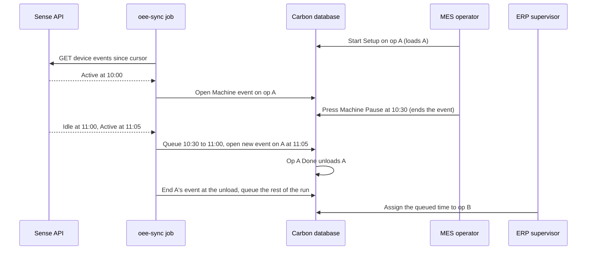
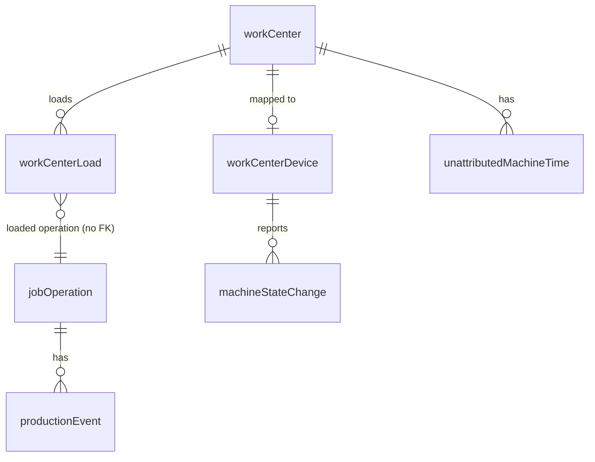

# OEE Provider integration (first provider: Sense)

> Status: implemented (PR #1909)
> Author: barbinbrad
> Date: 2026-10-12

> **Where the build differs from the first draft (the code wins; `.claude/rules/oee-provider.md`):**
> - Unattributed machine time is a review queue with no status. Assign and
>   dismiss delete the row. There is no dismiss reason and no Reopen.
> - The MES operation page shows no device badge. Only the work center
>   display shows the device state.
> - The loaded operation is a history table, `workCenterLoad`. The open row
>   is the load. `workCenter` has no pointer column.
> - The engine gives each moment of a run to an owner. Open sensor time
>   follows its owner when a load, a block or a press changes it.
> - The MES press rules apply on every work center, with or without a device.
> - The OEE tables are read-only through the API. A device maps only to its
>   own company's work center (composite FK). Carbon refuses Sense staging
>   (plain HTTP) in production.

## TLDR

An **OEE provider** is a machine-monitoring vendor. It reports whether each
machine is running. OEE providers are a new class of integration, like
accounting providers. A company can have more than one OEE provider active.
Every provider uses the same interface, the same sync job and the same
mapping screen.

Sense is the first provider. Sense clips a current sensor
onto each machine and reports state changes per **device**. Sense calls a
device a station.

The first step is the **device mapping**: the user pairs each provider device
with one Carbon work center. When a device reports that its machine runs,
Carbon creates a Machine `productionEvent` on that work center. The event
goes to the work center's **loaded operation**. That is the job operation
that a person last started on that work center. If nothing is loaded, the run
goes to an **unattributed machine time** list. A supervisor assigns it to a
job operation or dismisses it.

## Overview diagram



## Problem Statement

Carbon records machine time only when an operator starts and stops the
Machine timer in MES. Operators forget, and machines often run unattended
after setup. So job cost is low, and the work center utilization KPI is
wrong.

Shops already install machine-monitoring sensors. A current clip knows only
whether the machine is on. It does not know which job runs. Carbon cannot use
the top of the schedule: operators skip operations for missing parts and
expedites. Carbon cannot use the operator's clock-in either: an operator sets
up a machine, stops the timer and walks away while the machine runs.

Sense is the first vendor. Its public API
(`http://bifrost-staging.sensemfg.com/docs`) has these endpoints:

| Endpoint | Returns |
|---|---|
| `GET /v1/public/companies/sites` | sites, each with `id`, `name`, `timezone` |
| `GET /v1/public/companies/stations` | stations, each with `id`, `machine_name`, `machine_manufacturer`, `machine_type`, `machine_model`, `site_id`, `last_calibration_attempt_status` |
| `GET /v1/public/companies/sites/{site_id}/stations/{station_id}/events` | state changes, each with `id`, `status`, `created_at` (UTC). Query: `start_datetime`, `end_datetime`, `order`, `limit`, `offset`, `statuses` |
| `GET …/stations/{station_id}/telemetry` | power and vibration samples, one per minute (not used in v1) |

The `status` values are `Active`, `Idle`, `Alert` and `Offline`. Sense has no
webhooks, so Carbon must poll. The API key is company-scoped: Sense finds the
company from the key. On 2026-10-12 the staging company had 3 sites and 55
stations. One site (`Reston - 2`) had the timezone `UTC`.

Research: `.ai/research/oee-provider-integration.md`. No surveyed product
infers the job from an on/off signal. Each product keeps one active job per
machine, and a person or the ERP sets it. MachineMetrics keeps unmatched run
time as an "Unknown Job" that a person assigns later. This spec copies both
patterns.

## Proposed Solution

### 1. The OEE provider class

An OEE provider is an integration with `providerRole: "oee"`. Every OEE
provider implements one interface in `packages/ee/src/oee/types.ts`:

```ts
type MachineState = "Running" | "Idle" | "Down" | "Offline";

interface OeeDevice {
  externalDeviceId: string;
  name: string;
  externalSiteId: string | null;
  siteName: string | null;
  siteTimezone: string | null;
  manufacturer: string | null;
  model: string | null;
  machineType: string | null;
  calibrated: boolean | null;
}

interface OeeStateChange {
  externalEventId: string;
  state: MachineState;
  changedAt: string; // UTC ISO 8601
}

interface OeeProvider {
  id: OeeProviderId;
  validate(): Promise<{ valid: boolean; error?: string }>;
  listDevices(): Promise<OeeDevice[]>;
  listStateChanges(
    device: { externalDeviceId: string; externalSiteId: string | null },
    window: { since: string; until: string }
  ): Promise<OeeStateChange[]>;
}
```

`getOeeProvider(client, companyId, integrationId)` builds the provider from
the company's `companyIntegration` row. It reads the API key from Vault with
`resolveIntegrationSecrets`.

`getOeeProvider` finds the constructor in a registry,
`OEE_PROVIDERS` (`packages/ee/src/oee/registry.ts`), which maps an
integration id to a factory. Code outside the registry never branches on an
integration id. The `no-integration-id-branching` check enforces this, so
add `"sense"` to its `INTEGRATION_IDS` and its provider-directory exclusion.
Code that must find the OEE integrations calls
`getIntegrationIdsByRole("oee")`. A second provider adds one adapter and one
registry entry. The sync job, the mapping screen and the attribution engine
stay the same.

The Sense adapter (`packages/ee/src/sense/`) maps Sense statuses to
`MachineState` with an explicit allowlist:

| Sense `status` | `MachineState` |
|---|---|
| `Active` | `Running` |
| `Idle` | `Idle` |
| `Alert` | `Down` |
| `Offline` | `Offline` |

If Sense returns another status, the adapter throws. The sync job then fails
that device and keeps its cursor (`.ai/lessons.md` → "Financial
discriminators require explicit verified allowlists").

Sense ignores `offset`, and `offset=0` returns HTTP 400 (verified against
staging on 2026-10-13). So the adapter pages by time: it requests
`order=asc&limit=500`, and if the page is full it requests again from the last
event's `created_at`. It drops events it has already seen, by `id`, and stops
when a page is short or adds nothing new.

### 2. Installing Sense

Settings → Integrations → Sense. The descriptor `packages/ee/src/sense/config.tsx`
copies the Rillet descriptor. It has 3 settings:

| Setting | Type | Default |
|---|---|---|
| `apiKey` | `secret` | none (required) |
| `environment` | `options`: Production (`https://bifrost.sensemfg.com`), Staging (`http://bifrost-staging.sensemfg.com`) | Production |
| `minimumStateSeconds` | `number` | 60 |

`onHealthcheck` calls `validate()`, which calls `GET /v1/public/companies/sites`.

### 3. Device mapping

The drawer of each OEE integration gets a **Devices** tab. The loader calls
`listDevices()` and reads the mappings in parallel. Redis caches the device
list for 60 seconds. Each integration save clears the cache. The tab shows one
row per device:

| Column | Source |
|---|---|
| Device | `name`, then manufacturer, model and machine type as muted text |
| Site | `siteName` |
| Calibrated | `calibrated` as a badge |
| Work center | a `Combobox` of active work centers, plus a mapped work center that is inactive |

Rules:

1. The user picks a work center and saves the row. The action upserts a
   `workCenterDevice` row. It stores the name, site and site timezone of the
   device in the current provider list, not the form's values.
2. If the device is not in the current provider list, the action refuses.
3. If the work center already has a device from any OEE provider, the action
   refuses. The message names the other device and provider. The combobox
   leaves out the work centers that another device holds.
4. If the device's site timezone differs from the work center's location
   timezone, the row shows a warning icon. The tooltip names both timezones.
   A location with no timezone (null or `''`) uses the company's. Carbon uses
   the location timezone for all local time.
5. The user clears the combobox to unmap. The action ends the time that the
   device's sensor opened on the work center (`endSensorMachineTime`). Then it
   deletes the `workCenterDevice` row. A remap does the same on the old work
   center and inserts a new row.
6. A new mapping charges no time before the moment of the save. The first
   sync reads the 24 hours before the mapping only to learn the starting
   state.

### 4. The loaded operation (community)

The table `workCenterLoad` holds the loads of each work center. Each row has
`jobOperationId`, `loadedAt` and `unloadedAt`. The row with `unloadedAt` null
is the loaded operation. The loaded operation is the operation that is
physically on the machine. It does not depend on a sensor, so it is AGPL code.
It exists on every work center, with or without a device.

Two interceptors write the table. The API can only read it.

1. A writer inserts a `productionEvent` row with `endTime IS NULL` and a
   `workCenterId`. Then `sync_load_work_center_operation` loads the row's
   operation. Setup, Labor and Machine starts all load. So does the QR start
   (`/x/start/:operationId`).
2. The interceptor takes a transaction advisory lock for the work center.
   Loads on one work center run one at a time.
3. If the event's `startTime` is earlier than the newest `loadedAt` or
   `unloadedAt` of the work center, the interceptor writes nothing. A late
   event never undoes a later load or unload.
4. If the operation is already loaded, the interceptor writes nothing.
5. Else the interceptor ends the open row at `startTime`. Then it inserts a
   row with `loadedAt` = `startTime`.
6. A row inserted with an `endTime` (an ERP entry or an assigned interval)
   never loads. An event loads only its own company's operation onto its own
   company's work center.
7. `sync_unload_work_center_operation` ends the operation's open row. It does
   this when the status changes to `Done` or `Canceled`, when the operation
   is deleted, and when it moves to another work center. It sets
   `unloadedAt` = `GREATEST(NOW(), loadedAt)`.
8. Stopping a timer does not unload the operation. That is what lets an
   unattended run reach the job.

The interceptor has no status rule. A starting event reopens a Done operation
first (`sync_set_job_operation_in_progress`, a BEFORE interceptor).

A CHECK refuses `unloadedAt < loadedAt`. A partial unique index allows one
open row per work center. `jobOperationId` has no foreign key. A second
relationship between `jobOperation` and `workCenter` makes PostgREST refuse
the existing embeds between the two tables (PGRST201).

The sync reads this history. A run that the provider reports late goes to
the operation that was loaded when the machine ran.

The MES work-center display (`/display/:workCenterId/work`) shows the loaded
operation. It reads `loadedJobOperationId` from the view
`workCentersWithBlockingStatus`, which takes it from the open row. If the work
center has a `workCenterDevice`, the display also shows the machine state.

pg_cron deletes a row 7 days after its `unloadedAt`. It keeps the row longer
while a device on the work center has not planned past the unload
(`appliedThrough` is null or earlier than `unloadedAt`). It never deletes an
open row.

### 5. Attribution rules

The engine is a pure function, `planMachineTime`, in
`packages/ee/src/oee/engine.ts`. It returns a list of writes. The sync job
applies them.

**Inputs.**

| Input | Meaning |
|---|---|
| `loads` | The work center's loads in the planned window. Each has `jobOperationId`, `from`, `to` and `assignable`. |
| `blocks` | The periods when maintenance blocks the work center (`from`, `to`). |
| `lastManualChangeAt` | The latest operator press. |
| `firstUnplannedPressAt` | The earliest press since the last sync (`workCenterDevice.unplannedPressAt`). |
| `openMachineEvent` | The newest open Machine event on the work center: `id`, `jobOperationId`, `startTime`, and `system` (true when the sync created it). |
| `openUnattributed` | The open unattributed row. |
| `lastMachineEventEndTime` | The latest Machine `endTime` after `currentStateAt`. |
| `recordedIntervals` | The Machine events and unattributed rows in the window: `id`, `kind`, `startTime`, `endTime`. |
| `currentState`, `currentStateAt` | The applied state. |
| `mappedAt`, `minimumStateSeconds`, `now` | The mapping time, the debounce and the clock. |
| `changes` | The stored changes after `appliedThrough`, in time order. |

`assignable` is false when the operation is Done or Canceled, when its job is
locked (Completed, Closed or Cancelled), or when the operation no longer
exists. `machineTimeRefusal` (`packages/ee/src/oee/assignable.ts`) holds this
rule. The sync, the assign write and the ERP suggestion cards all use it.

**The owner rule.** The sensor decides whether the machine ran. The owner of
each moment of a run decides who gets the time:

1. If maintenance blocks the work center at that moment, the owner is the
   queue.
2. If an operator pressed Machine after the run started, and at or before
   that moment, the owner is the queue. The press stopped the operator's
   time, not the machine.
3. Else, if the operation loaded at that moment is `assignable`, the owner is
   that operation.
4. Else the owner is the queue.

"The queue" is `unattributedMachineTime`. The owner changes only at an edge:
a load begins or ends, a block begins or ends, or a press. The engine splits
each stretch of run time at these edges and gives each piece to its owner. It
never records time that a Machine event or an unattributed row already holds.
So the same facts give the same result in any order of arrival.

A closed piece for an operation becomes a Machine event with `employeeId` =
null and `createdBy` = `system`. The engine drops a closed queue piece shorter
than `minimumStateSeconds`. A piece that reaches the present while the
machine runs stays open. A queue piece opens only after it lasts
`minimumStateSeconds`.

**Debounce.** The engine drops a state that lasts less than
`minimumStateSeconds`. The previous state continues through it. The engine
applies a state change only after the change has lasted
`minimumStateSeconds`, or after the next change confirms it. Repeated reports
of one state count as one run.

**Applied state.** `currentState` is the state the engine applied last.
`currentStateAt` is the time that state began. `appliedThrough` is the
`changedAt` of the last stored change the engine consumed, applied or dropped.
Each sync reads the `machineStateChange` rows after `appliedThrough`. A change
that has not yet lasted `minimumStateSeconds` stays pending, and the next sync
reads it again.

**First sync.** A new device has no `currentState`. The first sync reads from 24
hours before the mapping. The engine takes the last change before the mapping
as the starting state, at the time of the mapping. So a machine that was
already running when the user mapped it opens time from the mapping, never
earlier.

**State changes.** For each new state change, in time order:

1. If the state does not change, skip it.
2. If `changedAt <= lastManualChangeAt`, the provider reported the change
   late. The press already decided the time after it. A late run is recorded
   closed by the owner rule, up to the press or up to an earlier stop. A late
   stop trims the queue (see "Time around a press").
3. If the state is `Running` and a Machine event or an unattributed row is
   open, do nothing.
4. If the state is `Running`, open time for the owner at `changedAt`: a
   Machine event on the loaded operation, or an unattributed row.
5. If the state is `Idle`, `Down` or `Offline`, end the open Machine event and
   the open unattributed row at `changedAt`.

**Open time follows its owner.** An open sensor event or open unattributed
row closes at the first edge where its owner changes. The new owner gets the
rest of the run. Examples:

- An operator starts Setup on operation B while a sensor event runs on A. The
  next sync ends the event on A at B's `loadedAt`. It opens an event on B at
  the same instant.
- Maintenance ends while the machine runs. The open unattributed row ends,
  and an event on the loaded operation opens.
- Operation A goes Done while the machine runs. The unload ends A's load, so
  A's event ends at the unload. The rest of the run goes to the queue.

An operator's open Machine event follows only the start of a block. A load
change does not move it.

**Blocked work center.** A `Down` dispatch blocks the work center from its
`createdAt` until it is Completed or Cancelled. A `Planned` dispatch blocks it
from `actualStartTime` while it is In Progress. The view
`workCentersWithBlockingStatus` counts In Progress dispatches only. The engine
uses the broader periods, because the MES ends every event on the work center
when a user creates a Down dispatch. A supervisor dismisses the queued time
as maintenance.

**Steady state.** After the changes, the engine checks one more case. The
device is `Running`, `currentStateAt > lastManualChangeAt`, and nothing is
open. Then the engine records the run up to now, by the owner rule. The start
is the latest Machine `endTime` after `currentStateAt`, or `currentStateAt`
when that is later. This rule covers a Machine event that a maintenance
dispatch or End Shift closed during a run.

**Time around a press.**

- **Running past a press.** The machine runs at a press and keeps running.
  The time after the press goes to the queue. If the machine stops within
  `minimumStateSeconds` of the press, the engine records nothing.
- **Two presses between syncs.** The sync passes the earliest press since the
  last sync. If the machine ran through it, the time between the presses that
  nothing holds goes to the queue.
- **A late stop.** A stop can arrive after a press and fall inside a queue
  row that the press ended. The engine cuts the row to the time the machine
  ran: it updates, splits or deletes the row. The engine never trims a
  Machine event. Queue rows do not post, so a trim is safe.

**Short rows.** Each sync deletes the closed unattributed rows on its work
center that are shorter than `minimumStateSeconds`.

### 6. The MES Machine button (community)

The Machine timer stays visible. It shows the open Machine event, as it does
today (`useOperation` treats an open Machine event as active for every
operator). The MES operation page shows no device badge. The work center
display shows the device state.

A machine has one machine time, and operators share it. The press rules apply
on every work center, with or without a device:

1. **Start** on operation C: end every open Machine event on the work center
   at the press time, from any operator or the sensor. Insert a Machine event
   on C that starts at the press time. The insert loads C.
2. **Pause**: end every open Machine event on the work center at the press
   time. The operation stays loaded.

A press does not end an event that starts after the press time. On a work
center with a device, the press also does 2 things:

1. It ends the open unattributed row at the press time.
2. It sets `lastManualChangeAt` to the later of its value and the press time.
   It sets `unplannedPressAt` to the earlier of its value and the press time.
   The sync clears `unplannedPressAt`.

Example: the machine is Active. The operator presses Pause at 10:03. Machine
time on the operation stops at 10:03. If the machine runs on, the time after
10:03 goes to the queue until the machine stops.

**Locks.** A press takes its locks in one order:

1. The `workCenterDevice` row `FOR UPDATE` (`lockWorkCenterDevice`). The sync
   takes this lock first too.
2. A transaction advisory lock on the work center. It exists with or without
   a device.
3. For an End only: the event row `FOR UPDATE`, while the event is open.

`lockMachinePress` (`@carbon/database/machine-time`) takes the first 2 locks.
`recordManualMachinePress` reads the press time under them. So presses on one
work center run one at a time, and the recorded press never moves backwards.

**Start and End.** `startMachineProductionEvent` (MES
`operations.service.ts`) runs the press, the event insert and the tracked
activity in one Kysely transaction. If one write fails, nothing ends.
`endMachineProductionEvent` refuses an event that has already ended, and an
event that starts after the press. The route then says "This event has
already ended". The End route reads the event's own work center and type, not
the form's values.

**Permissions.** The Kysely writes skip RLS. So `event.tsx` and
`start.$operationId.tsx` check `create` or `update` on `production` before
any write. `event.tsx` returns a flash message when it refuses.

**Posting.** The routes post every event that a press ends, except batch
events (`postEndedProductionEvents`). The QR start with `type=Machine`
follows rule 1. After the start, it ends the operation's Setup and Labor
events and posts them.

### 7. The sync job

1. The Inngest cron `oee-sweep` runs every 2 minutes. It selects active
   `companyIntegration` rows whose integration has `providerRole = 'oee'` and
   at least 1 `workCenterDevice`. It sends one `carbon/oee-sync` event per
   (company, integration). It copies `ramp-sweep.ts`.
2. `oee-sync` runs with concurrency 1 per company and a `singleton` (skip)
   per company and integration. It syncs all devices of the integration
   inside one `step.run`. One step per device would multiply the Inngest cost
   by the device count.
3. If the company is not entitled to `INTEGRATIONS`, the integration is
   inactive, or the key is empty, `getOeeProvider` returns an error. The job
   skips the integration.
4. For each device, the job reads state changes from `lastEventAt − 10
   minutes` to now. The overlap catches events that Sense stores late. The
   first sync reads from 24 hours before the mapping.
5. The job inserts the changes into `machineStateChange` with
   `ON CONFLICT DO NOTHING`. The unique key is
   (`workCenterDeviceId`, `externalEventId`, `companyId`).
6. The job opens one Kysely transaction per device. It locks the
   `workCenterDevice` row `FOR UPDATE`. The MES press takes the same lock
   first, so a press and a sync never interleave.
7. The job reads the open Machine event, the open unattributed row, the
   latest Machine `endTime` and the stored changes. It computes the start of
   the window: the earliest instant this plan can touch. It reads the loads,
   the block periods and the recorded intervals inside the window.
8. The job runs `planMachineTime` and applies the writes. A close matches
   only a row that is still open.
9. The job deletes the closed unattributed rows on the work center that are
   shorter than `minimumStateSeconds`.
10. In the same transaction, the job sets `currentState`, `currentStateAt`,
    `appliedThrough`, `lastEventAt` and `lastSyncedAt`. It clears
    `unplannedPressAt` and `lastSyncError`. `lastEventAt` follows the newest
    stored change, never the clock.
11. If one device fails, the job writes `lastSyncError` on that device and
    keeps its cursor. The other devices continue. An
    `OeeProviderUnavailableError` (network failure, timeout, 5xx) stops the
    run, because every device would fail the same way.

The job never posts to the GL. Carbon has no scheduled sweep that posts
production events. An event posts at one of 3 moments:

1. At a press: the MES routes post every event that the press ended, except
   batch events.
2. At operation finish: `finishJobOperation` (MES) and `completeOperation`
   (ERP) post the operation's ended, unposted events.
3. At job completion: `complete_job_to_inventory` posts every ended, unposted
   event of the job.

A sensor event that the sync closes posts at operation finish or job
completion. Until it posts, a supervisor can edit it on the job's Events tab.

When a user uninstalls Sense, its `onUninstall` hook (`senseOnUninstall`) ends
the open sensor time of every Sense device of the company. The mappings stay.

### 8. Unattributed machine time (ERP)

Production → **Unattributed Time** (`x+/production+/machine-time.tsx`). The
nav item shows only while an OEE integration is active. The list copies the
Batches list.

| Column | Value |
|---|---|
| Work center | name |
| Location | the work center's location |
| Start, End | in the work center's location timezone |
| Duration | `endTime − startTime`; "Running" while open |
| State | "Running" (blue) or "Stopped" (green) |

The list has 5 filters: work center, location, start date, end date and
state. The date filters use the same timezone as the list (the view
`unattributedMachineTimes`). The list has no sort.

`unattributedMachineTime` is a review queue, not a record. It has no status. A
row leaves the queue in 3 ways:

1. **Assign**: the action inserts a Machine `productionEvent` with the row's
   `startTime` and `endTime`, `employeeId` = null and `createdBy` = the user.
   Then it deletes the row. The event is the record.
2. **Not job time** (dismiss): the action deletes the row. It takes no
   reason.
3. pg_cron deletes the row 30 days after its `endTime`.

Assign and dismiss refuse a row that has no `endTime`: the machine is still
running. Assign also refuses a Done or Canceled operation and a locked job. It
checks them under row locks, inside its transaction.

The drawer (`machine-time.$id.tsx`) reviews the rows of the filtered list one
at a time:

- Suggestion cards show the operations that ran on the work center on the
  days the row covers, best match first. Keys 1 to 6 assign a card.
- A search card lists the open operations at the work center's location,
  including operations with no work center.
- "Not job time" dismisses the row. Skip, j and k move between rows.

Each answer moves to the next row. Closing the drawer returns to the list with
its filters.

### 9. Out of scope for v1

| Item | Why not now |
|---|---|
| An MES prompt ("What's running on W1?") | User decision (Q3). The ERP list comes first. |
| Splitting one unattributed row across 2 operations | A run without a load is normally one job. The supervisor can edit the event on the job's Events tab. |
| An OEE availability or downtime report | `machineStateChange` stores the data for it. The report is a later spec. |
| Telemetry, cycle counts, program numbers | A current clip gives no program. Telemetry is not needed to attribute time. |
| Sense partner tokens (`/v1/public/partners/…`) | Sense issues company-scoped keys to customers. |
| A pool work center with several devices | The mapping is 1:1 (Q1). |
| Importing history from before the mapping | No loaded operation exists for that period. |

### Design Decisions

| Decision | Choice | Rationale |
|---|---|---|
| Provider cardinality | Several OEE providers can be active at once. A work center has at most 1 device across all providers. | User decision (Q1). Shops mix vendors. The single-active trigger skips the `oee` role. `UNIQUE(workCenterId, companyId)` on `workCenterDevice` holds the real rule. |
| Mapping cardinality | 1 device ↔ 1 work center | User decision (Q1). The scheduler treats a work center as capacity 1 (`.claude/rules/scheduling-data-structures.md`). A pool work center ("VF2 ×3") must be split into one work center per machine. |
| Mapping storage | New table `workCenterDevice`, not `externalIntegrationMapping` | The row also holds the cursor, the live state and `lastManualChangeAt`. The cross-provider unique rule is a plain UNIQUE here. In `externalIntegrationMapping` the unique key includes `integration`, so it cannot enforce it. |
| Attribution | The loaded operation per work center. It is never the top of the schedule. Carbon never infers a job. | User decision (Q2). Research: every vendor keeps an explicit active job per machine. |
| How an operation is loaded | Any open `productionEvent` insert on the work center | Setup, Labor, Machine and the QR start already insert one. Shops change nothing. |
| Unattributed time | Its own table, cleared from an ERP list | User decision (Q3). `productionEvent.jobOperationId` is NOT NULL, so unattributed time cannot be a production event. |
| Manual Machine timer | Kept on every work center. A press ends every open Machine event on the work center. The time after a press in the same run goes to the queue. Pause keeps the operation loaded. | User decision (Q4, Q4b, Q4c). A work center has one machine time, so time is never counted twice. |
| GL posting | Sensor events post at operation finish or job completion. Events that a press ends post at the press. There is no posting sweep. | User decision (Q5). A wrong sensor attribution stays editable until the operation is done. |
| License boundary | Provider, sync, mapping and the unattributed list are commercial (`packages/ee`, `.ee.tsx`), gated by `INTEGRATIONS`. The loaded operation, the MES button rules and the display are AGPL. | User decision (Q6). Matches every other integration. |
| Timezone | Store UTC instants. Use the work center's `location.timezone` for local time. Warn on a site/location mismatch. | User decision (Q7). |
| Polling | Inngest cron every 2 minutes, 10-minute overlap, idempotent insert | Sense has no webhooks. A 2-minute delay keeps the work center display useful. The overlap plus the unique key makes a re-read safe. |
| Debounce | `minimumStateSeconds`, default 60 | Research: MachineMetrics uses 60 s for micro-stops. Vendors use 30 s to 3 min. |
| `Alert` and `Offline` | Both end machine time. `Offline` means "no data", not "down". | Research: vendors treat a sensor gap as unknown, never as running. |
| Blocked work center | Running time goes to the unattributed list | Maintenance run time must not reach a job. The supervisor dismisses it as maintenance. |
| Backfill | None. A mapping charges no time before the moment of the save. | The first sync reads the 24 hours before the mapping only to learn the starting state. |
| Load storage | The history table `workCenterLoad`. The open row is the load. | A pointer column held the same fact twice. Clearing its timestamp on unload let a late event load a replaced operation (`.ai/lessons.md`). |
| Who gets each moment | The owner rule (section 5) | The same facts give the same result in any order of arrival. |
| Sync errors | `lastSyncError` and `lastSyncedAt` on `workCenterDevice`, shown in the Devices tab | `accountingSyncOperation.direction` allows only accounting directions. A per-device column is enough for v1. |
| Heuristic 1: multi-tenancy | Every new table has `companyId`, composite PK `("id", "companyId")` and `id('prefix')` | `.claude/rules/conventions-database.md` |
| Heuristic 2: service shape | Service functions take `client` first and return `{ data, error }`. The ee write functions call `requireEntitlement(client, companyId, "INTEGRATIONS")` first. | `.claude/rules/conventions-services.md`, `.claude/rules/commercial-licensing.md` |
| Heuristic 3: RLS | `workCenterDevice`, `machineStateChange`, `unattributedMachineTime` and `workCenterLoad` are SELECT-only for company employees (`packages/database/src/authz/manifest.ts`). | Every write goes through Kysely in the sync, the MES press, the Sense uninstall hook, an entitlement-gated ee function or an interceptor (`.claude/rules/authz-manifest.md`). |
| Heuristic 4: permissions | Devices tab: `settings_update`. Unattributed list: `production_view`. Assign or dismiss: `production_update`. MES Machine start: `production_create`. MES Machine end: `production_update`. | Same scopes as integration settings and job events. The MES routes check them because the Kysely writes skip RLS. |
| Heuristic 5: forms | The drawer submits Assign and Dismiss with a fetcher. The route action validates them with zod validators in `production.models.ts`. | `.claude/rules/conventions-forms.md` |
| Heuristic 6: module layout | ERP UI in `modules/production/ui/MachineTime/*.ee.tsx` and `modules/settings/ui/Integrations/OeeDevices.ee.tsx`. Reads in `production.service.ts`. Writes in `@carbon/ee/oee.server`. | One service and one models file per module. Gated writes live in `packages/ee`. |
| Heuristic 7: compatibility | Additive, with one change for work centers with no device: a Machine press ends every open Machine event on the work center. | No public contract changes. |

## Data Model Changes



The migrations, in order:

| Migration | Change |
|---|---|
| `20261013030022_oee-provider.sql` | The role, the `machineState` enum and the three OEE tables |
| `20261013170425_unattributed-time-queue.sql` | The queue drops its status columns |
| `20261013191915`, `20261013201722` | Composite foreign keys to `workCenter`, and retention |
| `20261013233811` | The view `unattributedMachineTimes` |
| `20261014010130_work-center-load-history.sql` | The table `workCenterLoad` |
| `20261014024119_oee-load-is-history.sql` | Drops the pointer columns. Adds the constraints, `unplannedPressAt` and the sync's indexes |

| Table | Columns and constraints |
|---|---|
| `integration` | `providerRole` CHECK allows `'oee'`. `check_single_active_provider_role()` returns early for `oee`. Row `sense` with `providerRole = 'oee'`. |
| `workCenterDevice` (`id('wcd')`) | `workCenterId`, `integration`, `externalDeviceId`, `externalSiteId`, `siteTimezone`, `deviceName`, `currentState` (`machineState`), `currentStateAt`, `appliedThrough`, `lastEventAt`, `lastManualChangeAt`, `unplannedPressAt`, `lastSyncedAt`, `lastSyncError`, audit columns. `UNIQUE (workCenterId, companyId)`, `UNIQUE (integration, externalDeviceId, companyId)`. FK `(workCenterId, companyId)` → `workCenter`. |
| `machineStateChange` (`id('msc')`) | `workCenterDeviceId`, `workCenterId`, `externalEventId`, `state`, `changedAt`. `UNIQUE (workCenterDeviceId, externalEventId, companyId)`. FK `(workCenterId, companyId)` → `workCenter`. pg_cron deletes rows older than 30 days and rows of an unmapped device. |
| `unattributedMachineTime` (`id('umt')`) | `workCenterId`, `startTime`, `endTime`, audit columns. No status. FK `(workCenterId, companyId)` → `workCenter`. pg_cron deletes rows 30 days after `endTime`. |
| `workCenterLoad` (`id('wcl')`) | `workCenterId`, `jobOperationId` (no FK), `loadedAt`, `unloadedAt`, `createdAt`. CHECK `unloadedAt IS NULL OR unloadedAt >= loadedAt`. Partial unique index: one open row per work center. FK `(workCenterId, companyId)` → `workCenter`. |

`machineState` is the enum `'Running', 'Idle', 'Down', 'Offline'`. The view
`workCentersWithBlockingStatus` exposes `loadedJobOperationId` from the open
`workCenterLoad` row. Two indexes serve the sync: `productionEvent
(workCenterId, endTime) WHERE type = 'Machine'` and `maintenanceDispatch
(workCenterId)`.

The migrations write no policies. The authz manifest renders them: the four
OEE tables are SELECT-only for company employees. Every write goes through
Kysely in the sync, the MES press, the Sense uninstall hook or an
entitlement-gated `@carbon/ee/oee.server` function. The two interceptors are
AFTER interceptors in `packages/database/src/event-system/attachments.ts`:
`sync_load_work_center_operation` on `productionEvent` and
`sync_unload_work_center_operation` on `jobOperation`. The dispatchers are
`SECURITY DEFINER`, so the interceptors write `workCenterLoad` for an
operator who has no `resources_update` permission.
`workCenterDevice` and `unattributedMachineTime` have a statement broadcast
(`broadcast_table_changes`). Backups remap
`workCenterLoad.jobOperationId` and `machineStateChange.workCenterDeviceId`
(`packages/jobs/src/backups/id-refs.ts`).

`SECRET_KEYS` (`packages/ee/src/integrations/secrets.ts`) gets
`sense: ["apiKey"]`. The key stays at `metadata.apiKey`, as Linear's does, so
the install path needs no credential fold. `FORM_SECRET_INTEGRATIONS` in
`integrations.$id.tsx` gets `"sense"`. Three unions get `"oee"`: the
descriptor type (`packages/ee/src/types.ts`), `ProviderRole`
(`packages/ee/src/index.ts`) and `ProviderRole` (`packages/ee/src/sync/topology.ts`).
The topology picks only the accounting and spend roles, so an `oee` row never
enters it. The integration drawer hides Sync Activity for the `oee` role, and
`IntegrationCard` does not treat an active `oee` integration as an incumbent.

## API / Service Changes

| Location | Function | Purpose |
|---|---|---|
| `packages/ee/src/oee/types.ts` | `OeeProvider`, `MachineState`, `OeeDevice`, `OeeStateChange` | The provider contract |
| `packages/ee/src/oee/engine.ts` | `planMachineTime` | Pure attribution rules (section 5). Unit-tested. |
| `packages/ee/src/oee/assignable.ts` | `machineTimeRefusal` | Can an operation take machine time |
| `packages/ee/src/oee/service.server.ts` | `getOeeProvider`, `upsertWorkCenterDevice`, `deleteWorkCenterDevice`, `assignUnattributedMachineTime`, `dismissUnattributedMachineTime` | The writes call `requireEntitlement` first. |
| `packages/ee/src/sense/provider.ts` | `SenseProvider` | The Sense adapter |
| `packages/ee/src/sense/config.tsx`, `hooks.server.ts` | `Sense` descriptor, `senseHealthcheck`, `senseOnUninstall` | Install, health and uninstall |
| `packages/database/src/machine-time.ts` | `lockWorkCenterDevice`, `lockMachinePress`, `recordManualMachinePress`, `endSensorMachineTime` | The locks and the writes that end machine time |
| `packages/jobs/src/inngest/functions/integrations/oee-sweep.ts` | cron, every 2 minutes | Sends `carbon/oee-sync` per company and integration |
| `packages/jobs/src/inngest/functions/integrations/oee-sync.ts`, `oee-sync-device.ts` | `oeeSyncFunction`, `syncOeeDevice` | Section 7 |
| `apps/erp/app/modules/production/production.service.ts` | `getUnattributedMachineTimes`, `getUnattributedMachineTime`, `getUnattributedMachineTimeNeighbors`, `getWorkCenterDayEvents`, `getMachineTimeOperationCandidates` | Reads for the list and the drawer |
| `apps/erp/app/modules/production/production.models.ts` | `assignMachineTimeValidator`, `dismissMachineTimeValidator` | Form validators |
| `apps/erp/app/modules/settings/oee-devices.server.ts` | `getOeeDevicesTabData`, `saveWorkCenterDeviceMapping` | Devices tab loader and action |
| `apps/mes/app/services/operations.service.ts` | `startMachineProductionEvent`, `endMachineProductionEvent`, `postEndedProductionEvents` | Section 6 |
| `apps/mes/app/routes/x+/event.tsx`, `start.$operationId.tsx` | Machine start and end on every work center | Section 6 |
| `apps/mes/app/services/display.service.ts` | `getDisplayWorkCenter`, `getDisplayDeviceState` | Work-center display |

## Closest Sibling

| Part | Sibling | Files copied |
|---|---|---|
| Provider class | Accounting providers (`providerRole: "accounting"`) | `packages/ee/src/accounting/core/types.ts` (provider interface shape), `packages/ee/src/index.ts` (`getIntegrationIdsByRole`) |
| Descriptor and API-key settings | Rillet | `packages/ee/src/rillet/config.tsx`, `rillet/hooks.server.ts` |
| Role-targeted polling | Ramp | `packages/jobs/src/inngest/functions/integrations/ramp-sweep.ts`, `ramp-sync.ts` |
| Devices tab | Account Mapping | `apps/erp/app/modules/settings/ui/Integrations/AccountMapping.tsx` (row form, `Combobox`, per-row save). The row is flipped: the provider object is on the left and the Carbon record is the combobox. |
| Unattributed list | Production → Batches | `apps/erp/app/routes/x+/production+/batches.tsx`, `modules/production/ui/Batches/BatchesTable.tsx` |
| Assign drawer | Job events | `apps/erp/app/routes/x+/job+/$jobId.events.new.tsx`, `ProductionEventForm` |

The feature deviates from its siblings in 3 places. Each one is a row in
Design Decisions:

1. The mapping lives in its own table, not `externalIntegrationMapping`.
2. The `oee` role allows several active providers.
3. Sync errors are columns on the device, not Sync Activity rows.

## UI Changes

| Surface | Change | Archetype |
|---|---|---|
| ERP Settings → Integrations → Sense | New integration card. Drawer with Connection settings and a **Devices** tab. | Integration drawer (same as Rillet) |
| ERP Production nav | New item **Unattributed Time** in the Production group, after Batches. It shows only while an OEE integration is active. | List page with a drawer (same as Batches) |
| ERP Production → Unattributed Time → row | Review drawer: suggestion cards, a search card, "Not job time" and Skip | Drawer |
| MES operation screen | No change. The Machine toggle's dot already marks running time. Button rules in section 6. | No new archetype |
| MES work-center display | Loaded operation, and the device state when mapped | Existing display |
| Docs | `docs/content/docs/integrations/oee.mdx`, added to `meta.json`; a "Loaded operation" section in `docs/content/docs/reference/work-centers.mdx` | Integration guide |

If the company is not entitled to `INTEGRATIONS`, the Devices tab and the
Unattributed Time page render the upgrade overlay (`usePlanGate`). The
Unattributed Time nav item shows only while an OEE integration is active, so
a company with no OEE integration does not see it.

## Acceptance Criteria

- [ ] With the staging API key, installing Sense shows a healthy connection. The Devices tab lists the 55 Sense stations with their site names.
- [ ] Mapping Station 0002 to work center W1 saves a `workCenterDevice` row. The action refuses a second station on W1. Its message names Station 0002.
- [ ] Mapping a station from site `Reston - 2` (UTC) to a work center whose location is in `America/New_York` shows the timezone warning.
- [ ] Activating Sense while another `oee` integration is active succeeds. The single-active trigger still refuses a second active `accounting` integration.
- [ ] An operator starts Setup on operation A at W1 and stops it. The open `workCenterLoad` row of W1 names A.
- [ ] An event that starts before the newest `loadedAt` or `unloadedAt` of W1 loads nothing.
- [ ] Sense reports Active at T1 and Idle at T2 for the mapped station. Within 2 sync runs, a Machine `productionEvent` on A exists with `startTime` = T1, `endTime` = T2, `employeeId` null and `postedToGL` false.
- [ ] After operation A is finished, that event has `postedToGL` = true. Its cost is (T2 − T1) × W1's machine rate plus overhead.
- [ ] With nothing loaded on W1, an Active change creates an open `unattributedMachineTime` row. The row appears on Production → Unattributed Time.
- [ ] Assigning a stopped row to operation B creates a Machine event on B with the row's start and end, and deletes the row.
- [ ] Dismissing a stopped row deletes it, and no event exists. Dismissing a running row fails.
- [ ] The machine is Active and the operator presses Pause at 10:03. The event ends at 10:03. The time after 10:03 until the machine stops goes to an unattributed row. The next Idle→Active change opens a new event on the same operation.
- [ ] A sensor event runs on A, and the operator presses Machine Start on operation C. A's event ends at the press time. C's event starts at the press time. C is loaded.
- [ ] A sensor event runs on A, and an operator starts Setup on operation B. The next sync ends A's event at B's `loadedAt` and opens an event on B at that instant.
- [ ] Running the sync twice over the same window creates no duplicate `machineStateChange`, `productionEvent` or `unattributedMachineTime` rows.
- [ ] A state that lasts 30 seconds with `minimumStateSeconds` = 60 creates no event and does not close an open one.
- [ ] If Sense returns a status outside the allowlist, that station gets `lastSyncError` and keeps its cursor. Other stations still sync.
- [ ] W1 has an In Progress maintenance dispatch with OEE impact Down. Running time on W1 creates an unattributed row, not an event on the loaded operation.
- [ ] Operation A goes Done while the machine runs. The event ends at the unload, and the rest of the run becomes an unattributed row that starts at that time.
- [ ] On a work center with no `workCenterDevice`, a Machine press ends every open Machine event on the work center and writes no device column.
- [ ] Uninstalling Sense ends the open sensor events and unattributed rows of its devices. The `workCenterDevice` rows stay.
- [ ] On a plan without `INTEGRATIONS`, the Devices tab and the list show the upgrade overlay. Calling `assignUnattributedMachineTime` throws `EntitlementError`.
- [ ] `planMachineTime` has unit tests for every rule in section 5 and the press examples in section 6, including the same facts in different orders of arrival.

## Risks

| Risk | Severity | Mitigation |
|---|---|---|
| A stale loaded operation: nobody finishes or reloads it, so another job's run time goes to it | Med | The work center display shows the loaded operation. Any timer start on the right operation reloads. A supervisor can edit the event on the job's Events tab until the operation is finished. |
| The staging host is plain HTTP, so the API key travels unencrypted | Med | Production uses HTTPS. The Staging option says "testing only" in its description. |
| Sense rate limits and backfill behavior are not documented | Med | Verify with one curl before the job is wired into the cron (`.ai/lessons.md` → "A VERIFY-flagged provider endpoint in a cron loop is an outage"). The 10-minute overlap tolerates late events. Confirm the limits with Sense before launch. |
| Inngest cost of a 2-minute cron | Low | The sweep sends events only for companies with at least one mapped device. |
| `sync_set_job_operation_in_progress` reopens a Done operation on an open-event insert | Low | The engine opens an event only on an `assignable` operation, which is never Done or Canceled. Assign inserts a closed event and refuses a Done or Canceled operation. |
| A long Sensor Offline gap hides real run time | Low | Offline ends machine time. The Devices tab shows `currentState` = Offline and the time of the last sync. |
| An operator presses Machine Start while the machine is Idle. The event runs until the sensor reports the next change. | Med | This is the override the user chose (Q4c). The work center display shows the sensor's Idle state. The supervisor can edit the event until the operation is finished. |
| One work center models a pool of machines | Low | Out of scope. The mapping refuses a second device, and the docs say to split the work center. |

## Open Questions

> HARD STOP: Do not proceed with implementation until these are answered.

- [x] Can a company have more than one OEE provider active at once? — **Answer:** Yes. A work center has at most one device across all providers.
- [x] How does Carbon pick the job operation for sensor run time? — **Answer:** The loaded operation per work center. The latest Setup, Labor or Machine start there sets it, and it survives clock-out. Run time with nothing loaded is unattributed. Never the top of the schedule. No inference from In Progress operations.
- [x] Where is unattributed time resolved in v1? — **Answer:** An ERP supervisor list only. Assign to a job operation, or dismiss. The MES prompt is later work. (Shipped: dismiss takes no reason and deletes the row.)
- [x] What happens to the manual MES Machine timer on a mapped work center? — **Answer:** It stays visible and in sync with the sensor. There is one Machine event at a time, so no duplicates.
- [x] What does the Machine button do when the sensor drives the timer? — **Answer:** It overrides the sensor for the operator's time. Pause keeps the operation loaded. (Shipped as the owner rule: the time after a press in the same run goes to the queue.)
- [x] When does sensor machine time post to the GL? — **Answer:** At operation finish or job completion. (Shipped: there is no posting sweep; section 7 lists the 3 moments an event posts.)
- [x] Which parts are commercial? — **Answer:** The provider, the sync, the mapping and the unattributed list are in `packages/ee`, gated by `INTEGRATIONS`. The loaded operation and its MES display are AGPL.
- [x] Which timezone wins for local time? — **Answer:** The work center's location timezone. Store UTC. Warn when the Sense site timezone differs.

## Changelog

- 2026-10-14: Fixes from the strict self-review (`.ai/plans/2026-10-14-oee-review-fixes.md`). The open `workCenterLoad` row is the load: the migration drops `workCenter.loadedJobOperationId` and `loadedAt`. A load older than the newest boundary in the history writes nothing. An unload ends the open row at `GREATEST(NOW(), loadedAt)`. The engine applies one owner rule to every piece of a run. Open sensor time follows its owner across load, block and press edges. A late stop trims the closed queue rows. A press takes its time under the locks and records `unplannedPressAt`. A Machine start writes the press, the event and the tracked activity in one transaction. The routes check permission before any write and post every event a press ends. Uninstalling Sense ends its open sensor time. The ERP review keeps the list filters and spans the days of the row.
- 2026-10-13: Build changes. Unattributed time became a queue with no status. Maintenance blocks became periods. The load gained its history table, `workCenterLoad`. The OEE tables became read-only through the API, with composite foreign keys to `workCenter`. The MES press rules apply on every work center.
- 2026-10-12: Planning pass. Corrected the secret path, the interceptor timing, the view recreation and the indexes. Added the engine's inputs, applied state (`appliedThrough`) and first-sync rules. The steady-state rule now reopens time on the loaded operation when the rules allow it.
- 2026-10-12: Created. Research: `.ai/research/oee-provider-integration.md`. Prior thinking: the kyoto session of 2026-10-07 ("Current clip job identification").
