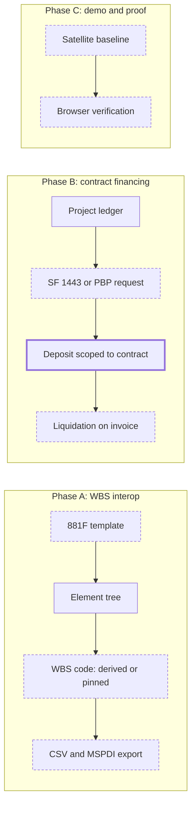

# WBS Interop, Contract Financing and the Earned Value Demo

> Status: in-progress (built; 5 acceptance criteria lack browser evidence, see Acceptance Criteria)
> Author: Claude (autonomous `/feature` run, `.ai/runs/2026-10-12-defense-manufacturer-pitch.md`)
> Date: 2026-10-12

Research: `.ai/research/wbs-interop-and-contract-financing.md`. It builds on
`.ai/specs/implemented/2026-10-09-government-contracting.md` (Phases 5a–5d) and
`.ai/specs/2026-10-03-projects.md`.

## TLDR

This spec adds what a defense manufacturer asks for after the DCAA questions. It has 3 phases:

- **Phase A, WBS interop (community).**
  - Each project element gets a WBS code. Carbon derives the code from the tree, or the user pins it to the contract WBS.
  - New projects can start from MIL-STD-881F templates.
  - The element tree goes in and out as CSV, and out as Microsoft Project XML (MSPDI).
- **Phase B, contract financing (commercial, `GOVERNMENT_CONTRACTING`).**
  - A customer contract can carry customary progress payments (SF 1443) or performance-based payments (PBP).
  - Carbon computes each request from the project ledger and records the government's payment as a deposit scoped to the contract.
  - It applies that deposit to delivery invoices as liquidation.
- **Phase C, the demo and the proof.**
  - The satellite dataset seeds element dates and a baseline, so the earned value screens show data.
  - The deferred browser verification of Phases 5a–5d runs, with Phases A and B.

## Overview diagram



## Problem Statement

A defense manufacturer evaluates Carbon with 3 questions that Carbon cannot answer today.

1. **"Does it use our contract WBS?"** An element has only a flat id such as `OB2-17`. The government's contract WBS uses codes such as `1.3.2`. Carbon has no code field, no MIL-STD-881 structure, no import and no export. A prime cannot load Carbon's schedule into MS Project, Primavera P6 or Deltek Cobra.
2. **"Can it run our progress payments?"** The government finances firm fixed-price DoD contracts with progress payments (FAR 32.5) or performance-based payments (FAR 32.10). The government's spec lists both as out of scope. Today a customer computes the SF 1443 in a spreadsheet, outside the ledger that holds the cost.
3. **"Show me earned value."** The satellite demo has control accounts and work packages but no baseline and no element dates. The Costs page says "Take a baseline first". Also, the browser verification of Phases 5a–5d never ran.

## Proposed Solution

### Phase A: WBS interop

**The WBS code.**

- `projectElement.wbsCode` stores a pinned code. When it is null, Carbon derives the code when it reads the tree.
- The pure function `computeWbsCodes(elements)` in `@carbon/utils` (`wbs.ts`) derives the codes:
  1. Sort the siblings by `sortOrder`, then by the sequence number of `readableId`.
  2. Skip a `Parameter` element. Its subtree gets no code.
  3. Give each other element its 1-based position among its numbered siblings.
  4. A root element's code is its position (`1`, `2`).
  5. A child's code is the parent's code, then `.`, then the position.
  6. If the parent's code ends in `.0`, drop the `.0` first. So under `1.0` the children are `1.1`, `1.2`, as MIL-STD-881F numbers them.
  7. A pinned code replaces the derived code of its element. Its children derive from the pinned code.
- A move or a reorder never changes a pinned code. The derived codes follow the tree.
- The `wbsCode` column holds 1 to 40 characters: digits, letters, `.` and `-` (CHECK). Two pinned codes in one project cannot be the same (partial unique index).
- `computeWbsCodes` also returns the set of codes that occur more than once, for example a pinned `1.2` beside a derived `1.2`. The Plan page marks those elements, and both exports refuse while a duplicate exists.
- `wbsCode` is a plan-layer field (`PLAN_LAYER_FIELDS`). After the plan locks, a change of a pinned code goes through a change request, like any other plan change. A contract WBS changes only by contract modification (881F §4.1).

**Pin and renumber.**

- The element page shows the code. The user can type a code to pin it, or clear it to go back to the derived code.
- The project ⋯ menu has **Pin WBS codes**. It pins every derived code of the project in one statement, which is what a contractor does at award. A pinned code then stays put when the tree changes.
- The element ⋯ menu has **Renumber WBS**. It clears the pinned codes of the element's subtree, so the subtree derives again.

**MIL-STD-881F templates.**

- `@carbon/utils` `wbs-templates.ts` holds 4 templates as static data: Appendix B (Electronics/Avionics/Generic), A (Aircraft, manned and unmanned), C (Missile/Ordnance) and F (Space).
- Each template holds levels 1 to 3 with the 881F codes and names. The data comes from the 881F text (`.context/research/881f.txt`, copied from the ASSIST PDF).
- The New Project drawer and **Copy from** list the templates under "MIL-STD-881F" beside the company's own templates.
- Building from a template inserts the elements with pinned codes.
  - Level 1 gets type `System`.
  - An element with children gets type `System`.
  - A leaf gets type `Task`.
- "1...n (Specify)" elements come in as 1 instance, with the name kept, for example "Prime Mission Product 1...n (Specify)". The user renames it.

**CSV export and import.**

- The Plan page's ⋯ menu has **Export CSV**, **Import CSV** and **Export MS Project XML**.
- Export columns: `Element ID` (the readable id), `WBS Code`, `Parent WBS Code`, `Level`, `Type`, `Name`, `Start`, `Target`, `Budget`, `Predecessors`, `Milestone`.
  - Dates are `YYYY-MM-DD`.
  - `Predecessors` lists the `precedes` links into the element as WBS codes, separated by `;`, for example `1.2.1; 1.1`. A `precedes` link has no lag and no type, so the export writes neither.
- Import is a modal on the Plan page: upload, preview, apply. It does not use the generic import wizard, which is per list page and has no parent record.
  1. The browser parses the file with PapaParse.
  2. The route action validates every row with the pure `readWbsCsv` (`projects.models.ts`).
  3. The modal shows the preview: new elements, updated elements, and errors per row.
  4. **Apply** calls `importProjectWbs` (`projects.server.ts`). It writes every row in one Kysely transaction.
- Import rules:
  1. A row with an `Element ID` of this project updates that element: name, type, budget, dates, parent, and the pinned code.
  2. A row with no `Element ID` creates an element. It takes the next `readableId`.
  3. `Parent WBS Code` names the parent. It is a code of the file or of an existing element. Blank means a root element.
  4. A `WBS Code` on the row pins that code.
  5. The import adds the `precedes` links that `Predecessors` names. It never deletes a link and never deletes an element.
  6. If any row has an error, the import writes nothing.
  7. If the plan is locked, the action refuses the import with `projectPlanLockedMessage`. Import is a setup step, done before the plan locks.

**MSPDI export.**

- `buildMspdiXml(project, elements, links, baseline)` is a pure function (`projects.models.ts`). It writes the XML as a string, with no new dependency. The route `api+/projects.$projectId.mspdi[.]xml.ts` serves it.
- The mapping follows the research file (*Recommended approach*, WBS item 6):
  - `UID` = the sequence number of `readableId`, which never changes.
  - `ID` = the row in tree order.
  - `WBS` and `OutlineNumber` = the WBS code. `OutlineLevel` = the depth.
  - `Summary` = 1 when the element has children.
  - `Start` at `T08:00:00` and `Finish` at `T17:00:00`.
  - A leaf gets `ConstraintType` 4 (Start No Earlier Than) on its start date.
  - `FixedCost` × 100 on leaves only.
  - `Baseline` 0 from the latest baseline's `schedule` and budgets.
  - `PredecessorLink` (FS, `LinkLag` 0) for each `precedes` link.
  - Text1 = the readable id. Text2 = the control account's WBS code. Text3 = the work package flag.
  - One Standard calendar (`UID` 1, Monday–Friday, 08:00–12:00 and 13:00–17:00).
- An element with no dates takes the project's start date and one estimated day, as Project shows "1 day?". A zero duration makes Project draw a milestone. Project schedules the element from its links.

### Phase B: contract financing

**Financing terms on the contract.**

- `customerContractFinancing` holds 1 row per contract:
  - the method: `Progress Payments` or `Performance-Based Payments`, never both (FAR 32.1003);
  - the contract price (SF 1443 line 5) and the initial award date (line 7);
  - the small-business flag (line 3);
  - for PBP, the maximum share of the price (default 0.9, FAR 32.1004(b)(2)).
- `customerContractFinancingRate` holds the rate history: effective date, progress payment rate, liquidation rate and modification number. The rate of a date is the latest row on or before it.
- Carbon never derives a rate from business size, because no source settles the DoD small-business rate. The form suggests 0.80 for both rates. The user enters the contract's rates.
- The contract's currency must be the base currency, as for billing lines (project billing P5).

**The request.**

- `contractFinancingRequest` covers both methods: number, request date, costs-through date, status, requested amount, approved amount, and the payment that settled it.
- Status lifecycle: Draft → Submitted → Approved → Paid, or Withdrawn from Draft or Submitted.
- The number is the next in the contract's series, given at **Submit** (`customerContractFinancing.nextRequestNumber`). A Draft has no number. A Withdrawn request keeps its number, so the series has no gaps.
- **A progress payment request** stores the SF 1443 as a snapshot in 2 JSONB columns:
  - `lines`: the computed value of lines 5 to 26;
  - `overrides`: each overridden line with its value, reason, user and time.
  The effective value of a line is the override, else the computed value. The pure `computeSf1443` (`@carbon/ee/contract-financing`) computes every line:

| Line | Source |
|---|---|
| 5, 6A, 6B, 7 | The terms and the rate on the request date |
| 11 | Σ `projectLedger.amount`, `unallowable = false`, `postingDate` ≤ the costs-through date. It reads the contract's project and the projects of its Fixed lines. A Cost Plus or T&M line's project stays out (FAR 32.501-3). Burden rows count, because they are allocable indirect cost. |
| 12a | The same sum with the unallowable rows |
| 12b | Entered, with its estimate date. The default is Σ `estimateAtCompletion` of the root elements, less 12a. A warning shows when the estimate date is more than 6 months old. |
| 13 | 11 × 6A. When 12c > 5, Carbon first multiplies 11 by the loss ratio, 5 ÷ 12c (FAR 32.503-6(g)). |
| 14a–14d | Entered. The default is 0 (subcontract financing). |
| 18 | Σ requested amount of the contract's earlier requests that are not Withdrawn |
| 20a | Entered. The suggestion is 11 × (21a ÷ 5). |
| 21a | Σ subtotal of the contract's posted delivery invoices (`salesInvoice.customerContractId`, not Voided), dated on or before the costs-through date |
| 21d | 0. Advance payments are out of scope. |
| 23 | Σ liquidation applied, plus the expected liquidation of the posted invoices that are not paid |
| 15–17, 19, 20b–20e, 21b, 21c, 21e, 22, 24–26 | The SF 1443 formulas |

- Section III (lines 20–25) applies only when 21a > 0. Without it, line 26 = line 19.
- `computeSf1443` rounds each line to whole dollars, half up, at the snapshot boundary (`SF1443_WHOLE_DOLLAR_SCALE = 0`).
- **A performance-based payment request** bills events:
  - `performanceBasedPaymentEvent` holds the schedule: sequence, code, description, completion criteria, Severable or Cumulative, the CLIN (a contract line) or none for the whole contract, the amount and the planned date.
  - The user marks an event complete, with the completion date and an evidence note.
  - A request can bill a Cumulative event only when every event before it in sequence is complete (FAR 32.1007(d)).
  - The request takes every complete event that no earlier live request billed, through `contractFinancingRequestEvent`.
  - It stores the DoD values: 1a, earlier events; 1b, this request; 1c, cumulative; 2, total cost incurred (12a).
  - Carbon refuses a request whose 1c exceeds the maximum share × the price.
  - The amount never reads the project ledger. Value 2 is information only (DFARS 232.1001(a)).
- **Print.** `ContractFinancingRequestPDF` (`@carbon/documents`) prints the SF 1443 sections I–III, or the PBP request table. The user types the request into WAWF. The EDI 810P export is out of scope.

**The payment and the liquidation.** This part reuses the customer deposit engine. It needs no new posting builder.

- `payment.customerContractId` is a third deposit scope, beside `salesOrderId` and `rentalAgreementId`. This part is community code, because a commercial contract can also take a deposit.
- A contract deposit funds only the invoices of that contract: `salesInvoice.customerContractId`, or a line with `customerContractId` (`fundingScopeCovers`, `deposit-scope.ts`).
- **Record payment** on an Approved request creates a Draft deposit payment for the approved amount, scoped to the contract. The user posts it the usual way, and the post credits the customer deposit account (`accountDefault.prepaymentAccount`). The request turns Paid when its payment posts.
- **The expected liquidation** of a posted delivery invoice is the lesser of 2 amounts (52.232-16(b)):
  - the liquidation rate on the invoice date × the invoice subtotal;
  - the unliquidated balance, less the expected liquidation of the contract's earlier unpaid invoices.
  `expectedLiquidation` (`@carbon/ee/contract-financing`) computes it.
- The invoice prints the GROSS amount, as DFAS asks. The invoice page and the PDF show "Progress payment liquidation expected: $X" as information.
- When the government pays, the user records a customer payment for the cash. The user then applies the contract's deposit to the invoice for the liquidation amount, through the existing "apply credit" path. The payment form suggests the expected liquidation.
- **The unliquidated balance** = Σ posted contract deposits − Σ their applications (`invoiceSettlement` rows with the deposit as `sourcePaymentId`). The financing page shows the balance.

### Phase C: the demo and the proof

1. Move `PLAN_LAYER_FIELDS`, `toPlanSnapshot`, `PROJECT_BASELINE_FORMAT_VERSION` and their types from `projects.models.ts` to `@carbon/database/project-plan`. Re-export them from `projects.models.ts`, so no call site changes.
2. `ProjectElementSpec` gets `startOffset` and `targetOffset`. `ProjectSpec` gets `baseline?: { name: string; dateOffset: DayOffset }`.
3. Tier 09 sets the element dates, then writes the baseline with the same snapshot (`formatVersion` 2), and advances `project.nextBaselineSequence`.
4. The satellite ORBSEC Block 2 project gets dates on its 4 work packages and a baseline "Contract award" dated 120 days ago. Its Costs page then shows BCWS, BCWP, ACWP, CPI and SPI per control account.
5. The ORBSEC contract gets progress payment terms, 1 Paid request and 1 Draft request. Tier 09 seeds its deposit and 1 liquidation with the rows that the posting path writes (the dataset convention).
6. `DATASET_COVERAGE_FLOORS.satellite` gains `projectBaseline`, `customerContractFinancing` and `contractFinancingRequest`.
7. `/test` runs the browser verification of Phases 5a–5d (plan tasks 5a-35, 5b-22, 5c-23, 5d-16) and of Phases A and B. It writes 1 playbook per phase under `.ai/playbooks/`.

### Design Decisions

| Decision | Choice | Rationale |
|----------|--------|-----------|
| How the WBS code is stored | Pinned code in `projectElement.wbsCode`; derived codes computed on read | SAP, Costpoint and P6 store an entered code, and MS Project freezes its WBS field until Renumber. Computing the derived code avoids a renumber write on every move. |
| Which elements get a code | Every type except `Parameter` | Requirement and Test Case are chargeable by default (`chargeableByDefault`), so they are charge numbers that can need a WBS code. A Parameter is a design value, not work. |
| `1.0` convention | A child of a code ending `.0` drops the `.0` | MIL-STD-881F numbers level 1 as `1.0` and level 2 as `1.1`. |
| Duplicate codes | Partial unique index on pinned codes; derived duplicates flagged in the UI and refused by both exports | A pinned code and a derived code can collide. Refusing the move would block normal tree editing. |
| 881F templates | Static data in `@carbon/utils`, not rows seeded per company | One copy for every company, existing ones included. No change to seed-company, backups or datasets. 881F is a US Government work with Distribution A. |
| Template element types | `System` for an element with children, `Task` for a leaf | Both are chargeable by default. 881F elements are product and work elements. |
| CSV import location | A project-scoped modal, not the generic import wizard | The wizard is per list page and has no parent record (`csv-import-system.md`). |
| CSV import scope | Create and update; never delete an element or a link | An import that deletes is dangerous on a project with charges. |
| MSPDI writer | A string builder, no XML dependency | The document is small and fixed in shape. AGENTS.md asks first before a production dependency. |
| Financing gate | Engine, routes' authoring and UI under `GOVERNMENT_CONTRACTING` in `packages/ee/src/contract-financing/`; the contract deposit scope is community | The same split as Phase 5b: the ee engine computes, community posting writes (`commercial-licensing.md`). |
| Payment and liquidation | Reuse the customer deposit engine with a contract scope | The deposit liability, the scoped application and the settlement records exist already. A new posting path would duplicate them. |
| GL account | `accountDefault.prepaymentAccount` (customer deposits) | No change to `accountDefault`. The financing page reports the contract balance from the subledger. |
| Invoice amount | Gross, with the expected liquidation as information | DFAS asks for the gross amount. A net invoice can be liquidated twice. |
| Rates | Per contract with history; no default by business size | The DoD small-business rate is unsettled (90 % or 95 %). The contract clause is the authority. |
| Loss ratio | Applied automatically in line 13 | Costpoint does this. The formula is pure. |
| Line 20a | Entered, with a suggestion from the price share | Costpoint also has no automatic method. Actual cost of delivered items is a follow-up. |
| Request numbering | Given at Submit; a Withdrawn request keeps its number | The SF 1443 needs a series with no gaps. |
| Demo baseline | Move the snapshot builder to `@carbon/database`; tier 09 writes the baseline | The dataset cannot import ERP code. One builder keeps the app and the demo in agreement. |
| 1. Multi-tenancy | Every new table has `companyId`, PK `("id", "companyId")`, `id('prefix')` | Repo convention. |
| 2. Service shape | Supabase reads return `{ data, error }`. Writes run in Kysely transactions in `.server` files, with `db` passed in. | `database-patterns.md`; `no-db-client-in-service`. |
| 3. RLS coverage | The new tables use `sales_*` through the authz manifest, like `customerContractFunding` | `authz-manifest.md`. Financing is contract data. |
| 4. Permission scoping | WBS: `projects`. Financing: `sales`. Recording a payment: `invoicing`. | The existing gates of each screen. |
| 5. Form pattern | `ValidatedForm` and zod validators for terms, rates, events, overrides and the code | `conventions-forms.md`. |
| 6. Module layout | WBS code in `projects.*`; financing UI in `sales/ui/Contracts/*.ee.tsx`; validators and compute in `@carbon/ee/contract-financing` | `module-conventions.md`, `commercial-licensing.md`. |
| 7. Backward compatibility | Additive columns only. Old baselines have no `wbsCode`, and their readers treat it as null. | No public contract changes. |

## Data Model Changes

```sql
-- Phase A
ALTER TABLE "projectElement" ADD COLUMN "wbsCode" TEXT
  CHECK ("wbsCode" ~ '^[A-Za-z0-9][A-Za-z0-9.-]{0,39}$');
CREATE UNIQUE INDEX "projectElement_wbsCode_key"
  ON "projectElement" ("projectId", "companyId", "wbsCode")
  WHERE "wbsCode" IS NOT NULL;

-- Phase B
CREATE TYPE "contractFinancingMethod" AS ENUM ('Progress Payments', 'Performance-Based Payments');
CREATE TYPE "contractFinancingRequestStatus" AS ENUM ('Draft', 'Submitted', 'Approved', 'Paid', 'Withdrawn');
CREATE TYPE "performanceBasedPaymentEventType" AS ENUM ('Severable', 'Cumulative');

CREATE TABLE "customerContractFinancing" (
  "id" TEXT NOT NULL DEFAULT id('ccf'),
  "companyId" TEXT NOT NULL,
  "customerContractId" TEXT NOT NULL,
  "financingMethod" "contractFinancingMethod" NOT NULL,
  "contractPrice" NUMERIC NOT NULL CHECK ("contractPrice" > 0),
  "initialAwardDate" DATE NOT NULL,
  "isSmallBusiness" BOOLEAN NOT NULL DEFAULT FALSE,
  "maximumPaymentShare" NUMERIC NOT NULL DEFAULT 0.9 CHECK ("maximumPaymentShare" > 0 AND "maximumPaymentShare" <= 1),
  "nextRequestNumber" INTEGER NOT NULL DEFAULT 1,
  "createdBy" TEXT NOT NULL REFERENCES "user"("id"),
  "createdAt" TIMESTAMP WITH TIME ZONE NOT NULL DEFAULT NOW(),
  "updatedBy" TEXT REFERENCES "user"("id"),
  "updatedAt" TIMESTAMP WITH TIME ZONE,
  CONSTRAINT "customerContractFinancing_pkey" PRIMARY KEY ("id", "companyId"),
  CONSTRAINT "customerContractFinancing_contract_key" UNIQUE ("customerContractId", "companyId"),
  CONSTRAINT "customerContractFinancing_contract_fkey" FOREIGN KEY ("customerContractId", "companyId")
    REFERENCES "customerContract"("id", "companyId") ON DELETE CASCADE
);

CREATE TABLE "customerContractFinancingRate" (
  "id" TEXT NOT NULL DEFAULT id('ccfr'),
  "companyId" TEXT NOT NULL,
  "customerContractId" TEXT NOT NULL,
  "effectiveDate" DATE NOT NULL,
  "progressPaymentRate" NUMERIC CHECK ("progressPaymentRate" > 0 AND "progressPaymentRate" <= 1),
  "liquidationRate" NUMERIC NOT NULL CHECK ("liquidationRate" >= 0 AND "liquidationRate" <= 1),
  "modificationNumber" TEXT,
  -- audit columns as above
  CONSTRAINT "customerContractFinancingRate_pkey" PRIMARY KEY ("id", "companyId"),
  CONSTRAINT "customerContractFinancingRate_date_key" UNIQUE ("customerContractId", "effectiveDate", "companyId")
);

CREATE TABLE "contractFinancingRequest" (
  "id" TEXT NOT NULL DEFAULT id('cfr'),
  "companyId" TEXT NOT NULL,
  "customerContractId" TEXT NOT NULL,
  "financingMethod" "contractFinancingMethod" NOT NULL,
  "requestNumber" INTEGER,                      -- given at Submit
  "status" "contractFinancingRequestStatus" NOT NULL DEFAULT 'Draft',
  "requestDate" DATE NOT NULL,
  "costsThroughDate" DATE NOT NULL,
  "estimateToComplete" NUMERIC,                 -- line 12b
  "estimateDate" DATE,
  "lines" JSONB NOT NULL DEFAULT '{}',          -- computed SF 1443 lines, or PBP values 1a–2
  "overrides" JSONB NOT NULL DEFAULT '{}',      -- { "20a": { value, reason, by, at } }
  "requestedAmount" NUMERIC NOT NULL DEFAULT 0, -- line 26, or PBP 1b
  "approvedAmount" NUMERIC,                     -- line 27
  "paymentId" TEXT,                             -- the deposit payment
  "submittedAt" TIMESTAMP WITH TIME ZONE,
  "submittedBy" TEXT REFERENCES "user"("id"),
  -- audit columns as above
  CONSTRAINT "contractFinancingRequest_pkey" PRIMARY KEY ("id", "companyId"),
  CONSTRAINT "contractFinancingRequest_number_key" UNIQUE ("customerContractId", "requestNumber", "companyId"),
  CONSTRAINT "contractFinancingRequest_number_check" CHECK (("status" = 'Draft') = ("requestNumber" IS NULL))
);

CREATE TABLE "performanceBasedPaymentEvent" (
  "id" TEXT NOT NULL DEFAULT id('pbpe'),
  "companyId" TEXT NOT NULL,
  "customerContractId" TEXT NOT NULL,
  "customerContractLineId" TEXT,                -- null = whole contract
  "sequence" INTEGER NOT NULL,
  "eventCode" TEXT NOT NULL,                    -- WAWF: 1 to 10 characters
  "description" TEXT NOT NULL,
  "completionCriteria" TEXT,
  "eventType" "performanceBasedPaymentEventType" NOT NULL DEFAULT 'Cumulative',
  "amount" NUMERIC NOT NULL CHECK ("amount" > 0),
  "plannedDate" DATE,
  "completedDate" DATE,
  "completedBy" TEXT REFERENCES "user"("id"),
  "evidence" TEXT,
  -- audit columns as above
  CONSTRAINT "performanceBasedPaymentEvent_pkey" PRIMARY KEY ("id", "companyId"),
  CONSTRAINT "performanceBasedPaymentEvent_code_key" UNIQUE ("customerContractId", "eventCode", "companyId"),
  CONSTRAINT "performanceBasedPaymentEvent_code_check" CHECK (char_length("eventCode") BETWEEN 1 AND 10)
);

CREATE TABLE "contractFinancingRequestEvent" (
  "id" TEXT NOT NULL DEFAULT id('cfre'),
  "companyId" TEXT NOT NULL,
  "contractFinancingRequestId" TEXT NOT NULL,
  "performanceBasedPaymentEventId" TEXT NOT NULL,
  "amount" NUMERIC NOT NULL,
  -- audit columns as above
  CONSTRAINT "contractFinancingRequestEvent_pkey" PRIMARY KEY ("id", "companyId")
);

-- The contract deposit scope (community)
ALTER TABLE "payment" ADD COLUMN "customerContractId" TEXT;
-- FK ("customerContractId", "companyId") → customerContract; CHECK at most one of
-- salesOrderId, rentalAgreementId, customerContractId is set.
```

Every FK column gets a `("…", "companyId")` index. RLS comes from the authz manifest (`sales_*`). Phase C adds no table.

## API / Service Changes

**Phase A**

- `@carbon/utils` `wbs.ts`: `computeWbsCodes`, `childWbsCode`, `isValidWbsCode`. Tests pin the `.0` rule, Parameter skips, pinned subtrees and duplicates.
- `@carbon/utils` `wbs-templates.ts`: `WBS_TEMPLATES` (4 templates); `wbsTemplateRows(key)`.
- `projects.server.ts`:
  - `pinProjectWbsCodes(db, …)`;
  - `renumberWbsSubtree(db, …)`;
  - `importProjectWbs(db, …)`;
  - `insertElementsFromWbsTemplate(db, …)`, shared by New Project and Copy from.
- `projects.models.ts`: `wbsCodeValidator`, `readWbsCsv`, `toWbsCsvRows`, `buildMspdiXml`.
- Routes:
  - `project+/$projectId.wbs.pin.tsx`, `.renumber.tsx`, `.import.tsx` (actions);
  - `api+/projects.$projectId.wbs[.]csv.ts` and `api+/projects.$projectId.mspdi[.]xml.ts` (downloads).

**Phase B** (`packages/ee/src/contract-financing/`)

- `compute.ts` (pure, client-safe):
  - `computeSf1443`;
  - `lossRatio`;
  - `buildPbpRequest`;
  - `expectedLiquidation`;
  - `unliquidatedBalance`;
  - `rateOn`.
- `models.ts`: validators for the terms, the rates, the events, the request and an override.
- `service.server.ts`:
  - authoring, each with `requireEntitlement("GOVERNMENT_CONTRACTING")` first: `upsertContractFinancing`, `addFinancingRate`, `upsertPbpEvent`, `completePbpEvent`, `createFinancingRequest`, `overrideRequestLine`, `submitFinancingRequest`, `approveFinancingRequest`, `withdrawFinancingRequest`;
  - readers: `loadSf1443Inputs`, one grouped query per source;
  - degrades with `companyHasFeature`: `getExpectedLiquidation` (invoice page, payment form).
- Community:
  - `deposit-scope.ts` and `fundingScopeCovers` learn the contract scope;
  - `post-payment` treats `customerContractId` as a deposit (`isDeposit`).
- ERP routes `contract+/$id.financing.*` (terms, rates, events, requests, record payment), with `requireFeature` and a catch of `EntitlementError`.

**Phase C**

- `@carbon/database/project-plan`: the moved snapshot builder.
- Tier 09: element dates, the baseline, the financing rows.

## UI Changes

The UI copies existing screens (`ui-minimal-existing-patterns`). It adds no new layout.

- **Plan page.**
  - A `WBS` column in the element list and the tree, in tabular numbers, with a pin icon on pinned codes and a warning icon on duplicates.
  - A ⋯ menu with Export CSV, Import CSV, Export MS Project XML and Pin WBS codes.
- **Element page.** A WBS code field in the properties column. Blank shows the derived code as a placeholder. A Renumber item in the ⋯ menu.
- **New Project drawer and Copy from.** A "MIL-STD-881F" group in the template picker.
- **Import modal.** It uses the existing `UploadCSV` drop zone, then a preview table (row, action, element, error) and **Apply**.
- **Contract → Financing** (`ContractFinancing.ee.tsx`), a section on the contract page:
  - the terms card;
  - the rate history (a grid);
  - PBP only: the events grid, an inline-edit grid like `ContractFundingActions`;
  - the requests table, with the unliquidated balance as the table's title badge.
  A gated company sees `UpgradeOverlaySection`.
- **Request drawer.** The SF 1443 lines as a 3-column table: line, computed, override. An overridden line shows its reason. Actions: Submit, Approve (with the approved amount), Withdraw, Record payment, Print.
- **Sales invoice page and PDF.** One informational line: "Progress payment liquidation expected: $X". It shows only on an invoice of a financed contract.
- **Payment form.** When the user selects an invoice of a financed contract, the form shows the contract deposit as available credit. The expected liquidation is the suggested amount.

## Acceptance Criteria

**Phase A**

- [x] A project with roots A and B, where A has children A1 and A2, shows codes 1, 1.1, 1.2 and 2. Moving A2 above A1 shows A2 = 1.1. Browser and `wbs.test.ts`.
- [x] After **Pin WBS codes**, moving A2 under B keeps its code 1.2. A new child of B after A2 gets 2.2, because A2 is a numbered sibling (rule 3). When A2 is unpinned, it becomes 2.1 and the new child keeps 2.2. Browser and `wbs.test.ts`.
- [x] A pinned root `1.0` gives its children 1.1 and 1.2. Browser (881F template) and `wbs.test.ts`.
- [x] Pin `1.2` while another element's derived code is `1.2`. Both elements show a duplicate warning. **Export CSV** refuses, with a message that names the code. Browser. The WBS menu now turns off both exports and names the code.
- [x] A Parameter element has no code and does not shift its siblings' codes. Browser.
- [x] New Project from "Appendix B — Electronics/Avionics/Generic" creates `1.0` with 13 level-2 elements, 1.1 to 1.13, and their level-3 children, all pinned. Browser: 52 elements.
- [x] Export CSV, then edit 2 names and add 1 row with a `Parent WBS Code`, then import. The preview shows 2 updates and 1 create. Apply changes exactly those 3 elements. Fixed after the browser run, which showed 5 updates: an unchanged row is no longer an update. `projects.wbs-csv.test.ts`.
- [x] A CSV row with an unknown parent code shows an error for that row, and Apply writes nothing. Browser.
- [ ] On a project with a locked plan, Carbon refuses the import with the plan-lock message. Not run: the test plan had no reached lock milestone.
- [ ] Export MS Project XML opens in MS Project with the same tree, codes, dates and links. Leaves carry Start No Earlier Than, and the baseline shows in the Baseline table. Check this once by hand: no CI has MS Project. Not run: `xmllint` passes on 2 exports; no MS Project was available.

**Phase B**

- [x] A contract has Progress Payments terms at 0.80 / 0.80, a price of $1,000,000, $300,000 eligible cost to date and no delivery. Its request shows line 26 = $240,000. `compute.test.ts`. In the browser line 11 was $0: the test project had no ledger cost.
- [x] An unallowable ledger row of $10,000 raises line 12a, not line 11. `compute.test.ts`.
- [x] With 12a + 12b = $1,200,000 and price $1,000,000, line 13 applies the loss ratio 0.8333. `compute.test.ts`.
- [x] Override line 20a with a reason. The drawer shows both the computed value and the override with the reason, user and time. Browser showed the value and the reason. User and time added after the run.
- [x] Submitting 2 requests numbers them 1 and 2. Withdrawing request 2 keeps its number, and the next request is 3. Browser.
- [x] Record payment on an Approved request creates a Draft deposit payment scoped to the contract. Posting it credits customer deposits and sets the request Paid. Browser: PAY-2026-10-000009.
- [x] A posted delivery invoice of $100,000 on the contract shows "liquidation expected: $80,000" and prints the gross $100,000. Browser: AR000010. The PDF prints the gross amount and no liquidation note (deferred).
- [x] A payment of $20,000 cash plus $80,000 contract credit settles the invoice. The unliquidated balance drops by $80,000. Browser.
- [x] The contract deposit cannot pay an invoice of another contract. `payment-funding.test.ts`.
- [x] A PBP contract with 3 Cumulative events refuses to bill event 2 before event 1 is complete. Carbon refuses a request whose 1c exceeds 90 % of the price. Browser. The cap was bypassed through a second Draft request. Fixed: a contract holds one Draft request.
- [ ] A company without `GOVERNMENT_CONTRACTING` sees the upgrade overlay in the Financing section. The authoring routes refuse. Not run: the dev stack runs `CARBON_EDITION=enterprise`.

**Phase C**

- [x] `pnpm db:check:datasets` passes for all 4 datasets. Run before commit 7d79066e63.
- [ ] After `pnpm db:seed:dev --dataset satellite`, the ORBSEC Block 2 Costs page shows earned value rows for both control accounts, not "Take a baseline first". Not run: `db:seed:dev` wipes the company. The dev database predates the seed change.
- [ ] `.ai/playbooks/` has 1 playbook for each of 5a, 5b, 5c, 5d, A and B. Each `/test` run reports every step passed. The run fixes a failed step and runs it again before the phase ends. Partly: 6 playbooks exist. The run found 11 defects; 10 are fixed, with unit tests where the code has a seam. Open: a manual journal accepts a posting date in year 100. The browser steps were not run again after the fixes.

## Risks

| Risk | Severity | Mitigation |
|------|----------|------------|
| A wrong SF 1443 line is a false statement to the government | High | Pure, tested `computeSf1443` with the FAR loss-ratio example as a fixture. Every override is visible with its reason. The user signs the certification. |
| Contract financing changes `payment` (production-critical) | Med | One nullable column and a CHECK. The deposit logic gains a third scope and keeps the existing 2 paths unchanged. Tests cover the existing scopes. |
| Phase A–B schema changes are Ask-First territory | Med | The user asked for these features. Every change is additive. The PR lists them as assumed decisions. |
| MSPDI files that Project rejects | Med | Element order follows the XSD. A fixture test compares against a golden file. A manual check in MS Project is part of the acceptance criteria. |
| Old baselines lack `wbsCode` and diff as a change | Low | `diffRows` treats a missing key as null. A test covers a version 2 snapshot without the key. |
| Customer deposit account mixes progress payments with other deposits | Low | The financing page reports the contract balance. A dedicated account is a follow-up. |
| Browser verification needs a running dev stack | Med | If the stack is down, the run records the skipped flows. It never reports them as passed. |

## Open Questions

> Autonomous run (2026-10-12). Each answer is an assumed decision for review at the PR.

- [x] **Store derived codes, or compute them?** — **Autonomous:** compute them; store only the pinned code. Rationale: MS Project and P6 precedent, and no renumber writes on moves.
- [x] **Which element types get a code?** — **Autonomous:** all but Parameter. Rationale: Requirement and Test Case are chargeable by default.
- [x] **881F templates as seeded rows or static data?** — **Autonomous:** static data in `@carbon/utils`. Rationale: every company gets them with no seed, backup or dataset change.
- [x] **Which appendixes?** — **Autonomous:** B, A, C and F, levels 1 to 3. Rationale: they cover generic electronics, aircraft and UAV, missile and space, the systems that small and mid-size defense manufacturers build.
- [x] **CSV import through the generic wizard?** — **Autonomous:** no, a project-scoped modal. Rationale: the wizard has no parent record.
- [x] **Import on a locked plan?** — **Autonomous:** refused. Rationale: import is a setup step. Change-request import is a follow-up.
- [x] **Does an import delete elements or links missing from the file?** — **Autonomous:** no. Rationale: deleting on a charged project is dangerous.
- [x] **Is contract financing community or commercial?** — **Autonomous:** the engine and UI are commercial (`GOVERNMENT_CONTRACTING`). The contract deposit scope is community. Rationale: the Phase 5b split.
- [x] **A new posting path or the deposit engine?** — **Autonomous:** the deposit engine with a contract scope. Rationale: the liability, the scoped application and the settlements exist.
- [x] **A dedicated GL account?** — **Autonomous:** no, `prepaymentAccount` in v1. Rationale: no `accountDefault` change. The subledger gives the balance.
- [x] **Net or gross invoice?** — **Autonomous:** gross, with the expected liquidation as information. Rationale: DFAS guidance.
- [x] **Default rates by business size?** — **Autonomous:** no. Suggest 0.80 / 0.80, and the user enters the contract's rates. Rationale: the DoD small-business rate is unsettled.
- [x] **Loss ratio in v1?** — **Autonomous:** yes, automatic. Rationale: a pure formula; Costpoint precedent.
- [x] **Lines 14a–14d, 20a, 21d?** — **Autonomous:** the user enters 14a–14d and 20a (20a with a price-share suggestion); 21d is 0. Rationale: Costpoint enters them too, and advance payments are out of scope.
- [x] **PBP liquidation per CLIN?** — **Autonomous:** contract-level only in v1. Rationale: smaller first step; the rate history allows a per-line rate later.
- [x] **WAWF EDI 810P?** — **Autonomous:** out of scope; print only. Rationale: the user types the request into WAWF. About 30 fields, a follow-up.
- [x] **The demo baseline: SQL in the tier, or the shared builder?** — **Autonomous:** the shared builder, moved to `@carbon/database`. Rationale: one snapshot shape for the app and the demo.

## Changelog

- 2026-10-12: Created in an autonomous `/feature` run. Every Open Question above is an assumed decision.
- 2026-10-12: Implemented (plan `.ai/plans/2026-10-12-wbs-interop-and-contract-financing.md`, Tasks 1–21). Browser runs of A, B and 5a–5d found 11 defects. Fixed (10): the PBP cap bypass (one Draft request per contract), unchanged CSV rows counted as updates, exports with repeated codes failing silently, the override user and time, SF 1443 line 27, new time on a project On Hold, a silent PO line block, Approve all, the cell history popover and Draft contracts in the ICE schedule. One estimated day for an undated MSPDI task replaces "no duration". The acceptance line for a new child of B now follows rule 3 (2.2). Open: a manual journal accepts a posting date in year 100. Deferred: the invoice PDF liquidation note, the payment form prefill and the financing demo rows. The spec stays in `.ai/specs/` until the skipped criteria have evidence.
