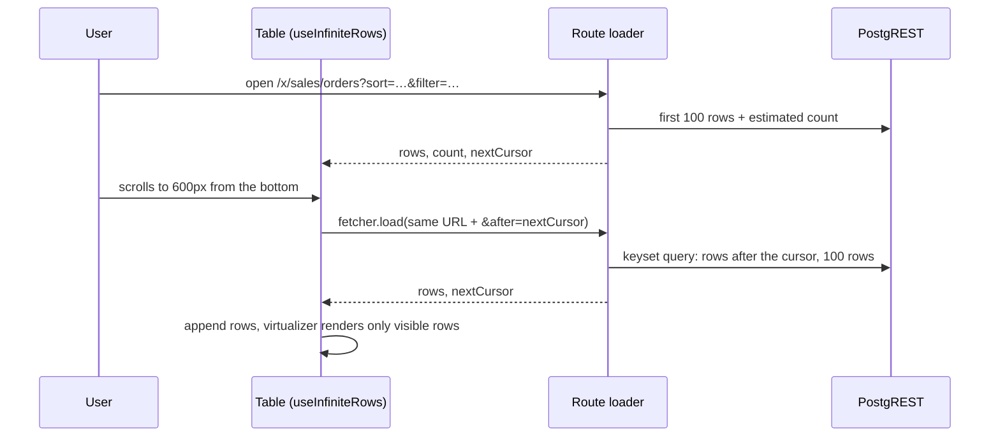

# Infinite scroll for ERP list tables

> Status: in-progress
> Author: Aashu
> Date: 2026-10-13
> Research: `.ai/research/2026-10-13-infinite-scroll-tables.md`

## TL;DR

- Every paginated ERP list loads more rows as you scroll, on desktop and on phones. The pager goes away.
- Loaders change from offset paging (`?offset=`) to cursor paging (`?after=`, meaning "the rows after this one").
- The shared `<Table>` virtualizes its rows with `@tanstack/react-virtual`, so thousands of loaded rows still scroll smoothly.
- The next 100 rows start to load when the user is 600px from the bottom, so the user does not see a wait.
- "Select all matching" and CSV export work on every matching row. Up to 1,000 rows they run in the browser; above that, an Inngest job (one per company at a time) does the work.
- Footer totals stay as today (the rows on screen), with a label that says so.
- Filters, sorts, search, saved views, inline editing and the phone list keep working as today.

## Overview diagram



## Problem Statement

1. Desktop lists show one page at a time (`PAGE_SIZES = [20, 100, 500, 1000]`). Each Prev/Next click is a GET navigation that re-runs every matched loader.
2. Offset paging gets slower on deep pages. The database reads and discards every row before the offset.
3. Offset paging shifts rows when a record is added or deleted between two requests. The user then sees a row twice or misses one.
4. The phone list has a stopgap "Load more" button (`CompactList.tsx:129-165`). It raises `?limit` up to 1000 and then falls back to Prev/Next.
5. The shared `<Table>` renders every row as a real `<Tr>` (`Table.tsx:1482-1590`). A page of 1000 rows is slow to render.

## Goals

- Infinite scroll on all ~130 paginated list pages that use the shared `<Table>`, on desktop and on phones.
- Infinite scroll on the 2 hand-paged tables: `SyncActivity.tsx` and `AccountLedgerDrawer.tsx`.
- Stable, fast paging at any depth (cursor paging).
- Smooth scrolling with thousands of loaded rows (row virtualization).
- No visible wait at the bottom of the list (prefetch at 600px).

## Non-goals

- MES. It has no paginated tables (`apps/mes/app/routes/x+/jobs.tsx` loads all open jobs).
- The 17 tables with `withPagination={false}` (wizards, grids, reports). They stay as they are.
- Small tables inside detail pages that use the plain `@carbon/react` `Table`.
- Server-side totals for footer rows.
- Sorting by a column of another table (see Decision 6).

## Proposed Solution

### 1. Cursor paging in the loaders

`getGenericQueryFilters` (`apps/erp/app/utils/query.ts:57-93`) reads a new `?after=` param. It stops reading `?offset=`. The param holds an opaque token: base64url JSON of the last row's sort values plus its `id`.

`setGenericQueryFilters` (`query.ts:157-203`) changes in 4 ways:

1. It adds `id` as the last sort key, so the order is always total. A list whose rows have no unique `id` passes its own key column.
2. If a cursor is present, it adds a keyset filter with `.or(…)`. For one sort column `c` (ascending) the filter is `c > v OR (c = v AND id > lastId)`. For more sort columns, the filter expands the same way.
3. It handles NULLs the way Postgres orders them: ascending puts NULLs last, descending puts NULLs first. A NULL cursor value uses `c IS NULL AND id > lastId`.
4. It replaces `.range(offset, …)` with `.limit(limit + 1)`. The extra row tells the loader that more rows exist.

A new helper `toPage(rows, args)` returns `{ rows, nextCursor }`. It drops the extra row and builds `nextCursor` from the last kept row, or returns `null` at the end.

The cursor reads the sort values from the returned row. So every sortable column must be in the list's select. In development, `toPage` throws if a sort column is missing from the row.

Values in the `.or()` string are quoted and escaped. Commas, parentheses and quotes in a value must not break the filter.

Counts: only the first request (no `?after=`) asks for `count: LIST_COUNT`. Later requests ask for no count.

### 2. Loader contract

Each list loader returns its rows, `count` (first page only), and `nextCursor`. The rows keep their current key (for example `salesOrders`). Example for `sales+/orders.tsx`:

```ts
// salesOrdersList (utils/list-registry/sales.server.ts) wraps getSalesOrders.
const page = await fetchListPage(salesOrdersList, client, companyId, searchParams);
return { salesOrders: page.rows, count: page.count, nextCursor: page.nextCursor };
```

The page size is fixed at 100. `?limit=` and `?offset=` are removed. Old bookmarks with `?offset=` or `?limit=` are ignored.

### 3. Shared Table: `useInfiniteRows`

The table component passes a new prop `infinite={{ dataKey: "salesOrders", nextCursor }}` to `<Table>`. A new hook `useInfiniteRows` inside the Table does this:

1. It starts with the loader's rows and `nextCursor`.
2. It calls `fetcher.load(pathname + search + "&after=" + cursor)` when the user is 600px from the bottom. It reads `fetcher.data[dataKey]` and appends the rows.
3. It runs one fetch at a time. It stops when `nextCursor` is `null`.
4. If a fetch fails, the list shows "Couldn't load more rows" with a Retry button.
5. If the reset key changes, it drops the loaded rows and starts again from the loader's first page. The reset key is the URL search without `after` and without the list's `ignoreParams` (Review fix A). So a filter, sort, search or saved view resets the list, and a drawer param does not.

The fetcher re-uses the route's own loader (Decision 3). No new API routes.

### 4. Row virtualization

The Table uses `useVirtualizer` on its existing scroll element `#table-container` (`Table.tsx:1264-1276`). It copies the `Grid.tsx` pattern:

- Spacer `<tr>` rows above and below the visible rows (`Grid.tsx:442-465`).
- `measureElement` for rows of different height (expanded rows, group headers).
- A `rangeExtractor` that keeps the selected cell's row mounted during inline editing (`Grid.tsx:390-403`).
- `overscan: 10`.

The sticky header, pinned columns and edge shadows stay as they are. The prefetch check uses the scroll element: `scrollHeight - scrollTop - clientHeight < 600`.

### 5. Phones

- `CompactList` drops its "Load more" button and its Prev/Next fallback. It uses the same `useInfiniteRows` hook and a virtualizer on the phone list's scroll element.
- The 9 tables with `mobileLayout="table"` behave like desktop.
- The phone keeps one scroll surface, the existing one (`.ai/lessons.md:1326-1336`).

### 6. Header row count

The `<Pagination>` bar, page-size dropdown and Prev/Next buttons go away. The ArrowLeft / ArrowRight pagination shortcuts go away. The table header shows the total:

- An exact number below 1,000 rows: "245 rows".
- At 1,000 rows or more, "about 2,300 rows" while `LIST_COUNT` (an estimate there) is all the page has, then the exact number ("2,317 rows"). A second request (`?count=exact`) gets it after page 1 shows, so the rows never wait for it.

### 7. Selection and "Select all matching"

- The Table sets `getRowId` to the row's `id`. Appending rows then never clears the selection (today it clears when `data.length` changes, `Table.tsx:383-387`).
- The header checkbox selects the loaded rows.
- If more rows exist, a bar shows "100 selected · Select all 2,345 matching". The selection then becomes "all rows that match the current URL filters", not a list of rows.
- Every bulk-action route that receives ids splits them into chunks of 100 for `.in()` (`.ai/lessons.md:2946-2958`).

The bulk action runs in one of 2 ways:

| Matching rows | How the action runs |
|---|---|
| 1,000 or fewer | The browser loads the remaining rows with the cursor loop (at most 10 requests of 100). Then it calls the action with full rows, as today (`renderActions(selectedRows)`). |
| More than 1,000 | The browser posts the action name, its value and the list's URL search to the action route. The route starts an Inngest job. Collect steps read the matching ids, at most 10,000 rows per step, and store each step's ids as one file in `temp-staging`. Apply steps then run the action on one slice of ids each, 100 ids per call. |

Rules for the background bulk action:

1. The job applies the same per-row checks as the browser does today. Example: Jobs Release acts only on Draft and Planned jobs (`JobsTable.tsx:757`). These checks move into the server code of each of the 15 bulk actions.
2. One background job runs per company at a time (Inngest concurrency key `companyId`, limit 1, and a Redis lock). A second request from the same company gets "A bulk action is already running for your company", with the latest time it ends.
3. The job runs with the requesting user's permissions and `companyId`. It never reads another company's rows.
4. When the job ends, the user gets a notification with the counts: done, skipped, failed.
5. Jobs Release and Batches Release run on at most 2,000 matching rows in the background. Each released job runs MRP. Past 2,000 rows the route refuses: "Filter the list to 2,000 rows or fewer" (Review fix D).

### 8. CSV export

Columns stay WYSIWYG: the visible columns in display order (`selectExportColumns`), with the translated headers.

| Matching rows | How the export runs |
|---|---|
| 1,000 or fewer | In the browser, as today. The browser loads the remaining rows with the cursor loop (at most 10 requests of 100). Each cell uses the on-screen format (`meta.exportValue`). |
| More than 1,000 | An Inngest job. The browser sends the list key, the URL search, the visible columns and their translated headers. Each job step reads at most 10,000 rows and writes them as one part file. A last step streams the parts into one CSV file in storage. Then the job sends the user a notification with a download link. |

Rules for the background export:

1. Cells hold the plain database values (for example `2026-10-13`, `1250.5`, the stored status). The on-screen format code runs in the browser, so the job cannot use it. One generic exporter serves every table.
2. The job never holds the whole file in memory. It reads 500 rows per query, and one part (at most 10,000 rows) is in memory at a time. The export stops at 100,000 rows or after the page that passes 200 MB.
3. One export job runs per company at a time (Inngest concurrency key `companyId`, limit 1, and a Redis lock). A second request from the same company gets "An export is already running for your company", with the latest time it ends.
4. The job runs as the requesting user, scoped to their `companyId`.
5. The decision between the 2 ways uses the header count. If the browser loop reaches 1,000 rows and more rows remain, it hands the export to the job.
6. The file belongs to the user who asked for it: `{companyId}/exports/{userId}/{exportId}.csv`. The download route `api+/table.export.$exportId` builds that key from the session and checks the list's permission again (Review fix D).

Accepted risk: background jobs run in the ERP containers (`apps/erp/app/routes/api+/inngest.ts`). Many companies can each run 1 big export at the same time, and those jobs share CPU with web requests. A separate worker container removes that risk; it is out of scope for now. The code puts a `// TODO(scale):` comment on the export and bulk-action Inngest functions that says this.

### 9. Footer totals

The 11 tables with `meta.renderTotal` keep their footer row, and it works as today: it totals the rows on screen, which are now the loaded rows (`aggregateForCol`, `Table.tsx:204-215`). The footer adds a label so the user knows the scope: "Total of 300 loaded rows". There is no "Total all" link.

### 10. Live updates (realtime)

`RouteRealtime` revalidates the loader, which returns only the first page. `useInfiniteRows` then re-fetches the remaining loaded pages in order with fresh cursors, and replaces them. The scroll position stays. Changed rows update in place, new rows appear, and deleted rows leave.

### 11. Back navigation

`useInfiniteRows` keeps the loaded rows, `nextCursor` and the scroll offset in memory, keyed by the company id, `dataKey` and the page URL key (Review fix A). On Back to the same URL, it restores them and scrolls to the same row. A page reload clears the memory. A realtime revalidation on return refreshes the restored rows (section 10).

### 12. The 2 hand-paged tables

- `SyncActivity.tsx` (page state plus `useFetcher`) switches to cursor paging and infinite scroll.
- `AccountLedgerDrawer.tsx` (`?offset=`/`?limit=` URL params) switches to cursor paging and infinite scroll inside the drawer.

### 13. Removal

After every list is converted, delete `usePagination`, `<Pagination>`, `PAGE_SIZES`, `getPageOffset`, `pageBounds` and the pagination shortcuts. Before deleting each one, confirm with a grep that it has no callers.

### Design Decisions

| # | Decision | Choice | Rationale |
|---|----------|--------|-----------|
| 1 | Virtualization library | `@tanstack/react-virtual` 3.13.23 | Already a dependency, used in 7 places, headless, ~5 kB. User decision. |
| 2 | Paging method | Cursor (keyset) paging | Stable under inserts and deletes, fast at any depth. User decision. |
| 3 | How the browser fetches the next page | `useFetcher` on the route's own loader with `?after=` | One place returns each list's rows; no 130 duplicate API routes. User decision. |
| 4 | When to prefetch | 600px from the bottom | The user does not feel a wait. User decision. |
| 5 | Page size | 100 rows, fixed | Matches `DEFAULT_PAGE_SIZE`. Below PostgREST `max_rows = 1000`. |
| 6 | Sort by another table's column (7 tables) | Turn off those sorts | No database change. User decision. |
| 7 | Row count in the header | Exact at any size: "about N" only until the exact count arrives | Users need the exact number of records. An exact count reads every matching row, so it runs in its own request after page 1 (`useExactCount`) instead of slowing page 1. User decision (revised). |
| 8 | Select all | Gmail-style "Select all N matching" bar, no cap. Exception: Jobs Release and Batches Release act on at most 2,000 rows in the background | User decision. The 2,000 cap: Review fix D, because each released job runs MRP. |
| 9 | Browser or server for "all matching" work | Browser up to 1,000 rows; Inngest job above 1,000 | Small lists stay instant. Journals and ledgers pass 10,000 rows (research file). User decision. |
| 10 | CSV export | All matching rows, visible columns only. Big exports hold plain DB values | The on-screen format code runs only in the browser. User decision. |
| 11 | Footer totals | As today: the rows on screen, with a "loaded rows" label | User decision. |
| 11a | Load on the database and servers | 1 background job per company at a time; accept the risk that many companies run jobs at once | A separate worker container fixes it later; marked with `TODO(scale)`. User decision. |
| 12 | Live updates | Refresh the loaded rows in place | User decision. |
| 13 | Back navigation | Restore rows and scroll position | User decision. |
| 14 | Scope | ~130 paginated lists + 2 hand-paged tables | User decision. Unpaginated tables and MES stay out. |
| 15 | Rollout | Core + 3 pilots (Sales Orders, Parts, Jobs), then module batches | User decision. Same branch. |
| 16 | Tie-breaker column | `id` by default, override per list | Keyset paging needs a total order. |
| 17 | Count on later pages | No count after the first page | Saves one estimate query per scroll. |
| 18 | Size of one job step | At most 10,000 rows (20 pages of 500) | The load balancer cuts a request at 600 s, and one step is one request. Review fix D. |
| 19 | Who can download a big export | Only the user who asked for it, through `api+/table.export.$exportId`, with the list's permission checked again | Review fix D. |

## Data Model Changes

None. No migrations. Decision 6 removes the 7 cross-table sorts instead of changing views.

## API / Service Changes

- `apps/erp/app/utils/query.ts`: `getGenericQueryFilters` reads `?after=`. `setGenericQueryFilters` adds the tie-breaker sort, the keyset filter and `.limit(limit + 1)`. New `toPage` helper. New cursor encode and decode functions.
- `apps/erp/app/utils/pagination.ts`: shrinks to the fixed page size, then goes away (section 13).
- ~130 route loaders under `apps/erp/app/routes/x+/` return `nextCursor` and drop `limit`/`offset`.
- Service functions keep their signature. They receive `cursor` instead of `offset` inside the generic filter args.
- Bulk-action routes for the 15 tables with `withSelectableRows` split id lists into chunks of 100. Each route also accepts "all matching" (the list's URL search) and then starts the background bulk-action job.
- The per-row checks of each bulk action (for example "only Draft and Planned jobs") move from the table component into the route's server code, so the browser path and the job path share them.
- New Inngest functions in `packages/jobs`: a table export job and a table bulk-action job, each with `concurrency: { key: "event.data.companyId", limit: 1 }`. `packages/jobs` cannot import `~/modules`, so the ERP app hands the jobs a dispatcher, like `setWorkflowDispatch` (`apps/erp/app/routes/api+/inngest.ts:34-47`).
- The export job writes the CSV to `temp-staging` at `{companyId}/exports/{userId}/{exportId}.csv` and notifies the user with a link to `api+/table.export.$exportId`.

## Closest Sibling

N/A for a record type. Code precedent:

- `Grid.tsx:384-465`: virtualizer, spacer rows and `rangeExtractor` in a TanStack table.
- `InfiniteScroll.tsx` with `$itemId.activity.tsx:237-321`: keyset cursor paging (`entryNumber`) with a load-more trigger.

## UI Changes

- List page archetype: no change to layout. The pager bar at the bottom goes away.
- Table header: row count ("245 rows" / "about 2,300 rows").
- A loading row at the bottom while the next page loads, and an error row with Retry.
- A selection bar with "Select all N matching".
- CSV export up to 1,000 rows downloads at once. Above 1,000 rows, a toast says "Your export is being prepared. We'll notify you when it's ready."
- A bulk action above 1,000 rows shows a toast "Running in the background. We'll notify you when it's done."
- Footer totals get a "Total of N loaded rows" label.
- Phone list: no "Load more" button; rows load as you scroll.
- All new copy uses Lingui (`t` / `Trans`), with plurals through `plural`.

## Acceptance Criteria

- [ ] On Sales Orders with 2,500 orders, scrolling to 600px from the bottom loads the next 100 rows. No pager shows.
- [ ] Scrolling through 2,500 rows on Sales Orders shows each order exactly once, in sort order, for each sortable column, ascending and descending.
- [ ] A sort on a column with NULL values (for example a blank due date) returns every row exactly once.
- [ ] A sort value (the cursor) with a comma, a parenthesis or a quote does not break the next-page request.
- [ ] Changing a filter, sort, search or saved view resets the list to the first 100 rows of the new result.
- [ ] With 2,000 rows loaded, only the visible rows (plus overscan) exist in the DOM.
- [ ] Inline editing on a table with `withInlineEditing` keeps the selected cell while the user scrolls far away and back.
- [ ] Pinned columns and the sticky header stay in place while rows load and scroll.
- [ ] On a phone (< 48rem), the compact list loads more rows on scroll, with no "Load more" button.
- [ ] The header shows "245 rows" for 245 rows. For 2,317 rows it shows "about 2,300 rows" at first, then "2,317 rows".
- [ ] On Jobs with 800 matching jobs, "Select all 800 matching" then Release releases every Draft and Planned job in the browser path.
- [ ] On Jobs with 3,000 matching jobs, "Select all 3,000 matching" then Release starts one background job. It releases only Draft and Planned jobs and notifies the user with the counts.
- [ ] CSV export of 800 matching rows downloads at once, with on-screen formatting and only the visible columns.
- [ ] CSV export of 12,000 matching rows starts a background job. The user gets a notification with a link, and the file has 12,000 data rows with plain database values.
- [ ] A second big export (or bulk action) from the same company while one runs gets the "already running" message. A big export from another company still starts.
- [ ] The background export never reads rows of another company.
- [ ] A footer total on Sales Orders reads "Total of 100 loaded rows" and grows as more rows load.
- [ ] Another user's edit to a loaded row on row 300 shows up without a scroll jump.
- [ ] Open row 400, press Back: rows 1–400 are still loaded and row 400 is in view.
- [ ] `SyncActivity` and `AccountLedgerDrawer` load more rows on scroll.
- [ ] The 7 cross-table sort columns no longer offer a sort.
- [ ] `pnpm exec turbo run typecheck --filter=erp`, Biome and the ERP unit tests pass. Cursor encode/decode and the keyset filter builder have unit tests.

## Verification status

None of the Acceptance Criteria above is browser-verified. This worktree had no running stack (decision "End-to-end check (Task 16)").

Unit tests cover the logic without a browser:

| Area | Tests |
|---|---|
| Cursor encode and decode, `keys`, offset tokens, keyset filter, `toPage` | `apps/erp/app/utils/cursor.test.ts`, `query.test.ts` |
| Registry merge, list select columns | `utils/list-registry/registry.test.ts`, `apps/erp/test/list-select-columns.test.ts` |
| Reset key, store, merge, edits overlay, virtual rows | `components/Table/infiniteRowsStore.test.ts`, `rowEdits.test.ts`, `useVirtualRows.test.ts`, `utils.test.ts` |
| Job ids, row limit, client factory | `apps/erp/app/utils/table-jobs.test.ts` |
| Job steps, lock, CSV, bulk counts | `packages/jobs/src/table-jobs/{run,lock,csv,bulk}.test.ts` |

The type and unit gates run in the final wave of the review fixes; record their result here.

Check in a browser after `crbn up`, in this order:

1. Every Acceptance Criterion above.
2. A drawer opened over a planning grid keeps the loaded rows (`ignoreParams`).
3. A star on a document past row 100 shows at once and stays.
4. A failed later page shows "Couldn't load more rows" with Retry.
5. A background export downloads through `api+/table.export.$exportId`. Another user of the company gets 404 for the same link.
6. "Select all" on more than 2,000 jobs, then Release, shows the 2,000-row refusal.

## Open Questions (resolved)

- [x] Which virtualization library? — **Answer:** TanStack Virtual. It is already installed and used, and it is headless.
- [x] Offset paging or cursor paging? — **Answer:** Cursor paging, because it works well with infinite scroll.
- [x] When to start the next fetch? — **Answer:** At 500–600px from the bottom. The spec uses 600px.
- [x] Reuse the route loader or add API routes? — **Answer:** Reuse the route loader (option A). New API routes would duplicate the loaders.
- [x] What replaces the pager's "1–100 of N"? — **Answer:** A row total in the table header.
- [x] Sorts by another table's column? — **Answer:** Turn off those sorts.
- [x] Row count wording? — **Answer:** Exact below 1,000, "about N" above. **Revised:** exact at any size; above 1,000 the exact count loads in a second request after page 1.
- [x] What does "select all" select? — **Answer:** Every matching row, through a Gmail-style "Select all N matching" bar.
- [x] What does CSV export download? — **Answer:** All matching rows. Columns stay WYSIWYG.
- [x] Load-all cap? — **Answer:** First 5,000 rows in the browser. Then changed: the research suggests journals pass 10,000 rows, so work above 1,000 rows moves to the server.
- [x] Can the server path become an attack surface? — **Answer:** Yes, if requests wait inside the server. Requests above 1,000 rows become Inngest jobs, 1 per company at a time. Many companies at once is an accepted risk until a separate worker container exists.
- [x] What do big exports contain? — **Answer:** Plain database values with the visible columns and translated headers.
- [x] How far does "select all matching" go? — **Answer:** No cap. Above 1,000 rows, the bulk action runs as an Inngest job.
- [x] Live updates while scrolled deep? — **Answer:** Refresh the loaded rows in place.
- [x] Back navigation? — **Answer:** Restore the same rows and scroll position.
- [x] Footer totals? — **Answer:** As today: total of the rows on screen, with a "loaded rows" label. No "Total all".
- [x] Scope? — **Answer:** All paginated lists plus the 2 hand-paged tables.
- [x] Rollout? — **Answer:** Core plus 3 pilots, then the rest in module batches.

## Autonomous Decisions

The user approved the spec, then asked for the whole pipeline (plan, build, test, review, fixes) to run without questions. The code research for the plan found facts the interview did not cover. Each decision below was made without the user. Review the high-stakes ones first.

### High-stakes

- [x] **A second big job from the same company** — **Autonomous:** The route takes a Redis lock (`SET key NX EX`) per company and job type before it starts the Inngest job. If the lock exists, the route answers "already running". If Redis is down (`redis.set` returns `null` and `redis.get` returns `null`), the route starts the job anyway: Inngest's per-company concurrency still runs the jobs one at a time. *(The lock is now a Lua script: Review fix D, "the lock".)* — Codebase rung: Inngest concurrency queues a second run, it never refuses it (`company-export.ts:363-370`); `@carbon/kv` returns `null` on failure (`packages/kv/src/resilient.ts`).
- [x] **Where big CSV files go** — **Autonomous:** The `temp-staging` bucket, under `{companyId}/exports/{jobId}.csv`. The download link is the existing `/file/preview/temp-staging/...` route. The nightly cleanup deletes the file after 7 days. *(Key and link replaced by Review fix D, "per-user export files".)* — Codebase rung: company buckets cap one file at 50 MB (`packages/files/src/storage.ts:36`); `temp-staging` allows 2.5 GB and the preview route already checks the `companyId` prefix (`file+/preview+/$bucket.$.tsx:69-90`).
- [x] **Row ceiling for one background export** — **Autonomous:** 100,000 rows. Above that, the job writes the first 100,000 rows and the notification says the file is cut. — Product judgement: the earlier chat named 100k as the guard; without a ceiling one export can run for a very long time on the shared containers.
- [x] **Which bulk actions get the background path** — **Autonomous:** Only the actions whose request is "ids + one field/value": item bulk update (Parts, Materials, Tools, Consumables, Services), Jobs Release, Jobs Delete, Purchase Order Delete, Batches Release and Dissolve, and user Deactivate / Send Invite / Edit Permissions. The planning tables (Order Parts, Create Jobs, Apply Suggested Changes) and Kanban Print Labels stay browser-only, capped at 1,000 selected rows. — Codebase rung: the planning payloads are built from browser state (drawer edits, time fence, supplier map: `PurchasingPlanningTable.tsx:349-421`); a PDF of thousands of labels is not a bulk action.
- [x] **Server-side checks that were browser-only** — **Autonomous:** Jobs Delete gets a server check for the `delete: production` permission and for the allowed statuses (Draft, Planned, Due Today, Overdue), plus a `companyId` filter on its status read. Purchase Order Delete gets a `companyId` filter and a Draft/Planned status check. — Spec rule 7.1: the job path must apply the same per-row checks; the research found these checks only in the browser (`job+/update.tsx:39-58`, `purchase-order+/update.tsx:26-31`).

### Other decisions

- [x] **Sort gates** — **Autonomous:** Both sort entry points (the header menu, `Table.tsx:1357-1361`, and the toolbar Sort picker, `Table/utils.ts:79-82`) skip any `accessorKey` that contains a `.` and any column with `enableSorting: false`. This turns off the 7 cross-table sorts (Decision 6). Jobs `orderQuantity` and `inventoryQuantity` get `enableSorting: false`: the `jobs` view has no such columns, so their sort fails today.
- [x] **Array sort columns (`tags`, `suppliers`)** — **Autonomous:** The keyset filter encodes an array value as a quoted Postgres array literal. If a unit test or a manual check shows PostgREST rejects it, the executor sets `enableSorting: false` on array columns instead and records it here.
- [x] **Custom field sorts (`customFields->>{id}`)** — **Autonomous:** The cursor reads the value from `row.customFields[id]` and compares it as text.
- [x] **Lists without a unique `id`** — **Autonomous:** `contractors` uses `supplierContactId`, `customFieldTables` uses `table`. The customer portal share page (`share+/customer.$id.tsx`, RPC without a row id) and the customer/supplier account lists (foreign default sort `user(lastName)`, no top-level `id` selected) keep a single load of up to 1,000 rows with no paging. They are small per company.
- [x] **Lists that do not page today** — **Autonomous:** `getCurrencies`, `getJobMaterialsWithQuantityOnHand`, `sync-tieout`, `invoicing+/_index` (a dashboard), `getPrintJobs` and `getGlobalAuditLog` keep their current loading. `getPrintJobs` and `getGlobalAuditLog` use their own offset paging (an RPC with `p_offset`); they get the infinite-scroll UI on top of offset requests, because their sources are outside `setGenericQueryFilters`.
- [x] **Revalidation cost** — **Autonomous:** A loader revalidation with the same URL search replaces the first page and re-fetches the other loaded pages one by one, up to 20 pages (2,000 rows). Rows past 2,000 are dropped and the cursor restarts from row 2,000. — The router re-runs the list loader on every drawer open and close (`defaultShouldRevalidate`), so an unbounded refresh would re-read every loaded row each time.
- [x] **Back-navigation memory** — **Autonomous:** A module-level `Map` (max 10 entries, oldest dropped first) keyed by `pathname + search`. *(Key replaced by Review fix A: company id + `dataKey` + page URL key.)* — The 3 pilot lists unmount when a record opens (`path.to.salesOrderDetails` is outside `sales+/orders`), so component state cannot hold it.
- [x] **Extra per-page data** — **Autonomous:** `infinite` takes an optional `onPage(data)` callback, so a table can merge per-page extras. Jobs uses it for `batchesByJobId`. *(Replaced by Review fix C: `mapRows` puts the extras on each row; `onPage` is gone. The other decisions below that name `onPage` are replaced the same way.)*
- [x] **Search escaping** — **Autonomous:** Out of scope. 49 services put the raw search into `.or()`; that bug exists today and is independent of paging. The acceptance criterion about commas now covers cursor values only. Recorded as a follow-up.
- [x] **Commits** — **Autonomous:** No commits. The user's standing rule forbids commits without permission; the work stays in the working tree for review.
- [x] **A page fetch whose loader throws** — **Autonomous:** The route's error screen shows, as for every fetcher in the app today. *(Replaced by Review fixes A and B: a failed later page returns `listError`, and the list shows "Couldn't load more rows".)* The inline "Couldn't load more rows" row with Retry shows when a request ends without a new rows array. — Codebase rung: React Router sends a fetcher's loader error to the nearest error boundary and drops the fetcher (`setFetcherError`, `react-router/dist/development/chunk-OB3PAWPO.mjs:3141`). A fetcher cannot catch it, and Decision 3 keeps the fetcher.
- [x] **The URL of the next page** — **Autonomous:** `useInfiniteRows` loads the list route's own URL from `useFormAction()`, not `location.pathname`. — Codebase rung: with a drawer open, `location.pathname` is the child route, whose loader has no rows. `useFormAction()` also adds `?index` for an index route (`chunk-OB3PAWPO.mjs:11027`), which `fetcher.load` needs to reach the index loader.
- [x] **Back-navigation restore** — **Autonomous:** The hook restores only on a Back/Forward (`POP`) navigation. Page 1 always comes fresh from the loader. The memory keeps the rows after page 1, their page count, the cursor and the scroll offset. The restored rows can be stale, so the hook fetches them again in the background with the revalidation rule (at most 20 pages). — Product judgement: a sidebar link click should open the list at the top; a record the user just edited must not show its old values after Back.
- [x] **The scroll offset for Back** — **Autonomous:** `useInfiniteRows` returns `rememberScrollTop(scrollTop)`. The Table calls it from its scroll listener. — Plan gap: the hook cannot read the scroll element on unmount, because React detaches the ref before the effect cleanup runs.
- [x] **A cursor that does not fit the sorts** — **Autonomous:** `setGenericQueryFilters` ignores a cursor whose value count differs from the sort count, and the request returns page 1. If every user sort is a cross-table sort (dropped by Decision 6), the default sorts apply. — Product judgement: only a hand-edited URL produces this, and an error screen helps nobody there.
- [x] **One virtual item per row** — **Autonomous:** Each virtual item is one `<tbody>` that holds the group header row, the data row and the expanded row. The virtualizer measures the `<tbody>`. `Row.tsx` and `rowMemo.ts` do not change. — Plan gap: a ref on the data row measures that row only, and a context-menu row gets no ref through `ContextMenuTrigger`. A table can hold many `<tbody>` elements.
- [x] **Row ids** — **Autonomous:** The Table keys rows by `id` only when every row has an `id` and no two rows share it (`hasUniqueRowIds`). Otherwise it keeps index keys, as before. — Product judgement: a list that repeats an id would break React keys and select two rows with one click.
- [x] **A new list query** — **Autonomous:** When the URL search changes (without `after`), the desktop table scrolls to the top and clears an uncontrolled selection. — Codebase rung: before, a new result set cleared the selection through the `data.length` effect and the pager scrolled to the top. With id keys, that effect no longer fires.
- [x] **Header count and footer label** — **Autonomous:** The header shows the row count where the condensed Prev/Next buttons were, only when `withPagination` is on and `count` is above 0. The footer label "Total of N loaded rows" shows only on a table with `infinite`. — Product judgement: a table without `infinite` has all its rows, and a table without a count would read "0 rows".
- [x] **The loading row** — **Autonomous:** While the next page loads, the row under the last row shows a spinner and "Loading more rows". The phone list shows a spinner above its footer text. — Plan step 7 named a spinner only; the text tells a screen reader user what happens.
- [x] **Phone list scroll element** — **Autonomous:** `CompactList` virtualizes against the nearest ancestor that scrolls and has content past its edge. On a page that is `<main>`. — Product judgement: a phone list in a drawer or a modal scrolls inside it. A virtualizer on `<main>` would never render the rows below the first view there.
- [x] **Phone group headers** — **Autonomous:** On phones, a group header is its own virtual item, and the range keeps the header above the first row in view rendered. So the header stays sticky while its rows scroll. — Plan step 5 says "keep group headers as they are". A header inside a per-row wrapper can only stick inside that wrapper.
- [x] **Phone footer text** — **Autonomous:** The phone footer "{n} of {count} rows" shows on every list with `withPagination` or `infinite`, also at the end of the list. An estimated count below the loaded rows shows the loaded number. — Product judgement: at the end of the list the footer is the only total on screen.
- [x] **Registry shape** — **Autonomous:** The registry is a folder, `utils/list-registry/`, with `index.server.ts` (types, `LIST_REGISTRY`, `getListDefinition`, `fetchListPage`) and one file per module. The files for every Task 12 batch exist from the start, and the index merges all of them. A loader imports its definition from the module file to keep the row type. — Parallel batches must not edit the same file. `fetchListPage` keeps each converted loader to one call that the jobs (Tasks 10 and 11) can share.
- [x] **Reference data on later pages** — **Autonomous:** When `?after=` is set, the Parts and Jobs loaders skip `tags` and `locations`. — Plan step 4: the Table reads a fetched page for its rows, `nextCursor` and `onPage` only. No component reads those keys from a fetched page.
- [x] **Jobs tracked entities** — **Autonomous:** `JobsTable` loads the tracked-entity labels of each page from `onPage` and merges them into one map. — Plan gap: the labels came from a browser query over page 1 only, so rows past 100 lost them.
- [x] **Lingui catalogs** — **Autonomous:** Tasks 4–7 add the strings through `Trans`, `Plural` and `t`, and a Vite compile of the 3 changed Table files shows no `@lingui/core` import. The `.po` catalogs are not extracted in these tasks. — `pnpm lingui:extract` rewrites 13 locale files; Task 16 runs it once after all batches, so parallel batches do not conflict on them.
- [x] **Browser check of the pilots (Task 6)** — **Autonomous:** Not run. This worktree has no running dev stack: `https://erp.infinite-scroll.dev/login` returns 502 from the portless proxy, and Docker has no container for this worktree. `crbn up` would create and migrate a new database, which this run must not do. Task 16 repeats the check. — Run rule: never touch the database.
- [x] **Loaders without `bypassRls` (Task 12d)** — **Autonomous:** If a list loader did not pass `bypassRls` before, it still does not. The loader calls `requirePermissions(request, xList.permission)`, and the permission keeps `role: "employee"`. This applies to 13 Items lists (change notices, the material property lists, item groups, units of measure and the 2 method lists). — Product judgement: recipe step 4 assumes every loader bypasses RLS. A switch to the service-role client changes who can read the rows, and paging needs no such change.
- [x] **Material dimensions unit system (Task 12d)** — **Autonomous:** The `material-dimensions` registry query reads `companySettings.useMetric` itself, on every page. — Codebase rung: the loader read it before the list query (`dimensions.tsx`). A background job calls the registry query without the loader, so the query must find the unit system on its own.
- [x] **Rows key `data` (Task 12d)** — **Autonomous:** The units of measure, change notice actions and change notice types loaders returned the raw service result. They now return `{ data, count, nextCursor }`, and the tables use `dataKey: "data"`. — Minimal change: the route components already read `data`.
- [x] **Purchasing Material Planning has no registry entry (Task 12b)** — **Autonomous:** `purchasing+/planning` pages with a cursor (`toPage` in the loader), but it has no `listKey`. Its export and bulk actions keep the 1,000-row browser path. — Codebase rung: the grid RPC needs the location that `resolveLocationId` reads from the user's defaults, and a registry query gets only the URL search. The spec already keeps the planning bulk actions browser-only.
- [x] **Planning rows and actions on later pages (Task 12b)** — **Autonomous:** `PurchasingPlanningTable` merges each later page's `items` and `planningActions` by item id through `onPage`. The supplier defaults, the order drawer and the bulk Order action then see every loaded row. A later page skips the `?item=` drawer-row read. — Plan step 8: the loader reads the actions of its own page only, so rows past 100 had no actions and no planned orders.
- [x] **Supplier contacts on later pages (Task 12b)** — **Autonomous:** The suppliers loader reads the report contacts of every page, and `SuppliersTable` merges them through `onPage`. A background export of more than 1,000 suppliers has no values for the 11 contact and address columns, because they are not columns of the `suppliers` view. — Plan step 8; the background export reads the registry rows only.
- [x] **Loaders without `bypassRls` (Task 12b)** — **Autonomous:** Supplier returns and leases keep the RLS client, by the Task 12d rule. Supplier types keeps `role: "employee"` and no column filters, as its loader had before.
- [x] **Loaders without `bypassRls` (Task 12a)** — **Autonomous:** RMAs, contracts, rental agreements, the price list, pricing rules, customer portals and the 4 reason and type lists keep the RLS client, by the Task 12d rule. The last 7 keep `role: "employee"`.
- [x] **Price list paging (Task 12a)** — **Autonomous:** The `price-list` registry query runs `resolvePriceList` with a customer or customer type in the URL, else `getBaseCatalog`, as the loader did. It reads `quantity` from the URL itself. The rows carry the item id as `itemId`, so the entry sets `idColumn: "itemId"`; the query still breaks ties on `item.id`. A later page skips the scope options. — Codebase rung: the services build each row from one `item` row (`itemId: item.id`).
- [x] **Sorts on computed columns (Task 12a)** — **Autonomous:** The 5 price list columns (Item, Item Group, Base Price, Resolved Price, Source) and the customer portal "Portal Link" column get `enableSorting: false`. — Codebase rung: the `item` table and `externalLink` have no such columns, so their sort fails today; the Jobs columns in "Sort gates" got the same fix.
- [x] **Select all past 1,000 rows without a `listKey` (Task 8)** — **Autonomous:** The bar offers "Select the first 1,000 rows". The browser loads and selects the first 1,000 rows. — Spec 7: browser-only lists cap the selection at 1,000 rows; the export uses the same cap.
- [x] **Rows loaded after "all matching" (Task 8)** — **Autonomous:** The Table selects each row that loads while every matching row is selected. A tick, an untick or "Clear selection" ends the "all matching" state. — Product judgement: an unticked row under "All matching rows selected" contradicts the bar.
- [x] **Select all on phones (Task 8)** — **Autonomous:** Phones get no new select-all control. The bar shows in selection mode when every loaded row is selected. — Standing rule: phone changes adapt the layout and add no features.
- [x] **The `allMatching` tooltip (Task 8)** — **Autonomous:** `useAllMatchingUnsupportedLabel()` (exported from `~/components/Table`) returns "Filter the list to 1,000 rows or fewer". A table whose action has no background path uses it. Until Task 11, Parts and Jobs ignore `allMatching` and act on the loaded rows only. — The plan puts the per-table handling in Task 11.
- [x] **When the export goes to the job (Task 9)** — **Autonomous:** 3 rules, in this order:
  1. If the list has a `listKey` and the count is above 1,000, the browser posts to the export route at once.
  2. Else the browser loads up to 1,000 rows. If rows remain and the list has a `listKey`, it posts to the route.
  3. Else it downloads the first 1,000 rows and shows "Exported the first 1,000 rows."

  A list with every row loaded exports the table's own rows, so inline edits stay in the file. — Spec 8, rule 5: the loop hands the export to the job when rows remain after 1,000.
- [x] **The export request (Task 9)** — **Autonomous:** The browser posts with `fetch`, not a fetcher. The success toast needs `{ success: true }`. On an error the toast shows the route's `error` text, else "The export could not start. Try again." — Codebase rung: a fetcher action revalidates the list loader, which re-fetches every loaded page (`fetch` precedent: `SalesOrderLineForm.tsx:317`).
- [x] **Production lists with no registry entry (Task 12c)** — **Autonomous:** Production Material Planning, Demand Forecasts and the 4 job lists (events, operations, quantities, steps) page with a cursor (`toPage` in the loader), with no `listKey`. Their export and bulk actions keep the 1,000-row browser path. — Codebase rung: a registry query gets only the URL search. The job lists need the `jobId` route param, and the planning lists need the user's default location (same rule as Task 12b).
- [x] **Production planning rows and actions on later pages (Task 12c)** — **Autonomous:** `ProductionPlanningTable` merges each later page's `items` and `planningActions` by item id through `onPage`, and clears them when the page scope changes. A later page skips the `?item=` drawer-row read. — Same rule as Task 12b: the loader reads the actions of its own page only.
- [x] **Production events order (Task 12c)** — **Autonomous:** `getProductionEvents` no longer orders by `startTime` ahead of every sort. `startTime` ascending is now the first default sort, then `createdAt` descending, so a user sort replaces it. — Codebase rung: the cursor must follow every column of the ORDER BY. A fixed first order breaks it.
- [x] **Assembly instructions order (Task 12c)** — **Autonomous:** The default sort is `createdAt` descending, not `updatedAt` descending NULLS LAST. `getAssemblyInstructions` now applies the URL sorts and filters through `setGenericQueryFilters`; before, it ignored them. — Codebase rung: `DefaultSort` has no NULLS option, and a descending cursor puts NULLs first. Instructions never edited would then lead the list.
- [x] **Demand Forecasts count (Task 12c)** — **Autonomous:** The loader returns the RPC's count from the first page, not `data.length`. — Codebase rung: with paging, `data.length` is one page. Production planning already reads the count of the same kind of RPC.
- [x] **Batches sorts on computed columns (Task 12c)** — **Autonomous:** The Jobs and Quantity columns of `BatchesTable` (`memberCount`, `totalQuantity`) get `enableSorting: false`. — The loader computes them per page, so the table has no such column. Same rule as the Jobs `orderQuantity` sort.
- [x] **Loaders without `bypassRls` (Task 12c)** — **Autonomous:** Scrap reasons, procedures, assembly instructions and batches keep the RLS client, by the Task 12d rule. The scrap reasons loader keeps the rows key `data`, by the Task 12d rule.
- [x] **Loaders without `bypassRls` (Task 12g)** — **Autonomous:** All 12 quality lists keep the RLS client and `role: "employee"`, by the Task 12d rule. Gauge types, issue types and required actions keep the rows key `data`. — None of the quality loaders passed `bypassRls` before.
- [x] **Quality reference data on later pages (Task 12g)** — **Autonomous:** On `?after=`, the loaders skip the issue types (issues, actions), the required actions (actions), the gauge types and company settings (gauges, calibrations) and the tags (quality documents). — Plan step 6; the customers loader skips its statuses by the same rule.
- [x] **Inspection plans sort (Task 12g)** — **Autonomous:** `getInspectionDocuments` adds `drawingNumber` to each mapped row, and the plan "Name" column gets `enableSorting: false`. — Codebase rung: the service maps each row, so the cursor found no `drawingNumber` (the default sort). The `inspectionDocuments` view has no `name` column, so that sort fails today.
- [x] **Location-scoped inventory lists (Task 12e)** — **Autonomous:** Quantities, kanbans and stock transfers page with `toPage` in the loader and have no registry entry and no `listKey`. Their export and bulk actions keep the 1,000-row browser path. — Codebase rung: without `?location=`, the loaders read the location from the user's defaults, which a registry query cannot see (the Task 12b planning rule). Quantities pages through its RPC: PostgREST applies the keyset filter, the order and the limit to the rows of `get_inventory_quantities`.
- [x] **Storage units tree (Task 12e)** — **Autonomous:** The storage units list does not page. The loader reads up to 1,000 roots in one load, and `getStorageUnitSubtrees` reads their subtrees 100 root ids per request. — Codebase rung: the Table appends a later page's rows flat, outside their parents, and the tree builds its rows from `data`. The spec's "single load" rule covers lists that cannot page.
- [x] **Realtime by loaded ids (Task 12e)** — **Autonomous:** The receipts, shipments, warehouse transfers and inventory counts tables drop their `useRealtime(table, "id=in.(…)")` call. — Codebase rung: each route's `handle.realtime` already follows every row of that table in the company. The id filter named page 1 only, so it added nothing.
- [x] **Blind count sorts (Task 12e)** — **Autonomous:** While a count is blind, the count lines loader drops a sort on `systemQuantity` or `variance`, as it already drops a filter on them. — Product judgement: the next-page cursor holds the last row's sort values, so it would send the withheld quantity to the browser.
- [x] **Inventory reference data on later pages (Task 12e)** — **Autonomous:** On `?after=`, the loaders skip the option lists (quantities, count lines), the locations (inventory counts), the company settings (tracked entities) and the count summary and movements (count lines). Tracked entities read the shelf-life policies of each page, and `TrackedEntitiesTable` merges them through `onPage`. — Plan steps 6 and 8.
- [x] **Storage rules single load (Task 12e)** — **Autonomous:** `x+/inventory+/storage-rules` passes `cursor: null` in place of `offset: 0`. It still reads up to 1,000 rules in one load. — The batch table does not list it, but it is in the module's folder and failed typecheck on the removed `offset`.
- [x] **Loaders without `bypassRls` (Task 12f)** — **Autonomous:** All 7 invoicing lists and all 11 accounting lists keep the RLS client, by the Task 12d rule. The accounting lists keep `role: "employee"`.
- [x] **Realtime by loaded ids (Task 12f)** — **Autonomous:** The sales invoice and purchase invoice tables drop their `useRealtime(table, "id=in.(…)")` call, as in Task 12e. No id list is built, so the `.in()` bound in `.ai/lessons.md` does not apply. — Codebase rung: `handle.realtime` on `invoicing+/sales` and `invoicing+/purchasing` follows every row of the table (`RouteRealtime` adds a string entry with no filter). A change reloads page 1, and the Table then fetches the loaded pages again.
- [x] **Group-scoped accounting lists (Task 12f)** — **Autonomous:** The `accounting-dimensions` and `intercompany-transactions` registry queries read `company.companyGroupId` for the company, then call the service with the group. — Codebase rung: a registry query gets the company only; `invoicing.service.ts` reads the group with the same `company` select.
- [x] **Period runs (Task 12f)** — **Autonomous:** Revenue recognition runs and lease runs are 2 registry entries on one query factory. `loadPeriodRuns` picks the entry by run type from `periodRunsLists`. `getRevenueRecognitionRuns` and `getDepreciationRuns` add `createdAt` to their selects. — Codebase rung: both default sorts are `createdAt`, so the cursor found no value.
- [x] **Intercompany company sorts (Task 12f)** — **Autonomous:** The Source and Target columns get `enableSorting: false`. — Codebase rung: `sourceCompany` and `targetCompany` are embedded companies, not columns of `intercompanyTransaction`, so their sort fails today.
- [x] **Accounting reference data on later pages (Task 12f)** — **Autonomous:** On `?after=`, fixed assets and fleet skip the asset class reads, and asset classes skips the company settings. Depreciation runs and the period runs keep their one-row "last run" read. — Plan step 6. The last run decides the next period, and it is one row.
- [x] **Invoicing dashboard (Task 12f)** — **Autonomous:** `invoicing+/_index` passes `cursor: null` and keeps the first 6 payments. — Codebase rung: `setGenericQueryFilters` reads `limit + 1` rows for the next-page check.
- [x] **Loaders without `bypassRls` (Task 12h)** — **Autonomous:** Attributes, timecards, employee types, groups, abilities, failure modes, both maintenance lists, training, the 4 settings lists, documents and both workflow lists keep the RLS client, by the Task 12d rule.
- [x] **Groups and partners single load (Task 12h)** — **Autonomous:** `users+/groups` and `resources+/partners` load up to 1,000 rows once, with no registry entry and no next page. — Codebase rung: groups build a tree with `arrayToTree`, and a page cut splits a group from its parent. A partner has one row per ability (primary key `id` + `abilityId`), so `id` cannot break ties.
- [x] **Sales rules and other single loads (Task 12h)** — **Autonomous:** `sales+/sales-rules`, `settings+/serial-numbers.new` and `resources+/assignments.$trainingId` pass `cursor: null` in place of `offset: 0` and keep their single load. Sales rules gets no registry entry: `SalesRulesGroups` is not a `<Table>`, so no `listKey` reads it. Its plan gate does not change. — The same fix as storage rules (Task 12e).
- [x] **Training assignment status (Task 12h)** — **Autonomous:** `getTrainingAssignmentStatus` cuts its in-memory rows at `limit` from row 0. — Codebase rung: the RPC returns every row, `GenericQueryFilters` has no `offset`, and both callers read one list.
- [x] **Recent documents (Task 12h)** — **Autonomous:** The "Recent" view is its own registry entry, `recent-documents`, with the default sorts `lastActivityAt` descending, then `favorite`. A sort the user picks replaces both. The loader picks the entry from `?q=`, and `DocumentsTable` gets the key as a prop. — Codebase rung: `getDocuments` put the `lastActivityAt` order before `setGenericQueryFilters`, so the cursor did not follow it. A registry entry has one fixed `defaultSorts`.
- [x] **Maintenance location (Task 12h)** — **Autonomous:** The 2 maintenance registry queries read `?location=` and fall back to the company's first location, as the loaders did. The loaders set the resolved location on the params they pass to `fetchListPage`. — The Task 12d material dimensions rule: a background job calls the query without the loader.
- [x] **API key hash (Task 12h)** — **Autonomous:** The `api-keys` registry query drops `keyHash` from every row, so an export never holds it. `ApiKeysTable` types its rows without the hash. — The loader dropped it before; the registry query is now the one place that reads the rows.
- [x] **Per-page extras (Task 12h)** — **Autonomous:** `WorkflowsTable` merges the version numbers and last runs of each later page through `onPage`. Workflow runs and documents compute the record names and download tokens per page in the loader, so each row carries its own. On `?after=`, the loaders skip the tags, the option lists, the invites, the MFA users, the document labels and file types, and the webhook config. — Plan steps 6 and 8.
- [x] **Optimistic document rows (Task 12h)** — **Autonomous:** *(Corrected by Review fix C.)* The first version skipped a row past page 1, and no revalidation followed, so a star or a label on such a row never showed. Now `DocumentsTable` lays each star and label change over every loaded row with the edit overlay (`applyRowEdits`). The change stays until its write ends. Then the table revalidates, and a load that starts after the write drops the change. See "Review fix C: Documents keeps the user's changes".
- [x] **Sync Activity pages (Task 13)** — **Autonomous:** The tab loads 100 rows per page, newest first, `id` ascending on ties. The integration loader reads page 1. A new resource route, `api+/integrations.$id.sync-activity`, reads each later page. A revalidation re-reads the loaded rows in one request, up to 2,000 rows. *(Replaced by Review fix C: Sync Activity pages through `pageUrl`, one page per request.)* `getSyncOperations` (`@carbon/ee`) gets an optional `after` keyset and the `id` tie-break, the same keyset as `getSyncOperationsExportPage`. The `syncPage` param is gone. — Codebase rung: the integration loader calls the provider (`listChartOfAccounts`), so a scroll must not re-run it.
- [x] **Account ledger drawer (Task 13)** — **Autonomous:** `getAccountLedger` pages with a cursor through `setGenericQueryFilters` and `ACCOUNT_LEDGER_DEFAULT_SORTS` (posting date, then entry, both descending). Lines of one entry now tie-break on `id` ascending, not descending. The 4 drawer routes read 100 lines per page (before: 50) and skip the summary on `?after=`. The drawer loads more through `useInfiniteRows` when its body scrolls to the end. — Codebase rung: the keyset filter compares the id ascending only.
- [x] **Print jobs and audit log (Task 13)** — **Autonomous:** Both loaders keep their offset sources and read 101 rows. The `after` token is `{ values: [], id: "<next offset>" }`. Neither list has a registry entry, so export and bulk actions keep the 1,000-row browser path. The audit log RPC still counts every page: `@carbon/ee` stays unchanged. — Spec decision "Lists that do not page today".
- [x] **Single-load lists (Task 13)** — **Autonomous:** The customer and supplier account lists and the customer portal share page load up to 1,000 rows and pass no `infinite`. Before, each showed its first 100 rows only. `getExternalSalesOrderLines` passes `idColumn: "salesOrderId"`. — Codebase rung: the RPC returns no `id`, so the default `id` tie-break would fail. A table without `infinite` holds all its rows (decision "Header count and footer label").
- [x] **Contractors and custom fields (Task 13)** — **Autonomous:** Both lists are registered with their `idColumn` and key their rows by it (`getRowId`). `getContractors` now reads the count; before, the list's count was always 0. The custom fields loader now throws its error redirect; before, it built the redirect and dropped it.
- [x] **Job leftovers (Task 13)** — **Autonomous:** `$jobId.materials` passes `cursor`, which `getJobMaterialsWithQuantityOnHand` ignores, so the page still loads every material. `job+/new` passes `cursor: null` and keeps the first 100 assets under construction. — Keep behavior.
- [x] **Which client the table jobs read with (Task 10)** — **Autonomous:** Every table job reads its list as the requesting user (`getUserScopedClient`), also for lists whose loader bypasses RLS. `ListDefinition` gets no RLS flag. — Spec 8.4 says the job runs as the user. A service-role read would rely on each list query to filter by `companyId`, and the queries of the RLS-client lists were not written for that. Risk: a list whose RLS is stricter than its permission exports fewer rows than the screen shows.
- [x] **The job's permission check (Task 10)** — **Autonomous:** The job reads the user's claims as the user (`get_claims`, the `readOwnerPermissions` pattern) and requires the employee role plus the list's permission. The route requires the same through `requirePermissions`. — Codebase rung: `getUserClaims` reads through a cache that can hold a revoked permission for an hour (`owner.ts`).
- [x] **Export page size (Task 10)** — **Autonomous:** The job reads 500 rows per query, not 1,000. — Codebase rung: the list query asks for `limit + 1` rows (`query.ts`), and PostgREST caps a response at `max_rows = 1000` (`config.toml`). A limit of 1,000 gets 1,000 rows back, so `toPage` sees no next page and the export stops at row 1,000. Task 11 must use the same limit.
- [x] **Export upload (Task 10)** — **Autonomous:** The job pages into a temp file, then reads the file into a Buffer and uploads it. *(Replaced by Review fix D: part files and a streamed upload.)* — `storage-js` accepts a Node stream, but no code in this repo uploads a stream, and no running stack was available to prove one against Storage. The 100,000-row ceiling bounds the Buffer.
- [x] **Lock value and release (Task 10)** — **Autonomous:** The lock value is the export id, not the user id. The job deletes the lock only while it still holds that id, in its last step and in `onFailure`. If `trigger` fails, the route deletes the lock. — A lock that expired after one hour and was taken by the next export must not be deleted by the first one.
- [x] **Export notifications (Task 10)** — **Autonomous:** `NotificationEvent.TableExport` (topic General) goes in-app and by email when the file is ready. The text comes from the payload, like `IntegrationSync`, in English, like every notification built in `content.ts`. A refused or failed export goes in-app only, with documentId `failed:{exportId}`, and its row opens the home page. A ready export's row downloads the file with a full page request (`reloadDocument`): the preview route is a resource route. — Product judgement: an email for a failure would carry a download button with no file behind it.
- [x] **Who can open an export file (Task 10)** — **Autonomous:** Any employee of the company who has the link. *(Replaced by Review fix D: the user who asked for it only.)* The preview route checks the employee role and the `{companyId}/` prefix only. The export id is a `nanoid`, so nobody guesses a link. The daily cleanup (cron `0 7 * * *`) deletes the file after 7 days: it is in no `modelUpload` row (`cleanup.ts`, "prune-staged-raw-models").
- [x] **The bulk job reads every id first (Task 11)** — **Autonomous:** The job reads all matching ids (500 per query, at most 100,000, duplicates dropped) before it acts. *(Steps replaced by Review fix D: collect steps of 10,000 rows, ids stored in `temp-staging`.)* Then it runs the action 100 ids at a time. Past 100,000 rows the notification says that only the first 100,000 were processed. — Product judgement: an update moves `updatedAt`, so on a list sorted by `updatedAt` an updated row lands behind the cursor and the job would read it again without end. The 100,000 ceiling is the export's.
- [x] **No retry for the bulk job (Task 11)** — **Autonomous:** `table-bulk-action` has `retries: 0`. A chunk that throws counts as `failed` and the run goes on. — A retry runs every chunk again, and Send Invite would email each user twice.
- [x] **Where the production bulk actions live (Task 11)** — **Autonomous:** `bulkReleaseJobs`, `bulkDeleteJobs`, `bulkReleaseBatches` and `bulkDissolveBatches` are in `modules/production/bulk-actions.server.ts`, not `production.server.ts`. Items and purchasing use their `{module}.server.ts`. — Codebase rung: `job+/release.test.ts` replaces `releaseJobs` in `production.server.ts`, and a module cannot replace its own internal calls. The module already has other `.server.ts` files (`forecast.server.ts`).
- [x] **Rows an action may not act on (Task 11)** — **Autonomous:** On both paths the server skips them and counts them as `skipped`: a job that is not Draft / Planned / Due Today / Overdue (Delete) or Draft / Planned (Release), a purchase order that is not Draft / Planned, a batch that is not Planned (Release) or Planned / Active (Dissolve), and an id of another company. The small path answers success for the rest, as Jobs Release did for a stale selection. Purchase Order Delete also requires `delete: purchasing` on the server, as the table did. Batch Dissolve now skips a Completing or Completed batch; before, the server function refused it and the toast named it as failed. — Spec rule 7.1; codebase rung: `job+/release.tsx` skipped a stale selection silently.
- [x] **Bulk action notification (Task 11)** — **Autonomous:** `NotificationEvent.TableBulkAction` (topic General), in-app only. The title holds the action and the 3 counts ("Release jobs finished: 1,200 done, 3 skipped, 0 failed"); the row opens the home page. — The topbar shows the title only, and a run has no file or record to link to.
- [x] **User bulk actions (Task 11)** — **Autonomous:** For Deactivate, Send Invite and Edit Permissions, "done" means queued: the job queues the existing `user-admin` and `update-permissions` jobs. The job picks the users with `canBulkActOnUser` (`users.models.ts`), the rule the table applies to its selection, and reads them with the service role scoped to the company, as the routes do. With `allMatching`, the modal posts through a fetcher that `EmployeesTable` owns, and the route answers `{ background: true }` instead of a redirect. — Codebase rung: the modals close on submit, and an unmounted fetcher never reports its result. The toast text needs Lingui, so it cannot be a flash message.
- [x] **Planning and Kanban bulk actions (Task 11)** — **Autonomous:** No change. These tables have no `listKey`, and the Table sets `allMatching` only for a list with a `listKey` (`Table.tsx:718`), so their actions never see it. — Minimal change: a disabled state for a value that cannot occur is dead code.
- [x] **Item bulk update writes (Task 11)** — **Autonomous:** `bulkUpdateItems` sets the item posting group with one read, one update and one insert per 100 items. Before, the route made 2 queries per item. Jobs Release schedules each location once per chunk of 100 jobs in the background job. — `AGENTS.md`: never query inside a loop. A per-chunk schedule keeps `runBulkAction` one call per chunk.
- [x] **`MAX_PAGE_SIZE` callers (Task 14)** — **Autonomous:** `users+/groups` and `resources+/partners` pass `limit: 1000`, as `storage-rules` and `sales-rules` do. `utils/pagination.ts` keeps `PAGE_SIZE` only. — Plan step 1 deletes `MAX_PAGE_SIZE`, and these 2 single loads were its last callers.
- [x] **Old `offset` resets (Task 14)** — **Autonomous:** `SearchFilter`, the count lines quick filters and the 3 ledger openers (chart of accounts, trial balance, multi-period statements) no longer delete `offset` or `limit` from the URL. `revalidateIgnoringOffset` drops its `offset` handling and becomes `revalidateOnSearchChange` in its 5 routes (4 reports and the chart of accounts). — Codebase rung: no list or drawer writes `?offset=` now (Task 13 moved the ledger drawer to a cursor), and `?after=` never enters the page URL. The old name described a param that no longer exists.
- [x] **Keyboard shortcuts page (Task 14)** — **Autonomous:** `docs/content/docs/reference/keyboard-shortcuts.mdx` drops the ← / → page keys, and its section is now "From a list page". — `keep-sources-in-sync.md`: a user-facing doc must not describe a removed shortcut.
- [x] **Where the paging guide lives (Task 15)** — **Autonomous:** A new rule, `.claude/rules/table-infinite-scroll.md`, with `paths:` on the Table, `query.ts`, `cursor.ts`, the registry and `routes/x+/**`. The root `AGENTS.md` Task Router links it. — Codebase rung: `apps/erp/AGENTS.md` does not exist (plan step 3), and a rule auto-loads where loaders are written. `packages/query/AGENTS.md` names no pager or offset, so it does not change.
- [x] **MCP and v1 API paging (Task 16)** — **Autonomous:** `GenericQueryFilters` keeps an optional `offset`. `setGenericQueryFilters` uses cursor paging (`limit + 1`) when the args carry a `cursor` key, and exact offset paging (`.range`) otherwise. — The MCP generator publishes `limit` + `offset` for every `GenericQueryFilters` service (`scripts/lib/service-metadata.ts`), and `dispatch-parity.test.ts` failed: without this, MCP and agent callers would get page 1 for every offset. `getAccountLedger` takes an optional `cursor` (typed `Cursor`) and `offset` for the same reason.
- [x] **End-to-end check (Task 16)** — **Autonomous:** Not run. This worktree has no running stack, and `crbn up` would create and migrate a new database (AGENTS.md: wait for the user before rebuilding a database). The only other running stack (`carbon-feat-active-pieces-integration`) has a corrupted database: PostgREST logs `missing chunk number 0 for toast value 99130 in pg_toast_2619`. Run `crbn up` in this worktree, then walk the Acceptance Criteria.
- [x] **Review fix A: drawer params keep the list (B4)** — **Autonomous:** `InfiniteOptions.ignoreParams` names the URL params that do not define the list. `getSearchKey` drops them with `after`, so the reset key, the Back store key and the selection ignore them. `useInfiniteRows` returns `resetKey`, and the Table reads it instead of deriving its own.
- [x] **Review fix A: failed later page (B7, client)** — **Autonomous:** A loader returns `listError` (a string) next to its rows key for a failed `?after=` page (`InfiniteListError`, `components/Table/types.ts`). `readPage` reads it as an error, so the list shows "Couldn't load more rows" with Retry. `readPage` also ends the list when `nextCursor` equals the cursor it requested (R1 client guard).
- [x] **Review fix A: Back store per company (B8, R13)** — **Autonomous:** The store key is company id + `dataKey` + page URL key. The company id comes from the authenticated root route data (`useRouteData`), not `useUser()`, which throws outside `/x`. The first store read or write with another company empties the store. A save keeps at most 19 later pages (20 with page 1), the same cap a revalidation re-reads. The rows on screen are never cut. The restored scroll offset stops at the end of the content.
- [x] **Review fix A: edits overlay (B9)** — **Autonomous:** The Table keeps `edits` (row id → edited values and a tick) in place of the `internalData` copy. A logical clock (`tick()`, `rowEdits.ts`) orders edits and loads. `useInfiniteRows.syncedAt` is the tick when the current rows started to load: a new page 1 when no later page is loaded, else the start of the last refresh. An edit before `syncedAt`, or one the row already holds, is dropped. An append does not move `syncedAt`, so it keeps every edit. A table without `infinite` gets a new `syncedAt` with each new `data`, so it drops edits as the old copy did. The values are keyed by column id, not `Partial<T>`, because a nested editable column uses a `a_b` path.
- [x] **Review fix A: one scroll mechanism (C5, R12, R14)** — **Autonomous:** `useInfiniteScroll` observes a sentinel after the rows with an IntersectionObserver (root = the scroll element, `rootMargin: "0px 0px 600px 0px"`). It loads again after each page while the sentinel stays in range, so a short list fills the view. It also remembers the offset for Back, restores it, and scrolls to the top on a new `resetKey`. `isNearEnd` is gone. The Table, the phone list and the account ledger drawer (root "auto": the nearest scrolling ancestor) use it. A `loadMore` during a refresh waits and runs when the task queue is empty. The phone list finds its scroll element again on each resize of the list.
- [x] **Review fix A: shared virtual rows and select-all (C6, C7, C8)** — **Autonomous:** `useVirtualRows` (virtualizer, kept index, spacer slots) serves the Table, the phone list and the Grid. `useSelectAllMatching` derives "all matching" from the choice, the list key and the selection it was made over: a new selection or a new list ends it, with no effect. `useInfiniteRows` has one ref for the latest render's values, one failed-task state and one `isStale` guard.
- [x] **Review fix A: new API for the other waves** — **Autonomous:** `InfiniteOptions.pageUrl` (default `useFormAction()`) lets an `api+` loader serve the pages. `InfiniteOptions.idColumn` keys and de-duplicates rows with no unique `id`. A parent may call `useInfiniteRows` itself and pass the result as `<Table infiniteRows={…}>`; the Table then runs its own hook with infinite scroll off. `loadAll` returns the `resetKey` at its end: the CSV download and "Select all" compare it with the key at the start and stop when the list changed (R15). `EXACT_COUNT_LIMIT` (1,000) replaces the bare `1000` in the row count copy; the "first 1,000 rows" copy takes the number as a value.
- [x] **Review fix D: the table jobs run in steps (B1)** — **Autonomous:** One step reads at most 20 pages of 500 rows (`TABLE_JOB_ROWS_PER_STEP`, 10,000). The export writes one part file per step and a last `compose` step streams the parts into the file. The bulk job stores the ids of each collect step in one file and then runs one apply step per slice. A step returns counts and the next cursor only, and the function sums them outside the steps. — The load balancer cuts a request at 600 s (`sst.config.ts`), and one step is one request. 20 queries stay well below that on a slow view. This replaces the decisions "The bulk job reads every id first" (one step) and "Export upload" (one Buffer).
- [x] **Review fix D: where the bulk ids live (B1)** — **Autonomous:** In `temp-staging`, at `{companyId}/bulk-actions/{runId}/{n}.json`, not in Redis. The job deletes them at the end; the nightly cleanup is the backstop. If an apply step cannot read its file, it counts the slice as failed and the run goes on. — A Redis key with a TTL can be evicted under memory pressure, and the run would then act on nothing without an error.
- [x] **Review fix D: duplicate ids across steps** — **Autonomous:** A collect step drops duplicate ids within its own pages only. A row can appear in two steps only when its sort value changes during the collection. Every action checks the row's status again, so a repeat is skipped or writes the same value. Send Invite can then email a user twice. — An exact check across steps needs every earlier id in each step.
- [x] **Review fix D: ids per apply step** — **Autonomous:** 1,000 by default, 100 per call. Jobs Release takes 25 per step and Batches Release 10, because each job runs the requirements recalculation and MRP. Batches Dissolve takes 100. The route sends `maxRows` and `idsPerStep` on the event (`BULK_ACTIONS`, `utils/table-jobs.ts`). — Product judgement: no measured MRP time was available; these keep a step far below 600 s for a run of one minute per job.
- [x] **Review fix D: 2,000-row limit for the two releases (B1)** — **Autonomous:** The route reads the list's header count (exact up to 1,000, an estimate above) and refuses past 2,000: "Release jobs runs on at most 2,000 rows. Filter the list to 2,000 rows or fewer." The job also stops at 2,000 rows and says so. In the menu, the disabled item shows "Filter the list to 2,000 rows or fewer" as its second line (`useAllMatchingLimitLabel`), because a disabled item takes no pointer events, so a tooltip cannot show. — The count is an estimate, so both checks are needed.
- [x] **Review fix D: the lock (R9)** — **Autonomous:** Take, release and extend are each one Lua script (`packages/jobs/src/table-jobs/lock.ts`): SET NX EX with the remaining TTL on refusal, compare-and-delete, compare-and-expire. Each step of a running job sets the TTL back to one hour. The 409 says "at the latest in N minutes" from the TTL. When Redis answers nothing, the route still starts the job (fail-open, as before). — A long run must not lose its lock to the next request.
- [x] **Review fix D: a new user token every four minutes (B2)** — **Autonomous:** The job passes a client factory (`refreshingClientFactory`, `utils/table-jobs.ts`) that signs a new token when the last is four minutes old. Jobs Release, Batches Release and Batches Dissolve ask it for the client before each row; the other actions ask once per chunk. The action routes pass the request's client. — A token lives five minutes, and a chunk of releases can run longer.
- [x] **Review fix D: per-user export files (R6)** — **Autonomous:** The file is `{companyId}/exports/{userId}/{exportId}.csv`, and the export id is `{listKey}.{random}`. `api+/table.export.$exportId.ts` builds the key from the session, so a user reaches their own exports only, and it requires the list's permission again. The notification links there. The general preview route still serves `temp-staging` under the company prefix, but no link names an export key any more. That route was outside this fix and is not changed. — The list key in the id lets the route check the permission with no second store; changing it names a file that does not exist. This replaces the decision "Who can open an export file".
- [x] **Review fix D: the export upload streams (R7)** — **Autonomous:** `compose` uploads a `ReadableStream` that downloads one part at a time. storage-js 2.117.2 sends a stream as a chunked body with `duplex: "half"`; a local HTTP server received the exact bytes. Supabase Storage itself was not exercised (no running stack). The export also stops after the page that passes 200 MB (`MAX_EXPORT_BYTES`). — A part holds at most 10,000 rows in memory.
- [x] **Review fix D: one notification per outcome (R10)** — **Autonomous:** `notifyTableJobUser` sends `notify` with an event id per run and outcome (`table-export:{id}:ready`, `:failed`, `:denied`). Inngest drops a second event with the same id for 24 hours, so a retried step does not notify twice.
- [x] **Review fix D: one bulk delete (C10, R8)** — **Autonomous:** `bulkDeleteByStatus` (`utils/bulk-delete.server.ts`) deletes 100 ids per request with the company and the allowed statuses in the DELETE itself and `.select("id")`. Deleted = the rows the database returned; skipped = the rest of the chunk. The purchase order statuses come from the enum filtered by `isPurchaseOrderBulkDeletable`. — One statement per chunk, and a row whose status changed after the selection stays.
- [x] **Review fix D: one answer shape for "every matching row" (C11)** — **Autonomous:** Every bulk route answers `{ success: true, background: true }` or `{ success: false, message }` (`BulkActionStart`) through `startAllMatchingBulkAction`. The three form routes add `data` and `error` (`bulkStartFormResponse`), because about 20 property panels type their fetcher with the items update action and read `error`. The tables use `useBulkFormAction`, `useBulkStartToast` and `bulkSelectionBody` / `appendBulkSelection`. The bulk action metadata (`BULK_ACTIONS`) is in the pure `utils/table-jobs.ts`; what each action does stays in `table-jobs.server.ts`.
- [x] **Review fix D: the handler interface stays as it is (C9)** — **Autonomous:** `canReadList` and `canRunBulkAction` stay two methods. The shared parts moved to `packages/jobs/src/table-jobs/` (`paging.ts`, `lock.ts`, `notify.ts`, `storage.ts`, `export-run.ts`, `bulk-run.ts`). — One `authorize(kind, payload)` method would hide the same two checks behind a union and delete no code.
- [x] **Review fix D: one notification target (C12)** — **Autonomous:** `notificationTarget` (`utils/notification-target.ts`) serves the topbar row and `api+/link.ts`. Three targets changed: Stock Transfer Assignment opens the stock transfer (the topbar opened a sales order of that id); an email link for Integration Sync opens the integration page (it opened the home page); an approval with no document type opens the purchase order in both. The job pages use the `…Details` routes. Jobs Projected Late keeps no topbar row (it had none), but its email link still opens the job.
- [x] **Review fix D: item bulk update reports partial work (R11, C13)** — **Autonomous:** `bulkUpdateItems` moved to `modules/items/bulk-actions.server.ts` (logger `items-bulk-actions`). It first reads the ids under the company, so the `itemCost` insert names only the company's items and an unknown id counts as skipped. If a chunk fails after others committed, the route answers the error with `done` and `failed`, and the toast says "Updated N. Could not update M: …".
- [x] **Review fix D: Edit Permissions re-checks the plan in the job** — **Autonomous:** `canRunBulkAction` also calls `companyHasFeature` for an action with a `feature` (`users.permissions` → `PERMISSIONS`), with the service-role client. The route keeps `requireFeature`.
- [x] **Review fix B: one loader helper (C3, B7)** — **Autonomous:** `loadListPage(request, list, { dataKey, bypassRls?, guard?, params?, firstPage?, onError? })` (`utils/list-registry/load.server.ts`) is the whole loader of a registered list. It runs `requirePermissions` with the list's permission, `guard` on every page, `fetchListPage`, and `firstPage` on page 1 only. A failed later page logs the error (`erp/list-registry`) and returns `listError: "Failed to load more rows"`. A failed page 1 throws the loader's old redirect with its flash (`onError`); without `onError` it shows no rows, as before. Every bare `redirect(...)` in a converted loader is now thrown. A loader that does not fit calls `fetchListPage` and returns `listErrorPage(dataKey)`.
- [x] **Review fix B: one paging constant per list (C4, J4)** — **Autonomous:** `X_PAGING: Paging = { defaultSorts, idColumn? }` replaces the 118 `X_DEFAULT_SORTS` constants. `setGenericQueryFilters(query, args, X_PAGING)`, `toPage(rows, { limit, sorts }, X_PAGING)` and the registry entry read it. The two planning constants keep their names (`PURCHASING_PLANNING_DEFAULT_SORTS`, `PRODUCTION_PLANNING_DEFAULT_SORTS`): wave C owns their routes. The price list's paging names `itemId`, but its item query breaks ties on the item's own `id` (the same value), so the service passes only `PRICE_LIST_PAGING.defaultSorts`.
- [x] **Review fix B: the query context and `searchList` (C2, J2, S2)** — **Autonomous:** `fetchListPage` parses `getGenericQueryFilters` once and calls `query(client, companyId, { params, limit, cursor, sorts, filters, companyGroupId? })`. `searchList({ key, permission, paging, service, params })` builds the common entry: the service gets `{ search, ...params, limit, cursor, sorts, filters }`. A `params` entry names a URL param or reads one (`(params) => …`). 94 of 110 entries use it. The dimension and intercompany lists read the group with `resolveCompanyGroupId`: a loader passes the group from `requirePermissions`; a background job has none, so the list reads it once per page, as before. The group is an optional 6th argument, so `fetchListPage` stays compatible with the jobs.
- [x] **Review fix B: a missing sort column ends the list (R1)** — **Autonomous:** `toPage` no longer throws in development. In every environment, if the last row has no value for a sort column or the id column, it returns `nextCursor: null` and logs a warning (`erp/cursor`). Fixed assets now select `createdAt` and `updatedAt`. `test/list-select-columns.test.ts` also checks that each listed `*_LIST_COLUMNS` holds the sort and id columns of its paging.
- [x] **Review fix B: cursor or offset (R2)** — **Autonomous:** `setGenericQueryFilters` pages by cursor when `args.cursor !== undefined`, not when the key exists.
- [x] **Review fix B: a cursor names its order (R4)** — **Autonomous:** A cursor stores `keys`, each keyset column with its direction (`createdAt:desc`). If the keys differ from the request's order, the query adds a filter that no row matches (`and(id.is.null,id.not.is.null)`). The list then ends instead of restarting at page 1. A cursor without `keys` does not decode.
- [x] **Review fix B: offset tokens (S3)** — **Autonomous:** Printing jobs and the audit log use `encodeOffsetToken` / `decodeOffsetToken`, not a `Cursor` with an offset in `id`. A failed later page of either returns `listError`.
- [x] **Review fix B: no cursor in MCP (R3)** — **Autonomous:** `getAccountLedger` (MCP) pages by `offset` only. The 4 ledger drawers call `getAccountLedgerPage` (`accounting.server.ts`), which reads `getAccountLedgerLines` (no `@mcp` tag) and replaced `getConsolidatedAccountLedger`. `getAssemblyInstructions` (MCP) takes its old flat args with `offset?` again and ends with `query = setGenericQueryFilters(…); return query;`; with only `limit` it reads from offset 0. The list reads `getAssemblyInstructionsPage` (no `@mcp` tag). Typing the MCP args as `GenericQueryFilters & {…}` was rejected: the generator then publishes them nested under `args`, a contract change.
- [x] **Merge with the service-function refactor (2026-10-20)** — **Autonomous:** main removed module barrels and moved operations into `defineServiceFn` consts. The bulk routes now call main's operations for a selection and start the background job for `allMatching` (or a selection too big for one request). The background job's production work runs main's operations (`releaseCheckedJobs`, `releaseBatches`, `updateBatch`) in `systemContext` on behalf of the user (`utils/production-bulk-actions.server.ts`); its other building blocks moved into the module service files (`bulkDeleteJobs` → `production.service.ts`, `bulkDeletePurchaseOrders` → `purchasing.service.ts`, the user queue helpers → `users.service.ts`). `getAccountLedgerPage` moved to `accounting.service.ts` and `loadPeriodRuns` to `routes/x+/accounting+/period-runs.server.ts`, where main put them. Later, `bulkUpdateItems` became `utils/item-bulk-actions.server.ts`: each chunk runs main's item operations (`setItemTrackingType`, `setItemSourcing`, `setItemPostingGroup`) in `systemContext`, so the value is validated and the writes match the in-request path.
- [x] **Review fix B: sync operations (R17)** — **Autonomous:** `getSyncOperations` counts on the first page only (no `after`, offset 0). It quotes the cursor values with the escape of `cursor.ts`, copied into ee because ee cannot import the app.
- [x] **Review fix C: per-row extras come with each page (C1)** — **Autonomous:** `loadListPage` takes `mapRows(rows, context)`, which runs on every page after a load without an error. Jobs (batches and the tracked entity), Suppliers (report contacts), Tracked Entities (shelf-life policy) and Workflows (published version number, last run) put the value on the row, and their tables read it from the row. `onPage` and every "merge later pages" state are gone; `InfiniteOptions.onPage` is removed. The Jobs tracked-entity lookup moved from the browser to the loader (the loader's client, filtered by `companyId`). — One page carries its own values, so a revalidation re-read of the loaded pages refreshes them too.
- [x] **Review fix C: the planning grids own their rows (C1, B4, B5)** — **Autonomous:** The planning loaders attach each item's actions to its row (`withPlanningActions`, `planning-action-scope.ts`), and to the linked drawer row. The table calls `useInfiniteRows` with `ignoreParams: [PLANNING_DRAWER_PARAM]` and passes it as `infiniteRows`. The drawer rows add the linked row only when it is not loaded, and the actions are read from those rows, so a loaded drawer row is counted once (production and purchasing alike). The constants are now `PURCHASING_PLANNING_PAGING` and `PRODUCTION_PLANNING_PAGING`. A failed later page returns `listErrorPage("items")`; a failed page 1 now throws its redirect (it was a bare `redirect(...)`). This replaces the Review fix B note that the two planning constants keep their names.
- [x] **Review fix C: Documents keeps the user's changes, not the rows (B3)** — **Autonomous:** `DocumentsTable` runs `useInfiniteRows` and lays the user's star and label changes over every loaded row with the Table's edit overlay (`applyRowEdits`, `rowEdits.ts`). A change is pending (never dropped) until its write ends; it then takes a tick and the table revalidates, so a load that starts after the write drops it. The "Starred" view hides a row the overlay unstars. This replaces the decision "Optimistic document rows (Task 12h)". The loader uses `loadListPage` with `mapRows` for the download tokens.
- [x] **Review fix C: Sync Activity pages from its API route (B6)** — **Autonomous:** `SyncActivity` uses `useInfiniteRows` with `pageUrl: path.to.api.integrationSyncActivity(id, status)` and `ignoreParams: ["tab"]`. The API route reads one page (no `?limit=`) and returns `{ operations, nextCursor }` or `listErrorPage`. Each row carries its `reference` (the document number and the Carbon row id, `withSyncOperationReferences`), which replaces the page-level `readableIds` map. A revalidation re-reads at most 20 pages, as every list.
- [x] **Review fix C: single-load lists read exactly 1,000 rows (R5)** — **Autonomous:** `SINGLE_LOAD_LIMIT` (`utils/pagination.ts`) with offset mode, `{ limit, offset: 0 }` → `.range(0, 999)`. A list with search or filters returns `isTruncated` when it gets 1,000 rows, and `<Table isTruncated>` shows "Showing the first 1,000 rows. Search or filter to see the rest." in a row under the rows (desktop) or under the list (phones), where "Loading more rows" shows on an infinite list (`RowLimitNote`): groups, partners, the customer and supplier accounts, the storage unit roots and the customer portal. Sales rules, storage rules, the new serial number form and a training's assignments use offset mode with no note: the first three have no search or filter, and the assignments page searches only the rows it loaded, so the note would be false. `getTrainingAssignmentStatus` (MCP) takes `offset` again.
- [x] **Review fix C: the customer portal's lookups are bounded (R16)** — **Autonomous:** The thumbnails download 8 at a time (`async.map`). `getJobOperationAttachments` sends 100 operation ids per request, 8 requests at a time, and logs a failed request; the page shows without those attachments, as before.
- [x] **Review fix C: the ERP tests import no list registry through a service** — **Autonomous:** `listErrorPage` and `LOAD_MORE_ERROR` moved to `utils/list-registry/list-error.ts`, which imports nothing; `load.server.ts` re-exports them. `accounting.server.ts` imported `load.server.ts`, which loads the registry and every module's service, and through them a Lingui `msg` macro (`@carbon/onboarding`) that vitest does not compile: `lease-run-posting.test.ts` failed to load.
- [x] **Review fix C: five tables keep their indentation** — **Autonomous:** `PricingRulesTable`, `SalesRFQsTable`, `ContractsTable`, `ReturnReasonsTable` and `CustomerTypesTable` read their props in the body (`memo((props) => { const { … } = props;`), so the change is the new prop and the `infinite` block only.

## Risks

- A list without a unique `id` column needs its own tie-breaker. The plan lists every such list before conversion.
- A sortable column that is not in the list's select ends the list after the page: `toPage` logs a warning. The plan checks each list.
- Background jobs share the ERP containers with web requests. Many companies with big jobs at once can slow every user. Accepted for now; a separate worker container fixes it (`TODO(scale)`).
- Each of the 15 bulk actions needs its per-row checks on the server. A check that stays only in the browser lets the job act on rows the user could not act on before.
- Big exports show plain values, so they differ from small exports (for example `1250.5` instead of `$1,250.50`).

## Changelog

- 2026-10-13: First draft, written after the design interview.
- 2026-10-13: Replaced the 5,000-row browser cap with a 1,000-row split: browser below, Inngest job above. Footer totals stay as today.
- 2026-10-13: Spec approved. Added Autonomous Decisions from the plan research.
- 2026-10-13: Review fixes A–D recorded. Corrected the Documents decision, marked the replaced decisions, and updated sections 3, 7, 8, 11 and the Design Decisions for job steps, the 2,000-row release limit and per-user export files. Added "Verification status".
