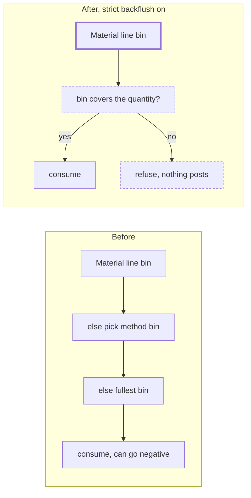

# Strict backflush

> Status: implemented
> Author: naveenkash
> Date: 2026-10-14

## TLDR

Strict backflush is a company setting on **Settings → Items**. It is off by default. When it is on, three rules apply:

1. A method version cannot become Active while a pulled material line has no Pull From storage unit.
2. A job cannot be released while a pulled material line has no storage unit.
3. A backflush takes material only from the material line's storage unit. If that storage unit holds too little stock, Carbon refuses the backflush, and the operation or the job does not complete.

Picked stock at the lineside bin still counts. Batch and serial issue does not change.

## Overview diagram



## Problem Statement

A material controller keeps the same part in more than one storage unit. The BoM line names the storage unit that production must pull from ("Pull From"). Today Carbon does not hold the backflush to it:

| Path | File | What it does when the Pull From bin is empty or short |
|---|---|---|
| Operation completion | `packages/server-functions/src/issue/index.ts` `issueJobOperationMaterials` | Uses the pick method's default bin, then the fullest bin. If the chosen bin is short, it switches to the fullest bin. |
| Job completion | SQL `backflush_job_materials` (`20261009010412_job-costing-always-post.sql`) | Uses the pick method's default bin, then the fullest bin. A warehouse bin is not capped, so it can go negative. A lineside bin is capped silently, so the job consumes less than it needs. |
| Manual issue and step-record backflush | `issue` `partToOperation` | Uses the pick method's default bin, then the fullest bin. |
| Method activation | `convert` `methodVersionToActive` | Does not check the materials. |

Example: the BoM says "pull 10 × PART-123 from Shelf A-4". Shelf A-4 has 6 and Shelf B-2 has 50. The operation completes, and Carbon takes all 10 from Shelf B-2. The records for both shelves are now wrong.

## Proposed Solution

### Design Decisions

| # | Decision | Choice | Rationale |
|---|---|---|---|
| 1 | Where the setting lives | One company setting, `companySettings.requireBackflushStorageUnit`, on Settings → Items. Default `false`. | The rule is a warehouse policy, not a property of one part. A per-item flag leaves unflagged parts on the old behavior with no warning. |
| 2 | Which lines need a Pull From | A method material line needs a Pull From when its `methodType` is not `Make to Order`, its `itemType` is Material, Part or Consumable, and its item's `itemTrackingType` is not `Non-Inventory`. | The backflush reads exactly these lines (`issueJobOperationMaterials`, `backflush_job_materials`). A Make to Order line is built, not pulled. A Purchase to Order line is consumed from a bin, and the BoM editor labels it "Pull From". |
| 3 | Which locations need a Pull From | Each location that has at least one active work center and at least one active storage unit. | Pull From is stored per location (`methodMaterial.storageUnitIds`). A location with no work center builds nothing. A location with no storage unit has no bin a line could name, so a Pull From there can never be set. |
| 4 | Draft methods | Release refuses a job whose pulled line has no `storageUnitId`. | A job can come from a Draft method, so the activation check alone has a gap. |
| 5 | Picked stock | The material's picks and unclaimed lineside stock are consumed first, as today. The strict rule applies to the remainder, against the line's Pull From. After a pick, the Pull From is the source bin of the line's oldest pick line into its current bin (`pullFromStorageUnit`). Job completion (SQL) draws a picked line from its lineside bin first, up to what the bin holds, then the rest from the Pull From. | A pick moves stock out of the Pull From bin with a transfer, so the records stay correct. Picking also moves `jobMaterial.storageUnitId` to the lineside bin, so that column no longer names the Pull From. The pick line keeps it. A later picking list takes the fullest bin, so only the oldest pick line names the Pull From. |
| 5a | Locations without a pull-from bin | Strict backflush applies only at a location from decision 3. Elsewhere the backflush, release and the badges behave as with the setting off. | Activation asks for no Pull From there, so a refusal there could never be fixed. |
| 6a | Negative stock under strict bins | A second switch, `companySettings.preventNegativeBackflush` ("Prevent negative stock", default `true`), nested under Strict Backflush and only active while it is on. Off: the material is still drawn only from its own storage unit, and that storage unit may go below zero. A missing storage unit is refused either way. | A company can want strict bins (accurate per-location stock) without the hard stop on a short bin. Default `true` keeps the behavior the setting shipped with. |
| 6 | Where a shortage stops the work | At operation completion (MES and ERP), at job completion, and at manual issue of a planned material. | If only job completion stopped, the operation would take stock from another bin first. |
| 7 | Batch and serial items | The activation and release checks include them. Their issue flow does not change. | An operator scans the unit, and the unit knows its own bin. |
| 8 | Methods that are already Active, jobs already released | Carbon does not change them. The settings card counts Active methods with a gap and open jobs (Ready, In Progress, Paused) whose next backflush would be refused: a stocked line with no storage unit, not batch or serial, with quantity still to issue, at a location from decision 3. Each count opens a drawer with the full list, searchable and paged. A count and its list read the same query. | Changing a live method or job without warning is a large risk. A card can hold a count, not a list of hundreds. |
| 9 | Produced units with no consumption | MES records a production quantity before it calls `issue`. When strict backflush is on, MES first runs `issue` as a dry run. The dry run stops after the strict check, before any ledger, cost or journal row. If the dry run fails, MES records nothing. An inspection lot runs the dry run before the lot closes. A failure after the units are recorded says "Units completed, but …". | Without the dry run, a refusal leaves produced units with no material consumed. A retry then records the units a second time. |
| 10 | Error text | The refusal names the part, the storage unit, the quantity needed and the quantity on hand. One refusal lists every short material. MES and ERP show the server's message instead of a fixed fallback. | "Failed to issue materials" tells the operator nothing to fix. A refusal that names one part at a time makes the material controller fix them one retry at a time. |
| 11 | One rule, three users | The line predicate lives once in `@carbon/database/strict-backflush`. Activation, release and the settings card all read it. | Three copies of the rule would drift apart. |

### Out of scope

| Path | Why |
|---|---|
| Manual issue of an unplanned part (`partToOperation` with no `materialId`) | No material line exists, so there is no Pull From to enforce. |
| Maintenance dispatch issue (`maintenanceDispatchInventory`) | It is not a job backflush. |
| Kanban auto-release and the MCP status tools | They skip every release check today. The backflush refusal still stops them later. |

## Data Model Changes

Two new columns. One function replaced.

```sql
ALTER TABLE "companySettings"
  ADD COLUMN "requireBackflushStorageUnit" BOOLEAN NOT NULL DEFAULT false;

ALTER TABLE "companySettings"
  ADD COLUMN "preventNegativeBackflush" BOOLEAN NOT NULL DEFAULT true;
```

`backflush_job_materials` is replaced with a copy of its live definition (`20261009010412_job-costing-always-post.sql`). The only changes are in the storage unit step:

1. Read `requireBackflushStorageUnit` once, before the loop.
2. If the setting is on and the item is stocked, use `jobMaterial.storageUnitId` only.
3. If that storage unit is null, `RAISE EXCEPTION` with the part name.
4. Take `pg_advisory_xact_lock` on the key `strict-backflush:<companyId>:<storageUnitId>:<itemId>`. The TypeScript check takes the same key.
5. If the storage unit's untracked on-hand is less than the quantity, `RAISE EXCEPTION` with the part, the storage unit, the quantity needed and the on-hand.
6. If the setting is off, the function behaves exactly as before.

No new table. No RLS change.

## API / Service Changes

| Where | Change |
|---|---|
| `packages/database/src/strict-backflush.ts` (new, export `@carbon/database/strict-backflush`) | `needsPullFrom(line)`, `missingPullFromLocations(storageUnitIds, locationIds)`. Pure, unit-tested. |
| `packages/server-functions/src/lib/strict-backflush.ts` (new) | `isStrictBackflush(trx, companyId)` reads the setting. `assertBinCovers(trx, …)` takes the bin lock, then throws a `ServerFnError` with status 409 when the bin is missing or short. `assertMethodHasPullFrom(db, …)` is the activation check. |
| `@carbon/database/strict-backflush` | Also `getPullFromLocations(db, companyId)`: the one query for "locations with an active work center". |
| `convert` `methodVersionToActive` | If the setting is on, load the version's lines and the locations with an active work center. Throw `InvalidInputError` that lists each part once, separated by "; ". |
| `issue` `issueJobOperationMaterials` | If the setting is on, the remainder after the pick budgets uses `material.storageUnitId` only. `assertBinCovers` counts the rows already planned in this call. No fallback bin, no fullest-bin switch. |
| `issue` `partToOperation` (planned material) | If the setting is on and the issue consumes stock, use `material.storageUnitId` only and run `assertBinCovers`. A return (positive adjustment) does not change. |
| `issue` input `jobOperation` | New optional `dryRun: boolean`. If `dryRun` is true and strict backflush is off, return at once. If it is on, run the issue in a transaction and roll it back. |
| `getJobReleaseReadiness` | Each job gets `materialsWithoutStorageUnit: { id, description }[]`. The list is empty when the setting is off. |
| `jobReleaseProblems` | Adds "set a Pull From storage unit on PART-1, PART-2". |
| `$jobId.status.tsx` (Release dialog path) | Refuses a job with `materialsWithoutStorageUnit` and names the parts. |
| `settings.service.ts` | `updateRequireBackflushStorageUnitSetting`, `updatePreventNegativeBackflushSetting`, `getActiveMethodsMissingPullFrom(db, companyId)` and `getOpenJobsMissingStorageUnit(db, companyId)`. |
| `versions.activate.$id.tsx`, `applyChangeNotice` | Show the server's message when activation fails. |
| MES `complete.tsx`, `end.$operationId.tsx`, `quality.server.ts` | Run the `dryRun` issue before `insertProductionQuantity`. Show the server's message. |
| MES `scrap.tsx`, `issue.tsx` | Show the server's message. |
| ERP `completeOperation`, `batch-operations` `complete` | Run the `dryRun` issue before the production quantity is written (batch: before phase 1). |
| MES `end.$operationId.tsx` serial branch | Stop on an `issue` error. Before this change the route ignored the error and finished the operation. |
| MES `backflushUntrackedMaterialsOnStepRecord` | The failure message lists the server's messages instead of bare item ids. |

## UI Changes

- **Settings → Items → Bill of Materials:** a new "Strict Backflush" card with a switch. When strict backflush is on, the card shows "N active methods have materials with no Pull From". It lists up to 10 of the parts, each linked to its make method.
- **Job → Release dialog:** when strict backflush is on, a "Missing Storage Units" warning lists each part once and disables Release Job.
- **Job → BoM line:** the same red "No storage unit" badge, and Storage Unit is not marked optional.
- **Part → Manufacturing → BoM line:** when strict backflush is on, the Storage Unit field is no longer marked optional. A line with no Pull From for the selected location shows the badge "No storage unit" instead of "Default Storage Unit".
- **Errors:** activation, release, MES completion and ERP job completion show the refusal text as a toast.

## Acceptance Criteria

- [ ] With strict backflush off, every path behaves as before. All existing `issue`, `get-method` and `convert` tests pass.
- [ ] A user turns on strict backflush. A BoM has a Part line with no Pull From at a location that has a work center. The user activates the version and sees an error that names each part once: "Set a Pull From storage unit before you activate this version: MAT-GAAS-CELL; MAT-CF-LAM; MAT-KAPTON". The version stays Draft.
- [ ] The same line is a Make to Order line, or a Non-Inventory item. Activation succeeds.
- [ ] A Draft job has a pulled Inventory line with no `storageUnitId`. Release refuses and names the part.
- [ ] A job line pulls 10 from Shelf A-4. Shelf A-4 holds 6, Shelf B-2 holds 50. The operator completes the operation in MES. Carbon shows "Not enough PART-123 in Shelf A-4: need 10, have 6". No production quantity, no ledger row and no journal is written.
- [ ] Shelf A-4 holds 10. The operation completes, and the ledger row is against Shelf A-4.
- [ ] 6 of the 10 were picked to the lineside bin, and Shelf A-4 holds 4. The operation completes. 6 come from the lineside bin and 4 from Shelf A-4.
- [ ] ERP Job → Complete with a short bin shows the refusal text, and the job stays open.
- [ ] The settings card shows the count of Active methods with a gap and of open jobs with a material that has no storage unit. Review opens a drawer that lists every one, with search.
- [ ] Unit tests pin `needsPullFrom`, `missingPullFromLocations` and the shortfall arithmetic.

## Risks

| Risk | Severity | Mitigation |
|---|---|---|
| Operators are blocked mid-job by a stock error | Med | This is the requested behavior. The message names the part, the bin and the quantities. The setting is off by default. |
| The SQL fork drops a branch of `backflush_job_materials` | High | Fork from the newest definition (`20261009010412`). Diff the new body against it so that only the strict hunks differ (lesson "Forking a SQL function migration"). |
| A refusal at job completion inside the MES Finish trigger shows a fixed message | Low | The operation-completion check runs first and catches most shortfalls. The ERP Job → Complete route already shows the RAISE text. |
| The dry run adds one transaction per MES completion | Low | It runs only when strict backflush is on. |
| Two completions draw the same bin at the same moment | Med | Both checks take a transaction-scoped advisory lock on (company, bin, item). Other stock movements (shipments, transfers) do not take it. |
| Two batch members draw the same bin | Low | Each member's dry run passes alone. Phase 2 then refuses the second member, and the batch stays Completing until a retry. |
| Kanban and MCP release skip the release check | Low | The backflush refusal still applies. Listed as out of scope. |

## Open Questions

- [x] Company toggle or per item? — **Answer:** company-wide on Settings → Items (user, 2026-10-13).
- [x] Which locations must have a Pull From? — **Answer:** each location with at least one active work center (user, 2026-10-13).
- [x] Draft methods feed jobs. Check at release too? — **Answer:** yes, refuse release of a job line with no storage unit (user, 2026-10-13).
- [x] Does picked stock at the lineside bin count? — **Answer:** yes; the strict rule applies to the remainder (user, 2026-10-13).
- [x] Where does a shortage stop the work? — **Answer:** at operation completion and at job completion (user, 2026-10-14).
- [x] Batch and serial items? — **Answer:** require the Pull From at activation; the issue flow does not change (user, 2026-10-13).
- [x] Methods already Active when the setting turns on? — **Answer:** do not change them; show the count and the list on the settings card (user, 2026-10-14).
- [x] Purchase to Order lines? — **Autonomous:** include them. The backflush consumes them from a bin, and the editor labels them "Pull From".
- [x] Produced units with no consumption after a refusal? — **Autonomous:** MES runs a dry-run issue first when strict backflush is on.

## Changelog

- 2026-10-14: Created from the backflush rules design discussion.
- 2026-10-16: Self-review fixes (plan `.ai/plans/2026-10-16-strict-backflush-review-fixes.md`): after a partial pick, the rest now comes from the Pull From, not lineside (decision 5, TypeScript and SQL); strict backflush skips a location with no pull-from bin (decision 5a); both paths lock every (bin, item) pair in one order before the first draw; SQL compares rounded quantities and counts a refused need; the dry run stops at the strict check; the inspection lot is checked before it closes; the New Version route checks activation; every release path checks storage units; the card counts with SQL and the jobs list holds only lines a backflush would refuse (decision 8); the BoM badges use the pull-from locations.
- 2026-10-16: The settings card counts open jobs with a material that has no storage unit, and both counts open a searchable drawer instead of an inline list (user request).
- 2026-10-16: The drawers show locations as pills. A materials cell shows 3 part IDs, and "+N more" opens the full list in a popover that scrolls (user request).
- 2026-10-16: Split the no-negative rule into its own switch, `preventNegativeBackflush` (decision 6a, user request).
- 2026-10-15: Long lists. A 20-line BoM produced a 912-character toast that ran off a small screen and faded before it could be read. Every strict refusal now names the first entries and counts the rest (`summarizeList`: 5 part names, 3 shortfalls; the SQL caps at 3 too). The Release dialog keeps the full list in a scroll box, and a collapsed BoM or job BoM row shows a red "No storage unit" badge.
- 2026-10-15: The activation error names only the parts, not the locations (user request).
- 2026-10-15: Browser test. Fixed: a location with a work center but no storage unit blocked activation for good; the release list named a part twice; the Release dialog did not warn before submit; the job BoM line showed "Default Storage Unit" and "Optional"; a refusal named only the first short material (TypeScript and SQL).
- 2026-10-14: Implemented. Added the bin lock, the dry run in ERP `completeOperation` and batch completion, and the MES serial-branch error check (found during the build).
