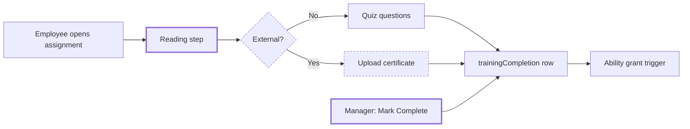

# Training PDF Guides and External Training Certificates

> Status: Approved
> Author: Aashu
> Date: 2026-10-14

## TLDR

- A training can carry one PDF guide. Employees read it on the reading step, next to the typed content.
- A training can be marked External. An employee completes it by uploading a certificate, not by a quiz.
- A manager can upload the certificate for an employee from the assignments page.
- A certificate is a PDF or an image. Upload completes the training at once. A manager can remove a wrong completion.
- Assignments, recurrence, status and ability grants work as they do today. Video is out of scope.

## Overview diagram



## Problem Statement

1. An author can only type training content in the rich-text editor. Many shops already have training guides as PDF files, for example a machine operating guide. The author must retype the guide.
2. Carbon has no way to record training that a person takes outside Carbon, for example a vendor welding course. The proof of that training is a certificate file. Carbon has nowhere to store the certificate.

Today a completion row stores only the employee, the assignment, the time and the period (`20251205021915_training.sql:156`, `20251206000000_training_assignments.sql:2`). It has no file column.

## Proposed Solution

### Part 1 — PDF guide on a training

1. The author uploads one PDF on a Draft training. The training stores its storage path in `training.guidePath`.
2. The training page shows the PDF in the existing `PdfViewer` (`modules/documents/ui/Documents/PdfViewer.tsx`) above the typed content.
3. The employee wizard (`share+/training.$id.tsx`, `ContentStep`) shows the same viewer above the typed content.
4. The author can replace or remove the PDF while the training is Draft.

### Part 2 — External training (superseded by Part 4)

1. The author turns on **External** in the training properties panel.
2. For an External training, the employee wizard shows the reading step, then a certificate upload step. It shows no questions.
3. The employee drops one file: PDF, PNG or JPG, 10 MB or less. The form posts the file to the route action.
4. The route action builds the storage key, uploads the file and inserts the `trainingCompletion` row with `certificatePath`. The training is complete at once.
5. On the assignments page, **Mark Complete** on an External training opens a modal. The manager must upload the certificate there.
6. A completed External assignment shows **View Certificate** on the assignments page and on the person's Trainings card.
7. A manager can **Remove Completion** on a completed assignment. This deletes the completion row. The assignment returns to Pending or Overdue.

### Design Decisions

| Decision | Choice | Rationale |
|----------|--------|-----------|
| PDF count per training | One PDF, `training.guidePath` | User choice. Smallest change; no attachment list UI. |
| PDF placement | Above the typed content, on the reading step | The guide is the main content. Typed text stays optional. |
| When the author can change the PDF | Draft only | Matches the content editor, which edits only in Draft (`x+/training+/$id.tsx`, `canEdit`). |
| How to mark a training External | New column `training.isExternal BOOLEAN NOT NULL DEFAULT false` | `trainingType` (Mandatory / Optional) answers a different question. A boolean is enough for one alternative completion path. |
| Questions on an External training | Kept in the table, hidden and not graded | Turning External off brings them back with no data loss. |
| Completion on certificate upload | Complete at once, no review step | User choice. A manager can remove a wrong completion. |
| Certificate fields | File only | User choice. `completedAt` is the upload time. Renewal follows `training.frequency`. |
| Certificate file types | Employee wizard: PDF, PNG, JPG. Manager modal: also HEIC, which `FileDropzone` converts to JPEG. | The share page has no browser storage client (`CarbonProvider` mounts only under `/x`), so it cannot run the HEIC converter. A phone browser hands a JPEG to a file input that does not list HEIC. HEIC is never stored (`packages/files/AGENTS.md`). |
| Certificate size | 10 MB or less | Same limit as the suggestion upload (`Suggestion.tsx:46`). |
| Manager completion of an External training | Certificate required | Every External completion then has proof. |
| Storage location | Company private bucket through `storage(client).company(companyId)` | Writes go to the company bucket only (`packages/files/AGENTS.md`). Any employee can write there (`20260929153242_storage-private-prefixes.sql:4`). |
| Storage keys | Guide: `{companyId}/training/{trainingId}/{nanoid}.pdf`. Certificate: `{companyId}/training-certificates/{trainingAssignmentId}/{employeeId}/{nanoid}.{ext}` | Keys sit under `{companyId}/`, so `/file/preview/private/...` authorizes them (`file+/preview+/$bucket.$.tsx:66`). |
| Who builds the certificate key | The server (`recordTrainingCompletion`, `resources.server.ts`). The form posts the file, not a key. | A caller can never point a completion at another person's file. The guide still uploads from the browser; `isValidTrainingGuideKey` checks that key. |
| Undo a completion | New service `deleteTrainingCompletion`, `delete: resources` | The completion DELETE policy needs `resources_delete` (`packages/database/src/authz/manifest.ts`, `trainingCompletion`). |
| Ability after an undo | The employee keeps the ability. The confirm dialog tells the manager. | User choice. The trigger `grant_ability_on_training_completion` only adds abilities. A person can hold the ability for another reason. |
| Certificate path on assignment rows | New service `getTrainingCertificatePaths(client, completionIds)` | Avoids a drop and recreate of 2 RPC functions. One query, no N+1. |
| Video | Out of scope for v1 | User choice. |
| Domain research | N/A | This is an internal feature with codebase precedent (customer tax certificate upload, `PdfViewer`). No ERP domain logic changes. |

Heuristics checklist:

| # | Heuristic | Result |
|---|-----------|--------|
| 1 | Multi-tenancy | No new table. New columns sit on `training` and `trainingCompletion`, which already carry `companyId`. |
| 2 | Service shape | `deleteTrainingCompletion` takes `client` first and returns `{ data, error }`. `insertTrainingCompletion` and `upsertTraining` gain fields only. |
| 3 | RLS coverage | Existing policies cover the new columns. No change. |
| 4 | Permission scoping | Upload guide: `update: people` (as the editor). Employee certificate: `role: employee` plus assignment check (as the wizard). Manager complete: `update: resources` (as `assignments.complete.tsx`). Remove completion: `delete: resources`. |
| 5 | Form pattern | Certificate modal and remove action use `ValidatedForm` + zod validators in `resources.models.ts`. |
| 6 | Module layout | All code stays in `~/modules/resources`. No new module. |
| 7 | Backward compatibility | New columns are nullable or defaulted. No RPC function changes. MCP tool digests for the changed service functions regenerate. |

### Part 3 — Training page layout (added after review)

1. The header owns the status. Draft shows **Publish**. Active shows **Archive**. The ⋯ menu has **Reopen**, which moves the training back to Draft. Each one asks for confirmation. Properties has no Status field.
2. The center pane is a stack of two cards: **PDF Guide**, then **Content**. The Content card holds the rich-text editor with its toolbar flush at the top (`Editor` prop `toolbarClassName`).
3. The author edits the name in Properties. The editor has no title block.
4. For an External training, the questions explorer explains why there is no quiz.
5. The shared editor loads the Color and Highlight extensions, so the color menu works in every editor.

### Part 4 — External assignments (replaces Part 2)

Product feedback after the first build: an external training happens in an outside system. Carbon has no content for it and must not send employees a link or a notification. An admin records who completed it.

1. **No training for an external one.** The **New Assignment** form asks for **Internal** or **External**.
   - Internal: pick a training, as today.
   - External: type a **Name** (for example "Forklift license"). There is no training, no content and no frequency.
2. **One-time.** An external assignment has no period. Each member is **"Pending"** until an admin marks them complete, then **"Completed"**. It is never **"Overdue"**.
3. **Admin only.**
   - Carbon sends no assignment notification and no weekly reminder for an external assignment.
   - It does not appear in the employee's outstanding-trainings list.
   - The employee completion page answers 404 for it.
4. **Certificate optional.** On the assignment roster, **Mark Complete** opens a dialog with an optional certificate upload (PDF, PNG, JPG; HEIC converted to JPEG). The admin can complete without a file.
5. **Remove the employee certificate flow.** The **External Certification** switch on a training, `training.isExternal`, the employee certificate step and its action are removed.
6. **Content is either/or.** An internal training has written content **or** an uploaded PDF, not both. The Content card has a two-way switch, **Write** | **Upload PDF**. A training with a guide is a PDF training; the employee page shows only the chosen one. Choosing **Write** on a PDF training removes the PDF after a confirmation.
7. **List and roster keyed by assignment.** The assignments list shows one row per assignment, with an **External** badge on external rows. The roster drawer opens by assignment id, not training id.

Data model for Part 4:

```sql
ALTER TABLE "trainingAssignment"
  ALTER COLUMN "trainingId" DROP NOT NULL,
  ADD COLUMN "name" TEXT,
  ADD CONSTRAINT "trainingAssignment_training_or_name"
    CHECK (num_nonnulls("trainingId", "name") = 1);

ALTER TABLE "training" DROP COLUMN "isExternal";
```

`get_training_assignment_status` and `get_training_assignment_summary` are dropped and recreated:
- The status function left-joins `training`. It returns `COALESCE(t.name, ta.name)` as the name, `'Once'` as the frequency of an external row, and a new `isExternal` column. It keeps a row when its training is Active or when it has no training.
- The summary groups by assignment and returns `trainingAssignmentId` and `isExternal`.
- `recordTrainingCompletion` takes the assignment's training or, for an external assignment, treats it as Active and one-time. It validates a certificate only when one is posted.

## Data Model Changes

```sql
ALTER TABLE "training"
  ADD COLUMN "guidePath" TEXT,
  ADD COLUMN "isExternal" BOOLEAN NOT NULL DEFAULT false;

ALTER TABLE "trainingCompletion"
  ADD COLUMN "certificatePath" TEXT;
```

`get_training_assignment_status` does not change. `get_training_assignment_summary` reads from it (`20260925121735_rpc-function-guards.sql:2007`), so a new output column would force a drop of both functions. Instead, the new service `getTrainingCertificatePaths` reads `certificatePath` for a list of `completionId` values in one `.in()` query.

## API / Service Changes

| Item | Change |
|------|--------|
| `trainingValidator` | Adds `isExternal` (`zfd.checkbox()`) and `guidePath` (optional text). |
| `trainingCompletionValidator` | Adds optional `certificatePath`. |
| New `recordTrainingCompletion` (`resources.server.ts`) | The one completion path. Refuses a training that is not Active. For an External training, checks the certificate (`validateTrainingCertificate`), builds the key and uploads it. Works out the period, inserts the row, removes the file if the insert fails, and restamps the scheduler for a granted ability. |
| `insertTrainingCompletion` | Accepts `certificatePath`. |
| New `deleteTrainingCompletion(client, id, companyId)` | Deletes one completion row. |
| New `getTrainingCertificatePaths(client, companyId, completionIds)` | Returns a map from completion id to `certificatePath`. |
| `x+/training+/update.tsx` (bulk update) | Accepts `isExternal` and `guidePath`. Refuses `guidePath` when the training is not Draft. |
| `share+/training.$id.tsx` loader | Returns `guidePath` and `isExternal`. |
| `share+/training.$id.tsx` action | New intent `certificate`. It checks the training is External, then calls `recordTrainingCompletion` with the posted file. The quiz path calls the same helper. |
| `x+/resources+/assignments.complete.tsx` | Requires a posted certificate file when the training is External. |
| New `x+/resources+/assignments.uncomplete.tsx` | Calls `deleteTrainingCompletion`. |

## Closest Sibling

N/A for a record type: this feature adds fields to the existing training record. The upload pattern copies the customer tax certificate: `modules/sales/ui/Customer/CustomerTaxForm.tsx` (dropzone, `storage(...).company(...)`, `/file/preview/private/...` link). The guide viewer reuses `modules/documents/ui/Documents/PdfViewer.tsx`.

## UI Changes

| Page | Change |
|------|--------|
| Training detail (`x+/training+/$id.tsx`, record page with editor) | PDF guide dropzone above the editor while Draft. PDF viewer above the content when a guide exists. |
| Training properties panel (`TrainingProperties.tsx`) | **External** switch. |
| Training explorer and questions routes | Hidden for an External training. |
| Employee wizard (`share+/training.$id.tsx`) | PDF viewer on the reading step. For External: certificate upload step instead of questions. |
| Assignments (`x+/resources+/assignments.$trainingId.tsx`) | **Mark Complete** opens a certificate modal for External. **View Certificate** link. **Remove Completion** action. |
| Person trainings card (`PersonTrainings.tsx`) | **View Certificate** link on completed External trainings. |

Every new string uses Lingui (`useLingui().t` or `<Trans>`).

## Acceptance Criteria

- [ ] An author uploads a PDF on a Draft training. The training page shows the PDF in a viewer above the typed content.
- [ ] An author cannot upload, replace or remove the PDF on an Active training.
- [ ] An employee opens an assigned training with a PDF guide. The reading step shows the PDF.
- [ ] An author turns on External. The questions explorer is hidden. The employee wizard shows an upload step and no questions.
- [ ] An employee uploads a PDF certificate on an External training. The assignment shows Completed. **View Certificate** opens the file.
- [ ] A manager uploads a HEIC photo in the certificate modal. The stored file is a JPEG.
- [ ] An employee cannot complete an External training without a file.
- [ ] A manager clicks **Mark Complete** on an External training. The modal requires a certificate. After upload the assignment shows Completed.
- [ ] A manager clicks **Remove Completion**. The assignment shows Pending (or Overdue when the period has ended).
- [ ] An External training that grants an ability adds the qualification on certificate upload, as the quiz path does.
- [ ] Every stored certificate key starts with `{companyId}/training-certificates/{trainingAssignmentId}/{employeeId}/`.
- [ ] A file over 10 MB, or of another type, is refused with a message.
- [ ] All new UI strings appear in the extracted Lingui catalog.

## Risks

| Risk | Severity | Mitigation |
|------|----------|------------|
| An employee uploads a certificate that is not real | Med | A manager can view every certificate and remove the completion. |
| A dropped or replaced file stays in storage with no row pointing at it | Low | Same as the tax certificate upload today. Out of scope for v1. |
| A large PDF loads slowly on a phone | Low | The viewer loads one file on demand. |
| A removed completion leaves the granted ability in place | Low | The confirm dialog says so. The manager removes the ability on the person's Abilities panel. |

## Open Questions

> All resolved before this spec was written.

- [x] What does v1 include? — **Answer:** PDF guide on a training, plus External training completed by certificate upload. Video is later.
- [x] How does a PDF guide attach to a training? — **Answer:** One PDF per training, shown on the reading step with any typed text.
- [x] How does an External training get marked complete? — **Answer:** The certificate upload completes it at once. A manager can upload on an employee's behalf and can remove a wrong completion. No quiz.
- [x] What does the uploader enter with the certificate? — **Answer:** The file only. Completed date is the upload time. Renewal follows the training frequency.
- [x] Does Carbon check that the file is a real certificate? — **Answer:** No. Any accepted file type completes the training. A manager reviews the file and removes a wrong completion.
- [x] When a manager removes a completion, what happens to the granted ability? — **Answer:** The employee keeps it. The confirm dialog tells the manager to remove it by hand if needed.
- [x] Can a person replace the certificate after upload? — **Answer:** No. To fix a wrong file, a manager removes the completion and the employee uploads a new file.

## Changelog

- 2026-10-14: Created
- 2026-10-14: Certificate paths come from a new service, not from the status RPC. Removing a completion keeps the ability.
- 2026-10-14: Implemented. The server builds the certificate key. The employee wizard takes PDF, PNG and JPG; the manager modal also takes HEIC. Removing a completion needs `delete: resources`.
- 2026-10-14: Page layout (Part 3). Every completion goes through `recordTrainingCompletion`: it refuses a training that is not Active, works out the period on the server and removes an orphaned certificate. `isExternal` changes only while Draft. Guide keys are `{uploadId}/{file name}`.
- 2026-10-14: Part 4. External trainings become name-only assignments that only an admin completes, with an optional certificate. Content is written or a PDF, not both.
