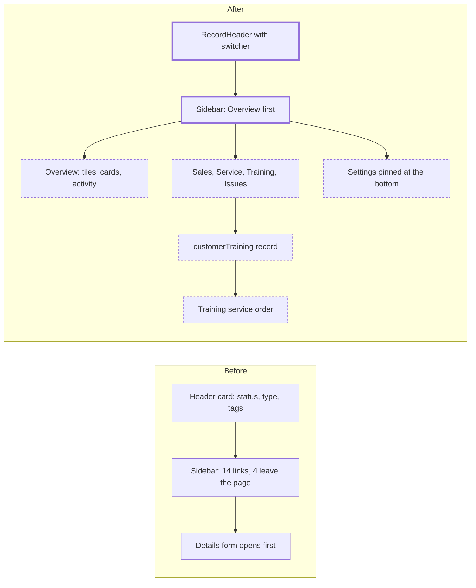

# Customer Record: Overview, Sales, Training and Issues

> Status: draft
> Author: barbinbrad
> Date: 2026-10-15

## TLDR

The customer record moves to the project workspace shell. It opens on an **Overview**, not the edit form. The left sidebar lists the working pages, and a **Settings** page is pinned at the bottom. Four new record pages hold what an after-sales service manager asks for: **Sales**, **Service**, **Training** and **Issues**. Sales shows purchases by item and all sales documents. A new `customerTraining` record logs training given to the customer's people. A new **Training** service order type schedules and bills a training session. A new `Customer Feedback` issue type routes feedback to engineering through the existing Issues workflow. This spec covers the customer only. Supplier and employee records follow in their own specs. Research: `.ai/research/2026-10-14-record-360-layout.md`.

## Overview diagram



## Problem Statement

An after-sales service manager wants "one-stop shopping" for a customer. The manager wants these things in one place:

1. The sales history, with quantities per product.
2. The serials the customer owns.
3. The field service done for the customer.
4. The RMAs for warranty service or paid repair.
5. The training given to the customer's people.
6. The customer's feedback, and its path to the engineers.
7. The customer's contacts.

Carbon has most of the data but no single place for it:

- The customer page opens on an edit form (`$customerId.details.tsx`). It shows no totals and no recent activity.
- The sidebar has 14 entries. Five of them (Details, Payment, Shipping, Tax, Bank Accounts) are setup forms that a user opens seldom.
- RFQs, Quotes, Orders and Invoices are links that leave the customer page for the module lists.
- No page lists the quantity of each product the customer bought.
- Service orders, RMAs and issues for the customer show on no customer page.
- Carbon has no record of training given to a customer. The `training` tables are for employees. None of the 9 products in the research has such a record either.
- A service order needs a serial. A training session is often for a product line, not one unit.

## Proposed Solution

### The shell

The customer layout `x+/customer+/$customerId.tsx` copies the project workspace layout `x+/project+/$projectId.tsx`:

- **Header**: `RecordHeader` with a customer switcher as its title, the customer status, Copy, a ⋯ menu (audit log, Delete) and the explorer toggle (`toolsPlacement="end"`). The switcher reads the live `customers` store (`useCustomers`). Choosing a customer opens the same page of that customer.
- **Body**: `ResizablePanels` with the customer sidebar as the explorer and the page as the content.
- **Sidebar**: copies `ProjectSidebar`. `DetailSidebar` holds the working links with icons. **Settings** sits at the bottom, under a border.

The sidebar links, top to bottom:

| Link | Route | Shows when the user can |
|---|---|---|
| Overview | `$customerId._index.tsx` (default) | view sales |
| Sales | `$customerId.sales.tsx` | view sales |
| Assets | `$customerId.assets.tsx` (exists) | view service |
| Service | `$customerId.service.tsx` | view service |
| Returns | `$customerId.returns.tsx` | view sales |
| Training | `$customerId.training.tsx` | view service |
| Issues | `$customerId.issues.tsx` | view quality |
| Contacts | `$customerId.contacts.tsx` (exists) | view sales |
| Locations | `$customerId.locations.tsx` (exists) | view sales |
| Documents | `$customerId.documents.tsx` (exists) | view sales |
| Risks | `$customerId.risks.tsx` (exists) | view sales |
| Settings (bottom) | `$customerId.settings.tsx` | view sales |

### Settings

`$customerId.settings.tsx` copies `$projectId.settings.tsx`. It stacks 5 sections on one page. Each section keeps its own form and its own Save:

1. Details: `CustomerForm`. Tags move here from the header.
2. Payment: `CustomerPaymentForm`.
3. Shipping: `CustomerShippingForm`.
4. Tax: `CustomerTaxForm`.
5. Bank Accounts: `CustomerBankAccounts`, only with the accounting permission, as today.

Each form posts to its existing route action. The loaders of `details`, `payment`, `shipping`, `tax` and `bank-accounts` redirect a GET to Settings, so old links keep working. The bank account drawers keep their routes.

### Overview

`$customerId._index.tsx` renders the Overview. It copies the parts of `ProjectOverview` (`OverviewSection`, `AttentionRow`). Top to bottom:

1. **4 value tiles** (`MetricCard`):

   | Tile | Value |
   |---|---|
   | Sales, last 12 months | Posted sales invoices dated in the last 12 months, in base currency |
   | Open orders | Sales orders not Completed, Closed or Cancelled |
   | Open balance | The customer's open receivables, in base currency. The overdue part shows in red |
   | Units in service | `customerAsset` rows with status In Service |

2. **Needs attention**: a list of `AttentionRow`s. It shows nothing when every count is 0. Rows: overdue invoices, late order lines (`promisedDate` before today and not `sentComplete`), open RMAs, open service orders, open issues.
3. **6 cards**. Each card has a title with a count, up to 5 rows and **View all** to its sidebar page:

   | Card | Rows | View all |
   |---|---|---|
   | Purchases by item | Item, quantity shipped, last order date | Sales |
   | Installed base | Serial, item, warranty badge | Assets |
   | Service | Order, type, status, next visit | Service |
   | Training | Title, date, attendee count, order status | Training |
   | Issues | Issue, type, status | Issues |
   | Contacts | Name, title, email, phone | Contacts |

4. **Recent activity**: the last 10 events of this customer, newest first, grouped by month. Each event comes from a date column of the customer's own records. The sources are orders, shipments, invoices, RMAs, service visits, training sessions and issues. The card does not read the audit log, so it works on every plan. Notes are not events.

The Overview loader makes one call: `get_customer_overview(customer_id, company_id)`. The function returns the tiles, the attention counts, the top rows of every card and the activity events as one JSON object. It is `SECURITY INVOKER`, so RLS decides what each user sees. The UI hides a card when the user lacks the view permission of its module.

### Sales

`$customerId.sales.tsx` has 2 views, switched by a tab control:

1. **Purchases by item** (default): one row per item on the customer's sales orders. Cancelled orders do not count. Columns:
   - Item
   - Quantity ordered: Σ `salesOrderLine.saleQuantity`
   - Quantity shipped: Σ `quantitySent`
   - Orders: the number of distinct sales orders
   - Last order date
   - Units in service: `customerAsset` rows of that item
   
   A click on a row opens the Documents view, filtered to that item.
2. **Documents**: one list of the customer's RFQs, quotes, sales orders and sales invoices. It has a type filter and a status filter. Each row opens its document. The list reads a new view, `customerSalesDocuments`.

### Service and Returns

- `$customerId.service.tsx` shows the customer's service orders with `ServiceOrdersTable`, filtered to the customer. It copies how `$customerId.assets.tsx` passes `customerId` to `CustomerAssetsTable`. **New Service Order** opens the existing drawer with the customer filled in.
- `$customerId.returns.tsx` shows the customer's RMAs with the sales return order table, filtered to the customer.

### Training

`$customerId.training.tsx` lists the customer's `customerTraining` rows. Columns: date, title, item, format, trainer, attendee count, and the service order with its status. **Log Training** opens a drawer form. A row opens the same drawer for edit.

The form fields:
- Title (required).
- Date and duration.
- Format: On Site, Remote or At Our Facility.
- Site.
- Item.
- Trainer (an employee).
- Attendees: a multi-select of the customer's contacts.
- Notes.

A row linked to a Training order shows the order's status. A row with no order is a session that was delivered and logged by hand. The row has no status of its own.

The contact drawer (`$customerId.contacts.$customerContactId.tsx`) lists the sessions the contact attended.

### Training service order

A new `serviceOrderType` value, `Training`:

- The New Service Order drawer offers Training next to Field Visit and Refurbishment.
- A Training order needs a customer, a site and an item (the product trained on). A unit is optional. The order stores the unit in `customerAssetId` and never sets `trackedEntityId`. So a Training order never blocks a repair of that unit through `serviceOrder_open_subject_key`.
- The work tree starts from Empty, a Template or the Item. Start from Serial is not offered.
- Visits, time, expenses, the estimate and the invoice work as on a Field Visit order.
- Coverage: `resolveCoverage` returns Contract when the order names a coverage contract, else Billable. A Training charge is never Warranty, even when the order names a unit under warranty.
- `createServiceOrder` inserts the order's `customerTraining` row in the same transaction. It copies the customer, the site, the item and the order's title, and sets `serviceOrderId`.
- When the order becomes Completed, the same transaction fills the row's `trainingDate` and `trainerId` from the last completed visit. It keeps a value that a user already set.
- `cancelServiceOrder` deletes the order's training row in the same transaction.

### Issues and Customer Feedback

- A new issue type, `Customer Feedback`. `seed-data.ts` (`nonConformanceTypes`) adds it for new companies. A migration adds it to every existing company with `ON CONFLICT ("companyId", (LOWER("name"))) DO NOTHING`, the guard of `20260915192947_rename-non-conformance-seed-data.sql`.
- Issue types are company data: a company can rename or delete them. No code reads an issue type by its name.
- `$customerId.issues.tsx` lists every issue linked to the customer through `nonConformanceCustomer`, of any type, with the type on each row. **New Issue** opens the existing issue form with the customer filled in. The user picks the type.
- The customer asset page (`CustomerAssetPage`) gets an **Issues** card. It lists the issues linked to its serial through `nonConformanceTrackedEntity`.

### Demo data

Each of the 4 datasets gets these rows:
- 3 `customerTraining` rows on one customer: 2 logged by hand and 1 created by a Training order.
- Their attendees.
- 1 Training service order with a completed visit.
- 1 `Customer Feedback` issue linked to a customer and a serial.

`COVERAGE_FLOORS` gets floors for `customerTraining` and `customerTrainingAttendee`.

### Design Decisions

| Decision | Choice | Rationale |
|----------|--------|-----------|
| Scope | The customer record only. Supplier and employee get their own specs later | User decision (Q1): iterate on the customer first |
| Shell | Copy `$projectId.tsx`: `RecordHeader` + `ResizablePanels` + `ProjectSidebar` shape | User choice. The research shows left navigation and tabs work equally well (Workday uses a left list) |
| Default page | Overview | All 9 products open a record on a summary (research pattern 1) |
| Setup forms | One Settings page, pinned at the bottom, with 5 stacked sections | User decision (Q2). Copies `$projectId.settings.tsx` |
| Contacts and Locations | Stay in the top list | User decision (Q2): a service manager uses them daily |
| Old setup URLs | The GET loader redirects to Settings. The actions stay | Old links and bookmarks keep working, and the forms need no new actions |
| Sales history | A Sales page: Purchases by item (default) and Documents | User decision (Q3). Copies NetSuite Items Purchased and SAP Business Documents |
| RFQs, Quotes, Orders, Invoices links | Removed from the sidebar | The Documents view covers them (Q3) |
| Activity | A Recent activity card built from document dates | User decision (Q4). Works without the Enterprise audit log |
| Header | Switcher, status, Copy, ⋯ menu. Type, account manager and tags move to Settings | User decision (Q8). One quiet row, as in projects |
| Overview content | 4 tiles, Needs attention, 6 cards, Recent activity | User decision (Q8). Stays inside the 5–8 component budget from the research |
| Overview data | One `SECURITY INVOKER` RPC per page load | Lesson "A layout that skips its loader…": make the loader one query |
| Non-employee users | The explorer is hidden for a user who is not an employee, as today | Preserves the current behavior of `$customerId.tsx` |
| Training record | `customerTraining` + `customerTrainingAttendee`. No expiry, no course link | User decision (Q5) |
| Training format | Enum `customerTrainingFormat`: On Site, Remote, At Our Facility | A closed set the list can filter. The name says what the choice decides |
| Training status | None. A linked order gives the status. A row with no order was delivered | User decision (Q6b): one source of truth |
| Training order serial | `trackedEntityId` is NULL on a Training order and set on every other type. The unit goes in `customerAssetId` | User decision (Q6a): a Training order never blocks a repair |
| Training order item | Required | User decision (Q9): `itemId` stays `NOT NULL` |
| Training coverage | Contract or Billable, never Warranty | User decision (Q6a). Changes `resolveCoverage`, an Ask First item in the module guide, approved here |
| Training row lifecycle | Created with the order; stamped on Completed; deleted on Cancelled; all in the order's transaction | User decision (Q6b) |
| Feedback | An issue type, `Customer Feedback`, plus type-agnostic customer and asset issue lists | User decision (Q7). Issues already have assignees, actions and reviewers |
| Feedback backfill | Insert for every company, skip a company that already has the name | User decision (Q7). The unique index is on `("companyId", LOWER("name"))` |
| Multi-tenancy (H1) | Both new tables: `companyId`, composite PK `("id", "companyId")`, `id('ctr')` and `id('cta')` | Convention |
| Service shape (H2) | `getCustomerTrainings`, `getCustomerTraining`, `upsertCustomerTraining`, `deleteCustomerTraining` take `client` first and return `{data, error}` | Convention |
| RLS (H3) | Both tables are in the authz manifest as `service` module tables. The view and the RPC are `security_invoker` | `.claude/rules/authz-manifest.md` |
| Permissions (H4) | Training routes: `service` view / create / update / delete. Overview and Sales: `sales` view. Issues page: `quality` view | Matches the module that owns each record |
| Forms (H5) | The training drawer uses `ValidatedForm` + `customerTrainingValidator` + a route action | Convention |
| Module layout (H6) | Training lives in the service module: `service.models.ts`, `service.service.ts`, `ui/Training/`. The customer pages stay in the sales module | One service file and one models file per module |
| Backward compatibility (H7) | `serviceOrder.trackedEntityId` becomes nullable. Readers that assume a serial get a null path | The type change shows every reader at typecheck |

## Data Model Changes

Two migrations: the enum value must commit before a CHECK can name it.

```sql
-- Migration 1
ALTER TYPE "serviceOrderType" ADD VALUE IF NOT EXISTS 'Training';
```

```sql
-- Migration 2
ALTER TABLE "serviceOrder" ALTER COLUMN "trackedEntityId" DROP NOT NULL;
ALTER TABLE "serviceOrder" ADD CONSTRAINT "serviceOrder_training_subject_check"
  CHECK (("type" = 'Training') = ("trackedEntityId" IS NULL));

CREATE TYPE "customerTrainingFormat" AS ENUM ('On Site', 'Remote', 'At Our Facility');

CREATE TABLE "customerTraining" (
  "id" TEXT NOT NULL DEFAULT id('ctr'),
  "companyId" TEXT NOT NULL,
  "customerId" TEXT NOT NULL,
  "customerLocationId" TEXT,
  "title" TEXT NOT NULL,
  "itemId" TEXT,
  "trainingDate" DATE,
  "durationHours" NUMERIC,
  "format" "customerTrainingFormat" NOT NULL DEFAULT 'On Site',
  "trainerId" TEXT REFERENCES "user"("id"),
  "serviceOrderId" TEXT,
  "notes" JSONB,
  "createdBy" TEXT NOT NULL REFERENCES "user"("id"),
  "createdAt" TIMESTAMP WITH TIME ZONE NOT NULL DEFAULT NOW(),
  "updatedBy" TEXT REFERENCES "user"("id"),
  "updatedAt" TIMESTAMP WITH TIME ZONE,
  "customFields" JSONB,
  CONSTRAINT "customerTraining_pkey" PRIMARY KEY ("id", "companyId"),
  CONSTRAINT "customerTraining_companyId_fkey" FOREIGN KEY ("companyId") REFERENCES "company"("id") ON DELETE CASCADE,
  CONSTRAINT "customerTraining_customerId_fkey" FOREIGN KEY ("customerId") REFERENCES "customer"("id") ON DELETE CASCADE,
  CONSTRAINT "customerTraining_customerLocationId_fkey" FOREIGN KEY ("customerLocationId") REFERENCES "customerLocation"("id") ON DELETE SET NULL,
  CONSTRAINT "customerTraining_itemId_fkey" FOREIGN KEY ("itemId") REFERENCES "item"("id") ON DELETE SET NULL,
  CONSTRAINT "customerTraining_serviceOrder_fkey" FOREIGN KEY ("serviceOrderId", "companyId") REFERENCES "serviceOrder"("id", "companyId") ON DELETE CASCADE,
  CONSTRAINT "customerTraining_serviceOrder_key" UNIQUE ("serviceOrderId", "companyId")
);

CREATE TABLE "customerTrainingAttendee" (
  "id" TEXT NOT NULL DEFAULT id('cta'),
  "companyId" TEXT NOT NULL,
  "customerTrainingId" TEXT NOT NULL,
  "customerContactId" TEXT NOT NULL,
  "createdBy" TEXT NOT NULL REFERENCES "user"("id"),
  "createdAt" TIMESTAMP WITH TIME ZONE NOT NULL DEFAULT NOW(),
  CONSTRAINT "customerTrainingAttendee_pkey" PRIMARY KEY ("id", "companyId"),
  CONSTRAINT "customerTrainingAttendee_training_fkey" FOREIGN KEY ("customerTrainingId", "companyId") REFERENCES "customerTraining"("id", "companyId") ON DELETE CASCADE,
  CONSTRAINT "customerTrainingAttendee_contact_fkey" FOREIGN KEY ("customerContactId") REFERENCES "customerContact"("id") ON DELETE CASCADE,
  CONSTRAINT "customerTrainingAttendee_key" UNIQUE ("customerTrainingId", "customerContactId", "companyId")
);

-- Indexes on every FK column, per conventions-database.md.
-- RLS through the authz manifest (module: service), not hand-written policies.

INSERT INTO "nonConformanceType" ("name", "companyId", "createdBy")
SELECT 'Customer Feedback', c."id", 'system' FROM "company" c
ON CONFLICT ("companyId", (LOWER("name"))) DO NOTHING;
```

`customer`, `customerLocation`, `customerContact` and `item` have single-column primary keys, so those FKs name `id` only, as the field service tables do.

New read objects:

| Object | Purpose |
|---|---|
| `get_customer_overview(customer_id, company_id)` | Tiles, attention counts, top rows of each card, activity events. One JSON object |
| `customerSalesDocuments` view | RFQs, quotes, sales orders and sales invoices of a customer, in one shape: type, id, readable id, date, status, amount |
| `get_customer_purchases_by_item(customer_id, company_id)` | The Purchases by item rows |

## API / Service Changes

| Where | Change |
|---|---|
| `sales.service.ts` | `getCustomerOverview`, `getCustomerSalesDocuments`, `getCustomerPurchasesByItem` |
| `service.models.ts` | `serviceOrderTypes` gains Training. `serviceOrderValidator`: Training needs customer, site and item; `customerAssetId` is optional; `trackedEntityId` must be empty. New `customerTrainingValidator` and `customerTrainingFormats` |
| `service.service.ts` | `getCustomerTrainings`, `getCustomerTraining`, `upsertCustomerTraining` (attendees replaced in one call), `deleteCustomerTraining`, `getTrainingsByContact` |
| `service.server.ts` | `createServiceOrder`: the Training branch and the training row insert. `syncServiceOrderStatus`: stamp the training row on Completed. `cancelServiceOrder`: delete the training row |
| `packages/utils/src/service-coverage.ts` | `resolveCoverage`: a Training order skips the warranty rules |
| `quality.service.ts` | `getIssuesByCustomer`, `getIssuesByTrackedEntity` (reads through `nonConformanceCustomer` and `nonConformanceTrackedEntity`) |
| `packages/database/src/seed-data.ts` | `nonConformanceTypes` gains `Customer Feedback` |
| `packages/database/src/authz/manifest.ts` | `customerTraining`, `customerTrainingAttendee` |
| Datasets | Training rows, a Training order, a feedback issue, the `COVERAGE_FLOORS` entries |

Route changes under `x+/customer+/`:

| Route | Change |
|---|---|
| `$customerId.tsx` | New shell: `CustomerHeader` rewritten on `RecordHeader`, `ResizablePanels`, `CustomerSidebar` |
| `$customerId._index.tsx` | Renders the Overview instead of redirecting to Details |
| `$customerId.settings.tsx` | New |
| `$customerId.details/payment/shipping/tax/bank-accounts.tsx` | GET redirects to Settings. Actions unchanged |
| `$customerId.sales.tsx`, `.service.tsx`, `.returns.tsx`, `.training.tsx`, `.training.new.tsx`, `.training.$trainingId.tsx`, `.issues.tsx` | New |

## Closest Sibling

**The project workspace.** The customer record copies these files:

| Project file | Customer file |
|---|---|
| `routes/x+/project+/$projectId.tsx` | `routes/x+/customer+/$customerId.tsx` |
| `modules/projects/ui/Project/ProjectHeader.tsx` (`RecordHeader`, `ProjectSwitcher`) | `modules/sales/ui/Customer/CustomerHeader.tsx` (`CustomerSwitcher`) |
| `modules/projects/ui/Project/ProjectSidebar.tsx` | `modules/sales/ui/Customer/CustomerSidebar/CustomerSidebar.tsx` |
| `modules/projects/ui/Project/useProjectNavigation.tsx` (`useProjectSidebarLinks`, links + `settings`) | `modules/sales/ui/Customer/CustomerSidebar/useCustomerSidebar.tsx` |
| `routes/x+/project+/$projectId._index.tsx` + `ProjectOverview.tsx` | `routes/x+/customer+/$customerId._index.tsx` + `CustomerOverview.tsx` |
| `routes/x+/project+/$projectId.settings.tsx` | `routes/x+/customer+/$customerId.settings.tsx` |

Deviations, each a Design Decision above:

1. The project sidebar has a change-request picker and an element tree. The customer sidebar has neither.
2. The project switcher loads its options in the layout loader. The customer switcher reads the live `customers` store, which the pickers already keep in the browser.
3. The customer explorer stays hidden for a user who is not an employee.

The Training drawer copies the customer contact drawer (`$customerId.contacts.$customerContactId.tsx`, `CustomerContactForm`). The Service, Returns and Issues pages copy `$customerId.assets.tsx`: a module table with the customer filter fixed.

## UI Changes

- Page archetype: the project workspace (the sibling's).
- The header is one row. It has no tabs and no primary button.
- The Overview, Sales, Service, Returns, Training and Issues pages render at natural height. The content panel is the only scroll surface (lesson "Card lists never get their own scroll region").
- An empty card shows one muted line. An empty page shows `Empty`.
- The warranty badge on the Installed base card reuses `WarrantyBadge` from `ServiceStatus`.
- No new filters, toggles or toolbars beyond the Sales view switch and the Documents type and status filters.
- All new strings go through Lingui. Run `/translate` after.
- Docs: update the customer reference page and the service order reference page under `docs/content/` for the new layout, the Training type and customer training.

## Acceptance Criteria

- [ ] Opening `/x/customer/<id>` shows the Overview, not the edit form.
- [ ] The sidebar lists Overview, Sales, Assets, Service, Returns, Training, Issues, Contacts, Locations, Documents and Risks, with Settings pinned at the bottom.
- [ ] A user without the service permission sees no Assets, Service or Training link, and no Installed base, Service or Training card.
- [ ] The switcher lists the company's customers. Choosing another customer on its Sales page opens that customer's Sales page.
- [ ] Settings shows Details, Payment, Shipping, Tax and Bank Accounts. Saving each section saves only that section.
- [ ] Opening `/x/customer/<id>/details` opens Settings.
- [ ] The 4 tiles match the source data. Sales in the last 12 months equals the sum of the customer's posted invoices in that window. Units in service equals the count of In Service assets.
- [ ] Needs attention is absent for a customer with no overdue invoice, late line, open RMA, open service order or open issue.
- [ ] Purchases by item shows one row per item. Its quantities equal the sums over the customer's sales order lines, without cancelled orders.
- [ ] A click on a Purchases by item row shows that item's sales documents.
- [ ] The Documents view lists the customer's RFQs, quotes, orders and invoices, and its type filter narrows the list.
- [ ] Recent activity shows at most 10 events, newest first, grouped by month, on a company without the audit log.
- [ ] A user logs a training with 2 attendees. The Training page, the Training card and both contacts' drawers show it.
- [ ] A user creates a Training order with no unit. The order saves with `trackedEntityId` NULL, and its training row shows on the customer with status Draft.
- [ ] A Training order on a unit with an open Depot Repair order saves. Neither order blocks the other.
- [ ] Completing the Training order's visit with Work complete = Yes sets the training row's date and trainer.
- [ ] Cancelling a Training order removes its training row.
- [ ] A user logs time on a Training order whose unit is under labor warranty. The charge posts as Billable, or as Contract when the order names a coverage contract.
- [ ] A Field Visit, Depot Repair or Refurbishment order without a serial is refused by `serviceOrder_training_subject_check`.
- [ ] Every existing company has the `Customer Feedback` issue type, and a company that already had it has one row, not two.
- [ ] Renaming the `Customer Feedback` type leaves the customer Issues page and card working.
- [ ] A user links an issue to a customer and a serial. The issue shows on the customer Issues page, the Issues card and the asset page.
- [ ] `pnpm db:check:datasets` passes for all 4 datasets with the new floors.
- [ ] `pnpm exec turbo run typecheck --filter=erp`, the service model tests and the coverage tests pass.

## Risks

| Risk | Severity | Mitigation |
|------|----------|------------|
| A reader of `serviceOrder.trackedEntityId` assumes a serial and breaks on a Training order | High | Regenerate the types. Typecheck lists every reader. Grep string selects of `trackedEntity` on `serviceOrder` (lesson "A dropped column breaks string selects…") |
| The overview RPC is slow on a customer with many documents | Med | One call. Indexes on `customerId` exist on the source tables. Measure on the satellite dataset before the demo |
| Open balance disagrees with the receivables report | Med | Compute it with the same rule as `get_ar_open_by_customer` |
| `resolveCoverage` changes the posting account of a charge | Med | The change applies to Training orders only. A unit test pins Field Visit, Depot Repair and Refurbishment results |
| The backfill restores `Customer Feedback` to a company that deleted it | Low | Accepted (Q7). The type is harmless when unused |
| The Settings page posts to 5 different actions; a save redirect lands on the old route | Low | The old routes redirect a GET to Settings |
| Bookmarks to the removed Quotes / Orders / Invoices sidebar links | Low | Those were list-page URLs with a filter; they still work |

## Open Questions

> HARD STOP: Do not proceed with implementation until these are answered.

- [x] Q1. How do we phase it? — **Answer:** the customer record only, to iterate. Supplier and employee get their own specs later.
- [x] Q2. What goes under Settings? — **Answer:** one Settings page pinned at the bottom with Details, Payment, Shipping, Tax and Bank Accounts stacked. Contacts and Locations stay in the top list.
- [x] Q3. Where does sales history live? — **Answer:** a Sales page with Purchases by item (default) and Documents (RFQs, quotes, orders, invoices with a type filter). The 4 sidebar links that left the page go away.
- [x] Q4. What does the Overview show as activity? — **Answer:** a Recent activity card built from the customer's own document dates: last 10, newest first, grouped by month. No audit log, no notes.
- [x] Q5. What does a customer training record hold? — **Answer:** customer, site, title, optional item, date, duration, format, trainer, optional service order, notes, and attendees from customer contacts. No expiry and no course link.
- [x] Q6. How does a Training service order work? — **Answer:** (a) the serial is optional and a Training order never blocks a repair; coverage is Contract or Billable. (b) `createServiceOrder` creates the training row with the order. The row shows the order's status. On completion it takes the date and trainer from the last visit. A cancel deletes it.
- [x] Q7. How does customer feedback work? — **Answer:** a `Customer Feedback` issue type for new companies, plus a backfill that skips a company that already has the name. The customer and asset issue lists read any type, because types are editable per company.
- [x] Q8. What do the header and the Overview show? — **Answer:** the header is the switcher, status, Copy and ⋯ menu; type, account manager and tags move to Settings. The Overview has 4 tiles, Needs attention, 6 cards and Recent activity.
- [x] Q9. Does a Training order need a product? — **Answer:** yes. `serviceOrder.itemId` stays `NOT NULL`. A training logged without an order keeps the item optional.

## Changelog

- 2026-10-15: Created. The user answered Q1–Q9 before the spec was written.
