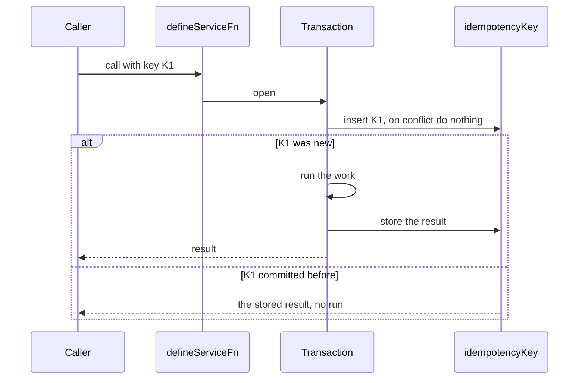

# Idempotent service functions

> Status: draft
> Author: Sidwebworks
> Date: 2026-10-15

## TLDR

Agents, API clients and double clicks send the same write twice. Today a few
writes guard themselves (`updateJobStatus` with `fromStatuses`) and the rest
run twice. This spec adds idempotency to `defineServiceFn` in three layers:
state guards in the write itself, an idempotency key stored in an UNLOGGED
Postgres table in the same transaction as the work, and event ids derived from
that key. Spec only: the build waits until the module migration is done.

## Overview diagram



## Problem Statement

- A retried release, post or cancel runs again. Most of these are status
  transitions, and only a few writes check the status in the UPDATE itself.
- A retried create makes a second row: a second purchase order, a second
  payment. No status can catch it.
- An event sent before a transaction commits can describe work that rolled
  back. A retried call sends the event twice.

## Proposed Solution

### Layer 1: state guards

A status transition is one conditional UPDATE: `… WHERE status IN (<from>)`.
If the row has left those statuses, the write changes nothing and the
function returns `conflict` ("The job was already released"). This is the
`updateJobStatus` `fromStatuses` pattern, made the standard for every
transition. It needs no storage and it also stops two users who act at once.

### Layer 2: idempotency keys for creates

1. The caller sends a key: the `Idempotency-Key` header over HTTP, an
   `idempotencyKey` field for MCP, a hidden field in a form.
2. A function declares `idempotency: "key"`. The helper then runs `run` inside
   `ctx.transaction`.
3. As the transaction's first statement, the helper inserts the key row with
   `ON CONFLICT DO NOTHING`.
4. If the insert wrote a row, the work runs, and the helper stores the result
   in the row before the commit.
5. If the insert wrote nothing, the helper reads the row and returns its
   stored result. The work does not run.
6. If the stored input hash differs from this call's, the helper returns
   `conflict` ("This key was used for a different request").

A second call with the same key waits on the unique index until the first
transaction ends. So there is no "in progress" state, and a crash rolls back
the key row with the work.

### Layer 3: events

An event sent by a keyed call gets the id `<operation>:<key>`. Inngest drops a
second send with the same id. Events go out after the commit, through a
`ctx.afterCommit` hook on the transaction.

### Design Decisions

| Decision | Choice | Rationale |
|----------|--------|-----------|
| Key store | UNLOGGED Postgres table | Commits with the work in one transaction. Redis cannot, so a crash between the commit and the key write left the key stuck. UNLOGGED skips the WAL for rows that live 24 hours (precedent: `apiKeyRateLimit`) |
| Crash behavior | Accept the loss | Postgres truncates an UNLOGGED table after a crash, so a retry after a database crash can run again. Layer 1 still catches the transitions |
| Which functions | Creates of documents and money first | Transitions are covered by layer 1 |
| Retention | 24 hours, a daily pg_cron delete | A retry after a day is a new request |
| Key scope | `(companyId, operation, key)` | Two companies or two operations never share a key |

## Data Model Changes

```sql
CREATE UNLOGGED TABLE "idempotencyKey" (
    "companyId" TEXT NOT NULL,
    "operation" TEXT NOT NULL,
    "key" TEXT NOT NULL,
    "requestHash" TEXT NOT NULL,
    "result" JSONB,
    "createdBy" TEXT NOT NULL REFERENCES "user"("id"),
    "createdAt" TIMESTAMP WITH TIME ZONE NOT NULL DEFAULT NOW(),
    "expiresAt" TIMESTAMP WITH TIME ZONE NOT NULL,
    CONSTRAINT "idempotencyKey_pkey" PRIMARY KEY ("companyId", "operation", "key"),
    CONSTRAINT "idempotencyKey_companyId_fkey" FOREIGN KEY ("companyId")
      REFERENCES "company"("id") ON DELETE CASCADE
);
ALTER TABLE "idempotencyKey" ENABLE ROW LEVEL SECURITY;
```

- No API role reads or writes it: RLS is on and the authz manifest gives it no
  policy. Only the server's Kysely connection uses it.
- No audit `updatedBy` / `updatedAt`: a row is written once, then deleted.

## API / Service Changes

- `defineServiceFn` takes `idempotency?: "key"`.
- `ServiceContext.transaction` gains `afterCommit(fn)`.
- The v1 handler reads `Idempotency-Key`. MCP `call_tool` accepts `idempotencyKey`.
- `useAction` sends a key per submission, so a double click returns the first
  result.

## Closest Sibling

N/A: this is infrastructure. The closest precedent is `apiKeyRateLimit`
(UNLOGGED, per-key rows, swept by time).

## UI Changes

N/A: no page changes. A double-submitted form shows one result.

## Acceptance Criteria

- [ ] Two calls to a keyed create with the same key and input make one row and return the same result.
- [ ] Two concurrent calls with the same key make one row; the second returns the first one's result.
- [ ] The same key with different input returns `conflict` and writes nothing.
- [ ] A keyed call whose `run` returns an error stores no key, so a retry runs.
- [ ] A second release of a released job returns `conflict` and changes nothing.
- [ ] A keyed call's event is sent once, after the commit.
- [ ] Rows older than 24 hours are gone after the daily sweep.

## Risks

| Risk | Severity | Mitigation |
|------|----------|------------|
| A database crash empties the table | Low | Layer 1 guards; a crash is rare and the window is one day |
| A function with writes outside `asSystem.pg` (Supabase calls) is not atomic with the key | Med | `idempotency: "key"` requires every write in `ctx.transaction`; review per function |
| Callers reuse one key for different requests | Low | The request hash refuses it |

## Open Questions

- [x] Redis or Postgres for the key store? Postgres, an UNLOGGED table (user, 2026-10-09).
- [x] Build now or later? Spec now, build after the module migration (user, 2026-10-09).

## Changelog

- 2026-10-15: Created
