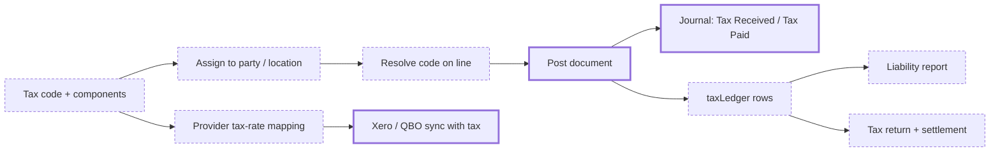
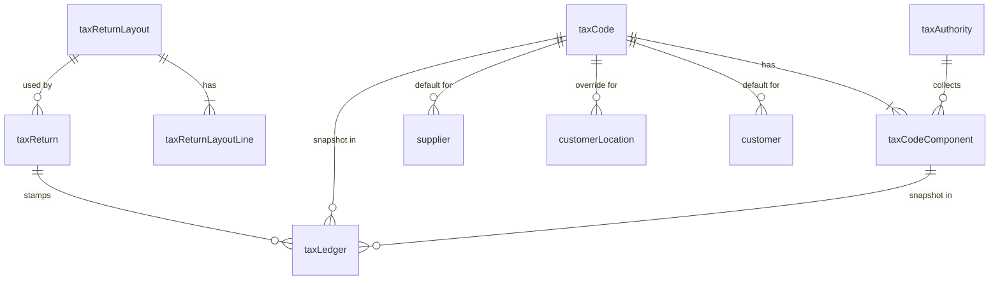

# Multi-Jurisdiction Tax, Recoverable Purchase Tax and Provider Tax Mapping

> Status: draft (all open questions resolved — ready for /plan)
> Author: Claude (with Brad Barbin)
> Date: 2026-10-16
> Supersedes: `.ai/specs/archived/2026-07-03-multi-jurisdiction-tax.md` (none of it shipped except the sales tax split, see Problem Statement)
> Research: `.ai/research/2026-10-16-purchase-tax-recovery-and-xero-tax-mapping.md`, `.ai/research/multi-jurisdiction-tax.md`, `.ai/research/shipping-tax-accounting.md`
> Grill log: `.ai/runs/2026-10-16-grill-multi-jurisdiction-tax.md`
> Extended by: `.ai/specs/2026-07-04-withholding-ecsl-intrastat-mtd.md` (HMRC MTD submission, EC Sales List, Intrastat, withholding), `.ai/specs/2026-07-04-e-invoicing.md`. Phase 3 plugs into `.ai/specs/2026-07-04-avalara-integration-foundation.md`.

## TLDR

Carbon stores tax as a bare `taxPercent` on each line. It has no tax code, no tax subledger and no recoverable purchase tax. A purchase adds all of its tax to inventory or expense, at the receipt and again at the invoice. The Xero sync sends a hard-coded `OUTPUT` on sales lines and "No VAT" on bills, so a UK company's Xero VAT return is wrong.

This spec adds a **tax code** made of **components** (rate, authority, accounts, recoverable percent, shipping rule, effective dates). Customers, ship-to locations and suppliers get a direct code assignment, and items get a `taxable` flag. One resolver sets the code and rate on every in-scope document line. Posting splits purchase tax into a recoverable share (to **Tax Paid**) and a non-recoverable share (into cost, as today). Every posted document writes an immutable `taxLedger` row per line and component. Xero and QuickBooks Online map each tax code to a provider tax rate, per direction, and push bills and credit notes with real tax.

Phase 2 adds tax returns with a settlement entry. Phase 3 adds an Avalara AvaTax connector.

## Overview diagram



## Problem Statement

These facts hold on `main` at 2026-10-16:

- **One flat rate, no code.** A line holds only `taxPercent` (a 0–1 fraction). Quote and sales order lines default it from `customer.taxPercent` (`QuoteExplorer.tsx:102`, `SalesOrderExplorer.tsx:147`). New sales invoice lines default to 0 (`SalesInvoiceExplorer.tsx:78`), and so do purchase order and purchase invoice lines (`PurchaseOrderExplorer.tsx:82`, `PurchaseInvoiceExplorer.tsx:83`). Rental agreements, contract lines and fixed asset sales carry their own rate or a hard-coded 0. There is no record of the authority, the jurisdiction or the item's taxability.
- **Sales tax already posts as a liability.** Since #1599 (2026-09-09, spec `2026-09-07-accounting-posting-corrections.md`), `buildSalesPostingLines` credits revenue net and credits `accountDefault.salesTaxPayableAccount` with the tax (`packages/database/src/sales-posting-amounts.ts:487-521`). This was July's OQ 1. It is done, and this spec builds on it.
- **All purchase tax goes into cost, twice.** Receipt creation adds the purchase order line's tax into the received unit cost (`packages/server-functions/src/create/index.ts:1038-1056`), so inventory and GR/IR hold the tax. The purchase invoice adds tax into cost again (`purchase-posting-amounts.ts:60`). `accountDefault.purchaseTaxPayableAccount` is read by no posting path. Its seeded account, 2220 "Purchase Tax Payable", is a Liability. For a VAT company this overstates inventory and expense by every pound of reclaimable VAT.
- **Header shipping is never taxed.** Line shipping joins the tax base. Header shipping does not (`sales-posting-amounts.ts:171-178`). UK VAT and US states such as Texas tax delivery charges.
- **Memos carry no tax.** A credit memo against a taxed invoice credits AR gross and never reduces Tax Received. The rental early-return credit replays the negative Rent line with no tax unwind (`rental-credit.ts:5-14`).
- **Exemption data is inert.** `customerTax.taxExempt` and its certificate fields feed only the forms, a header badge and the Stripe customer mapper (`stripe-customer.mapper.ts:43-49`). An exempt customer still gets charged `customer.taxPercent`.
- **Providers get the wrong tax rate.** Xero sales lines send `TaxType: "OUTPUT"` (`xero/entities/invoice.ts:121`). That code is not valid in a UK organisation, where the codes are `OUTPUT2`, `INPUT2` and so on. Xero bills, credit notes, card charges and reimbursements send `"NONE"`. A "No VAT" line reaches no box of the Xero VAT return, so reclaimable VAT never reaches box 4. QuickBooks Online matches sales lines to a tax code at run time (`invoice-tax.ts`) but sends no tax on bills.
- **No tax reporting.** Nothing records the taxable base, exempt base or tax per authority. "What do I owe Texas for Q3?" has no answer in Carbon.

The July spec designed most of this but none of it was built. Its posting paths (`packages/database/supabase/functions/*`) no longer exist. Posting now lives in `packages/server-functions/src/*` and `packages/database/src/*`.

## Proposed Solution

### Tax codes and components

- **`taxCode`** — a named treatment ("UK Standard 20%", "UK Car Lease 20% (50% recoverable)", "TX – Austin", "EU Reverse Charge", "Export Zero-Rated"). It holds:
  - `calculationType` (`Normal` | `Reverse Charge`)
  - `reportingCategory` (`Standard` | `Reduced` | `Zero-Rated` | `Exempt` | `Reverse Charge` | `Export` | `Out of Scope`), which return layouts filter on
  - `taxesShipping`, default false (see Header shipping)
  - an optional `invoiceMessage` (the VAT clause a document prints)
  - optional `countryId` and `state`, which drive suggestions only
- **`taxCodeComponent`** — one or more rows per code. Each row holds a name ("TX State", "City of Austin"), an optional `taxAuthorityId`, `taxPercent`, `sequence`, `isCompound` (tax on tax), `recoverablePercent`, optional account overrides, and `effectiveDate` / `expirationDate`.
- **`taxAuthority`** — who the company pays (HMRC, the Texas Comptroller). An optional `supplierId` lets Phase 2 pay a return through AP.
- **`taxRegistration`** — the company's own registration numbers by country and state, with dates. Sales documents print the matching one.

UK VAT is one code with one component. Texas is one code with two to four components. Canada GST + PST is two components, with PST compound where the province says so. The effective rate is the compound-aware sum of the components that are effective on the document date. The resolver writes that rate to the line's existing `taxPercent`, so every reader of `taxPercent` (invoice views, PDFs, provider components) keeps working.

To change a rate, set `expirationDate` on the old component and add a new row. The resolver picks the rows that are effective on the document date. A posted document never changes, because its tax lives in `taxLedger`.

### Determination: direct assignment, no matrix

Carbon removed the posting-group matrix on purpose (`20260229000000_drop-posting-groups.sql`, lesson "Posting-group-style matrices are a rejected pattern"). Tax follows the same rule: flat assignment with an override, as Xero does.

- `customer.taxCodeId` is the customer's default.
- `customerLocation.taxCodeId` overrides it for that ship-to. `salesInvoiceShipment.customerLocationId` already exists, so the invoice knows its ship-to.
- `supplier.taxCodeId` defaults purchase lines. The supplier's invoice still decides the amount.
- `item.taxable`, default true. A non-taxable item gets zero tax and an exempt-base ledger row.
- A line can override the code. The audit log records the old and new values.

`resolveLineTaxes` runs these checks in order for a sales line:

1. If `customerTax.taxExempt` is true, return zero tax and the exemption reason.
2. If `item.taxable` is false, return zero tax with no reason.
3. Take `customerLocation.taxCodeId` for the ship-to, else `customer.taxCodeId`.
4. If there is a code, return its effective components and rate.
5. If there is no code, return `customer.taxPercent`, as today.

A purchase line uses `supplier.taxCodeId`, else `supplier.taxPercent`.

When a user creates or edits a customer, a location or a supplier, Carbon suggests active codes whose `countryId` and `state` match the address. The user confirms. A document never reads the address to pick a code, so a posted line's tax always traces to two fields.

The resolver runs on every in-scope document (grill 3):

| Side | Documents |
|---|---|
| Sales | quote line, sales order line, sales invoice line, rental agreement and `rentalAgreementCharge`, `customerContractLine`, fixed asset sale |
| Purchase | supplier quote line, purchase order line, purchase invoice line, lessee lease invoice line (from the supplier's code), fixed asset purchase |
| Both | memo (see Memo tax) |

Out of scope: `chargeLine` (Ramp card charges) and `reimbursementLine`. They keep tax inside the amount and send "No VAT" to providers. A follow-up spec covers them.

The billing generators (`create-rental-invoices`, `create-contract-invoices`, `create-lease-invoices`) copy the source's `taxCodeId` and rate onto the invoice line. `convert` already copies `taxPercent` between documents (`convert/index.ts:437,733,1014,1637,1822`). It copies `taxCodeId` the same way.

### Header shipping

`taxCode.taxesShipping` decides whether header shipping is taxed (grill 4). `buildSalesPostingLines` already allocates header shipping across lines by weight (`allocatedHeaderShipping`). If a line's code has `taxesShipping` on, the line's share of header shipping joins that line's tax base. With the flag off, the result is today's: header shipping untaxed. The `salesInvoices` view, the provider components (`sales-document-components.ts`) and the PDF helpers apply the same rule.

### Recoverable purchase tax

Each component has `recoverablePercent`, a fraction from 0 to 1, default 0 (grill 1). For each purchase line and component:

- recoverable tax = component tax × `recoverablePercent`
- non-recoverable tax = component tax − recoverable tax

Split the line's tax across components by their rates with `distributeRoundingResidual`. Split each component's tax into its two shares the same way, so that the parts add up exactly.

| Step | Today | After |
|---|---|---|
| Receipt (`create` → `post-receipt`) | unit cost = price + (tax + shipping) / qty | unit cost = price + (non-recoverable tax + shipping) / qty |
| Purchase invoice | Dr cost (net + all tax) / Cr AP gross | Dr cost (net + non-recoverable tax) / Dr Tax Paid (recoverable tax) / Cr AP gross |
| Lessee lease line (`lease-lines.ts`) | tax to Operating Lease Expense | non-recoverable tax to Operating Lease Expense; recoverable tax to Tax Paid |

A code at 0% recoverable posts exactly what Carbon posts today, so US companies see no change. The Tax Paid account comes from the component's `taxPaidAccountId`, else `accountDefault.taxPaidAccount`. If the receipt and the invoice use the same price, rate and code, the purchase price variance stays zero.

### Tax accounts and the renamed defaults

The defaults adopt Odoo's names (grill 2). The user rejected "input tax" and "output tax" as unclear.

| Default column | Today's name | Seeded account (new companies) | Class | Posted by |
|---|---|---|---|---|
| `taxReceivedAccount` | `salesTaxPayableAccount` | 2210 Tax Received | Liability | sales invoice tax, memo tax unwind |
| `taxPaidAccount` | `purchaseTaxPayableAccount` | 1310 Tax Paid | Asset (current) | recoverable purchase tax |
| `reverseChargeSalesTaxPayableAccount` | unchanged | 2230 Reverse Charge Sales Tax | Liability | reverse charge and use tax accruals |
| `taxPayableAccount` | new (Phase 2) | 2520 Tax Payable | Liability | the settlement, when the company owes |
| `taxReceivableAccount` | new (Phase 2) | 1320 Tax Receivable | Asset (current) | the settlement, when the authority owes |

The migration renames the two columns. It does not rename or reclassify an existing company's accounts. To do that, it would have to find them by number or name, which the lesson "Never resolve a control account by number/name" forbids. A company that keeps one VAT control account points `taxReceivedAccount` and `taxPaidAccount` at the same account. Each new FK to `account` is `ON DELETE RESTRICT` and gets a `REFERENCE_POLICY` entry in `account-import.ts`.

### Posting

| Path | After |
|---|---|
| Sales invoice | Dr AR gross / Cr revenue net / Cr Tax Received per component (`component.taxReceivedAccountId`, else the default). Already true for the default account; this adds the per-component split and `taxesShipping`. |
| Purchase invoice, 0% recoverable or no code | Unchanged: tax goes into cost. |
| Purchase invoice, recoverable code | See Recoverable purchase tax. |
| Purchase invoice, Reverse Charge code, recoverable | Dr Tax Paid / Cr `reverseChargeSalesTaxPayableAccount`. The pair nets to zero. AP stays net, because the supplier charged no tax. |
| Purchase invoice, Reverse Charge code, 0% recoverable (US use tax) | Dr cost / Cr `reverseChargeSalesTaxPayableAccount`. AP stays net. Phase 2 adds the "Accrue use tax" action on the line. |
| Memo | See Memo tax. |
| Void | Negates the recorded lines and writes negating `taxLedger` rows, as voids do today. |

Rounding: per line, half-up. The ledger stores the document-currency tax at the currency's decimals (what the document shows) and the base-currency tax at internal scale (journal parity). Apportioning across components uses `distributeRoundingResidual`.

### Memo tax

The user enters a net amount and a tax code (grill 5). Carbon computes the tax forward with `applyRate` at the currency's decimals. `memo` stores `taxCodeId` and `taxAmount`. `memo.amount` stays the gross that hits AR or AP (net + tax), so the AR/AP views and tie-outs do not change.

Posting for a customer Credit memo: Dr reason account (net) / Dr Tax Received (tax) / Cr AR (gross). The other direction and party combinations mirror it. The ledger rows are negative for a credit against sales. A memo without a code posts exactly as today.

A memo made from a source takes the source line's code and rate. The sources are RMA credits (`salesReturnOrderCreditLine`), rental early-return credits and contract credits. A credit that spans two rates becomes two memos. The July design worked tax out backwards from the gross. That is dropped, because the posting-corrections spec forbids inferring tax from a memo's gross amount.

### The tax subledger: `taxLedger`

Each posting path writes one row per line and component in the same Kysely transaction as the journal. The paths are `post-sales-invoice`, `post-purchase-invoice`, `post-memo` and the legacy backfills under `activate-accounting/legacy/`. Each row holds:

- the source (Sales, Purchase), document, line and journal
- the posting date
- code and component snapshots (name, authority, rate, recoverable percent)
- the taxable base, the tax, the recoverable tax and the exempt base, in base currency and in document currency
- the exemption reason and certificate number
- the party, the currency and the exchange rate

Exempt, non-taxable and zero-rated lines write rows with an exempt base, because returns report exempt totals.

Before the accounting cutover, postings write Provisional journals. Ledger rows always reference their journal. Every reader (the report, the return) joins on `journal.status = 'Posted'`. So a promoted journal brings its rows with it, and the promotion code needs no change.

The name `taxLedger` refers to sales tax and VAT only. The income-tax depreciation fields (`assetTaxRate`, `depreciationRunLine.taxAmount`, `buildDeferredTaxJournals`) are a different subject. The rule file says so.

### Provider tax-rate mapping (Phase 1)

Xero and QuickBooks Online get a mapping (grills 6 and 7). Rillet keeps its header `tax_amount` on invoices and sends no tax on bills.

- **Storage.** `externalIntegrationMapping` with entity type `taxCode`. The entity id joins the tax code and the direction (`sales` | `purchase`), through `buildTaxCodeMappingEntityId`. `allowDuplicateExternalId` is on, because many Carbon codes can map to one provider rate. The metadata holds the provider rate's name and its percentage. This copies `core/dimension-mapping.ts`.
- **Catalog.** Xero reads GET `/TaxRates`. The connection already has the `accounting.settings` scope. The choices are `ACTIVE` rates filtered by `CanApplyToRevenue` for sales and by `CanApplyToExpenses` for purchases. QuickBooks Online reuses the catalog loader in `invoice-tax.ts` and takes `SalesTaxRateList` or `PurchaseTaxRateList` by direction.
- **Proposals.** The drawer proposes the rate whose percentage equals the code's effective rate, as `matchDimensionValuesByName` proposes values. The user confirms.
- **UI.** The integration drawer (`routes/x+/settings+/integrations.$id.tsx`) gets a "Tax Rates" tab that copies `DimensionMapping.tsx`: one row per active code, with a sales select and a purchase select.
- **Sync gate.** The `update-sync-enabled` intent refuses while an active code has no mapping for a direction it is used in. This is the same rule as `getUnmappedRequiredAccounts`.
- **Push** (grill 8). Each line sends Carbon's tax amount and the mapped rate. Before the push, the syncer checks that the amount is within one minor unit of the net × the provider rate's percentage.
- **Unmapped and legacy lines** (grill 9). If a line's code has no mapping, the document stops with the retryable Warning `UNMAPPED_TAX_CODES`, naming the code. If a legacy line has only `taxPercent`, the syncer matches the percentage to exactly one active rate for that direction. No match, or more than one, gives the same Warning. The hard-coded `OUTPUT` and `INPUT` go away.

| Document | Xero today → after | QuickBooks Online today → after |
|---|---|---|
| Sales invoice | `OUTPUT` / `NONE` → mapped sales rate | run-time percent match → mapped `TaxCodeRef` |
| Sales order (quote) | no `TaxType` → mapped sales rate | not synced |
| Purchase order | `INPUT` / `NONE` → mapped purchase rate | no tax → mapped `TaxCodeRef` |
| Bill | `NONE` → recoverable part at the mapped purchase rate | no tax → mapped `TaxCodeRef` + `TxnTaxDetail` |
| Credit note (memo, vendor credit) | `NONE` → mapped rate of the memo's code | no tax → mapped `TaxCodeRef` |
| Charge, reimbursement, journal | `NONE` (unchanged) | no tax (unchanged) |

**Bills.** A bill syncer replays the posted journal (`loadBillCostingLines`, `core/document-costing.ts`). After this spec the journal holds a Tax Paid line, and the cost lines hold net + non-recoverable tax. So the syncer leaves the Tax Paid line out of the cost lines and reads each source line's tax from `taxLedger`. Xero allows one tax rate per line, so a partly recoverable line becomes two lines (grill 10):

1. The recoverable part: net × `recoverablePercent` at the mapped purchase rate, with the recoverable tax.
2. The rest: the remaining net plus the non-recoverable tax at `NONE`, on the same account.

A 0% line keeps today's single "No VAT" line. A US company's bills therefore do not change.

### Registrations and documents

- Sales PDFs (`packages/documents`) show a tax summary per component and authority, and the codes' `invoiceMessage` text.
- They print the seller's `taxRegistration` number for the company's country, else `company.taxId`.
- They print the customer's VAT number when the code is Reverse Charge or Export.
- The quote share page, the supplier quote share page and the Stripe invoice builder read the line's `taxPercent`. The resolver sets it, so they need no change.

### Reporting and returns

- **Tax liability report** (Phase 1). It groups `taxLedger` over a date range by authority and component. It shows the taxable base, the exempt base, the tax collected, the recoverable tax and the net due. Rows count only when their journal is Posted. CSV export uses the existing table-export path.
- **Tax returns** (Phase 2). A `taxReturn` has a period, an optional authority and a layout, with status `Draft → Finalized`. Finalizing it does four things:
  1. Stamp `taxReturnId` on every unstamped ledger row in range.
  2. Snapshot the totals.
  3. Post the settlement: Dr Tax Received, Cr Tax Paid, net to `taxPayableAccount` (owed) or `taxReceivableAccount` (refund due).
  4. If the authority links a supplier, offer a draft purchase invoice for the net due.

  If Xero or QuickBooks Online is connected with sync on, Finalize is off and the page says that the provider files the return (grill 11). The liability report still works.

  A document posted later into a finalized period lands in the next return. Settlement posts only into an open period (`lib/get-accounting-period.ts`). Reopening is allowed only on the newest finalized return. It reverses the settlement and clears the stamps.
- **Return layouts** (Phase 2). `taxReturnLayout` and `taxReturnLayoutLine` map ledger totals to return boxes, filtered by reporting category or code. The seed adds a generic layout and a UK 9-box layout.
- **US use tax** (Phase 2). An "Accrue use tax" action on a purchase line where the supplier charged no tax. The user picks a Reverse Charge code at 0% recoverable.

### Avalara AvaTax connector (Phase 3)

The connector lives in `packages/ee` and plugs in behind `resolveLineTaxes`, chosen per company. It uses the integration, credentials and REST client from the Avalara foundation spec (`packages/ee/src/avalara/`), which is not built yet. Phase 3 depends on it. Quotes and orders call `CreateTransaction` as `SalesOrder` (an estimate, never committed). `post-sales-invoice` calls `SalesInvoice` with `commit: true` and `code` = the invoice id, and maps `details[]` into `taxLedger` rows. A void calls `VoidTransaction`. Customer and location forms get address validation (`ResolveAddress`). The exemption reason maps to `entityUseCode`. If Avalara fails, posting uses the internal codes and flags the rows `needsEngineReconciliation`; a reconcile job re-runs them later. The registrations page compares Carbon registrations with the Avalara nexus list.

### Delivery phases

| Phase | Scope | Depends on |
|---|---|---|
| **1 — Codes, posting, ledger, provider mapping** | Schema and the account-default renames. Tax codes, components, authorities and registrations, with their UI. Assignment and suggestions on customers, locations and suppliers. `item.taxable`. `resolveLineTaxes` on every in-scope document. Posting: the component split, `taxesShipping`, recoverable purchase tax at the receipt and the invoice, reverse charge, memo tax. `taxLedger`. The liability report. PDF tax blocks. The Xero and QuickBooks Online tax-rate mapping and tax on every synced document in the provider table above. The demo datasets. The `customer.taxPercent` sunset UX. | — |
| **2 — Returns and self-assessment** | `taxReturn`, the settlement, AP remittance, return layouts (generic and UK seeded), the use-tax action | Phase 1 |
| **3 — Avalara** | The AvaTax connector, the fallback and the reconcile job, address validation, the nexus check | Phase 1, Avalara foundation spec |

### Design Decisions

| Decision | Choice | Rationale |
|---|---|---|
| One model or two | One: `taxCode` + components covers VAT, GST and stacked US rates | Odoo, Xero and Avalara use one model. Business Central's VAT / sales-tax split is legacy. One resolver, one ledger, one report. |
| Determination | Direct assignment (location → customer; supplier), `item.taxable`, line override. No matrix. | Carbon removed the posting-group matrix (lesson). Xero's per-contact default plus override is the proven small-business model. |
| Addresses | Address fields on the code drive suggestions only | A document's tax always traces to two fields. Editing an address never changes posted tax. |
| Rate on lines | Keep `taxPercent`, set by the resolver. Add nullable `taxCodeId`. | Views, PDFs, Stripe and provider components read `taxPercent` today. NULL `taxCodeId` means a legacy line. |
| Recoverability | `recoverablePercent` (0–1) per component, default 0 | Grill 1. Business Central, Acumatica and Odoo. One code covers partial recovery. |
| Non-recoverable tax | Into the line's cost (inventory, expense, lease expense) | Today's behavior. SAP `NVV`, NetSuite "Post to Item Cost", Business Central "Use For Item Cost". No separate expense-account option in v1. |
| Receipts | Leave the recoverable share out of the received unit cost | Without this, inventory and GR/IR keep the reclaimable tax. |
| Account names | `taxReceivedAccount`, `taxPaidAccount`; Phase 2 `taxPayableAccount`, `taxReceivableAccount` | Grill 2. Odoo's names. The settlement then reads "payable" only for the net owed. |
| Existing accounts | Column rename only; no account migration | The lesson forbids finding a control account by number or name. |
| Header shipping | `taxCode.taxesShipping` | Grill 4. The rule belongs to the jurisdiction. Replaces July's company setting. |
| Memo tax | Net entry plus code, tax computed forward; `amount` stays gross | Grill 5. Keeps the AR/AP contract. Complies with the posting-corrections ruling. |
| Documents in scope | All sales and purchase documents except card charges and reimbursements | Grill 3. Ramp sends no tax data. Those get a follow-up spec. |
| Ledger and the cutover | Rows reference the journal; readers join `status = 'Posted'` | Provisional journals promote with no change to `promote.ts`. |
| Ledger amounts | Document-currency tax at currency decimals, base tax at internal scale | Returns need what the document showed. The GL needs journal parity. |
| Rate changes | Effective and expiry dates on components | Business Central Tax Detail pattern. Backdated documents are routine. |
| Exemptions | `customerTax.taxExempt` short-circuits; reason and certificate snapshot to the ledger | Wires existing inert data. Returns report exempt bases. |
| Providers | Xero and QuickBooks Online map codes; Rillet unchanged | Grill 6. Rillet is US-only and has no VAT return. |
| Mapping timing | Phase 1 | Grill 7. Recoverable posting without a mapping breaks the Xero VAT return. |
| Pushed tax amount | Carbon's amount plus the mapped rate, checked to one minor unit | Grill 8. The provider agrees with the journal. The check catches a wrong rate. |
| Unmapped codes | Block with `UNMAPPED_TAX_CODES`; legacy lines match by percentage; sync gate | Grill 9. Katana and Unleashed block. A default rate puts VAT in the wrong box. |
| Partly recoverable bill lines | Two provider lines: recoverable part at the mapped rate, the rest at `NONE` | Grill 10. Xero allows one rate per line and has no partial recovery outside Canada. |
| Mapping location | The integration drawer's "Tax Rates" tab, not the tax code form | One place for every provider mapping, as accounts and dimensions do. |
| Returns | Stamp rows on finalize, settle to two accounts, late documents roll forward | Business Central settlement and Odoo tax lock, without blocking postings. |
| Who files | Carbon finalizes a return only when no Xero or QuickBooks Online sync is on | Grill 11. One system files, so one settlement exists. |
| Avalara | Behind `resolveLineTaxes`, in `packages/ee` | NetSuite SuiteTax plug-in pattern and Avalara's ERP guide. Integrations live in `packages/ee`. |
| Multi-tenancy (heuristic 1) | Every new table: `companyId`, composite PK `("id", "companyId")`, `id('prefix')`, audit columns; child FKs on the composite | House convention. Lesson "Single-column FKs on multi-tenant children accept cross-tenant ids". |
| Service shape (heuristic 2) | New functions in `accounting.service.ts` / `accounting.models.ts`, `(client, companyId, …)` → `{data, error}` | One service file per module. Tax is accounting-owned, as payment terms and dimensions are. Provider code stays in `packages/ee/src/accounting`. |
| RLS (heuristic 3) | Four policies per table: SELECT for employees of the company, writes with `accounting_*` permissions | Same as `dimension`. `taxLedger` writes come from server functions with explicit `companyId`. |
| Permissions (heuristic 4) | Tax routes `view/update: "accounting"`; line resolution inside the document's own permission | Same as payment terms and dimensions. |
| Forms (heuristic 5) | `ValidatedForm` + `validator(taxCodeValidator)` + route action; components edited inline like `dimensionValues` | The `DimensionForm` sibling. |
| Module layout (heuristic 6) | No new module. `accounting` module, `ui/Tax/`, routes `x+/accounting+/tax-*` | Tax configuration is accounting configuration. |
| Backward compatibility (heuristic 7) | New columns nullable or defaulted to today's behavior. Two column renames with `LIVE_COLUMN_RENAMES` entries. Views recreated with DROP + `SELECT *`, forked from their newest definitions. | A company with no codes behaves as today, except header shipping on a code with `taxesShipping`. Old backups still restore. |

## Data Model Changes

One idempotent Phase 1 migration (`pnpm db:migrate:new multi-jurisdiction-tax`) and one Phase 2 migration. Run `pnpm run generate:types` after each. Every table below also gets the audit columns, an index on `companyId` and on each FK, and the four RLS policies. The sketch leaves them out.



```sql
CREATE TYPE "taxCalculationType" AS ENUM ('Normal', 'Reverse Charge');
CREATE TYPE "taxReportingCategory" AS ENUM
  ('Standard', 'Reduced', 'Zero-Rated', 'Exempt', 'Reverse Charge', 'Export', 'Out of Scope');
CREATE TYPE "taxLedgerSource" AS ENUM ('Sales', 'Purchase');
CREATE TYPE "taxReturnStatus" AS ENUM ('Draft', 'Finalized');              -- Phase 2

CREATE TABLE "taxAuthority" (
    "id" TEXT NOT NULL DEFAULT id('txa'),
    "companyId" TEXT NOT NULL,
    "name" TEXT NOT NULL,
    "supplierId" TEXT,                                -- Phase 2: pay a return through AP
    -- audit columns, "customFields" JSONB
    CONSTRAINT "taxAuthority_pkey" PRIMARY KEY ("id", "companyId"),
    CONSTRAINT "taxAuthority_companyId_fkey" FOREIGN KEY ("companyId") REFERENCES "company"("id") ON DELETE CASCADE,
    CONSTRAINT "taxAuthority_supplierId_fkey" FOREIGN KEY ("supplierId", "companyId") REFERENCES "supplier"("id", "companyId"),
    CONSTRAINT "taxAuthority_name_key" UNIQUE ("companyId", "name")
);

CREATE TABLE "taxCode" (
    "id" TEXT NOT NULL DEFAULT id('txc'),
    "companyId" TEXT NOT NULL,
    "name" TEXT NOT NULL,                             -- "UK Standard 20%"
    "description" TEXT,
    "calculationType" "taxCalculationType" NOT NULL DEFAULT 'Normal',
    "reportingCategory" "taxReportingCategory" NOT NULL DEFAULT 'Standard',
    "taxesShipping" BOOLEAN NOT NULL DEFAULT FALSE,   -- grill 4
    "invoiceMessage" TEXT,
    "countryId" INTEGER REFERENCES "country"("id"),   -- suggestion only
    "state" TEXT,                                     -- suggestion only
    "active" BOOLEAN NOT NULL DEFAULT TRUE,
    -- audit columns, "customFields" JSONB
    CONSTRAINT "taxCode_pkey" PRIMARY KEY ("id", "companyId"),
    CONSTRAINT "taxCode_companyId_fkey" FOREIGN KEY ("companyId") REFERENCES "company"("id") ON DELETE CASCADE,
    CONSTRAINT "taxCode_name_key" UNIQUE ("companyId", "name")
);

CREATE TABLE "taxCodeComponent" (
    "id" TEXT NOT NULL DEFAULT id('txcc'),
    "companyId" TEXT NOT NULL,
    "taxCodeId" TEXT NOT NULL,
    "name" TEXT NOT NULL,                             -- "TX State"
    "taxAuthorityId" TEXT,
    "taxPercent" NUMERIC NOT NULL CHECK ("taxPercent" >= 0 AND "taxPercent" <= 1),
    "recoverablePercent" NUMERIC NOT NULL DEFAULT 0
        CHECK ("recoverablePercent" >= 0 AND "recoverablePercent" <= 1),   -- grill 1
    "sequence" INTEGER NOT NULL DEFAULT 1,
    "isCompound" BOOLEAN NOT NULL DEFAULT FALSE,
    "taxReceivedAccountId" TEXT,                      -- else accountDefault.taxReceivedAccount
    "taxPaidAccountId" TEXT,                          -- else accountDefault.taxPaidAccount
    "effectiveDate" DATE,
    "expirationDate" DATE,
    -- audit columns
    CONSTRAINT "taxCodeComponent_pkey" PRIMARY KEY ("id", "companyId"),
    CONSTRAINT "taxCodeComponent_taxCodeId_fkey" FOREIGN KEY ("taxCodeId", "companyId") REFERENCES "taxCode"("id", "companyId") ON DELETE CASCADE,
    CONSTRAINT "taxCodeComponent_taxAuthorityId_fkey" FOREIGN KEY ("taxAuthorityId", "companyId") REFERENCES "taxAuthority"("id", "companyId"),
    -- account FKs: ON DELETE RESTRICT, plus REFERENCE_POLICY entries in account-import.ts
    CONSTRAINT "taxCodeComponent_dates_check" CHECK ("expirationDate" IS NULL OR "effectiveDate" IS NULL OR "expirationDate" >= "effectiveDate")
);

CREATE TABLE "taxRegistration" (
    "id" TEXT NOT NULL DEFAULT id('txr'),
    "companyId" TEXT NOT NULL,
    "countryId" INTEGER NOT NULL REFERENCES "country"("id"),
    "state" TEXT,
    "registrationNumber" TEXT NOT NULL,
    "effectiveDate" DATE,
    "endDate" DATE,
    -- audit columns, "customFields" JSONB
    CONSTRAINT "taxRegistration_pkey" PRIMARY KEY ("id", "companyId"),
    CONSTRAINT "taxRegistration_companyId_fkey" FOREIGN KEY ("companyId") REFERENCES "company"("id") ON DELETE CASCADE
);

CREATE TABLE "taxLedger" (
    "id" TEXT NOT NULL DEFAULT id('txl'),
    "companyId" TEXT NOT NULL,
    "source" "taxLedgerSource" NOT NULL,
    "documentType" TEXT NOT NULL,                     -- 'Sales Invoice' | 'Purchase Invoice' | 'Memo'
    "documentId" TEXT NOT NULL,
    "documentLineId" TEXT,
    "journalId" TEXT NOT NULL,                        -- readers join journal.status = 'Posted'
    "postingDate" DATE NOT NULL,
    "taxCodeId" TEXT,                                 -- NULL for legacy and exempt lines
    "taxCodeComponentId" TEXT,
    "componentName" TEXT,                             -- snapshots
    "taxAuthorityId" TEXT,
    "taxPercent" NUMERIC NOT NULL DEFAULT 0,
    "recoverablePercent" NUMERIC NOT NULL DEFAULT 0,
    "customerId" TEXT,
    "supplierId" TEXT,
    "taxableAmount" NUMERIC NOT NULL DEFAULT 0,       -- base currency, internal scale
    "taxAmount" NUMERIC NOT NULL DEFAULT 0,           -- base; negative on a void or a credit
    "recoverableAmount" NUMERIC NOT NULL DEFAULT 0,   -- base; purchase side
    "exemptAmount" NUMERIC NOT NULL DEFAULT 0,        -- base
    "documentTaxableAmount" NUMERIC NOT NULL DEFAULT 0,  -- document currency, currency decimals
    "documentTaxAmount" NUMERIC NOT NULL DEFAULT 0,
    "currencyCode" TEXT,
    "exchangeRate" NUMERIC,
    "taxExemptionReason" "taxExemptionReason",
    "exemptionCertificateNumber" TEXT,
    "taxReturnId" TEXT,                               -- Phase 2
    "needsEngineReconciliation" BOOLEAN NOT NULL DEFAULT FALSE,   -- Phase 3
    "createdBy" TEXT NOT NULL REFERENCES "user"("id"),
    "createdAt" TIMESTAMP WITH TIME ZONE NOT NULL DEFAULT NOW(),
    "updatedBy" TEXT REFERENCES "user"("id"),
    CONSTRAINT "taxLedger_pkey" PRIMARY KEY ("id", "companyId"),
    CONSTRAINT "taxLedger_companyId_fkey" FOREIGN KEY ("companyId") REFERENCES "company"("id") ON DELETE CASCADE
);
-- indexes: ("companyId", "postingDate"), ("companyId", "documentId"),
--          ("companyId", "journalId"), ("companyId", "taxAuthorityId"), ("companyId", "taxReturnId")

-- Phase 2: "taxReturn" (id('txrt'), readable "taxReturnId" from the sequence, "taxAuthorityId",
-- "taxReturnLayoutId", "periodStart", "periodEnd", "status", "totals" JSONB, "journalId",
-- "remittanceInvoiceId", "finalizedAt", "finalizedBy"), "taxReturnLayout", "taxReturnLayoutLine"
-- ("boxNumber", "label", "sequence", "source", "aggregate", "reportingCategories", "taxCodeIds",
-- "rowTotaling") — shapes unchanged from the July spec.
```

Column changes:

```sql
-- Phase 1: renames (+ LIVE_COLUMN_RENAMES entries, glossary, cutover readiness, account-import)
ALTER TABLE "accountDefault" RENAME COLUMN "salesTaxPayableAccount" TO "taxReceivedAccount";
ALTER TABLE "accountDefault" RENAME COLUMN "purchaseTaxPayableAccount" TO "taxPaidAccount";

-- Phase 1: additions (nullable or defaulted to today's behavior)
ALTER TABLE "item"                    ADD COLUMN "taxable" BOOLEAN NOT NULL DEFAULT TRUE;
ALTER TABLE "customer"                ADD COLUMN "taxCodeId" TEXT;
ALTER TABLE "customerLocation"        ADD COLUMN "taxCodeId" TEXT;
ALTER TABLE "supplier"                ADD COLUMN "taxCodeId" TEXT;
ALTER TABLE "quoteLine"               ADD COLUMN "taxCodeId" TEXT;
ALTER TABLE "salesOrderLine"          ADD COLUMN "taxCodeId" TEXT;
ALTER TABLE "salesInvoiceLine"        ADD COLUMN "taxCodeId" TEXT;
ALTER TABLE "rentalAgreement"         ADD COLUMN "taxCodeId" TEXT;
ALTER TABLE "rentalAgreementCharge"   ADD COLUMN "taxCodeId" TEXT;
ALTER TABLE "customerContractLine"    ADD COLUMN "taxCodeId" TEXT;
ALTER TABLE "supplierQuoteLinePrice"  ADD COLUMN "taxCodeId" TEXT;
ALTER TABLE "purchaseOrderLine"       ADD COLUMN "taxCodeId" TEXT;
ALTER TABLE "purchaseInvoiceLine"     ADD COLUMN "taxCodeId" TEXT;
ALTER TABLE "memo"                    ADD COLUMN "taxCodeId" TEXT;
ALTER TABLE "memo"                    ADD COLUMN "taxAmount" NUMERIC NOT NULL DEFAULT 0;
-- each taxCodeId: composite FK ("taxCodeId", "companyId") → "taxCode"

-- Phase 2
ALTER TABLE "accountDefault" ADD COLUMN "taxPayableAccount" TEXT;     -- required to finalize a return
ALTER TABLE "accountDefault" ADD COLUMN "taxReceivableAccount" TEXT;
```

Views that change: `salesInvoices` (newest `20261006221401`), `purchaseInvoices` (newest `20260916143022`), `salesInvoiceLines`, `purchaseInvoiceLines` (newest `20261011163211`), `customers` and `suppliers` (newest `20260521124731`), `quotes`, `salesOrders`. Each is recreated with DROP + `SELECT *`, forked from its newest definition, keeping `security_invoker`.

Platform surfaces:

- **Backups.** The new tables have `companyId`, so `company-backup.ts` picks them up. The two renames get `LIVE_COLUMN_RENAMES` entries. Regenerate `packages/jobs/manifests/schema.json` with `pnpm db:check:backups`.
- **Datasets.** Each dataset seeds codes, components and an authority, assigns them to its parties, and gets `COVERAGE_FLOORS` for the new tables. The validator checks that every assigned code exists.
- **CSV import.** Customer and supplier importers accept a tax code by name.
- **MCP.** The new service functions become MCP tools. Authoring functions follow `mcp-blocked-tools.ts` review.

## API / Service Changes

In `apps/erp/app/modules/accounting/` (models and service, no new service file):

- CRUD for `taxCode` (with a batch upsert of components), `taxAuthority`, `taxRegistration`, and in Phase 2 `taxReturnLayout`. Standard `(client, companyId, …)` → `{data, error}` shape, with list variants that take `GenericQueryFilters`.
- `resolveLineTaxes(client, companyId, { source, customerId?, customerLocationId?, supplierId?, itemId?, date })` returns `{ taxCodeId, taxPercent, components[], exempt, exemptionReason }`. It writes nothing. Phase 3 sends it to Avalara when the company enables that.
- `suggestTaxCodes(client, companyId, { countryId?, state? })`.
- `getEffectiveTaxComponents(client, companyId, taxCodeId, date)` does the effective-date filter and the compound rate math. The resolver, the form preview, posting and the tests share it.
- `getTaxLiability(client, companyId, { startDate, endDate, taxAuthorityId? })`.
- Validators: `taxCodeValidator`, `taxCodeComponentValidator` (rate and recoverable percent 0–1, expiry after effective), `taxAuthorityValidator`, `taxRegistrationValidator`. Phase 2 adds `taxReturnValidator` and `taxReturnLayoutLineValidator`.
- Phase 2: `createTaxReturn`, `getTaxReturnPreview`, `finalizeTaxReturn` (one Kysely transaction: stamp rows, snapshot totals, post the settlement, create the optional AP invoice), `reopenTaxReturn`.

In `packages/database/src/` (pure, shared by server functions and tests):

- `tax-components.ts`: component split, recoverable split, header-shipping base, all through `applyRate` and `distributeRoundingResidual`.
- `buildSalesPostingLines` (`sales-posting-amounts.ts`): per-component tax legs, `taxesShipping`.
- `purchase-posting-amounts.ts`: cost = net + non-recoverable tax; recoverable tax becomes its own leg.
- `build-memo-journal.ts`: the net / tax split.
- `tax-ledger.ts`: builds ledger rows from the same split.

In `packages/server-functions/src/`:

- `post-sales-invoice`, `post-purchase-invoice`, `post-memo` and `activate-accounting/legacy/*` write `taxLedger` rows in the journal's transaction. Voids write negated rows.
- `create` (receipt lines) uses the non-recoverable share in the received unit cost. `post-receipt` needs no change.
- `lease-lines.ts` splits lease tax into Operating Lease Expense and Tax Paid.
- `create-rental-invoices`, `create-contract-invoices` and `create-lease-invoices` copy `taxCodeId`. `convert` copies it between documents.
- `accounting-cutover/shared.ts` uses the renamed defaults.

In `packages/ee/src/accounting/`:

- `core/tax-mapping.ts`, modelled on `core/dimension-mapping.ts`: `buildTaxCodeMappingEntityId`, `getTaxCodeMappings`, `upsertTaxCodeMappings`, `matchTaxCodesByRate`, `getUnmappedTaxCodes`.
- `providers/xero/provider.ts`: `listTaxRates()`.
- The Xero entities (`invoice.ts`, `sales-order.ts`, `purchase-order.ts`, `bill.ts`, `credit-memo.ts`, `vendor-credit.ts`) and the QuickBooks Online entities (`invoice.ts`, `invoice-tax.ts`, `purchase-order.ts`, `bill.ts`, `credit-memo.ts`, `vendor-credit.ts`) resolve the mapped rate, check the amount, and raise `UNMAPPED_TAX_CODES`.
- `core/document-costing.ts`: bill cost lines leave out the Tax Paid line and carry each source line's tax from `taxLedger`.
- Phase 3: `AvalaraTaxEngine` and its reconcile job (Inngest).

## Closest Sibling

- **Tax code with components → dimension with values.** `x+/accounting+/dimensions.tsx`, `dimensions.new.tsx`, `dimensions.$dimensionId.tsx`, `dimensions.delete.$dimensionId.tsx`, and `modules/accounting/ui/Dimensions/{DimensionForm,DimensionsTable}.tsx`. The tax code drawer edits its components inline, as `DimensionForm` edits `dimensionValues`. Deviation: components carry dates, accounts and two percentages, so each component row is a small grid, not one text field. Authorities and registrations copy the payment terms set (`payment-terms*.tsx`, `ui/PaymentTerms`).
- **Provider tax-rate tab → the Dimensions tab of the integration drawer.** `DimensionMapping.tsx`, the `getDimensionSyncTabData` loader and the `upsert-dimension-value-mapping` / `bulk-upsert-dimension-value-mappings` intents. Deviation: two selects per row (sales, purchase), not one.
- **`taxLedger` → `itemLedger`.** Append-only, written by the posting function in the same transaction, never edited.
- **Tax return → depreciation run / revenue recognition run** (`depreciation-runs*.tsx`): a dated run that posts one journal. Deviation: it stamps ledger rows and can be reopened.

## UI Changes

- **Accounting → Tax** (new nav group, list + drawer, the Dimensions archetype):
  - Tax Codes: the table and the drawer form, with the inline component grid, the address fields and an effective-rate preview.
  - Tax Authorities and Tax Registrations: list and drawer. Registrations warn about codes with no matching registration and registrations with no code.
  - Tax Liability: the report, with a date range, an authority filter and CSV export.
  - Tax Returns (Phase 2): the list and the detail, with period, layout, live box preview, Finalize and Reopen.
- **Accounting → Defaults.** The "Taxes" group shows "Tax Received" and "Tax Paid". Phase 2 adds "Tax Payable" and "Tax Receivable".
- **Customer, location, supplier.** A Tax Code select with the address suggestion. The customers and suppliers tables get a bulk "Assign tax code" action. Once a company assigns a code, the `taxPercent` fields hide behind a "Move to tax codes" banner (July OQ 4). The banner lists the parties still on a bare percent.
- **Item.** A "Taxable" switch in the properties panel, default on.
- **Document lines.** The line drawers show the resolved code and amount, with an override select. A "Recalculate taxes" action follows a ship-to change. Purchase lines show the recoverable share. Phase 2 adds "Accrue use tax".
- **Memo form.** Net amount, tax code, computed tax, gross.
- **Integration drawer → Tax Rates tab** (Xero, QuickBooks Online). One row per active code, sales and purchase selects with proposals, and a count of unmapped codes beside the sync switch.
- **PDFs.** The tax summary block, `invoiceMessage` text, the seller registration, and the customer VAT number for Reverse Charge and Export codes.

## Acceptance Criteria

Phase 1:

- [ ] A user creates "TX – Austin" (State 6.25% + City 2.00%, TX/US). The customer form suggests it for a Texas address. After assignment, a sales order line defaults `taxPercent = 0.0825`. Posting the invoice credits revenue net, credits Tax Received 6.25 and 2.00 as two lines, and debits AR gross. Two `taxLedger` rows hold the right bases and authorities.
- [ ] A customer has a code and a ship-to location with a different code. A line resolves the location's code when that location is the ship-to, else the customer's code.
- [ ] A `taxExempt` customer with a certificate gets zero tax. Posting writes a ledger row with `exemptAmount` = the base and the reason and certificate number. An `item.taxable = false` line gets the same result with no reason.
- [ ] A UK purchase order line at "UK Standard 20%", 100% recoverable: receiving 10 units at £100 puts £1,000 into inventory, not £1,200. The invoice posts Dr GR/IR £1,000 / Dr Tax Paid £200 / Cr AP £1,200, with zero price variance.
- [ ] A purchase invoice line at "UK Car Lease 20% (50% recoverable)" for £1,000 net posts Dr cost £1,100 / Dr Tax Paid £100 / Cr AP £1,200.
- [ ] A purchase line at a 0% recoverable code posts the same receipt and invoice journals as today, line for line.
- [ ] A Reverse Charge purchase line, 100% recoverable: Dr Tax Paid / Cr Reverse Charge Sales Tax at the domestic rate, net zero. AP is net.
- [ ] A customer Credit memo of £1,000 net at 20% stores `amount = 1200`, `taxAmount = 200`. It posts Dr reason £1,000 / Dr Tax Received £200 / Cr AR £1,200 and writes negative ledger rows. A memo without a code posts as today.
- [ ] A rental early-return credit takes the rent line's code and unwinds its tax.
- [ ] A code with `taxesShipping` on taxes each line's share of header shipping. With it off, header shipping stays untaxed.
- [ ] A component that expires on 2026-06-30, with a successor at 8.5% from 2026-07-01: invoices dated June 30 and July 1 compute 8.25% and 8.5%.
- [ ] Voiding a posted sales invoice writes negated ledger rows. The liability report nets that document to zero.
- [ ] Before the cutover, a posted invoice writes ledger rows on a Provisional journal. The liability report leaves them out until the journal is promoted.
- [ ] The liability report for a quarter ties to the movement of the Tax Received and Tax Paid accounts over the same range.
- [ ] After the migration, `accountDefault` has `taxReceivedAccount` and `taxPaidAccount`, existing values are kept, and a backup taken before the migration restores them.
- [ ] Xero (UK demo organisation): map "UK Standard 20%" to `OUTPUT2` (sales) and `INPUT2` (purchase). A sales invoice line then pushes `TaxType: "OUTPUT2"`. A bill line pushes the net with `TaxType: "INPUT2"` and the tax amount. A 50% recoverable bill line pushes two lines: £500 at `INPUT2` with £100 tax, and £600 at `NONE`.
- [ ] Xero: a document whose code has no mapping stops with `UNMAPPED_TAX_CODES`, naming the code. After the user maps it, a retry succeeds. The sync switch stays disabled while an active code is unmapped.
- [ ] Xero: a legacy line at 20% with no code maps to the one active 20% revenue rate. With two such rates, it raises `UNMAPPED_TAX_CODES`.
- [ ] Xero: a code mapped to a 5% rate on a 20% line fails the one-minor-unit check with a Warning that names both rates.
- [ ] QuickBooks Online (GB company): a bill line with a mapped code pushes `TaxCodeRef` and `TxnTaxDetail`. A US company's bills push as today.
- [ ] A company with no tax codes produces the same journals, views, PDFs and provider payloads as today. The existing Xero `invoice.test.ts` expectation of `"OUTPUT"` changes to the percent-matched rate.
- [ ] Every dataset seeds and assigns codes, and `pnpm db:check:datasets` passes with the new floors.
- [ ] `pnpm exec turbo run typecheck --filter=erp --filter=@carbon/ee --filter=@carbon/server-functions --filter=@carbon/database` and the scoped tests pass after `pnpm run generate:types`.

Phase 2:

- [ ] Finalizing a Q2 return stamps exactly the unstamped Posted rows in range and snapshots the totals. It posts Dr Tax Received / Cr Tax Paid, with the net to Tax Payable (owed) or Tax Receivable (refund due). If the authority links a supplier, it creates a draft purchase invoice for the net due. A document posted into Q2 after finalizing lands in Q3's preview.
- [ ] With Xero connected and sync on, the Finalize action is disabled and the page names Xero as the filer. The liability report still shows the period.
- [ ] Reopening the newest finalized return reverses the settlement and clears its stamps. An older return cannot reopen while a newer one is finalized.
- [ ] The seeded UK layout fills boxes 1, 4, 6 and 7 correctly. The fixture holds standard, zero-rated, partly recoverable and reverse charge documents.
- [ ] "Accrue use tax" on a US purchase line where the supplier charged no tax posts Dr cost / Cr Reverse Charge Sales Tax. AP is net.

Phase 3:

- [ ] With Avalara on and its API mocked: a quote line calls `CreateTransaction(SalesOrder)`. Posting calls `CreateTransaction(SalesInvoice, commit: true, code = invoice id)` and writes one ledger row per `details[]` entry. A void calls `VoidTransaction`.
- [ ] With the Avalara API failing, posting uses the internal codes and flags the rows. The reconcile job clears the flags when the mock recovers.

## Risks

| Risk | Severity | Mitigation |
|---|---|---|
| Receipt valuation change misvalues stock or creates price variance | High | Only codes with a recoverable percent above 0 change. Receipt and invoice use one split function. The acceptance tests pin zero variance. |
| The column renames break a reader that typecheck cannot see (SQL functions, views, Swagger docs, the backup manifest) | Med | Grep migrations for the old names before writing the migration. `LIVE_COLUMN_RENAMES` covers backups. Regenerate the Swagger schema and the manifest. |
| Partly recoverable bill lines misreport box 7 in Xero | Med | The two-line split follows common Xero practice. A UK accountant reviews the demo return before release (grill 10). |
| Header-shipping tax changes invoice totals for a company that turns on `taxesShipping` | Med | Off by default. The code form explains the flag. |
| Unmapped-code blocking stops syncs that work today | Med | Legacy lines match by percentage, so a company with no codes keeps syncing. The Warning names the code and links to the tab. |
| A wrong component rate produces wrong tax at volume | Med | The effective-rate preview, the liability report and the provider check catch a mismatch early. |
| Avalara outage or API change | Med | Fallback and reconcile, isolated in `packages/ee`. |
| `taxLedger` growth | Low | Append-only, indexed by `(companyId, postingDate)`. Same profile as `itemLedger`. |
| The name "tax" collides with income-tax depreciation | Low | The rule file and the glossary separate them. |
| Partial migration on a retried deploy | Med | Every DDL statement is idempotent. |

## Open Questions

> HARD STOP: Do not proceed with implementation until these are answered.

From the July spec (still valid unless noted):

- [x] **July 1. Apply the sales-posting fix to legacy lines?** — **Answer:** Yes. Shipped in #1599 (2026-09-09). This spec builds on it.
- [x] **July 2. Memos in v1?** — **Answer:** Yes. The design changed in grill 5.
- [x] **July 3. Line override permission.** — **Answer:** The document's own permission, with the audit log recording old and new values.
- [x] **July 4. Sunset of `customer.taxPercent`.** — **Answer:** Hide the field once the company assigns a code, behind a "Move to tax codes" banner and a bulk action. The data stays as the no-code fallback.
- [x] **July 5. Shipping taxability.** — **Answer:** Replaced by grill 4 (`taxCode.taxesShipping`).
- [x] **July 6. Historical reclassification.** — **Answer:** Out of scope. An accountant writes a one-time reclass journal. Docs give the guidance.

From the 2026-10-16 grill (`.ai/runs/2026-10-16-grill-multi-jurisdiction-tax.md`):

- [x] **1. How does a tax code mark recoverability?** — **Answer:** `recoverablePercent` per component, 0–1, default 0. Receipts leave the recoverable share out of cost. The invoice posts it to Tax Paid.
- [x] **2. Which account holds recoverable tax, and what are the defaults called?** — **Answer:** Odoo's names: `taxReceivedAccount`, `taxPaidAccount`, and in Phase 2 `taxPayableAccount` and `taxReceivableAccount`. Column renames only; existing accounts are not migrated.
- [x] **3. Which documents get tax codes?** — **Answer:** All sales and purchase documents except card charges and reimbursements, which get a follow-up spec.
- [x] **4. Is header shipping taxed?** — **Answer:** `taxCode.taxesShipping`, default off.
- [x] **5. How does a memo carry tax?** — **Answer:** Net entry plus code, tax computed forward, `amount` stays gross. Derived memos copy the source line's code.
- [x] **6. Which providers get mapping?** — **Answer:** Xero and QuickBooks Online. Rillet does not change.
- [x] **7. When does mapping ship?** — **Answer:** Phase 1.
- [x] **8. Does Carbon send its own tax amount?** — **Answer:** Yes, checked to one minor unit against the provider rate.
- [x] **9. Unmapped codes and legacy lines?** — **Answer:** Block with `UNMAPPED_TAX_CODES`, match legacy lines by percentage, and gate the sync switch.
- [x] **10. How does a partly recoverable bill line reach Xero?** — **Answer:** Two lines. The recoverable part (net × recoverable percent) goes at the mapped purchase rate with the recoverable tax. The rest (remaining net + non-recoverable tax) goes at `NONE` on the same account. This is common Xero practice. A "No VAT" line reaches no return box, so box 7 leaves out the non-recoverable part's net. A UK accountant checks a demo return before release.

- [x] **11. Do Carbon tax returns run when Xero or QuickBooks Online files the return?** — **Answer:** No. If Xero or QuickBooks Online is connected with sync on, Carbon keeps `taxLedger` and the liability report, but turns off Finalize on a tax return. The return page says that the provider files the return. Reason: the provider builds its return from the synced documents and books its own settlement. A Carbon settlement would sync as a manual journal and book the settlement twice. Rillet has no VAT return, so it does not turn off Finalize.

## Changelog

- 2026-10-16: Created. Replaces the July spec, which moves to `archived/`. Rebased on current code: posting lives in `packages/server-functions` and `packages/database/src`. The sales tax split shipped in #1599. Receipts add tax to cost. Rentals, contracts, discounts and lessee leases now exist. Added recoverable purchase tax at the receipt and the invoice, and the account-default renames. Added `taxesShipping` and forward-computed memo tax. Moved the Xero and QuickBooks Online tax-rate mapping into Phase 1. Resolved grill questions 1–9 with the user. Questions 10 and 11 came up while writing. The user resolved both. Repointed the dependent specs (MTD, e-invoicing, Avalara foundation, public-company readiness, RMA, posting corrections) to this spec.
