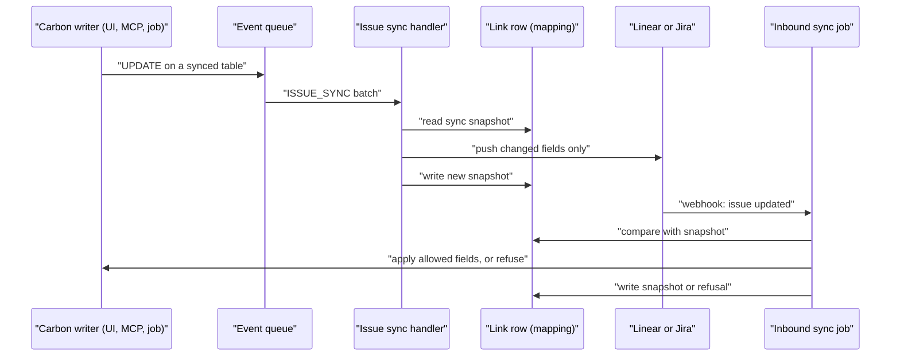

# Issue Tracker Sync: Quality Tasks, Change Notice Tasks and Project Elements

> Status: in-progress
> Author: barbinbrad
> Date: 2026-10-17
> Research: `.ai/research/issue-tracker-sync.md`

## TLDR

Carbon links a quality action task to a Linear or Jira issue and syncs it both ways.
Change notice action tasks are half-wired, and several parts of the quality sync are
broken. This spec does three things in three phases:

1. **Phase 0** fixes the inbound bugs in the current sync.
2. **Phase 1** moves the outbound push from hand-written route calls to an event-system
   subscription, so every writer reaches the tracker. It adds an echo guard, lock
   handling and remote-delete handling. Quality and change notice tasks move onto it.
3. **Phase 2** adds project elements of every type as a third synced record type.

## Overview diagram



## Problem Statement

A linked task and its issue must show the same status, assignee, due date and
notes. Today that is true only in part.

**What is broken now (confirmed in the code):**

| # | Defect | Effect |
|---|---|---|
| 1 | `LinearClient.getUsers` sends `variables: { input: filter }` to a query that declares `$filter` (`packages/ee/src/linear/lib/client.ts:211`) | Linear ignores the filter. The inbound job takes the first Linear user, so a linked issue with an assignee sets the Carbon assignee to that user, or clears it. This changes customer data. |
| 2 | `notify.ts` sends `table: "nonConformance"` and the issue id to `notifyTaskAssigned` (`packages/jobs/src/inngest/functions/notifications/notify.ts:458`) | Both services stop at `table !== "nonConformanceActionTask"`. No assignee change reaches a tracker. |
| 3 | `isNotificationService` lists only `"slack"` and `"linear"` (`packages/ee/src/notifications/pipeline.ts:57`) | Jira gets no outbound status or assignee push at all. |
| 4 | `getWorkflowState` filters on the state type only and takes the first node (`linear/lib/client.ts:266`) | In a workspace with several teams, the push can use another team's state. Linear refuses it, and the code logs and drops the error. |
| 5 | Nothing emits `task.notes.changed` | The notes handlers in both services are dead code. Notes reach the tracker only through the browser's POST to `sync-notes`. |
| 6 | `getIssueActionTasks` reads `externalIntegrationMapping` with no `companyId` filter (`quality.service.ts:497`) | The read breaks the multi-tenancy rule. RLS hides other companies' rows, but the code must scope the query itself. |
| 7 | The inbound jobs write with the service role and check no lock | A tracker edit changes a task on a change notice that is Done or Cancelled. |
| 8 | `getCompanyEmployees` (both trackers) filters `.in("user.email", emails)` on an embed with no `!inner` | PostgREST then filters only the embed, not the rows. The query returns every employee, and the inbound job takes the first one as the assignee. |
| 9 | `LinearWorkStateType` has no `duplicate` value | `LinearIssueSchema` refuses an issue in a Duplicate state, so the sync drops it. |

**What is missing:**

- **Change notice tasks.** The status route never calls `notifyTaskStatusChanged`, and
  `api+/assign.ts` has no event for `changeOrderActionTask`. Status and assignee
  changes never leave Carbon.
- **Writers outside the routes.** The supplier portal SCAR, MCP tools, the API,
  customer workflows and server functions write task rows with no push.
- **No echo guard.** A database-level push would loop with the inbound job, because
  nothing records what the last sync agreed.
- **Project elements.** A project element has Linear-style state groups, priority,
  owner, dates and a rich-text description. Users plan in Linear or Jira beside
  Carbon, but an element cannot link to an issue.

## Proposed Solution

### Terms

| Term | Meaning |
|---|---|
| **tracker** | Linear or Jira |
| **issue** | a Linear issue or a Jira issue |
| **synced record** | a Carbon row that can link to an issue: a `nonConformanceActionTask`, a `changeOrderActionTask` or a `projectElement` |
| **link** | the `externalIntegrationMapping` row that joins one synced record to one issue |
| **sync snapshot** | the field values the last sync agreed on, stored on the link (`metadata.sync.values`) |
| **refusal** | an inbound change that a lock stopped, stored on the link (`metadata.sync.refused`) |

### Phase 0: fix the current sync

Phase 0 ships first as its own PR, so quality customers get the fixes before the new
record types. Each fix is the smallest change in place.

Phase 0 fixes the inbound defects (1, 4, 6, 7, 8, 9). Defects 2, 3 and 5 are outbound.
Phase 1 replaces the outbound path, so it fixes them there. An interim fix for defect 2
would break Slack: `SlackNotificationService` reads `task.assigned` `data.id` as the
issue id.

| # | Fix |
|---|---|
| 1 | The inbound Linear job reads the assignee email from the fetched issue (`fullIssue.assignee.email`). `getUsers` sends `variables: { filter }` with the `UserFilter` shape (`{ email: { eq } }`, `{ id: { eq } }`). |
| 4 | `getWorkflowState(companyId, teamId, type)` filters on the team and the type, and orders by `position`. The issue queries fetch `team { id }`, so the link's `metadata` holds the issue's team (`metadata.team.id`). |
| 6 | `getIssueActionTasks` filters the mapping read by `companyId`. |
| 7 | The inbound jobs skip a `changeOrderActionTask` whose change notice is `Done` or `Cancelled`, and return the reason in the step output. `isChangeNoticeLocked` moves to `@carbon/database/change-notice` for this. |
| 8 | Both `getCompanyEmployees` select `user!inner(email)`. |
| 9 | `LinearWorkStateType` gains `Duplicate = "duplicate"`, which maps to `Skipped`. |

Phase 0 also applies Q8 to both trackers (Q9). If the
tracker assignee matches no Carbon employee, or Jira hides the email, the inbound job
leaves the Carbon assignee unchanged. Only an unassigned issue clears it.

### Phase 1: one sync engine for every synced record

#### The registry

`packages/ee/src/lib/actionTaskEntity.ts` becomes the synced-record registry,
`syncedEntities` in `packages/ee/src/issue-sync/entities.ts` (`@carbon/ee/issue-sync`).
Each entry names the table, the parent, the text, assignee and due-date columns, the
synced `fields`, the permission and `detailPath`. Pure functions do the rest:

| Function | File | Purpose |
|---|---|---|
| `carbonValues(type, row)` | `canonical.ts` | the Carbon row as snapshot values (`description` is a hash of its Tiptap JSON) |
| `linearValues(issue)`, `jiraValues(issue)` | `canonical.ts` | the issue as snapshot values |
| `changedOutbound`, `changedInbound`, `nextSync` | `diff.ts` | the echo guard |
| `lockedFields(type, ctx)` | `locks.ts` | the fields a lock protects now, and the reason |

Phase 1 moves every caller of the old names (`actionTaskEntities`,
`ActionTaskEntityType`, `actionTaskPermissions`, `actionTaskParentId`) to the new
ones, then deletes `actionTaskEntity.ts`.

#### Outbound: an event-system subscription

1. A new handler type `ISSUE_SYNC` joins `SYNC`, `WEBHOOK` and `WORKFLOW`.
2. `ensureIssueSyncSubscriptions(client, companyId, integration)` converges the
   company's subscriptions, in the way `ensureProviderSubscriptions` does for
   accounting. It subscribes `UPDATE` and `DELETE` on the three synced tables while
   the integration is active, and deletes the subscriptions when it is not.
3. The install hook, the settings save, every link and create route, and the inbound
   job each call it. An existing install converges on its first link or its first
   inbound webhook. No migration backfills subscription rows.
4. The `issue-sync` Inngest function (`carbon/event-issue-sync`) receives a batch. It
   groups the records by company and sends one `carbon/issue-sync.push` event per
   company. The `issue-sync-push` function handles each company's records:
   1. Group the records by table.
   2. Read the links for the batch with one `.in("entityId", ids)` query per table.
   3. Drop records with no link.
   4. Read the CURRENT rows with one query per table. The event is a hint; the row is
      the truth.
   5. For each link, compare `toCanonical(row)` with the sync snapshot.
   6. Push only the fields that differ, in one tracker call per issue.
   7. Write the new sync snapshot.
5. On `DELETE` of a synced record, the handler deletes the link. It removes the
   Carbon back-link from the issue, best-effort. It never deletes the issue.

The `issue-sync-push` function and the inbound jobs share one Inngest concurrency key,
`issue-sync-<companyId>` with `scope: "env"`, so a push and a pull of one company
never interleave. A batch can hold several companies, which is why the push runs in
a second function with a per-company key.

Phase 1 removes the route-level Linear and Jira pushes:

1. `LinearNotificationService` and `JiraNotificationService` leave the pipeline.
2. Delete the browser's `sync-notes` POST and the two `sync-notes` routes.

Slack keeps its notification calls.

#### The echo guard

The sync snapshot holds two values per field: `carbon` (Carbon's canonical value) and
`remote` (the tracker's raw value).

- **Outbound.** The handler pushes a field only when `toCanonical(row)` differs from
  `carbon`. After the push it stores both values.
- **Inbound.** The job applies a field only when the issue's value differs from
  `remote`. After the write it stores the issue's raw value as `remote` and
  `toCanonical(row after write)` as `carbon`.

So the event that the inbound write raises finds `carbon` equal to the row, and pushes
nothing. Storing both values matters for rich text: Markdown → Tiptap → Markdown is
not always byte-identical, and a one-value snapshot would push the normalized text
back once. For a description, both values are FNV-1a hashes of the JSON or Markdown
text, so the link stays small.

#### Conflict rule

Last write wins per field (Q3). Each side's change applies when it arrives. The
outbound handler reads the current row, so a Carbon change that a later tracker change
overwrote is not pushed.

#### Locks

The inbound job asks the adapter's `lockFor` before it writes. A protected field is
not written. The job stores a refusal (`{ at, fields, reason }`) on the link and
returns it in the step output. The next inbound change for a field that is no longer
locked clears the refusal. Carbon never pushes its value back over the tracker's
value to undo the edit.

| Synced record | Lock | Protected fields |
|---|---|---|
| `changeOrderActionTask` | change notice `Done` or `Cancelled` (`isChangeNoticeLocked`) | every field |
| `nonConformanceActionTask` | none today | none |
| `projectElement` | project `Closed` | every field |
| `projectElement` | plan locked (`isProjectPlanLocked`) | `name`, `description` |

The adapters in `packages/ee` cannot import app code, so both lock predicates move
to `@carbon/database`, which the app and `packages/ee` both import:

- `isChangeNoticeLocked` moves from `items.models.ts:1196` to
  `@carbon/database/change-notice`.
- `isProjectPlanLocked` moves from `projects.models.ts:3882` to
  `@carbon/database/project-plan`, beside `PLAN_LAYER_FIELDS`.

The app modules re-export them, so their callers do not change. The predicates stay
community code.

#### Remote delete and unlink

- The Linear webhook accepts `action: "remove"`. The Jira job accepts
  `jira:issue_deleted`. Each deletes the link and keeps the Carbon record (Q7).
- One issue links to at most one synced record per tracker. The link and create
  routes refuse an issue that already has a link of any entity type, because the
  inbound job looks the link up by `externalId`.

#### The first sync

- **Link** an existing issue: the route pulls first. It applies every field from the
  issue to the record, as today, and writes the first sync snapshot.
- **Create** a new issue: the route pushes first. It sends every field of the record
  to the new issue, and writes the first sync snapshot.
- A link with no sync snapshot (made before Phase 1) behaves like a first pull on its
  next inbound webhook.

#### The link write

`linkActionTo{Linear,Jira}Issue` delete and re-insert the link on every inbound
sync. They become an upsert on `(entityType, entityId, integration, companyId)` with
the service role, so the sync snapshot and the refusal survive.

### Phase 2: project elements

Every element type can link to an issue (Q5), Folder and Parameter included.

#### Field map

| Field | Element column | Linear | Jira | Direction |
|---|---|---|---|---|
| Title | `name` | `title` | `summary` | both; inbound refused while the plan is locked |
| Description | `description` (Tiptap) | `description` (Markdown, `markdownToTiptap` / `tiptapToMarkdown`) | `description` (ADF, `adfToTiptap` / `tiptapToAdf`) | both; inbound refused while the plan is locked |
| State | `stateId` (state group) | `state.type` | status category | both |
| Owner | `ownerId` | `assignee` (email) | `assignee` (email) | both |
| Priority | `priority` | `priority` 0–4 | `priority` by name | both |
| Target date | `targetDate` | `dueDate` | `duedate` | both |

Start date, labels, milestone and the parent link do not sync in v1. Linear has no
issue start date, and the client has no label support today.

#### State mapping

| Element state group | → Linear `state.type` | → Jira category | ← from Linear | ← from Jira |
|---|---|---|---|---|
| Backlog | `backlog` | `new` | `backlog`, `triage` | — |
| Unstarted | `unstarted` | `new` | `unstarted` | `new` |
| Started | `started` | `indeterminate` | `started` | `indeterminate` |
| Completed | `completed` | `done` | `completed` | `done` |
| Cancelled | `canceled` | `done` | `canceled`, `duplicate` | — |

- **Inbound.** If the element's current state is already in the target group, the
  job keeps it. A company can have several states in one group. Otherwise the job
  takes the group's default state. From Jira, `new` keeps a Backlog element in
  Backlog, and `done` keeps a Cancelled element in Cancelled.
- **Outbound.** The handler pushes the team's first state of that type by `position`
  (Linear), or the first transition into that category (Jira).
- **`completedAt`.** A shared pure helper sets it, so the route and the inbound job
  agree: now for the Completed group, else null. Today `updateProjectElementField`
  holds that rule inline.
- **State choice.** A pure helper, `pickStateForGroup(states, group, currentStateId)`
  in `@carbon/database/project-plan`, keeps the current state when it is in the group,
  else returns the group's default (`isDefault`), else the first by `sortOrder`. The
  five inline queries in `projects.server.ts` stay as they are.

#### Priority mapping

| Element | Linear | Jira (by name) |
|---|---|---|
| Urgent | 1 | Highest |
| High | 2 | High |
| Medium | 3 | Medium |
| Low | 4 | Low ← also Lowest |
| None | 0 | no change |

If the Jira project has no priority with that name, the handler does not change the
priority.

#### Client changes

- **`LinearClient`.**
  - Fetch `priority` on every issue query (`team { id }` comes in Phase 0).
  - `updateIssue` accepts `priority` and `dueDate`.
  - `LinearIssueSchema` adds both fields.
- **`JiraClient`.**
  - `updateIssue` accepts `duedate`.
  - `listPriorities` reads `GET /rest/api/3/priority`.

## Design Decisions

| Decision | Choice | Rationale |
|---|---|---|
| Fix the current sync | Phase 0, its own PR, first (Q1) | Bug 1 changes customer data. Phase 1 and 2 build on these paths. Fixes 2, 3 and 5 are interim: Phase 1 replaces the route path they touch. |
| Outbound trigger | Event-system subscription, new handler type `ISSUE_SYNC` (Q2) | It catches every writer: routes, MCP, the API, workflows, server functions, the supplier portal. |
| New handler type, not `SYNC` | `ISSUE_SYNC` | `sync.ts` is the accounting reconciler and its `handlerConfig.provider` is an accounting or spend provider. Issue sync shares nothing with it but the queue. |
| Suppress during dataset apply and restore | Add `ISSUE_SYNC` to the `app.sync_in_progress` list in `dispatch_event_batch` | A demo template or a restore must not push to a customer's tracker. |
| Subscription lifecycle | Converged from code (`ensureIssueSyncSubscriptions`) | Copies the accounting precedent (`packages/ee/src/accounting/core/subscriptions.ts`), which never backfills subscriptions in a migration. |
| Echo guard | Sync snapshot with `carbon` and `remote` values per field | The research consensus is compare-before-write (Jama delta sync, Linear `updatedFrom`). Two values absorb rich-text normalization. |
| Conflict rule | Last write wins per field (Q3) | Jama's rule. Every synced field here is a progress field or plan text under its own lock. |
| Link granularity | One synced record per issue; no project ↔ team mirror in v1 (Q4) | Carbon's pattern is one link per task. Duro, Matrix and Exalate link the same way. A mirror can come later. |
| Element types | All seven (Q5, user answer) | Users track Requirements, Test Cases and Folders as issues too. |
| Locked records | Refuse the protected fields, store a refusal, show it on the link (Q6) | Jama blocks and retries a locked item; Ketryx and Qualio flag it. No tool overwrites an approved record silently. |
| Undo a refused tracker edit | No push-back (Q10) | A push-back would fight the tracker user. The badge shows the difference. |
| Remote delete | Delete the link, keep the record (Q7) | Linear Jira Sync, Unito, Exalate and codebeamer all do this. |
| Unmatched or hidden assignee | Leave the Carbon assignee unchanged (Q8, Q9) | Jira can hide `emailAddress`. Clearing on a miss would erase a correct Carbon value. |
| One issue, one record | Refuse at link time across entity types | The partial unique index is per `entityType`, so the database allows a second link. The inbound lookup by `externalId` needs one row. |
| Action task title | Not synced (unchanged) | Today the sync never writes an action task title. This spec does not change that. |
| Element start date, labels, milestone, parent | Not synced in v1 | Linear has no issue start date. The clients have no label support. Hierarchy sync is the weakest area across the research. |
| Multi-tenancy (heuristic 1) | No new tables | The link and the subscription rows already carry `companyId`. Every new query filters by it. |
| Service shape (heuristic 2) | ee services take `client` first and return `{ data, error }` | Matches `linear/lib/service.ts` and `jira/lib/service.ts`. |
| RLS (heuristic 3) | Unchanged | `externalIntegrationMapping` has SELECT and INSERT policies only. Jobs and link routes write with the service role, as today. |
| Permissions (heuristic 4) | `update: quality`, `update: parts`, `update: projects` by record type | Extends `actionTaskPermissions`. The element link routes use `update: projects`, as the element update route does. |
| Forms (heuristic 5) | No new forms | The existing Link and Create dialogs post to their routes. |
| Module layout (heuristic 6) | Engine in `packages/ee/src/issue-sync/`; handler in `packages/jobs/src/inngest/functions/events/issue-sync.ts` | The sync is commercial code like the Linear and Jira packages. The handler is Inngest-coupled, like `sync.ts`. |
| Backward compatibility (heuristic 7) | Existing links keep working; the link `metadata` keeps the issue fields at the top level and adds a `sync` key | The hydration code parses `metadata` with `LinearIssueSchema` / the Jira schema, and zod drops the extra key. |

## Data Model Changes

No new tables or columns.

1. **`eventSystemSubscription_handlerType_check`.** Add `ISSUE_SYNC` to the CHECK
   list. This needs a migration (`pnpm db:migrate:new issue-sync-handler-type`).
2. **`dispatch_event_batch`** (`packages/database/src/event-system/functions/dispatch_event_batch.sql`).
   Add `ISSUE_SYNC` to the handler types that `app.sync_in_progress` suppresses (both
   `NOT IN ('SYNC','WEBHOOK','WORKFLOW')` lists). It ships through
   `pnpm --filter @carbon/database authz migration`.
3. **`attachments.ts`.** Give `projectElement` `events: true`. The other two tables
   already have it. It ships through the same authz migration.
4. **`HandlerTypeSchema`** (`packages/database/src/event.ts`). Add `"ISSUE_SYNC"`.
5. **Link `metadata`.** Add a `sync` key:

```ts
type LinkSync = {
  values: Record<SyncedField, { carbon: string | null; remote: string | null }>;
  refused?: { at: string; fields: SyncedField[]; reason: string } | null;
};
```

```sql
-- Migration sketch: widen the handler type list.
ALTER TABLE "eventSystemSubscription"
  DROP CONSTRAINT IF EXISTS "eventSystemSubscription_handlerType_check";
ALTER TABLE "eventSystemSubscription"
  ADD CONSTRAINT "eventSystemSubscription_handlerType_check"
  CHECK ("handlerType" IN (
    'WEBHOOK', 'WORKFLOW', 'SYNC', 'SEARCH', 'AUDIT', 'EMBEDDING', 'ISSUE_SYNC'
  ));
```

The plan must read the newest migration that sets this CHECK, and keep its exact
list.

## API / Service Changes

| Change | Phase | Where |
|---|---|---|
| `getUsers` filter fix; inbound assignee from the fetched issue | 0 | `linear/lib/client.ts`, `jobs/.../integrations/linear.ts` |
| Task id and table on the assignment hook | 0 | `api+/assign.ts`, `notify.ts` |
| `"jira"` in `isNotificationService` | 0 | `notifications/pipeline.ts` |
| Team-scoped `getWorkflowState` | 0 | `linear/lib/client.ts` |
| Delete `notifyTaskNotesChanged` and the notes handlers | 0 | `notifications/` |
| `companyId` filter on the mapping read | 0 | `quality.service.ts` |
| Change notice lock check in the inbound jobs | 0 | `jobs/.../integrations/{linear,jira}.ts` |
| Synced-record registry and adapters | 1 | `packages/ee/src/issue-sync/entities.ts` |
| `ensureIssueSyncSubscriptions` | 1 | `packages/ee/src/issue-sync/subscriptions.ts` |
| `issue-sync` handler and queue dispatch | 1 | `jobs/.../events/issue-sync.ts`, `events/queue.ts`, `events/index.ts` |
| Inbound jobs call the adapter, the lock check and the snapshot | 1 | `jobs/.../integrations/{linear,jira}.ts` |
| Webhook schemas accept remove and delete events | 1 | `packages/jobs/src/schemas.ts`, both webhook routes |
| Link upsert keeps `metadata.sync` | 1 | `linear/lib/service.ts`, `jira/lib/service.ts` |
| Remove the Linear and Jira services from the pipeline; delete the `sync-notes` routes | 1 | `notifications/`, `api+/integrations.*.issue.sync-notes.ts` |
| Refuse an issue that already has a link | 1 | the link and create routes |
| Jira setup instructions list the `issue deleted` event | 1 | `jira/config.tsx` |
| `projectElement` adapter, state and priority maps | 2 | `issue-sync/entities.ts`, `issue-sync/maps.ts` |
| `pickStateForGroup`, `completedAtForGroup` pure helpers | 2 | `@carbon/database/project-plan` |
| Client fields: Linear `priority`, `team`, `dueDate`; Jira `duedate`, priorities | 2 | both `client.ts` |
| Element page loader reads the element's links | 2 | `getProjectElementPageInChangeRequest` (`projects.server.ts`) |

## Closest Sibling

The **change notice action task link** is the sibling. It is the second record type
that the Linear and Jira link supports, and it already reuses the generic parts:

- `apps/erp/app/components/ActionTasks/Linear/IssueDialog.tsx` and `Jira/IssueDialog.tsx`
  (Link and Create tabs, `entityType` prop)
- `apps/erp/app/modules/items/ui/ChangeNotice/ChangeNoticeActions.tsx` (renders the
  dialogs when `integrations.has("linear" | "jira")`)
- `getChangeNoticeActions` in `items.service.ts` (one mapping read per tracker, by
  `companyId`)
- `apps/erp/app/routes/api+/integrations.{linear,jira}.issue.{link,create}.ts`
  (branch on `entityType`)

The project element copies these files. The deviations:

| Deviation | Why |
|---|---|
| The dialog triggers sit in the element page header row, not in a task card header | The element page has no task card. Its header row is where the record's own controls are. |
| Create sends the element `name` as the issue title | An action task has no editable title in the sync; an element does. |

## UI Changes

Page archetype: the element page (`ElementView`), unchanged. The UI change is small,
in line with the minimal-UI rule for projects.

1. **Header row** (`ElementView.tsx`, between `<Copy>` and the ⋯ menu). Render
   `LinearIssueDialog` and `JiraIssueDialog` with `entityType="projectElement"`,
   each only when that integration is active. The dialog's own trigger shows a grey
   tracker icon, or the issue identifier once linked. This copies `headerExtras` in
   `ChangeNoticeActions.tsx`.
2. **Refusal** (all three record types). If the link has a refusal, the dialog's
   linked-issue card shows "Not applied: <reason>", and the trigger shows a warning
   icon beside the identifier. Example: "Not applied: the project plan is locked".

## Acceptance Criteria

**Phase 0**

- [ ] In Linear, a user assigns an issue linked to a quality action task to a user whose email matches a Carbon employee. Within one minute the task's assignee is that employee.
- [ ] In Linear, a user assigns a linked issue to a user who matches no Carbon employee. The task's assignee does not change.
- [ ] A Linear workspace has two teams. A status change on a task linked to a team-B issue moves the issue to a team-B state.
- [ ] A Linear edit to an issue linked to a task on a Done change notice leaves the task unchanged. The job output names the reason.

**Phase 1**

- [ ] A user assigns a linked quality action task in Carbon. The Linear issue and the Jira issue each show the matching assignee.
- [ ] A user changes the status of a Jira-linked quality action task. The Jira issue moves to the matching status category.
- [ ] A change notice action task's status changes in Carbon. The linked issue's status follows within one minute.
- [ ] An MCP tool call changes a linked quality task's assignee. The linked issue's assignee follows.
- [ ] A Linear status change reaches Carbon. The inbound write raises no outbound push: the handler output shows the record skipped as unchanged.
- [ ] A user edits notes on a linked task and saves. The issue description follows, and the browser sends no `sync-notes` request.
- [ ] A user deletes a Linear issue that links to a task. The link row is gone, and the task still exists.
- [ ] A user tries to link an issue that is already linked to another record. The route refuses with a message.
- [ ] Applying a demo template to a company with an active Linear integration pushes nothing to Linear.

**Phase 2**

- [ ] A user creates a Linear issue from a Requirement element. The issue's title and description match the element.
- [ ] A user moves a linked element to a Started state. The Linear issue moves to that team's first `started` state.
- [ ] A Linear issue moves to `completed`. The element moves to the company's default Completed state, and the job sets its `completedAt`.
- [ ] An element in a non-default Started state stays in that state when its Linear issue moves between two `started` states.
- [ ] Linear priority Urgent (1) sets the element priority to Urgent, and Carbon Low sets Linear 4.
- [ ] A linked element's plan is locked. A Linear title change leaves the element name unchanged, and the sidebar shows "Not applied: the project plan is locked". A Linear status change in the same webhook still applies.
- [ ] The automatic start on first charge (`startElementOnFirstCharge`) moves a linked element to Started. The linked issue follows.

## Risks

| Risk | Severity | Mitigation |
|---|---|---|
| An echo loop between the handler and the inbound job | High | The sync snapshot. Unit-test the round trip (Carbon → tracker → webhook → no push) for every field, rich text included. |
| Rich-text round trip changes text on every sync | Med | The two-value snapshot. Test `tiptapToMarkdown(markdownToTiptap(x))` and the ADF pair on the existing fixtures. |
| A busy project fills the queue with element updates that have no link | Low | `dispatch_event_batch` exits early for companies with no subscription. The handler drops records with no link after one query per table. |
| Existing installs have no subscription until a link or a webhook converges it | Med | The inbound job and every link route converge. Document it in the integration's setup text. |
| Jira workflows refuse a transition | Med | The handler pushes the remaining fields, records the refusal in the step output, and keeps the old snapshot for the status, so the next change retries. |
| Removing the route pushes before Phase 1 is complete leaves a gap | Med | Phase 1 removes them in the same PR that adds the handler. |
| `api+/assign.ts` checks no module permission (`requirePermissions(request, {})`) | Med | Out of scope: RBAC changes need their own approval. Record it in `.claude/rules/linear-integration.md` Known gaps. |
| Inbound writes set no `updatedBy` | Low | Unchanged from today. The audit log shows the service role. |

## Open Questions

> All questions are resolved. The answers are built into the design above.

- [x] Q1. Does this spec also fix the current sync? — **Answer:** Yes. Phase 0, its own PR, shipped first.
- [x] Q2. What triggers the outbound push? — **Answer:** An event-system subscription with a new handler type, compared against the last synced values (option B).
- [x] Q3. What is the conflict rule? — **Answer:** Last write wins per field.
- [x] Q4. Link one element at a time, or mirror a project? — **Answer:** One element at a time in v1.
- [x] Q5. Which element types can link? — **Answer:** All element types (user answer; the recommendation was Task only).
- [x] Q6. What happens to an inbound edit on a locked record? — **Answer:** The inbound job refuses the protected fields. The link stores the reason, and a badge shows it. Progress fields on an element with a locked plan still sync.
- [x] Q7. What does a remote delete do? — **Answer:** It deletes the link and keeps the Carbon record.
- [x] Q8. What if Jira hides the assignee's email? — **Answer:** Leave the Carbon assignee unchanged.

Questions found while writing the spec:

- [x] Q9. Does the Q8 rule also cover a Linear assignee who matches no Carbon employee? — **Answer:** Yes. A miss leaves the Carbon assignee unchanged, and only an unassigned issue clears it. Both trackers behave the same.
- [x] Q10. After a lock refuses a tracker edit, does Carbon push its own value back to the tracker? — **Answer:** No. The refusal badge shows the difference. A push-back would undo the tracker user's edit with no reason.

## Changelog

- 2026-10-19: Phases 0 and 1 implemented. Engine in `packages/ee/src/issue-sync/`; rule `.claude/rules/issue-sync.md`. Link and create go through `linkExistingIssue` / `linkNewIssue`; a linked record's existing description goes to the issue on link.
- 2026-10-17: Planning corrections. Defects 8 and 9 added. Outbound defects 2, 3 and 5 move to Phase 1. The element dialog triggers move to the header row (the sibling's `headerExtras`). `pickStateForGroup` replaces `defaultStateOfGroup`. Description snapshots are hashes. Link pulls first; create pushes first.
- 2026-10-17: Created. Research in `.ai/research/issue-tracker-sync.md`. The user resolved Q1–Q10. Q9 and Q10 came up while writing the spec.
