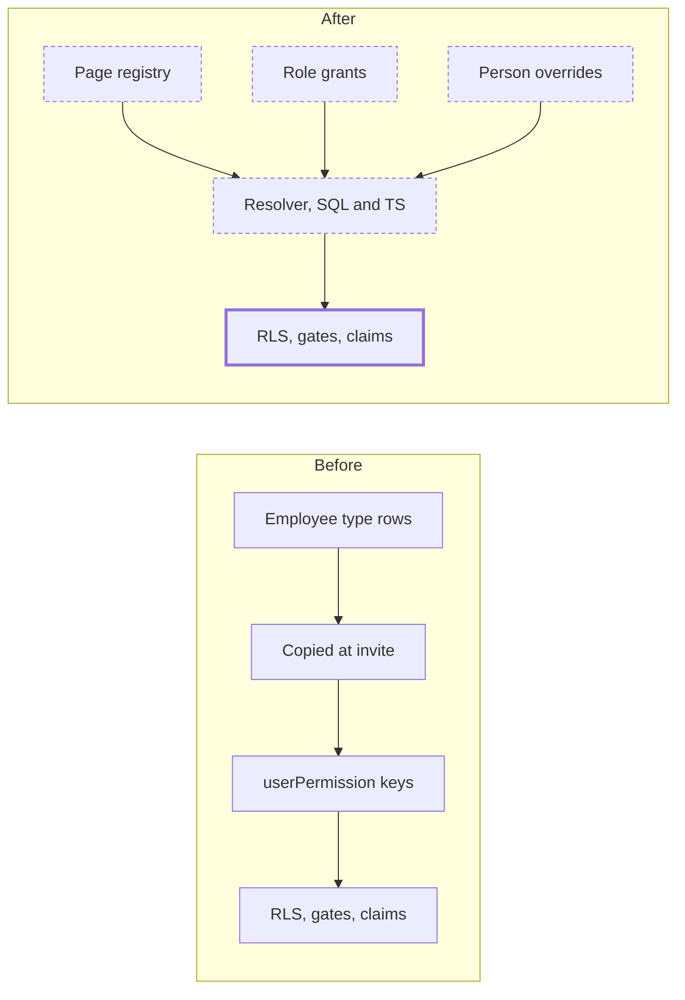

# Page-Level Permissions

> Status: draft
> Author: Sid (with Claude)
> Date: 2026-10-18
> Research: `.ai/research/page-level-permissions.md`

## TLDR

Access moves from 17 modules to the 158 pages inside 14 of them. An admin
gives a role one level per module (None, View, Create, Edit, Full) and an
exception level on any page. A person can have overrides that add or remove
access, and an override wins. Carbon stops copying a role into each person:
one resolver computes a person's access from their role and overrides when a
check runs. The same resolver serves RLS, service functions, routes, the
sidebar, MES and API keys. Every module moves to page keys in one deploy.

## Overview diagram



## Problem Statement

1. **Access is too coarse.** A permission attaches to one of 17 modules. An
   admin cannot give a warehouse clerk Receipts without Shipments, or an
   accountant Payment Terms without the Chart of Accounts.
2. **A person is a copy of a role.** `createEmployeeAccount` and
   `convertConsoleOperatorToUser` (`users.service.ts`) copy the employee
   type's permissions into `userPermission.permissions`. A later edit of the
   type reaches nobody who already has it. Admins bulk-edit people one by one
   (`carbon/update-permissions`), so every person drifts into a role of their
   own. The glossary entry "Default Permissions" says so: an edit "changes the
   template for future hires only".
3. **"View" means two things.** It means "can open this page" and "can read
   this data". RLS lets every employee read 143 of the 296 company tables
   (`company(module)` in `packages/database/src/authz/rules.ts`). Service
   functions gate every read on `view: <module>`. So a page that reads
   locations needs `resources_view`, although the database already lets
   every employee read locations.
4. **The check exists five times.** Five pieces of code decide access:
   `requirePermissions` (`@carbon/auth`), the Onshape panel session check
   (`@carbon/ee`), `hasPermissions` (`@carbon/api`), `authorizePostingCaller`
   (ERP `shared.service.ts`) and the SQL helper
   `get_companies_with_employee_permission`. Nothing proves they agree.
5. **Keys are free strings.** `{ view: "inventory" }` in a route, a service
   function, an RLS rule and a client `permissions.can(...)` call is a plain
   string. A typo compiles.
6. **A role edit is not an audit event.** `logPermissionChange` records one
   person's before and after keys. Nothing records "Warehouse Supervisor:
   Receipts went from View to Edit, 14 people affected".

## Proposed Solution

### The page registry

One registry in code, `packages/database/src/access/registry.ts`, lists each
module, its pages and, for each page:

| Field | Holds |
|---|---|
| `id` | The page key: `<module>.<page>`, camelCase, for example `inventory.receipts` |
| `label` | The name the editor and the sidebar show |
| `maxLevel` | The highest level the page supports (`View` for a page with no editing) |
| `tables` | The tables the page owns: its writes need the page's levels |
| `where` | For a table that two or more pages share: the column and value that pick this page's rows (`item.type = 'Tool'`) |
| `children` | For a shared table: the tables of the same pages that hang off it (`itemCost` through `itemId`) and check its `where` through it |
| `readers` | Restricted tables of other pages that this page reads (see below) |
| `paths` | The route path prefixes of the page; the switch uses them to map route files to pages |

The registry exports the page keys as a TypeScript union. A key in a service
function, a route, an RLS rule, MES or a client check is then typed.

The database needs no copy of the registry. A page key carries its module
(`inventory.receipts` → `inventory`), and the resolver needs nothing else. The
page cap (`maxLevel`) is an editor rule: the grant writers clamp a level to it.

### The pages

One page per distinct sidebar path (`use<Module>Submodules.tsx`). Sidebar
entries that share a path are filters of one list and form one page.

| Module | Pages |
|---|---|
| Accounting (19) | Reporting, Sync Tie-Out, Journal Entries, Intercompany, Accounting Periods, Depreciation, Leases, Revenue Recognition, Assets, Fleet, Asset Classes, Chart of Accounts, Cost Centers, Default Accounts, Dimensions, Exchange Rates, Fiscal Year, Payment Terms, Projects |
| Documents (1) | Documents (All, My, Recent, Pinned and Trash share one path) |
| Inventory (15) | Quantities, Movements, Inventory Count, Kanbans, Receipts, Shipments, Picking Lists, Stock Transfers, Warehouse Transfers, Tracked Entities, Traceability, Storage Units, Storage Types, Storage Rules, Shipping Methods |
| Invoicing (9) | Payables, Purchase Invoices, Supplier Credits, Charges, Reimbursements, Receivables, Sales Invoices, Credit Memos, Payments |
| Items (16) | Parts, Materials, Tools, Consumables, Services, Change Notices, Change Notice Types, Change Notice Actions, Dimensions, Finishes, Grades, Shapes, Substances, Types, Item Groups, Units |
| People (6) | Employees, Timecards, Attributes, Departments, Holidays, Shifts |
| Production (12) | Jobs, Batches, Unattributed Time, Demand Forecasts, Material Planning, Resource Planning, Forecast, Priorities, Outbound, Assemblies, Procedures, Scrap Reasons |
| Purchasing (8) | Suppliers, Purchase Orders, Returns, Leases, Material Planning, RFQs, Supplier Quotes, Types |
| Quality (12) | Actions, Issues, Risks, Gauges, Records, Inspections, Inspection Plans, Quality Documents, Action Types, Gauge Types, Issue Types, Issue Workflows |
| Resources (10) | Dispatches, Schedules, Failure Modes, Locations, Processes, Work Centers, Abilities, Training, Assignments, Suggestions |
| Sales (15) | Customers, Portals, RFQs, Quotes, Sales Orders, Returns, Service Contracts, Rental Agreements, Price Lists, Pricing Rules, Sales Rules, No Quote Reasons, Return Reasons, Statuses, Types |
| Settings (29) | Billing, Company, Companies, Document Templates, Logos, Printing, Accounting, Inventory, Invoicing, Items, People, Planning, Purchasing, Production, Quality, Sales, Resources, API Keys, Approval Rules, Audit Logs, Backups, Custom Fields, Demo Data, Integrations, ITAR Certifications, Security, Sequences, Serial Numbers, Webhooks |
| Users (4) | Accounts, Operators, Groups, Employee Types |
| Workflows (2) | Workflows, Runs |

- The Items module's permission name stays `parts` (`useModules.tsx`), so its
  keys are `parts.<page>`.
- The `module` enum values `messaging` and `items` gate nothing today and get
  no pages. `printing` (two RLS rules) maps to the Settings page Printing.
- The Settings pages that configure a module (Settings → Inventory and the
  others) stay Settings pages. An admin can give an inventory manager
  `settings.inventory` alone.
- The plan sets each page's `maxLevel` from the actions its routes offer.
  Pages with no editing (Reporting, Traceability, Payables, Receivables,
  Audit Logs) cap at View.

### Pages that share a table

Two cases are known: the five item types share `item` (column `type`), and
Supplier Credits and Credit Memos share `memo` (column `direction`). The plan
lists every other case from the registry, because a table in the `tables` of
two pages fails the registry's own test unless both pages give `where`.

For such a table, each write rule checks the page whose `where` matches the
row. A read rule checks it too when the table's read needs a permission; a
table that every employee may read stays readable by every employee. A child
table of the shared row checks the page of its parent row, through a lookup
on the parent. Any table with an `itemId`, such as `itemCost` or
`supplierPart`, is such a child. So Tools at Edit with Parts at View lets a
person change a tool's cost but not a part's cost.

### Levels

| Level | Actions it holds |
|---|---|
| None | none |
| View | view |
| Create | view, create |
| Edit | view, create, update |
| Full | view, create, update, delete |

The order is NetSuite's (research, pattern 2). A grant writer stores at most
the page's `maxLevel`.

### Grants and precedence

A grant is one row of the `permission` table. It gives one subject one level
on a module or on one page. The
subjects are an employee type (the role), a person (an override) and an API
key. To resolve the level of a person on a page in a company, the resolver
takes the first grant that exists, in this order:

1. The person's grant on the page.
2. The person's grant on the module.
3. The role's grant on the page.
4. The role's grant on the module.
5. None.

An API key resolves with steps 3 to 5 on its own grants. An employee type
with `systemType = 'Admin'` resolves to Full on every page, with no grant rows,
so the rule also covers a page added later.

A permission key is `<page>_<action>`, for example
`inventory.receipts_update`. It holds when the page's level includes the
action. After the switch, no check names a module key. A conformance check
fails a `<module>_<action>` key in routes, service functions, RLS rules, MES,
the workflow catalog or `ui/`.

Navigation asks a different question: "may this person open anything in the
module?" `holdsAny(module, action)` answers it. The top-level nav
(`useModules.tsx`, `permissions.can("view", item.permission)` today) shows a
module when the person has View on any of its pages.

### Reads of reference data

Each table has a read rule in RLS. It is either "employee" (any employee of
the company, the default of `company(module)`) or a permission.

- A service function that reads only "employee" tables gates on `"employee"`.
  It admits any employee of the company and any API key of the company. It
  refuses a customer or supplier portal account. This replaces the
  `"member"` permission added on this branch.
- A table whose read needs a permission gets the rule `anyOf(view on its own
  page, view on every page that lists it in readers)`. RLS already supports
  `anyOf` (`rules.ts`).

So a buyer picks payment terms on a purchase order without a level on the
Payment Terms page (research, pattern 3).

### One resolver, two languages

- **SQL**: `get_companies_with_employee_permission(permission)` keeps its
  signature. It reads the caller's grants instead of `userPermission`. RLS
  wraps it in `(SELECT …)`, so Postgres runs it once per statement, not once
  per row. `get_claims` returns the role, the caller's grants in the company,
  the Admin flag and the portal keys still held in `userPermission`. The SQL
  key path reads the key's own grants.
- **Claims in the app**: `expandClaims` (TS) turns grants into the
  `{ "<page>": { view: [companyId], … } }` shape with the registry, because
  only the registry knows a module's pages. `usePermissions`, the service
  function gate and `getApiKeyRecord` read that shape, as they do today.
- **TypeScript**: `resolveLevel` (grants to a level), `expandClaims`, `holds`
  and `holdsAny` (checks on the expanded claims) in
  `packages/database/src/access/resolve.ts`, pure functions. Four callers use `holds` and lose their own copy of the
  logic: `@carbon/api` `hasPermissions`, `@carbon/auth` `requirePermissions`,
  the Onshape panel check and `authorizePostingCaller`.
- **Parity**: one table of cases in `packages/database/src/access/cases.json`
  runs against `holds` in vitest and against the SQL function in
  `packages/database/supabase/tests/access-resolver.test.sql`. A case that
  passes in one and fails in the other fails CI.

No stored copy of a person's access exists, so none can go stale. The Redis
claims cache stays (`permissions:<userId>`) with two changes:

1. The key carries the registry version: `permissions:<registryHash>:<userId>`.
   A deploy that changes the registry invalidates every cached claim at once
   (research, Infisical).
2. A role edit busts the key of every employee with that role, in the same
   service function. An override edit busts the one person's key.

### Postings

Nothing changes. A service function checks the person's level on the source
document. Then the posting writes ledgers as the system (`ctx.asSystem`).
This is Business Central's "indirect" permission and Odoo's `sudo()`
(research, pattern 5).

### Access view and audit

- `users.getEffectiveAccess({ userId })` returns, for each page, the level and
  its source (person page, person module, role page, role module, Admin).
- `users.getPageAccessHolders({ page, level })` returns every person and API
  key whose level on the page is at least `level`. This is the access review
  NIST 800-171 and SOC 2 audits ask for.
- A role grant edit writes one audit event: role, page or module, old level,
  new level, and the number of people affected. An override edit keeps
  `logPermissionChange` with the person's effective keys before and after.

### Rollout

| Phase | Work | Access change |
|---|---|---|
| 0 | On this branch: replace the service-function `"member"` permission with `"employee"`; restore `view` on the lookups whose table needs a permission to read | Lookups on "employee" tables stay open; the others return to their module permission |
| 1 | Registry with one page per module (its key is the module name, so `sales_view` is a page key); `permissionLevel`, `permission`; both resolvers and the parity tests; `get_claims` from grants; cache key version; data migration and its report | None, except the round-up (Design Decisions) |
| 2 | The role grid (the mockup), the person's Access tab with overrides, the API key grid, the access view, the role audit event | None until an admin edits |
| 3 | One deploy: the registry gets all 158 pages; every RLS rule, service function, ERP and MES route gate, client check, workflow catalog event and sidebar moves to page keys; the module-key check turns on | None for existing roles: a module grant covers every page |
| 4 | Drop `employeeTypePermission`, the employee keys in `userPermission` and `apiKey.scopes` | None |

Phase 0 ships on its own. Phases 1 and 2 ship together: once the resolver reads
grants, the old editors would write tables that nothing reads. Phase 3 is one
deploy because a page key and a module key must never decide the same access
at the same time.

### Design Decisions

| Decision | Choice | Rationale |
|---|---|---|
| Unit of access | One page per distinct sidebar path, grouped by module: 158 pages in 14 modules | The grid matches what the admin clicks (Acumatica, Business One). Answered by the user |
| Pages that share a table | The registry names the column that picks each page's rows; RLS checks it, on child tables through the parent row | A page split the database does not enforce is a promise the API breaks. Answered by the user for item types; the same rule covers `memo.direction` |
| Levels | None, View, Create, Edit, Full, in NetSuite's order; a page caps its own level | One choice per page; no create-without-view state. Answered by the user |
| Module level plus page exceptions | A role and a person can grant a module and override single pages | A page added later inherits the module level (Acumatica inheritance); the mockup's module checkbox is the module level |
| Overrides | A person's grant can add or remove, and wins over the role | Answered by the user; NetSuite Global Permissions, Infisical folder grants |
| Where access is worked out | Computed when checked, from grants; no stored copy | `(SELECT …)` makes it once per statement; nothing to recompile or backfill. Answered by the user |
| Rollout | Every module switches to page keys in one deploy | No time when a page key and a module key decide the same access. Answered by the user |
| Module keys | None after the switch; a conformance check fails one. The nav uses `holdsAny` | In phases 1 and 2 a module's one page has the module's name, so no meaning of a module key is needed |
| Converting today's flags | Round up to the lowest level that covers every granted flag; the migration writes a report of every role, person and key whose access grew | Nobody loses access on deploy day; an admin lowers what grew. Answered by the user |
| API keys | The same grid and grants as roles; `accounting_delete` stays opt-in as Full on Accounting pages, never set by "select all" | One model; a key can be limited to one page. Answered by the user |
| Admin employee type | `systemType = 'Admin'` resolves to Full on every page with no grant rows | New pages and modules are covered without a migration |
| Reference reads | `"employee"` gate for tables RLS lets every employee read; `anyOf` page views for restricted tables | Matches RLS; Odoo `base.group_user`, Business Central D365 BASIC |
| Postings | Unchanged: the gate checks the source document, the posting writes as the system | Business Central "indirect", Odoo `sudo()` |
| Route gates | Each ERP and MES route names its page key in `requirePermissions`, typed; no gate derived from the URL | Explicit and greppable; the same pattern as today |
| Sidebar | A page shows only when the person has View on it | Today most sidebar entries check only `role: "employee"` |
| Settings pages for a module | Stay in Settings (`settings.inventory`) | Today they need `settings`; page grain already lets an admin grant one of them |
| Who edits grants | Role grants: `users.employeeTypes` at Edit. Person overrides: `users.accounts` at Edit. API key grants: `settings.apiKeys` at Edit | The pages where an admin edits each subject today |
| Code location | Registry and resolver in `packages/database/src/access/` (community); authoring in `@carbon/ee/permissions.server` behind `requireEntitlement("PERMISSIONS")` and `API_KEYS` | `@carbon/database` is the lowest package that RLS, `@carbon/auth` and `@carbon/api` all import; authoring stays commercial (`commercial-licensing.md`) |
| Tenancy (heuristic 1) | `permission` has `companyId` and PK `("id", "companyId")` | Every company's grants are its own |
| One table | Roles, people and API keys share `permission`; three subject columns, exactly one set, each a real foreign key | Deletes cascade and backup restores rewrite the ids. Answered by the user |
| Registry in the database | None: the resolver reads page keys from grants and from the permission it checks; writers validate `page` against the registry | A copy of the registry in a table needs a generator and can drift |
| Service shape (heuristic 2) | Building blocks in `users.service.ts` take `client` first and return `{ data, error }`; operations are `defineServiceFn` in `users.server.ts` | `module-files.md` |
| RLS (heuristic 3) | `permission`: a role or person grant is read and written with the `users` pages above; an API key grant with `settings.apiKeys`. The resolver is `SECURITY DEFINER`, so a person needs no read access to resolve their own level | The same rules as `employeeTypePermission` (via `employeeType`) and `apiKey` today |
| Permission scoping (heuristic 4) | Every route uses page keys in `requirePermissions` | Typed by the registry |
| Forms (heuristic 5) | The grids are `ValidatedForm` forms with a zod validator and a route action calling one service function | `conventions-forms.md` |
| Module files (heuristic 6) | No new module; no barrel files | `module-files.md` |
| Public contracts (heuristic 7) | The MCP manifest's `ToolPermission` gains an optional `page`; the API key `scopes` column is replaced by grants; both go in the changelog | A tool gated on a page must say so to `describe_tool` |

## Data Model Changes

```sql
CREATE TYPE "permissionLevel" AS ENUM ('None', 'View', 'Create', 'Edit', 'Full');

CREATE TABLE "permission" (
    "id" TEXT NOT NULL DEFAULT id('prm'),
    "companyId" TEXT NOT NULL,
    "employeeTypeId" TEXT,                   -- a role's permission
    "userId" TEXT,                           -- a person's override
    "apiKeyId" TEXT,                         -- an API key's permission
    "module" "module" NOT NULL,
    "page" TEXT,                             -- 'inventory.receipts'; NULL: the whole module
    "level" "permissionLevel" NOT NULL,
    "convertedFrom" TEXT[],                  -- the old checkboxes, set only by the conversion
    "createdBy" TEXT NOT NULL REFERENCES "user"("id"),
    "createdAt" TIMESTAMP WITH TIME ZONE NOT NULL DEFAULT NOW(),
    "updatedBy" TEXT REFERENCES "user"("id"),
    "updatedAt" TIMESTAMP WITH TIME ZONE,
    CONSTRAINT "permission_pkey" PRIMARY KEY ("id", "companyId"),
    CONSTRAINT "permission_companyId_fkey" FOREIGN KEY ("companyId")
      REFERENCES "company"("id") ON DELETE CASCADE ON UPDATE CASCADE,
    CONSTRAINT "permission_one_subject" CHECK (
      num_nonnulls("employeeTypeId", "userId", "apiKeyId") = 1
    ),
    CONSTRAINT "permission_page_in_module" CHECK (
      "page" IS NULL OR split_part("page", '.', 1) = lower("module"::text)
    ),
    CONSTRAINT "permission_unique" UNIQUE NULLS NOT DISTINCT
      ("companyId", "employeeTypeId", "userId", "apiKeyId", "module", "page")
);
CREATE INDEX "permission_employeeTypeId_idx" ON "permission" ("employeeTypeId");
CREATE INDEX "permission_userId_idx" ON "permission" ("userId", "companyId");
CREATE INDEX "permission_apiKeyId_idx" ON "permission" ("apiKeyId");
```

The foreign keys from `employeeTypeId`, `userId` and `apiKeyId` cascade on
delete. RLS rules go in `packages/database/src/authz/manifest.ts`, never in
the migration (`authz-manifest.md`).

**Data migration (phase 1), one transaction:**

1. Each `employeeTypePermission` row becomes one module grant on its role. The
   level is the lowest level that covers every flag it grants. The Admin type
   gets no rows.
2. Each employee whose `userPermission` keys differ from their role's result
   gets a module grant for each module that differs, with the same round-up.
3. Each `apiKey.scopes` module becomes a module grant on the key, with the
   same round-up. `accounting_delete` becomes Full on Accounting only when the
   scope held it.
4. Each row the conversion writes keeps the old checkboxes in
   `convertedFrom`. The access view lists every row whose level grants more
   than `convertedFrom`. A save of that role, person or key clears the column.

Phase 3 needs no data migration: a module grant covers every page of the
module.

## API / Service Changes

| Where | Change |
|---|---|
| `packages/database/src/access/` | New: `registry.ts`, `levels.ts`, `resolve.ts` (`resolveLevel`, `holds`, `holdsAny`), `cases.json` |
| `packages/database/src/authz/helpers/` | `get_companies_with_employee_permission.sql`, `get_claims.sql` and `get_api_key_scopes.sql` build their answers from `permission`; same signatures. New helper `access_level(subject, company, page)` |
| `@carbon/auth` `api-key.server.ts` | `getApiKeyRecord` reads the key's scopes from grants, so every key check downstream stays as it is |
| `packages/database/src/authz/rules.ts`, `manifest.ts` | A rule that names a module renders with the keys of the page that owns its table, from the registry; a restricted read renders `anyOf` the page and its readers; a shared table renders its `where` check. Rules that name a `<module>_<action>` key explicitly move to page keys by hand (795 permission references today) |
| `@carbon/api` `permissions.ts` | `hasPermissions` calls `holds`; `Permissions` gains `"employee"` and loses `"member"` |
| `@carbon/api` `service-fn.server.ts` | The user actor carries its `role`, so `"employee"` refuses a portal account |
| `@carbon/auth` `auth.server.ts` | `requirePermissions` calls `holds`; the claims cache key carries the registry hash |
| `@carbon/ee` `permissions.server.ts` | `upsertEmployeeTypePermissions`, `updatePermissions`, `updateEmployee` write `permission`; the bulk edit writes overrides for many people; each busts the affected cache keys and writes the audit event |
| `users.server.ts` | New operations: `getEffectiveAccess`, `getPageAccessHolders`, `upsertAccessGrants` (role or person), `deleteAccessGrant` |
| `settings.server.ts` | API key create and update write the key's `permission` rows |
| Every module's `*.server.ts` | Page keys in `permission` (1,607 permission references today) |
| ERP and MES routes | Page keys in `requirePermissions` (1,088 ERP and 14 MES route files today) |
| `ui/` and components | Page keys in `permissions.can` (1,258 calls today); `canAny` beside `can` in `usePermissions.tsx`; `useModules.tsx` uses `canAny`; each `use<Module>Submodules.tsx` entry names its page |
| Workflow event catalog (`packages/ee/src/workflows/catalog/`) | An event's `permission` (106 events today) becomes the page that owns its table, from the registry's `tables`; regenerate `events.generated.ts` |
| `scripts/lib/service-fn-metadata.ts` | Publishes `"employee"` as membership and a page key as `{ module, page, actions }` |
| `@carbon/checks` | New conformance check: no `<module>_<action>` key after phase 3 |
| Docs | Rewrite `docs/content/docs/reference/permissions.mdx` (the module-action model, employee types, per-person overrides) and the glossary entries "Default Permissions" and the employee-permissions entries in `docs/content/src/glossary/terms.ts` |

## Closest Sibling

The permission editors that exist today. The new grids replace them file for
file:

| Today | Becomes |
|---|---|
| `x+/users+/employee-types.$employeeTypeId.tsx`, `ui/EmployeeTypes/EmployeeTypeForm.ee.tsx` | The role grid: module rows that expand to page rows, one level per row |
| `x+/users+/employees.$employeeId.tsx`, `ui/Employees/EmployeePermissionsForm.ee.tsx` | The person's Access tab: the role's level in grey, the override in a select |
| `ui/Employees/BulkEditPermissionsForm.ee.tsx` | Bulk overrides for the selected people |
| `x+/settings+/api-keys…`, `settings/ui/ApiKeys/ApiKeysForm.tsx` | The same grid for a key |

Deviation: one grid component (`AccessGrid`) serves all four, in place of
four forms with their own checkbox tables.

## UI Changes

- **Role grid** (archetype: settings form, as `EmployeeTypeForm`): one row per
  module with a level select and an "N of M pages" count. Expanding a row shows
  its pages, each with a level select capped at the page's `maxLevel`. A page
  row left empty shows the module level in grey.
- **Person Access tab**: the same grid. Each row shows the role's level and an
  override select ("Role default", None to Full).
- **API key form**: the same grid. "Select all" never sets Full on Accounting
  pages.
- **Access view**: on the person page, a read-only grid of effective levels
  with their source. On the role page, a "People with access" list per page.
- **Sidebar**: every module's entries show only with View on their page. The
  top-level nav shows a module with View on any of its pages.

## Acceptance Criteria

- [ ] A role has Inventory at View and Receipts at Edit. A person with that
      role creates and edits a receipt and sees shipments. The Shipments page
      offers no create or edit action, and `api.inventory` shipment writes
      refuse with `forbidden`.
- [ ] The same person with a Receipts override of None gets "Access Denied"
      on the Receipts page, and the receipt service functions refuse.
- [ ] An admin changes the role's Receipts level from Edit to View. On the
      next request every person with the role sees Receipts read-only, with no
      bulk edit.
- [ ] A person with Tools at Edit and Parts at View changes a tool's cost.
      The same change on a part fails in the app, through the API and with a
      direct PostgREST update.
- [ ] A person with Credit Memos at Edit and Supplier Credits at View edits a
      credit memo. An update of a supplier credit fails in the app, through
      the API and with a direct PostgREST update.
- [ ] Every role whose module level covers a page added to the registry after
      the migration holds that page, with no data migration.
- [ ] A person with the Admin type has Full on every page, including a page
      added after the migration.
- [ ] A person whose only level in Inventory is View on Receipts sees
      Inventory in the top-level nav and only Receipts in its sidebar.
- [ ] An MES operator whose role has Production Jobs at Edit and no other
      Production page starts and completes a job operation in MES.
- [ ] A role that held Inventory view and update without create holds
      Inventory Edit after the migration, and the report lists it as "grew".
- [ ] An API key with Receipts View reads receipts through the API and gets
      403 on a receipt create.
- [ ] "Select all" on the API key grid leaves every Accounting page below
      Full.
- [ ] A buyer with no level on Payment Terms selects payment terms on a
      purchase order.
- [ ] A customer portal account calling an `"employee"`-gated service function
      gets `forbidden`.
- [ ] Every row of `cases.json` passes against `holds` and against the SQL
      resolver.
- [ ] `{ update: "inventory.receiptz" }` in a service function fails
      typecheck, and `{ update: "inventory" }` after phase 3 fails the
      module-key check.
- [ ] The access view shows each page's level and source for a person, and
      lists everyone with at least Edit on Receipts.
- [ ] A role edit writes one audit event with the role, the page, the old and
      new level and the number of people affected.
- [ ] `get_companies_with_employee_permission` adds less than 1 ms to a
      receipts list query (`EXPLAIN ANALYZE`, seeded satellite dataset).
- [ ] The item-type check adds less than 5 ms to an update of 1,000 item cost
      rows (`EXPLAIN ANALYZE`, seeded satellite dataset).

## Planned extensions

These are not in this spec. The model must not block them.

| Extension | Where it fits |
|---|---|
| API keys take a role | `apiKey.employeeTypeId`; the resolver runs steps 1 to 5 with the key's own grants as step 1 and 2 |
| Portal accounts as built-in roles | Two `systemType` values (`Customer Portal`, `Supplier Portal`) with grants; `userPermission` and its hard-coded keys (`documents_udpate`, `jobs_view`) go |
| Record-scoped access (one location or warehouse) | `permission.locationId`; RLS rules on location-owned tables add a location predicate |
| Starter roles (Accountant, Buyer, Warehouse) | Seeded `employeeType` rows with grants, created with the company |

Out of scope: named actions on a page, such as `accounting.journalEntries.post`
for approve, post or void. Levels cannot express "can post but not edit";
approval rules cover "who may approve". The key format leaves room to add them.

## Risks

| Risk | Severity | Mitigation |
|---|---|---|
| One deploy changes 1,088 routes, 1,607 service function permissions, 1,258 client checks and 795 RLS references; a review cannot catch every wrong page | High | The registry is the only source; the module-key check fails any key left behind; `cases.json` and `supabase/tests/authz-*.test.sql` per page; a browser test of every page with a role that holds only that page; a staging soak before release |
| A table in the wrong page, or a missing reader, hides data from a page that needs it | High | The registry lists `tables` and `readers`; the authz tests above; the same browser tests |
| The item-type check on `item` and its child tables slows every item read | Med | Indexed lookup on `item("id", "companyId")`; measured in the acceptance criteria; the plan lists every child table it touches |
| A workflow subscribed to an event stops firing because its owner lacks the new page key | Med | The catalog takes each event's page from the registry; at the switch a module grant covers every page, so no owner loses access |
| The round-up gives people access an admin did not intend | Med | The access view lists every converted row that grew; the release notes tell admins to review it |
| The SQL and TS resolvers drift | Med | `cases.json` runs against both in CI |
| A cached claim outlives a role edit | Med | The role edit busts every affected key; the registry hash in the key covers deploys; the TTL stays 1 h |
| Resolver cost per statement | Low | Runs once per statement; indexed grants; measured in the acceptance criteria |
| Authoring leaves the commercial boundary | Low | Writers stay in `@carbon/ee/permissions.server` with `requireEntitlement` |

## Open Questions

> All resolved before this spec was written, or while writing it.

- [x] Ordered levels or four independent checkboxes? — **Answer:** levels: None, View, Create, Edit, Full.
- [x] Can a person's override remove access as well as add it? — **Answer:** both; the override wins over the role.
- [x] Which modules? — **Answer:** first Accounting and Inventory; then, after the first draft, "if we're doing it we need to do it for all modules". All 14 modules with a sidebar get pages.
- [x] Where is access worked out? — **Answer:** the resolver computes it when a check runs, from grants. No stored copy exists, so nothing can go stale. The SQL helper runs once per statement.
- [x] What is in v1? — **Answer:** six items. They are: module level with page exceptions, one resolver in TS and SQL with shared cases, typed keys, the sidebar, the access view and role audit events. The model must not block four planned extensions: API keys taking a role, portal roles, record-scoped access and starter roles. Named actions are out of scope.
- [x] What is a page? — **Answer:** one page per sidebar entry. Entries that share a path (Documents) are one page.
- [x] How do today's flags convert when they do not fit the ladder? — **Answer:** round up to the lowest level that covers every granted flag, with a report of everything that grew.
- [x] Do API keys get page levels in v1? — **Answer:** yes, the same grid and grants as roles; `accounting_delete` stays opt-in.
- [x] One deploy or waves? — **Answer:** one deploy for every module.
- [x] Is each item type its own page, enforced by the database? — **Answer:** yes: five pages, and RLS checks `item.type` on `item` and its child tables. The same rule covers every table two pages share.

## Changelog

- 2026-10-18: Created. Eight questions resolved with the user before writing. While writing: the nav needs "any page" (`holdsAny`), the workflow event catalog moves to page keys, and `accessGrant` reads follow today's `users` and `settings` rules.
- 2026-10-18: One table, `permission` (with `permissionLevel`), replaces `accessGrant`, `accessLevel` and `accessMigrationReport`; the conversion report is the `convertedFrom` column. Answered by the user.
- 2026-10-18: Planning: phases 1 and 2 ship together; `get_claims` returns grants and `expandClaims` turns them into page keys; registry `children` field for shared tables.
- 2026-10-18: Planning: removed the `permissionPage` table (the resolver needs no copy of the registry; writers clamp to `maxLevel`); defined `accessMigrationReport`; added the registry `paths` field; RLS rules take their page from the registry by table; API key scopes come from grants through `get_api_key_scopes` and `getApiKeyRecord`.
- 2026-10-18: Scope widened to every module in one deploy (158 pages in 14 modules), with page-enforced shared tables (`item.type`, `memo.direction`). Module keys removed after the switch. Docs and glossary added to the change list. Fixed the name of the function that copies a role at invite (`createEmployeeAccount`).
