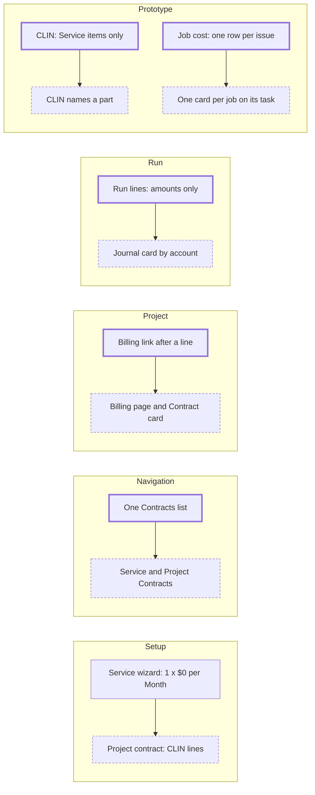

# Project contracts, and project billing a first-time user can follow

> Status: in-progress
> Author: Brad (decisions), Claude (spec)
> Date: 2026-10-21

## TLDR

A Time & Materials or Cost Plus contract is set up today in the wizard of a
recurring service contract. That wizard asks for a quantity, a rate per month and
an invoice schedule, so a T&M line reads "Recurring, 1 × $0.00 per Month". This
spec makes the **project contract** its own thing on the same tables. A new header
column, `billingBasis`, is `Schedule` for a service contract and `Project` for a
project contract. A project contract has its own list (Sales → Agreements →
Project Contracts), its own setup steps (Details → Lines → Invoicing → Review)
and lines of three billing methods: Time & Materials, Cost Plus and Fixed Price.
The project then shows its contract's money on the Overview and always shows its
Billing page. The spec also fixes the labels that name one number in several
ways, adds a journal card to the Draft revenue run, and adds a "Project to cash"
guide chapter.

A CLIN can also name a part, such as a prototype. The user builds it with
**Build** on the CLIN, which makes a job, and ships it with **Deliver**. The job
shows on its task as one plan line with one cost card (section 10). The goal is
a prototype flow that needs no projects training.

## Overview diagram



## Problem Statement

A first-time user cannot tell how a project bills, posts and earns revenue.

1. **The contract wizard is a subscription wizard.** Its Services step has the
   columns Revenue Type, Qty, Rate, Per, Discount, Start, End and Total. A T&M
   line has none of these, so the row reads "Recurring, 1, $0.00, Month" and the
   contract total is $0.00. The CLIN, the billing element, the funded amount and
   the ceiling sit behind ⋯ → Edit Details and a separate line Billing page.
2. **The header is a subscription header.** It carries `billingFrequency`,
   `billingTiming`, `billingAlignment`, `termMonths`, `renewal`,
   `renewalUplift`, `firstInvoiceDate` and `billedThrough`. The Details step asks
   for a duration and an action on completion.
3. **The project hides its billing.** The project's Billing link shows only after
   a contract line names a billing element. Before that, nothing on the project
   says that it can bill, or how to start. The Overview shows a budget, but not
   the funded amount, the billed amount or the revenue.
4. **Billing review is easy to lose.** It is a tab of Projects → Approvals, and
   Approvals shows only while timesheet approval or DCAA timekeeping is on.
5. **One number has many names.** "Complete", "Progress", "Recognized",
   "Revenue Recognized" and "Earned to Date" name the same idea. "Contract value"
   shows $0 for T&M and Cost Plus lines. The Project WIP default says "until it
   is billed", but the revenue run relieves it. The Contract Assets default says
   "for rent", but contracts use it too.
6. **A run posts without showing its journal.** The Draft revenue recognition run
   shows each row's amount, not the accounts it will debit and credit.
7. **A CLIN cannot name a part.** A government CLIN is often a hardware
   deliverable, such as "0001: Prototype, 2 EA". The line accepts only a Service
   item (`CONTRACT_LINE_NOT_SERVICE`).
8. **A job's cost does not reach its task's estimate.** A task's Make to Order
   plan line can create a job, but the card matches actuals by item. The job
   issues its components, not the part, so the card shows nothing charged.
   Meanwhile the Actual tab shows one row for each component and each labor
   event.
9. **A prototype costs too much training.** To build a part for a project
   today, the user must know about charge numbers, consume-to-project, project
   stock and plan lines. Nothing ships a part against a CLIN.

Research: `.ai/research/project-billing-onboarding-ux.md`. Unanet and Costpoint
keep a project's contract money on one project view, and D365 and Unanet show
what a post will write before it posts.

## Proposed Solution

### 1. The billing basis

`customerContract.billingBasis` (enum `contractBillingBasis`: `Schedule`,
`Project`), NOT NULL, default `Schedule`.

| | Service contract (`Schedule`) | Project contract (`Project`) |
|---|---|---|
| Lines | Recurring and One-time Service lines, billing method `Fixed` | CLIN lines, billing method `Time & Materials`, `Cost Plus` or `Fixed` (labelled "Fixed Price") |
| Billing | the invoice schedule | billable items (T&M, Cost Plus) and billing events (Fixed Price) |
| Term | start, duration, renewal, uplift | period of performance: start and end dates |
| Invoicing | frequency, alignment, timing, first invoice, billed through | billing period (frequency), alignment `Calendar`, timing `Arrears`, all fixed by the basis except the frequency |
| Revenue | the revenue plan (Daily, Even Period) | follows the billing method (below) |
| Coverage for service orders | yes | never |

The migration backfills `Project` for every contract with a line whose
`billingMethod` is not `Fixed`, and `Schedule` for the rest. No demo dataset
seeds a T&M or Cost Plus line, so the backfill touches no seeded contract.

### 2. Project contract lines

A project contract line is still a `customerContractLine`, with its item
(`itemId` is NOT NULL; the item is what the invoice line says). On a project
contract the item is a Part or a Service (section 10). On a service contract it
stays a Service. The line fields a project contract uses:

| Field | T&M | Cost Plus | Fixed Price |
|---|---|---|---|
| CLIN (`lineItemNumber`), SLIN parent (`parentLineId`) | yes | yes | yes |
| Description, item (Part or Service) | yes | yes | yes |
| Billing element (`projectElementId`) | required | required | required for Percent Complete |
| Handling % (`materialHandlingPercent`) | yes | no | no |
| Fee % (`feePercent`) | no | required | no |
| Funded amount, funded cost, ceiling, notice | yes | yes | no |
| Quantity | 1; a part line: the units to deliver | 1; a part line: the units to deliver | 1; a part line: the units to deliver |
| Price | none (rate 0) | none (rate 0) | `rate`: the price, or the unit price on a part line (One-time) |
| Revenue method | Right to Invoice | Percent Complete or Right to Invoice | Percent Complete or Daily |

A project contract line is always One-time. The server refuses a Recurring
line on a project contract and a non-Fixed line on a service contract.

### 3. Fixed Price billing events

A Fixed Price line bills on billing events: rows of the existing invoice
schedule (`customerContractInvoice` / `customerContractInvoiceLine`). The
schedule planner already gives a One-time line one row. The project contract's
Invoicing step shows the existing invoice grid (`ContractInvoiceGrid`) with the
Fixed Price lines only, so the user adds, moves, splits and deletes events while
the contract is Draft. Confirm keeps edited rows. The invoicing job drafts each
event on its date, and the Percent Complete price is the sum of the line's rows,
as today.

### 4. Screens of a project contract

All routes stay under `x+/contract+/`. Each screen asks `billingBasis` and shows
the project variant.

- **List.** `x+/sales+/project-contracts.tsx`, a copy of `contracts.tsx` filtered
  to `Project`. `contracts.tsx` filters to `Schedule`. The nav has "Service
  Contracts" and "Project Contracts" in Agreements.
- **New.** `contract+/new.tsx?basis=Project` inserts a Draft project contract.
  `?projectId=` preselects the project.
- **Setup steps.** `projectContractSetupSteps`: `details`, `products` (labelled
  "Lines"), `invoicing`, `review`. Revenue has no step: it follows the billing
  method.
  - **Details**: customer, name, project (required), contract number
    (`customerReference`), period of performance (start, end), salesperson,
    close date, notes.
  - **Lines**: a grid of CLIN, description, billing method, billing element,
    funded amount, ceiling, fee or handling %, price (Fixed Price only) and
    revenue method. "Add Line" opens the line drawer.
  - **Invoicing**: bill-to, contact, address, payment terms, billing period, and
    invoicing mode; then the Fixed Price billing events, when a Fixed Price line
    exists.
  - **Review**: the summary, and a list of gaps, each linked to its fix. Confirm
    stays disabled while a gap blocks it.
- **Contract page.** The header, explorer and properties hide the subscription
  fields for a project contract. The Details tab leads with the Project Billing
  card and shows "Funded" in place of "Contract value".
- **Draft invoice now.** The contract's ⋯ Invoice action on a project contract
  also drafts its project billing invoices, when the server function can be
  scoped to one contract.

### 5. The gaps the Review step checks

| Gap | Blocks Confirm | Fix link |
|---|---|---|
| No line | yes | Lines step |
| A T&M or Cost Plus line has no billing element | yes | the line drawer |
| The billing element is not marked as a billing element | yes | the element page |
| The project's cost treatment is not Contract | yes | the project Overview |
| The contract currency is not the base currency | yes | Details step |
| A Fixed Price line's billing events do not add up to its price | yes | Invoicing step |
| A T&M line, and a labor category with no bill rate and no contract rate | no | Projects → Labor Categories |
| A project account default is empty (Project WIP, Deferred Revenue, Contract Assets, Contract Loss Provision) | no | Accounting → Default Accounts |

The blocking gaps mirror what confirm already refuses (`checkBillingLines`), so
the page says it before the server does.

### 6. The project side

- **Billing page for every Contract project.** The sidebar shows Billing under
  Costs for a Contract project, with or without a line. With no project contract
  the page shows an `Empty` with "No project contract bills this project" and a
  "New Project Contract" button (`?basis=Project&projectId=`).
- **Contract card on the Overview.** A Contract project with a project contract
  shows a "Contract" card under Budget: the funding bar (`FundingBar`, compact)
  and Funded, Cost, Billed, Unbilled and Revenue, with a link to the contract.
- **Needs attention rows.** A Contract project gets a row when no project
  contract bills it, when its project contract is Draft, and when billable
  items wait for review (linked to Approvals → Billing).
- **Approvals.** The Projects menu shows Approvals also while billable items of
  a contract line are Unbilled or On Hold, and its count adds them.

### 7. One name for each number

| Concept | Name in the UI | Was |
|---|---|---|
| What the plan allows to spend | Budget | Budget |
| What was spent | Cost | Actual, Cost Incurred |
| What the customer authorized | Funded | Funded Amount, Funding |
| The cap | Ceiling | Ceiling |
| What was invoiced | Billed | Billed |
| Billable, not yet invoiced | Unbilled | Unbilled |
| What was earned | Revenue | Recognized, Revenue Recognized |
| How far the work is | Progress | Complete |

Also:

1. Fix the Project WIP default's text: cost stays there until the revenue run
   relieves it to cost of goods sold.
2. Fix the Contract Assets default's text: revenue earned before it is invoiced,
   for rentals and contracts.
3. Fix the `revenue-method` glossary entry: four methods.
4. Add glossary entries: `project-contract`, `service-contract`,
   `time-and-materials`, `cost-plus`, `fixed-price`, `funded-amount`,
   `contract-ceiling`.
5. Give the project contract fields `termId` popovers.

### 8. The journal card on a Draft run

The Draft revenue recognition run page gets a "Journal" card. It sums the run's
schedule rows by account (`debitAccountId`, `creditAccountId`; a negative amount
swaps the sides, as `run-journals.ts` posts it). A shared `JournalPreview`
(`~/components/JournalPreview.tsx`, extracted from `LeaseJournalPreview`) renders
it, with "number name" account labels from `useAccounts()`.

### 9. Docs

A Guide chapter `docs/content/guides/project-to-cash.mdx` (flow `project-to-cash`,
`flowIndex: 5`) walks one T&M project from contract to revenue. It includes a
prototype CLIN: Build, run the job, Deliver, invoice (section 10). The reference
pages `project-billing.mdx` and `contracts.mdx` name the two contract kinds.

### 10. Prototypes: a part CLIN, built by a job

**Goal (Brad, 2026-10-22).** Building a prototype on a project must cost little
thought and little training. A user who knows jobs and contracts builds and
delivers a prototype with no projects training. The measure: three actions on
the CLIN (**Build**, **Deliver**, then the invoice), and no setting that the
user must know about in advance.

Research: `.ai/research/jamis-prototype-clins.md` (JAMIS Prime, SAP, Costpoint,
Unanet). Every one of them makes the user choose when a production order's cost
reaches the contract: SAP's valuated or non-valuated project stock, Costpoint's
Expensed or Asset inventory abbreviation, Acumatica's `PJ` order type and Update
Project checkbox. Carbon derives that choice from the CLIN's billing method.

In this section, a task is a project element with plan lines.

```
Project contract
└─ CLIN 0001  "Prototype, 1 EA"  (T&M)   [Build] [Deliver]
        │ bills                    │ J-104       │ SHP-0042
        ▼                          ▼             ▼
Project plan
└─ 1.0 Prototype build      ← billing element
   ├─ 1.1 Design            plan lines: labor, costs (as today)
   ├─ 1.2 Fabrication       plan line: Prototype × 1, Make to Order → J-104
   │                        one card: "J-104 · $38,000 of $50,000"
   └─ 1.3 Test              plan lines: labor, costs (as today)
```

#### 10.1 The user's path

| Step | Where | What the user does | What Carbon does |
|---|---|---|---|
| 1 | Project contract, Lines step | Adds a CLIN with the part as its item | Saves the line (Part items are new on a project contract) |
| 2 | The CLIN (line page or Lines grid row menu) | Clicks **Build**, confirms quantity, due date, location and task | Creates the job, links it to the CLIN, adds the task's plan line for it (10.2) |
| 3 | The job | Runs the job as any other job | Posts the job's cost to the task (10.3) |
| 4 | The CLIN | Clicks **Deliver**, then posts the shipment | Records the delivery and prints the receiving report (10.4) |
| 5 | The contract | Nothing new | Bills by the CLIN's billing method, as today |

The user never sets a project stock flag, a consume-to-project flag or a plan
line by hand. **Build** chooses them from the CLIN's billing method.

The other path stays: a user who starts from the task clicks **Create Job** on
a Make to Order plan line (`$projectId.elements.$elementId.create-job.tsx`).
Create Job looks for a part CLIN of the project with the same item that bills
the task. If it finds exactly one, it links the job to it and chooses the flags
as **Build** does.

#### 10.2 Build

**Build** opens the Create Job modal that the plan line uses today (quantity,
due date, location), plus a task picker. The task defaults to the CLIN's billing
element. If the plan is locked and no Draft change request is open, Build
refuses with the plan lock message, as Add line does. Then Carbon does these
steps. `insertJob` runs on its own client, so the steps cannot share one
transaction: if a later step fails, Build deletes what the earlier steps wrote,
as Charge cost deletes an entry that does not post.

1. Create the job for the part, with `job.customerContractLineId` set to the CLIN.
2. Charge the job to the task (`projectId`, `projectElementId`).
3. Set `consumeToProject`, for every billing method (D30, D33). The job's cost
   reaches the project as it posts. A T&M or Cost Plus CLIN bills it as
   incurred; a Fixed Price CLIN's Percent Complete revenue follows it.
4. Add a Make to Order material plan line for the part on the task, at the
   item's unit cost × quantity, and stamp its `jobId`.

The CLIN shows its jobs (job number, status, quantity complete) and its
deliveries. It shows one primary action by state, as JAMIS's workflow engine
guides users to the next step (D35):

| State | Primary action |
|---|---|
| No job | **Build** |
| A job has completed units that are not delivered | **Deliver** |
| Every unit delivered | none |

#### 10.3 The job on its task

| Place | Shows |
|---|---|
| Task, Estimated tab | One card for the plan line: the estimate, the job's cost so far, the progress bar, and the job number as a link |
| Task, Actual tab | One card for the job: the job number, the part and the job's cost total, linked to the job. Not one card per ledger row |
| The job | The bill of materials, the routing, the issues and the labor, as today |
| Plan rollup, Costs page, Overview Budget | No change: the job's ledger rows carry the task, so they roll up the tree |
| Contract line billing | No change: the job's rows sit under the billing element |
| Overview, Needs attention | A row when a part CLIN's job is complete and its quantity is not delivered |

#### 10.4 Deliver

The delivery is a shipment with the new source `Customer Contract`. It copies
the rental agreement's **Deliver**: the `create` server function opens the
contract's Draft shipment, or makes one. The shipment has one `shipmentLine`
per part CLIN (`lineId` = the CLIN). The delivery records custody: the job
already consumed the part to the project, so no delivery moves stock (D29,
D30). `post-shipment` posts each line as follows:

| | Every part CLIN |
|---|---|
| Quantity limit | Σ quantity complete of the CLIN's jobs, less what is already delivered, and never above the line quantity less what is already delivered |
| Stock | None |
| Journal | None |
| Serial | Typed on the line (`shipmentLine.serialNumber`; one line per unit for a Serial item) |
| Revenue | No change: Right to Invoice or Percent Complete follow cost, Daily follows the calendar |
| Billing | T&M and Cost Plus: no change, billable items. Fixed Price: the delivered units' share of the next Planned billing event moves to the delivery date (D34) |

The shipment PDF prints a **Receiving Report** for this source: the contract
number (`customerReference`), each CLIN with its description, quantity, unit
and serial numbers, and the ship date. The user types it into WAWF, as for the
SF 1443 (no EDI export). Void reverses the posting, as for every source.

#### 10.5 Changes

1. **Item on a project contract line.** The line takes a Part or a Service
   item when the contract's `billingBasis` is `Project`. A service contract
   keeps Service only. Change the 3 guards:
   - `upsertContractLine` (`sales.service.ts`, `CONTRACT_LINE_NOT_SERVICE`).
   - `post-customer-contract` Confirm (the "only Service items" problem).
   - `post-customer-contract` Amend, for an added line.

   `insertContractLines` (the service wizard's Add Products) stays Service only.
   On a project contract, `ContractLineForm` labels the field "Item" and passes
   `type="Item"` with `validItemTypes={["Part", "Service"]}`. A service contract
   keeps the "Service" label. Add the same label switch to `ContractLineSummary`
   and to the Item column of `ProjectContractLinesGrid`.

   A part line carries its quantity: the units to deliver ("Prototype, 2 EA").
   Two places force quantity 1 today, and both change for a part line only:
   - `upsertContractLine` (`isBilling || isProject ? 1 : line.quantity`) keeps
     the quantity of a Part line.
   - `customerContractLine_billing_check` allows `quantity > 0` on a T&M or
     Cost Plus line. Its `rate = 0` stays: billable items price the line, not
     quantity × rate.

   A Fixed Price part line's price is quantity × `rate`. Build defaults the job
   quantity to the line quantity less what the CLIN's jobs already build.
   Deliver refuses more than the line quantity less what is already delivered.
2. **A contract invoice line never ships.** `isDirectItemLine`
   (`post-sales-invoice/posting-lines.ts`) returns false for a line with
   `customerContractLineId`. Without it, a part on a contract invoice line
   relieves stock a second time:
   - A Fixed Price billing event for an Inventory part writes a `Sales Shipment`
     item ledger row and a cost of goods sold pair.
   - A T&M or Cost Plus line skips the item ledger (`billedServiceLineIds`), but
     the journal still adds the cost of goods sold pair.

   The invoice line stays `invoiceLineType` `Service`. The delivery (10.4) owns
   the stock movement.
3. **Build and the job link.** Add `job.customerContractLineId`. Add the Build
   action on the CLIN (10.2). Extend the plan line's Create Job to link a
   matching CLIN (10.1).
4. **Plan card actuals by job.** In the element's `planActuals`
   (`projects.server.ts`), a material plan line with a `jobId` takes every own
   ledger row of that job, of every cost type. The item and labor category
   keys skip a row that has a `jobId` owned by a plan line, so no cost counts
   twice. The card's quantity stays `quantityIssued`.
5. **Actual tab by job.** `ElementTimeAndMaterials` folds the subtree's ledger
   rows that share a `jobId` into one card. The card shows the job number, the
   part, the element (when it is below this one) and the summed amount. Rows
   with no `jobId` stay one card each.
6. **Deliver.** The `Customer Contract` shipment source, its `create` case, its
   `post-shipment` and void branches, the shipment UI branch, and the Receiving
   Report PDF (10.4).
7. **Needs attention.** The Overview row for a completed, undelivered part CLIN
   job (10.3).

Not done, by design: the task does not show the job's bill of materials as
estimate lines (D26). The job holds that detail.

#### 10.6 The job and the project

**The project plans the work. The job does the work.** The task owns what, how
many and by when. The job owns how: the method, the operations, the materials
and the shop schedule. Facts flow down once, at Build, and flow up as they
happen. The user never types a fact in both places.

```
          Build (once): part, quantity, due date, charge number
  Task  ───────────────────────────────────────────────────────▶  Job
 (plan) ◀───────────────────────────────────────────────────────  (execution)
          as they happen: cost, quantity complete, scheduled finish
```

A job is not an element type (D36). Element types (System, Requirement,
Function, Task, Test Case, Parameter) say what the work is. A job does the
work, and it charges an element, as a timesheet entry or a PO line does.
Elements are plan records: change requests, baselines, plan lock and templates
act on them. A job is an execution record with ledger history. A job element would also carry two
states, two dates and two owners for one fact. So the job attaches to its task,
and the task shows the job, read-only.

| Project concept | Owner | How the job relates | Change |
|---|---|---|---|
| Task | The project | The job's charge number. One task can have several jobs | None |
| Estimate | The plan line | The Make to Order plan line is the job's budget. Build copies its quantity into the job | 10.2 |
| Cost | The job | Ledger rows carry `jobId` and the task, so they roll up the tree, the Costs page and the Budget | 10.5 items 4 and 5 |
| Dates | The task's `targetDate` | Build sets the job's due date from the task's `targetDate`. The job's scheduled finish shows on the task | Item 1 below |
| Milestone | The project | Through the task's `milestoneId`. The milestone's cost already counts the job's ledger rows | Item 3 below |
| Progress | The user (the task's state) | The card shows the job's quantity complete. A complete job does not complete the task, because test or inspection work can remain | Item 2 below |
| Serial | The delivery | Typed on the delivery line; the job receives no stock, so no tracked entity reaches the task | None |
| Earned value | The project | The job's units complete could give the task's earned percent | Not in this spec |

Changes:

1. **Dates.** Build defaults the job's due date to the task's `targetDate`. The
   task's plan tree card and the element page show the job's scheduled finish.
   If the job is scheduled to finish after the task's `targetDate`, the Overview
   shows a Needs attention row: "J-104 finishes after 1.2's target date".
2. **Progress.** The plan tree card of a task with a job shows a badge with the
   job number and its quantity complete ("J-104 · 1 of 1"), linked to the job.
   If every job of an open task is complete, the Overview shows a Needs attention
   row: "J-104 is complete. Is 1.2 done?" The badge is derived from
   `projectElementMaterial.jobId`; no new column.
3. **Milestone hours.** The milestone drawer's hours and burn chart count the
   Labor hours of job ledger rows on the milestone's tasks, beside the Posted
   timesheet hours (D39). A milestone that hides its shop labor misleads.

Two gaps break a T&M prototype today. They affect every consume-to-project job,
not only a part CLIN, so this spec must close them:

- **Shop labor has no labor category.** `post-production-event` writes a Labor
  ledger row with `employeeId` and hours, but no `laborCategoryId`.
  `resolveBillRate` then finds a rate only when the contract has a rate for that
  employee. Otherwise every shop hour goes On Hold with "No bill rate". The
  labor cost uses the shop rate, so the cost side is correct.
- **Shop labor skips DCAA timekeeping.** In DCAA mode, project labor must come
  through certified weekly timesheets (`government-contracting.md`).
  `post-production-event` does not read `timekeepingControls`, so shop time on a
  consume-to-project job posts labor to the project with no timesheet.

The fixes:

5. **A labor category for shop labor (D37).** `post-production-event` stamps
   the employee's `employeeJob.laborCategoryId` on the Labor ledger row. The
   column exists already, so this adds none. `resolveBillRate` then finds the
   category's bill rate. If the employee has no labor category, the row stays
   as today and the billable item goes On Hold with "No bill rate". An
   operation-level override is a follow-up.
6. **Shop labor through DCAA timekeeping (D38).** It copies the service visit,
   whose time goes through `save-timesheet-entry` with
   `timesheetEntry.serviceVisitId`. When `timekeepingControls` is DCAA and the
   job is consume-to-project, `post-production-event` does these steps:
   1. Post the Machine and Overhead legs as today.
   2. Skip the Labor leg.
   3. Add the event's hours to the employee's Draft timesheet entry for that
      day, project, task, labor category and job (`timesheetEntry.jobId`, new),
      through `save-timesheet-entry` in `add` mode.

   The employee certifies the hours with the week. `post-timesheet` then posts
   the labor cost and stamps `jobId` on the ledger row, so the job's card still
   counts it. Outside DCAA mode, nothing changes. My Time shows the job number
   on the row. Before the change, the plan's first task confirms the gap
   against `government-contracting.md`.

### Design Decisions

| # | Decision | Choice | Rationale |
|---|----------|--------|-----------|
| D1 | Separate a project contract from a service contract | Same tables, a header column `billingBasis`, separate screens | Brad, Q1. 14 tables reference `customerContractLine`; the engines need no change. |
| D2 | Name of the column | `billingBasis` (`Schedule`, `Project`) | It names what the choice decides: what the contract bills from. Never "Kind" (`conventions-database.md`). |
| D3 | Where the list lives | Sales → Agreements: "Service Contracts" and "Project Contracts" | Brad, Q2. No RBAC change; the projects menu stays at four Manage links. |
| D4 | Line billing methods | T&M, Cost Plus and Fixed Price | Brad, Q3. One award mixes CLIN types. |
| D5 | How Fixed Price bills | Billing events: the existing invoice schedule rows, edited in `ContractInvoiceGrid` | Brad, Q3. The planner, the job and the Percent Complete price read these rows already. |
| D6 | Project contract header billing fields | Frequency shown as "Billing period"; alignment `Calendar` and timing `Arrears` set by the basis | `create-project-billing-invoices` takes the period end from the header frequency and alignment. |
| D7 | Routes | Reuse `x+/contract+/` routes; branch the components on `billingBasis` | The service contract is the sibling; one route set keeps one action per write. |
| D8 | Setup steps of a project contract | Details → Lines → Invoicing → Review | Revenue follows the billing method, so it needs no step. |
| D9 | Readiness checks | The Review step's gap list, and Needs attention rows on the project | Delegated to the recommendation. No new page. |
| D10 | Billing page | Shown for every Contract project, with an `Empty` and a CTA | Delegated to the recommendation. |
| D11 | Approvals visibility | Also while contract billable items are Unbilled or On Hold | Keeps rebuild decision D13 (billing review is a tab of Approvals). |
| D12 | Journal preview scope | The Draft revenue run only | The data is on the rows. The burden run needs a dry run in `packages/ee`; it is a follow-up. |
| D13 | Docs | A guide chapter and reference updates in this spec | Delegated to the recommendation. |
| D14 | Server guard | `post-customer-contract` (confirm, amend) and `upsertContractLine` refuse a line that does not match the basis | The database cannot see the header from a line CHECK; the server functions are the one write path that posts. |
| D15 | Coverage contracts | Service orders read `Schedule` contracts only | A project contract never covers a service order; the auto-pick must not change. |
| D16 | Heuristic 1, multi-tenancy | No new table | The column is on `customerContract`, already company-scoped. |
| D17 | Heuristic 2, service shape | Service functions keep `client` first and `{ data, error }` | `conventions-services.md`. |
| D18 | Heuristic 3, RLS | No new policy | The column inherits the table's `sales_*` policies. |
| D19 | Heuristic 4, permissions | The project contract routes use the contract routes' `sales` scopes | Same record, same permission. |
| D20 | Heuristic 5, forms | `ValidatedForm` + `customerContractValidator` (basis-aware refine) + the existing actions | `conventions-forms.md`. |
| D21 | Heuristic 6, module layout | Code stays in `sales.models.ts`, `sales.service.ts`, `ui/Contracts/` | One service and one models file per module. |
| D22 | Heuristic 7, compatibility | `customerContracts` view recreated with the column; MCP tools regenerate | The view expands `c.*` at creation. |
| D23 | Item types on a project contract line | Part or Service; a service contract stays Service only | Brad, 2026-10-22: a CLIN can be a part, such as a prototype. Other item types (Material, Tool, Consumable, Fixture) are not deliverables. |
| D24 | What collects a part CLIN's cost | A job, charged to a task | Brad, 2026-10-22: the job is the natural unit of collection for prototype manufacturing. Tasks keep their own plan lines. |
| D25 | How the job connects to the CLIN | `job.customerContractLineId`, set by **Build** on the CLIN or by the plan line's Create Job when one CLIN matches | The CLIN shows its jobs, and the delivery limits a T&M quantity to what its jobs completed. Billing still follows the billing element (P7). |
| D26 | How the task shows the job | One Estimated card (the plan line) and one Actual card (the job); no bill of materials lines on the task | Brad, 2026-10-22: avoid information overload. The job holds the detail. |
| D27 | Contract invoice lines and stock | `isDirectItemLine` is false for a contract line | The delivery owns the stock movement. An invoice line that also shipped would relieve the part twice. |
| D28 | Training cost | Three actions on the CLIN (Build, Deliver, invoice); Build sets every flag | Brad, 2026-10-22: greatly cut the cognitive and training cost of prototypes. A setting the user must know about in advance is a training cost. |
| D29 | T&M and Cost Plus delivery | A shipment that moves no stock (option A) | Brad, 2026-10-22. The job consumed the part to the project, so cost bills as incurred, as a cost-type CLIN needs. |
| D30 | Fixed Price delivery | No stock, as for T&M and Cost Plus (option A for every billing method). Supersedes option B | Brad, 2026-10-22 (option 1, after plan Task 21). Project stock is visible only on a project with `projectStock`: the owner pickers, the bin move scan, MRP segments, picking and the job form ignore a stripe on any other project (run log, "Section 10 assumptions"). Cost-to-cost on a consumed job is how SAP non-valuated stock and Costpoint Expensed inventory work. |
| D31 | Delivery document | A shipment with the new source `Customer Contract`, copied from the rental agreement's Deliver | The sibling: a shipment opened from an agreement. One Draft per contract. |
| D32 | Receiving report | The shipment PDF's `Customer Contract` branch, printed; no WAWF export | Same choice as the SF 1443 in the contract financing spec. |
| D33 | Project stock for a Fixed Price job | None. A prototype job always consumes to the project. Supersedes "receive to project stock without the flag" | Brad, 2026-10-22 (option 1). The superseded choice left a stripe that 6 readers cannot see (D30). |
| D34 | Billing on delivery | Posting a Fixed Price delivery of N units takes N × `rate` out of the line's next Planned billing event onto a Planned event on the delivery date (a split; the whole row moves when it holds exactly that amount). Void puts it back | Brad, 2026-10-22. An Active contract's events cannot be edited, so the delivery must move the event. One row holds quantity × rate, so moving the whole row would bill every unit at the first delivery. |
| D35 | The CLIN's next step | One primary action by state: Build, then Deliver | JAMIS 8.0 guides users to "the next logical steps" (`.ai/research/jamis-prototype-clins.md`). A prompt costs less than training (D28). |
| D36 | Is a job an element type? | No. The job attaches to a task, and the task shows it read-only (badge, scheduled finish, serial) | Brad, 2026-10-22. Element types say what the work is; a job is how it is made. Elements are plan records (change requests, baselines, templates); a job is an execution record. |
| D37 | Labor category of shop labor | `employeeJob.laborCategoryId`, stamped on the Labor ledger row by `post-production-event` | Brad, 2026-10-22. The column exists. Without it, T&M billing holds every shop hour. |
| D38 | Shop labor under DCAA | A Draft `timesheetEntry` with `jobId`, certified with the week; `post-timesheet` posts the cost | Brad, 2026-10-22. DCAA needs certified time for project labor. The service visit already routes its time this way. |
| D39 | Milestone hours | Count job Labor hours beside timesheet hours | Brad, 2026-10-22. |

## Data Model Changes

```sql
-- Migration: contract billing basis
DO $$ BEGIN
  CREATE TYPE "contractBillingBasis" AS ENUM ('Schedule', 'Project');
EXCEPTION WHEN duplicate_object THEN NULL; END $$;

ALTER TABLE "customerContract"
  ADD COLUMN IF NOT EXISTS "billingBasis" "contractBillingBasis" NOT NULL DEFAULT 'Schedule';

UPDATE "customerContract" c SET "billingBasis" = 'Project'
WHERE EXISTS (
  SELECT 1 FROM "customerContractLine" l
  WHERE l."customerContractId" = c."id" AND l."companyId" = c."companyId"
    AND l."billingMethod" <> 'Fixed'
);

-- The view expands c.* at creation: drop and recreate it with the same body.
```

```sql
-- Migration: contract delivery enum (its own file: ADD VALUE cannot share a
-- transaction with a statement that uses the value)
ALTER TYPE "shipmentSourceDocument" ADD VALUE IF NOT EXISTS 'Customer Contract';

-- Migration: prototype jobs and contract deliveries

-- A part line carries its units to deliver (section 10.5 item 1).
ALTER TABLE "customerContractLine" DROP CONSTRAINT IF EXISTS "customerContractLine_billing_check";
ALTER TABLE "customerContractLine" ADD CONSTRAINT "customerContractLine_billing_check" CHECK (
  "billingMethod" = 'Fixed'
  OR ("projectId" IS NOT NULL AND "projectElementId" IS NOT NULL AND "quantity" > 0 AND "rate" = 0
      AND "revenueType" = 'One-time')
);
ALTER TABLE "job" ADD COLUMN IF NOT EXISTS "customerContractLineId" TEXT;
-- FK to customerContractLine, ON DELETE SET NULL; index on
-- ("customerContractLineId", "companyId").

ALTER TABLE "shipmentLine" ADD COLUMN IF NOT EXISTS "serialNumber" TEXT;

-- D38: shop time under DCAA, as serviceVisitId does for a service visit.
ALTER TABLE "timesheetEntry" ADD COLUMN IF NOT EXISTS "jobId" TEXT;
-- FK to job, ON DELETE SET NULL; part of the timesheet cell key.

-- D34: the billing row a Fixed Price delivery wrote or moved, and the date it
-- moved from (NULL for a split), so void can put it back.
ALTER TABLE "shipmentLine" ADD COLUMN IF NOT EXISTS "customerContractInvoiceLineId" TEXT;
ALTER TABLE "shipmentLine" ADD COLUMN IF NOT EXISTS "previousInvoiceDate" DATE;

-- One open Draft delivery per contract, as rentals have
-- (shipment_oneOpenDraftPerRentalAgreement_idx).
CREATE UNIQUE INDEX IF NOT EXISTS "shipment_oneOpenDraftPerCustomerContract_idx"
  ON "shipment" ("sourceDocumentId", "companyId")
  WHERE "status" = 'Draft' AND "sourceDocument" = 'Customer Contract';
```

No new table, so no new RLS policy. Add `'Customer Contract'` to
`shipmentSourceDocumentType` (`inventory.models.ts`). The backup manifest picks
up the columns through `pnpm db:check:backups`.

## API / Service Changes

- `sales.models.ts`: `contractBillingBases`; `customerContractValidator` takes
  `billingBasis` and makes the subscription fields optional for `Project`;
  `projectContractLineValidator` rules in `checkBillingTerms`.
- `sales.service.ts`: `getContracts(client, companyId, { billingBasis, ... })`;
  `customerContractTerms` carries `billingBasis` (a conditional spread, as
  `contractType`); `upsertContractLine` refuses a line that does not match the
  basis.
- `post-customer-contract`: confirm and amend refuse a mismatched line
  (`BILLING_BASIS_MISMATCH`).
- `projects.service.ts` / `$projectId.tsx`: `hasProjectContract`, the project
  contract summary for the Overview card, and the billing review count.
- `service.server.ts` / `service.service.ts`: coverage contract reads filter to
  `Schedule`.
- `sales.service.ts` `upsertContractLine` and `post-customer-contract` (confirm,
  amend `add`): accept a Part item on a `Project` contract (D23).
- `post-sales-invoice/posting-lines.ts`: `isDirectItemLine` is false for a line
  with `customerContractLineId` (D27).
- `projects.server.ts`: `planActuals` attributes a job's own ledger rows to the
  plan line that holds its `jobId`; the subtree rows carry `jobId` and the job's
  readable id for the Actual tab (D26).
- Build: a route action on the contract line (`x+/contract+/$id.$lineId.build.tsx`)
  that shares the job, flag and plan line logic with
  `$projectId.elements.$elementId.create-job.tsx` (D25, D28).
- `create` server function: a `shipmentFromCustomerContract` case, a copy of
  `shipmentFromRentalAgreement` (D31).
- `post-shipment`: a `Customer Contract` post and void branch
  (`post-shipment/customer-contract.ts`), by billing method (D29, D30).
- `file+/shipment+/$id[.]pdf.tsx`: the Receiving Report branch (D32).

## Closest Sibling

The **service contract**: the same record. The project contract copies its
routes and components file for file and branches inside them.

| Piece | Service contract file | Project contract |
|---|---|---|
| List | `x+/sales+/contracts.tsx`, `ContractsTable.tsx` | `x+/sales+/project-contracts.tsx`, the same table with basis-aware columns |
| New | `x+/contract+/new.tsx`, `ContractDetailsForm.tsx` | `new.tsx?basis=Project`, `ProjectContractDetailsForm.tsx` (a copy) |
| Setup shell | `$id.setup.tsx`, `ContractSetupSteps.tsx` | the same, with `projectContractSetupSteps` |
| Lines step | `$id.setup.products.tsx`, `ContractProductsGrid.tsx` | the same route, `ProjectContractLinesGrid.tsx` (a copy) |
| Invoicing step | `$id.setup.invoicing.tsx`, `ContractBillTo.tsx`, `ContractInvoiceGrid.tsx` | the same route and components, with basis-aware fields |
| Review step | `$id.setup.review.tsx` | the same route, project gaps |
| Page | `$id.tsx`, `ContractHeader`, `ContractExplorer`, `ContractProperties`, `$id.details.tsx` | the same, with basis-aware sections |

Deviations: no Revenue step (D8), and the Lines grid columns (D4). Both are
Design Decisions.

The delivery (section 10.4) has its own sibling: the **rental agreement's
Deliver**. It copies `$id.$lineId.deliver.tsx`, the `shipmentFromRentalAgreement`
case of `create`, `post-shipment/rental-agreement.ts`, the rental branches of
`ShipmentForm`, `ShipmentLines` and `ShipmentPostModal`, and the Delivery Ticket
branch of the shipment PDF. The deviation: it uses `shipmentLine` (an item and a
quantity), not `shipmentFixedAssetLine` (a fixed asset unit), because a CLIN
delivers an item.

## UI Changes

- Archetype: the setup wizard (`~/components/Setup`, Archetype J) and the
  contract record page, as the service contract.
- Every new or changed screen follows the rebuild plan rules: one toolbar row,
  one primary action, no input boxes in a table, `Empty` for empty states,
  `bordered` on Boolean fields, `termId` on domain terms.
- The project Overview's new card copies `BudgetCard` (`OverviewCard`).
- The Needs attention rows copy `AttentionRow`.
- The journal card copies `LeaseJournalPreview` inside the run page's `Card`.

## Acceptance Criteria

- [ ] After the migration, a contract with a T&M or Cost Plus line has `billingBasis = 'Project'` and every other contract has `'Schedule'`.
- [ ] Sales → Agreements shows "Service Contracts" and "Project Contracts"; each list shows only its own basis.
- [ ] "New" on Project Contracts creates a Draft project contract and opens the Details step with Project required and no Duration, Renewal or Uplift field.
- [ ] The Lines step of a project contract has no Revenue Type, Qty, Per or Discount column; a T&M line shows its CLIN, billing element and funded amount.
- [ ] A Fixed Price line of $90,000 split into three $30,000 events on the Invoicing step confirms, and the contract shows three Planned invoices.
- [ ] The Review step lists "The billing element is not marked as a billing element" with a link, and Confirm is disabled until it is fixed.
- [ ] The service contract line drawer offers no billing method; the server refuses a T&M line on a service contract and a Recurring line on a project contract.
- [ ] A Contract project with no project contract shows Billing in its sidebar, and the page shows the empty state with "New Project Contract".
- [ ] A Contract project billed by an Active project contract shows the Contract card on the Overview with Funded, Cost, Billed, Unbilled and Revenue.
- [ ] With timesheet approval off and DCAA off, Projects → Approvals shows while a contract billable item is Unbilled.
- [ ] The project Billing table's columns read Progress and Revenue; the contract's Project Billing card reads Revenue.
- [ ] A Draft revenue recognition run shows a Journal card whose debits equal its credits.
- [ ] The service order form offers only service contracts as coverage.
- [ ] The guide chapter "Project to cash" renders in the docs build, and every internal link resolves.
- [ ] A project contract line saves with a Part item and confirms; a service contract line with a Part item is refused with `CONTRACT_LINE_NOT_SERVICE`.
- [ ] Posting a Fixed Price billing event invoice for an Inventory part writes no item ledger row, no shipment and no cost of goods sold pair (unit test on `isDirectItemLine` and the journal builder).
- [ ] A job created from a task's Make to Order plan line, with $1,200 of material issued and 4 hours of labor posted, shows the plan line card charged with the job's total cost.
- [ ] The task's Actual tab shows that job as one card with the job number and the same total, not one card per ledger row.
- [ ] A T&M CLIN whose billing element is the task's parent bills the job's material and labor as billable items.
- [ ] A T&M part line saves with quantity 2 and a Fixed Price part line with quantity 2 at $40,000 shows a price of $80,000; a Service line on a project contract stays quantity 1.
- [ ] **Build** on a T&M part CLIN creates a consume-to-project job linked to the CLIN, and a Make to Order plan line on the chosen task with the job's number; the user sets no other field.
- [ ] **Build** on a Fixed Price part CLIN creates a consume-to-project job, as on a T&M CLIN.
- [ ] **Deliver** on a T&M part CLIN whose job completed 1 unit posts a shipment of 1 with a typed serial, writes no item ledger row and no journal, and refuses a quantity of 2.
- [ ] **Deliver** on a Fixed Price part CLIN of quantity 2 at $40,000 whose job completed 1 unit posts no item ledger row and no journal, and moves $40,000 of the next Planned billing event to the delivery date; void moves it back.
- [ ] The shipment PDF of a contract delivery prints the contract number, the CLIN, the quantity and the serial.
- [ ] The Overview shows a Needs attention row while a part CLIN's job is complete and its quantity is not delivered.
- [ ] **Build** on a task with a target date of 2026-11-30 creates a job due 2026-11-30; a scheduled finish of 2026-12-05 gives a Needs attention row.
- [ ] The plan tree card of a task with a job shows "J-104 · 0 of 1"; after completion it shows "1 of 1" and the Overview asks if the task is done.
- [ ] A T&M CLIN bills an hour of shop labor on a consume-to-project job at the employee's labor category bill rate, with no "No bill rate" hold, when the employee has no contract rate.
- [ ] In DCAA mode, an hour of shop time on a consume-to-project job posts no Labor ledger row and adds 1 hour to the employee's Draft timesheet entry with the job; certifying the week posts the labor with the job's `jobId`.
- [ ] Outside DCAA mode, shop time posts its Labor ledger row as today, with the labor category.
- [ ] The milestone drawer counts job Labor hours on its tasks.
- [ ] `pnpm exec turbo run typecheck --filter=erp`, the sales and projects unit tests and `pnpm --filter docs typecheck` pass.

## Risks

| Risk | Severity | Mitigation |
|------|----------|------------|
| Amend, cancel and renewal re-plan a Fixed Price line's remaining billing events into one row | Med | Known gap, documented. Amend already refuses a change to a billing line; a Fixed Price line's events are best set before Confirm. A `change` of a partly invoiced Fixed Price line bills only the new price less what was invoiced (audit B2, 2026-10-22), as one row on the first invoice date from the change; a new price below what was invoiced is refused. |
| A Fixed Price line with Percent Complete may be refused at Confirm (`refuseRevenueResiduals` counts its billed total against zero revenue rows) | Med | The plan writes a failing test first. If it fails, the fix skips progress revenue methods in the residual check (server and `$id.tsx`). |
| The branch is behind main, which moves the contract engine into `sales.service.ts` and drops the module barrels | Med | Build on the branch as it is. The merge is a separate step with the `resolving-merge-conflicts` skill. |
| A legacy contract mixes Recurring and T&M lines | Low | The backfill makes it a project contract; the server guard applies to new writes only. |
| The Approvals count adds a query to the Projects layout | Low | One `count: exact, head: true` read on `projectBillableItem`. |
| `isDirectItemLine` also gates the item ledger and journal of non-contract invoices | Med | The change adds one condition (`customerContractLineId` set). The existing `posting-lines.test.ts` cases pin the other lines. |
| Two plan lines name the same job | Low | Only Create Job sets `projectElementMaterial.jobId`, and it makes a new job each time. If a direct write repeats a `jobId`, the oldest line takes the job's actuals, as `keyOwners` does for items. |
| A user charges the part's material to the task directly, outside the job | Low | Those rows have no `jobId`. They match by item as today and show as their own cards. |
| Amend re-plans Planned billing events (`applyReconciliation`) and can undo a delivery's split | Med | Amend already refuses a `change` of a billing line. The plan's delivery test amends a Fixed Price part line after a delivery and asserts the delivered row stays. |
| A T&M or Cost Plus line with quantity above 1 meets a reader that assumed quantity 1 | Med | The plan greps every reader of a billing line's `quantity` (funding, the contract total, the invoice planner) before the CHECK changes. Billable items price the line, so the amount does not change. |
| Under DCAA, a job's labor cost reaches the project only when the week is certified, up to 7 days late | Med | That is DCAA's rule for all project labor. The job card shows the Draft hours as "not posted yet", as the Actual tab does for timesheets today. |
| The timesheet cell key gains `jobId`, so My Time can show 2 rows for one task | Low | The row shows the job number. Hand-entered time has no job and keeps its row. |
| A delivery has no tracked entity, so the serial is text with no genealogy | Low | The job consumed the part to the project, so no stock record exists to trace (D30). IUID data is a follow-up. |

## Open Questions

- [x] How do we separate a project contract from a service contract? — **Answer (Brad, 2026-10-21):** same tables, a header column `billingBasis`, separate screens (D1).
- [x] Where does the project contract live in the navigation? — **Answer (Brad):** Sales → Agreements, "Service Contracts" and "Project Contracts"; the project links to its contract (D3).
- [x] What line billing methods does a project contract take, and how does Fixed Price bill? — **Answer (Brad):** T&M, Cost Plus and Fixed Price; Fixed Price bills on billing events stored as invoice schedule rows (D4, D5).
- [x] Where does the setup checklist live? — **Delegated (Brad, 2026-10-21: "go with your recommendations"):** the project contract's Review step and the Overview's Needs attention rows; no new page (D9).
- [x] Does the Billing page show before a contract exists? — **Delegated (Brad, 2026-10-21: "go with your recommendations"):** yes, for every Contract project, with an empty state and a CTA (D10).
- [x] How does billing review get found? — **Delegated (Brad, 2026-10-21: "go with your recommendations"):** keep it a tab of Approvals; show Approvals while billable items wait (D11).
- [x] Which terms are canonical? — **Delegated (Brad, 2026-10-21: "go with your recommendations"):** the table in section 7.
- [x] Which runs get a journal preview? — **Delegated (Brad, 2026-10-21: "go with your recommendations"):** the Draft revenue run now; the burden run is a follow-up (D12).
- [x] Is the guide chapter in scope? — **Delegated (Brad, 2026-10-21: "go with your recommendations"):** yes (D13).
- [x] Can a CLIN name a part? — **Answer (Brad, 2026-10-22):** yes. A CLIN can be a part or a service, for example a prototype (D23).
- [x] What collects a prototype's cost? — **Answer (Brad, 2026-10-22):** a job, as the unit of collection; tasks keep their plan lines (D24).
- [x] How does the job show on the project? — **Answer (Brad, 2026-10-22):** keep it simple and avoid information overload; one line on its task (D25, D26).
- [x] Is delivery against the CLIN in scope, and how? — **Answer (Brad, 2026-10-22):** yes. T&M and Cost Plus deliver with no stock (A); Fixed Price ships from project stock (B) (D29, D30). **Changed (Brad, 2026-10-22, option 1):** Fixed Price delivers with no stock too (D30).
- [x] What is the goal for prototypes? — **Answer (Brad, 2026-10-22):** greatly cut the cognitive and training cost of using projects to make prototypes (D28).
- [x] How does a Fixed Price job receive to project stock when the project has no project stock? — **Answer (Brad, 2026-10-22): yes to the recommendation (D33).** Allow `receiveToProjectStock` on a job with `customerContractLineId` set to a Fixed Price line, without `project.projectStock`. The project flag keeps its meaning for receipts. Otherwise the user must know to switch on project stock while the project is Draft (against D28). The plan checks `chargeNumberError` and the project close guard first. **Superseded (Brad, 2026-10-22, option 1):** plan Task 21 found 6 readers that ignore a stripe on a project without `projectStock`. A prototype job always consumes to the project (D33).
- [x] Where does shop labor get its labor category? — **Answer (Brad, 2026-10-22: "go with the recommendations"):** the employee's labor category, stamped by `post-production-event`. The column already exists (`employeeJob.laborCategoryId`) (D37).
- [x] How does shop labor meet DCAA timekeeping? — **Answer (Brad, 2026-10-22: "go with the recommendations"):** shop time writes a Draft timesheet entry with the job, which the employee certifies with the week (D38).
- [x] Does the milestone burn count shop hours? — **Answer (Brad, 2026-10-22: "go with the recommendations"):** yes (D39).
- [x] Does a Fixed Price delivery trigger the line's billing event? — **Answer (Brad, 2026-10-22): yes to the recommendation (D34).** Posting the delivery dates the line's next Planned billing event to the delivery date, because an Active contract's events cannot be edited.

## Changelog

- 2026-10-21: Created. Q1 to Q3 answered by Brad; Brad delegated the rest ("go with your recommendations"); those answers are marked Delegated.
- 2026-10-22: Added section 10 (prototypes: a part CLIN, built by a job), problems 7 to 9, D23 to D32, and their data model, acceptance criteria and risks. Delivery (A for T&M and Cost Plus, B for Fixed Price) and the job link are in scope. Brad answered the two section 10 questions (D33, D34). Added the research file `.ai/research/jamis-prototype-clins.md` and D35 (the CLIN's next step) from it. While planning: Build refuses on a locked plan and cleans up on failure (no shared transaction); D34 splits the billing row per delivered unit. Added section 10.6 (the job and the project), D36 (a job is not an element type), and D37 to D39 (shop labor: labor category, DCAA timekeeping, milestone hours); Brad took the recommendations. After plan Task 21: option 1 — every prototype job consumes to the project and no delivery moves stock (D30, D33 superseded); the task serial fill (10.6 item 4) is dropped.
