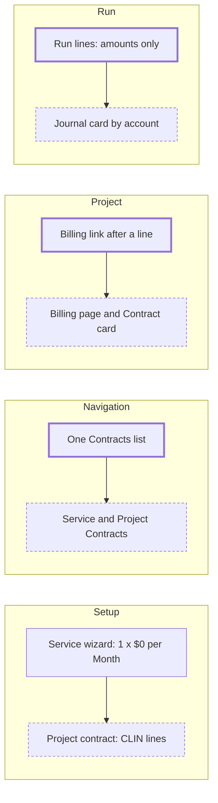

# Project contracts, and project billing a first-time user can follow

> Status: in-progress
> Author: Brad (decisions), Claude (spec)
> Date: 2026-10-21

## TLDR

A Time & Materials or Cost Plus contract is set up today in the wizard of a
recurring service contract. That wizard asks for a quantity, a rate per month and
an invoice schedule, so a T&M line reads "Recurring, 1 × $0.00 per Month". This
spec makes the **project contract** its own thing on the same tables. A new header
column, `billingBasis`, is `Schedule` for a service contract and `Project` for a
project contract. A project contract has its own list (Sales → Agreements →
Project Contracts), its own setup steps (Details → Lines → Invoicing → Review)
and lines of three billing methods: Time & Materials, Cost Plus and Fixed Price.
The project then shows its contract's money on the Overview and always shows its
Billing page. The spec also fixes the labels that name one number in several
ways, adds a journal card to the Draft revenue run, and adds a "Project to cash"
guide chapter.

## Overview diagram



## Problem Statement

A first-time user cannot tell how a project bills, posts and earns revenue.

1. **The contract wizard is a subscription wizard.** Its Services step has the
   columns Revenue Type, Qty, Rate, Per, Discount, Start, End and Total. A T&M
   line has none of these, so the row reads "Recurring, 1, $0.00, Month" and the
   contract total is $0.00. The CLIN, the billing element, the funded amount and
   the ceiling sit behind ⋯ → Edit Details and a separate line Billing page.
2. **The header is a subscription header.** It carries `billingFrequency`,
   `billingTiming`, `billingAlignment`, `termMonths`, `renewal`,
   `renewalUplift`, `firstInvoiceDate` and `billedThrough`. The Details step asks
   for a duration and an action on completion.
3. **The project hides its billing.** The project's Billing link shows only after
   a contract line names a billing element. Before that, nothing on the project
   says that it can bill, or how to start. The Overview shows a budget, but not
   the funded amount, the billed amount or the revenue.
4. **Billing review is easy to lose.** It is a tab of Projects → Approvals, and
   Approvals shows only while timesheet approval or DCAA timekeeping is on.
5. **One number has many names.** "Complete", "Progress", "Recognized",
   "Revenue Recognized" and "Earned to Date" name the same idea. "Contract value"
   shows $0 for T&M and Cost Plus lines. The Project WIP default says "until it
   is billed", but the revenue run relieves it. The Contract Assets default says
   "for rent", but contracts use it too.
6. **A run posts without showing its journal.** The Draft revenue recognition run
   shows each row's amount, not the accounts it will debit and credit.

Research: `.ai/research/project-billing-onboarding-ux.md`. Unanet and Costpoint
keep a project's contract money on one project view, and D365 and Unanet show
what a post will write before it posts.

## Proposed Solution

### 1. The billing basis

`customerContract.billingBasis` (enum `contractBillingBasis`: `Schedule`,
`Project`), NOT NULL, default `Schedule`.

| | Service contract (`Schedule`) | Project contract (`Project`) |
|---|---|---|
| Lines | Recurring and One-time Service lines, billing method `Fixed` | CLIN lines, billing method `Time & Materials`, `Cost Plus` or `Fixed` (labelled "Fixed Price") |
| Billing | the invoice schedule | billable items (T&M, Cost Plus) and billing events (Fixed Price) |
| Term | start, duration, renewal, uplift | period of performance: start and end dates |
| Invoicing | frequency, alignment, timing, first invoice, billed through | billing period (frequency), alignment `Calendar`, timing `Arrears`, all fixed by the basis except the frequency |
| Revenue | the revenue plan (Daily, Even Period) | follows the billing method (below) |
| Coverage for service orders | yes | never |

The migration backfills `Project` for every contract with a line whose
`billingMethod` is not `Fixed`, and `Schedule` for the rest. No demo dataset
seeds a T&M or Cost Plus line, so the backfill touches no seeded contract.

### 2. Project contract lines

A project contract line is still a `customerContractLine`, with its Service item
(`itemId` is NOT NULL; the item is what the invoice line says). The line fields
a project contract uses:

| Field | T&M | Cost Plus | Fixed Price |
|---|---|---|---|
| CLIN (`lineItemNumber`), SLIN parent (`parentLineId`) | yes | yes | yes |
| Description, Service item | yes | yes | yes |
| Billing element (`projectElementId`) | required | required | required for Percent Complete |
| Handling % (`materialHandlingPercent`) | yes | no | no |
| Fee % (`feePercent`) | no | required | no |
| Funded amount, funded cost, ceiling, notice | yes | yes | no |
| Price | none (quantity 1, rate 0) | none (quantity 1, rate 0) | `rate` (quantity 1, One-time) |
| Revenue method | Right to Invoice | Percent Complete or Right to Invoice | Percent Complete or Daily |

A project contract line is always One-time. The server refuses a Recurring
line on a project contract and a non-Fixed line on a service contract.

### 3. Fixed Price billing events

A Fixed Price line bills on billing events: rows of the existing invoice
schedule (`customerContractInvoice` / `customerContractInvoiceLine`). The
schedule planner already gives a One-time line one row. The project contract's
Invoicing step shows the existing invoice grid (`ContractInvoiceGrid`) with the
Fixed Price lines only, so the user adds, moves, splits and deletes events while
the contract is Draft. Confirm keeps edited rows. The invoicing job drafts each
event on its date, and the Percent Complete price is the sum of the line's rows,
as today.

### 4. Screens of a project contract

All routes stay under `x+/contract+/`. Each screen asks `billingBasis` and shows
the project variant.

- **List.** `x+/sales+/project-contracts.tsx`, a copy of `contracts.tsx` filtered
  to `Project`. `contracts.tsx` filters to `Schedule`. The nav has "Service
  Contracts" and "Project Contracts" in Agreements.
- **New.** `contract+/new.tsx?basis=Project` inserts a Draft project contract.
  `?projectId=` preselects the project.
- **Setup steps.** `projectContractSetupSteps`: `details`, `products` (labelled
  "Lines"), `invoicing`, `review`. Revenue has no step: it follows the billing
  method.
  - **Details**: customer, name, project (required), contract number
    (`customerReference`), period of performance (start, end), salesperson,
    close date, notes.
  - **Lines**: a grid of CLIN, description, billing method, billing element,
    funded amount, ceiling, fee or handling %, price (Fixed Price only) and
    revenue method. "Add Line" opens the line drawer.
  - **Invoicing**: bill-to, contact, address, payment terms, billing period, and
    invoicing mode; then the Fixed Price billing events, when a Fixed Price line
    exists.
  - **Review**: the summary, and a list of gaps, each linked to its fix. Confirm
    stays disabled while a gap blocks it.
- **Contract page.** The header, explorer and properties hide the subscription
  fields for a project contract. The Details tab leads with the Project Billing
  card and shows "Funded" in place of "Contract value".
- **Draft invoice now.** The contract's ⋯ Invoice action on a project contract
  also drafts its project billing invoices, when the server function can be
  scoped to one contract.

### 5. The gaps the Review step checks

| Gap | Blocks Confirm | Fix link |
|---|---|---|
| No line | yes | Lines step |
| A T&M or Cost Plus line has no billing element | yes | the line drawer |
| The billing element is not marked as a billing element | yes | the element page |
| The project's cost treatment is not Contract | yes | the project Overview |
| The contract currency is not the base currency | yes | Details step |
| A Fixed Price line's billing events do not add up to its price | yes | Invoicing step |
| A T&M line, and a labor category with no bill rate and no contract rate | no | Projects → Labor Categories |
| A project account default is empty (Project WIP, Deferred Revenue, Contract Assets, Contract Loss Provision) | no | Accounting → Default Accounts |

The blocking gaps mirror what confirm already refuses (`checkBillingLines`), so
the page says it before the server does.

### 6. The project side

- **Billing page for every Contract project.** The sidebar shows Billing under
  Costs for a Contract project, with or without a line. With no project contract
  the page shows an `Empty` with "No project contract bills this project" and a
  "New Project Contract" button (`?basis=Project&projectId=`).
- **Contract card on the Overview.** A Contract project with a project contract
  shows a "Contract" card under Budget: the funding bar (`FundingBar`, compact)
  and Funded, Cost, Billed, Unbilled and Revenue, with a link to the contract.
- **Needs attention rows.** A Contract project gets a row when no project
  contract bills it, when its project contract is Draft, and when billable
  items wait for review (linked to Approvals → Billing).
- **Approvals.** The Projects menu shows Approvals also while billable items of
  a contract line are Unbilled or On Hold, and its count adds them.

### 7. One name for each number

| Concept | Name in the UI | Was |
|---|---|---|
| What the plan allows to spend | Budget | Budget |
| What was spent | Cost | Actual, Cost Incurred |
| What the customer authorized | Funded | Funded Amount, Funding |
| The cap | Ceiling | Ceiling |
| What was invoiced | Billed | Billed |
| Billable, not yet invoiced | Unbilled | Unbilled |
| What was earned | Revenue | Recognized, Revenue Recognized |
| How far the work is | Progress | Complete |

Also:

1. Fix the Project WIP default's text: cost stays there until the revenue run
   relieves it to cost of goods sold.
2. Fix the Contract Assets default's text: revenue earned before it is invoiced,
   for rentals and contracts.
3. Fix the `revenue-method` glossary entry: four methods.
4. Add glossary entries: `project-contract`, `service-contract`,
   `time-and-materials`, `cost-plus`, `fixed-price`, `funded-amount`,
   `contract-ceiling`.
5. Give the project contract fields `termId` popovers.

### 8. The journal card on a Draft run

The Draft revenue recognition run page gets a "Journal" card. It sums the run's
schedule rows by account (`debitAccountId`, `creditAccountId`; a negative amount
swaps the sides, as `run-journals.ts` posts it). A shared `JournalPreview`
(`~/components/JournalPreview.tsx`, extracted from `LeaseJournalPreview`) renders
it, with "number name" account labels from `useAccounts()`.

### 9. Docs

A Guide chapter `docs/content/guides/project-to-cash.mdx` (flow `project-to-cash`,
`flowIndex: 5`) walks one T&M project from contract to revenue. The reference
pages `project-billing.mdx` and `contracts.mdx` name the two contract kinds.

### Design Decisions

| # | Decision | Choice | Rationale |
|---|----------|--------|-----------|
| D1 | Separate a project contract from a service contract | Same tables, a header column `billingBasis`, separate screens | Brad, Q1. 14 tables reference `customerContractLine`; the engines need no change. |
| D2 | Name of the column | `billingBasis` (`Schedule`, `Project`) | It names what the choice decides: what the contract bills from. Never "Kind" (`conventions-database.md`). |
| D3 | Where the list lives | Sales → Agreements: "Service Contracts" and "Project Contracts" | Brad, Q2. No RBAC change; the projects menu stays at four Manage links. |
| D4 | Line billing methods | T&M, Cost Plus and Fixed Price | Brad, Q3. One award mixes CLIN types. |
| D5 | How Fixed Price bills | Billing events: the existing invoice schedule rows, edited in `ContractInvoiceGrid` | Brad, Q3. The planner, the job and the Percent Complete price read these rows already. |
| D6 | Project contract header billing fields | Frequency shown as "Billing period"; alignment `Calendar` and timing `Arrears` set by the basis | `create-project-billing-invoices` takes the period end from the header frequency and alignment. |
| D7 | Routes | Reuse `x+/contract+/` routes; branch the components on `billingBasis` | The service contract is the sibling; one route set keeps one action per write. |
| D8 | Setup steps of a project contract | Details → Lines → Invoicing → Review | Revenue follows the billing method, so it needs no step. |
| D9 | Readiness checks | The Review step's gap list, and Needs attention rows on the project | Delegated to the recommendation. No new page. |
| D10 | Billing page | Shown for every Contract project, with an `Empty` and a CTA | Delegated to the recommendation. |
| D11 | Approvals visibility | Also while contract billable items are Unbilled or On Hold | Keeps rebuild decision D13 (billing review is a tab of Approvals). |
| D12 | Journal preview scope | The Draft revenue run only | The data is on the rows. The burden run needs a dry run in `packages/ee`; it is a follow-up. |
| D13 | Docs | A guide chapter and reference updates in this spec | Delegated to the recommendation. |
| D14 | Server guard | `post-customer-contract` (confirm, amend) and `upsertContractLine` refuse a line that does not match the basis | The database cannot see the header from a line CHECK; the server functions are the one write path that posts. |
| D15 | Coverage contracts | Service orders read `Schedule` contracts only | A project contract never covers a service order; the auto-pick must not change. |
| D16 | Heuristic 1, multi-tenancy | No new table | The column is on `customerContract`, already company-scoped. |
| D17 | Heuristic 2, service shape | Service functions keep `client` first and `{ data, error }` | `conventions-services.md`. |
| D18 | Heuristic 3, RLS | No new policy | The column inherits the table's `sales_*` policies. |
| D19 | Heuristic 4, permissions | The project contract routes use the contract routes' `sales` scopes | Same record, same permission. |
| D20 | Heuristic 5, forms | `ValidatedForm` + `customerContractValidator` (basis-aware refine) + the existing actions | `conventions-forms.md`. |
| D21 | Heuristic 6, module layout | Code stays in `sales.models.ts`, `sales.service.ts`, `ui/Contracts/` | One service and one models file per module. |
| D22 | Heuristic 7, compatibility | `customerContracts` view recreated with the column; MCP tools regenerate | The view expands `c.*` at creation. |

## Data Model Changes

```sql
-- Migration: contract billing basis
DO $$ BEGIN
  CREATE TYPE "contractBillingBasis" AS ENUM ('Schedule', 'Project');
EXCEPTION WHEN duplicate_object THEN NULL; END $$;

ALTER TABLE "customerContract"
  ADD COLUMN IF NOT EXISTS "billingBasis" "contractBillingBasis" NOT NULL DEFAULT 'Schedule';

UPDATE "customerContract" c SET "billingBasis" = 'Project'
WHERE EXISTS (
  SELECT 1 FROM "customerContractLine" l
  WHERE l."customerContractId" = c."id" AND l."companyId" = c."companyId"
    AND l."billingMethod" <> 'Fixed'
);

-- The view expands c.* at creation: drop and recreate it with the same body.
```

No new table, so no new RLS policy. The backup manifest picks up the column through
`pnpm db:check:backups`.

## API / Service Changes

- `sales.models.ts`: `contractBillingBases`; `customerContractValidator` takes
  `billingBasis` and makes the subscription fields optional for `Project`;
  `projectContractLineValidator` rules in `checkBillingTerms`.
- `sales.service.ts`: `getContracts(client, companyId, { billingBasis, ... })`;
  `customerContractTerms` carries `billingBasis` (a conditional spread, as
  `contractType`); `upsertContractLine` refuses a line that does not match the
  basis.
- `post-customer-contract`: confirm and amend refuse a mismatched line
  (`BILLING_BASIS_MISMATCH`).
- `projects.service.ts` / `$projectId.tsx`: `hasProjectContract`, the project
  contract summary for the Overview card, and the billing review count.
- `service.server.ts` / `service.service.ts`: coverage contract reads filter to
  `Schedule`.

## Closest Sibling

The **service contract**: the same record. The project contract copies its
routes and components file for file and branches inside them.

| Piece | Service contract file | Project contract |
|---|---|---|
| List | `x+/sales+/contracts.tsx`, `ContractsTable.tsx` | `x+/sales+/project-contracts.tsx`, the same table with basis-aware columns |
| New | `x+/contract+/new.tsx`, `ContractDetailsForm.tsx` | `new.tsx?basis=Project`, `ProjectContractDetailsForm.tsx` (a copy) |
| Setup shell | `$id.setup.tsx`, `ContractSetupSteps.tsx` | the same, with `projectContractSetupSteps` |
| Lines step | `$id.setup.products.tsx`, `ContractProductsGrid.tsx` | the same route, `ProjectContractLinesGrid.tsx` (a copy) |
| Invoicing step | `$id.setup.invoicing.tsx`, `ContractBillTo.tsx`, `ContractInvoiceGrid.tsx` | the same route and components, with basis-aware fields |
| Review step | `$id.setup.review.tsx` | the same route, project gaps |
| Page | `$id.tsx`, `ContractHeader`, `ContractExplorer`, `ContractProperties`, `$id.details.tsx` | the same, with basis-aware sections |

Deviations: no Revenue step (D8), and the Lines grid columns (D4). Both are
Design Decisions.

## UI Changes

- Archetype: the setup wizard (`~/components/Setup`, Archetype J) and the
  contract record page, as the service contract.
- Every new or changed screen follows the rebuild plan rules: one toolbar row,
  one primary action, no input boxes in a table, `Empty` for empty states,
  `bordered` on Boolean fields, `termId` on domain terms.
- The project Overview's new card copies `BudgetCard` (`OverviewCard`).
- The Needs attention rows copy `AttentionRow`.
- The journal card copies `LeaseJournalPreview` inside the run page's `Card`.

## Acceptance Criteria

- [ ] After the migration, a contract with a T&M or Cost Plus line has `billingBasis = 'Project'` and every other contract has `'Schedule'`.
- [ ] Sales → Agreements shows "Service Contracts" and "Project Contracts"; each list shows only its own basis.
- [ ] "New" on Project Contracts creates a Draft project contract and opens the Details step with Project required and no Duration, Renewal or Uplift field.
- [ ] The Lines step of a project contract has no Revenue Type, Qty, Per or Discount column; a T&M line shows its CLIN, billing element and funded amount.
- [ ] A Fixed Price line of $90,000 split into three $30,000 events on the Invoicing step confirms, and the contract shows three Planned invoices.
- [ ] The Review step lists "The billing element is not marked as a billing element" with a link, and Confirm is disabled until it is fixed.
- [ ] The service contract line drawer offers no billing method; the server refuses a T&M line on a service contract and a Recurring line on a project contract.
- [ ] A Contract project with no project contract shows Billing in its sidebar, and the page shows the empty state with "New Project Contract".
- [ ] A Contract project billed by an Active project contract shows the Contract card on the Overview with Funded, Cost, Billed, Unbilled and Revenue.
- [ ] With timesheet approval off and DCAA off, Projects → Approvals shows while a contract billable item is Unbilled.
- [ ] The project Billing table's columns read Progress and Revenue; the contract's Project Billing card reads Revenue.
- [ ] A Draft revenue recognition run shows a Journal card whose debits equal its credits.
- [ ] The service order form offers only service contracts as coverage.
- [ ] The guide chapter "Project to cash" renders in the docs build, and every internal link resolves.
- [ ] `pnpm exec turbo run typecheck --filter=erp`, the sales and projects unit tests and `pnpm --filter docs typecheck` pass.

## Risks

| Risk | Severity | Mitigation |
|------|----------|------------|
| Amend, cancel and renewal re-plan a Fixed Price line's remaining billing events into one row | Med | Known gap, documented. Amend already refuses a change to a billing line; a Fixed Price line's events are best set before Confirm. A `change` of a partly invoiced Fixed Price line bills only the new price less what was invoiced (audit B2, 2026-10-22), as one row on the first invoice date from the change; a new price below what was invoiced is refused. |
| A Fixed Price line with Percent Complete may be refused at Confirm (`refuseRevenueResiduals` counts its billed total against zero revenue rows) | Med | The plan writes a failing test first. If it fails, the fix skips progress revenue methods in the residual check (server and `$id.tsx`). |
| The branch is behind main, which moves the contract engine into `sales.service.ts` and drops the module barrels | Med | Build on the branch as it is. The merge is a separate step with the `resolving-merge-conflicts` skill. |
| A legacy contract mixes Recurring and T&M lines | Low | The backfill makes it a project contract; the server guard applies to new writes only. |
| The Approvals count adds a query to the Projects layout | Low | One `count: exact, head: true` read on `projectBillableItem`. |

## Open Questions

- [x] How do we separate a project contract from a service contract? — **Answer (Brad, 2026-10-21):** same tables, a header column `billingBasis`, separate screens (D1).
- [x] Where does the project contract live in the navigation? — **Answer (Brad):** Sales → Agreements, "Service Contracts" and "Project Contracts"; the project links to its contract (D3).
- [x] What line billing methods does a project contract take, and how does Fixed Price bill? — **Answer (Brad):** T&M, Cost Plus and Fixed Price; Fixed Price bills on billing events stored as invoice schedule rows (D4, D5).
- [x] Where does the setup checklist live? — **Delegated (Brad, 2026-10-21: "go with your recommendations"):** the project contract's Review step and the Overview's Needs attention rows; no new page (D9).
- [x] Does the Billing page show before a contract exists? — **Delegated (Brad, 2026-10-21: "go with your recommendations"):** yes, for every Contract project, with an empty state and a CTA (D10).
- [x] How does billing review get found? — **Delegated (Brad, 2026-10-21: "go with your recommendations"):** keep it a tab of Approvals; show Approvals while billable items wait (D11).
- [x] Which terms are canonical? — **Delegated (Brad, 2026-10-21: "go with your recommendations"):** the table in section 7.
- [x] Which runs get a journal preview? — **Delegated (Brad, 2026-10-21: "go with your recommendations"):** the Draft revenue run now; the burden run is a follow-up (D12).
- [x] Is the guide chapter in scope? — **Delegated (Brad, 2026-10-21: "go with your recommendations"):** yes (D13).

## Changelog

- 2026-10-21: Created. Q1 to Q3 answered by Brad; Brad delegated the rest ("go with your recommendations"); those answers are marked Delegated.
