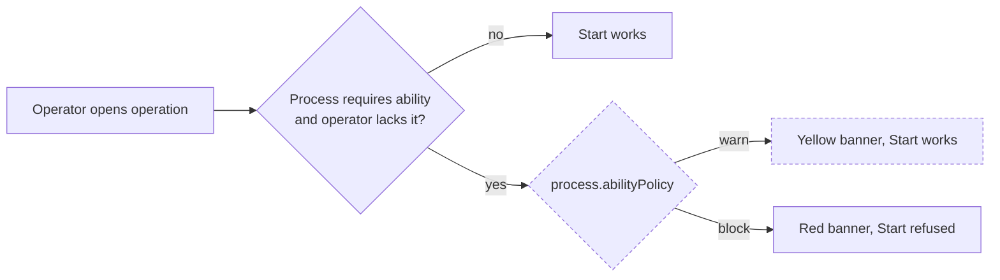

# MES ability enforcement per process

> Status: Approved
> Date: 2026-10-22
> Research: `.ai/research/mes-ability-enforcement.md`

## TL;DR

- Each process that requires an ability now says what MES does when an operator lacks it: **Warn** (default) or **Block**.
- The choice sits on the process form, under "Requires Ability". It shows only while that toggle is on.
- The toggle's description now names the ability, which is the process's own name.
- **Warn**: MES shows a banner on the operation page. The operator can still start.
- **Block**: MES shows the banner and refuses all production work on the operation: Start, Log completed, Scrap, Rework, Mark as Done, step records and material issue. The message names the training that grants the ability.
- There is no company-wide setting. Today MES always blocks; after this change every process starts on Warn.

## Overview diagram



## Problem

An operator gets an ability when they complete a training. The trigger `grant_ability_on_training_completion` writes the `employeeAbility` row.

MES checks the ability at Start with `getOperationEligibility` (`apps/mes/app/services/operations.service.ts`). That check always blocks. An admin cannot choose a softer mode, and some abilities need a block while others only need a warning. The operator also sees no warning before Start. The process form does not say which ability its toggle requires.

## Goals

1. Add a per-process mode: `Warn` or `Block`. The default is `Warn`.
2. In `Warn` mode, show a warning and let the operator start.
3. In `Block` mode, refuse all production work on the operation. Tell the operator how to get the ability.
4. Show the warning before Start, on all three MES operation views.
5. Name the ability in the "Requires Ability" description.

## Non-goals

- No company-wide setting.
- No change to the ability data model, the training trigger, or expiry rules.
- No change to the scheduler's operator eligibility (`packages/planning`).
- No other UX changes to processes, abilities or trainings.

## Design

### Data model

Migration `20261022063357_process-ability-policy.sql`:

```sql
CREATE TYPE "processAbilityPolicy" AS ENUM ('Warn', 'Block');
ALTER TABLE "process"
  ADD COLUMN IF NOT EXISTS "abilityPolicy" "processAbilityPolicy" NOT NULL DEFAULT 'Warn';
```

ERP and MES read the values and the type from the generated `processAbilityPolicy` enum.

The same migration drops and re-creates the `processes` view, so `p.*` picks up the column. The column is read only while `requiresAbility` is on.

### ERP process form

| Part | Change |
|---|---|
| `resources.models.ts` | Add `processAbilityPolicies` and `abilityPolicy: z.enum(...).optional()` to `processValidator`. |
| `ProcessForm.tsx` | The name field is controlled. The "Requires Ability" description reads "Only employees with the {name} ability can be scheduled for and run this process". |
| `ProcessForm.tsx` | `AbilityPolicy` renders a `Select` "If an operator isn't qualified": Warn / Block. It shows only while Requires Ability is on, like the batch type select. |
| `processes.$processId.tsx`, `processes.new.tsx` | Initial value `abilityPolicy` (stored value, else `Warn`). |

`insertProcess` / `updateProcess` spread the validated input, so they write the field with no change.

### MES

1. `getAbilityShortfall` returns what the operator lacks, or null. One embedded read gets the process and its ability. Then the qualification and the granting training are read in parallel. A shortfall carries `policy`, `processName`, `expiredOn` and `trainingName`.
2. `abilityBlockRefusal` is the only check the routes call. It builds the English flash text when the policy is `Block`.
3. `abilityBlockRefusal` returns the refusal text when the policy is `Block`. These routes call it before they write: `event` (Start), `start.$operationId`, `end.$operationId` (kanban complete scan), `batch.$batchId.complete` and `batch.$batchId.record` (one member is checked, because every member runs the batch's process), `complete`, `finish`, `scrap`, `rework`, `record`, `record.$id.delete`, `issue`, `issue-tracked-entity` (single operation), `unconsume`, `entity+/…scrap`, and the inspection `sample`, `measurement`, `disposition` and `complete-passed` routes.
4. The operation view disables the same actions when the policy is `Block`. Pause, Maintenance, Quality Issue, Instructions and Chat stay enabled. Not guarded: `steps.complete-all` (a manager override), `steps.inspection` (an automatic sync) and a batch pick.
5. `x+/event.tsx` redirects a full-page POST (`Sec-Fetch-Mode: navigate`, a press before the page hydrates) back to the referring page, keeping the flash.
6. The three loaders (`operation`, `assembly`, `inspection`) pass the shortfall to the view as `abilityWarning`. The assembly and inspection views disable the same work, and skip their timer auto-start, when the policy is `Block`.
7. `AbilityWarning` renders a warning `Alert` (Warn) or a destructive `Alert` (Block). Its copy uses Lingui.

The server flash text stays English. MES routes have no server-side translation today.

## Design decisions

| Decision | Choice | Why |
|---|---|---|
| Where the mode lives | On `process` | Some abilities need a block and others a warning. User answer. |
| Company-wide setting | None | The per-process mode replaces it. User answer. |
| Column type | Enum `processAbilityPolicy`: `Warn` / `Block` | One generated type for ERP and MES, with no casts. Same pattern as `invoiceAutomation`. |
| Default | `Warn` | The original request. |
| Ability name on the form | In the toggle's description | Minimal. User answer. |
| Field visibility | Only while Requires Ability is on | Same pattern as the batch type select. |
| Warn UX | Banner on the page, no extra click | User answer. |
| Views with the banner | Operation, assembly and inspection | All three post Start to `x+/event.tsx`. |
| Which training to name | One Active training with `grantsAbilityId` = the ability | The trigger grants the ability from that link. |

## Acceptance criteria

1. An existing process has `abilityPolicy = 'Warn'` after the migration.
2. An admin opens a process and turns on Requires Ability. The description names the process. The "If an operator isn't qualified" select appears with Warn selected. Turning the toggle off hides the select.
3. The admin picks Block and saves. The value is `Block` after a reload.
4. Process "Welding" requires an ability, with policy `Warn`. Operator A has no `employeeAbility` row for it and opens a Welding operation. A yellow banner names the ability and its training. Operator A presses Start. The timer starts.
5. Same setup with policy `Block`. Operator A sees a red banner. Start, Log completed, Scrap, Rework, Mark as Done, Record and Issue Material are disabled. A direct POST to any guarded route is refused, and nothing is written.
6. Same setup with policy `Block`. Operator A scans the operation's start QR code. MES redirects to the operation page with the error toast.
7. Operator A's `employeeAbility.expiresAt` is yesterday. The banner says the qualification expired, with the date.
8. Operator B has a valid `employeeAbility` row. No banner shows. Start works in both modes.
9. The assembly and inspection views show the same banner as the operation view.

## Open questions (resolved)

- [x] Existing companies already get a hard block. What default do they get? — **Answer:** `Warn`, as the request says.
- [x] How does an operator see the warning in Warn mode? — **Answer:** A banner on the operation page. Start needs no extra click.
- [x] Company setting or per process? — **Answer:** Per process, on the process form. No company setting.

## Changelog

- 2026-10-22: First draft with a company-wide setting in Production → Shop Floor.
- 2026-10-22: Implemented with the company setting.
- 2026-10-22: Thermo-nuclear review fixes: enum column, one shared check, `getAbilityShortfall`, Block gating and no auto-start in the assembly and inspection views.
- 2026-10-22: Block covers all production work, not only Start. The event route recovers from a full-page POST.
- 2026-10-22: Moved the mode onto the process and removed the company setting. Named the ability in the toggle's description.
