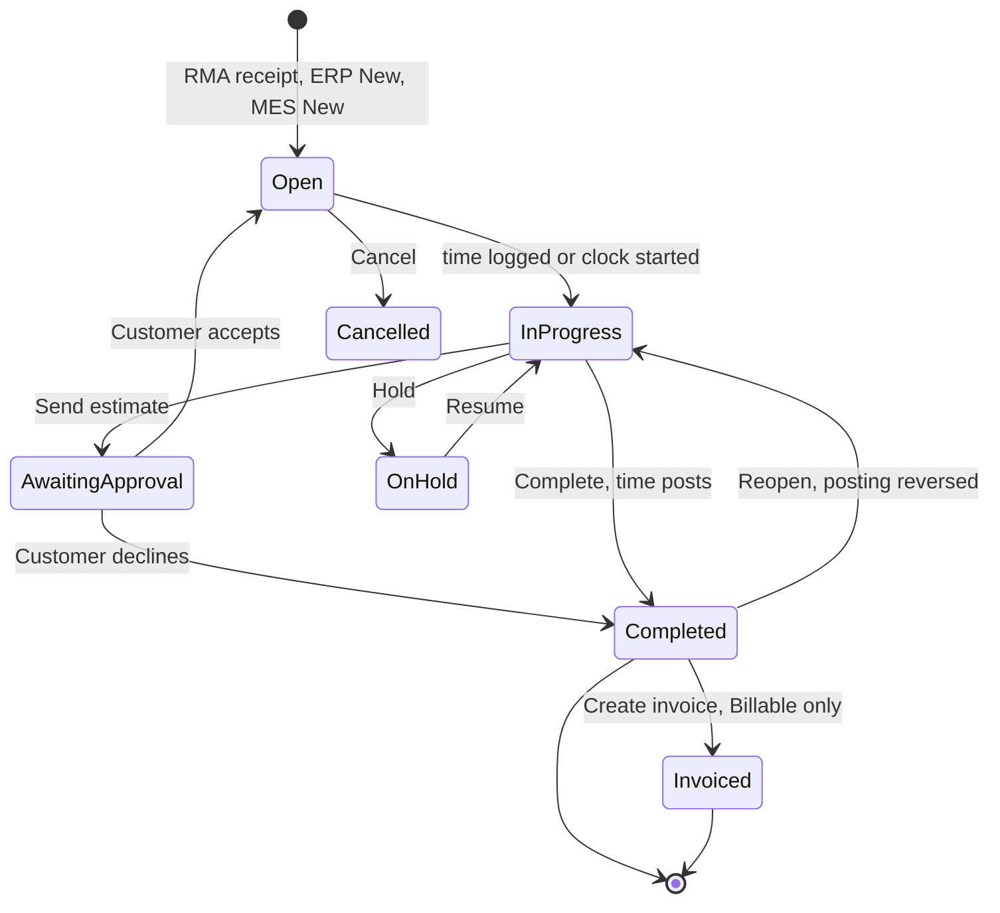
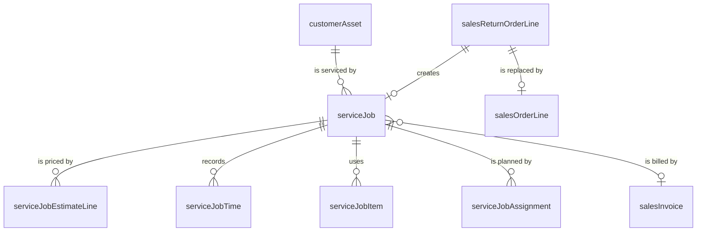

# Service Jobs and Customer Returns

> Status: draft
> Author: Claude (with Brad Barbin)
> Date: 2026-10-22

## TLDR

This spec replaces the project-based field service module with one flat record, the **service job**. A service job is work on a customer's unit, at our depot or at the customer's site. It has one coverage (Billable, Warranty or Contract), a time list, a parts list and, for billable work, an estimate. Its sibling is the maintenance dispatch, not the project.

The spec also rebuilds the customer RMA around a per-line decision: Return to Stock, Return for Service or Return for Warranty. When its receipt posts, a Service or Warranty line creates a service job.

The technician uses the job from the MES, with a start/stop clock. Time also shows on My Time. A dispatcher plans the work on the dispatch grid: technicians by days. Postings follow `.ai/research/2026-10-22-service-rma-postings.md`.

The old module (service orders, visits, hidden projects, coverage per charge) is on this branch only. Phase 0 removes it.

## Overview diagram



`AwaitingApproval` is the status "Awaiting Approval", `InProgress` is "In Progress" and `OnHold` is "On Hold".

## Problem Statement

The current module (`.ai/specs/implemented/2026-10-08-field-service.md`) treats service as a kind of project. Brad's review on 2026-10-22 found 5 problems:

1. **Too many clicks and layers.** To log 1 hour of work, a technician opens the order, then a visit, then a work element, then Log Time. Each service order owns a hidden `project` and a `projectElement` tree.
2. **Screens are scattered.** The order, the visit page, the element page, the Work tab and the Billing tab each hold part of one job.
3. **The MES has no service screens.** A technician cannot start a job from the shop floor or from a tablet.
4. **The RMA does not match real practice.** A line is "Repair" or a quality disposition. There is no warranty decision, no repair estimate, and no diagnosis step. Diagnosis time is never recorded.
5. **The schedule shows visits only.** Unscheduled jobs and technician capacity are not on it.

The cause is the shared design. Projects and service are different things. A project is a long plan with a budget and a work breakdown. A service job is one unit, one problem and one bill.

The old design also posted coverage per charge, into project tables. Project billing, indirect rates and DCAA rules then had to filter service projects out in 12 places.

## Proposed Solution

### The service job

One `serviceJob` row holds the whole job:

- **Subject:** the customer, an optional customer asset (a serial we shipped), and the work site (Depot or Customer Site).
- **Coverage:** Billable, Warranty or Contract. The job has one coverage. The system suggests it from the asset's warranty dates and, in phase 3, from a service contract. The user can change it until the job is Completed.
- **Problem, findings, resolution:** rich-text notes and a `repairable` flag that the technician sets.
- **Estimate:** Billable jobs only. Labor, part and charge lines with prices. Send produces a PDF. A user records Accept or Decline.
- **Time:** `serviceJobTime` rows, one per entry. The MES clock writes a start and an end. My Time writes hours for a day.
- **Parts and charges:** `serviceJobItem` rows. The technician issues a part from inventory. A charge is a Service item (for example a travel fee) with a price. In phase 1 a charge has no cost. In phase 2 a charge can carry a cost, linked to the reimbursement line or supplier invoice line that paid it.
- **Assignments:** `serviceJobAssignment` rows (technician, date, planned hours). They are the schedule.

There are no visits, no work tree, no templates and no project.

### Where a job comes from

| Origin | Phase | How |
|---|---|---|
| RMA line, Return for Service or Return for Warranty | 1 | `post-receipt` creates the job when the receipt posts. Work site is Depot. |
| Office (phone call, email) | 1 | Service → Jobs → New, a drawer. |
| Technician on the shop floor or on site | 2 | MES → Service → New. Scan or pick the serial. The job opens In Progress, is assigned to the technician, and the clock starts. |
| Service contract | 3 | Separate spec. |

### The RMA

The RMA (`salesReturnOrder`) keeps its header, receipt, credit memo, replacement order and return shipment. In this spec, a "Service line" is a Return for Service line, and a "Warranty line" is a Return for Warranty line. These parts change:

1. **Request from the asset registry.** "Add from assets" lists the customer's assets. Each chosen asset becomes a line with its item, serial, origin shipment and warranty status. The existing "Add from shipments" (`ReturnableLinesModal`) stays.
2. **Line decision (`returnType`).** Each line is Return to Stock, Return for Service or Return for Warranty. The line form suggests Return for Warranty when the asset's warranty end date is on or after the RMA date. A line also gets a `problem` text.
3. **Service and Warranty lines hold one unit.** Their quantity is 1. The line names the asset or serial when one exists.
4. **Receipt.**
   - A Return to Stock line receives as today: valued at the original shipment cost, On Hold.
   - A Service or Warranty line receives with no value (the customer owns the unit). `post-receipt` creates one service job for the line. It sets coverage Billable for Service and Warranty for Warranty, status Open, work site Depot, and the receiving location.
5. **Diagnosis is on the job.** The technician logs diagnosis time on the job and sets `repairable`. For a Billable job, the technician then sends the estimate.
6. **Not repairable.** The technician completes the job with `repairable = false`. A Billable job can still bill its evaluation time. The RMA line then offers its next step:

| Line | Next step choices |
|---|---|
| Return for Service | Return unrepaired (ship back), Scrap (with the customer's consent) |
| Return for Warranty | No-charge replacement (a replacement sales order line), Return unrepaired |

7. **Warranty denied.** If the technician finds misuse, the user changes the line to Return for Service. The job's coverage changes to Billable, and the estimate step follows.
8. **Ship back.** When the job is Completed and repairable, the line's "Ship" action creates the RMA shipment (existing `post-shipment` case `Sales Return Order`). The shipment posts no value, because the unit was never valued.
9. **Return to Stock lines keep their disposition** on the RMA line, after inspection: Restock (Use As Is), Return to Customer, Scrap or Rework. The pick list loses "Repair", because Return for Service replaces it.
10. **Completion.** The RMA is Completed when every line is resolved:
    - Return to Stock: received and disposed.
    - Service or Warranty: the job is Completed or Cancelled, and the unit has shipped back, been scrapped, or been replaced.

    A new status, In Progress, covers the time between full receipt and completion. `post-receipt` no longer sets Completed by itself.

### Postings

The postings follow `.ai/research/2026-10-22-service-rma-postings.md`. "Coverage account" means:

| Coverage | Coverage account |
|---|---|
| Billable | `costOfServiceAccount`, else `costOfGoodsSoldAccount` |
| Warranty | `warrantyExpenseAccount` |
| Contract | `costOfServiceAccount`, else `costOfGoodsSoldAccount` |

| Event | Dr | Cr | Written by |
|---|---|---|---|
| RMA receipt, Return to Stock | Inventory (original shipment cost) | COGS | `post-receipt`, unchanged |
| RMA receipt, Service or Warranty | none | none | `post-receipt` |
| Credit memo | `salesReturnsAccount` | AR | unchanged |
| Part issued to a job | coverage account | Inventory | `issue`, new type `serviceJobInventory` |
| Part returned from a job | Inventory | coverage account | `issue`, new type `serviceJobUnconsume` |
| Job Completed (all time entries) | coverage account | `laborAbsorptionAccount` | new `post-service-job` |
| Job reopened | reverses the completion journal | | `post-service-job` |
| Coverage changed with parts issued | new coverage account | old coverage account | `post-service-job`, one reclass journal |
| Billable job invoice | AR | Sales | existing `post-sales-invoice` |
| Warranty replacement shipment | `warrantyExpenseAccount` | Inventory | `post-shipment`, when the sales order line names a Warranty RMA line |
| Scrap a returned stock unit | `scrapAccount` | Inventory | unchanged |

Rules:

1. **Labor cost and bill rate come from a labor item.** A labor item is an item of type Service, such as "Field Technician" or "Bench Repair". Its `itemCost.unitCost` is the cost per hour. Its `itemUnitSalePrice.unitSalePrice` is the bill rate per hour. Each time entry names a labor item. The job defaults it from `companySettings.serviceLaborItemId`.
2. **Time posts when the job is Completed.** Until then, time entries are editable. `post-service-job` writes one journal for all entries, at hours × the labor item's `unitCost` at completion. It stores the cost on each row. Reopen reverses that journal.
3. **Parts post when the technician issues them,** because the stock leaves the shelf at that moment.
4. **Revenue posts at the invoice.** A Time and Materials job bills 3 things: its billable time, its billable parts and its charges. Time bills at hours × bill rate, one line per labor item. A Fixed Price job bills one line: the job's `serviceItemId` at the accepted estimate total.
5. **No warranty reserve.** This is the 2026-10-08 decision. A company that keeps an ASC 460 reserve maps `warrantyExpenseAccount` to its Accrued Warranty Liability account.
6. **No WIP.** The customer owns the unit, so cost goes straight to the coverage account (ASC 340-40-25-8(c)).

### Time and the schedule

- **MES clock (phase 2).** Start writes a `serviceJobTime` row with `startTime`. Stop sets `endTime`, `hours` and `entryDate`. This copies `maintenance-event.tsx`.
- **My Time (phase 2).** The ERP and MES My Time weeks add one row per service job. A job gets a row when the employee has time or an assignment on it that week. Dragging a service row's bar sets the day's total. The app writes the difference to one manual entry for that day (no clock). A total below the day's clock entries is refused: the technician edits clock entries on the job. Service rows never go through submit, approval, certification or DCAA. They lock when the job is Completed. "Add row" lists the employee's open service jobs as well as charge numbers.
- **Dispatch grid (phase 2).** Service → Schedule shows technicians as rows and the days of a week as columns.
  - Each cell shows the day's assignments as blocks (job id, customer, planned hours) and a total against the shift hours.
  - A backlog panel lists open jobs with no assignment. Dragging a job onto a cell creates an assignment. Dragging a block moves it.
  - The rows are the location's employees, with the People board's department filter. `peopleAbsence` greys a person's day out.
  - The grid shows jobs, not visits.

### MES (phase 2)

A new **Service** queue in the MES sidebar has these screens:

| Screen | Copies |
|---|---|
| My service jobs: assigned to me today, then open at my location | `apps/mes/app/routes/x+/maintenance.tsx` |
| New job: scan or pick a serial or customer, type the problem, see the suggested coverage | `dispatch.new.tsx` |
| Job page: clock, parts (add and issue), findings, resolution, photos, Complete with signature | `dispatch.$dispatchId.tsx` |
| Clock start/stop | `maintenance-event.tsx` |
| Issue a part | `dispatch.$dispatchId.add-and-issue.tsx` |

### Design Decisions

| # | Decision | Choice | Rationale |
|---|----------|--------|-----------|
| 1 | Record type | New `serviceJob` table; sibling is `maintenanceDispatch` | A production `job` needs a make method, makes stock and is planned by MRP. A customer's unit is none of these. Maintenance already has time, parts, MES creation and posting on a flat record. (Brad, 2026-10-22.) |
| 2 | Visits | None. `serviceJobAssignment` (technician, date, planned hours) replaces them | A visit was a second layer between the job and the work. Travel and arrival stamps can return later. (Brad, 2026-10-22.) |
| 3 | Time storage | Own table `serviceJobTime`; My Time reads it next to `timesheetEntry` | The UI is shared, the data is not. Project approval and DCAA rules never touch service time. (Brad, 2026-10-22.) |
| 4 | Estimate | On the job (`serviceJobEstimateLine`), not a sales quote | One record. A quote converts to a sales order, so a quote would need a new quote-to-job path. (Brad, 2026-10-22.) |
| 5 | Diagnosis | On the job for Service and Warranty lines; disposition on the RMA line for Return to Stock lines | Diagnosis is technician labor and is often billed. This replaces the earlier "triage on the RMA line" answer. (Q1, Brad, 2026-10-22.) |
| 6 | Refurbishment of own stock | Out of service. It is a production rework job | A unit we own is inventory and follows `.ai/research/serial-service-cost-treatment.md`. (Brad, 2026-10-22.) |
| 7 | Coverage | One per job, editable until Completed; a change with issued parts posts one reclass journal | SAP's accounting indicator works the same way. Coverage per charge was the old module's complexity. |
| 8 | Coverage accounts | New `accountDefault.costOfServiceAccount` (nullable, falls back to COGS); `warrantyExpenseAccount` kept | Keeps service margin apart from product margin. (Q2, Brad, 2026-10-22.) |
| 9 | Labor rates | From the labor item: `itemCost.unitCost` per hour and the sale price per hour | Reuses Service items. A company can have several labor items. No new rate table. (Q3, Brad, 2026-10-22.) |
| 10 | When time posts | At job completion, one journal; Reopen reverses it | Entries stay freely editable. Cost lands in the same period as the invoice. (Q4, Brad, 2026-10-22.) |
| 11 | Revenue | At the invoice; no unbilled accrual in v1 | SMB practice. An accrual (Dr `contractAssetAccount`) can come later. (Q5, Brad, 2026-10-22.) |
| 12 | Travel and other field costs | Phase 1: a charge line on `serviceJobItem` is pricing only (a Service item with a price and no cost). Phase 2: a charge line can carry a cost, linked to the `reimbursementLine` or `purchaseInvoiceLine` that paid it | A trip fee or call-out fee is pricing. A hotel or a part bought on site is a real cost, and the job margin must show it. The linked document already posts the journal, so the job adds no payable. (Q6, Brad, 2026-10-22.) |
| 13 | Scope | Phases 0–2 in this spec; phase 3 (contracts, supplier recovery, PM) in its own spec | Phases 0–2 are a complete product. Contract coverage needs its own design. (Q7, Brad, 2026-10-22.) |
| 14 | Service and Warranty line quantity | 1 per line; one job per line | One unit, one job. "Add from assets" adds one line per asset. |
| 15 | Customer asset | Kept (`customerAsset`, created at shipment); optional on a job; `customerAssetComponent` dropped | Installed-part warranty is not needed for v1. A job's parts list is the history. |
| 16 | Job status | Open, Awaiting Approval, In Progress, On Hold, Completed, Invoiced, Cancelled | No Scheduled status: an assignment says that. Not Repairable is `repairable = false`, not a status. |
| 17 | RMA status | Add In Progress (fully received, lines not yet resolved); Completed when every line is resolved | Receipt no longer ends a Service or Warranty line. |
| 18 | Warranty replacement | `salesOrderLine.salesReturnOrderLineId`; `post-shipment` sends its cost to `warrantyExpenseAccount` when that RMA line is Return for Warranty | PwC RR 8.2. SAP and NetSuite need a configuration patch for this. |
| 19 | The defective unit after a replacement | The RMA line's choice: keep at zero value, or scrap at zero | The unit becomes ours with no value. |
| 20 | Phase 0 method | Forward migrations that drop the service tables and columns; old migration files stay | Developer databases and previews have the old migrations applied. Deleting files would force a reset. |
| 21 | Dispatch grid rows | The location's employees, with the People board's department filter | Copies `PeopleMatrix`. No new technician setting. |
| 22 | Permissions | Existing `service` module scopes (`service_view`, `service_create`, `service_update`, `service_delete`); MES routes use `requirePermissions(request, {})` like maintenance | No RBAC change. The `projectModule` rule loses its service branch. |
| 23 | Multi-tenancy (heuristic 1) | Every new table has `companyId`, composite PK `("id", "companyId")` and `id('prefix')` | House rule. |
| 24 | Services (heuristic 2) | All service functions in `service.service.ts`: `client` first, return `{ data, error }`, never throw; Kysely writes take `db` from the route | House rule; `no-db-client-in-service` check. |
| 25 | RLS (heuristic 3) | SELECT/INSERT/UPDATE/DELETE policies for each new table through the authz manifest, `service` module | `.claude/rules/authz-manifest.md`. |
| 26 | Forms (heuristic 5) | `ValidatedForm` + `validator(zod)` + route action for the job, estimate line, time entry, part and assignment | House rule. |
| 27 | Module layout (heuristic 6) | One `service.models.ts`, one `service.service.ts`, one `service.server.ts`, barrel `index.ts`, under `modules/service/` | The old module files are rewritten, not kept. |
| 28 | Backward compatibility (heuristic 7) | No stable surface changes. The service module and its MCP tools are on this branch only, not on main | Nothing to migrate for customers. The MCP digest regenerates. |
| 29 | Document number | `serviceJobId`, sequence `serviceJob`, prefix `SJ`, size 6; added to `sync_advance_document_sequence` | Lesson "A caller-supplied document number used to leave the counter behind". |
| 30 | When an estimate is required | Fixed Price jobs and jobs from a Return for Service line, unless `repairable = false` (see the estimate rule under UI Changes) | Brad's diagram puts Quote → Accepted before the billable repair. A field call billed by the hour needs no gate. (Q8, Brad, 2026-10-22.) |
| 31 | Drag and drop on matrices | One shared component, `~/components/ScheduleMatrix` (`@dnd-kit/core`), used by the dispatch grid AND the production People matrix. On the People matrix, dragging a chip moves that work center assignment to another person or day (`movePeopleAssignmentCell`, merging with a same-station row as `movePeopleAssignment` does). Clicking a cell still opens the hours modal | Both are people × days matrices. Brad asked for the same drag and drop on both (2026-10-23). This is the one production change in this spec. |

## Data Model Changes



### Phase 0: removed (forward migration)

The plan lists every object. In summary:

- Tables: `serviceOrder`, `serviceVisit`, `customerAssetComponent`, and the service template rows and columns.
- Enums: `serviceOrderType`, `serviceOrderStatus`, `serviceVisitStatus`, `serviceInvoiceDetail`, and the old `serviceCoverage` (it had Capitalized).
- Project columns: `project.projectType`, `project.parentProjectId`, `timesheetEntry.coverage`, `timesheetEntry.coverageReason`, `timesheetEntry.serviceVisitId`, `projectLedger.coverage`.
- Project values and functions: the `projectCostTreatment` value 'By Coverage', and `get_child_service_project_costs`.
- `salesInvoice.serviceOrderId` and `salesReturnOrderLine`'s Repair path.
- Kept, because project billing uses them: `projectBillableItem`, `projectExpenseEntry`, `projectElement.fixedPrice`. The plan checks each `coverage` column on them, and drops it only if project billing does not read it.
- Kept: `customerAsset`, `itemUnitSalePrice.laborWarrantyMonths` and `partsWarrantyMonths`, `accountDefault.warrantyExpenseAccount`, `companySettings.serviceLaborItemId`, the 'Service' module value.

A Postgres enum cannot drop a value. The migration moves every row off 'By Coverage', then recreates `projectCostTreatment` without it.

### Phase 1: new enums and tables

```sql
CREATE TYPE "serviceJobStatus" AS ENUM (
  'Open', 'Awaiting Approval', 'In Progress', 'On Hold',
  'Completed', 'Invoiced', 'Cancelled'
);
CREATE TYPE "serviceCoverage" AS ENUM ('Billable', 'Warranty', 'Contract');
CREATE TYPE "serviceWorkSite" AS ENUM ('Depot', 'Customer Site');
CREATE TYPE "serviceBillingMethod" AS ENUM ('Time and Materials', 'Fixed Price');
CREATE TYPE "serviceJobPriority" AS ENUM ('Low', 'Medium', 'High', 'Critical');
CREATE TYPE "serviceEstimateStatus" AS ENUM ('Draft', 'Sent', 'Accepted', 'Declined');
CREATE TYPE "serviceJobItemLineType" AS ENUM ('Part', 'Charge');
CREATE TYPE "returnType" AS ENUM (
  'Return to Stock', 'Return for Service', 'Return for Warranty'
);
ALTER TYPE "salesReturnOrderStatus" ADD VALUE 'In Progress' BEFORE 'Completed';

CREATE TABLE "serviceJob" (
    "id" TEXT NOT NULL DEFAULT id('sj'),
    "companyId" TEXT NOT NULL,
    "serviceJobId" TEXT NOT NULL,
    "status" "serviceJobStatus" NOT NULL DEFAULT 'Open',
    "coverage" "serviceCoverage" NOT NULL DEFAULT 'Billable',
    "workSite" "serviceWorkSite" NOT NULL DEFAULT 'Depot',
    "billingMethod" "serviceBillingMethod" NOT NULL DEFAULT 'Time and Materials',
    "priority" "serviceJobPriority" NOT NULL DEFAULT 'Medium',
    "customerId" TEXT NOT NULL,
    "customerLocationId" TEXT,
    "customerContactId" TEXT,
    "customerAssetId" TEXT,
    "itemId" TEXT,
    "trackedEntityId" TEXT,
    "locationId" TEXT NOT NULL,              -- our location: depot, parts source
    "salesReturnOrderLineId" TEXT,
    "serviceItemId" TEXT,                    -- Service item billed for Fixed Price
    "assignee" TEXT,                         -- lead technician
    "dueDate" DATE,
    "problem" TEXT,
    "findings" JSONB,
    "resolution" JSONB,
    "repairable" BOOLEAN,
    "estimateStatus" "serviceEstimateStatus",
    "estimateSentAt" TIMESTAMP WITH TIME ZONE,
    "estimateRespondedAt" TIMESTAMP WITH TIME ZONE,
    "estimateRespondedBy" TEXT,              -- customer's name, typed by the user
    "fixedPrice" NUMERIC,                    -- accepted estimate total
    "completedAt" TIMESTAMP WITH TIME ZONE,
    "completionJournalId" TEXT,
    "salesInvoiceId" TEXT,
    "signaturePath" TEXT,
    "signedByName" TEXT,
    "createdBy" TEXT NOT NULL REFERENCES "user"("id"),
    "createdAt" TIMESTAMP WITH TIME ZONE NOT NULL DEFAULT NOW(),
    "updatedBy" TEXT REFERENCES "user"("id"),
    "updatedAt" TIMESTAMP WITH TIME ZONE,
    "customFields" JSONB,
    CONSTRAINT "serviceJob_pkey" PRIMARY KEY ("id", "companyId"),
    CONSTRAINT "serviceJob_serviceJobId_key" UNIQUE ("serviceJobId", "companyId"),
    CONSTRAINT "serviceJob_companyId_fkey" FOREIGN KEY ("companyId")
      REFERENCES "company"("id") ON DELETE CASCADE ON UPDATE CASCADE
    -- plus FKs to customer, customerLocation, customerContact, customerAsset,
    -- item, trackedEntity, location, salesReturnOrderLine, salesInvoice, journal
);
-- One live job per RMA line.
CREATE UNIQUE INDEX "serviceJob_salesReturnOrderLineId_key"
  ON "serviceJob" ("salesReturnOrderLineId", "companyId")
  WHERE "salesReturnOrderLineId" IS NOT NULL AND "status" <> 'Cancelled';

CREATE TABLE "serviceJobEstimateLine" (
    "id" TEXT NOT NULL DEFAULT id('sjel'),
    "companyId" TEXT NOT NULL,
    "serviceJobId" TEXT NOT NULL,
    "itemId" TEXT NOT NULL,                  -- labor item, part, or charge item
    "description" TEXT,
    "quantity" NUMERIC NOT NULL,             -- hours for a labor item
    "unitPrice" NUMERIC NOT NULL,
    "sortOrder" INTEGER NOT NULL DEFAULT 0,
    -- audit columns, PK ("id", "companyId"), FK to serviceJob ON DELETE CASCADE
);

CREATE TABLE "serviceJobTime" (
    "id" TEXT NOT NULL DEFAULT id('sjt'),
    "companyId" TEXT NOT NULL,
    "serviceJobId" TEXT NOT NULL,
    "employeeId" TEXT NOT NULL,
    "laborItemId" TEXT NOT NULL,
    "entryDate" DATE NOT NULL,
    "startTime" TIMESTAMP WITH TIME ZONE,    -- set by the MES clock
    "endTime" TIMESTAMP WITH TIME ZONE,
    "hours" NUMERIC NOT NULL DEFAULT 0,
    "billable" BOOLEAN NOT NULL DEFAULT TRUE,
    "unitCost" NUMERIC,                      -- stored by post-service-job
    "note" TEXT,
    -- audit columns, PK ("id", "companyId"), FK to serviceJob ON DELETE CASCADE
);
-- One running clock per employee.
CREATE UNIQUE INDEX "serviceJobTime_open_clock_key"
  ON "serviceJobTime" ("employeeId", "companyId") WHERE "startTime" IS NOT NULL AND "endTime" IS NULL;

CREATE TABLE "serviceJobItem" (
    "id" TEXT NOT NULL DEFAULT id('sji'),
    "companyId" TEXT NOT NULL,
    "serviceJobId" TEXT NOT NULL,
    "lineType" "serviceJobItemLineType" NOT NULL,
    "itemId" TEXT NOT NULL,
    "description" TEXT,
    "quantity" NUMERIC NOT NULL,
    "unitOfMeasureCode" TEXT,
    "storageUnitId" TEXT,
    "unitCost" NUMERIC NOT NULL DEFAULT 0,   -- set by issue for a Part
    "unitPrice" NUMERIC NOT NULL DEFAULT 0,  -- defaults from the item's sale price
    "billable" BOOLEAN NOT NULL DEFAULT TRUE,
    "reimbursementLineId" TEXT,            -- phase 2: the charge's paid cost
    "purchaseInvoiceLineId" TEXT,          -- phase 2: the charge's paid cost
    -- audit columns, PK ("id", "companyId"), FK to serviceJob ON DELETE CASCADE
);

CREATE TABLE "serviceJobAssignment" (
    "id" TEXT NOT NULL DEFAULT id('sja'),
    "companyId" TEXT NOT NULL,
    "serviceJobId" TEXT NOT NULL,
    "employeeId" TEXT NOT NULL,
    "scheduledDate" DATE NOT NULL,
    "plannedHours" NUMERIC,
    "note" TEXT,
    -- audit columns, PK ("id", "companyId"), FK to serviceJob ON DELETE CASCADE
    CONSTRAINT "serviceJobAssignment_unique"
      UNIQUE ("serviceJobId", "employeeId", "scheduledDate", "companyId")
);

ALTER TABLE "salesReturnOrderLine"
  ADD COLUMN "returnType" "returnType" NOT NULL DEFAULT 'Return to Stock',
  ADD COLUMN "customerAssetId" TEXT,
  ADD COLUMN "problem" TEXT,
  ADD COLUMN "quantityShipped" NUMERIC NOT NULL DEFAULT 0,  -- shipped back to the customer
  ADD CONSTRAINT "salesReturnOrderLine_service_quantity_check"
    CHECK ("returnType" = 'Return to Stock' OR "quantity" = 1);

ALTER TABLE "salesOrderLine" ADD COLUMN "salesReturnOrderLineId" TEXT;

ALTER TABLE "accountDefault" ADD COLUMN "costOfServiceAccount" TEXT
  REFERENCES "account"("id") ON DELETE RESTRICT;   -- plus REFERENCE_POLICY entry
```

Other changes:

- Add 'Service Job Consumption' to `itemLedgerDocumentType` and `journalLineDocumentType`, for issued parts. This copies 'Maintenance Consumption'. Add it to `JOURNAL_LINE_SAFE_DOCUMENT_TYPES` (`packages/server-functions/src/lib/plan-adjustment.ts`), or the journal lines fall back to 'Inventory Adjustment'.
- Add 'Service Job' to `journalEntrySourceType` and `journalLineDocumentType`, for the completion journal. This copies 'Maintenance Event'.
- Add the 5 new tables to `attachments.ts` (`events: true`) and to the authz manifest.
- Add `serviceJob` to the `sync_advance_document_sequence` interceptor.
- Register `costOfServiceAccount` as an account default: `ACCOUNT_DEFAULT_COLUMNS` (`accounting-cutover/shared.ts`), `ROLE_NAMES` (`account-import.ts`), and `OPTIONAL_DEFAULT_ROLES`, `DEFAULT_FALLBACKS` (to `costOfGoodsSoldAccount`) and `OPTIONAL_DEFAULT_LABELS` (`journal-posting-status.ts`). `REFERENCE_POLICY` skips `accountDefault` columns.
- Add `salesInvoiceLine.serviceJobId`. `post-sales-invoice` treats a line with it like a billed project item: no shipment, no item ledger, no COGS. The job already relieved the stock when the part was issued.
- Seed the `serviceJob` sequence for new companies in `packages/database/src/seed-data.ts` (`sequences`), as well as in the migration.
- Demo datasets: replace the seeded service orders with service jobs (tier 04 or a new tier), and update `coverage.ts` floors, `wipe.ts` and `validate.ts`.

## API / Service Changes

**ERP `service.service.ts` (rewritten)**

- Reads: `getServiceJobs` (list filters), `getServiceJob`, `getServiceJobTime`, `getServiceJobItems`, `getServiceJobEstimateLines`, `getServiceJobAssignmentsRange`, `getServiceBacklog`, `getCustomerAssets`, `getCustomerAsset`, `getServiceJobsByAsset`, `suggestCoverage(asset, asOfDate)`.
- Writes: `insertServiceJob`, `updateServiceJob`, `upsertServiceJobEstimateLine`, `deleteServiceJobEstimateLine`, `upsertServiceJobTime`, `deleteServiceJobTime`, `upsertServiceJobItem` (Charge lines only), `upsertServiceJobAssignment`, `moveServiceJobAssignment`, `deleteServiceJobAssignment`, `upsertCustomerAsset`.

**Server functions (`packages/server-functions`)**

| Function | Does |
|---|---|
| `post-service-job` (new) | `complete`: posts all time, stores `unitCost`, sets Completed. `reopen`: reverses. `reclass`: posts the coverage-change journal for issued parts. Kysely transaction. |
| `issue` (changed) | New types `serviceJobInventory`, `serviceJobTrackedEntities`, `serviceJobUnconsume`. They copy the maintenance types and post to the coverage account. |
| `post-receipt` (changed) | Sales Return Order case: Return for Service and Return for Warranty lines post no value and create the job. Replaces `post-receipt/repair.ts`. The RMA moves to In Progress when fully received. |
| `post-shipment` (changed) | A sales order line with `salesReturnOrderLineId` that points at a Return for Warranty line debits `warrantyExpenseAccount`, not COGS. A Sales Return Order shipment of a Service or Warranty line posts no value. |
| `create-service-invoice` (new) | Builds a Draft `salesInvoice` from a Completed Billable job (Time and Materials or Fixed Price lines). Each line carries `serviceJobId`. Sets `salesInvoiceId` and Invoiced. |
| `post-sales-invoice` (changed) | A line with `serviceJobId` posts revenue only: no shipment, no item ledger, no COGS. |

**Routes (ERP)** live under `x+/service-jobs+/` (list, schedule, assets) and `x+/service-job+/`. `x+/service+/` already belongs to the Service item type, so the module cannot use it. Paths use the `serviceJob*` prefix in `utils/path.ts`. The job routes are `new`, `update`, `$jobId`, `$jobId.status`, `$jobId.estimate*`, `$jobId.time*`, `$jobId.item*`, `$jobId.add-and-issue`, `$jobId.invoice` and `$jobId.estimate[.]pdf`. The RMA adds `$id.from-assets`, `$id.$lineId.next-step` and `$id.$lineId.ship`.

**Routes (MES)** are `x+/service.tsx`, `x+/service.new.tsx`, `x+/service.$jobId.tsx`, `x+/service.$jobId.add-and-issue.tsx` and `x+/service-time.tsx`.

**MCP.** The rewritten `service.service.ts` changes the tool digest. Run `pnpm run generate:mcp`.

## Closest Sibling

**Service job ↔ maintenance dispatch.** Both are work on one asset, with a time list and a parts list. Both are created from the MES and closed by a technician. Copy file for file:

| Service job file | Copies |
|---|---|
| `routes/x+/service-jobs+/_index.tsx` (list) | `routes/x+/resources+/maintenance.tsx` |
| `routes/x+/service-job+/new.tsx`, `update.tsx`, `$jobId.tsx`, `$jobId.status.tsx` | `routes/x+/maintenance+/new.tsx`, `update.tsx`, `$dispatchId.tsx`, `$dispatchId.status.tsx` |
| `$jobId.time.*`, `$jobId.item.*`, `$jobId.add-and-issue.tsx` | `$dispatchId.event.*`, `$dispatchId.item.*`, `$dispatchId.add-and-issue.tsx` |
| `ui/ServiceJob/ServiceJobHeader`, `Explorer`, `Properties`, `Notes`, `Form`, `ServiceJobsTable`, `ServiceJobStatus` | `ui/Maintenance/MaintenanceDispatchHeader`, `Explorer`, `Properties`, `Notes`, `Form`, `MaintenanceDispatchesTable`, `MaintenanceStatus` |
| `post-service-job` | `post-maintenance-event` |
| `issue` types `serviceJob*` | `issue` types `maintenanceDispatch*` |
| MES routes (table under MES above) | MES maintenance and dispatch routes |

Deviations from the sibling, each a Design Decision above:

- Coverage replaces severity, source and OEE impact (decision 7).
- The estimate is an extra explorer section (decision 4).
- Time posts at completion, not per event (decision 10).
- The job has a customer and an asset, not a work center.
- Assignments are an extra table (decision 2).
- The People matrix gains drag and drop through the shared `ScheduleMatrix` component (decision 31). The grid then copies the matrix as it is.

**Dispatch grid ↔ People board.** The grid copies `routes/x+/priority+/people.tsx` with `view=matrix` (`PeopleMatrix`, `PeopleHeader`, `peopleShared.ts`): people as rows, days as columns. `PeopleMatrix` has no drag and drop today. This spec adds it through a shared `~/components/ScheduleMatrix` component, built from the `DndContext` pattern in `PeopleWeekBoard.tsx`. The People matrix and the grid both use it. The grid's blocks are service job assignments instead of work center assignments.

**My Time service rows ↔ project rows** in `projects/ui/Timesheet/TimesheetWeek.tsx`, `useTimesheetRows.ts` and `@carbon/react/WeekHours`.

**RMA changes ↔ the existing RMA screens** (`sales-return-order+/`, `ui/SalesReturnOrders/`). "Add from assets" copies `ReturnableLinesModal`.

## UI Changes

Every screen names its precedent. Each UI task in the plan screenshots the new screen at 1440 px next to the precedent, per the lesson "Every UI task names its precedent screen".

| Screen | Archetype | Precedent |
|---|---|---|
| Service → Jobs list | A, module list | Resources → Maintenance (`MaintenanceDispatchesTable`) |
| New job drawer | drawer form | `maintenance+/new.tsx` |
| Job page: header with one primary action; explorer with Estimate, Time and Parts; centre with Problem, Findings, Resolution and Files; properties panel | B, 3-pane workspace | `maintenance+/$dispatchId.tsx` |
| Estimate PDF | PDF | `packages/documents/src/pdf/ServiceEstimatePDF.tsx`, rewritten for the job |
| Service → Schedule | People matrix | `priority+/people.tsx?view=matrix`, with drag and drop from `~/components/ScheduleMatrix` |
| Production → People, Matrix view (changed) | People matrix | the same screen, plus drag and drop from `~/components/ScheduleMatrix` |
| Service → Customer Assets list and asset page | A, and D-like detail | the current `CustomerAssetsTable` and `CustomerAssetPage`. The asset page lists its service jobs and RMA lines |
| RMA line form: Return Type, asset, problem | existing | `SalesReturnOrderLineForm` |
| RMA "Add from assets" modal | existing | `ReturnableLinesModal` |
| RMA line: job link and next-step actions in the line's ⋯ menu | existing | `SalesReturnOrderExplorer` line menu |
| My Time service rows | existing | `TimesheetWeek` (ERP), `x+/timesheet.tsx` (MES) |
| MES Service queue and job page | MES queue and record | MES `maintenance.tsx`, `dispatch.$dispatchId.tsx` |
| Settings → Accounting: Cost of Service account | F, settings | the existing account defaults page |

The job page header has one primary action, chosen by status and coverage:

| Status | Job | Primary action |
|---|---|---|
| Open | any | Start |
| In Progress | needs an estimate (rule below) and has none accepted | Send Estimate |
| In Progress | any other case | Complete |
| Awaiting Approval | Billable | Record Response |
| Completed | Billable | Create Invoice |

Reopen, Hold, Cancel, Send Estimate and Print Estimate go in the ⋯ menu.

**Estimate rule.** A job needs an accepted estimate before Complete in 2 cases:
1. Its billing method is Fixed Price.
2. It came from a Return for Service line.

There is one exception. A job with `repairable = false` can complete without an estimate, so the evaluation time can be billed. Any other Billable job (Time and Materials, from the office or the MES) can complete without an estimate.

Service nav (`useServiceSubmodules`) shows Jobs, Schedule and Customer Assets. My Visits, Templates and Service Orders are removed.

## Acceptance Criteria

**Phase 0**

- [ ] `serviceOrder`, `serviceVisit` and `customerAssetComponent` do not exist after `pnpm db:migrate`. `project` has no `projectType` and no `parentProjectId`.
- [ ] `grep -rn "projectType\|serviceOrder\|serviceVisit" apps packages --include='*.ts' --include='*.tsx'` finds only generated types and migrations.
- [ ] Project billing tests (`post-sales-invoice`, `create-project-billing-invoices`, `project-revenue`, `indirect-rates`) pass.
- [ ] `pnpm db:check:datasets` passes with no service orders seeded.
- [ ] `.ai/specs/implemented/2026-10-08-field-service.md` is in `.ai/specs/archived/` with "> Superseded by: 2026-10-22-service-jobs-and-returns.md".

**Phase 1**

- [ ] A user creates an RMA, picks "Add from assets", and chooses 2 assets: one in warranty, one out of warranty. They see 2 lines suggested as Return for Warranty and Return for Service.
- [ ] Receiving both lines writes no journal and no `costLedger` row. It creates 2 service jobs (Warranty and Billable), Open, work site Depot. The RMA shows In Progress.
- [ ] A Return to Stock line on the same RMA receives at the original shipment cost (Dr Inventory / Cr COGS), as before.
- [ ] On the Billable job, a user logs 1.5 h with labor item "Bench Repair" (cost 40, price 95). The user adds an estimate (2 h labor, 1 part at 120) and sends it. The job is Awaiting Approval and the PDF shows a total of 310.
- [ ] After "Accepted", the user issues the part from stock (unit cost 70). One journal posts Dr Cost of Service 70 / Cr Inventory 70.
- [ ] Completing the job posts one journal: Dr Cost of Service 60 / Cr Labor Absorption 60 (1.5 h × 40).
- [ ] Create Invoice (Time and Materials) drafts a sales invoice with 1.5 h × 95 and 1 × 120, and sets the job to Invoiced.
- [ ] On the Warranty job, completion posts the labor to `warrantyExpenseAccount`. The job has no estimate and no invoice action.
- [ ] A user changes a job's coverage from Warranty to Billable after a part was issued. One reclass journal posts: Dr Cost of Service / Cr Warranty Expense, at the part's cost.
- [ ] A Warranty job completed with `repairable = false` lets the RMA line create a no-charge replacement line. Shipping it posts Dr Warranty Expense / Cr Inventory, not COGS.
- [ ] Shipping a repaired unit back on the RMA writes no journal. The RMA is Completed when all lines are resolved.
- [ ] Reopening a Completed job reverses its completion journal, and its time entries are editable again.

**Phase 2**

- [ ] In the MES, a technician scans a shipped serial, types a problem, and creates a job. The job is In Progress and assigned to them, and the clock runs. Stopping the clock writes one `serviceJobTime` row with hours.
- [ ] A second Start for the same employee while a clock runs is refused with a message.
- [ ] The technician issues a part from the MES job page. The ERP job shows it with its cost.
- [ ] My Time (ERP and MES) shows the job as a row with the logged hours. Dragging the bar to 3 h updates the row. After the job is Completed, the row is locked.
- [ ] A technician adds a $180 hotel charge to a job and links it to their reimbursement line. The job shows a cost of 180 on that line, and no new journal posts from the job.
- [ ] On Production → People (Matrix view), dragging a person's Monday chip to their Tuesday cell moves the assignment, and the week's hours total for that person is unchanged. A drop on a day marked Absent is refused. Clicking a cell still opens the hours modal.
- [ ] On Service → Schedule, dragging a backlog job onto a technician's Tuesday creates an assignment. The job leaves the backlog, and the cell total shows its planned hours.

## Risks

| Risk | Severity | Mitigation |
|---|---|---|
| Phase 0 drops columns that project billing still reads | High | The plan greps every string select for each dropped column (lesson "A dropped column breaks string selects"). Project billing tests gate the phase. |
| Recreating `projectCostTreatment` breaks views and functions that depend on it | Med | The plan lists the dependents (`pg_depend`) and recreates them in the same migration. |
| Time posted only at completion leaves a long open job's cost out of a month | Low | Most repairs close in days. A month-end posting of open time can come later if a customer needs it. |
| A labor item with no cost posts 0 labor cost | Med | Complete refuses when a billable or covered entry's labor item has no `unitCost`, and names the item. |
| Changing coverage after an invoice exists | Med | Coverage is locked from Completed onward. Reopen is refused once the job is Invoiced. |
| A linked reimbursement or supplier invoice line posts to an account other than the job's coverage account | Low | A reimbursement line started from the job defaults its account to the job's coverage account. Linking an existing line with another account shows a warning. |
| The MES and ERP My Time diverge | Low | Each app reads its own rows, as the timesheet already does. Both group and edit them through the shared pure helpers `groupServiceTimeRows` and `manualHoursForDay` (`packages/utils/src/service-job.ts`). |
| Demo datasets fail after the old tables go | Med | Phase 0 updates tiers, the validator and the floors in the same change. `pnpm db:check:datasets` gates it. |

## Open Questions

> HARD STOP: Do not proceed with implementation until these are answered.

Decisions made in the 2026-10-22 conversation, before research:

- [x] New table or production `job`? — **Answer:** New `serviceJob`, sibling maintenance dispatch. (Brad)
- [x] Keep visits? — **Answer:** No. Assignments replace them. (Brad)
- [x] Where does service time live? — **Answer:** Its own table. My Time shows both kinds of row. (Brad)
- [x] Sales quote or estimate on the job? — **Answer:** Estimate on the job. (Brad)
- [x] Refurbishment? — **Answer:** Out of service. It is a production rework job. (Brad)
- [x] Postings? — **Answer:** As in `.ai/research/2026-10-22-service-rma-postings.md`. (Brad)
- [x] Scope order? — **Answer:** Phase 0 decouple, phase 1 RMA and depot job, phase 2 MES, My Time and the grid, phase 3 contracts. (Brad)

Spec questions (Brad answered "accept all" to the recommendations, 2026-10-22):

- [x] Q1. Where does diagnosis happen for Service and Warranty lines? — **Answer:** On the service job, which the receipt creates. Return to Stock lines keep a disposition on the RMA line. Warranty denied changes the line to Service and the job to Billable.
- [x] Q2. Add a cost-of-service account? — **Answer:** Yes. `costOfServiceAccount`, nullable, falls back to COGS.
- [x] Q3. Where do the labor cost rate and bill rate come from? — **Answer:** From a labor item (an item of type Service): `itemCost.unitCost` per hour and the sale price per hour. Each time entry names one.
- [x] Q4. When does service time post? — **Answer:** At job completion, in one journal. Reopen reverses it.
- [x] Q5. When is billable revenue recognized? — **Answer:** At the invoice. No unbilled accrual in v1.
- [x] Q6. Travel and field costs? — **Answer:** Phase 1: charge lines are pricing only, with no cost. Phase 2: a charge line can carry a cost, linked to the reimbursement line or supplier invoice line that paid it. (Brad confirmed after a follow-up, 2026-10-22.)
- [x] Q7. Scope of this spec? — **Answer:** Phases 0–2 in detail. Phase 3 (contract coverage, supplier warranty recovery, preventive maintenance) gets its own spec.

Questions found while writing the spec:

- [x] Q8. Is an accepted estimate a hard gate? Why it matters: it decides whether Complete is refused, and whether a technician can repair an RMA unit before the customer approves. — **Answer:** A gate for Fixed Price jobs and Return for Service jobs, but not for a job marked not repairable. Time and Materials jobs from the office or the MES have no gate. (Brad, 2026-10-22.)

## Changelog

- 2026-10-22: Created. Supersedes `.ai/specs/implemented/2026-10-08-field-service.md` (archived in phase 0).
- 2026-10-22: Q6 refined (charge cost in phase 2) and Q8 resolved. All questions closed; ready for `/plan`.
- 2026-10-22: Planning corrections: `salesReturnOrderLine.quantityShipped` (the RMA line had no shipped count to resolve on); routes move to `x+/service-jobs+/` (`x+/service+/` is the Service item type); real enum names `journalEntrySourceType` and `journalLineDocumentType`; account default registration; `salesInvoiceLine.serviceJobId` so an invoice does not relieve stock twice; drag and drop copies `PeopleWeekBoard`.
- 2026-10-23: Drag and drop on both matrices through a shared `ScheduleMatrix` component; the production People matrix gets it too (decision 31, Brad).
