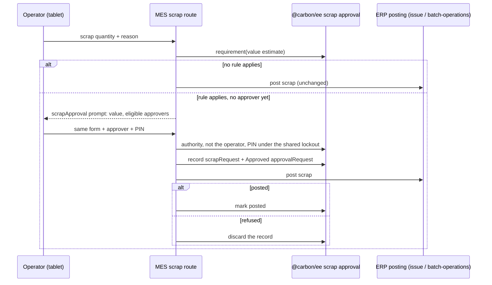

# Scrap approval at the tablet

> Status: in-progress
> Author: BettrCallRaul
> Date: 2026-10-24

## TLDR

An approval rule can require an approver's sign-off before scrap from the shop floor
posts. The rule is a new `scrap` approval document type with value tiers. A manager sets
it up in Settings → Approval Rules, as for purchase orders. When a rule applies, the scrap
dialog asks for an approver and that approver's console PIN on the same tablet. Then the
scrap posts as today, and Carbon records an Approved request for it. There is no pending
state, no inbox and no held scrap.

## Overview diagram



## Problem Statement

- Any employee signed in to the MES can scrap. Operation scrap, component scrap and batch
  completion with scrap check no permission, and the postings run as the system.
- Manufacturers want a second person to sign off scrap above a value. Purchase orders
  above a value already need an approver.
- The approvals engine already models approver groups and value tiers. But every approval
  type today is a record that waits in a status. Scrap is an event that posts at once, and
  the MES has no approval surface.

## Proposed Solution

The approver is on the floor, so the sign-off happens in the same request as the scrap.

1. `scrap` joins `approvalDocumentType` and the amount-tiered types. Settings → Approval
   Rules gets a Scrap card with tiers by estimated scrap value. A floor of 0 means every
   scrap.
2. The route estimates the material in the scrapped units before the posting, on the basis
   the scrap journal uses. The journal can write off less: the backflush stops at the job's
   planned material (`quantityIssued` reaching `estimatedQuantity`), and a batch completion
   issues material for good units only and posts no scrap journal.
   - A Standard item costs its standard cost. Any other item costs its `itemCost.unitCost`,
     or its standard cost when the unit cost is 0 or missing.
   - Operation scrap: the materials this operation backflushes (untracked, a stocked type,
     still planned, and the materials of its kitted Make to Order children), plus every non
     Make to Order material of the earlier operations, times the scrap quantity.
   - Component scrap: the cost of the scrapped entity's item, times its quantity.
   - Batch completion: the members' scrap, summed.
3. If no enabled rule exists, or the value is under every tier, the scrap posts as before.
   Carbon reads no PINs and writes no record.
4. If a rule applies, the first submit gets `{ scrapApproval }` back and posts nothing. The
   answer holds the value, the currency and the eligible approvers.
5. The eligible approvers are the approvers of the matched tier and of every higher tier.
   Only those with a console PIN are offered, and never the operator.
6. The dialog shows an approver list and a PIN pad. It sends the same form again with
   `approverId`, `approverPin` and `approvedValue`, the value the approver was shown. A
   change to the scrap quantity clears the prompt, so a new value is shown again.
7. The route then does these steps:
   1. Refuse the operator as approver.
   2. Check the approver's authority with `canApproveRequest`.
   3. Refuse an approver the prompt did not offer: inactive, or with no PIN.
   4. Refuse when `approvedValue` is not the value the route computes now.
   5. Check the PIN against `employeePin`, under the console pin-in lockout.
   6. Record a `scrapRequest` and an Approved `approvalRequest` in one transaction.
   7. Post the scrap.
   8. Mark the record posted. If the posting refused the scrap (4xx), delete the record.
      Any other failure may have committed, so the record stays with no `postedAt`.
8. A batch completion whose phase 2 failed has already recorded its scrap. Its record is
   marked posted, and the resumed completion posts without a second approval.
9. Scrap typed in on a job's quantities in the ERP or through the API meets the same
   rules. `createProductionQuantity` and an `updateProductionQuantity` that adds scrap (or
   moves it to another operation) refuse a caller who cannot approve at that tier. An approver records it on their own
   authority, with the approval written in their name. An API key is always refused.
10. Production → Scrap Approvals lists every approved scrap: job, item, quantity, reason,
    estimated value, posted or not confirmed, recorded by, approved by, and when.

### Design Decisions

| Decision | Choice | Rationale |
|----------|--------|-----------|
| Sign-off shape | PIN at the tablet, synchronous | Scrap posts at once (count, backflush, replacement serial, journal). A queue needs a held-scrap record, replay and stale-state guards, and the MES has no pending state. |
| Rule condition | Value tiers on the estimated material value; a floor of 0 means every scrap | The engine's one condition is `lowerBoundAmount`. A materials-only value is what the scrap journal relieves per unit. Where the journal writes off less (the backflush cap, batch completion), the estimate still values the material in the scrapped units, so the tier errs high. |
| Cost basis | Unit cost, else standard cost when the unit cost is 0 | A new item reads 0 until a receipt, and its scrap would pass under every tier. |
| Self-approval at the tablet | Refused | The PIN step means nothing if the operator signs their own scrap. |
| ERP and API scrap | An approver records it on their own authority; everyone else is refused; an API key is refused | No tablet and no second person at a desk. This is asymmetric with the tablet, where an approver who scraps needs a second approver. |
| Gate placement | MES routes and ERP service functions; the decisions live in `@carbon/ee` | Matches the purchase order finalize gate. A PIN never enters a posting payload: the `issue` posting logs its payload. |
| Order of writes | Record, then post, then mark posted | Every posted scrap that needed approval has a record. A crash leaves a record with `postedAt` null, never an unrecorded scrap. |
| Approver PIN | The console PIN (`employeePin`) | Reuses the bcrypt table. Set Console PIN on Users → Employees now also shows when a scrap rule is enabled, with console mode off. |
| PIN guessing | The console pin-in budgets, shared | A guess at either surface counts at both: 5 per person and 30 per terminal in 15 minutes. |
| Paths in scope | MES operation scrap, component scrap and batch completion with scrap; ERP job quantities | Inventory adjustment Scrap and issue close Scrap belong to inventory and quality. |
| Entitlement | `APPROVAL_RULES` (Business and Partner plans) | `getApprovalRuleByAmount` reads no rule without it. |
| What the approver signs | The value they were shown (`approvedValue`), checked again on the server | Without it an operator could raise the quantity after the PIN went in, and a top-tier approver's authority would cover any value. |
| Ambiguous posting failures | Keep the record, unconfirmed | A timeout after the commit must not leave a posted scrap with no approval. The list shows the row as Not confirmed. |
| Job delete | `scrapRequest.jobId` is SET NULL | The record and its approval request outlive the job. |
| Floor of 0 in the rule form | Allowed (`min(0)` in `approvalRuleValidator`) | The form refused 0 (`gt(0)`), the floor "every scrap" needs. Purchase order rules can now save a floor of 0 too. |

## Data Model Changes

```sql
ALTER TYPE "approvalDocumentType" ADD VALUE IF NOT EXISTS 'scrap';

CREATE TABLE "scrapRequest" (
  "id" TEXT NOT NULL DEFAULT id('scr'),
  "companyId" TEXT NOT NULL,
  "jobId" TEXT,               -- null for a batch that spans jobs
  "jobOperationId" TEXT,      -- operation scrap
  "jobOperationBatchId" TEXT, -- batch completion
  "jobMaterialId" TEXT,       -- component scrap
  "trackedEntityId" TEXT,     -- the scrapped serial or component
  "itemId" TEXT,
  "scrapReasonId" TEXT,
  "quantity" NUMERIC NOT NULL,
  "estimatedValue" NUMERIC NOT NULL DEFAULT 0,
  "notes" TEXT,
  "postedAt" TIMESTAMPTZ
  -- audit columns, composite PK, FKs, indexes
);
```

- `approvalRequest.documentId` names the `scrapRequest`. The `approvalRequests` view shows
  the job (or the batch) as the readable id and the item as the description.
- The `scrapRequests` view joins the job, operation, batch, entity, item, reason and the
  latest approval request, for the list.
- RLS: an employee with `production_view` reads. No API role writes; the server writes over
  Kysely.
- No CHECK that one source column is set: a job delete runs the SET NULL on its operations'
  rows, and that CHECK would refuse it.

## API / Service Changes

- `@carbon/ee/approvals/scrap.server`: `hasScrapApprovalRules`, `hasBatchScrapApproval`, `describeScrap`,
  `getScrapApprovalRequirement`, `authorizeScrapApprover`, `recordScrapApproval`,
  `markScrapApprovalPosted`, `discardScrapApproval`, `getScrapApprovals`. Pure decisions in
  `approvals/scrap.ts`.
- `@carbon/ee/console.server`: `employeesWithPin`.
- MES: `services/scrap-approval.server.ts` (`postScrapWithApproval`) and
  `services/pin-limits.server.ts` (the budgets shared with console pin-in). Routes:
  `x+/scrap.tsx`, `x+/entity+/$materialId.$trackedEntityId.scrap.tsx`,
  `x+/batch.$batchId.complete.tsx`.
- ERP: `approveErpScrap` and `settleErpScrapApproval` in `production.service.ts`, called by
  `createProductionQuantity` and `updateProductionQuantity`.

## Closest Sibling

- Rules: purchase order approval tiers (`ApprovalRules.ee.tsx` card, `ApprovalRuleForm.ee.tsx`).
- Identity at the tablet: console pin-in (`x+/console.pin-in.tsx`, `PinInOverlay.tsx`).
- List: Production → Unattributed Time (`machine-time.tsx`, `MachineTimeTable.ee.tsx`), a
  commercial read-only list in the same module.

## UI Changes

- MES scrap dialogs: an "Approval needed" step with the estimated value, the approvers and a
  four-digit PIN pad. The submit button reads "Approve and Log Scrap", "Approve and Scrap"
  or "Approve and Complete".
- ERP Settings → Approval Rules: a Scrap card with tiers ("Minimum Scrap Value").
- ERP Production → Scrap Approvals: a table page, the Unattributed Time archetype.
- ERP Users → Employees: Set Console PIN also when a scrap rule is enabled.

## Acceptance Criteria

- [ ] No scrap rule: every scrap path behaves as before, with no extra prompt.
- [ ] A rule with floor 0: every MES scrap asks for an approver's PIN before it posts.
- [ ] Tiers: scrap under the lowest floor posts with no prompt. Above it, the dialog offers
      and accepts only approvers of that tier or higher.
- [ ] The operator cannot approve their own scrap. A wrong PIN is refused and counts against
      the console PIN lockout.
- [ ] Each approved scrap has a `scrapRequest` with `postedAt` and an Approved
      `approvalRequest`. A refused posting leaves neither.
- [ ] ERP job quantities: a non-approver is refused; an approver records it with an approval.
- [ ] Production → Scrap Approvals lists the approved scraps.

## Known gaps

- `productionQuantity` takes API-role writes (RLS `company("production")`), so a client
  with production create can insert a Scrap row through PostgREST with no approval. Such
  a row does no backflush and posts no journal, like the ERP form. A guard there would
  also stop the MES inspection disposition, which writes the row with the user's client.
- On Carbon Cloud a failed plan read makes `companyHasFeature` answer false, so the rule
  reads as off. Every approval type shares this.
- Rules apply per scrap event. An operator can split scrap into pieces under the lowest
  floor; a floor of 0 is the answer.

## Not in scope

- Queue-based approval, for an approver who is not at the tablet.
- Scrap from an inspection disposition in the MES, inventory adjustment Scrap and issue close
  Scrap. Each is a quality or inventory decision with its own owner.
- Holding the job while scrap waits.
- Per-reason, per-item or percentage rules: the engine matches on one amount.
- Demo dataset rows for scrap approvals (the dataset validator exempts `scrap`).
