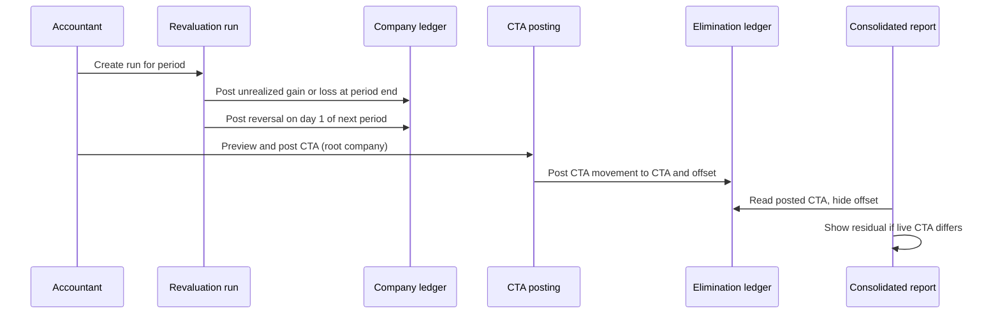

# Period-End FX Revaluation and Posted CTA

> Status: in-progress
> Author: Claude, for brad@carbonos.dev
> Date: 2026-10-26
> Research: `.ai/research/2026-10-26-fx-revaluation-and-cta-posting.md`
> Supersedes: §1 (revaluation), §2 (rate history) and §3 (posted CTA) of `.ai/specs/2026-07-04-fx-consolidation-completeness.md`. Its §4 (translation fixes) and §5 (historical-rate layers) stay live there.

## TLDR

The period close gets two new FX postings. A **Currency Revaluation run** revalues each company's open foreign-currency monetary items at the period-end closing rate. It posts the difference to new Unrealized Exchange Gain and Unrealized Exchange Loss accounts, and reverses it on day 1 of the next period. A **CTA posting** puts the group's cumulative translation adjustment (CTA) in the ledger. It posts the period's movement to the configured CTA equity account on the root company's elimination entity.

Revaluation goes to profit or loss (IAS 21.28, ASC 830-20-35-1). The CTA goes to equity (IAS 21.41, ASC 830-30-45-12). Neither posting ever puts a translation difference in profit or loss.

## Overview diagram



## Problem Statement

Carbon records realized exchange gains and losses only when a payment settles an invoice (`calculateSettlementFx`, `packages/database/src/accounting-currency.ts:73`). Nothing revalues an open foreign-currency balance at period end. Two problems follow:

1. **The balance sheet is wrong at every period end.** A EUR invoice booked at July's rate stays at July's rate until someone pays it. IAS 21.23 and ASC 830-20-35-2 require the closing-rate amount at each balance sheet date. IAS 34.B29–B31 applies the rule to interim periods.
2. **The CTA is not in the ledger.** `getConsolidatedBalances` (`apps/erp/app/modules/accounting/accounting.service.ts:5817`) calculates it when a report runs. `applyReportCta` (`:1109`) adds it to `accountDefault.currencyTranslationAccount`. Nobody can drill into it, it carries no balance forward, and the close records no evidence of it.

Facts that shape the design (verified in code on 2026-10-26):

| Fact | Where |
|---|---|
| `journalLine` has no `sourceAmount` or `sourceCurrencyCode`. Journals are base currency only. | `packages/database/src/types.ts` `journalLine` Row |
| No bank account entity exists. `payment.bankAccount` is a GL account id. `account` has no currency column. | `20260630093809` |
| `get_ar_open_by_customer` and `get_ap_open_by_supplier` return each open invoice and memo with `currencyCode`, `exchangeRate`, `openInCurrency` and `openInBase`, as of any date. | latest `20261009014620` |
| `get_ar_tie_out` and `get_ap_tie_out` sum every Posted line on the control accounts. A revaluation line on a control account breaks the tie-out. | `20261009014620:241,306` |
| Unapplied non-deposit cash sits on the AR or AP control account. A deposit sits on the deposit account. | `packages/database/src/build-payment-journal.ts:335-354` |
| `get_exchange_rate(company, code, asOf)` returns base = 1, else the company's override, else the global market ratio on or before `asOf`. It raises an error when no rate exists. | `20260903015941:217-258` |
| `reverseRunJournals` refuses a journal whose status is not Posted. | `accounting.service.ts:11340` |
| Each parent company gets an elimination entity in its own base currency when its first subsidiary joins. | `apps/erp/app/modules/settings/settings.service.ts:3981` |
| The account form always submits `consolidatedRate = "Average"`, on create and on edit. | `apps/erp/app/modules/accounting/ui/ChartOfAccounts/ChartOfAccountForm.tsx:125` |
| No part of the July spec's §1–§3 is built. `exchangeRateHistory` was dropped. | `20260903020233_currency-config-only.sql` |

## Proposed Solution

Three phases. Each phase ships alone.

### Phase 1 — Currency Revaluation run (AR, AP, memos, unapplied cash)

A run belongs to one company and one period end. It copies the depreciation run's lifecycle: Draft → Post → Undo (Reverse Run) → Draft, plus Recalculate and Delete.

**Exposures.** On Recalculate, the run reads every open foreign-currency item at the period end. A foreign-currency item is one whose currency differs from the company's base currency.

| Exposure type | Source | Open amount | Booked base amount | Adjustment account |
|---|---|---|---|---|
| `Receivable` | `get_ar_open_by_customer(company, periodEnd)`, invoices and memos | `openInCurrency` | `openInBase` | `arRevaluationAccount` |
| `Payable` | `get_ap_open_by_supplier(company, periodEnd)`, invoices and memos | `openInCurrency` | `openInBase` | `apRevaluationAccount` |
| `Unapplied Receipt` | Customer receipts with an unapplied remainder at `periodEnd`, deposits excluded | the remainder in payment currency (`remainingFundingSources`, `packages/utils/src/payment-funding.ts:668`) | the remainder's base carrying value (`remainingBase`) | `arRevaluationAccount` |
| `Unapplied Disbursement` | Supplier disbursements, same rule | same | same | `apRevaluationAccount` |

The as-of rule for unapplied cash matches `get_ar_tie_out`. A payment counts when it is Posted with `postingDate` ≤ `periodEnd`. A settlement counts when its applying payment (`paymentId`) is Posted with `postingDate` ≤ `periodEnd`. The rule does not read `appliedDate`.

Two legacy cases (`.ai/lessons.md:1977`):

- The RPCs count a settlement with a NULL `sourceAmount` as 0 document principal. So `openInCurrency` is too high for an invoice with a legacy settlement. For such an invoice, the run sets `openAmount = toDocumentAmount(openInBase, exchangeRate, decimalPlaces)`.
- The RPCs drop a memo that has a settlement with a NULL `sourceAmount`. The run does not revalue such a memo. The run page lists each one under "Not revalued", so the accountant can see it.

The run never revalues these non-monetary balances: customer deposits (IFRIC 22), prepaid expenses, inventory, fixed assets and equity.

Intercompany invoices are in the AR and AP RPCs, so the run revalues them like external invoices. The difference stays in consolidated profit or loss (IAS 21.45). The elimination engine does not eliminate revaluation lines. See Risks.

**Rates.** On create, the run stores one rate per exposure currency in `currencyRevaluationRate`. The default is `get_exchange_rate(companyId, currencyCode, periodEnd)`. Its `rateSource` is `Override` when the company has an `exchangeRateOverride` row, else `Market`. On a Draft run, a user can edit a rate. The edit sets `rateSource = 'Manual'` and recalculates the lines.

**Calculation, per line.**

1. `revaluedBaseAmount = toBaseAmount(openAmount, rate)` (`@carbon/database/accounting-currency`, divide convention, internal `SCALE`).
2. Each exposure has a balance side. `Receivable` and `Unapplied Disbursement` are debit balances (+1). `Payable` and `Unapplied Receipt` are credit balances (−1). An `Account Balance` line takes its side from the account class: Asset +1, Liability −1.
3. `differenceAmount = round(side × (revaluedBaseAmount − bookedBaseAmount))`. A positive value is a gain. A negative value is a loss.
4. If `differenceAmount` is 0, keep the line and post nothing for it.

The RPCs already sign memos by the control account's natural balance (an AR credit memo is negative), so one rule serves invoices and memos.

**Journals.** Post writes two journals in one Kysely transaction, both `sourceType = 'Currency Revaluation'`, both Posted:

| Journal | `postingDate` | Lines |
|---|---|---|
| Valuation journal (`currencyRevaluationRun.journalId`) | `periodEnd` | One line per run line on its adjustment account, with `documentType` / `documentId` of the source. One line for the total gain on `unrealizedExchangeGainAccount`. One line for the total loss on `unrealizedExchangeLossAccount`. |
| Reversal journal (`currencyRevaluationRun.reversalJournalId`) | `periodEnd + 1 day` | Every valuation line negated, documents kept |

Gains and losses post gross, per line, to separate accounts. The journal does not net them. `assertBalanced(…, EPSILON, "Currency revaluation journal")` guards both journals.

The run links the two journals through its own columns. It does not set `journal.reversedById`. That would mark the valuation journal Reversed, and `reverseRunJournals` refuses a Reversed journal, so Undo would fail.

**Why auto-reverse.** The realized gain at settlement already uses the original document rate (`calculateSettlementFx`). Auto-reverse keeps that calculation as it is. The total profit or loss of each period is correct under IAS 21.29. Delta would need a stored revalued amount per item and a change to `buildPaymentJournal`.

Worked example (USD company, rate = EUR per 1 USD):

1. July 10: invoice €1,000 at 0.90. Booked base = $1,111.11.
2. July 31: closing rate 0.85. Revalued base = $1,176.47. The valuation journal posts Dr AR Revaluation Adjustment $65.36, Cr Unrealized Exchange Gain $65.36.
3. August 1: the reversal journal posts Dr Unrealized Exchange Gain $65.36, Cr AR Revaluation Adjustment $65.36.
4. August 15: payment at 0.88 = $1,136.36. The payment journal posts a realized gain of $25.25 against $1,111.11, as it does today.
5. August profit or loss = −65.36 + 25.25 = −40.11 = 1,136.36 − 1,176.47. July shows +65.36. The total is +25.25.

**Periods and gates.**

- The run follows the depreciation run's gates: `assertAccountingCutover` / `ACCOUNTING_NOT_STARTED`, and `futureRunPeriodError`.
- It resolves both periods before the transaction with `getOrCreateAccountingPeriod(…, "accounting")`. A Locked period accepts the posting. A Closed period refuses it.
- Periods close in sequence. So when the period end is open, the next period is never Closed.
- An elimination entity never gets a revaluation run. It has no documents.

**One run per period.** A unique constraint allows one run per (company, `periodEnd`). Undo returns the run to Draft, so the company never needs a second run for the same period end.

**Stale run.** Post re-reads the exposures and refuses with `RunOutOfDateError` when they differ from the Draft lines (the depreciation precedent). If a user posts a back-dated document into the period after the run posts, the close check fails. The user then runs Undo and posts again.

**Undo.** Undo calls `reverseRunJournals` on both journals, with `resolveReversalPeriods`, then sets the run to Draft. Undo refuses once the run's own period is Closed. Each reversal would move to the company's today on its own, so the two would land on different dates and leave a revaluation on the books between them. The Draft could also never post again into a Closed month.

**Close checklist.** A new definition, seeded for every company:

| Field | Value |
|---|---|
| `name` | Revalue foreign currency balances |
| `taskType` | Auto |
| `autoCheckKey` | `fx-revaluation` |
| `severity` | Warning |
| `required` | true |
| `sortOrder` | before `unmatched-ic` (NetSuite order: revaluation before elimination) |

The check passes when one of two conditions is true:

- The company has no foreign-currency exposure at `periodEnd`.
- A Posted run exists for `periodEnd`, and its lines equal a fresh exposure read at the run's rates, within `EPSILON`.

The check reuses the run preview (`getPeriodRunPreview` pattern, `accounting.service.ts:3726`). The close page shows a Create Run button for it, as it does for depreciation.

### Phase 2 — Foreign-currency balance accounts (bank, cash, loans)

**Account currency.** Add `account.currencyCode`, nullable. A user sets it on a posting account of class Asset or Liability (the account form shows it only then). It names the currency the account's balance is held in. Accounts are group-scoped. So a company skips an account whose currency equals its base currency, and an account it has never posted to.

**Run lines.** Recalculate adds one `Account Balance` line per such account:

| Column | Value |
|---|---|
| `bookedBaseAmount` | the account's GL balance at `periodEnd` (`GL_JOURNAL_STATUSES`, natural sign), less every Currency Revaluation journal dated on or before `periodEnd`. Without that, a posted run would look stale against its own valuation. |
| `openAmount` | the balance in the account currency on the period-end statement. The accountant types it in on the Draft run. |
| adjustment account | the account itself. It has no subledger to tie out to. |

- Post refuses while any `Account Balance` line has no `openAmount`.
- Recalculate keeps an entered `openAmount`.
- The run shows who entered each balance and when (`openAmountEnteredBy`, `openAmountEnteredAt`).
- Auto-reverse means the GL balance at `periodEnd` never includes an earlier revaluation. The day-1 reversal removed it.

When the bank reconciliation spec adds `journalLine.sourceAmount`, Recalculate can prefill `openAmount` from it. This spec does not depend on that.

### Phase 3 — Posted CTA

**Where it posts.** On the **root company's elimination entity**: the elimination entity whose `parentCompanyId` is the group's root company. That entity uses the root's base currency, which is the presentation currency.

**What it posts.** One balanced journal per posting, `sourceType = 'Currency Translation'`, `status = 'Posted'`, dated `periodEnd`, in the elimination entity's period. The journal sets no `eliminationKind`, so Regenerate in the intercompany workbench never reverses it:

| Line | Account | Amount |
|---|---|---|
| 1 | root `accountDefault.currencyTranslationAccount` | the movement, natural sign |
| 2 | root `accountDefault.currencyTranslationOffsetAccount` | the same amount, opposite sign |

The steps:

1. `liveCta` = the CTA that `getConsolidatedPeriodSeries` calculates for one bucket, with every operating company selected. The bucket is the accounting period itself: `start` = the period's start date, `end` = `periodEnd`. It uses the same code path as the consolidated balance sheet.
2. `postedCta` = −1 × the balance of the offset account on the elimination entity at `periodEnd`. Only CTA journals post to the offset account, so its balance is the posted CTA with the opposite sign.
3. `movement = liveCta − postedCta`. If `movement` rounds to 0 at the root currency's `decimalPlaces`, post nothing.

**No table.** The ledger holds the posted CTA. After a late change, the next posting writes another movement. SAP Group Reporting reruns post deltas the same way. No Undo is needed, because the next posting corrects the balance.

**Why an offset account.** A balanced journal cannot carry a one-sided plug. A full per-account consolidation ledger (SAP group journal) is out of scope. The offset account keeps the entry balanced. The consolidated report hides the offset account, so equity shows the CTA once.

**Consolidated reports.** `applyReportCta` gets the offset account id. If the offset row is absent, or its balance is 0 in every bucket, `applyReportCta` behaves as it does today. Otherwise, per bucket:

1. The CTA row keeps its booked balance. That balance already holds the posted CTA, because the elimination entity's ledger is in the consolidation.
2. `residual = liveCta − postedCta`.
3. If `residual` is not 0 in any bucket, add a synthetic leaf "Unposted translation adjustment" (`id = UNPOSTED_CTA_ACCOUNT_ID`) beside the CTA row, with `translatedBalance = residual`.
4. Remove the offset row before the translated rollup.

The CTA row plus the synthetic row equals `liveCta`, so the statement still balances. A report on one company translated alone does not include the elimination entity, so its behavior does not change.

The posting uses a one-month bucket. A quarterly or yearly report column takes its average rate over a longer window, so its residual row can show a small amount. That is expected.

**Who posts it.** A user with `accounting_update` on the root company. The service checks that the caller's company is the group's root (`parentCompanyId IS NULL`). It also checks that the root has an accounting cutover. The elimination entity has no cutover of its own. The write uses `ctx.asSystem.pg`, scoped to the elimination entity's id. `resolveAccountingPeriod` (`shared.service.ts:15188`) finds or creates the elimination entity's period, and refuses a Locked or Closed period, as the elimination engine does.

**Close checklist.** A new definition, seeded for every company:

| Field | Value |
|---|---|
| `name` | Post currency translation adjustment |
| `taskType` | Auto |
| `autoCheckKey` | `cta-posted` |
| `severity` | Warning |
| `required` | true |
| `sortOrder` | after `unmatched-ic` |

The check passes in two cases:

- The company is not the root of a group with an active company in another base currency.
- The movement rounds to 0.

The CTA preview lists each subsidiary whose `fx-revaluation` check fails for the period. It warns, and it does not block (NetSuite order: revaluation first).

**Rate types fix (prerequisite).** The posted CTA depends on each account's `consolidatedRate`. `ChartOfAccountForm` always submits `"Average"`, so an edited balance-sheet account silently moves to the average rate. The form changes:

- **Create:** derive the default from the class. Asset and Liability get Current. Equity gets Historical. Revenue and Expense get Average. This matches `seed-data.ts`.
- **Edit:** keep the stored value.
- Show the field as a select, so an accountant can see and change it.

### Out of scope

| Item | Where it lives |
|---|---|
| Translated income statements at per-period average rates | July spec §4 |
| Historical-rate layers for equity | July spec §5 |
| Long-term intercompany loans to OCI (IAS 21.32, ASC 830-20-35-3(b)) | No loan entity exists. Future spec. |
| Elimination of intercompany revaluation lines | `.ai/specs/2026-07-04-intercompany-maturity.md` |
| CTA per foreign operation, NCI share, reclassification on disposal (IAS 21.48) | Future spec. The posted CTA is one group balance. |
| Remeasurement (books kept in a non-functional currency, highly inflationary) | Carbon treats `baseCurrencyCode` as the functional currency, as NetSuite does. |
| Delta valuation, lowest-value methods | Not compliant (lowest value) or not needed (delta). |

### Design Decisions

| # | Decision | Choice | Rationale |
|---|----------|--------|-----------|
| 1 | What the close posts | Revaluation → profit or loss in each company. CTA → equity on the root's elimination entity. | Q1. IAS 21.28 and 21.41; ASC 830-20-35-1 and 830-30-45-12. SAP, Business Central and Intacct post both. |
| 2 | Posting technique | Auto-reverse on day 1 of the next period | Keeps `calculateSettlementFx` unchanged. SAP classic, NetSuite and Odoo default. |
| 3 | AR/AP presentation | Separate AR and AP revaluation adjustment accounts | The tie-out RPCs sum every control-account line. SAP classic KDF pattern. |
| 4 | Account-balance presentation | Post directly to the balance account | No subledger to tie out. SAP KDB pattern. |
| 5 | Gain and loss accounts | Two new defaults, separate from the realized pair, posted gross | Every surveyed product separates them. The split matters for tax. |
| 6 | Bank and other balances | `account.currencyCode` plus a statement balance entered on the run | Q2. Journals carry no source currency. The statement is the source of truth. Business Central revalues bank accounts that carry a currency code. |
| 7 | Rate | `get_exchange_rate` at `periodEnd`, stored per currency on the run, editable on Draft | Q3. One resolver for documents and revaluation. The stored rate is the audit trail. Odoo and SAP allow a valuation rate. |
| 8 | Checklist severity | Warning for both checks | Q4. Precedent: depreciation, revenue recognition, lease and IC checks are Warning. A controller can raise them to Blocker in the template. |
| 9 | Intercompany open items | Revalue like external items. No elimination of revaluation lines in v1. | Q5. IAS 21.45. NetSuite revalues IC items in each entity. |
| 10 | CTA mechanics | Movement journal, CTA ↔ offset, on the root's elimination entity. No table. | Q6. A balanced journal needs an offset. The ledger holds the cumulative balance, so reposting is safe. |
| 11 | One CTA definition | The posting calls the consolidated report's own CTA path | The report and the ledger can never disagree. |
| 12 | Run-to-journal link | Run columns `journalId` and `reversalJournalId`, not `reversedById` | `reverseRunJournals` refuses a Reversed journal. Undo must reverse both. |
| 13 | Monetary scope | AR, AP, memos, unapplied cash, flagged accounts. Never deposits. | IAS 21.16, IFRIC 22. |
| 22 | New account defaults stay nullable | Follow the lessee-lease precedent: nullable, backfilled, in `ACCOUNT_DEFAULT_COLUMNS` and `OPTIONAL_DEFAULT_ROLES`. The run refuses with a rule error when one is empty. | A NOT NULL column with no DEFAULT fails the backup check. Setup readiness still requires the accounts. |
| 14 | Multi-tenancy (heuristic 1) | New tables: `id('prefix')`, `companyId`, PK `("id", "companyId")`, audit columns. `account.currencyCode` is group-scoped like `account`. | House convention. |
| 15 | Service shape (heuristic 2) | Operations in `accounting.server.ts` (`defineServiceFn`). Building blocks in `accounting.service.ts` take `db` or `trx`. Models in `accounting.models.ts`. | `.claude/rules/module-files.md`. The depreciation run's split. |
| 16 | RLS (heuristic 3) | Run tables through the authz manifest, `company("accounting", { read: "accounting_view" })` | The revenue recognition run precedent (`packages/database/src/authz/manifest.ts:436`). |
| 17 | Permissions (heuristic 4) | Create and recalculate: `accounting_create`. Post, Undo, rate and balance edits: `accounting_update`. Delete: `accounting_delete`. CTA post: `accounting_update` on the root. | Matches `createRunForPeriod` and the depreciation routes. |
| 18 | Forms (heuristic 5) | Rate edits and balance entries use `ValidatedForm` + zod validators, posted to route actions with an `intent` | `.claude/rules/conventions-forms.md`. |
| 19 | Module layout (heuristic 6) | All code in `modules/accounting/`. Routes in `x+/accounting+/` and `x+/currency-revaluation-run+/`. No barrel. | `.claude/rules/module-files.md`. |
| 20 | Backward compatibility (heuristic 7) | Additive: two enum values, one nullable column, five `accountDefault` columns (backfilled), three tables. `applyReportCta` changes output only when a CTA journal exists. | No FROZEN surface changes. |
| 21 | Accounting sync | `POSTING_POLICY`: `Currency Revaluation` syncable, `defaultEnabled: false`. `Currency Translation` `syncable: false`. | New types are opt-in, like `Lease Run`. A CTA journal lives on an elimination entity, which has no integration. |

## Data Model Changes

One migration per phase (`pnpm db:migrate:new <name>`). Run `pnpm run generate:types` after each one.

```sql
-- Enum migration (alone: a new enum value cannot be used in the same transaction)
ALTER TYPE "journalEntrySourceType" ADD VALUE IF NOT EXISTS 'Currency Revaluation';
ALTER TYPE "journalEntrySourceType" ADD VALUE IF NOT EXISTS 'Currency Translation';

-- Phase 1 ----------------------------------------------------------------

-- Account defaults: nullable, seeded and backfilled by id (lessee-lease precedent,
-- 20261011163211). ACCOUNT_DEFAULT_COLUMNS makes them required at accounting setup.
ALTER TABLE "accountDefault"
  ADD COLUMN IF NOT EXISTS "unrealizedExchangeGainAccount" TEXT,
  ADD COLUMN IF NOT EXISTS "unrealizedExchangeLossAccount" TEXT,
  ADD COLUMN IF NOT EXISTS "arRevaluationAccount" TEXT,
  ADD COLUMN IF NOT EXISTS "apRevaluationAccount" TEXT;
-- Seed per company group. Resolve each parent by "isGroup" = TRUE AND name,
-- never by number (.ai/lessons.md).
--   4160 'Unrealized Exchange Gains'   Revenue, Other Income, in 'Other Income'
--   7030 'Unrealized Exchange Losses'  Expense, Other Expense, in 'Other Expenses'
--   1170 'AR Revaluation Adjustment'   Asset, Other Current Asset, in 'Receivables'
--   2030 'AP Revaluation Adjustment'   Liability, Other Current Liability, in 'Payables'
-- consolidatedRate: Average for the two P&L accounts, Current for the two
-- balance-sheet accounts. Add FKs.

CREATE TABLE "currencyRevaluationRun" (
  "id" TEXT NOT NULL DEFAULT id('fxr'),
  "currencyRevaluationRunId" TEXT NOT NULL,          -- readable, sequence 'currencyRevaluationRun'
  "companyId" TEXT NOT NULL,
  "periodEnd" DATE NOT NULL,
  "status" TEXT NOT NULL DEFAULT 'Draft',
  "journalId" TEXT,                                  -- valuation journal, periodEnd
  "reversalJournalId" TEXT,                          -- reversal journal, periodEnd + 1
  "postedAt" TIMESTAMP WITH TIME ZONE,
  "postedBy" TEXT REFERENCES "user"("id"),
  "createdBy" TEXT NOT NULL REFERENCES "user"("id"),
  "createdAt" TIMESTAMP WITH TIME ZONE NOT NULL DEFAULT NOW(),
  "updatedBy" TEXT REFERENCES "user"("id"),
  "updatedAt" TIMESTAMP WITH TIME ZONE,
  CONSTRAINT "currencyRevaluationRun_pkey" PRIMARY KEY ("id", "companyId"),
  CONSTRAINT "currencyRevaluationRun_companyId_fkey" FOREIGN KEY ("companyId")
    REFERENCES "company"("id") ON DELETE CASCADE ON UPDATE CASCADE,
  CONSTRAINT "currencyRevaluationRun_status_check" CHECK ("status" IN ('Draft', 'Posted')),
  CONSTRAINT "currencyRevaluationRun_readable_key" UNIQUE ("currencyRevaluationRunId", "companyId")
);
ALTER TABLE "currencyRevaluationRun"
  ADD CONSTRAINT "currencyRevaluationRun_period_key" UNIQUE ("companyId", "periodEnd");

CREATE TABLE "currencyRevaluationRate" (
  "id" TEXT NOT NULL DEFAULT id('fxrr'),
  "companyId" TEXT NOT NULL,
  "runId" TEXT NOT NULL,
  "currencyCode" TEXT NOT NULL REFERENCES "currencyCode"("code"),
  "rate" NUMERIC NOT NULL CHECK ("rate" > 0 AND "rate" <> 'NaN'::numeric),  -- units per 1 base unit
  "rateSource" TEXT NOT NULL,                        -- 'Market' | 'Override' | 'Manual'
  "createdBy" TEXT NOT NULL REFERENCES "user"("id"),
  "createdAt" TIMESTAMP WITH TIME ZONE NOT NULL DEFAULT NOW(),
  "updatedBy" TEXT REFERENCES "user"("id"),
  "updatedAt" TIMESTAMP WITH TIME ZONE,
  CONSTRAINT "currencyRevaluationRate_pkey" PRIMARY KEY ("id", "companyId"),
  CONSTRAINT "currencyRevaluationRate_run_fkey" FOREIGN KEY ("runId", "companyId")
    REFERENCES "currencyRevaluationRun"("id", "companyId") ON DELETE CASCADE,
  CONSTRAINT "currencyRevaluationRate_source_check" CHECK ("rateSource" IN ('Market', 'Override', 'Manual')),
  CONSTRAINT "currencyRevaluationRate_run_currency_key" UNIQUE ("runId", "currencyCode")
);

CREATE TABLE "currencyRevaluationLine" (
  "id" TEXT NOT NULL DEFAULT id('fxrl'),
  "companyId" TEXT NOT NULL,
  "runId" TEXT NOT NULL,
  "exposureType" TEXT NOT NULL,
  "documentType" TEXT,                               -- invoice, memo or payment; NULL for Account Balance
  "documentId" TEXT,
  "accountId" TEXT NOT NULL REFERENCES "account"("id"),   -- adjustment account, or the balance account
  "currencyCode" TEXT NOT NULL REFERENCES "currencyCode"("code"),
  "openAmount" NUMERIC,                              -- in currencyCode; NULL until entered (Account Balance)
  "openAmountEnteredBy" TEXT REFERENCES "user"("id"),
  "openAmountEnteredAt" TIMESTAMP WITH TIME ZONE,
  "bookedBaseAmount" NUMERIC NOT NULL,
  "revaluedBaseAmount" NUMERIC,
  "differenceAmount" NUMERIC,                        -- positive = gain
  "createdBy" TEXT NOT NULL REFERENCES "user"("id"),
  "createdAt" TIMESTAMP WITH TIME ZONE NOT NULL DEFAULT NOW(),
  "updatedBy" TEXT REFERENCES "user"("id"),
  "updatedAt" TIMESTAMP WITH TIME ZONE,
  CONSTRAINT "currencyRevaluationLine_pkey" PRIMARY KEY ("id", "companyId"),
  CONSTRAINT "currencyRevaluationLine_run_fkey" FOREIGN KEY ("runId", "companyId")
    REFERENCES "currencyRevaluationRun"("id", "companyId") ON DELETE CASCADE,
  CONSTRAINT "currencyRevaluationLine_exposureType_check" CHECK ("exposureType" IN (
    'Receivable', 'Payable', 'Unapplied Receipt', 'Unapplied Disbursement', 'Account Balance'))
);
-- RLS: add the three tables to packages/database/src/authz/manifest.ts.
-- Sequence: insert 'currencyRevaluationRun' for every company, and add it to
-- seed-data.ts sequences.

INSERT INTO "periodCloseTaskDefinition" (...)  -- 'fx-revaluation', every company

-- Phase 2 ----------------------------------------------------------------

ALTER TABLE "account"
  ADD COLUMN IF NOT EXISTS "currencyCode" TEXT REFERENCES "currencyCode"("code");
-- Recreate the "accounts" view (SELECT account.* froze its column list),
-- WITH(SECURITY_INVOKER=true).

-- Phase 3 ----------------------------------------------------------------

ALTER TABLE "accountDefault"
  ADD COLUMN IF NOT EXISTS "currencyTranslationOffsetAccount" TEXT;
-- Seed 3210 'Currency Translation Offset' (Equity, Equity - Close, Historical) in
-- 'Equity'. Never isSystem: report trees treat isSystem rows as chart roots.
-- Backfill by id, add the FK.

INSERT INTO "periodCloseTaskDefinition" (...)  -- 'cta-posted', every company
```

Each new `accountDefault` column also goes into these places:

- `seed-data.ts` `accountDefaults`
- `OPTIONAL_DEFAULT_ROLES` and `OPTIONAL_DEFAULT_LABELS` (`packages/database/src/journal-posting-status.ts`)
- `ACCOUNT_DEFAULT_COLUMNS` (`accounting-cutover/shared.ts:85`)
- the import labels (`account-import.ts:92`)
- `AccountDefaultsForm.tsx`
- the validator (`accounting.models.ts:583`)

Each new source type also goes into these places:

- `POSTING_POLICY`
- `journalEntrySourceTypes` (`accounting.models.ts:716`)
- the icon map (`components/Icons.tsx:606`)
- `RUN_JOURNAL_SOURCES` (`accounting.models.ts:1223`). This holds `Currency Revaluation` only, so that `reverseJournalEntry` refuses a run journal.

## API / Service Changes

`accounting.server.ts` (operations):

| Operation | Does |
|---|---|
| `createRunForPeriod` | accepts `run: "Currency Revaluation"` |
| `createCurrencyRevaluationRun` | creates a Draft for a period end, stores the rates, builds the lines |
| `recalculateCurrencyRevaluationRun` | rebuilds the lines at the stored rates, keeps entered balances |
| `updateCurrencyRevaluationRate` | edits one rate on a Draft, sets `Manual`, recalculates |
| `updateCurrencyRevaluationBalance` | enters `openAmount` for an `Account Balance` line |
| `postCurrencyRevaluationRun` | drift check, then posts both journals in one transaction |
| `reverseCurrencyRevaluationRun` | Undo, back to Draft |
| `deleteCurrencyRevaluationRun` | deletes a Draft |
| `previewCurrencyTranslation` | per-company CTA contribution, `liveCta`, `postedCta`, movement, subsidiaries with a failing `fx-revaluation` check |
| `postCurrencyTranslation` | posts the movement journal on the root's elimination entity |

`accounting.service.ts` (building blocks):

| Building block | Does |
|---|---|
| `buildCurrencyRevaluationLines(db, args)` | pure over the exposure reads and the rates, unit-tested |
| `readRevaluationExposures(db, companyId, periodEnd)` | calls the AR/AP RPCs, the unapplied-cash read and the flagged accounts |
| `insertCurrencyRevaluationJournals(trx, args)` | writes both journals |
| `getCurrencyRevaluationPreview` | feeds the `fx-revaluation` close check |
| `getPostedCta(db, eliminationCompanyId, accountId, periodEnd)` | the posted CTA balance |
| `applyReportCta` | subtracts `postedCta`, hides the offset row |

## Closest Sibling

**The depreciation run.** It computes its lines when it is created. It does not claim schedule rows. It has one line per entity, Recalculate, a drift check at post, Undo and a close check driven by a preview. The revaluation run copies it file for file.

| Depreciation run | Currency Revaluation run |
|---|---|
| `routes/x+/accounting+/depreciation-runs.tsx` | `routes/x+/accounting+/currency-revaluation-runs.tsx` |
| `routes/x+/accounting+/depreciation-runs.new.tsx` | `routes/x+/accounting+/currency-revaluation-runs.new.tsx` |
| `routes/x+/depreciation-run+/$depreciationRunId.tsx` | `routes/x+/currency-revaluation-run+/$runId.tsx` |
| `$depreciationRunId.post.tsx`, `.recalculate.tsx`, `.reverse.tsx`, `.delete.tsx` | `$runId.post.tsx`, `.recalculate.tsx`, `.reverse.tsx`, `.delete.tsx` |
| `$depreciationRunId.repeat.tsx` | not copied. Each period needs its own rates. |
| `ui/FixedAssets/DepreciationRunHeader.tsx`, `…Status.tsx`, `…Table.tsx`, `…Documents.tsx` | `ui/CurrencyRevaluation/CurrencyRevaluationRunHeader.tsx`, `…Status.tsx`, `…Table.tsx`, `…Documents.tsx` |
| `postDepreciationRun`, `reverseDepreciationRun` | `postCurrencyRevaluationRun`, `reverseCurrencyRevaluationRun`. Both reuse `reverseRunJournals` and `resolveReversalPeriods`. |

Deviations, each a Design Decision:

| Deviation | Decision |
|---|---|
| Two journals per run, not one | #2, #12 |
| Rates stored and edited per run | #7 |
| Account Balance lines take a typed balance | #6 |
| New tables use `id('prefix')` and a composite PK (`depreciationRun` uses `xid()` and a single PK) | #14 |

The CTA posting has no run sibling. It copies the intercompany elimination action: a preview, then a post on the elimination entity through the service role.

## UI Changes

The run pages copy the depreciation run archetype (a list page plus a detail page with a header, status and a lines table).

1. **Nav.** Add "Currency Revaluation" to the "Closing" group (`ui/useAccountingSubmodules.tsx:79`).
2. **Run detail.** It has three parts:
   - The header shows the period end, the status and the two journals (Documents panel).
   - The rates grid has one row per currency: rate, source and an edit action on Draft.
   - The lines table has columns for exposure type, document link, currency, open amount, booked base, revalued base and difference. An `Account Balance` line has an editable open amount on Draft and shows who entered it.
   - The table totals gains and losses.
3. **Period close page.** The `fx-revaluation` row gets a Create Run button. The `cta-posted` row on the root company gets a Preview CTA button. The button opens a modal with the per-company contributions, the warning list and a Post button.
4. **Account form.** Add an "Account Currency" select for Asset and Liability posting accounts. Make `consolidatedRate` a visible select, defaulted by class on create.
5. **Account defaults form.** Add the five new accounts. The four revaluation accounts go in their sections. The offset goes beside Currency Translation in Equity.
6. **Consolidated balance sheet.** Hide the offset row. Show "Unposted translation adjustment" under the CTA row when the residual is not 0.

## Acceptance Criteria

Phase 1:

- [ ] A USD company has one open EUR invoice of €1,000 booked at 0.90 and a closing rate of 0.85. Its July run shows one Receivable line: booked $1,111.11, revalued $1,176.47, difference $65.36.
- [ ] Post creates a valuation journal dated July 31: Dr AR Revaluation Adjustment $65.36, Cr Unrealized Exchange Gain $65.36. It also creates a reversal journal dated August 1. Both journals are Posted, with `sourceType` Currency Revaluation.
- [ ] `get_ar_tie_out` for July 31 reports no difference after the post.
- [ ] A payment of €1,000 on August 15 at 0.88 posts a realized gain of $25.25. August profit or loss for the item is −$40.11.
- [ ] An open EUR supplier invoice produces a Payable line. A rate rise gives a loss on Unrealized Exchange Loss.
- [ ] An unapplied EUR customer payment produces an Unapplied Receipt line. A EUR customer deposit on a sales order produces no line.
- [ ] Editing the EUR rate on a Draft sets the source to Manual and recalculates every EUR line.
- [ ] Posting a back-dated EUR invoice into July after the run posted makes the `fx-revaluation` check fail. Undo then Post makes it pass.
- [ ] Undo reverses both journals. The run returns to Draft, and July and August net to 0.
- [ ] The service refuses a second run for the same company and period end.
- [ ] A company with no foreign-currency items passes `fx-revaluation` without a run.
- [ ] The service refuses a run for a company before its accounting cutover, with `ACCOUNTING_NOT_STARTED`.

Phase 2:

- [ ] A USD company has a Bank account with Account Currency EUR. The run shows it as an Account Balance line with its July 31 GL balance.
- [ ] Post refuses while that line has no statement balance.
- [ ] After the accountant enters €50,000, Post writes the difference directly to the bank account and the gain or loss account.
- [ ] Recalculate keeps the entered balance.

Phase 3:

- [ ] A USD root has a EUR subsidiary, and the consolidated July balance sheet shows CTA $38,400. Post CTA writes Dr Offset / Cr CTA $38,400 on the root's elimination entity, dated July 31.
- [ ] After that post, the consolidated balance sheet shows CTA $38,400, no offset row, no residual line, and it balances.
- [ ] In August the live CTA is $41,000. The preview shows posted $38,400 and a movement of $2,600. Post writes only $2,600.
- [ ] A user on a subsidiary cannot post the CTA. A user with `accounting_update` on the root can.
- [ ] The `cta-posted` check passes on a company that is not a group root, and on a root whose group has one currency.
- [ ] Creating a new Asset account defaults `consolidatedRate` to Current. Editing a Historical equity account keeps Historical.

## Risks

| Risk | Severity | Mitigation |
|---|---|---|
| Revalued intercompany balances are not eliminated, so a residual IC revaluation adjustment can show in the consolidated balance sheet | Med | IAS 21.45 keeps the profit or loss effect. The balance-sheet residual is listed in the CTA preview. Elimination is in the intercompany-maturity spec. |
| The posted CTA inherits the report's known errors: life-to-date income at a trailing average rate, and one historical rate per currency | Med | Rule #11 keeps one definition. The July spec §4–§5 fixes the calculation, and the next posting corrects the balance. |
| A wrong `consolidatedRate` on an edited account posts a wrong CTA | High | The Phase 3 form fix. Audit existing accounts in the migration: list (do not change) balance-sheet accounts set to Average. |
| An entered bank balance is wrong | Med | The run shows who entered it and when. Undo and re-post correct it. |
| A standing `exchangeRateOverride` ignores the period end, so an old pin becomes the closing rate | Med | The rates grid shows the source `Override`. The user can edit it to Manual. |
| Readers that filter `status = 'Posted'` only count the reversal journal | Low | Both revaluation journals stay Posted (Decision #12). |
| Unapplied payment remainder in document currency is missing for legacy settlements with NULL `sourceAmount` | Med | Readers must tolerate NULL (`.ai/lessons.md:1977`). Such a payment gets no line and appears in a run warning. |
| Elimination-entity writes through the service role | Med | Same pattern and root check as `generateEliminationEntries` and `applyCtaToReportPeriodSeriesForReport`. |

## Open Questions

> HARD STOP: Do not proceed with implementation until these are answered.

- [x] Q1. What does the close post: revaluation only, or revaluation plus a posted CTA, and where does the CTA go? — **Answer:** Option A. Revaluation goes to profit or loss in each company. The CTA posts to equity on the elimination entity. Never the CTA to profit or loss.
- [x] Q2. How does the run get a foreign-currency bank balance when journals carry no source currency? — **Answer:** Option A. Add `account.currencyCode`. The accountant enters the statement balance on the run. Posted directly to the account.
- [x] Q3. Which closing rate does the run use? — **Answer:** the user accepted the recommendation ("go with all of the recommendations"). The run uses `get_exchange_rate` at the period end. It stores one rate per currency, editable on Draft, with `rateSource`.
- [x] Q4. Blocker or Warning for the two close checks? — **Answer:** accepted the recommendation: Warning, matching the depreciation, revenue recognition, lease and IC checks.
- [x] Q5. How does the run treat intercompany open items? — **Answer:** accepted the recommendation: revalue them like external items (IAS 21.45). Elimination of revaluation lines is out of scope.
- [x] Q6. How does the CTA reach the ledger? — **Answer:** accepted the recommendation: a movement journal (CTA ↔ offset) on the root's elimination entity, with no table. Reports hide the offset and show any unposted residual.

## Changelog

- 2026-10-28: The two FX close tasks show only where they apply. `fx-revaluation` is hidden when nothing is open in a foreign currency at the period end and no run exists. `cta-posted` is hidden unless the company is the root of a group with a company in another base currency. A hidden task never gates the close and is stored as Done. An account counts as a balance exposure only after the company posts to it outside a revaluation journal. Migrations renamed past main's newest after merging main.
- 2026-10-27: Self-review fixes. An `Account Balance` line is booked without Currency Revaluation journals, so a posted run is never stale against its own valuation. Only accounts the company has posted to are its exposures. The close check counts an out-of-date Posted run even when nothing is open. Undo refuses a run whose period is Closed. The CTA post re-reads the posted CTA under a lock.
- 2026-10-27: Implemented on branch `consolidation-exchange-rates` (plan Tasks 1–22). Four deviations from the plan:
  - The statement balances are a separate editable grid, not a cell in the lines table.
  - The CTA preview lists the foreign-currency subsidiaries with no Posted revaluation run. One query does this. It does not evaluate each subsidiary's `fx-revaluation` check.
  - The run counter is exempt in the `document-sequence-synced` check (plan decision P5).
  - The CTA modal is a nested route under the close page (`periods.$periodId.close.cta.tsx`).
- 2026-10-26: Planning corrections from code: the defaults stay nullable (#22). The offset account is not `isSystem`. One run per period end. The as-of rule for unapplied cash and two legacy fallbacks. The CTA gate, period and residual row. See `.ai/plans/2026-10-26-fx-revaluation-and-cta-posting.md`.
- 2026-10-26: Created. Q1 and Q2 answered by the user. Q3–Q6 resolved by the user's acceptance of all recommendations. The `consolidatedRate` form fix added as a Phase 3 prerequisite. Supersedes §1–§3 of `2026-07-04-fx-consolidation-completeness.md`.
