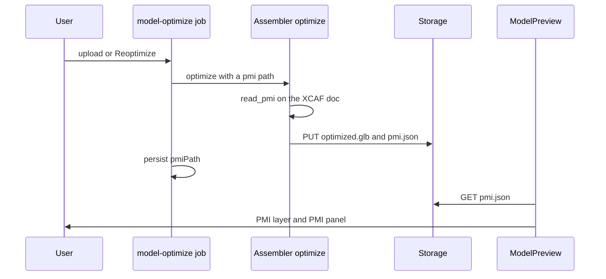

# PMI (model-based definition) in the STEP viewer

> Status: implemented (pending review)
> Author: Claude (autonomous `/feature` run for Brad)
> Date: 2026-10-26

## TLDR

A STEP AP242 file can carry PMI (Product Manufacturing Information): dimensions, geometric tolerances, datums and saved views. This is the model-based definition (MBD) of the part. Carbon's viewer shows none of it today.

This spec adds a `pmi.json` artifact that the assembler writes during the model ingest. It also adds a PMI layer and a PMI panel to `ModelPreview`. The user sees the author's annotations on the model, reads each tolerance in a list, opens the saved views, and picks an item to highlight the faces it controls. The change is view-only. Inspection characteristics from PMI are a later change.

Research: `.ai/research/step-pmi-viewer.md`.

## Overview diagram



## Problem Statement

Customers send STEP AP242 files that hold the tolerances of the part. A machinist or an inspector opens the part in Carbon and sees only the shape. To read a tolerance, the user must open the CAD tool or a separate PDF drawing. Two examples:

1. NIST test part CTC 01 holds 12 dimensions, 6 geometric tolerances and 3 datums. Carbon shows none of them.
2. NIST test part CTC 05 has 2 saved views, each with its own camera and its own set of annotations. Carbon shows one default camera.

OCCT already reads this data into the XCAF document that the converter opens (`STEPCAFControl_Reader` reads GD&T and views by default). The converter keeps only names, colors and the assembly tree, and drops the PMI.

## Proposed Solution

1. The assembler reads the PMI from the XCAF document in a new pass, `read_pmi` (`crates/occt-bridge`). The pass does not change the tessellation, the GLB or any `nodeId`.
2. `crates/converter` turns the result into a `pmi.json` document (version 1). All geometry is in world mm, in the same frame as the GLB.
3. The `optimize` action writes `pmi.json` as a fourth ingest output when the caller asks for it and the model has PMI.
4. The `model-optimize` job asks for it, uploads it to `{companyId}/models/{modelUploadId}/pmi-{run}.json` and sets `modelUpload.pmiPath`. It removes the file of the run before.
5. The artifacts routes (ERP and MES) return `pmiPath`. The hosts pass `pmiUrl` to `ModelPreview`.
6. `ModelPreview` loads the document. It draws the PMI layer and shows a PMI panel.

### What the artifact holds

| Part | Content |
|---|---|
| `items[]` | One entry per dimension, geometric tolerance, datum and graphic-only annotation |
| `item` semantic values | Kind, type, nominal, upper and lower tolerance, limits, fit class, decimals, zone value and modifiers, datum references |
| `item.lines` | The graphical PMI as polylines (leader lines, frames, stroked text) |
| `item.mesh` | Filled graphical PMI (tessellated text) as triangles |
| `item.plane`, `item.textPosition` | The annotation plane and the text anchor |
| `item.faces`, `item.edges` | Indices into the document's referenced faces and edges |
| `faces[]`, `edges[]` | Triangles of each referenced face and polylines of each referenced edge |
| `views[]` | Saved views: name, view direction, up direction, projection, the ids of the items the view shows |

### Viewer behavior

| Action | Result |
|---|---|
| The model has PMI | A "PMI" panel shows under the Measurements panel, with the item count |
| Toggle the eye button | The PMI layer shows or hides |
| Open the panel | The user sees the items grouped as Dimensions, Tolerances, Datums and Notes, each with its formatted label |
| Pick an item | The item turns blue and draws on top of the model. Its faces and edges get a blue highlight. The camera turns to face the annotation plane and fits the item |
| Pick the item again | The selection clears |
| Pick a saved view | The camera takes the view's direction and up direction and fits the view's items. Only those items show |
| Pick "All PMI" | All items show again |
| Change the unit (mm / in) | Measurements and PMI labels change together |

If an item has no graphical PMI, the viewer draws a text label at the item's text anchor. If the item has no text anchor, the viewer draws the label at the center of its referenced faces.

### Design Decisions

| Decision | Choice | Rationale |
|---|---|---|
| Graphical or semantic PMI | Both | The drawing is what designers expect (SAP, Siemens, NIST SFA). The semantic values make a later inspection link possible (High QA pattern) |
| Where PMI is read | A new pass `read_pmi` that opens the document again, in the optimize ingest | The converter, its tessellation and every `nodeId` stay unchanged. The ingest already has the `.xbf`, which parses fast |
| Which action writes it | `optimize` (ingest) only, opt-in through a `pmi` body key | `ModelPreview` shows the optimized GLB. `convert` (assembly player) is out of scope for v1. Opt-in keeps other callers unchanged |
| Face highlight | Ship each referenced face's own triangles in `pmi.json` | The optimized GLB merges and can simplify meshes, so per-face ranges in the GLB would not survive. Only referenced faces ship, so the size stays small |
| Coordinate frame | World mm. Part-level PMI uses the first instance of its part | OCCT stores presentation in the part frame. One instance keeps the list free of copies. MBD files are mostly single parts |
| Duplicate datums | Merge datums with the same name. Keep the first copy that has graphical PMI | OCCT adds a datum once per tolerance that uses it |
| Saved view camera | Use view direction and up direction. Fit the view's items | OCCT stores the projection point relative to the camera frame, so it is not a world point |
| Annotation placement | In its plane, as the author drew it | SAP, Siemens and SOLIDWORKS defaults |
| Depth | Depth-tested by default. The selected item draws on top | Hundreds of always-on-top annotations hide the model. SAP offers "Always on Top" as an option, not a default |
| Label formatting | In TypeScript (`pmi.ts`), from the semantic values | The unit toggle changes the label, and vitest can test the formatter |
| Display unit | One mm / in toggle for Measurements and PMI. It starts at the PMI's source unit when known. Otherwise it keeps today's default (in) | An inch file reads naturally in inches. The decimals in the file only apply in its own unit. Models with no PMI keep today's behavior |
| Storage column | New nullable `modelUpload.pmiPath` | Same shape as `glbPath`, `graphPath`, `optimizedModelPath` |
| Existing models | No backfill. "Reoptimize from source file" writes `pmi.json` | The action already exists on the GLB badge. A forced backfill would re-optimize every model |
| Failure | A PMI failure never fails the optimize. It adds a warning and writes no `pmi.json` | The preview matters more than the PMI |
| Size cap | 16 MB of JSON. Over the cap, drop face triangles first. Still over: no `pmi.json`, plus a warning | A bad file must not make a huge artifact |
| Heuristic 1–3 (tenancy, service shape, RLS) | No new table. One column on `modelUpload`, which keeps its RLS | — |
| Heuristic 4 (permissions) | The artifacts routes keep `role: "employee"`. The preview proxy keeps its company path check | No change to RBAC |
| Heuristic 5 (forms) | N/A | No form |
| Heuristic 6 (module layout) | No ERP module change. Viewer code goes in `packages/viewer/src` | — |
| Heuristic 7 (compatibility) | Additive only. `graph.json` and `types.ts` stay as they are. `pmi.json` is a new versioned contract in `packages/viewer/src/pmi.ts` and `crates/converter/src/pmi.rs`. `CODE_VERSION` stays at 4 | Only `plan` reads the result-pointer cache, and `convert` the file cache. `optimize` reads neither, so a bump would only throw away convert and plan results |

## Data Model Changes

```sql
ALTER TABLE "modelUpload" ADD COLUMN "pmiPath" TEXT;
```

`modelUpload` keeps its RLS policies. `STORAGE_PATH_COLUMNS` (`company-backup.ts`) adds `pmiPath`, so a cross-company restore rewrites it with the other model paths. The closure test (`company-backup.closure.test.ts`) adds it to `MODEL_UPLOAD_PATH_COLUMNS`.

### `pmi.json` version 1

```ts
type PmiDocument = {
  version: 1;
  unit: "mm";
  sourceUnit: "mm" | "in" | null;
  items: PmiItem[];
  faces: { positions: number[]; indices: number[] }[];
  edges: number[][]; // each a flat polyline x,y,z,…
  views: PmiView[];
};

type PmiItem = {
  id: string; // "d1", "t1", "a1", "n1" in document order
  kind: "dimension" | "tolerance" | "datum" | "note";
  name: string | null;
  dimension: PmiDimension | null;
  tolerance: PmiTolerance | null;
  datum: PmiDatum | null;
  lines: number[][];
  mesh: { positions: number[]; indices: number[] } | null;
  plane: { origin: Vec3; normal: Vec3; xDirection: Vec3 } | null;
  textPosition: Vec3 | null;
  faces: number[];
  edges: number[];
};

type PmiView = {
  id: string;
  name: string;
  direction: Vec3; // from the camera towards the model
  up: Vec3;
  projection: "parallel" | "central" | null;
  itemIds: string[];
};
```

`PmiDimension`, `PmiTolerance` and `PmiDatum` carry the OCCT values as lower camel case strings and numbers. Lengths are mm. Angles are degrees. The lower tolerance is negative (OCCT stores its magnitude).

## API / Service Changes

| Layer | Change |
|---|---|
| `crates/occt-bridge` | `read_pmi(path) -> Pmi` (STEP or `.xbf`). `write_test_pmi_step(path)`, an AP242 fixture writer for the hermetic test |
| `crates/converter` | `pmi.rs`: `extract_pmi(path) -> Option<PmiDocument>` and the serde types |
| `apps/assembler` | `optimize` takes `pmi: { path }`. On success it adds output `pmi` (`application/json`) and `result.outputs.pmi` |
| `packages/jobs` | `model-optimize` sends `pmi.path` (unique per run), signs a `pmi` upload URL, and persists `pmiPath` (or `null`). It removes the previous run's file |
| `apps/erp`, `apps/mes` | `api+/model.artifacts.$modelUploadId.ts` returns `pmiPath` |
| `packages/viewer` | `pmi.ts` (contract, parsing, formatting), `PmiLayer.tsx`, `ModelCanvas` and `ModelPreview` props, `ModelArtifacts.pmiPath` |

## Closest Sibling

The sibling is the optimize thumbnail: a second ingest output of the same job, uploaded through a signed URL, stored as a `modelUpload` path column, and returned by the artifacts route. This feature copies:

| Thumbnail | PMI |
|---|---|
| `ThumbnailOut` in `OptimizeReq` (`optimize.rs`) | `PmiOut` |
| `outputs.thumbnail` in `result` | `outputs.pmi` |
| `thumbnailPath` in `model-optimize.ts` mint and persist | `pmiPath` |
| superseded thumbnail removal | superseded `pmi-{run}.json` removal |
| `thumbnailPath` in the artifacts route | `pmiPath` |

The viewer UI copies `ModelMetricsPanel` in `ModelPreview.tsx`: same card, same collapse button, same unit toggle. Deviation: the PMI panel holds a scrolling list. That is a Design Decision above.

## UI Changes

Archetype: none. The change is a panel inside the existing model viewer card (`ModelPreview`). It copies the Measurements panel. The pages that show `ModelPreview` get the panel with no page change: part, tool, quote line, job, sales and purchase order lines, RFQs and change notices in the ERP, and the job operation model tab and assembly view in the MES.

## Acceptance Criteria

- [x] `cargo test -p converter --test pmi` passes. The fixture writer makes an AP242 file with 1 dimension, 1 geometric tolerance and 1 datum, and `extract_pmi` returns all 3 with their referenced faces.
- [x] Reading the same fixture through `step_to_xbf` then `.xbf` gives the same `pmi.json`.
- [x] With `PMI_FIXTURES` set, `extract_pmi` on NIST CTC 01 returns at least 20 items, and each item has lines or a mesh.
- [x] NIST CTC 01 returns 1 saved view and CTC 05 returns 2. Each view looks down (negative Z) with +Z up, and names only existing items.
- [x] NIST CTC 01 merges its 9 datum copies to 3 datums: A, B and C.
- [x] On NIST CTC 01, the referenced faces lie inside the model's bounding box, and the annotations' box overlaps it.
- [x] Converter tests that existed before this change give the same `graph.json` and GLB bytes.
- [x] `pnpm --filter @carbon/viewer test` passes, with new tests for parsing and label formatting (dimension with ±, limits, fit class, diameter; tolerance frame with zone and datums; mm and inch).
- [x] `pnpm exec turbo run typecheck --filter=@carbon/viewer --filter=erp --filter=mes --filter=@carbon/jobs` passes.
- [x] A user opens a NIST CTC 01 model, sees the PMI panel with the item count, and picks a position tolerance. The tolerance turns blue and its faces highlight.
- [x] A model with no PMI shows no PMI panel, and its optimize writes no `pmi.json`.

## Risks

| Risk | Severity | Mitigation |
|---|---|---|
| The optimized GLB is not in the same frame as the XCAF world | High | Acceptance criterion on bounding box overlap with NIST CTC 01 |
| `read_pmi` opens the document a second time, which adds time to large ingests | Med | It returns early when the document has no GD&T labels and no views. The `.xbf` parses fast |
| OCCT reads a file's PMI wrongly (NIST files hold known errors) | Med | A PMI failure is a warning only. The panel shows what OCCT read |
| The browser font has no glyph for a GD&T symbol | Low | The symbols are in Unicode blocks that system fonts cover. The label also has the type name as a tooltip |
| A `.xbf` re-optimize does not know the source unit | Low | The unit toggle keeps its default (in) for those models. The user can switch |
| Hundreds of HTML labels slow the viewer | Low | Labels draw only for items with no graphical PMI, capped at 200 |

## Open Questions

> HARD STOP: Do not proceed with implementation until these are answered.

- [x] Show PMI in the assembly player too? — **Autonomous:** No, `ModelPreview` only in v1. Parts move in the player, and the player loads `convert` output, not `optimize` output. Follow-up.
- [x] Make inspection characteristics from PMI? — **Answer (user, scope):** No, view-only first. Follow-up.
- [x] Backfill existing models? — **Autonomous:** No. "Reoptimize from source file" adds PMI to one model. A backfill would re-optimize every model.
- [x] A column or a fixed path? — **Autonomous:** A nullable `pmiPath` column, the same as every other `modelUpload` artifact. A fixed path would need a storage probe to know whether PMI exists.
- [x] Which instance of a part in an assembly? — **Autonomous:** The first instance in the tree walk. MBD files are mostly single parts, and copies clutter the list.
- [x] Click a face to list its PMI? — **Autonomous:** Not in v1. It needs face picking on the optimized GLB, which has no face ids. Follow-up.
- [x] Schema change on `modelUpload` (Ask-First check)? — **Autonomous:** Not production-critical. It is an artifact table, and the change adds one nullable column.
- [x] New contract (Ask-First check)? — **Autonomous:** Additive. `graph.json` and `types.ts` do not change. `pmi.json` is a new, versioned, internal artifact.

## Implementation notes

These facts came out of the build. They change details, not the design.

| Finding | Result |
|---|---|
| OCCT's `XCAFView_Object::ViewDirection` is the look direction (camera to model), not the eye axis | `read_pmi` copies it as it is. NIST CTC 01's isometric view proves the sign |
| OCCT stops reading saved views at the first camera with no draughting model | NIST STC 06 (AP242 edition 3) reads its PMI but none of its 12 views. An OCCT reader limit, recorded in `apps/assembler/AGENTS.md` |
| OCCT makes a dimension with no value and no drawing when the drawing is a separate graphic-only item | `build_document` drops such a dimension. The drawing stays as a note. NIST CTC 01 has 4 |
| `TDocStd_Application` refuses to open a path it already holds open (`PCDM_RS_AlreadyRetrieved`) | `read_pmi` opens an `.xbf` from a stream and closes it after. `read_xbf` never closes its document, so the ingest's xbf is still open when `read_pmi` runs |
| CAD exporters give graphic-only notes a generic name ("DGT:Dimension") | The panel labels them "Note 1", "Note 2" |
| The MES assembly view loads its preview from the model path, not the artifacts route | `pmiUrl` is wired in the ERP `CadModel` and the MES job operation model tab only. The MES assembly view is a follow-up |
| The local stack could not start (the shared Redis pool was full) | Types came from a throwaway database restored from a sibling worktree's schema with the same 1,238 migrations. Without the migration the generated files matched the committed ones byte for byte. With it, the diff was the 3 `pmiPath` lines. `generate:swagger` needs PostgREST and did not run |
| The self-review found that a stable `pmi.json` path let two runs of one model delete each other's file | The path is unique per run (`pmi-{run}.json`), as the thumbnail's is |
| The self-review found that one Latin-1 name made `rust::String` throw and lost the file's PMI | `read_pmi` builds strings with `rust::String::lossy` |
| A picked annotation lying flat (normal ±Z) read at an arbitrary turn, because the focus kept +Z as the camera's up | The focus uses the annotation plane's own Y axis (normal × X) as up, so the text reads left to right |
| Switching PMI units meant opening the Measurements panel | The PMI panel has its own mm / in toggle. It shares one unit with Measurements |
| The browser test ran on a throwaway Vite page that mounts the real `ModelPreview` | The page used the optimized GLB and `pmi.json` that `run_ingest` wrote for NIST CTC 01 and CTC 05. The PMI lines up with the model, picks highlight, and saved views filter and turn the camera |

## Changelog

- 2026-10-26: Implemented. Acceptance criteria updated for the OCCT view limit (STC 06) and the real NIST counts.

- 2026-10-26: Created (autonomous `/feature` run). The Open Questions section marks each autonomous decision.
