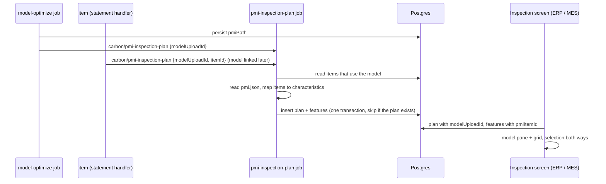

# Inspection plans from STEP PMI

> Status: approved (decisions by the user, 2026-10-27)
> Author: Claude (autonomous `/feature` run for Brad)
> Date: 2026-10-27

## TLDR

A STEP AP242 model can carry PMI: dimensions, geometric tolerances, datums and notes. Since `2026-10-26-step-pmi-viewer.md`, the optimize ingest writes them to `pmi.json` (`modelUpload.pmiPath`) and the viewer draws them.

This change makes an inspection plan from that PMI automatically. Each dimension and each geometric tolerance becomes one characteristic. The plan holds the model and no PDF. When an inspector records measurements against the plan (ERP or MES), the drawing pane shows the 3D model with its PMI, not a PDF. A pick in the measurement grid selects the PMI item on the model, and a pick on the model selects the row.

## Overview diagram



## Problem Statement

A quality engineer who gets an MBD model must type each characteristic into an inspection plan by hand. To do that, they must first export or draw a PDF, because a plan needs a PDF to show anything. The model already holds every nominal, tolerance and datum reference in machine-readable form. The viewer shows them, but nothing uses them.

## Proposed Solution

### When a plan is made

One Inngest function, `pmi-inspection-plan` (event `carbon/pmi-inspection-plan`), makes the plans. Two places send the event:

| Sender | When | Data |
|---|---|---|
| `model-optimize`, after the `persist` step | The run wrote a `pmi.json` | `{ companyId, modelUploadId }` |
| Statement handler `queue_pmi_inspection_plans` on `item` | An INSERT or UPDATE sets `item.modelUploadId` to a model whose `pmiPath` is set | `{ companyId, modelUploadId, itemId }` |

The second sender covers a model that is linked to an item after the optimize ran: a new revision, a quote line converted to a part, an existing model attached to a part.

The function:

1. Reads the model row. If `pmiPath` is null, stop.
2. Reads the items whose `modelUploadId` is the model (only `itemId` when the event names one).
3. Drops each item that already has a plan for this model.
4. Downloads `pmi.json` and maps it to characteristics (`pmiInspectionCharacteristics`).
5. If no characteristic results, stop.
6. For each remaining item, inserts one plan and its features in one Kysely transaction.

A partial unique index on `inspectionDocument ("companyId", "partId", "modelUploadId") WHERE "modelUploadId" IS NOT NULL` makes a duplicate impossible. The insert uses `ON CONFLICT DO NOTHING`.

### PMI item to characteristic

| PMI item | Characteristic |
|---|---|
| Dimension with a value and a `±` deviation | `nominalValue` = value, `tolerancePlus` = upper, `toleranceMinus` = abs(lower) |
| Dimension whose deviations share a sign (`−0.013/−0.028`, `+0.05/+0.02`) | re-centred: `nominalValue` = the band's centre, plus and minus = half the band. The grid judges a reading by magnitudes, so the drawing nominal would pass parts outside the band |
| Dimension with limits only (`upperBound`, `lowerBound`) | `nominalValue` = midpoint, plus and minus = half the range |
| Dimension with a value and no numeric tolerance (fit class only, min/max qualifier, basic) | `nominalValue` = null: the grid records Pass or Fail |
| Dimension of type `commonLabel` or `presentation`, or with no value | skipped |
| Geometric tolerance with a value | `nominalValue` = `0`, `tolerancePlus` = zone value, `toleranceMinus` = `0` |
| Geometric tolerance with no value | `nominalValue` = null: Pass or Fail |
| Datum | skipped |
| Note | skipped |

Other fields:

- `type` = `Measurement` for every row.
- `label` = `1`, `2`, `3` … in the order of `pmi.json` (dimensions, then tolerances, as the file lists them).
- `description` = the PMI title and text from `formatPmiItem`, for example `Diameter ⌀10.00 ±0.05`.
- `unit` = `mm` or `in` from `sourceUnit` (mm when unknown); `deg` for an angle. Lengths convert from the file's mm to inches for an inch model.
- `pageNumber` = `1`. A model plan has one "page".
- `pmiItemId` = the PMI item id (`d1`, `t3`).

### The plan row

| Column | Value |
|---|---|
| `partId` | the item |
| `modelUploadId` | the model |
| `drawingNumber` | the item's `readableIdWithRevision`, with ` (1)`, ` (2)` … when taken (same rule as `resolveInspectionDocumentDrawingNumber`) |
| `storagePath`, `fileName`, `pageCount` | null |
| `createdBy` | `system` |

### Using the plan

The plan is used like any plan: assign it on the item's Quality tab for receipts, or pick it on an Inspection operation.

- ERP `/x/inspection/{id}` and MES `/x/inspection/{operationId}`: when the plan has a model, the drawing pane shows `ModelUploadPreview` in place of `InspectionDrawingPane`. The active feature selects its `pmiItemId` on the model. The camera turns to it and its faces highlight. A pick on a PMI item on the model sets the active feature.
- Editor `/x/inspection-document/{id}`: when the plan has a model, the top pane shows the model, not the PDF area. The PDF actions (Add Selector, zoom box, Replace PDF, Download PDF, Balloon) are hidden. A row's actions column shows a **Show** button that selects its PMI item on the model. Add Characteristic, edit, delete and sampling work as for a PDF plan.

### Design Decisions

| Decision | Choice | Why |
|---|---|---|
| Automatic or a button | Automatic (user) | The user asked for it. |
| PDF and model on one plan | Model only (user) | One source per plan keeps the panes simple. |
| Datums and notes | Skipped (user) | A datum has nothing to measure. A note has no value. |
| Screens | ERP and MES (user) | Both run inspections. |
| `pageNumber` on a model feature | `1`, column stays NOT NULL | The save RPC already defaults it to 1. The label trigger stays correct: labels are unique in the plan. No RPC change. |
| A plan per item or per model | Per item and model | `inspectionDocument.partId` is NOT NULL. Each revision is its own item. |
| A re-optimize of the same model | Leaves the plan alone | The engineer may have edited it. PMI ids are stable for the same file. |
| A new model on the item | Makes a new plan; the old plan stays | A plan may have measurements. Assignments keep pointing at the old plan until a person changes them. |
| Model deleted | `modelUploadId` ON DELETE SET NULL | The plan then has no pane, as a plan with no PDF has today. |
| Where the mapping lives | `@carbon/viewer/pmi` (pure, tested) | It reads the PMI types and `formatPmiItem`. `@carbon/jobs` already depends on `@carbon/viewer`. |
| Where the insert lives | `createPmiInspectionPlan` in `@carbon/database/quality` | The Kysely building block takes `db`. The job calls it in a transaction. |
| Unit text | `mm`, `in`, `deg` | `inspectionFeature.unit` is free text. The grid shows a text that matches no unit code as it is. |
| Backfill of models optimized with PMI before this change | None | PMI shipped on 2026-10-26. A Reoptimize of such a model sends the event. |
| Auto-assign the plan for receipts | No | A person decides which plan gates a receipt. |
| Item delete | Deletes the item's PMI plans that no inspection used (`deleteUnusedPmiInspectionPlans`) | `inspectionDocument.partId` is ON DELETE RESTRICT. A plan nobody made by hand must not block the delete. A used plan still refuses it. The delete runs as the system, so `parts_delete` alone can remove an unused PMI plan. |
| Model deleted after the plan is made | The plan keeps its features and loses its model (SET NULL) | It then behaves as a plan made by hand, and blocks a part delete like one. Recognising it would need a column that marks a plan as made from PMI. |

## Data Model Changes

One migration:

```sql
ALTER TABLE "inspectionDocument"
  ADD COLUMN "modelUploadId" TEXT REFERENCES "modelUpload"("id") ON DELETE SET NULL;
ALTER TABLE "inspectionFeature" ADD COLUMN "pmiItemId" TEXT;
CREATE UNIQUE INDEX "inspectionDocument_part_model_key"
  ON "inspectionDocument" ("companyId", "partId", "modelUploadId")
  WHERE "modelUploadId" IS NOT NULL;
```

The `inspectionDocuments` view selects `d.*`, which Postgres expands when it creates the view. The migration drops and creates the view again, so the view gets `modelUploadId`.

Event system: a new statement handler `queue_pmi_inspection_plans` (`packages/database/src/event-system/handlers/`), attached to `item` in `attachments.ts`, shipped with `pnpm --filter @carbon/database authz migration`.

## API / Service Changes

- `@carbon/viewer/pmi` (new package export): `pmiInspectionCharacteristics(doc): PmiCharacteristic[]`.
- `@carbon/database/quality`: `createPmiInspectionPlan(db, { companyId, itemId, modelUploadId, characteristics })`.
- `@carbon/jobs`: `pmiInspectionPlanFunction`; `model-optimize` sends the event.
- `@carbon/viewer` `ModelPreview`: new optional props `selectedPmiItemId` and `onPmiItemSelect` (controlled selection).
- ERP and MES inspection loaders return `model: { modelUploadId, modelPath } | null` and `pmiItemId` on each feature.

## Closest Sibling

`InspectionDrawingPane` (ERP and MES copies) is the sibling of the model pane, `ModelUploadPreview` (`@carbon/viewer`): the same place in `InspectionView`, the same active-feature selection both ways. Unlike the drawing pane it is one shared component, not an app copy.

## UI Changes

No new route. The drawing pane slot shows a model. The editor's top pane shows a model. The plan list shows no PDF for a model plan.

## Acceptance Criteria

- [ ] An optimize that writes `pmi.json` makes one plan per item that uses the model, with one characteristic per dimension and geometric tolerance.
- [ ] A second optimize of the same model makes no second plan.
- [ ] Linking an item to a model that has PMI makes a plan for that item.
- [ ] A model with PMI but no dimension or tolerance makes no plan.
- [ ] The ERP and MES inspection screens show the model for a model plan. A row pick selects the PMI item. A pick on the model selects the row.
- [ ] The editor shows the model for a model plan, and edits save.
- [ ] `pmiInspectionCharacteristics` has unit tests for each row of the mapping table.
- [ ] Deleting an item removes its PMI plans that no inspection used.

## Risks

| Risk | Effect | Mitigation |
|---|---|---|
| PMI ids change when the extractor changes its order | A re-optimize after an extractor change points features at other items | The plan is never rewritten, and ids are per model. Note it in the inspection rule. |
| Many items share one model | One plan each | Correct: each revision inspects to its own plan. |
| `pmi.json` up to 16 MB | Memory in the job | One download per run, parsed once. |

## Open Questions

None. The user resolved the four questions on 2026-10-27.

## Changelog

- 2026-10-27: first version.
- 2026-10-27: added the item-delete rule, found during the build.
- 2026-10-27: self-review: one-sided deviations are re-centred; the model pane reports a pick that selects no characteristic.
- 2026-10-27: nuclear self-review: the model pane is `ModelUploadPreview` in `@carbon/viewer` (shared by ERP and MES, with `modelPreviewUrls` also used by `CadModel` and the MES model tab), not an app copy; the item-delete cleanup is the building block `deleteUnusedPmiInspectionPlans`; tests pin the building blocks, the trigger, and the mapping against `valuateMeasurement`. Recreating the `inspectionDocuments` view also adds the `sampling*` columns.
