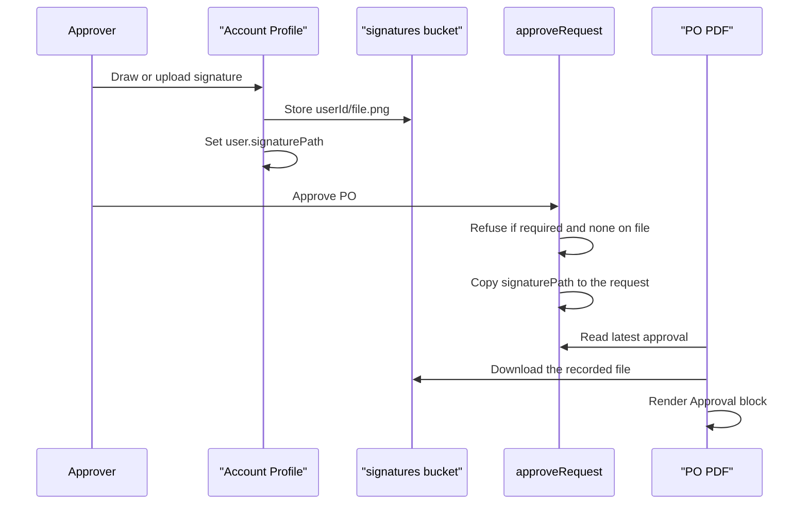

# Approval signatures on purchase orders

> Status: implemented (uncommitted)
> Author: Sid
> Date: 2026-10-28

## TLDR

A user draws or uploads a signature once, in Account → Profile. When the user
approves a purchase order, Carbon records which signature file was on file at
that moment. The PO PDF then prints the approver's signature, name and date in
a new Approval block. A company can require a signature before anyone can
approve a PO.

## Overview diagram



## Problem Statement

A customer (TDI) sends PO PDFs to suppliers. The supplier expects a signature
from a person with signing authority. Today:

- The PO PDF has no signature. The name it shows ("Contact") is the buyer
  contact: assignee, else account manager, else creator
  (`packages/documents/src/pdf/blocks/purchaseOrder/PartiesBlock.tsx:169`).
  It is not the approver.
- #2039 added the `order.approvedBy` and `order.approvedDate` merge fields, so
  a template can print "Approved by Craig on Oct 26". There is still no
  signature image.
- The customer imported POs that their old process had already signed. In
  Carbon they show as approved by the person who clicked Approve, with no
  signature.

## Proposed Solution

1. **Signature on the user.** Account → Profile gets a Signature section with
   two choices: Draw (a canvas) or Upload (PNG or JPG). The file goes to a new
   private bucket, `signatures`, at `{userId}/{random}.png`. The user row keeps
   the current path in `signaturePath`. A file is never overwritten.
2. **Snapshot at approval.** `approveRequest` (`packages/ee/src/approvals/service.ts`)
   copies the approver's `signaturePath` to `approvalRequest.decisionSignaturePath`
   in the same transaction that sets the request to Approved. Later changes to
   the user's signature do not change an approved PO.
3. **Optional requirement.** Settings → Purchasing gets "Require a signature to
   approve purchase orders". When it is on, `approveRequest` refuses a PO
   approval from a user with no signature, and the PO page sends that user to
   Account → Profile to add one.
4. **Approval block on the PO PDF.** A new built-in template block, `approval`,
   prints the signature image, the approver's name and the approval date. It
   renders nothing on a PO that is not approved. It shows on existing saved
   templates without any action from the customer.

### Design Decisions

| Decision | Choice | Rationale |
|----------|--------|-----------|
| Where the user manages it | Account settings → Profile pane, below the photo | The user asked for it under the profile. The pane is shared by ERP, MES and starter (`packages/account`), so all three get it. |
| Scope of a signature | One per person, across all companies | Same as the avatar. A signature belongs to a person, not to a company. |
| Storage | New private bucket `signatures`; owner can INSERT and SELECT in their own `{uid}/` folder; no UPDATE; DELETE by the server only | The `avatars` bucket is readable by every logged-in user. A signature must not be. No UPDATE means a file can never be overwritten, which the snapshot depends on. |
| Path column | `user.signaturePath TEXT NULL` | Mirrors `user.avatarUrl`. Co-workers can read the path, but the bucket is private, so the path alone gives no access. |
| Draw vs upload | Both, saved as the same PNG | The user asked for upload in addition to drawing. The PDF reads one file and does not care which way it was made. |
| Drawing library | None. Plain `<canvas>` with pointer events and quadratic smoothing, exported as a trimmed PNG | Adding a production dependency is Ask First, and a canvas covers it. The reui component is only a reference for look and feel. |
| Upload processing | `prepareImageUpload` (`@carbon/files/media`), the avatar's pipeline, with a max size | It already decodes, shrinks and re-encodes. PNG keeps transparency. |
| Old POs after a change | Keep the original: snapshot the path on the approval request (**user answer**) | A re-printed PO matches the copy the supplier received. |
| Deleting old files | On replace or remove, the server deletes the previous file only when no `approvalRequest` names it | Keeps the snapshot valid. Unused files do not pile up. |
| Require a signature | Company setting, off by default, POs only (**user answer**) | Lets TDI lock it down without changing anything for other companies. |
| Where the requirement is checked | Inside `approveRequest` (ee), for `documentType = 'purchaseOrder'` | Every approve path goes through it. A check in the route alone could be skipped by another caller. |
| Self-approval | Out of scope; separate PR (**user answer**) | Keeps this change to signatures. |
| Documents covered | Purchase orders only | The only approval document Carbon sends to an outside party. The snapshot in `approveRequest` already records the signature for every document type, so others can add the block later. |
| Existing saved templates | The `approval` block is appended VISIBLE (**user answer**) | It prints nothing on an unapproved PO, so it cannot clutter a layout. Needs a new `BlockMeta` flag, `showWhenAppended`, because `resolveTemplate` appends missing built-ins hidden today. |
| Block position | After Terms, in the default PO template and when appended | A signature closes the document. Appending puts it last anyway. |

## Data Model Changes

One migration.

```sql
-- Private bucket for user signatures.
INSERT INTO storage.buckets ("id", "name", "public")
VALUES ('signatures', 'signatures', false)
ON CONFLICT ("id") DO NOTHING;

CREATE POLICY "Users can view their own signatures"
ON storage.objects FOR SELECT USING (
  bucket_id = 'signatures'
  AND (storage.foldername(name))[1] = (SELECT auth.uid()::text)
);

CREATE POLICY "Users can insert their own signatures"
ON storage.objects FOR INSERT WITH CHECK (
  bucket_id = 'signatures'
  AND (storage.foldername(name))[1] = (SELECT auth.uid()::text)
);
-- No UPDATE policy: a file is never overwritten. No DELETE policy: the server deletes.

ALTER TABLE "user" ADD COLUMN "signaturePath" TEXT;

ALTER TABLE "approvalRequest" ADD COLUMN "decisionSignaturePath" TEXT;

ALTER TABLE "companySettings"
  ADD COLUMN "requirePurchaseOrderApprovalSignature" BOOLEAN NOT NULL DEFAULT false;
```

Then `pnpm run generate:types`. `db:check:backups` must pass: a backup now
carries `decisionSignaturePath`. A restore into another environment points at
a file that may not exist there; the PDF then prints the name and date only.

## API / Service Changes

| Where | Change |
|---|---|
| `apps/erp/app/modules/users/users.server.ts` | New `updateOwnSignature({ path: string \| null })`, copied from `updateOwnAvatar`. It refuses a path outside `${userId}/`, saves it, then deletes the previous file with the service role when no `approvalRequest.decisionSignaturePath` names it. |
| `apps/erp/app/routes/api+/account.profile.ts` | New `signature` intent. The loader adds a short-lived signed URL for the current signature (`AccountProfileData.signatureUrl`). |
| `packages/account/src/types.ts` | `signatureUrl` on `AccountProfileData`. |
| `packages/ee/src/approvals/service.ts` → `approveRequest` | In its transaction: read the approver's `signaturePath`; for a purchase order with the setting on and no signature, return the error code `signature-required` and write nothing; else write `decisionSignaturePath`. |
| `packages/ee/src/approvals/service.ts` → `getDocumentApproval` | Also returns `signaturePath`. |
| `apps/erp/app/modules/purchasing/purchasing.service.ts` → `getPurchaseOrderApproval` | Downloads the recorded file with the service role and returns it as a data URL, `signature: string \| null`. A missing file gives `null`, never an error. |
| `apps/erp/app/modules/purchasing/purchasing.server.ts` (approve operation) | Maps `signature-required` to a validation error with a clear message. |
| `apps/erp/app/routes/x+/purchase-order+/$orderId.tsx` | Loader adds `approvalNeedsSignature` (setting on and the user has no signature). |
| `apps/erp/app/modules/settings/settings.server.ts` | Accept `requirePurchaseOrderApprovalSignature` in the purchasing settings update. |
| `packages/documents/src/template/` | New built-in block type `approval`: `schema.ts`, a `BLOCK_META` entry with `showWhenAppended: true`, default PO template, every block registry (others return `null`). |
| `packages/documents/src/pdf/blocks/purchaseOrder/` | `ApprovalBlock.tsx`; `PurchaseOrderApproval.signature`; a sample signature in `purchaseOrder.samples.ts` for the template preview. |

## Closest Sibling

The profile photo. `ProfilePhotoForm.tsx` (upload, resize, submit the path),
`updateOwnAvatar` (validate the path, save, delete the replaced file) and the
`photo` intent of `account.profile.ts`. The signature copies each of these.
Deviations: a private bucket instead of the public `avatars` bucket, a Draw
option, and a delete that skips files an approval still names. Each is in the
Design Decisions table.

## UI Changes

- **Account → Profile:** a Signature section under the photo. Archetype: the
  existing account settings pane section (`AccountSettingsSection`). It shows
  the current signature on a white box, with Draw, Upload and Remove. Draw
  opens a modal with the canvas, Clear and Save.
- **PO page:** when `approvalNeedsSignature` is true, Approve opens a short
  dialog: "Add your signature to approve purchase orders", with a button that
  opens Account → Profile (`useAccountSettings((s) => s.open)("profile")`).
- **Settings → Purchasing:** one toggle, "Require a signature to approve
  purchase orders".
- **PO template editor:** the Approval block appears in the block list and can
  be hidden like any built-in block.
- **PO PDF:** the Approval block. Signature image (max 40 pt high), then the
  approver's name and the approval date. Nothing when the PO is not approved.

## Acceptance Criteria

- [ ] A user draws a signature in Account → Profile, saves it and sees it in
      the pane after a reload. The same works for an uploaded PNG and JPG.
- [ ] A second user cannot read the first user's signature file, through the
      storage API or through a signed URL request.
- [ ] A user approves a PO, then opens its PDF and sees their signature, name
      and the approval date in the Approval block.
- [ ] That user replaces their signature. The PDF of the PO from the previous
      step still shows the original signature.
- [ ] An unapproved PO's PDF has no Approval block content.
- [ ] A company with a saved PO template sees the Approval block on its PDFs
      without editing the template.
- [ ] With the setting on, a user with no signature clicks Approve and is sent
      to add one. The PO stays in Needs Approval. A direct call to the approve
      operation is refused with the same message.
- [ ] With the setting off, approving without a signature works as it does
      today, and the PDF prints the name and date with no image.
- [ ] Removing a signature that an approval names keeps the file; removing one
      no approval names deletes the file.
- [ ] Scoped typecheck for `@carbon/account`, `@carbon/documents`, `@carbon/ee`
      and `erp`, Biome, `pnpm db:check:backups` and `pnpm db:check:datasets`
      pass.

## Open Questions

- [x] If a user changes or removes their signature, what do approved POs show?
      — **Answer:** the original. The path is copied to the approval request
      at approval time, and files are never overwritten.
- [x] Does this change also block approving your own PO? — **Answer:** no. A
      separate PR fixes self-approval.
- [x] Must an approver have a signature on file? — **Answer:** a company
      setting, off by default, for purchase orders.
- [x] Does the block show on existing saved templates? — **Answer:** yes,
      appended visible.

## Out of scope

- Signatures on other documents (sales orders, invoices, quotes).
- Re-authentication or a typed name at approval time.
- Signing on behalf of someone else, or uploading a signature for another user.
- Self-approval guard (separate PR).
- User docs in `docs/content`; add them when this ships.
