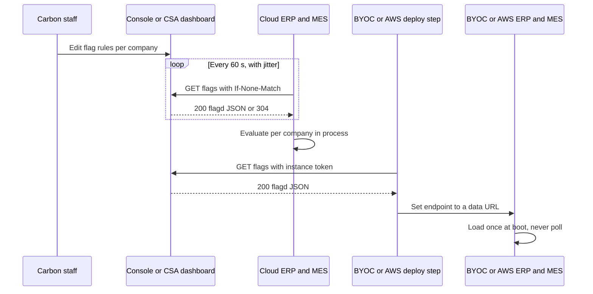

# Feature flags for Carbon instances

> Status: draft
> Author: Sid
> Date: 2026-10-28
> Research: `.ai/research/2026-10-28-feature-flags.md`

## TLDR

Each Carbon instance reads its feature flags from one URL. The operator sets
the URL and the request headers with two environment variables, the same way
the OTEL exporter is set up. The URL returns a flagd JSON document, the
OpenFeature standard format. The ERP and the MES evaluate the flags in
process with `@openfeature/flagd-core`. There is no flagd daemon. Carbon staff
can turn a flag on for named users, for one company, by percentage, by
tenancy (single or multi) or by edition. On Carbon Cloud, one process at a
time fetches the URL, at most once a minute, and every process reads the
shared copy in Redis. A BYOC
instance and a Carbon-managed AWS workspace get their flags once, at deploy
time, so a console outage never changes a running instance. The console and
the CSA dashboard are two independent sources. Each one keeps its own flag
data and serves the same contract. Flags control rollouts only. The license
key and `requireEntitlement` still decide which paid features a company has.

## Overview diagram



## Problem Statement

Carbon has no feature flag system. The only flag-like mechanism is
`INTEGRATION_EARLY_ACCESS_USER_IDS` (`packages/env/src/schema.ts`). It is a
list of user ids in an environment variable, and it gates one thing: the
install of a Coming soon integration.

So today:

1. A feature cannot go to one company first and then to all companies without
   a deploy.
2. A risky change has no switch that turns it off without a deploy.
3. A BYOC instance cannot get a feature that Carbon Cloud has, except through a
   code default.
4. Each new staged rollout invents its own environment variable.

## Proposed Solution

### 1. Configuration — two environment variables

```bash
CARBON_FLAGS_ENDPOINT="https://console.carbon.ms/api/flags"
CARBON_FLAGS_HEADERS="Authorization=Bearer%20<token>,X-Carbon-Instance=<id>"
```

`CARBON_FLAGS_HEADERS` uses the format of `OTEL_EXPORTER_OTLP_HEADERS`. It is a
list of `key=value` pairs, separated by commas, with percent-encoded keys and
values. The parser skips a malformed pair and logs it. It never throws.

| `CARBON_FLAGS_ENDPOINT` value | Used by | Behavior |
|-------------------------------|---------|----------|
| `https://…` (console or CSA dashboard) | Carbon Cloud | Load at boot, then poll |
| `data:application/json;base64,…` | BYOC, Carbon-managed AWS workspaces | Load once at boot. No poll. |
| Unset | Community self-host, local dev | Code defaults only |

Both variables are server-only. They never go into `getBrowserEnv()`.
`CARBON_FLAGS_HEADERS` is `secret: true`, because it holds the token.

### 2. The endpoint contract

The console and the CSA dashboard each implement this contract. A stock flagd
daemon can also read the endpoint, because flagd's own HTTP sync sends the same
headers (`Authorization`, extra headers, `If-None-Match`).

**Request:** `GET <CARBON_FLAGS_ENDPOINT>` with the configured headers. The
request also sends `If-None-Match` when the instance has an ETag, and
`X-Carbon-Commit` with the build's git commit when the instance knows it.

| Header | Set by | Use in the source |
|--------|--------|-------------------|
| `Authorization` | `CARBON_FLAGS_HEADERS` | The instance token. It is the only identity. |
| `X-Carbon-Commit` | `CARBON_COMMIT_SHA` (alias `VERCEL_GIT_COMMIT_SHA`; `sst.config.ts` forwards `IMAGE_TAG`), and `ci/src/deploy.ts` at deploy time | Record the most recent build seen for each instance, next to `lastFetchAt`. Only the process that holds the lease fetches, so during a rolling deploy the value can alternate between the old and the new build. The value is the first 12 characters of the commit on every platform. |
| `If-None-Match` | The provider | Answer `304` when the document has not changed. |

The headers carry no company id, user id or other tenant data.

| Response | Meaning | Instance action |
|----------|---------|-----------------|
| `200` + `ETag` + flagd JSON | New flags | Validate, load, keep the ETag |
| `304` | No change | Keep the loaded flags |
| `401` / `403` | Unknown or revoked token | Keep the last good document. Record the error. |
| `5xx`, timeout, body over 1 MB | Server problem | Keep the last good document. Record the error. |

**Evaluation context.** The instance evaluates every flag with these fields.
A rule can test any of them.

| Field | Value | Set by |
|-------|-------|--------|
| `targetingKey` | `email`, else `companyId` | The call site |
| `email` | The user's email in lower case, when the call site passes one. An `emails` rule tests it. | The call site |
| `companyId` | The session's company | The call site (required) |
| `tenancy` | `"single"` or `"multi"`, from `SINGLE_TENANT` (`TENANT_TYPE`) | The provider |
| `edition` | `"cloud"`, `"enterprise"`, `"community"` or `"test"`, from `CarbonEdition` | The provider |

**Body:** a flagd flag definition document
(`https://flagd.dev/schema/v0/flags.json`):

```json
{
  "$schema": "https://flagd.dev/schema/v0/flags.json",
  "flags": {
    "new-mrp-engine": {
      "state": "ENABLED",
      "variants": { "on": true, "off": false },
      "defaultVariant": "off",
      "targeting": {
        "if": [
          { "in": [{ "var": "companyId" }, ["cmp_123", "cmp_456"]] }, "on",
          { "==": [{ "var": "tenancy" }, "single"] }, "on",
          {
            "==": [
              { "fractional": [
                { "cat": [{ "var": "$flagd.flagKey" }, { "var": "companyId" }] },
                ["hit", 10], ["_rest", 90]
              ] },
              "hit"
            ]
          }, "on",
          null
        ]
      },
      "metadata": { "archived": false }
    }
  }
}
```

This example turns the flag on for 2 named companies, for every
single-tenant instance, and for 10% of the other companies.

Rules for the body:

1. The source sends only the rules for the instance that the token names. A
   BYOC instance never gets another customer's company ids.
2. A percentage rollout buckets on the flag key plus `companyId`. So every
   user of one company gets the same answer.
3. A `null` at the end of the `if` chain returns `defaultVariant`.
4. An archived flag carries `"metadata": { "archived": true }`. It keeps its
   current answer.
5. The source validates the document with `new FlagdCore().setConfigurations(body)`
   before it sends it. The source never sends a document that fails validation.

### 3. The instance side — `@carbon/env/flags.server`

A new subpath export of `@carbon/env`. It follows the existing
`./push.server` subpath. The `.server` suffix keeps it out of the browser
bundle. The provider reads the two variables through the `@carbon/env`
exports, never through `process.env` (`packages/env/AGENTS.md`).

| Export | Job |
|--------|-----|
| `CarbonFlagsProvider` | An OpenFeature provider. It loads the document and evaluates with `FlagdCore`. |
| `initFlags({ store, waitUntil })` | Sets the provider. Each app calls it once in `app/entry.server.tsx`. |
| `FlagsStore` (type) | The interface of the shared cache. `@carbon/kv` implements it with Redis. |
| `flags.bool(key, ctx)` | The only API that call sites use. `ctx` is `{ companyId, email? }`, and `companyId` is required. The provider adds `tenancy` and `edition`. |
| `evaluateBrowserFlags(ctx)` | Returns the value of every registry flag with `browser: true`, for the layout loaders. |
| `parseHeaders(raw)` | The `CARBON_FLAGS_HEADERS` parser. |

`initFlags` goes in `app/entry.server.tsx`, not in `server/app.ts`.
`entry.server.tsx` already imports `waitUntil` and sets up tracing, and it runs
in dev and in production. `server/app.ts` is the Vercel wrapper only.

A second, client-safe file, `@carbon/env/flags`, holds the flag registry:

```ts
export const FLAGS = {
  "new-mrp-engine": { type: "boolean", default: false, browser: false },
} as const;
```

The registry is the one place a flag's code default lives. `flags.bool(key, ctx)`
reads the default from it, so two call sites cannot use two different
defaults. A key that is not in the registry is a type error.

**How defaults work.** A flag has 2 defaults:

| Default | Lives in | Answers when |
|---------|----------|--------------|
| Registry default | `FLAGS[key].default` in this repo | The instance has no answer from a source |
| Source default | `defaultVariant` of the flag in the source | The source knows the flag, but no rule matches |

The provider picks the value in this order. `@openfeature/flagd-core` 5.0.0
returns the reasons in the table (checked in a scratch test).

| Case | Value | flagd reason |
|------|-------|--------------|
| A rule matches | The rule's variant | `TARGETING_MATCH` |
| No rule matches, or the flag has no rules | The source default | `DEFAULT` or `STATIC` |
| The flag has `state: "DISABLED"` | The registry default | `DISABLED` |
| The document has no such flag | The registry default | `FLAG_NOT_FOUND` |
| No document is loaded, or the endpoint is unset | The registry default | — |
| The flag's value has the wrong type | The registry default | `TYPE_MISMATCH` |

So `DISABLED` is the switch that gives control back to the code. Use it to
stop a flag without deleting it.

The browser follows the same rules. `useFeatureFlags().feature(key)` returns the
loader's value, else the registry default.

During a rollout, the two defaults move in this order:

| Step | Registry default | Source default | Rules |
|------|------------------|----------------|-------|
| 1. Ship the code | off | — (no flag yet) | — |
| 2. Create the flag | off | off | `companyIds` = one company |
| 3. Widen the rollout | off | off | `percent`, then `tenancy` or `editions` |
| 4. On for every instance that has a source | off | on | removed |
| 5. Ship the new default | on | on | — |
| 6. Archive, then remove the code | — | archived | — |

Between step 4 and step 5, an instance with no source still runs the old
behavior. That covers community self-host, and a BYOC or AWS workspace that
has not deployed since step 4.

**Three layers.** A flag value comes from process memory. Process memory comes
from Redis. Redis comes from the source.

| Layer | Holds | Read |
|-------|-------|------|
| Process memory | The parsed document, in `FlagdCore` | On every evaluation, about 5 µs, no I/O |
| Redis | One hash per instance: `body`, `etag`, `fetchedAt` | Every 10 s ± 20% per process, in the background |
| Source | The rules | At most once every 60 s per instance, by the process that holds the lease |

The Redis key is `flags:<scope>`. `<scope>` is the first 16 hex characters of
the SHA-256 of `CARBON_FLAGS_ENDPOINT` plus `CARBON_FLAGS_HEADERS`. So the ERP
and the MES of one instance share one copy. Two instances that share one
Redis never mix their documents.

**Provider behavior for an `http(s)` endpoint:**

1. At boot, read the hash from Redis and load `body` when it exists. Do not
   wait for the source.
2. If Redis has no `body`, fetch the source. Wait at most 2 seconds. If the
   fetch takes longer, it continues in the background.
3. On every evaluation, check the time of the last sync. If it is older than
   10 seconds ± 20%, start a background sync. Never run two syncs at once.
4. Pass each background sync to `waitUntil`, so Vercel keeps the function
   alive until the sync ends.
5. A sync reads `etag` and `fetchedAt` from Redis. If `etag` differs from the
   loaded one, it reads `body`, validates it and loads it.
6. If `fetchedAt` is older than 60 seconds, or this process cannot load the
   copy in Redis, the sync takes the lease `flags:<scope>:refresh` (10 s). The process with the lease fetches the
   source with `If-None-Match`. On a `200`, it validates the body and writes
   `body`, `etag` and `fetchedAt`. On a `304`, it writes `fetchedAt` only.
7. If another process holds the lease, the sync does nothing more. If the
   fetch fails, the process keeps the lease until it expires, so a down
   source gets at most one request per 10 s from all processes.
8. If Redis is unavailable, the process fetches the source directly, at most
   once every 60 seconds ± 20%.
9. On any error, keep the loaded flags, set `lastError`, and log a warning.
10. When code evaluates a flag with `metadata.archived = true`, log one warning
    per key per process.
11. A missing flag, a wrong type, or no loaded document returns the registry
    default.

A `data:` endpoint loads once at boot. It never reads or writes
Redis, because its document never changes.

Sync on read, not on a timer, because Vercel pauses the process between
requests.

**The store.** `@carbon/kv` depends on `@carbon/env`, so `@carbon/env`
cannot import `@carbon/kv`. So `@carbon/env/flags.server` defines the
`FlagsStore` interface, and `@carbon/kv` exports `redisFlagsStore`, which
implements it with the fail-soft `redis` client and `acquireLease`. The app
passes it to `initFlags`. A test passes an in-memory store.

**What this costs a request.** Measured with 50 flags, each with a 200-company
rule (a 111 KB document):

| Step | Cost |
|------|------|
| One evaluation through the OpenFeature SDK | about 4.5 µs |
| The layout loader with 10 browser flags | about 45 µs |
| Parse and validate the document | about 17 ms, only when the `etag` changes |
| Background sync | 1 `HMGET` every 10 s per process, off the request path |
| Cold start | 2 reads in parallel (`HMGET` and `HGET`), no wait for the source |

### 4. Flags in the frontend

A flag with `browser: true` in the registry can reach React components.

1. The ERP authenticated layout loader (`apps/erp/app/routes/x+/_layout.tsx`)
   calls `evaluateBrowserFlags` with the session's `companyId` and `email`.
   The MES layout sends no flags until an MES component reads one; until
   then `useFeatureFlags()` in the MES answers the registry defaults.
2. The loader returns the values as `flags: Record<string, FlagValue>`.
3. `@carbon/react` exports `useFeatureFlags()`
   (`packages/react/src/hooks/useFeatureFlags.tsx`). Its `feature(key)` reads
   `flags` from the `/x` route data and falls back to the registry default.
   It follows `usePlan`, which reads the same route in both apps.
4. Both apps call `useFeatureFlags()` directly. The ERP's `useFlags` does
   not change: it keeps the edition and environment booleans.

The hook lives in `@carbon/react` because the `no-duplicated-app-file`
check refuses a hook that both apps copy.

Only evaluated values reach the browser. Rules, company lists and the token
never do.

A layout loader reruns a GET only after `SHELL_MAX_AGE_MS` (its
`shouldRevalidate`). So a browser flag can take until the next layout
revalidation to change. Server flags are up to 60 seconds old on Carbon Cloud
already, so this is acceptable.

**Patterns for call sites:**

| Need | Pattern |
|------|---------|
| A flag decides if a page or its data exists | Check `flags.bool` in the route loader, after `requirePermissions`. Throw `notFound()` when the flag is off. |
| A flag swaps a UI | One ternary at the highest component that changes: `feature("x") ? <BuilderV2 /> : <Builder />`. Do not pass the flag down as a boolean prop. |
| The new UI is large | Load the new variant with `lazy(() => import(…))` inside `Suspense`, as `InspectionView` does for its drawing pane. A company without the flag never downloads it. |
| A flag hides an unreleased paid feature | Check the flag first. When the flag is on, the plan gate applies as before: `usePlanGate` shows the upgrade overlay. |

Do not add a `<FeatureGate>` wrapper component. Do not fetch flags from the
browser.

### 5. Who reads flags

Only the ERP and the MES read flags in v1. Inngest jobs (`@carbon/jobs`) and
the Rust assembler do not. So a background job, for example an MRP run, must
not depend on a flag.

### 6. The sources — console and CSA dashboard

The console (`console.carbon.ms`) and the CSA dashboard are both Node apps,
outside this repo. Each one is an independent source. An instance points at
one source only. Each source has its own data and its own implementation of
section 2. They share no Carbon package.

Only Carbon staff control flags, in the source's admin form. A company never
sees or changes a flag.

Each source has:

| Part | What it holds |
|------|---------------|
| Flag table | `key`, `description`, `variants` (JSON), `defaultVariant`, `archivedAt`, audit columns |
| Rule table | `flagKey`, `order`, `variant`, and the conditions: `companyIds`, `emails`, `percent`, `tenancy` (`single`, `multi` or empty), `editions`, `instanceIds` (empty = every instance) |
| Instance token table | `instanceId`, `tokenHash` (SHA-256), `createdAt`, `revokedAt`, `lastFetchAt`, `lastCommit` (the most recent `X-Carbon-Commit` seen; during a rolling deploy it can show the old or the new build until every process runs the new one) |
| Change log | One row per save: who, when, the flag before and after |
| Admin form | Staff edit variants, default, rules and archive state |
| Endpoint | Section 2. It hashes the bearer token, finds the instance, compiles the rules into one `if` chain per flag and validates the result. It sets `lastFetchAt`. |

A rule matches when all its non-empty conditions match. The endpoint
compiles a rule with 2 or more conditions into one `and`. An `emails`
condition compiles to `{ "in": [{ "var": "email" }, [ … ]] }`, with each email
in lower case.

Use `emails` with `companyIds` in one rule. Then the rule means "these
people, in this company". A user rule without a company follows the user
into every company the user belongs to. A percentage always buckets by
company, never by user, so one company never splits.

Each source uses these standard pieces and writes nothing else to handle the
format:

1. The `Flag` type from `@openfeature/flagd-core` for the output shape.
2. `FlagdCore.setConfigurations` to validate the output.

**Flag lifecycle:**

1. Ship the code with the registry default.
2. Turn the flag on for one company, then by percentage, then for all companies.
3. Change the registry default to the rolled-out value and ship it.
4. Archive the flag in the source. It keeps its answer, and any code that
   still reads it logs a warning.
5. Remove the code and the registry entry.
6. Delete the flag in the source. The source refuses a hard delete less than
   30 days after the archive.

### 7. BYOC and AWS workspaces — flags are fixed at deploy time

Two deploy steps fetch the flags:

| Deployment | Deploy step | Token and source from |
|------------|-------------|-----------------------|
| BYOC | The byoc repo's deploy step | The byoc repo's install config |
| Carbon-managed AWS workspace (SST) | `ci/src/deploy.ts` | The `workspaces` row: new columns `flags_endpoint` and `flags_token` |

Each deploy step does the same thing:

1. Fetch the flags with the instance token:
   `curl -fsS -H "Authorization: Bearer $TOKEN" "$SOURCE" -o flags.json`.
2. Write the result into `CARBON_FLAGS_ENDPOINT` as a
   `data:application/json;base64,…` URL. `ci/src/deploy.ts` refuses a
   document over 32 KiB, because AWS limits a whole ECS task definition to
   64 KiB.
3. If the fetch fails, fail the deploy before rollout. The old release keeps
   running.

For an AWS workspace, `ci/src/deploy.ts` adds `CARBON_FLAGS_ENDPOINT` to the
environment it passes to `sst deploy`. `sst.config.ts` forwards it to the ERP
and MES services, next to `SYSTEM_STATUS_URL`. A `workspaces` row without
`flags_endpoint` deploys with no flags source, so its flags are the code
defaults.

A flag change reaches these instances only with the next deploy. A running
instance never calls a source. A restart loads the same data URL, so every
process of one release has the same flags.

### 8. Flags and licensing

Licensing decides if a company may use a feature. A flag decides if a feature
that the company may use is on for it yet. The two systems stay separate.

1. A call site checks the entitlement first and the flag second:

   ```ts
   await requireEntitlement(client, companyId, "WORKFLOWS");
   if (await flags.bool("workflows-v2-builder", { companyId })) { … }
   ```

2. A flag can only narrow what the license allows. When the source is down, an
   entitled company gets the registry default. A company without the
   entitlement is still refused.
3. A rule can test `edition`, for example "on for Enterprise instances only".
   That is rollout targeting, not a grant. The feature stays behind
   `requireEntitlement`.
4. The flags token and the license are separate credentials. Revoking one
   never touches the other.

Both systems survive an outage the same way:

| | Licensing (spec 2026-08-19) | Flags |
|---|---|---|
| Online | Check-in every 24 h, 30-day term | Poll every 60 s on Carbon Cloud |
| Offline | Air-gapped license, 1-year term | `data:` endpoint set at deploy |
| Source down | Keeps the entitlements until expiry | Keeps the last good document |
| Request path | Never calls out | Evaluates in process |

### 9. Rules that do not change

1. Flags control rollouts only. A flag never grants or removes a paid feature.
   `FEATURE_PLANS`, `requireEntitlement` and the license key stay the only
   entitlement checks.
2. The registry default is the safe value. An instance with no flags source
   must work.
3. A flag never gates an irreversible write or a change of stored data shape
   on its own. During a source outage, two processes of Carbon Cloud can hold
   different documents for a short time.

### 10. The v1 flags

A sweep of `main` found 2 features that are half-released behind a stand-in
gate. They are the first entries of the registry:

```ts
export const FLAGS = {
  "multi-company-management": { type: "boolean", default: false, browser: true },
  "integration-early-access": { type: "boolean", default: false, browser: false },
} as const;
```

In both, Carbon staff (`isInternalEmail`) keep their access. The flag adds
companies to the staff. So with no source, behavior stays as it is today.

**`multi-company-management`** — the Settings → Companies pages.

| Today | With the flag |
|-------|---------------|
| The loaders of `x+/settings+/companies.tsx`, `companies.$id.tsx` and `companies.delete.$id.tsx` redirect every user without a Carbon email | They redirect when the user has no Carbon email and the flag is off for the company |
| `internalOnlyRoutes` in `useSettingsSubmodules.tsx` hides the nav entry from users without a Carbon email | The entry shows when `isInternal` is true or `useFeatureFlags().feature("multi-company-management")` is true |

**`integration-early-access`** — install of an integration with
`internalOnly: true` on Carbon Cloud. Today only `onshape-v2` has it.

| Today | With the flag |
|-------|---------------|
| `hasIntegrationEarlyAccess(userId)` (`packages/ee/src/plan.server.ts`) reads the user ids in `INTEGRATION_EARLY_ACCESS_USER_IDS` | `hasIntegrationEarlyAccess({ companyId, userId })` returns `flags.bool("integration-early-access", { companyId, userId })` |
| Early access belongs to a user, in every company of that user | Early access belongs to the users of a rule, in the companies of that rule |

1. The flag is one switch for every `internalOnly` integration, as the user
   list is today. A user also needs access to the Onshape app in Onshape, so
   each rule names the users (`emails`) and their company (`companyIds`).
2. `isIntegrationComingSoon` (`packages/ee/src/plan.ts`) does not change. It
   still takes `hasEarlyAccess: boolean`.
3. Its 2 callers pass the new value: `isIntegrationInstallWithheld`
   (`settings.service.ts`) and the `x+/settings+/integrations.tsx` loader.
4. Keep `INTEGRATION_EARLY_ACCESS_USER_IDS` as a fallback: `hasIntegrationEarlyAccess` answers true when the user is in the list or the flag is on. Remove the list once a flags source is live and its users have rules.

Before the deploy that removes the variable, do these steps:

1. Find each company of each user in the list.
2. For each company, add a rule with that company in `companyIds` and its
   listed users' emails in `emails`.

**Later flags.** These features are hidden in code until a dependency ships.
Each one becomes a flag when its rollout starts:

| Feature | Today |
|---------|-------|
| Construction in progress for fixed assets | `CONSTRUCTION_IN_PROGRESS_ENABLED = false` (`accounting.models.ts`), "hidden until it returns with projects" |
| Storage rules for work centers | Filtered out in `StorageRulesGroups.tsx` until their entry point and MES modal ship |

### Existing gates that stay as they are

| Gate | Why it is not a flag |
|------|----------------------|
| `useFlags` edition booleans (`isCloud`, `isCommunity`, `isEnterprise`) | They describe the deployment, not a rollout. |
| `isInternalEmail` checks for staff tools (implementation hub editing, backup restore at onboarding) | They decide who may use a staff tool. That is identity, not a rollout. |
| Console mode and Timecards "Beta" badges (`settings+/people.tsx`) | Company settings that the customer turns on. |
| `STRIPE_CONNECT_ENABLED`, `CARBON_SLACK_ENABLED` | They say if an integration is configured. |
| `MAINTENANCE_MODE` | It must work when no flags source answers. |
| Templates "Coming soon" (`x+/templates+/_index.tsx`) | Document types that the code does not support yet. |

### Design Decisions

| Decision | Choice | Rationale |
|----------|--------|-----------|
| Flag format | flagd flag definition JSON | The OpenFeature standard. Node and Go libraries evaluate it the same way. A later move to Unleash or Flagsmith is a provider swap. |
| Evaluation | In process, `@openfeature/flagd-core` 5.0.0 | No daemon to run. Evaluation needs no network call. |
| Remote evaluation (OFREP) | Rejected | The server evaluates on every request. A BYOC instance could not run on flags fixed at deploy time. |
| Configuration | `CARBON_FLAGS_ENDPOINT` + `CARBON_FLAGS_HEADERS` | Same shape as the OTEL exporter, so operators already know it. One instance can point at any source. |
| Source language and home | A route in the console and in the CSA dashboard, both Node | Answer to Q1 and Q8. Each reuses its own database, instance list and admin auth. |
| Two sources | Independent data, same contract | Answer to Q8. An instance points at one source. |
| Shared code for the sources | None. Each source uses the flagd-core type and validator. | Answer to Q9. The contract is the shared part. |
| Instance auth | One flags token per instance, stored as a SHA-256 hash | Answer to Q2. Rotation and revocation touch nothing else. |
| Authoring | Admin form in each source, with a change log | Answer to Q3. |
| Who controls a flag per company | Carbon staff only, with a `companyIds` rule | Answer to Q13. Customers never see flags. |
| User targeting | An `emails` condition, used with `companyIds` | Answer to Q16. A grant to a person stays inside the company that the rule names. |
| Tenancy and edition | Fields in the evaluation context that a rule can test | Answer to Q14. Company rules work the same on single-tenant and multi-tenant instances. |
| Browser flags | Evaluated in the authenticated layout loader, read with `useFeatureFlags().feature(key)` | Answer to Q4. Rules never reach the browser. One hook in `@carbon/react` for both apps. |
| Readers | ERP and MES only | Answer to Q7. |
| Package home | `@carbon/env/flags.server` + `@carbon/env/flags` | Answer to Q12. The `.server` suffix follows the repo convention for server-only modules. |
| Provider setup | `initFlags` in `app/entry.server.tsx` | It already holds `waitUntil` and tracing setup, and it runs in dev and in production. |
| Shared cache | Redis, through a `FlagsStore` that `@carbon/kv` implements | The user asked for Redis. Every process converges on one document. One process per instance calls the source. `@carbon/kv` depends on `@carbon/env`, so the interface lives in `@carbon/env`. |
| Cloud refresh | Redis sync on read every 10 s ± 20%; source fetch under a lease when Redis is older than 60 s; all through `waitUntil` | Vercel pauses the process between requests. A cold start never waits for the source when Redis has a copy. |
| BYOC refresh | Deploy time only, as a `data:` URL | Answer to Q6. A console outage never reaches a running customer instance. |
| AWS workspace refresh | Deploy time only, from the `workspaces` row in `ci/src/deploy.ts` | Answer to Q11. Same as BYOC. A controlled-environment workspace makes no runtime call. |
| Deploy fetch failure | The deploy fails | Answer to Q6. The old release keeps running. |
| Flag delete guard | Archive first. `metadata.archived` makes the instance warn. Hard delete waits 30 days. | Answer to Q5 and Q10. CI needs no console token. |
| Code defaults | One registry, `FLAGS` | Two call sites cannot disagree on a default. |
| v1 flags | `multi-company-management`, `integration-early-access` | Answer to Q15 and Q16. Staff keep their access. The early-access env list stays as a fallback until a flags source is live, so no current user loses access at merge. |
| Direct OpenFeature use | No check. `flags.bool` is the only read API `@carbon/env` exports. | A check guarded an import nobody makes. Add one if code starts to import `@openfeature/*` directly. |
| Flag types | Booleans only | Every v1 flag is a boolean. Add string or number support with the first flag that needs it. |
| Endpoint schemes | `https:` and `data:` | Nothing produces a `file:` endpoint: the CI deploy and the planned BYOC step both write `data:`. |
| H1 Multi-tenancy | No new Carbon tables. Targeting keys on `companyId`, and the typed wrapper requires it. | The flag data lives in the sources, not in Carbon's database. |
| H2 Service shape | N/A | No service functions. `flags.*` returns a value and never throws. |
| H3 RLS | N/A | No Carbon tables. Each source protects its tables with its own admin auth. |
| H4 Permission scoping | N/A in Carbon | The sources restrict the admin form to Carbon staff. |
| H5 Form pattern | N/A in Carbon | The admin form is in the sources. |
| H6 Module layout | Two subpath exports in `@carbon/env`, no barrel | Follows `./push.server`. |
| H7 Backward compatibility | Additive | Both variables are optional. Unset means code defaults, which is today's behavior. |
| New dependencies | `@openfeature/server-sdk`, `@openfeature/flagd-core` in `@carbon/env` | Both Apache-2.0. Sid approved them in this design. |

## Data Model Changes

No change to Carbon's database. The flag, rule, token and change log tables
live in each source's own database (section 6).

The CI deploy database gets 2 columns on `workspaces`: `flags_endpoint` (text)
and `flags_token` (text, secret). Both are nullable.

## API / Service Changes

| File | Change |
|------|--------|
| `packages/env/src/schema.ts` | Add `CARBON_FLAGS_ENDPOINT` (type `url`) and `CARBON_FLAGS_HEADERS` (`secret: true`). |
| `packages/env/src/index.ts` | Export both variables and `CARBON_COMMIT_SHA`. |
| `packages/env/src/flags.ts` | New. The `FLAGS` registry and its types. Client-safe. |
| `packages/env/src/flags.server.ts` | New. Provider, `initFlags`, `flags.*`, `evaluateBrowserFlags`, `parseHeaders`. |
| `packages/env/src/flags.server.test.ts` | New. The tests for the acceptance criteria of the provider. |
| `packages/env/package.json` | Add the `./flags` and `./flags.server` exports and the two dependencies. |
| `pnpm-workspace.yaml` | Add the two dependencies to the catalog. |
| `packages/kv/src/flags-store.ts` | New. `redisFlagsStore`, the Redis `FlagsStore`. Export it from `src/index.ts`. It is glue, so it has no unit test (`.claude/rules/testing.md`); the provider tests cover the store contract with an in-memory store. |
| `apps/erp/app/entry.server.tsx`, `apps/mes/app/entry.server.tsx` | Call `initFlags` with `redisFlagsStore`, `waitUntil` and `onWarning` (the app's logger, scope `flags`). |
| `apps/erp/app/routes/x+/_layout.tsx` | Return `flags` from `evaluateBrowserFlags`. |
| `packages/react/src/hooks/useFeatureFlags.tsx` | New. `useFeatureFlags()` for both apps. `@carbon/env` moves from a dev dependency to a dependency of `@carbon/react`. |
| `apps/mes/package.json` | Add `@carbon/env` (dev dependency, like the other `@carbon/*` packages), for the `flags.server` import in the entry. |
| `apps/erp/app/routes/x+/settings+/companies.tsx`, `companies.$id.tsx`, `companies.delete.$id.tsx` | Redirect only when the user has no Carbon email and `multi-company-management` is off (section 10). |
| `apps/erp/app/modules/settings/ui/useSettingsSubmodules.tsx` | Show the Companies entry when `isInternal` or `useFeatureFlags().feature("multi-company-management")` is true. |
| `packages/ee/src/plan.server.ts` | `hasIntegrationEarlyAccess({ companyId, userId, email })` reads `integration-early-access` with the email and the env list with the id. Delete `isListedUserId` if nothing else uses it. |
| `apps/erp/app/modules/settings/settings.service.ts`, `apps/erp/app/routes/x+/settings+/integrations.tsx` | Pass `{ companyId, userId, email }` to `hasIntegrationEarlyAccess` and await it. |
| `packages/ee/src/plan.test.ts` | Keep the `isIntegrationComingSoon` cases. They test a boolean, so they do not change. |
| `packages/env/src/schema.ts`, `packages/env/src/index.ts` | Keep `INTEGRATION_EARLY_ACCESS_USER_IDS`, described as a fallback until a flags source is live. |
| `.claude/rules/onshape-panel.md`, `.claude/rules/environment-configuration.md`, `packages/ee/AGENTS.md` | Replace `INTEGRATION_EARLY_ACCESS_USER_IDS` with the `integration-early-access` flag. |
| `.env.example` | Document both variables, next to `SYSTEM_STATUS_URL`. |
| `contrib/deploying/simple-docker-caddy/docker-compose.prod.yml` | Pass both variables to the ERP and MES services. |
| `sst.config.ts` | Forward `CARBON_FLAGS_ENDPOINT`, and `IMAGE_TAG` as `CARBON_COMMIT_SHA`, in the ERP and MES environment blocks. |
| `ci/src/deploy.ts`, `ci/src/flags.ts`, `ci/src/flags.test.ts` | Read `flags_endpoint` and `flags_token`, fetch and validate the flags (`fetchFlagsDocument`, `assertFlagdDocument`), set `CARBON_FLAGS_ENDPOINT` to a `data:` URL. |
| `.claude/rules/environment-configuration.md` | Add a flags section next to the maintenance and status section. |
| `packages/env/AGENTS.md` | Document the flags exports and the lifecycle. |
| byoc repo deploy step | Fetch the flags and set `CARBON_FLAGS_ENDPOINT` to a `data:` URL. |
| Console and CSA dashboard | Tables, admin form and endpoint (section 6). |
| Vercel projects (Carbon Cloud) | Set both variables in the ERP and MES projects. |

The provider sends its warnings to `onWarning` with structured properties.
The apps log them, and the log lines feed two Axiom monitors on Carbon Cloud:

1. "Feature flags kept after a failed sync" with `ageMs` over 10 minutes.
2. "Code read an archived feature flag".

## Closest Sibling

The OTEL exporter in `@carbon/logger` (`packages/logger/src/tracing.server.ts`).
It is an optional, server-only integration. Two environment variables
configure it: an endpoint and a list of headers. Unset means it does nothing.
This spec copies that shape.

Deviations:

| Deviation | Why |
|-----------|-----|
| A `data:` endpoint is valid | BYOC and AWS workspaces fix their flags at deploy time. |
| The module lives in `@carbon/env`, not `@carbon/logger` | The user's choice. Flags are configuration. |

For browser flags, the sibling is the existing `useFlags` hook
(`apps/erp/app/hooks/useFlags.tsx`). This spec adds `feature(key)` to it. The
values come from the authenticated layout loader, because a flag needs the
session's `companyId`.

## UI Changes

None in the ERP or the MES. The admin form is in each source (section 6).

## Acceptance Criteria

- [ ] With `CARBON_FLAGS_ENDPOINT` unset, the ERP starts and every `flags.bool` call returns the registry default.
- [ ] With a source that targets `cmp_123`, `flags.bool("new-mrp-engine", { companyId: "cmp_123" })` returns `true` and the same call for `cmp_999` returns `false`.
- [ ] With a rule `tenancy = single`, the flag is on for every company when `TENANT_TYPE=single`, and off when `TENANT_TYPE` is unset.
- [ ] With a rule `editions = [enterprise]`, the flag is on when `CARBON_EDITION=enterprise` and off when it is `cloud`.
- [ ] A second fetch sends `If-None-Match`. A `304` keeps the loaded flags and updates `confirmedAt`.
- [ ] `CARBON_FLAGS_HEADERS="Authorization=Bearer%20ab+c%2Cd=,X-Bad=%zz"` sends `Authorization: Bearer ab+c,d=`, skips `X-Bad`, and does not throw.
- [ ] The provider refuses a response body over 1 MB, and the loaded flags stay.
- [ ] When the source does not answer, the ERP boot waits at most 2 seconds.
- [ ] When the source is down at cold start, a process loads the document from Redis and does not wait for the source.
- [ ] With 5 providers on one store, the source receives at most 1 request per 60 s.
- [ ] A document that one provider writes to the store reaches a second provider on its next sync.
- [ ] With the store unavailable, a provider fetches the source directly and still evaluates flags.
- [ ] A rule with `companyIds = [cmp_A]` and `emails = [x@acme.com]` is on for `X@Acme.com` in `cmp_A`. It is off for `x@acme.com` in `cmp_B` and for `y@acme.com` in `cmp_A`.
- [ ] A `data:` endpoint loads once and the provider never fetches again.
- [ ] A BYOC deploy with the console down fails before rollout, and the old release keeps serving.
- [ ] `ci/src/deploy.ts` on a `workspaces` row with `flags_endpoint` set passes a `data:` `CARBON_FLAGS_ENDPOINT` to `sst deploy`. A row without it passes none.
- [ ] Evaluating a flag with `metadata.archived = true` logs one warning per key per process.
- [ ] A component that calls `useFeatureFlags().feature("x")` for a browser flag gets the value for the session's company. The page source contains no rules and no company ids other than the session's own.
- [ ] A user without a Carbon email opens `/x/settings/companies` while `multi-company-management` is off for the company. The loader redirects to Settings. With the flag on for the company, the page loads and the Companies entry shows in Settings.
- [ ] A user with a Carbon email opens `/x/settings/companies` with the flag off, and the page loads as it does today.
- [ ] On Carbon Cloud, a user without a Carbon email sees Onshape V2 as "Coming soon" while `integration-early-access` is off for the company. With the flag on, the user can install it.
- [ ] A user listed in `INTEGRATION_EARLY_ACCESS_USER_IDS` can still install Onshape V2 with no flags source, and `pnpm --filter @carbon/ee test` passes.
- [ ] Instance B's response from a source contains no rule scoped to instance A.
- [ ] A source refuses to send a document that `FlagdCore.setConfigurations` rejects.
- [ ] `pnpm exec turbo run typecheck --filter=@carbon/env`, `--filter=erp` and `--filter=mes` pass.

## Risks

| Risk | Severity | Mitigation |
|------|----------|------------|
| Two processes hold different documents for a short time | Low | Every process syncs from Redis every 10 s ± 20%. Rule 9.3: no flag gates an irreversible write alone. |
| Redis is down | Low | Each process fetches the source directly, once a minute, and keeps its loaded document. |
| A revoked or wrong token keeps an instance on old flags without anyone noticing | Med | The `onWarning` log line (`ageMs`) and the 10-minute age monitor. The source records `lastFetchAt` per instance. |
| The console and the CSA dashboard compile rules differently | Med | Both validate with `FlagdCore`. Both run the acceptance criteria for the contract. |
| A flag turns into a permanent configuration switch | Low | The lifecycle in section 6. The archive warning shows code that still reads an old flag. |
| A browser flag leaks targeting data | Low | Only evaluated values reach the browser. An acceptance criterion checks the page source. |
| A flag check leaks into jobs, where no provider runs | Low | The provider is set up only in the ERP and MES entries. In jobs, `flags.*` returns the registry default. |
| A new subpath export of `@carbon/env` answers 500 in dev | Low | `.ai/lessons.md`: restart every running dev server after the exports change. |

## Open Questions

> HARD STOP: Do not proceed with implementation until these are answered.

- [x] Q1. Where does the flags server live? — **Answer:** A route inside the console. Later answer: the console is a Node app, not Go.
- [x] Q2. How does an instance prove who it is? — **Answer:** A new flags token per instance. The source stores its SHA-256 hash.
- [x] Q3. How are flags created and changed in v1? — **Answer:** An admin form in the source, with a change log.
- [x] Q4. Do React components need flags in v1? — **Answer:** Yes. The layout loader evaluates browser flags. Later answer: the existing `useFlags` hook reads them through `feature(key)`.
- [x] Q5. How do we stop a flag being deleted while code still reads it? — **Answer:** Archive first. No hard delete until 30 days after the archive.
- [x] Q6. Which step fetches the flags for BYOC? — **Answer:** The byoc deploy step. It writes a `data:` URL. If the fetch fails, the deploy fails.
- [x] Q7. Which runtimes read flags in v1? — **Answer:** Only the ERP and the MES.
- [x] Q8. Do the console and the CSA dashboard each hold their own data? — **Answer:** Yes. Both are Node apps and independent sources.
- [x] Q9. Where does the shared code for the sources live? — **Answer:** Nowhere. Each source writes its own implementation with the standard flagd-core type and validator.
- [x] Q10. How does code find out that it reads an archived flag? — **Answer:** The document marks the flag with `metadata.archived`. The instance logs a warning, and an Axiom monitor alerts on it.
- [x] Q11. How do the AWS workspaces that `ci/src/deploy.ts` deploys get their flags? — **Answer:** At deploy time, from the token and source on their `workspaces` row.
- [x] Q12. Does the provider live in `@carbon/lib`, next to the system status reader? — **Answer:** No. It stays in `@carbon/env` and has no link to `SYSTEM_STATUS_URL`.
- [x] Q13. Who switches a flag on for one company? — **Answer:** Carbon staff only, with a rule in the source.
- [x] Q14. How does single tenant or multi tenant change a flag? — **Answer:** The instance sends `tenancy` and `edition` in the evaluation context, and a rule can test them.
- [x] Q15. Which flags does v1 ship with? — **Answer:** `multi-company-management` and `integration-early-access`. Construction in progress and work-center storage rules become flags later.
- [x] Q16. Does integration early access target users or companies? — **Answer:** First answer: companies. Later answer, after Raul's input: both. Each Onshape user also needs access in Onshape, so rules get a `userIds` condition, used with `companyIds`. `INTEGRATION_EARLY_ACCESS_USER_IDS` goes away.
- [x] Q17. Where does the provider cache the document? — **Answer:** In Redis, as much as possible, to keep things fast. Every process reads the shared copy, and one process at a time calls the source.

## Changelog

- 2026-10-28: Created. All 10 questions answered by Sid before writing.
- 2026-10-28: Codebase sweep. Added Q11–Q14: AWS workspaces, package home, company control, and tenancy and edition in the context. Moved `initFlags` to `entry.server.tsx`. Replaced the `useFlag` hook with `useFlags().feature(key)`. Added the frontend patterns, the licensing section, the list of gates that stay, the checks rule and the deploy files.
- 2026-10-28: Added "How defaults work" (section 3). It covers the 2 defaults, the order of evaluation and how both defaults move during a rollout.
- 2026-10-28: Added section 10, the v1 flags (Q15, Q16): `multi-company-management` and `integration-early-access`, which replaces `INTEGRATION_EARLY_ACCESS_USER_IDS`.
- 2026-10-28: Added `userIds` rules (Q16 revised) and the Redis-backed store (Q17): three layers, a lease for the source fetch, and the measured cost per request.
- 2026-10-28: Built on `feat/feature-flags`. Changes from the build: the browser hook moved to `@carbon/react` (`useFeatureFlags`), the Redis store has no unit test, and the AWS `data:` URL has a 32 KiB cap.
- 2026-10-28: Review fixes. The provider keeps the lease after a failed fetch, fetches for itself when it cannot load the Redis copy, sends structured warnings to `onWarning`, and keeps the boot sync alive with `waitUntil`. The MES layout sends no flags. `ci/src/deploy.ts` checks the document's shape.
- 2026-10-28: Added the `X-Carbon-Commit` header from `CARBON_COMMIT_SHA` (alias `VERCEL_GIT_COMMIT_SHA`; `IMAGE_TAG` on AWS), so each source records which build every instance runs.
- 2026-10-29: Review fixes. A process that rejects the Redis copy keeps its fetch in memory. The Redis hash expires after 1 day without a write. `X-Carbon-Commit` is 12 characters everywhere. `flagStatus()` is gone; monitoring reads the `onWarning` log lines. `lastCommit` means the most recent commit seen.
- 2026-10-29: Simplified. Flags are booleans only (`flags.bool`). No `file:` endpoints. No `flags-through-env` check. Both apps read browser flags with `useFeatureFlags()`, and the ERP's `useFlags` is unchanged.
- 2026-10-29: PR review. Subsidiary create and update follow `multi-company-management` like the Companies pages. Header names are case-insensitive. The Redis scope includes the flagd-core version, so a process that rejects the copy on its own key repairs it. `ci/src/deploy.ts` validates with flagd-core strict mode and the boolean registry, and sends `flags_token` only over https.
- 2026-10-29: Self-review. `INTEGRATION_EARLY_ACCESS_USER_IDS` stays as a fallback beside the flag, so merging before a flags source exists takes nobody's early access away. The CI fetch and validator moved to `ci/src/flags.ts` with tests.
- 2026-10-29: PR review. `createSubsidiary` requires a parent in the caller's group. `updateSubsidiaryDetails` checks the company and its new parent are in the caller's group, and clears exchange-rate overrides in the same transaction when the base currency changes. The provider refuses an endpoint that is not https: or data:.
- 2026-10-29: Rules name users by email, not by user id. Staff know emails, and a BYOC console cannot see a customer's user ids. `targetingKey` is the email, else the company. The env list fallback still holds user ids.
