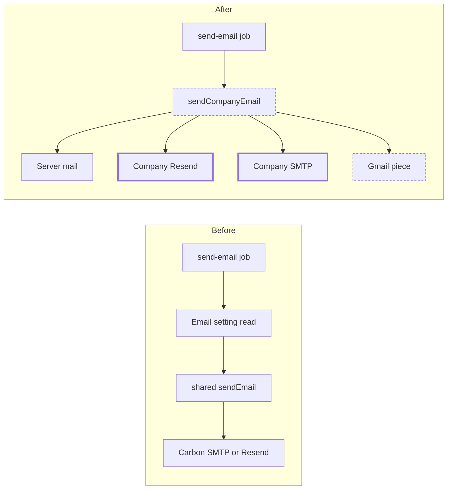

# Choose how a company sends email: Gmail, Resend, SMTP or server mail

> Status: Approved
> Author: Aashu
> Date: 2026-10-29

## TLDR

- Add **Gmail** as a fourth "Delivery method" card in the Email integration, beside Server mail, Resend and Custom SMTP.
- With Gmail picked, the company's mail goes out from a connected Gmail account that the admin picks.
- Carbon sends through the Activepieces Gmail piece, which already holds the connection, the token refresh and the MIME build. Carbon writes no Gmail API code.
- Fix a gap: today Resend and Custom SMTP ignore the company's own key and server. After this change, every delivery method sends through what the company picked.
- All company mail follows the choice: documents, user invites, two-factor mails and notification emails. Login codes, onboarding mail, the changelog and deletion warnings stay on Carbon's address.
- A failed send fails the same way for every method. No method falls back to another.

## Overview diagram



## Problem Statement

1. **No Gmail choice.** The Gmail integration shipped as a workflow piece. A company cannot use it to send its quotes, orders or invoices.
2. **Resend and SMTP do not use the company's settings.** The Email integration asks for a Resend API key or SMTP server. The `send-email` job reads only `active` and `metadata` and then calls the shared `sendEmail` (`packages/jobs/src/inngest/functions/notifications/send-email.ts:56-103`). So every company sends through Carbon's own transport, under Carbon's address. The company's key is used only by the healthcheck (`packages/ee/src/email/hooks.server.ts:51-84`).
   - This worked until 2026-05-27. Commit `13e69a18bc` ("revert send email changes") removed the per-company Resend client and moved to `process.env.RESEND_API_KEY`.
3. **Only documents read the setting.** Invites, two-factor mails and notification emails always go from the server's address, even when a company has its own mail set up (`packages/lib/src/events.ts:89-92`).

## Proposed Solution

### What sends through the company's choice

| Email | Today | After |
|---|---|---|
| Quote, sales order, sales invoice, PO, RFQ, supplier quote (the 7 `document: true` call sites) | Carbon transport; Server mail sets the From name | Company's delivery method |
| Automated invoice email (`packages/jobs/src/invoicing/automate-invoice.ts:815`) | Carbon transport, direct `sendEmail` | Company's delivery method |
| User invite and re-invite (`users.service.ts:2331`, `invite.$code.tsx:241`, `tasks/user-admin.ts:107`) | Carbon transport, direct `sendEmail` | Company's delivery method |
| Two-factor emails (`apps/erp/app/services/mfa-email.server.ts`) | Carbon transport | Company's delivery method |
| Notification emails (`notify.ts:740-765`) | Carbon transport | Company's delivery method |
| Implementation Hub ready (`shared.service.ts:1821`) | Carbon transport | Company's delivery method |
| Login verification code, welcome and get-started mail, changelog, company deletion warning | Carbon transport | Unchanged: Carbon transport |

The last row stays on Carbon's address for a reason. A login code goes out before Carbon knows the company. The other mails come from Carbon, not from the company.

### One sender function

Add `sendCompanyEmail(serviceClient, companyId, payload)`. It is the one place that turns a company's Email setting into a sent message:

1. Read the company's `email` integration row.
2. Resolve the delivery with `resolveEmailDelivery` (extended with `gmail`).
3. Send through the transport for that delivery:

| Delivery | Transport | From | Reply-To |
|---|---|---|---|
| None (no integration, no server mail) | shared `sendEmail` (Carbon transport) | Carbon default | caller's `replyTo` |
| `server` | shared `sendEmail` | company name on the server address (documents only, as today) | caller's `replyTo` plus `fromEmail` |
| `resend` | nodemailer to `smtp.resend.com` with the company's vaulted `apiKey` | `{company name} <{fromEmail}>` | caller's `replyTo` |
| `smtp` | nodemailer with the company's `host`, `port`, `username`, vaulted `password`, `secure` | `{company name} <{fromEmail}>` | caller's `replyTo` |
| `gmail` | Activepieces `gmail_send_email`, with the token from `resolvePieceAuth` | `{company name} <{Gmail account}>` | caller's `replyTo` |

The `send-email` job calls `sendCompanyEmail` for every event. The two job senders (`automate-invoice.ts`, `user-admin.ts`) call it directly. The two ERP invite senders dispatch the `send-email` event, as `packages/lib/AGENTS.md` asks; both ignore the send result today. The shared `sendEmail` stays for Carbon's own mail.

### Gmail through the Activepieces piece

The piece's send action takes `receiver`, `cc`, `bcc`, `subject`, `body_type`, `body`, `reply_to`, `sender_name`, `from` and `attachments` (read in `@activepieces/piece-gmail@0.13.0`). The workflow allowlist omits `attachments` only for workflow authors (`allowlist.ts:339`). A direct call can pass them.

The Gmail adapter does 3 things:

1. Get the access token with `resolvePieceAuth(serviceClient, companyId, "gmail", gmailConnectionId)`. This refreshes the token when it is near expiry.
2. Map the payload to the piece's props. Attachments become `{ file: { base64, filename, extension } }`.
3. Call `action.run(buildPieceContext({ auth, propsValue }))`, the same way `runIntegrationAction` does (`packages/jobs/src/workflows/actions/integration.ts:189-218`).

### Failure

Every delivery method fails the same way. The send throws, and the job follows its existing retry rule (`emailDeliveryFailure`). No method falls back to another. An expired Gmail connection fails the send; the Gmail card already shows "reconnect".

### Design Decisions

| Decision | Choice | Rationale |
|---|---|---|
| Where the user picks Gmail | A fourth card in the Email integration's "Delivery method" setting | One place for email. Answered by the user. |
| Which mail follows the choice | All company mail; Carbon's own mail stays on Carbon | Answered by the user. A login code has no company. |
| How Gmail sends | The Activepieces piece action, called directly | The piece already does auth, refresh and MIME. Answered by the user. |
| Which Gmail account | A select field `gmailConnectionId` on the Email settings, listing the company's Active Gmail connections | A company can connect several accounts. Answered by the user. |
| `fromEmail` with Gmail | Hidden; Gmail sends as the picked account | The piece says a From address "must be listed in your GMail account's settings". The picked account always is. |
| Fix Resend and SMTP | Yes, in this change | Answered by the user. Same code path as Gmail. |
| Resend transport | SMTP to `smtp.resend.com` with the company key | Matches the shared transport since #1652; no Resend SDK in the send path. |
| Failure | Fail; no fallback for any method | Answered by the user. Gmail is treated like the other methods. |
| Plan gate | Gmail stays a Business integration on Cloud; Email stays free | Answered by the user. No pricing change. |
| Where `sendCompanyEmail` lives | `packages/jobs` (server-only), exported for the ERP | It needs `@carbon/ee` secrets and `@carbon/jobs` piece auth. The ERP already imports `@carbon/jobs/integrations` server-side. |
| Branching on the `gmail` id | Only inside `packages/ee/src/email/` and the Gmail adapter | The `no-integration-id-branching` check allows a provider to name itself. |
| Multi-tenancy | Every read is scoped by `companyId`; the service role reads the vault and the connection | Same rule as `runIntegrationAction`. |

## Data Model Changes

No new table and no migration. The Email integration's `metadata` gets one new variant in its zod schema (`packages/ee/src/email/config.tsx:137`):

```ts
z.object({
  provider: z.literal("gmail"),
  gmailConnectionId: z.string().min(1, { message: "Pick a Gmail account" })
})
```

`EmailDelivery.provider` widens to `"server" | "resend" | "smtp" | "gmail"`, and `EmailDelivery` gets an optional `gmailConnectionId`.

## API / Service Changes

| Change | File |
|---|---|
| Add the `gmail` card, the `gmailConnectionId` setting and the schema variant | `packages/ee/src/email/config.tsx` |
| Widen `EmailDelivery`; read `gmailConnectionId` in `resolveEmailDelivery` | `packages/ee/src/email/delivery.ts` |
| Healthcheck for `gmail`: the picked connection exists and is Active | `packages/ee/src/email/hooks.server.ts` |
| Add `sendCompanyEmail` and the four transports | new file under `packages/jobs/src/` |
| Call `sendCompanyEmail` | `send-email.ts`, `automate-invoice.ts`, `user-admin.ts` |
| Dispatch `trigger("send-email", …)` with the `companyId` in place of the direct `sendEmail` | ERP `users.service.ts` (`sendInviteEmail`), `_public+/invite.$code.tsx` |
| Fill the `gmailConnectionId` options from the company's Gmail connections | ERP `x+/settings+/integrations.$id.tsx` loader (`dynamicOptions`) |
| Update the `document` comment: it now sets only the server-mail From name | `packages/lib/src/events.ts` |

## Closest Sibling

N/A for a record type: this change adds no record. The closest code precedent is `runIntegrationAction` (`packages/jobs/src/workflows/actions/integration.ts`). The Gmail adapter copies its auth, context and error handling. The settings field copies the Ramp account selects that the same loader fills through `dynamicOptions`.

## UI Changes

The Email integration's settings form (archetype: integration settings drawer, unchanged):

1. The "Delivery method" cards show Gmail as a fourth card.
2. With Gmail picked, a "Gmail account" select shows the company's Active Gmail connections by `accountLabel`. "From email" is hidden.
3. If the company has no Active Gmail connection, the select is empty. Its help text says to connect Gmail on the Gmail integration first.
4. On Cloud Starter, the Gmail integration shows its usual upgrade card, so no connection can exist.

Integration descriptor copy is plain English in every `config.tsx` (no file there uses Lingui). The new labels follow that convention.

## Acceptance Criteria

- [ ] An admin connects `sales@acme.test` on the Gmail integration, picks Gmail in Email settings, picks that account, and saves.
- [ ] A finalized quote emails the customer from `Acme <sales@acme.test>`, with the quote PDF attached, and Reply-To set to the user who sent it.
- [ ] A user invite, a two-factor email and a notification email for that company arrive from `sales@acme.test`.
- [ ] A login verification code still arrives from Carbon's address.
- [ ] With Resend picked and a company API key saved, a PO email goes through the company's Resend account from its `fromEmail`.
- [ ] With Custom SMTP picked, a PO email goes through the company's SMTP server.
- [ ] With the Gmail connection revoked, the quote send fails, the job logs the error, and no mail goes out from another address.
- [ ] Saving Gmail with no account picked shows "Pick a Gmail account".
- [ ] A company with no Email integration sends exactly as today.
- [ ] Typecheck, Biome and the `@carbon/checks` conformance checks pass.

## Risks

| Risk | Severity | Mitigation |
|---|---|---|
| A Cloud company that saved a bad Resend key or an unverified domain since 2026-05-27 starts to fail when the fix ships | High | The healthcheck already flags a bad key. Before release, list Email installs with `provider = 'resend'` whose healthcheck fails, and contact them. |
| Gmail's daily send limit (lower for personal accounts) blocks a company with high notification volume | Med | Document the limit in the Email docs page. The failure surfaces in the job log like any other send failure. |
| An invite email fails through the company's method, and nobody sees it | Med | `sendInviteEmail` ignores the send result today (`users.service.ts:2331`), so an SMTP failure is silent now too. Keep that behavior; log the failure. |
| The vendor piece changes its props in a later version | Low | The piece version is pinned (`0.13.0`). A test pins the prop names the adapter sends. |

## Open Questions

> All resolved with the user before this spec was written.

- [x] Where does the user pick Gmail? — **Answer:** a fourth "Delivery method" card in the Email integration.
- [x] Which emails follow the choice? — **Answer:** all company mail. Login codes, onboarding, changelog and deletion warnings stay on Carbon's address.
- [x] Build on Activepieces or write a Gmail client? — **Answer:** Activepieces. Call the piece's send action directly; it supports attachments.
- [x] What happens when Gmail is disconnected? — **Answer:** the same as the other methods today: the send fails. No fallback.
- [x] Which Gmail account sends when several are connected? — **Answer:** the admin picks one in Email settings.
- [x] Fix the Resend/SMTP gap here? — **Answer:** yes, the gap is real on `main` (since commit `13e69a18bc`).
- [x] Is Gmail sending free on Cloud Starter? — **Answer:** no. Gmail stays a Business integration.

## Changelog

- 2026-10-29: Created. Research: `.ai/research/2026-10-29-email-provider-choice.md`.
- 2026-10-29: Implemented per `.ai/plans/2026-10-29-email-provider-choice.md`. `sendCompanyEmail` takes the service client as its first argument. `@carbon/ee` gains the import-light subpath `./email/delivery`. A document sent through this server's transport always names the company on the From, which keeps the automated invoice email's From as before.
- 2026-10-29: Review fixes. Server mail and Gmail save with no credential (`picksCredentialFreeEmail`). `parseEmailSettings` is the single schema read of Email metadata. `documentSender` merged into `sharedMailHeaders`.
