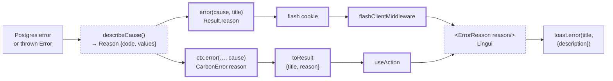

# Specific error toasts

> Status: in-progress
> Author: Aashu
> Date: 2026-10-29

Research: [`.ai/research/2026-10-29-specific-error-toasts.md`](../research/2026-10-29-specific-error-toasts.md)

## TLDR

- Every error toast keeps its short title, for example "Failed to update purchase order".
- A second line under the title shows the real reason.
- One change in the shared server helpers reaches about 1,800 server toasts.
- A module-by-module sweep fixes about 360 browser toasts in ERP and MES that drop the reason.
- Known database refusals get a translated, friendly reason. Other errors show the raw database or trigger text.
- A single-record save or delete that the database skips without an error now shows an error toast.

## Overview diagram

## Problem Statement

Most error toasts say only "Failed to <verb> <thing>". The server knows the real cause, but it writes the cause to the log only. The user and the developer must guess what went wrong.

Evidence:

| Place | What it does today |
|---|---|
| `packages/auth/src/utils/result.ts:10-23` | `error(cause, msg)` logs the cause. It returns `{ success: false, message }` only. |
| `packages/api/src/service-fn.server.ts:437-450` | `refusalFromDatabase` adds a reason for 10 SQLSTATEs only. It drops trigger text (P0001, 55000). |
| `packages/auth/src/types.ts:64-70` | `Result.description` reaches the toast's second line. No call site sets it. |
| Client `toast.error` | About 314 calls use a fixed string and ignore the caught error. |
| RLS `USING`-only update policies | A blocked update changes 0 rows and returns no error. The user sees nothing, or "No matching record was found." |

Example: a purchase order save that a closed accounting period blocks shows "Failed to update the purchase order". The trigger text "Accounting period is closed for posting date 2026-10-01" stays in the log.

## Proposed Solution

The solution has 5 units.

### Unit 1 — `describeCause` (pure, server and browser)

File: `packages/utils/src/error-reason.ts` (`@carbon/utils`). Every package in the chain (`@carbon/api`, `@carbon/auth`, `@carbon/react`, `@carbon/query`) already depends on `@carbon/utils`, and the browser needs the same function for `toastError`.

1. Move the field parsing of `packages/api/src/database-refusal.ts` (`fieldsOf`, `keyColumns`, `quoted`, `list`) into this file.
2. A reason has the shape `{ code: ReasonCode, values: Record<string, string> }`.
3. `ReasonCode` is a closed set of 10 codes: `duplicate`, `stillUsed`, `noMatch`, `required`, `breaksRule`, `badValue`, `forbidden`, `notFound`, `notApplied`, `raw`.
4. `reasonText(reason)` gives the English text. For the 8 database codes it is byte-identical to the current `databaseRefusal` message.
5. `databaseRefusal()` keeps its signature and its output. It reads the reason from this file and maps the code to its category.
6. Map P0001 and 55000 to `raw`, with the authored trigger text.
7. If a RAISE uses 23514, 23503 or 42501 with authored text, map it to `raw` with that text. Authored text is text without the Postgres wording "violates" or "permission denied". This applies to `describeCause` only. `databaseRefusal` keeps its current output.
8. Cut `raw` text to 300 characters.
9. Add `describeCause(cause): Reason | null`. It uses this order:

| Cause | Reason |
|---|---|
| Known SQLSTATE | the mapped code from step 3 |
| Code `CARBON_NOT_APPLIED` (Unit 4) | `notApplied` |
| Other database error with a message | `raw`, the Postgres message |
| zod error | `raw`, the summary that `packages/api/src/errors.ts` already builds |
| `Error` | `raw`, `error.message` |
| string | `raw`, the string |
| `null`, or an object that is not an error (for example `params`) | `null` |

### Unit 2 — `<ErrorReason>` (client, translated)

File: `packages/react/src/ErrorReason.tsx`.

- `<ErrorReason reason={reason} />` renders the translated text of one reason. It uses `useLingui()` from `@lingui/react/macro`, the pattern `i18n-lingui-system.md` requires.
- Each `ReasonCode` has one `t` template. Example: `duplicate` gives ``t`A record with this ${columns} already exists.` ``.
- `raw` renders `values.text` as it is. Raw text is not translated.
- It is a component, not a function of `i18n`. The flash middleware runs outside React and has no `i18n`. Sonner renders a `description` node inside `<Toaster>`, and `<Toaster>` sits inside `LocaleProvider` in both apps (`apps/erp/app/root.tsx`, `apps/mes/app/root.tsx`).
- Both the ERP and the MES Lingui catalogs already include `packages/react/src` (`lingui.config.js`).
- The precedent is the integrations UI: the server sends a code, and the client translates it (`apps/erp/app/modules/settings/ui/Integrations/IntegrationCard.tsx:114`).
- The same file exports `toastError(title, cause?)` for browser-side catches. It calls `describeCause` from `@carbon/utils` and shows `<ErrorReason>` as the description.

### Unit 3 — Carry the reason to the toast

The legacy path:

1. Add an optional `reason?: Reason` to `Result` (`packages/auth/src/types.ts`).
2. Make `error(cause, msg)` set `reason` from `describeCause(cause)`.
3. Make `flash()` and `getSessionFlash()` write and read `reason`.
4. Make `flashClientMiddleware` call `toast.error(message, { description })`. The description is `result.description`, else `<ErrorReason reason={result.reason} />`.

The service-function path:

1. Add an optional `reason` to `CarbonError`.
2. Make `refusalFromDatabase` set `title` and `reason`. For an `internal` refusal with no known SQLSTATE, set `reason` from `describeCause`.
3. Make `toResult` send `{ category, message, status, title, reason }`.
4. Keep `message` as the combined "Title: English reason" string. API callers see no change.
5. `title` is the bare operation message.
6. Make `serviceErrorMessage` and `useAction` show `title` and an `<ErrorReason>` description when `reason` exists. Else they show `message`, as today.
7. Make `respond(...).redirect` copy `title` and `reason` into the flash.

### Unit 4 — Detect a skipped single-record write

1. Add `requireAffected(query)` to `packages/utils/src/require-affected.ts` (`@carbon/utils`), so ERP and MES services can both use it.
2. Use it on single-record writes keyed by id: `.update(...).eq("id", …)` and `.delete().eq("id", …)`.
3. Add `.select("id")` to each of these calls.
4. If the call has no error and returns 0 rows, `requireAffected` returns a Supabase-shaped error with code `CARBON_NOT_APPLIED`.
5. `describeCause` maps that code to `notApplied`. The text is "You don't have permission to change this record, or it no longer exists."

Do not change bulk writes (`.in(...)`, a filter without an id, an intended no-op). These writes can match 0 rows on purpose.

### Unit 5 — The sweep (ERP and MES)

Do the sweep one module at a time. The modules are purchasing, sales, inventory, production, items, accounting, quality, resources, people, settings, documents, invoicing, shared, and the MES services and routes. In each module:

1. Check each server `error(x, …)` call. Make sure `x` is the real error object.
2. Replace a `params` cause (about 50 calls) with the real error, or with `null` when no error exists.
3. If a title is wrong for the operation, correct it.
4. If a call passes `null` but an error is in scope, pass the error.
5. Change each client `toast.error` with a fixed string and an error in scope to `toastError(i18n, title, cause)`.
6. Add `requireAffected` to each single-record update and delete.
7. Leave each call that is already specific unchanged.

### Design Decisions

| Decision | Choice | Rationale |
|----------|--------|-----------|
| D1 How to reach about 2,500 toasts | One shared helper change, then a per-module sweep | User choice. The helper change reaches about 1,800 server calls. The sweep covers the rest. |
| D2 Where the reason shows | The toast's second line (sonner `description`) | User choice. `Result.description` already reaches the toast (`flash.client.ts:26`). |
| D3 Text for an unmapped error | The raw database, trigger or exception text | User choice. It helps debugging most. RLS limits data to the user's own company. |
| D4 Translation of friendly reasons | The server sends `{ code, values }`; the client translates with Lingui | User choice. The repo rule says new copy is translatable. Server packages have no Lingui. |
| D5 Service-function toasts | Move the reason to the second line too | User choice. All error toasts look the same. |
| D6 Service-function `message` | Keep it combined; add `title` and `reason` | `BACKWARD_COMPATIBILITY.md` makes service return shapes STABLE. The public API sends `message`. |
| D7 RAISE text with a standard code | Show the authored text | The authored text is more specific than the generic code text (research gap 3). |
| D8 Skipped-write check scope | Single-record writes keyed by id only | Bulk writes can match 0 rows on purpose. A check there gives false errors. |
| D9 Sweep scope | ERP and MES. The helper change reaches all apps. | User choice. |
| D10 Raw text | Not translated | It comes from the database or an exception. Nothing exists to translate. |
| D11 Request id in the toast | No | The user chose the raw message over a reference id. |
| D12 Public and sign-in pages | Keep the message generic: pass `null` as the cause in `_public+`, `share+` and sign-in, invite, MFA and SSO flows | A raw reason there can tell an outsider that an account exists, or show table names to a customer. D3 covers signed-in employees only. |

## Data Model Changes

N/A. The change adds no table, column or migration.

## API / Service Changes

| Surface | Change |
|---|---|
| `Result` (`packages/auth/src/types.ts`) | New optional `reason` field. Additive. |
| `error()` (`packages/auth/src/utils/result.ts`) | Sets `reason`. Signature unchanged. |
| `flash()`, `getSessionFlash()` | Write and read `reason`. |
| `databaseRefusal()` | Also returns `reason`. Existing `message` text unchanged. |
| New `describeCause()`, `reasonText()`, `Reason` | `packages/utils/src/error-reason.ts` |
| New `<ErrorReason>`, `toastError()` | `packages/react/src/ErrorReason.tsx` |
| `CarbonError` | New optional `reason`. |
| `toResult` / `SerializedError` | New `title` and `reason` fields. `message` unchanged. |
| `serviceErrorMessage`, `useAction` | Show `title` plus the reason. |
| New `requireAffected()` | `packages/utils/src/require-affected.ts` |
| Route actions and services in ERP and MES | Sweep edits from Unit 5. |

## Closest Sibling

N/A. This change adds no record type. The closest prior art is the integrations error toast (`IntegrationCard.tsx:114`): a server code and a client `i18n._` with a `description`.

## UI Changes

- The error toast gets a second line. The component is the existing sonner `Toaster` (`packages/react/src/Toast.tsx`). No new component.
- Check the contrast of the description text on the red error toast. If it fails, change the `description` class for the error variant only.

## Acceptance Criteria

- [ ] A purchase order save that breaks a unique constraint shows the title and the second line "A record with this "…" already exists."
- [ ] After a switch to the `de` locale, that second line uses the German catalog entry. Lingui extract lists the entry even when no translation exists yet.
- [ ] A save that a trigger blocks with `RAISE EXCEPTION 'Accounting period is closed for posting date %'` shows that sentence as the second line. This works on a legacy `error()` route and on a service-function route.
- [ ] A purchase order update that RLS blocks shows "You don't have permission to change this record, or it no longer exists." The user does not see a success toast or no toast.
- [ ] An upload failure in `DefaultAttachmentsPanel` shows "Failed to upload <file>" and the storage error as the second line.
- [ ] A public API call that hits a duplicate returns the same `message` string as before. A unit test on `toResult` proves it.
- [ ] `error(null, "Rate limit exceeded")` still shows one line and no description.
- [ ] Unit tests cover `describeCause` for each row of the Unit 1 table and each SQLSTATE in `REFUSALS`.
- [ ] `<ErrorReason>` has a `switch` case for each `ReasonCode`, with a `never` check, so typecheck fails on a missing code.
- [ ] Unit tests prove `reasonText` gives the same text as the current `databaseRefusal` for each SQLSTATE.
- [ ] `rg 'error\(params,' apps/erp apps/mes` returns no match.
- [ ] Scoped typecheck passes for `@carbon/api`, `@carbon/auth`, `@carbon/query`, `@carbon/react`, `erp` and `mes`.
- [ ] The existing tests of those packages pass.
- [ ] Lingui extract adds entries and removes none.
- [ ] `.claude/rules/flash-system.md` and `packages/auth/AGENTS.md` describe `reason` and the second line.

## Risks

| Risk | Severity | Mitigation |
|------|----------|------------|
| A raw message shows a table or column name to a user | Low | User accepted it (D3). RLS keeps data inside the company. |
| `.select("id")` after an update needs SELECT permission on the row | Medium | Add it only where the route already reads the record. Test one RLS-blocked update per module. |
| A write marked single-record can match 0 rows on purpose | Medium | Unit 4 covers id-keyed writes only. Each sweep commit lists the writes it changed. |
| A large diff is hard to review | Medium | One commit per module. The shared helper change is its own first commit. |
| Toast text is longer | Low | The reason sits on the second line. The title stays short. |
| `Result.reason` makes the flash cookie bigger | Low | The reason is a short object. Raw text is capped at 300 characters. |

## Open Questions

> HARD STOP: Do not proceed with implementation until these are answered.

- [x] How do we make about 2,500 toasts specific? — **Answer:** One shared helper change, then a per-module sweep for the calls that still drop the reason.
- [x] Where does the reason show? — **Answer:** On the toast's second line, under the current title.
- [x] What does an unmapped error show? — **Answer:** The raw database or exception text.
- [x] Do we translate the friendly reasons? — **Answer:** Yes. The server sends a code and values. The client translates with Lingui. Raw text stays as it is.
- [x] Which apps does the sweep cover? — **Answer:** ERP and MES.
- [x] Do service-function toasts move the reason to the second line too? — **Answer:** Yes. The API `message` stays the same (D6).
- [x] Do we catch saves that RLS skips without an error? — **Answer:** Yes, now. Only single-record writes keyed by id (D8).

## Changelog

- 2026-10-29: Created after research and the user interview.
- 2026-10-29: Approved. Moved `describeCause` and `requireAffected` to `@carbon/utils`, because the browser needs them too. Replaced `formatReason(i18n, …)` with the `<ErrorReason>` component, because the flash middleware has no `i18n`.
- 2026-10-29: Added D12 during the sweep: the shared `error()` change also reaches public pages, so those keep generic messages.
