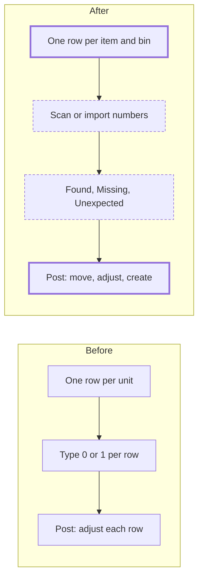

# Inventory count for tracked units

> Status: draft
> Author: sid@carbon.ms
> Date: 2026-10-30

## TLDR

An inventory count shows one row per item and storage unit, and the row
collapses. A serial or batch row expands to show its units. The counter scans
or types the serial or batch number of each unit on the shelf. Each unit then
shows a state: Found, Missing or Unexpected. The post writes off a Missing
unit, moves an Unexpected unit that Carbon knows to its new bin, and creates
an unknown unit. Units with no serial number count as a quantity, and
the counter can give each one a serial number. A CSV file of count results
goes through the same rules as a scan.

Research: `.ai/research/inventory-count-tracked-items.md`.

## Overview diagram



## Problem Statement

A customer prepared a full count and asked how Carbon counts tracked parts.
Count IC000005 showed nine identical rows for item SA-0033, each with System
Qty 1. The Batch / Serial column showed "—" on every row. Today the count has
these gaps:

| # | Gap | Effect |
|---|-----|--------|
| 1 | `generateInventoryCountLines` writes one line per (item, storage unit, tracked entity). | A bin with 200 serials shows 200 rows. |
| 2 | The Batch / Serial column reads `trackedEntity.readableId`. A unit with no serial number shows "—". | The counter cannot tell which row is which unit. |
| 3 | The counter types 0 or 1 on each serial row. | The counter cannot scan what is on the shelf. |
| 4 | The count holds only the snapshot lines. | A unit on the shelf that is not in the snapshot has no line. The counter must leave the count and post a separate adjustment. |
| 5 | A unit that moved to another bin shows Missing in its old bin. | The post writes it off. It never reappears in its new bin. |
| 6 | Counts have no import. CSV is export only. | The counter types a full count from a scanner or a spreadsheet again by hand. |

Units with no serial number come from two writers today:

1. `postInventoryAdjustment` inserts a `trackedEntity` with `readableId: readableId ?? null`. `inventoryAdjustmentValidator` does not require a serial number.
2. A job under the `production` serial number timing (`20261028153412_serial-number-timing.sql`) leaves a replacement unit unnumbered.

Blind counts already exist (`inventoryCount.isBlind`). The `$id.tsx` loader
drops `systemQuantity` and `variance` filters and sorts while the count is
blind. This spec keeps that behavior and extends it to the new rows.

## What other systems do

From `.ai/research/inventory-count-tracked-items.md`:

| Topic | Practice | This spec |
|---|---|---|
| Sheet layout | Business Central, NetSuite and SAP show one line per item and bin, with the serials under it. Odoo and Acumatica show one flat row per serial, and Acumatica users complain about the page count. | Group rows that collapse. |
| Missing serial | Every system posts a negative adjustment. | Missing is written off. |
| Unknown serial | Business Central, Odoo and Fishbowl post a positive adjustment that creates it. | The post creates it. |
| Serial known in another bin | Business Central tells the user to make a reclass or transfer. SAP blocks the post until the user makes a transfer posting. | The post makes the move itself. The counter does not leave the count. |
| Units with no serial number | NetSuite Smart Count counts a quantity. Katana keeps an "Unbatched" quantity. | One Unnumbered quantity line. |
| Found batch | Every system counts per lot in item and bin. A found lot is a positive line. | Add an Unexpected batch line. |
| Import | Fishbowl's CSV keys on part, location, tracking number and quantity. | 4 flat columns: item, storage unit, serial or batch, counted quantity. |
| Blind count | NetSuite and Business Central hide expected quantities from the counter only. | `isBlind` already does this. |
| Recount tolerance | NetSuite Smart Count and SAP EWM use variance tolerances. | Out of scope for v1. |

## Proposed Solution

### Rows

The count table shows one **group row** per (item, storage unit). The group
row shows the item, the storage unit, Expected, Counted and Variance. A
tracked group row also shows the number of Found, Missing and Unexpected units.

| Item tracking | Group row | Expanded row |
|---|---|---|
| Inventory (untracked) | Counted is editable on the group row. | The row does not expand. |
| Serial | Counted is the number of Found and Unexpected units. | One line per unit: serial number, state, actions. |
| Batch | Counted is the sum of the batch lines. | One line per batch: batch number, Expected, Counted, state. |

Every tracked group row collapses. It starts collapsed. It expands in 3 cases:

1. The user clicks its chevron.
2. A search matches a unit in the group (`expandRowsFor`, as `ReceivingTable` does).
3. The user scans a unit into the group. The row expands and highlights that unit.

### Unit states

A count line has one state. Carbon derives the state. No column stores it.

| State | Condition |
|---|---|
| Not counted | `countedQuantity` is null. |
| Found | A snapshot line with `countedQuantity` > 0. |
| Missing | A snapshot line with `countedQuantity` = 0. |
| Unexpected | A line with `foundDuringCount` = true. |

### Scan

The count page has a scan bar above the table. It holds a storage unit picker
and a code field. A keyboard-wedge scanner types the code and presses Enter.

1. The counter picks the storage unit.
2. The counter scans a code.
3. `recordInventoryCountScan` resolves the code in this order: a serial or batch number (`trackedEntity.readableId`) of an item at this location, then an item readable id.
4. If the code matches 2 or more items, the scan bar asks the counter to pick the item.
5. The function writes the result, and the table updates the group row.

| The code is | Result |
|---|---|
| A serial expected in this bin | The line becomes Found (counted 1). |
| A serial already Found in this bin | No change. The scan bar shows "Already counted". |
| A serial expected in another bin of this count | Carbon adds an Unexpected line in this bin. The expected line in the other bin stays as it is. |
| A serial Carbon knows, in no line of this count | Carbon adds an Unexpected line in this bin. |
| A batch number | The scan bar asks for the quantity. Carbon sets Counted on the line, or adds an Unexpected line. |
| An unknown number | The scan bar asks for the item. Carbon adds an Unexpected line with no tracked entity and the typed number. |
| An item readable id (untracked item) | The scan bar asks for the quantity. Carbon sets Counted on the group. |

The counter can also add a unit by hand from the expanded row ("Add unit").
That form calls the same function.

### Units with no serial number

A serial group can hold units with no serial number. The expanded row shows
them as one **Unnumbered** line with a quantity, not one line per unit.

1. The counter types the number of unnumbered units on the shelf.
2. `setInventoryCountUnnumberedQuantity` sets `countedQuantity` = 1 on that many lines, oldest unit first (`trackedEntity.createdAt`), and 0 on the rest.
3. If the typed number is above the expected number, the function refuses it. The counter scans or types a serial number for each extra unit. Each extra unit becomes an Unexpected line.

The counter can give a Found unnumbered unit a serial number. The expanded
row opens one input per Found unnumbered unit. The number goes to
`inventoryCountLine.assignedReadableId`. The post writes it to the unit.

### Post

`postInventoryCount` keeps its guards: the Pending check under `FOR UPDATE`,
the snapshot drift check, the serial 0-or-1 check, and the one shared journal.
`planInventoryCountPost` gains 3 steps before it books anything:

1. **Pair moves.** For each tracked entity, the planner adds the negative deltas and the positive deltas of its lines. The matched quantity posts as a move: 2 ledger rows with `entryType` `Transfer` and `documentType` `Inventory Count`, no GL, no cost layers. `postInventoryAdjustment` books a storage-unit transfer the same way, with `Direct Transfer`. The count keeps `Inventory Count`, so `getInventoryCountMovements` lists the move.
2. **Move a known serial from outside the count.** If an Unexpected serial line has no negative line in this count, the planner finds the unit's bin with `getTrackedEntityBins`. If the unit has stock at this location, the planner adds a move from that bin.
3. **Adjust the rest.** What remains after steps 1 and 2 posts as today: `bookAdjustment` with a positive or a negative adjustment.

Rules for an Unexpected line:

| The unit | Post |
|---|---|
| Has stock in another bin at this location | A move from that bin. |
| Has stock at another location | Refuse the post. The counter makes a warehouse transfer first. |
| Is `Consumed` with no stock | A positive adjustment on the same entity, at the item's current cost. The unit becomes `Available`. |
| Is `Rejected` or `Scrapped` | Refuse the post. Quality owns these units (Unscrap, inspection). |
| Has no tracked entity (unknown number) | A positive adjustment that creates the entity with the typed number, as `postInventoryAdjustment` does. |

Then the post writes each `assignedReadableId` to `trackedEntity.readableId`.
It refuses a number that another unit of the same item already holds.

A refused post rolls back. It returns the line ids in `invalidLineIds`, as the
serial check does today, and the table highlights the rows.

### CSV import

The count page gets an Import button while the count is Draft. The file has
4 fixed columns: Item, Storage Unit, Serial / Batch, Counted Quantity. The
per-unit CSV export of the count has the same columns, so the counter can
export, fill in and import one file. A pure parser reads the file, as
`parseChartCsv` does for the chart of accounts import. Each row goes through
the scan resolver. A file is a full count of each group it names:

1. For each group in the file, every snapshot unit the file does not list becomes Missing (counted 0).
2. A group that the file does not name stays as it is.
3. A row the resolver cannot place (unknown item, unknown storage unit, a number on two items) is an error with its line number, as the chart of accounts import shows them. The import writes no row from a file with errors.

### Blind counts

While a count is blind, the group row hides Expected and Variance. The
expanded row shows only the lines the counter has counted. It hides Missing
and Not counted units, because their serial numbers would show what the
system expects. After the post, every line shows.

### Design Decisions

| Decision | Choice | Rationale |
|----------|--------|-----------|
| Group key | (item, storage unit) | A counter works one bin at a time. The bin is how the snapshot already splits stock. |
| Group default | Collapsed; expands on chevron, search, or scan | A full count has hundreds of groups. Search and scan open the group the counter works in. |
| Group data | A new view `inventoryCountGroups`, paged by cursor | A group never splits across 2 pages. `ReceivingTable` loads all lines and stops at a limit. A full count can be larger than that limit. |
| Expanded row data | One cached `api+` loader per group, read when the row expands | A collapsed group costs no line read. |
| Line state | Derived from `countedQuantity` and `foundDuringCount` | No stored state can drift from the quantities. |
| Unexpected known serial | Move from its current bin, not a write-off and a new unit | The unit keeps its history and its cost layer. |
| Serial at another location | Refuse | A count is for one location. A move between locations is a warehouse transfer. |
| Unknown serial | Create it with the typed number | The unit is on the shelf. Carbon must record it. |
| Unnumbered units | One quantity line; the oldest units count first | The units cannot be told apart. The oldest-first rule gives one repeatable answer. |
| Extra unnumbered units | Refuse; ask for a serial number | A new unit with no number repeats the problem this spec fixes. |
| Assign a serial number | Optional, written at post | A count is the time a person holds the unit. A Draft count stays editable until the post. |
| Batch in a new bin | Pair within the count as a move; adjust the rest | A batch can hold stock in 2 bins. Carbon cannot know a batch moved from a bin outside the count. |
| CSV semantics | A named group is a full count | A count file lists what is on the shelf. Units it leaves out are not on the shelf. |
| CSV columns | 4 fixed columns, no column map | The generic import (`/x/shared/import/$tableId`) cannot carry the count id. The chart of accounts import shows the fixed-column pattern. |
| Scan input | A text field with Enter | Keyboard-wedge scanners work with no new component or dependency. |
| MES | Out of scope for v1 | Counts live only in the ERP today. A MES count screen is its own spec. |
| Multi-tenancy | No new table. New columns sit on `inventoryCountLine`, which has `companyId` and the composite key. | Heuristic 1 |
| Service shape | Each operation is a `defineServiceFn` in `inventory.server.ts`; building blocks in `inventory.service.ts` | Heuristic 2, `.claude/rules/module-files.md` |
| RLS | The view is `SECURITY_INVOKER`. The existing `inventoryCountLine` policies apply. | Heuristic 3 |
| Permission | `update: inventory` for every write, as `updateInventoryCountLine` | Heuristic 4 |
| Forms | The scan bar and Add unit use `ValidatedForm` with a validator in `inventory.models.ts` | Heuristic 5 |
| Module layout | Inventory module files only, no barrel | Heuristic 6 |
| Compatibility | `updateInventoryCountLine` keeps its input. Old counts read with `foundDuringCount` = false. | Heuristic 7 |

## Data Model Changes

```sql
ALTER TABLE "inventoryCountLine"
  ADD COLUMN "foundDuringCount" BOOLEAN NOT NULL DEFAULT FALSE,
  ADD COLUMN "assignedReadableId" TEXT;

-- No unique index on (count, bin, unit): counts made before this can hold 2
-- lines of one unit in one bin, and every writer locks the count first.
-- (20261031050452 drops the index where an earlier deploy created it.)

-- One line per new number per item in a count.
CREATE UNIQUE INDEX "inventoryCountLine_newUnit_key"
  ON "inventoryCountLine" ("inventoryCountId", "itemId", "readableId")
  WHERE "trackedEntityId" IS NULL AND "readableId" IS NOT NULL;

CREATE INDEX "inventoryCountLine_group_idx"
  ON "inventoryCountLine" ("inventoryCountId", "itemId", "storageUnitId");

CREATE OR REPLACE VIEW "inventoryCountGroups" WITH (SECURITY_INVOKER = true) AS
SELECT
  icl."inventoryCountId",
  icl."companyId",
  icl."itemId",
  icl."storageUnitId",
  SUM(icl."systemQuantity") AS "expectedQuantity",
  SUM(icl."countedQuantity") AS "countedQuantity",
  SUM(icl."countedQuantity") - SUM(icl."systemQuantity") AS "variance",
  COUNT(*) AS "lineCount",
  COUNT(*) FILTER (WHERE NOT icl."foundDuringCount" AND icl."countedQuantity" > 0) AS "foundCount",
  COUNT(*) FILTER (WHERE NOT icl."foundDuringCount" AND icl."countedQuantity" = 0) AS "missingCount",
  COUNT(*) FILTER (WHERE icl."foundDuringCount") AS "unexpectedCount",
  COUNT(*) FILTER (WHERE icl."countedQuantity" IS NULL) AS "notCountedCount",
  COUNT(*) FILTER (WHERE icl."trackedEntityId" IS NOT NULL AND te."readableId" IS NULL) AS "unnumberedCount",
  -- every unit number in the group, so a search for a serial finds its group
  string_agg(COALESCE(icl."assignedReadableId", icl."readableId"), ' ') AS "unitNumbers"
  -- plus the item, material and storage-unit columns of "inventoryCountLines",
  -- so the group table keeps the same column filters
FROM "inventoryCountLine" icl
  LEFT JOIN "trackedEntity" te
    ON te."id" = icl."trackedEntityId" AND te."companyId" = icl."companyId"
GROUP BY icl."inventoryCountId", icl."companyId", icl."itemId", icl."storageUnitId";
```

`SUM("countedQuantity")` is null when the counter has counted no line of the group. That
reads as Not counted, as a null line does today.

Recreate `inventoryCountLines` after the `ALTER`: it selects `icl.*`, which
Postgres expands when it creates the view.

After the migration, run `pnpm run generate:types`, `pnpm db:check:datasets`
and `pnpm db:check:backups`.

## API / Service Changes

Operations in `apps/erp/app/modules/inventory/inventory.server.ts`. Every write
refuses a count that is not Draft (`conflict`), as `updateInventoryCountLine`
does.

| Operation | Permission | Does |
|---|---|---|
| `getInventoryCountGroups` | `view: inventory` | Reads `inventoryCountGroups` with the generic filters and cursor paging. Drops `expectedQuantity` and `variance` filters and sorts while blind. |
| `getInventoryCountGroupLines` | `view: inventory` | Reads the lines of one group. While blind, returns only counted lines. |
| `recordInventoryCountScan` | `update: inventory` | Resolves a code in a storage unit and writes the result (see Scan). Returns the group and the line it changed. |
| `addInventoryCountUnit` | `update: inventory` | Adds an Unexpected line from the Add unit form. Shares the resolver with the scan. |
| `removeInventoryCountUnit` | `update: inventory` | Deletes an Unexpected line. Refuses a snapshot line. |
| `setInventoryCountUnnumberedQuantity` | `update: inventory` | Spreads a counted quantity over the unnumbered lines of a group, oldest first. |
| `assignInventoryCountSerial` | `update: inventory` | Sets `assignedReadableId` on a Found unnumbered line. Refuses a number that another unit of the item holds. |
| `importInventoryCountResults` | `update: inventory` | Reads the uploaded file, resolves every row, and writes all rows in one Kysely transaction. |

Building blocks in `inventory.service.ts`:

| Building block | Does |
|---|---|
| `resolveInventoryCountCode(db, args)` | The one resolver for scan, Add unit and import. Pure lookup, no write. |
| `planInventoryCountPost` | Gains the move pairing, the outside-bin move and the Unexpected rules. Stays pure and tested in `inventory.plan-post.test.ts`. |
| `postInventoryCount` | Books moves as `Transfer` pairs with `documentType` `Inventory Count`, creates new units, and writes `assignedReadableId`. |

Routes under `apps/erp/app/routes/x+/inventory-count+/`:

| Route | Calls |
|---|---|
| `$id.scan.tsx` | `recordInventoryCountScan` |
| `$id.units.new.tsx` | `addInventoryCountUnit` |
| `$id.units.$lineId.delete.tsx` | `removeInventoryCountUnit` |
| `$id.unnumbered.tsx` | `setInventoryCountUnnumberedQuantity` |
| `$id.serial.tsx` | `assignInventoryCountSerial` |
| `$id.import.tsx` | `importInventoryCountResults` |
| `api+/inventory-count.$id.group.ts` | `getInventoryCountGroupLines`, with `cachedClientLoader` |

## Closest Sibling

This spec changes an existing record type, so the count is its own sibling.
Each new part copies an existing screen:

| Part | Copies |
|---|---|
| Grouped, collapsible table | `ui/Receiving/ReceivingTable.tsx` and `inventory+/receiving.tsx`: one row per order, lines in `renderExpandedRow`, `canExpandRow`, `expandRowsFor` on search |
| Scan a unit into a document | `stock-transfer+/$id.scan.$lineId.tsx` and `pickStockTransferLineEntity` |
| New serial on a positive adjustment | `postInventoryAdjustment` (insert `trackedEntity` with the typed `readableId`) |
| Move of a tracked entity between bins | `postInventoryAdjustment`, `isStorageUnitTransfer` branch |
| Upload a fixed-column CSV | `x+/accounting+/chart-import.tsx`, `modules/accounting/account-import-csv.ts`, `ui/ChartOfAccounts/AccountImportCsvErrors.tsx` |

Deviations, each a Design Decision above: a view pages the groups instead of
loading them whole; the expanded row loads on expand; the import writes count lines,
not new records.

## UI Changes

Page archetype: document detail with a line table, the count's existing
`$id.tsx` page.

1. `InventoryCountLines.tsx` becomes `InventoryCountGroups.tsx`. It renders `Table` with `renderExpandedRow`, `canExpandRow` (tracked items only) and `expandRowsFor` (the search, or the group of the last scan).
2. A new `InventoryCountGroupUnits.tsx` renders the expanded row: the unit lines, the Unnumbered line, Add unit, and the serial number inputs.
3. A new `InventoryCountScanBar.tsx` sits above the table while the count is Draft. It holds the storage unit picker and the code field. It keeps focus after each scan.
4. A state badge on each unit line: Found (green), Missing (red), Unexpected (blue), Not counted (gray), from the `--status-*` palette.
5. The CSV export gains one row per unit for tracked groups, with the state, so the user can edit an export and import it again.

## Acceptance Criteria

- [ ] A count of a bin with 9 units of a serial item shows 1 group row, collapsed, with Expected 9.
- [ ] The user clicks the chevron, and the row shows 9 unit lines. A second click collapses it.
- [ ] The user searches a serial number. The group that holds it opens, and Carbon highlights the line.
- [ ] The user picks bin A1 and scans 7 of the 9 serials. The group shows Found 7, Not counted 2.
- [ ] The user scans the same serial again. The scan bar shows "Already counted", and Found stays 7.
- [ ] The user scans a serial that Carbon has in bin B2. The A1 group shows Unexpected 1. After the post, the unit is in A1, its cost layer is unchanged, and the post wrote no journal line for it.
- [ ] The user scans an unknown number and picks the item. After the post, a unit with that number exists in A1 with status Available.
- [ ] The user scans a `Scrapped` serial. The post refuses and highlights the line.
- [ ] A group has 5 unnumbered units. The user types 3. After the post, the 2 newest units are Consumed and the 3 oldest stay.
- [ ] The user types 6 for 5 unnumbered units. The function refuses and asks for a serial number.
- [ ] The user gives a Found unnumbered unit the number SN-100. After the post, the unit's `readableId` is SN-100.
- [ ] The user imports a file that names bin A1 and lists 8 of its 9 serials. The 9th unit shows Missing. Other bins do not change.
- [ ] A file with an unknown storage unit writes no row and lists the error with its line number.
- [ ] On a blind count, the group row shows no Expected, and the expanded row shows only counted units.
- [ ] An untracked item shows 1 group row with no chevron, and Counted is editable on it.
- [ ] A count made before this change opens and posts with the same result as before.

## Risks

| Risk | Severity | Mitigation |
|------|----------|------------|
| The post now books moves and new units. A wrong pairing moves or writes off the wrong unit. | High | Keep the plan pure. Test each Unexpected rule and the pairing in `inventory.plan-post.test.ts` before any posting code. |
| Stock moves between the scan and the post. | Med | The existing snapshot drift check and the `FOR UPDATE` lock on each entity stay. The outside-bin move reads the bin inside the post transaction. |
| Two counters scan the same unit into 2 bins. | Med | The unique index allows each unit once per bin. The post refuses a serial with counted 1 in 2 bins. |
| The group view is slow on a large count. | Med | The group index on (`inventoryCountId`, `itemId`, `storageUnitId`). Measure on a count of 10,000 lines before the merge. |
| A serial number typed during the count is already in use. | Low | `assignInventoryCountSerial` checks it at entry. The post checks it again under the lock. |
| Demo datasets and backups miss the new columns. | Low | Run `pnpm db:check:datasets` and `pnpm db:check:backups`. Both columns have defaults. |

## Open Questions

> Resolved on 2026-10-30. The user asked to "do it all in one go", so each
> answer is the author's recommendation, accepted by the user without a
> question-by-question review. Change any of them before `/plan`.

- [x] What is a group? — **Answer:** (item, storage unit). A counter works one bin at a time.
- [x] Does a group start open or closed? — **Answer:** Collapsed. It opens on its chevron, on a search match, or on a scan into it. The user asked for collapsible groups.
- [x] What does an Unexpected serial that Carbon knows do at post? — **Answer:** It moves from its current bin at this location. It is not written off and created again.
- [x] What if that serial is at another location? — **Answer:** The post refuses. A warehouse transfer moves stock between locations.
- [x] What does an Unexpected `Consumed` serial do? — **Answer:** A positive adjustment brings the same unit back as `Available`, at the item's current cost. `Rejected` and `Scrapped` units refuse.
- [x] What does an unknown serial do? — **Answer:** The post creates the unit with the typed number.
- [x] How does the counter count units with no serial number? — **Answer:** As one quantity. The oldest units count first. A quantity above the expected number needs a serial number for each extra unit.
- [x] Can the counter number an unnumbered unit? — **Answer:** Yes, optionally. The post writes the number.
- [x] What does a batch found in a new bin do? — **Answer:** Within the count, Carbon pairs the decrease and the increase as a move. The rest is an adjustment.
- [x] What does an import do to units it does not list? — **Answer:** In a group the file names, they become Missing. Groups the file does not name do not change.
- [x] What does a blind count show in an expanded row? — **Answer:** Only the counted units, until the post.
- [x] Is the MES in scope? — **Answer:** No. Counts are ERP only today.
- [x] How does the counter scan? — **Answer:** A text field with Enter, which keyboard-wedge scanners use. No new dependency.

## Phases

| Phase | Ships | Depends on |
|---|---|---|
| 1 | Migration, `inventoryCountGroups`, the grouped collapsible table, the expanded row | — |
| 2 | Scan bar, Add unit, unit states, the post's move pairing and Unexpected rules | 1 |
| 3 | Unnumbered quantity line and serial number assignment | 2 |
| 4 | CSV import of count results, and the per-unit CSV export | 2 |

## Changelog

- 2026-10-30: Created from the IC000005 question. Answers accepted as recommended.
- 2026-10-30: While planning: a move posts with `documentType` `Inventory Count`; the import uses fixed columns, not `ImportCSVModal`.
- 2026-10-30: From the browser test: a serial unit is marked Found or Missing, not typed as 0 or 1. A unit counted in 2 bins reads "Moved to" and "Moved from". Group variance covers counted lines only. Stock of a serial item with no unit record is counted as a quantity, and the 0-or-1 check applies to units only.
