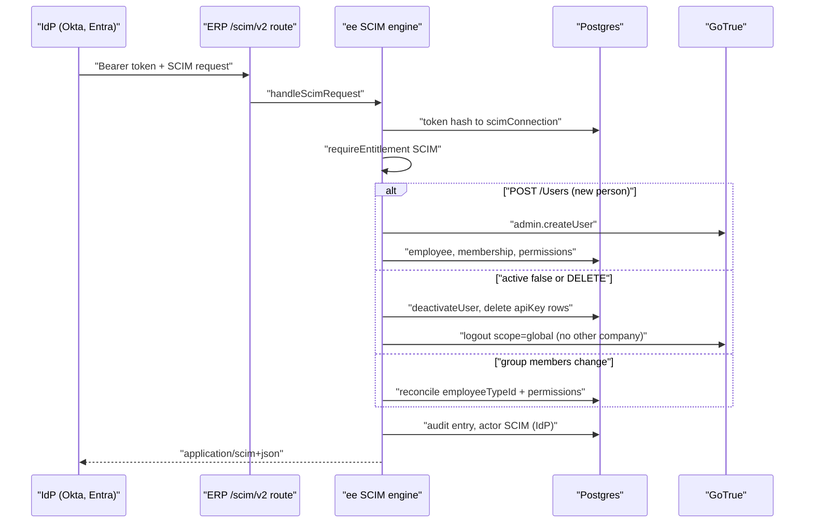
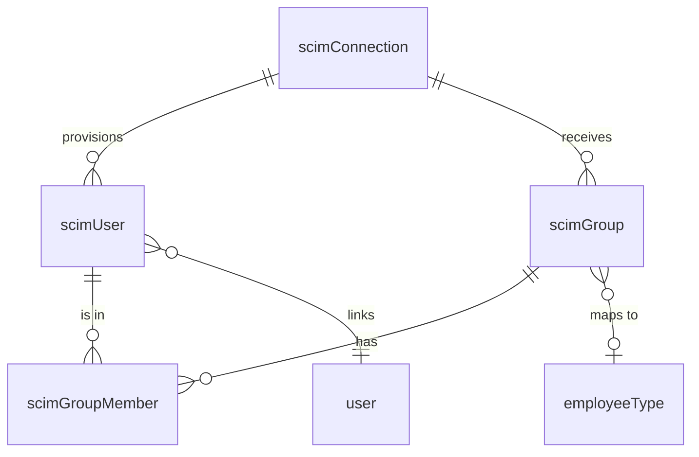

# SCIM 2.0 Provisioning

> Status: implemented
> Author: naveen + Claude
> Date: 2026-10-30
> Research: [.ai/research/scim-provisioning.md](../research/scim-provisioning.md)
> Closest sibling: SAML SSO ([2026-08-21-enterprise-saml-sso.md](2026-08-21-enterprise-saml-sso.md))

## TLDR

A customer's identity provider (Okta, Microsoft Entra ID, or any SCIM 2.0
client) creates, updates, deactivates and regroups Carbon employees over
SCIM 2.0 at `/scim/v2`. The main outcome is automatic offboarding. When the
IdP sets `active: false` or sends DELETE, Carbon removes the person from that
company with the existing per-company deactivation. Carbon also deletes the
person's API keys in that company. If the person has no other company, Carbon
ends every session they have. IdP groups map to employee types. A person in no
mapped group gets the connection's default employee type. The admin sets up
SCIM in a new Provisioning section on Settings → Security. SCIM runs on Cloud
and on self-hosted, behind a new `SCIM` plan feature (Business, Partner).

## Overview diagram



## Problem Statement

SAML SSO is invite-first, and it left provisioning out of scope: "SCIM /
automatic offboarding? Out of scope for v1; manual deactivation." So when IT
disables a person in Okta, that person can no longer sign in through SSO. But
four things stay live until an admin deactivates the person by hand:

1. the Carbon membership (`userToCompany`) and the permission grants,
2. the open sessions: magic link, Google and passkey sign-in still work,
3. the API keys: a key authenticates as its `createdBy` user, and nothing
   checks that the user is still a member,
4. on Cloud, the paid seat.

Example: Acme Corp has 400 people in Okta. IT disables Jane on her last day.
Today Jane can still sign in to Carbon with a magic link, and her API key
still posts journal entries as Jane. An admin finds out at the next access
review.

Onboarding has the same problem in reverse. IT assigns a new hire to the
Carbon app in Okta. Today that does nothing, and an admin must invite the new
hire in Carbon too.

## Proposed Solution

1. **A SCIM 2.0 server at `/scim/v2`** (ERP route `routes/scim+/v2.$.ts`).
   It serves `Users`, `Groups`, `ServiceProviderConfig`, `ResourceTypes` and
   `Schemas`. It accepts every request shape that Okta and Entra send (see the
   research, answer 3): PUT and PATCH, `op` in any case, string booleans,
   no-path value objects with dotted keys, and filtered paths.
2. **One `scimConnection` per company.** It holds the hashed bearer token, the
   IdP name, the default employee type and the default location.
3. **A thin route, a commercial engine.** The route calls
   `handleScimRequest` in `@carbon/ee/scim.server`. The engine resolves the
   token, runs `requireEntitlement(…, "SCIM")`, applies the rate limit, and
   routes the request.
4. **Per-company offboarding.** `active: false` and DELETE call the existing
   `deactivateUser` (`@carbon/auth/users.server`). Then the engine deletes the
   person's `apiKey` rows in the company. If the person has no other company,
   the engine signs the person out of GoTrue everywhere.
5. **Group → employee type mapping.** Pushed IdP groups land in `scimGroup`.
   The admin maps a group to an employee type on the Provisioning card. When a
   person's groups change, the engine picks the mapped type with the best
   priority. Then it rewrites the person's permission grants for this company
   from that type.
6. **A Provisioning section on Settings → Security**, beside SAML SSO. The
   admin creates the connection, copies the base URL and the token (shown
   once), regenerates the token, maps groups, and turns SCIM off.
7. **Audit.** Every SCIM change writes an `employee` audit entry with
   `actorId: null` and `metadata.actorLabel: "SCIM (Okta)"`. The audit UI
   shows the label instead of "System".

### Request lifecycle

#### `POST /Users` (create or adopt)

1. Read `userName`, the primary email, `name.givenName`, `name.familyName`,
   `externalId` and `active`. The email is the primary `emails` value, else
   the first `work` value, else `userName` when it is an email address.
2. If a `scimUser` with the same `userName` (no case) exists in the company,
   answer `409` with `scimType: uniqueness`.
3. If the company has an active SAML SSO connection with verified domains and
   the email is outside them, answer `400` (the invite rule,
   `uncoveredSsoDomainError`).
4. Find the Carbon `user` by email.
   - If there is no user and `CONTROLLED_ENVIRONMENT` is on, answer `403`.
     A new person needs the U.S.-person attestation an invite records.
   - If there is no user, create the auth user with `auth.admin.createUser`.
     The `create_public_user` trigger creates the `user` row.
   - If the user row exists with `active = false` (an SSO-archived row),
     answer `409`.
5. If SAML SSO is on for the email's domain, seed the SSO identity
   (`seedSsoIdentityForUser`). So the first SSO sign-in links to this account.
6. In one Kysely transaction:
   1. If the person is a customer or supplier contact in this company, refuse
      with `409`.
   2. If the person is already an active employee here, keep the employee
      type and the permissions (adopt).
   3. Else upsert `employee` (default type, `active`), insert `employeeJob`
      when it is missing (default location), insert `userToCompany`, and
      write this company's grants from the type.
   4. Revoke the person's open invites for this company.
   5. Write the name to `user` only when the person has no other company.
   6. Insert `scimUser`.
7. After the commit: bust the claims cache, sync the Stripe seats (Cloud),
   write the audit entry. If the transaction failed and step 4 made the auth
   user, delete the auth user.
8. Answer `201` with the User resource.

#### `PUT` / `PATCH /Users/{id}`

1. Apply the operations to the stored SCIM state (`userName`, `externalId`,
   name, email, `active`).
2. If `active` goes from true to false, run the deactivation below.
3. If `active` goes from false to true, reactivate: set `employee.active`,
   insert `userToCompany`, write the grants from the reconciled type.
4. If only the name changes, write it to `user` only when the person has no
   other company.
5. Carbon never changes a person's sign-in email from SCIM. It stores the new
   `userName` and email on `scimUser` and answers with them.

#### Deactivation (`active: false` or `DELETE /Users/{id}`)

1. Call `deactivateUser(serviceRole, userId, companyId)`. It strips this
   company from `userPermission`, deletes `userToCompany`, sets
   `employee.active = false`, deletes group `membership` rows, revokes open
   invites and busts the claims cache.
2. Read the person's `apiKey` rows in this company. Delete them. Bust each
   cached key hash.
3. If the person has no `userToCompany` row left, call GoTrue
   `/logout?scope=global` with a token signed for the person. GoTrue revokes
   every refresh token.
4. For PATCH or PUT, set `scimUser.active = false`. For DELETE, delete the
   `scimUser` row.
5. Sync the Stripe seats (Cloud). Write the audit entry.

#### Group membership change

1. Store the group change in `scimGroup` / `scimGroupMember`.
2. Collect the affected `scimUser` ids.
3. If the connection has no mapped group, stop.
4. For each affected active person, pick the type: the mapped group with the
   lowest `priority` (ties: `displayName`), else the default type.
5. For each person whose `employee.employeeTypeId` differs, set the new type
   and rewrite this company's grants from it. Use one read and batched writes.
6. Bust the claims caches. Write one audit entry per changed person.

Saving a mapping or the default type on the Provisioning card runs steps 4–6
for every active person of the connection.

### Design Decisions

| Decision | Choice | Rationale |
|----------|--------|-----------|
| Deployment and plan (Q1) | Cloud and self-hosted. New `SCIM` key in `FEATURE_PLANS`: Business, Partner. `requireEntitlement` in the engine. Community is blocked by `companyHasFeature`. | SCIM needs `auth.admin.createUser` (already on Cloud), Carbon tables and the public GoTrue `/logout`. It needs no GoTrue SSO admin API and no `auth` schema write. Every surveyed product puts SCIM on its top plan. |
| Not tied to SAML SSO | SCIM works without SSO. With SSO on, SCIM keeps the invite domain rule and seeds the SSO identity. | Cloud has no SAML. Provisioned people sign in by magic link, Google or password. |
| Fields the IdP owns (Q2) | The IdP owns `active`, the name and (with mappings) the employee type. Last writer wins: Carbon shows no lock in v1. | Okta and Entra overwrite on every push. A lock needs changes in 4 people forms. The Provisioning card and the docs say which fields the IdP owns. |
| Name writes | Only for a person with no other company. | `user` is global. One company's IdP must not rename a person that another company also sees. |
| Email writes | Never. SCIM stores the IdP's `userName` and email on `scimUser` only. | The sign-in email is global. An IdP that can change it can take over the person's other companies. |
| Group mapping (Q3) | IdP groups → employee types only. Lowest `priority` wins, ties by `displayName`. No mapped group → the default type. No mapping at all → SCIM never changes a type after create. | SAP maps groups to business roles. Linear gives unmapped people the base role. Carbon has one type per employee, so precedence must be explicit. Location and department stay manual. |
| A type change rewrites grants | The engine replaces this company's slice of `userPermission` with the type's grants. Hand edits to that person's grants are lost. | A type change in Carbon already means "these permissions". Merging would keep the access the IdP removed. |
| Deactivate (Q4) | The existing per-company `deactivateUser`, plus delete the person's `apiKey` rows in the company, plus GoTrue global logout when no company is left. The global `user` stays. | A key authenticates as its creator with no membership check, so it keeps access open. GitHub org-level SCIM keeps the personal account. Slack and Notion sign the person out. |
| Sessions with other companies | Keep the GoTrue session. | A global logout would sign the person out of companies this IdP does not own. Membership delete and the claims cache bust already block this company at the next request. |
| DELETE | Same as `active: false`, then delete the `scimUser` row, so a later GET answers 404. | Entra sends DELETE only after its 30-day hard delete, and expects 404 then. |
| Manual deactivation in Carbon | Sticks. The engine acts on `active` changes only, so an IdP push with `active: true` does not undo it. A deactivate then reactivate in the IdP brings the person back. | Admins keep a break-glass. Linear has the same override. |
| Seats (Q5) | No cap. Sync the Stripe quantity after each membership change. The card shows the count of active provisioned people. | No product caps provisioning. Carbon has no seat cap anywhere today. |
| Existing users on first sync (Q6) | Match by email (no case). An active employee is adopted as is. A person with no membership here joins with the default type. A customer or supplier contact is refused. Store `externalId` and `userName` on `scimUser`. | Linear, Notion and Atlassian match by email. SCIM grants no more than an invite already can: an admin can invite any email today. |
| GET /Users scope | Lists `scimUser` rows only, never unmanaged employees. | SCIM must not touch people it does not manage, such as shop-floor operators on shared terminals. |
| Audit (Q7) | One `employee` audit entry per change, `actorId: null`, `metadata.origin: "scim"`, `metadata.actorLabel: "SCIM (<IdP>)"`. The 3 audit renderers show `actorLabel` when there is no actor. | The audit columns are FKs to `user`, so a synthetic actor id is not possible. `employee` is already an audited entity. |
| Controlled environment | SCIM can adopt an active employee, update and deactivate. It refuses every other join and every reactivation (`403`). | An invite records the U.S.-person attestation. SCIM cannot give it. Offboarding still works. |
| Token | `scim_` + 32 random base62 characters. Store `tokenHash` (SHA-256 hex, `hashApiKey`) and `tokenPreview` (last 4). Show once. Regenerate replaces the hash. | The API-key pattern (`apiKey.keyHash`). Okta and Entra store one static bearer token. |
| Rate limit | 600 requests per minute per connection. Answer `429` with `Retry-After: 60`. | Okta waits `Retry-After` seconds. Entra runs 5–10 requests in parallel. |
| Resource id | `scimUser.id` / `scimGroup.id`, not the Carbon user id. | A company-scoped id answers 404 across companies by construction. It does not leak global user ids. |
| Where the code lives | Engine in `packages/ee/src/sso/` (`scim-*.ts`), exported as `@carbon/ee/scim.server`. Settings UI in `ScimProvisioning.ee.tsx`. | The commercial-licensing rule. SAML SSO lives in the same folder. |
| Multi-tenancy (heuristic 1) | All 4 tables have `companyId`, composite PK `("id", "companyId")`, `id('…')` defaults. `scimGroupMember` has PK `("groupId", "scimUserId", "companyId")`. | Convention. |
| Service shape (heuristic 2) | Engine functions take `db` and `serviceRole` and return `{ data, error }`. The HTTP handler returns a `Response` and never throws. | Convention. The MCP engine (`serveMcpRequest`) is the precedent for an ee handler. |
| RLS (heuristic 3) | `company("settings", { read: "settings_view" })` for all 4 tables in `authz/manifest.ts`. | `apiKey` uses the same rule. The engine writes with the service role. |
| Permissions (heuristic 4) | Security loader: `view: "settings"`. `x+/settings+/scim.tsx` action: `update: "settings"`. The SCIM route authenticates by token only. | Same as `sso.tsx`. |
| Forms (heuristic 5) | `ValidatedForm` + `scimConnectionValidator` / `scimGroupMappingValidator` in `settings.models.ts`. | Convention. |
| Module layout (heuristic 6) | No new ERP module. Settings route + ee files. No barrel in `apps/erp`. | Same as SAML SSO. |
| Backward compatibility (heuristic 7) | Additive. No behavior changes for people without a `scimUser` row. `AuditMetadata` gains two optional fields. | Preserve behavior. |

## Data Model Changes

One migration (`pnpm db:migrate:new scim-provisioning`): 1 enum, 4 tables.
RLS rules go in `packages/database/src/authz/manifest.ts`, not the migration.

```sql
CREATE TYPE "scimIdentityProvider" AS ENUM (
  'Okta', 'Microsoft Entra ID', 'Google Workspace', 'JumpCloud', 'OneLogin', 'Other'
);

CREATE TABLE "scimConnection" (
  "id" TEXT NOT NULL DEFAULT id('scim'),
  "companyId" TEXT NOT NULL,
  "identityProvider" "scimIdentityProvider" NOT NULL,
  "tokenHash" TEXT NOT NULL,
  "tokenPreview" TEXT NOT NULL,
  "defaultEmployeeTypeId" TEXT NOT NULL REFERENCES "employeeType"("id"),
  "defaultLocationId" TEXT NOT NULL REFERENCES "location"("id"),
  "lastRequestAt" TIMESTAMP WITH TIME ZONE,
  "createdBy" TEXT NOT NULL REFERENCES "user"("id"),
  "createdAt" TIMESTAMP WITH TIME ZONE NOT NULL DEFAULT NOW(),
  "updatedBy" TEXT REFERENCES "user"("id"),
  "updatedAt" TIMESTAMP WITH TIME ZONE,
  PRIMARY KEY ("id", "companyId"),
  FOREIGN KEY ("companyId") REFERENCES "company"("id") ON DELETE CASCADE
);
ALTER TABLE "scimConnection" ADD CONSTRAINT "scimConnection_companyId_key" UNIQUE ("companyId");
ALTER TABLE "scimConnection" ADD CONSTRAINT "scimConnection_tokenHash_key" UNIQUE ("tokenHash");

CREATE TABLE "scimUser" (
  "id" TEXT NOT NULL DEFAULT id('scimu'),       -- the SCIM resource id
  "companyId" TEXT NOT NULL,
  "connectionId" TEXT NOT NULL,
  "userId" TEXT NOT NULL REFERENCES "user"("id") ON DELETE CASCADE,
  "userName" TEXT NOT NULL,
  "externalId" TEXT,
  "email" TEXT NOT NULL,
  "givenName" TEXT,
  "familyName" TEXT,
  "active" BOOLEAN NOT NULL DEFAULT TRUE,
  "createdBy" TEXT NOT NULL REFERENCES "user"("id"),   -- 'system'
  "createdAt" TIMESTAMP WITH TIME ZONE NOT NULL DEFAULT NOW(),
  "updatedBy" TEXT REFERENCES "user"("id"),
  "updatedAt" TIMESTAMP WITH TIME ZONE,
  PRIMARY KEY ("id", "companyId"),
  FOREIGN KEY ("connectionId", "companyId") REFERENCES "scimConnection"("id", "companyId") ON DELETE CASCADE
);
CREATE UNIQUE INDEX "scimUser_companyId_userName_key" ON "scimUser" ("companyId", lower("userName"));
ALTER TABLE "scimUser" ADD CONSTRAINT "scimUser_companyId_userId_key" UNIQUE ("companyId", "userId");

CREATE TABLE "scimGroup" (
  "id" TEXT NOT NULL DEFAULT id('scimg'),
  "companyId" TEXT NOT NULL,
  "connectionId" TEXT NOT NULL,
  "displayName" TEXT NOT NULL,
  "externalId" TEXT,
  "employeeTypeId" TEXT REFERENCES "employeeType"("id") ON DELETE SET NULL,  -- the mapping
  "priority" INTEGER NOT NULL DEFAULT 100,
  -- audit columns as above
  PRIMARY KEY ("id", "companyId"),
  FOREIGN KEY ("connectionId", "companyId") REFERENCES "scimConnection"("id", "companyId") ON DELETE CASCADE
);
CREATE UNIQUE INDEX "scimGroup_companyId_displayName_key" ON "scimGroup" ("companyId", lower("displayName"));

CREATE TABLE "scimGroupMember" (
  "groupId" TEXT NOT NULL,
  "scimUserId" TEXT NOT NULL,
  "companyId" TEXT NOT NULL,
  PRIMARY KEY ("groupId", "scimUserId", "companyId"),
  FOREIGN KEY ("groupId", "companyId") REFERENCES "scimGroup"("id", "companyId") ON DELETE CASCADE,
  FOREIGN KEY ("scimUserId", "companyId") REFERENCES "scimUser"("id", "companyId") ON DELETE CASCADE,
  FOREIGN KEY ("companyId") REFERENCES "company"("id") ON DELETE CASCADE
);
-- Indexes on companyId and every FK.
```



Notes:

- `employeeType` and `location` have single-column PKs. The engine checks
  that both belong to the company before every write, as
  `createEmployeeAccount` does.
- Turning SCIM off deletes the `scimConnection` row. The cascade deletes the
  SCIM rows. Carbon users, memberships and employees stay.
- The engine stamps `createdBy` / `updatedBy` with `'system'` on the SCIM
  rows. The `system` user exists since `20230123004317_companies-rls.sql`.
- `AuditMetadata` (`packages/database/src/audit.types.ts`) gains
  `origin: "scim"` and `actorLabel?: string`. No SQL change.

## API / Service Changes

**`@carbon/ee/scim.server`** (new export → `packages/ee/src/sso/scim-index.server.ts`):

| Function | File | Does |
|---|---|---|
| `handleScimRequest(request, deps)` | `scim.server.ts` | Authenticates, gates, rate-limits, routes. Returns a `Response`. |
| `createScimConnection(serviceRole, db, input)` | `scim-connections.server.ts` | `requireEntitlement`. Makes the token. Returns the raw token once. |
| `updateScimConnection(serviceRole, db, input)` | `scim-connections.server.ts` | `requireEntitlement`. Saves the IdP, default type and location. Reconciles. |
| `regenerateScimToken(serviceRole, input)` | `scim-connections.server.ts` | `requireEntitlement`. Replaces the hash. Returns the raw token once. |
| `deleteScimConnection(serviceRole, input)` | `scim-connections.server.ts` | Not gated, so a downgraded company can still turn SCIM off. |
| `getScimConnection(client, companyId)` | `scim-connections.server.ts` | The card's read: connection, groups with member counts, active count. |
| `updateScimGroupMapping(serviceRole, db, input)` | `scim-connections.server.ts` | `requireEntitlement`. Sets `employeeTypeId` and `priority`. Reconciles. |

**Pure modules (unit-tested, no I/O):**

- `scim-protocol.ts`: `parseScimFilter`, `normalizePatchOperations`,
  `applyUserPatch`, `applyGroupMemberPatch`, `toScimUser`, `toScimGroup`,
  `scimListResponse`, `scimError`, the discovery documents.
- `scim-mapping.ts`: `pickEmployeeType(memberships, defaultTypeId)`,
  `replaceCompanyGrants(current, typeGrants, companyId)`,
  `primaryEmail(resource)`.

**`@carbon/auth`:** `signUserAccessToken(userId)` in
`lib/supabase/client.server.ts`. `getUserScopedClient` calls it, so there is
one signer. The engine passes the token to
`serviceRole.auth.admin.signOut(token, "global")`.

**ERP routes:**

- `routes/scim+/v2.$.ts` — `loader` and `action` both call
  `handleScimRequest(request, { db: getDatabaseClient(), serviceRole })`.
- `routes/x+/settings+/scim.tsx` — action-only, like `sso.tsx`. Intents:
  `create`, `update`, `regenerate`, `delete`, `mapGroup`. GET redirects to
  Security.
- `routes/x+/settings+/security.tsx` — the loader adds `scim` (connection,
  groups, active count, base URL `${getAppUrl()}/scim/v2`, employee types).

**SCIM endpoints** (all under `/scim/v2`, `Content-Type: application/scim+json`):

| Method and path | Answer |
|---|---|
| `GET /ServiceProviderConfig`, `/ResourceTypes`, `/Schemas` | Static documents. `patch` and `filter` supported; `bulk`, `sort`, `etag`, `changePassword` not. |
| `GET /Users?filter=&startIndex=&count=` | `ListResponse`. Filters: `eq` on `userName`, `externalId`, `emails.value`, `id`, joined by `and`. Anything else is `400 invalidFilter`. `count` max 200. |
| `GET /Users/{id}` | The User, or `404`. |
| `POST /Users` | `201`, `409 uniqueness`, `400 invalidValue`, `403` (controlled environment). |
| `PUT /Users/{id}`, `PATCH /Users/{id}` | `200` and the User. |
| `DELETE /Users/{id}` | `204`. |
| `GET /Groups`, `GET /Groups/{id}` | Honor `excludedAttributes=members`. |
| `POST /Groups`, `PUT`/`PATCH`/`DELETE /Groups/{id}` | `201` / `200` / `204`. Unknown member ids are ignored. |
| Bad or missing token | `401`. Not entitled: `403`. Over the limit: `429`. |

## Closest Sibling

SAML SSO. SCIM copies its shape file for file:

| SAML SSO | SCIM |
|---|---|
| `packages/ee/src/sso/connections.server.ts` | `packages/ee/src/sso/scim-connections.server.ts` |
| `packages/ee/src/sso/provisioning.server.ts` (`migrateUserToSso`: user, employee, membership, permissions in one transaction) | `packages/ee/src/sso/scim.server.ts` (create and reactivate) |
| `@carbon/ee/sso.server` → `sso/index.server.ts` | `@carbon/ee/scim.server` → `sso/scim-index.server.ts` |
| `x+/settings+/sso.tsx` (action-only, intents) | `x+/settings+/scim.tsx` |
| Single Sign-On section in `security.tsx` | Provisioning section in `security.tsx`, body in `ScimProvisioning.ee.tsx` |
| `ssoConnectionValidator` in `settings.models.ts` | `scimConnectionValidator`, `scimGroupMappingValidator` |
| `ssoConnection` RLS: `company("settings", …)` | the same builder |

The token copies API keys: `crbn_` + `nanoid`, `hashApiKey`, `keyPreview`,
shown once (`createApiKey`, `settings.server.ts`). The HTTP handler copies
MCP: the route hands the request to an ee function (`serveMcpRequest`), which
holds the entitlement lock.

Deviations, each a Design Decision above:

1. `isSsoEnabled` gates SSO by edition. The `SCIM` feature gates SCIM by plan.
2. SSO lives inside the "Single Sign-On" heading. Provisioning gets its own
   heading, because Cloud shows it without SSO.
3. SSO is invite-first. SCIM adds people at once: the IdP admin is the
   authority.

## UI Changes

Archetype: the Settings page with cards, the same as Security
(`security.tsx`). New section under the SSO section, title "Provisioning".

1. **Heading** "Provisioning" with the text "Let your identity provider add,
   update and remove members with SCIM." and a status dot (Active / Not
   configured).
2. **Gated:** if `usePlanGate({ feature: "SCIM" }).isGated`, wrap the card in
   `UpgradeOverlaySection`, like the two-factor card.
3. **No connection:** card "Set up SCIM" with a `ValidatedForm`: Identity
   provider (Select), Default employee type (Select), Default location
   (`Location`). Submit "Generate token".
4. **Token modal:** after create or regenerate, a modal shows the base URL and
   the token with copy buttons, and "This token is shown once."
5. **Connection card:** base URL (`CopyableField`), token `scim_•••abcd`, last
   request time, active provisioned count, and the form for the IdP, default
   type and default location. Footer: "Turn off" (confirm modal),
   "Regenerate token" (confirm modal), "Save changes".
6. **Group mappings card:** one row per pushed group: name, member count, an
   employee type Select (with "Not mapped"), a priority number, Save. Empty
   state: "No groups yet. Push groups from your identity provider to map them
   to employee types."
7. **Text on the card** names what the IdP owns: "Your identity provider owns
   each provisioned member's name, active state and, for mapped groups,
   employee type. Changes made here are overwritten on the next update."

Audit log: the table, the drawer and the CSV export show
`metadata.actorLabel` when `actorId` is null, else "System".

## Acceptance Criteria

- [ ] An admin with `settings_update` on a Business-plan company creates a SCIM connection on Settings → Security and sees the base URL and a `scim_` token once. A Starter or Community company sees the upgrade overlay, and the `/x/settings/scim` action refuses a direct POST.
- [ ] `GET /scim/v2/Users?filter=userName eq "<random guid>"` with the token answers `200` with `totalResults: 0`. A wrong token answers `401` with a SCIM `Error` body.
- [ ] `POST /scim/v2/Users` for a new email answers `201`. Carbon then has an active employee with the default type and location, a `userToCompany` row, and grants equal to the type's grants. A second POST with the same `userName` in other letter case answers `409`.
- [ ] `POST /scim/v2/Users` for the email of an existing active employee adopts the person: same user id, same employee type, a `scimUser` row.
- [ ] `PATCH /Users/{id}` with `{"op":"Replace","path":"active","value":"False"}` (Entra) removes the membership. It deletes the person's API keys in that company and answers `200` with `active: false`. The person's next request to that company fails.
- [ ] `PUT /Users/{id}` with the full object and `active: false` (Okta AIW) does the same. A person with no other company loses every refresh token: the next token refresh fails.
- [ ] A person who belongs to a second company keeps access to that company after deactivation in the first.
- [ ] `PATCH` with `active: true` reactivates the person with the type's grants.
- [ ] `DELETE /Users/{id}` answers `204`. Then `GET /Users/{id}` answers `404`. The global `user` row and the person's records stay.
- [ ] `POST /Groups` with 2 members, then a mapping to type "Purchasing" with priority 1, changes both people's type and grants. Removing one member with `{"op":"remove","path":"members[value eq \"<id>\"]"}` sets that person back to the default type.
- [ ] An employee with no `scimUser` row is never listed, changed or deactivated by SCIM.
- [ ] Each create, deactivate, reactivate and type change writes an `employee` audit entry. The audit log shows "SCIM (Okta)" as the actor.
- [ ] With `CONTROLLED_ENVIRONMENT=true`, `POST /Users` for an unknown email answers `403`. Deactivation still works.
- [ ] Unit tests pin the filter parser, the PATCH normalizer (Okta and both Entra shapes), `pickEmployeeType` and `replaceCompanyGrants`.
- [ ] `pnpm exec turbo run typecheck --filter=@carbon/ee --filter=@carbon/auth --filter=@carbon/database --filter=erp`, Biome and the ee tests pass.

## Risks

| Risk | Severity | Mitigation |
|------|----------|------------|
| A leaked SCIM token lets an attacker add an admin-type person or remove everyone | High | Hashed at rest, shown once, regenerate kills the old token, rate limit. The default type is the admin's choice. Every change is in the audit log with the IdP label. |
| An IdP sets an email that belongs to a person in another company, and SCIM adds that person here | Med | Same trust as an invite today. SCIM never changes that person's email or name, and the person gets no access to the other company. With SSO on, the verified-domain rule applies. |
| Hosted Supabase stops accepting HS256 tokens from the legacy JWT secret, so the global logout fails | Med | Workflows and the Onshape panel already depend on it. The engine logs a failed logout and still finishes the deactivation: the membership is gone, so this company is blocked anyway. The test phase checks it. |
| A type change wipes a person's hand-edited grants | Med | Only when the type changes. The card text says the IdP owns the type for mapped groups. |
| Deactivation is not one transaction: `deactivateUser` writes through supabase-js | Med | It is the existing deactivation, kept on purpose. Each step is idempotent, and the IdP retries. A retry finishes the missing steps. |
| Okta and Entra send a shape the parser does not know | Med | Unit tests pin both IdPs' documented shapes. An unknown op answers `400` with the reason, which the IdP shows to its admin. |
| A group PATCH with 1000 members makes 1000 grant rewrites | Low | One read, batched `UPDATE … FROM (VALUES …)` of 500 rows, one transaction. |
| Manual edits in Carbon fight the IdP | Low | Documented. Manual deactivation sticks on purpose. |

## Open Questions

> Resolved in fully autonomous mode. The user said: "you take the ownership
> and dont ask me for anything, stop when it's done". The user also waived the
> AGENTS.md "Ask First" stops for auth and RBAC. The **Autonomous** mark on each answer below
> flags it for review at the PR.

- [x] Q1. Cloud, self-hosted, or both? Which edition or plan? — **Autonomous:** Both. A new `SCIM` feature for Business and Partner, locked with `requireEntitlement` in the engine. SCIM needs no self-hosted primitive (research, "Carbon today"), and every surveyed product puts SCIM on its top plan.
- [x] Q2. Which fields does the IdP own? Read-only or last-writer-wins? — **Autonomous:** The IdP owns name, active state and (with mappings) employee type. Last writer wins, with no UI lock in v1. The card and the docs say so. Carbon never changes the sign-in email, and it writes the name only for a person with no other company.
- [x] Q3. Map groups to employee types only, or locations and departments too? What about a person in no mapped group? — **Autonomous:** Employee types only, with an explicit priority. A person in no mapped group gets the connection's default type. With no mapping at all, SCIM never changes a type after create.
- [x] Q4. Deactivate: membership only, or API keys too? — **Autonomous:** Both. Plus a GoTrue global logout when the person has no company left. A key authenticates as its creator with no membership check, so it keeps access open.
- [x] Q5. Seats: unlimited, cap, or flag? — **Autonomous:** Unlimited. Stripe sync after each change, and the active count on the card. No product caps provisioning, and Carbon has no seat cap today.
- [x] Q6. Existing users on the first sync? — **Autonomous:** Match by email, no case. Adopt an active employee as is. Add a non-member with the default type. Refuse a customer or supplier contact. Store `userName` and `externalId` on `scimUser`.
- [x] Q7. Audit every SCIM change with actor "SCIM (<IdP>)"? — **Autonomous:** Yes. An `employee` audit entry with `actorId: null` and `metadata.actorLabel`. The 3 audit renderers show the label.
- [x] Q8 (found while designing). What does SCIM do in a controlled environment? — **Autonomous:** It refuses every join that is not an adopt, and every reactivation (`403`). It still updates and deactivates. An invite records the U.S.-person attestation, and SCIM cannot.
- [x] Q9 (found while designing). Does an IdP push with `active: true` undo a manual deactivation in Carbon? — **Autonomous:** No. The engine acts on changes of `active` only.

## Out of scope (v1)

- A UI lock on IdP-owned fields, and a "Managed by SCIM" badge on the people list.
- Mapping groups to locations, departments or shifts.
- Bulk operations (`/Bulk`), sorting, ETags.
- SCIM for customer and supplier portal accounts.
- An OAuth client-credentials token. Okta and Entra both take a bearer token.
- Revoking API keys on a manual deactivation in Carbon. The same hole exists
  there, and the fix belongs to the users module.

## Known gaps (found in the test phase)

- **Two audit rows per change.** The event-system audit trigger also records each `employee` write, with no actor ("System"). So the audit log shows the SCIM row (actor "SCIM (Okta)") and a "System" row for the same change. A fix needs the trigger path to carry the label, or the explicit entry to be dropped in favor of it.
- **Not run live:** the `403` for a company without the plan (this stack is Enterprise edition), the `CONTROLLED_ENVIRONMENT` refusal, the rate limit, and the global logout against hosted Supabase (it ran against local GoTrue). Okta's Spec Test and Microsoft's SCIM Validator need a public URL.

## Changelog

- 2026-10-30: Created in fully autonomous `/feature` mode. Open questions Q1–Q9 resolved autonomously (see Open Questions). Research at `.ai/research/scim-provisioning.md`.
- 2026-10-30 (implemented): Built as planned in `.ai/plans/2026-10-30-scim-provisioning.md`. Deviations: the "Not mapped" choice posts `"none"` (`SCIM_NOT_MAPPED`), and group PATCH answers `204`. Tested live against a local stack: Okta AIW and Entra request shapes, adopt, deactivate (membership, API keys, refresh token revoked), a second company kept, reactivate, group mapping, DELETE, audit label, token regenerate and turn off. Known gaps listed above.
- 2026-10-30 (self-review fixes): (1) `userName` and `displayName` now match with `lower() = lower()` over Kysely; PostgREST `ilike` read `*` as a wildcard, so a filter could return the wrong person. (2) The engine stores `active: false` only after offboarding succeeds; a failed membership removal or API-key delete answers `500`, so the IdP retries. (3) In a controlled environment SCIM also refuses to add an existing non-member and to reactivate, since both skip the attestation.
