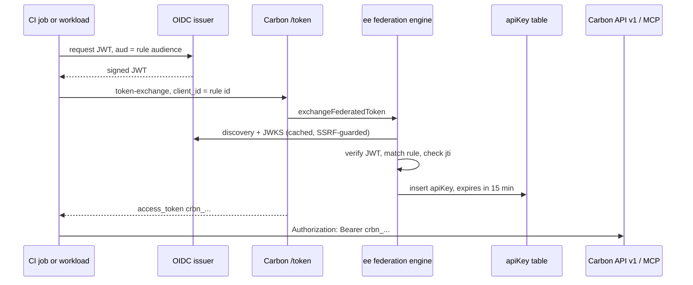
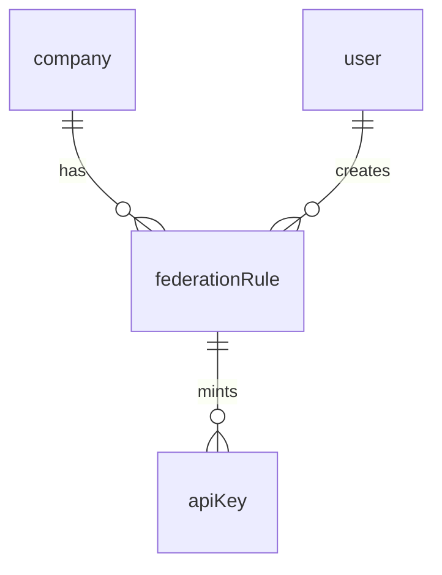

# Workload Identity Federation for the Carbon API

> Status: in-progress
> Author: naveenkash
> Date: 2026-10-30

## TLDR

A company admin creates a **federation rule**. The rule trusts JWTs from one
OIDC issuer (GitHub Actions, AWS, Google Cloud, Microsoft Entra ID or a custom
issuer) when the JWT's subject and claims match the rule. A CI job or a cloud
workload sends its JWT to Carbon's `/token` endpoint with the RFC 8693
token-exchange grant. Carbon checks the JWT and returns an ordinary `crbn_…`
API key that expires in 15 minutes. The customer stores no long-lived secret.
The minted key is an `apiKey` row, so v1, MCP, PostgREST, rate limits and scopes
work with no change to the authentication path. Research:
[`.ai/research/workload-identity-federation.md`](../research/workload-identity-federation.md).
Run record: `.ai/runs/2026-10-30-workload-identity-federation.md`.

## Overview diagram



## Problem Statement

A Carbon API key is a long-lived secret. It can post invoices, change BOMs and
read customer data until someone revokes it. It leaks from the customer's side:
a CI log that prints environment variables, a committed `.env` file, a
contractor's laptop. Carbon stores only the SHA-256 of the key, but that does
not help against these leaks. The raw key in the customer's systems is the
credential.

Customers who run integrations in GitHub Actions, AWS, Google Cloud or Azure
already have a workload identity there. Today they must still copy a Carbon key
into that platform's secret store. Defense and ITAR customers on Carbon's
controlled environment also face an audit finding for every static credential.

Example: a GitHub Action pushes BOM changes from a PLM repository to Carbon
every night. Today it holds `CARBON_API_KEY` as a repository secret that never
expires. With federation, the action asks GitHub for a JWT, exchanges it, and
the resulting key is useless 15 minutes later.

## Proposed Solution

1. An admin opens **Settings → Identity Federation** and creates a rule. A
   provider preset fills in the issuer and the conditions to supply.
2. The workload asks its IdP for a JWT with the rule's audience.
3. The workload posts the JWT to `/token` with the rule id as `client_id`.
4. The ee engine checks the JWT and the rule. Then it inserts an `apiKey` row
   with the rule's scopes, linked to the rule, that expires after the rule's
   token lifetime.
5. The workload calls the API with `Authorization: Bearer crbn_…`. The existing
   `apiKey` path authenticates it.
6. A nightly pg_cron job deletes minted keys that expired more than 1 day ago.

**New API Key** on the API Keys page first opens a chooser modal, as in the
Claude Console: "Set up identity federation" or "Continue with an API key".

### Design Decisions

| Decision | Choice | Rationale |
|---|---|---|
| Token issued by the exchange | An `apiKey` row with `federationRuleId` set and `expiresAt` = now + the rule's lifetime. The raw key is `crbn_` + 24 random bytes (base64url), the same `crbn_` prefix as any key. | **Human answer.** The SQL helpers resolve `carbon-key` through `apiKey.keyHash` and check `expiresAt`. Rate limits and `lastUsedAt` key on `apiKey.id`. RubyGems mints an ordinary key the same way. It keeps the "no new token format" decision in `2026-07-04-integration-surface.md:247`. |
| Exchange endpoint | Add the RFC 8693 grant `urn:ietf:params:oauth:grant-type:token-exchange` to the existing `/token` route. `client_id` holds the rule id. | **Human answer.** OpenAI, Google Cloud, Databricks, Pulumi and SAP use RFC 8693. `/token` already dispatches on `grant_type` and is exempt from the CSRF check (`packages/auth/src/lib/security.ts:20`). |
| What the minted key acts as | The rule's `createdBy` user, limited to the rule's scopes. | **Human answer.** API keys act as `createdBy` today. Service accounts are out of scope. |
| Rule selection | The client names the rule in `client_id`. | **Autonomous.** GitHub and Google sign JWTs for every customer, so the JWT alone cannot name the company. Anthropic and Tailscale do the same. |
| One record or two | One `federationRule` record holds issuer, audience, conditions, scopes and lifetime. No separate issuer record. | **Autonomous.** OpenAI and RubyGems keep one record. A company has few rules, so a shared issuer record saves little. |
| Subject match | `subject` is an exact match. A trailing `*` makes it a prefix match. The validator refuses a bare `*`. | **Autonomous.** Anthropic and OpenAI use this. A wildcard in the middle is easy to get wrong. |
| Claim conditions | `claimConditions` is a map from a top-level claim name to an exact string. At most 10 entries. No CEL, no regex. | **Autonomous.** Exact matching is the consensus. RubyGems had a regex DoS (GHSA-p37h-pvp2-fh88). |
| Minimum condition | A rule needs a `subject` or at least 1 claim condition. A CHECK constraint and the validator both enforce it. | **Autonomous.** Anthropic, OpenAI and AWS refuse an issuer-only rule. |
| Shared issuers | The validator and a CHECK constraint require an immutable claim for 5 issuers: also `https://app.terraform.io` (`terraform_organization_id`) and `https://agent.buildkite.com` (`organization_id`). `https://token.actions.githubusercontent.com` needs `repository_owner_id`. `https://gitlab.com` needs `namespace_id`. `https://accounts.google.com` needs an exact `subject` with no `*`. | **Autonomous.** The PyPI resurrection risk and npm's SlugFest incident come from binding to a name. AWS refuses these trust policies without a tenancy claim. |
| Allowed issuers | Any `https` issuer whose host resolves to public addresses. The validator refuses IP literals and ports other than 443. | **Autonomous.** AWS gives each account its own issuer and Entra gives each tenant its own, so a fixed list cannot work. Anthropic uses this guard. |
| Self-hosted private issuers | The env flag `FEDERATION_ALLOW_PRIVATE_ISSUERS` (default off) turns off the private-address check. `https` stays required. | **Autonomous.** The run record decided Cloud first, with a small private-issuer setting for Enterprise self-host. |
| Pasted key sets | Out of scope for v1. | **Autonomous.** Only air-gapped installs need them. The run record left them out. |
| Key discovery | Read `{issuer}/.well-known/openid-configuration`. Refuse it when its `issuer` differs from the rule's `issuer`. Fetch `jwks_uri` with `jose` `createRemoteJWKSet`. Both fetches go through the SSRF-guarded dispatcher. | **Autonomous.** Every vendor uses discovery. `jose` 6.0.11 is already a dependency of `@carbon/ee`. |
| Key set cache | One `createRemoteJWKSet` per `jwks_uri`, kept in memory for 10 minutes, with `jose`'s 30 s refetch cooldown. Discovery documents are kept for 10 minutes. Timeout 5 s. | **Autonomous.** PyPI and crates.io refresh on an unknown `kid` with a cooldown and a 5 s timeout. |
| JWT checks | Require `kid`, `iss`, `aud`, `sub`, `iat` and `exp`. Allow RS256/384/512, ES256/384/512 and PS256/384/512. Refuse `HS*` and `none`. Leeway 30 s. Refuse `exp − iat` over 24 hours. | **Autonomous.** Anthropic's checks. 24 hours admits Azure managed identity tokens and matches Google's `iat` limit. |
| Replay | If the JWT has `jti`, Redis `SET NX` on `federation-jti:<issuer>:<jti>` with a TTL to `exp` + 30 s. A second use fails. If Redis fails, the exchange fails. | **Autonomous.** PyPI, crates.io and RubyGems. Azure and Google tokens have no `jti`, so `jti` is optional. Fail closed because this is an authentication check. |
| Audience | A rule field. The default is the install's `ERP_URL`. An Entra rule uses the customer's `api://<APP_ID>`. | **Autonomous.** A dedicated audience is the consensus. Entra needs a value in the customer's own tenant. |
| Token lifetime | `tokenLifetimeMinutes`, 5 to 60, default 15. | **Autonomous.** PyPI and RubyGems use 15 minutes. OpenAI caps at 1 hour. |
| Error detail | Every verification failure returns `400 {"error":"invalid_grant"}`. The rule stores `lastFailureAt` and `lastFailureReason`. Success sets `lastExchangeAt`. | **Autonomous.** Anthropic returns an opaque error and shows the reason to the admin. Columns on the rule avoid a new history table. |
| Exchange rate limit | Two Redis sliding windows. 60 attempts per minute per rule and caller IP, before verification. 30 verified exchanges per minute per rule. Excess returns `429`. | **Autonomous.** Each exchange inserts a row. The MCP route uses the same limiter for OAuth callers (`apps/erp/app/routes/api+/mcp+/_index.ts:64`). |
| Rule edit | An edit of `scopes` updates the scopes of every live minted key. An edit of `issuer`, `audience`, `subject` or `claimConditions` deletes them. The rule update and the key change are one Kysely transaction; the cache entries drop after commit. An exchange re-reads the rule after it mints: a trust change refuses the token (`rule_changed`) and deletes the key, a scope change rescopes it. | **Autonomous.** A narrower scope applies at once, as `updateApiKey` does for keys. A key minted under old trust was minted for a workload the rule no longer names. |
| Rule delete | `ON DELETE CASCADE` deletes the minted keys. The service drops their cache entries before and after the delete, as `revokeApiKey` does. | **Autonomous.** A deleted rule must stop every key it minted. |
| Cleanup of minted keys | A pg_cron job, `federated-api-key-retention`, runs `util.purge_expired_federated_api_keys()` daily at 04:41 UTC. It deletes minted keys whose `expiresAt` is more than 1 day ago. | **Autonomous.** Precedent: `machine-state-change-retention` (`20261013191915_oee-tenancy-and-retention.sql`). |
| API Keys list | The list and `getApiKeys` show only rows with `federationRuleId IS NULL`. | **Autonomous.** Minted keys are not something an admin manages. |
| Name of a minted key | `federated:<ruleId>:<8 random characters>`. | **Autonomous.** `apiKey` has a UNIQUE `(name, companyId)` constraint. |
| Plan gate | Authoring calls `requireEntitlement(client, companyId, "API_KEYS")`. The exchange calls `companyHasFeature(…, { feature: "API_KEYS" })` and fails with `invalid_grant` when it is false. No new `Feature` key. | **Autonomous.** Federation is a way to get an API key, so it shares the API keys plan (Business). Commercial licensing puts the lock inside `packages/ee`. |
| Where the engine lives | `packages/ee/src/federation/` (`models.ts`, `match.ts`, `service.server.ts`, `index.ts`). | **Autonomous.** `.claude/rules/commercial-licensing.md`: the feature body and its lock live in `packages/ee`. |
| SSRF guard location | Move `packages/jobs/src/workflows/actions/url-guard.ts` to `packages/lib/src/url-guard.server.ts`. Export it as `@carbon/lib/url-guard.server`. Jobs imports it from there. | **Autonomous.** `@carbon/ee` cannot depend on `@carbon/jobs`. `@carbon/jobs` and `@carbon/ee` both depend on `@carbon/lib`. One guard, not two copies. |
| Who can manage rules | Routes and service functions require `users_update`, as the API keys routes do. RLS on `federationRule` allows SELECT with `settings_view` only. The operations write it as the system, with `createdBy` set to the caller. | **Autonomous.** The permission copies the sibling. Write-denied RLS came from the branch review: an open `settings_create` insert skipped every issuer check and let the writer pick `createdBy`. |
| Backups | `federationRule` joins `SECRET_TABLES` in `packages/jobs/src/backups/schema.ts`. | **Autonomous.** A trust rule restored into another company would let a CI job reach that company. `apiKey` is already there for the same reason. |
| Dataset wipe | `federationRule` joins the list next to `apiKey` in `packages/database/src/datasets/wipe.ts:50`. | **Autonomous.** Same handling as its sibling. |
| Multi-tenancy (heuristic 1) | `federationRule` has `companyId`, composite PK `("id", "companyId")` and `id('fedr')`. | Convention. |
| Service shape (heuristic 2) | Operations are `defineServiceFn` in `settings.server.ts`. The ee writers return `{ data, error }`. | `.claude/rules/module-files.md`. |
| Forms (heuristic 5) | `ValidatedForm` + `validator(federationRuleValidator)` + a route action, copied from `ApiKeysForm`. | Sibling. |
| Module layout (heuristic 6) | No new module. Settings files only: `settings.server.ts`, `settings.service.ts`, `settings.models.ts`, `ui/Federation/`. No barrel beyond the sibling's existing `ui/ApiKeys/index.ts` pattern. | `.claude/rules/module-files.md`. |
| Backward compatibility (heuristic 7) | `/token` keeps its two grants unchanged. `apiKey` gains a nullable column. v1, MCP and the SQL helpers do not change. | Additive only. |

## Data Model Changes



```sql
CREATE TYPE "federationProvider" AS ENUM (
  'GitHub Actions',
  'AWS',
  'Google Cloud',
  'Microsoft Entra ID',
  'Custom OIDC'
);

CREATE TABLE IF NOT EXISTS "federationRule" (
  "id" TEXT NOT NULL DEFAULT id('fedr'),
  "companyId" TEXT NOT NULL,
  "name" TEXT NOT NULL,
  "provider" "federationProvider" NOT NULL,
  "issuer" TEXT NOT NULL,
  "audience" TEXT NOT NULL,
  "subject" TEXT,
  "claimConditions" JSONB NOT NULL DEFAULT '{}',
  "scopes" JSONB NOT NULL DEFAULT '{}',
  "tokenLifetimeMinutes" INTEGER NOT NULL DEFAULT 15,
  "lastExchangeAt" TIMESTAMP WITH TIME ZONE,
  "lastFailureAt" TIMESTAMP WITH TIME ZONE,
  "lastFailureReason" TEXT,
  "createdBy" TEXT NOT NULL,
  "createdAt" TIMESTAMP WITH TIME ZONE NOT NULL DEFAULT NOW(),
  "updatedBy" TEXT,
  "updatedAt" TIMESTAMP WITH TIME ZONE,
  CONSTRAINT "federationRule_pkey" PRIMARY KEY ("id", "companyId"),
  CONSTRAINT "federationRule_id_key" UNIQUE ("id"),
  CONSTRAINT "federationRule_name_companyId_key" UNIQUE ("name", "companyId"),
  CONSTRAINT "federationRule_companyId_fkey" FOREIGN KEY ("companyId")
    REFERENCES "company"("id") ON DELETE CASCADE ON UPDATE CASCADE,
  CONSTRAINT "federationRule_createdBy_fkey" FOREIGN KEY ("createdBy")
    REFERENCES "user"("id") ON DELETE CASCADE,
  CONSTRAINT "federationRule_updatedBy_fkey" FOREIGN KEY ("updatedBy")
    REFERENCES "user"("id"),
  CONSTRAINT "federationRule_condition_check"
    CHECK ("subject" IS NOT NULL OR "claimConditions" <> '{}'::jsonb),
  CONSTRAINT "federationRule_subject_check"
    CHECK ("subject" IS NULL OR ("subject" <> '' AND "subject" <> '*')),
  CONSTRAINT "federationRule_tokenLifetime_check"
    CHECK ("tokenLifetimeMinutes" BETWEEN 5 AND 60)
);

CREATE INDEX IF NOT EXISTS "federationRule_companyId_idx"
  ON "federationRule" ("companyId");

ALTER TABLE "federationRule" ENABLE ROW LEVEL SECURITY;

ALTER TABLE "apiKey"
  ADD COLUMN IF NOT EXISTS "federationRuleId" TEXT;

ALTER TABLE "apiKey"
  ADD CONSTRAINT "apiKey_federationRuleId_fkey"
  FOREIGN KEY ("federationRuleId", "companyId")
  REFERENCES "federationRule"("id", "companyId")
  ON DELETE CASCADE;

CREATE INDEX IF NOT EXISTS "apiKey_federationRuleId_expiresAt_idx"
  ON "apiKey" ("federationRuleId", "expiresAt")
  WHERE "federationRuleId" IS NOT NULL;

CREATE OR REPLACE FUNCTION util.purge_expired_federated_api_keys()
RETURNS void LANGUAGE sql SECURITY DEFINER SET search_path = public AS $$
  DELETE FROM "apiKey"
  WHERE "federationRuleId" IS NOT NULL
    AND "expiresAt" < NOW() - INTERVAL '1 day';
$$;
```

- The RLS rule goes in `packages/database/src/authz/manifest.ts`, not in the
  migration: `federationRule: company("settings", { read: "settings_view" })`.
  Then `pnpm --filter @carbon/database authz migration federation-rule`
  writes the generated policy migration.
- The pg_cron schedule follows `20261013191915_oee-tenancy-and-retention.sql:40-53`.
- The FK from `apiKey` points at `federationRule("id")`, which the UNIQUE
  constraint makes referenceable. `apiKey` already carries its own `companyId`.

## API / Service Changes

### `packages/ee/src/federation/` (commercial)

| File | Exports |
|---|---|
| `models.ts` | `federationProviders`, `FEDERATION_PRESETS` (issuer, default audience, required claim per provider), `SHARED_ISSUER_REQUIREMENTS`, `federationRuleValidator`, `FederationRuleInput` |
| `match.ts` | `matchSubject(pattern, sub)`, `matchClaims(conditions, claims)`, `checkRuleRequirements(rule)`, `FederationFailure` reasons. Pure and tested. |
| `service.server.ts` | `upsertFederationRule`, `deleteFederationRule` (both call `requireEntitlement(…, "API_KEYS")`), `exchangeFederatedToken(input)`, `verifySubjectToken(jwt, rule, deps)` |
| `index.ts` | `export * from "./models"; export * from "./match";` |

`exchangeFederatedToken({ ruleId, subjectToken })` does these steps:

1. Read the rule with the service role. If there is none, fail.
2. If `companyHasFeature(API_KEYS)` is false, fail.
3. Check the exchange rate limit for the rule. If it is spent, return `rate_limited`.
4. Verify the JWT (`verifySubjectToken`).
5. Match `subject` and `claimConditions`.
6. Record the `jti`, if any.
7. Insert the `apiKey` row and return `{ key, expiresIn }`.
8. Set `lastExchangeAt` on success, or `lastFailureAt` and `lastFailureReason` on failure.

It returns `{ ok: true, key, expiresIn }` or `{ ok: false, reason }` for a refused token. It throws only when a database write fails.

`FederationFailure` reasons: `rule_not_found`, `not_entitled`, `malformed_jwt`,
`missing_kid`, `algorithm_not_allowed`, `issuer_mismatch`, `discovery_failed`,
`signature_invalid`, `audience_mismatch`, `expired`, `not_yet_valid`,
`lifetime_too_long`, `subject_mismatch`, `claim_mismatch`, `jti_reused`,
`replay_check_unavailable`, `missing_claims`, `creator_not_employee`, `rule_changed`. The admin sees these in the rule drawer. The caller
never sees them.

### `apps/erp/app/routes/_oauth+/token.tsx`

Add a branch before the `oauthClient` lookup. When `grant_type` is
`urn:ietf:params:oauth:grant-type:token-exchange`:

- Required: `client_id` (the rule id), `subject_token`, `subject_token_type`
  (`urn:ietf:params:oauth:token-type:jwt` or `…:id_token`).
- `200`: `{ "access_token": "crbn_…", "issued_token_type": "urn:ietf:params:oauth:token-type:access_token", "token_type": "Bearer", "expires_in": 900 }`.
- `400 {"error":"invalid_request"}` for a missing parameter. `400
  {"error":"invalid_grant"}` for any refused token. `429
  {"error":"slow_down"}` for the rate limit.

`[.]well-known.oauth-authorization-server.ts` adds the grant to
`grant_types_supported`.

### `apps/erp/app/modules/settings/`

| File | Change |
|---|---|
| `settings.server.ts` | `createFederationRule`, `updateFederationRule`, `deleteFederationRule` (`defineServiceFn`, `permission: { update: "users" }`). Update and delete drop the minted keys' cache entries. |
| `settings.service.ts` | `getFederationRule`, `getFederationRules`, `FEDERATION_RULES_PAGING`. `getApiKeys` and `getApiKey` filters `federationRuleId IS NULL`. |
| `settings.models.ts` | No change. Forms import `federationRuleValidator` from `@carbon/ee/federation`. |
| `utils/list-registry/settings.server.ts` | `federationRulesList`, registered in `settingsLists`. |

### `packages/lib`

`src/url-guard.server.ts` (moved from jobs). `packages/lib/package.json` adds
the `./url-guard.server` export and the `undici` dependency that jobs already
uses. The 3 jobs importers point at `@carbon/lib/url-guard.server`.

### `packages/env`

`FEDERATION_ALLOW_PRIVATE_ISSUERS` (boolean, optional, default `false`).

## Closest Sibling

The sibling is the **API key**. A federation rule is "a way to get an API key".
It has the same owner, the same permission, the same scope picker and the same
plan.

| Sibling file | New file |
|---|---|
| `apps/erp/app/routes/x+/settings+/api-keys.tsx` | `apps/erp/app/routes/x+/settings+/federation.tsx` |
| `apps/erp/app/routes/x+/settings+/api-keys.new.tsx` | `apps/erp/app/routes/x+/settings+/federation.new.tsx` |
| `apps/erp/app/routes/x+/settings+/api-keys.$id.tsx` | `apps/erp/app/routes/x+/settings+/federation.$id.tsx` |
| `apps/erp/app/routes/x+/settings+/api-keys.delete.$id.tsx` | `apps/erp/app/routes/x+/settings+/federation.delete.$id.tsx` |
| `apps/erp/app/modules/settings/ui/ApiKeys/ApiKeysForm.tsx` | `apps/erp/app/modules/settings/ui/Federation/FederationRuleForm.tsx` |
| `apps/erp/app/modules/settings/ui/ApiKeys/ApiKeysTable.tsx` | `apps/erp/app/modules/settings/ui/Federation/FederationRulesTable.tsx` |
| `packages/ee/src/api-keys.server.ts` | `packages/ee/src/federation/service.server.ts` |
| `apiKeysList` | `federationRulesList` |

Deviations, each a row in Design Decisions:

1. The form has a provider picker that fills in the issuer and the audience.
2. The edit view shows a usage snippet and the last exchange and failure. A key
   instead shows its raw value once.
3. The gated page reuses `ApiKeysUpgradeOverlay`, because both pages sell the
   same plan feature.

## UI Changes

Page archetype: the sibling's — a settings list table with a modal form over
it (`api-keys.tsx` + `RecordOutlet`).

1. **Sidebar.** `useSettingsSubmodules.tsx` adds "Identity Federation" (icon
   `LuShieldCheck`) under System, after "API Keys".
2. **List** (`FederationRulesTable`). Columns: Name, Provider, Issuer, Subject,
   Scopes, Last exchange, Last failure, Created by, Created at. Row menu: Edit,
   Delete. **New** needs `update users`.
3. **Form modal** (`FederationRuleForm`). Fields, in order:
   1. Provider (select). Changing it fills in the issuer and the audience.
   2. Name.
   3. Issuer URL. Read-only for GitHub Actions and Google Cloud.
   4. Audience. Defaults to `ERP_URL`.
   5. Subject. Placeholder per provider, for example `repo:acme/plm-sync:ref:refs/heads/main`.
   6. Claim conditions (key and value rows, at most 10). The GitHub Actions
      preset adds a `repository_owner_id` row with help text: "Run
      `gh api users/<owner> --jq .id`".
   7. Token lifetime (minutes, 5 to 60).
   8. `PermissionMatrix` scopes, as in `ApiKeysForm`.
4. **Edit view** adds a read-only "Usage" block with a GitHub Actions example
   that names the rule id and the audience. It also shows the last exchange
   time and the last failure reason.
5. **Chooser modal** on the API Keys page. **New** opens a modal before the key
   form. Copy:
   - Title: "With identity federation, you don't need an API key"
   - Body: "Your cloud or CI provider issues short-lived tokens that
     authenticate your requests. There is no static key to manage."
   - 3 checks: "Nothing to store in env vars, config files, or secret
     managers", "Tokens expire in minutes", "Works with GitHub Actions, AWS,
     Google Cloud, and Microsoft Entra ID".
   - Note: "Local scripts and third-party tools may still need an API key."
   - Primary: "Set up identity federation" → `path.to.newFederationRule`.
   - Secondary: "Continue with an API key" → `path.to.newApiKey`.
6. **Docs.** `docs/content/docs/building/identity-federation.mdx`, linked from
   `building/api-keys.mdx` and `building/meta.json`. It has one example per
   provider.

## Acceptance Criteria

- [ ] An admin with `users_update` on a Business company creates a GitHub
      Actions rule with subject `repo:acme/plm:ref:refs/heads/main` and
      `repository_owner_id = 123`. The rule shows in Settings → Identity
      Federation.
- [ ] Saving a GitHub Actions rule with no `repository_owner_id` shows a field
      error and writes nothing.
- [ ] Saving a rule with subject `*` and no claim conditions shows a field
      error and writes nothing.
- [ ] Saving a Google Cloud rule with subject `1234*` shows a field error.
- [ ] A JWT signed by the rule's issuer, with the rule's audience, subject and
      claims, posted to `/token` with the token-exchange grant, returns `200`
      with a `crbn_` `access_token` and `expires_in` = lifetime × 60.
- [ ] That `access_token` calls a v1 endpoint inside the rule's scopes and gets
      `200`. A call outside the scopes gets `403`.
- [ ] The same JWT posted a second time returns `400 invalid_grant`, and the
      rule shows the last failure reason `jti_reused`.
- [ ] A JWT with the wrong audience, a wrong subject, a wrong claim, an
      `HS256` signature, no `kid`, an expired `exp`, or `exp − iat` over 24
      hours returns `400 invalid_grant`.
- [ ] A rule whose issuer resolves to a private address cannot be saved while
      `FEDERATION_ALLOW_PRIVATE_ISSUERS` is off.
- [ ] Deleting the rule makes every key it minted return `401` on the next
      request.
- [ ] Narrowing the rule's scopes makes a live minted key return `403` for the
      removed scope on the next request.
- [ ] The API Keys list never shows a minted key.
- [ ] After a minted key's `expiresAt` passes, the key returns `401`.
- [ ] `util.purge_expired_federated_api_keys()` deletes minted keys that expired
      more than 1 day ago and keeps all other `apiKey` rows.
- [ ] On a Starter company, the Identity Federation page shows the upgrade
      overlay, and the exchange returns `400 invalid_grant` with reason
      `not_entitled`.
- [ ] **New** on the API Keys page opens the chooser modal. Each button opens
      the matching form.
- [ ] `/token` with `grant_type=authorization_code` and `refresh_token` behaves
      as before.

## Risks

| Risk | Severity | Mitigation |
|---|---|---|
| An admin writes a rule that trusts a whole shared issuer. | High | The CHECK constraint, the validator, and the per-issuer immutable-claim rules. |
| SSRF through a typed issuer URL. | High | Discovery and JWKS fetches use the guarded dispatcher. `https` only, port 443, no IP literals. The guard refuses private addresses unless the env flag is on. |
| A renamed GitHub owner re-registered by an attacker. | High | `repository_owner_id` is required for the GitHub issuer. |
| A minted key works for up to 30 s after the rule is deleted (the key record cache). | Low | The service drops the cache entries before and after the delete, as `revokeApiKey` does. |
| Many exchanges fill `apiKey` with rows. | Medium | 30 exchanges per minute per rule, and the nightly purge. |
| A workload exchanges repeatedly to get past the per-key rate limit. | Low | The per-company cap in `check_api_key_rate_limit` sums every key of the company, minted keys included. |
| Redis is down, so the `jti` check cannot run. | Medium | The exchange fails closed with `replay_check_unavailable`. |
| The token belongs to a person (`createdBy`). | Medium | The exchange refuses with `creator_not_employee` once that person is no longer an employee of the company, as `oauthContext` does for OAuth connectors. Service accounts are a later spec. |
| Moving `url-guard.ts` breaks a jobs import. | Low | The plan runs the jobs typecheck and its webhook tests after the move. |

## Open Questions

> HARD STOP: Do not proceed with implementation until these are answered.

- [x] What token does the exchange return? — **Answer:** a short-lived
      `apiKey` row linked to the rule (user, 2026-10-30).
- [x] What is the exchange endpoint? — **Answer:** RFC 8693 token exchange on
      the existing `/token` route, with the rule id in `client_id` (user,
      2026-10-30).
- [x] Who does the minted key act as? — **Answer:** the rule's creator, as for
      API keys. Service accounts are out of scope (user, 2026-10-30).
- [x] Which scope for v1? — **Autonomous:** Cloud first. Any public `https`
      issuer, with presets for GitHub Actions, AWS, Google Cloud and Microsoft
      Entra ID. A private-issuer env flag for self-host. No pasted key sets.
      The user did not answer the scope question; the run record logs the decision.
- [x] One record or an issuer record plus a rule record? — **Autonomous:** one
      record (OpenAI, RubyGems).
- [x] How are conditions expressed? — **Autonomous:** exact subject or a
      trailing-`*` prefix, plus exact claims. No CEL (RubyGems regex DoS).
- [x] Is `jti` required? — **Autonomous:** optional, single-use when present.
      Azure and Google tokens have none.
- [x] New plan feature or reuse `API_KEYS`? — **Autonomous:** reuse `API_KEYS`.
- [x] Where does the SSRF guard live? — **Autonomous:** move it to
      `@carbon/lib/url-guard.server`.
- [x] Does an exchange history table ship in v1? — **Autonomous:** no. The
      rule stores the last exchange and the last failure. The minted `apiKey`
      rows are the success history until the purge.

## Changelog

- 2026-10-30: Created. Three Ask-First questions answered by the user. The
  other decisions are autonomous and logged in the run record.
- 2026-10-30: Built on `naveenkash/identity-federation`. Two changes from the design:
  1. The chooser modal opens inside the new API key route (`api-keys.new.tsx`).
     The table's **New** button keeps its link and its `n` shortcut.
  2. `ApiKeysTable` no longer renders an `Outlet`. The route already renders a
     `RecordOutlet`, so every API key modal mounted twice, and the chooser
     stayed on screen after **Continue with an API key**.
  `ApiKeysUpgradeOverlay` is reused for the gated Identity Federation page.
- 2026-10-30: Review fixes. `federationRule` is read-only to API roles. The
  database checks the shared-issuer claims and the prefix rule. A trust edit
  (issuer, audience, subject, claim conditions) revokes the minted keys. A
  scope edit during an exchange cannot leave an old-scope key. The exchange
  refuses when the rule's creator is no longer an employee. The rate limit
  has a per-IP tier before verification. The form refuses a repeated claim.
- 2026-10-30: Second review fixes. The rule update and its key revoke or
  rescope are one transaction. The exchange re-reads the rule after it
  mints (`rule_changed`). The per-IP limit runs before any read. HCP
  Terraform and Buildkite join the shared issuers. A refused edit keeps the
  modal open.
- 2026-10-31: Parity build (see the addendum). Issuers are their own
  records with a key source, CA certificate, single-use toggle and token-age
  limit. Rules and issuers are archived, not deleted. Every exchange attempt
  is an authentication event, kept 30 days. Settings has Rules, Issuers and
  Authentication events tabs, and Connect workload is a four-step wizard.
  The Last Exchange and Last Refusal columns are gone: the events replace
  them.

## Addendum (2026-10-31): parity with the Claude Console screens

The user compared the build with the Claude Console screens and scoped the
rest into v1. Service accounts and CEL conditions stay out: a rule's keys
still act as its creator, and conditions stay exact. Source: the user's 10
screenshots of `platform.claude.com/settings/workload-identity-federation`.

### Changes

| Area | Before | After |
|---|---|---|
| Issuer | A field on each rule | A `federationIssuer` record. Many rules reference one issuer. |
| Key source | OIDC discovery only | `jwksSource`: `OIDC Discovery` (optional `discoveryUrl`), `JWKS URL` (`jwksUrl`), `Inline JWKS` (`jwks`). Optional `caCertificate` (PEM) for the TLS of the discovery and key fetches. |
| Replay | Single use when the token has a `jti` | Per issuer: `requireUniqueJti` (default on). On: a token with no `jti` is refused (`missing_jti`). Off: no replay check. |
| Token age | Fixed 24 h | Per issuer: `maxTokenLifetimeHours`, 1 to 24, default 1. |
| Key lifetime | The rule's lifetime | The rule's lifetime, capped at 2 × the token's remaining life, never under 60 s (Anthropic's formula). |
| Names | Free text | Lowercase letters, digits and hyphens, for issuers and rules. Rules get an optional `description`. |
| Delete | Hard delete | Archive. Archiving an issuer archives its rules. An archive revokes the minted keys. The list has Active and Archived. |
| History | `lastExchangeAt` and `lastFailure*` on the rule | `federationExchange`: one row per attempt (outcome, reason, subject, client IP, the minted key id). Kept 30 days. |
| Presets | 5 providers | Adds Kubernetes. |
| Audit | None | `federationIssuer` and `federationRule` go to the audit log. |
| UI | One modal per rule | Settings → Identity Federation has 3 tabs: Rules, Issuers, Authentication events. **Connect workload** opens a 4-step wizard: Issuer, Federation rule, Permissions, Test. The Test step waits for the rule's first exchange. |

### Decisions

| Decision | Choice | Rationale |
|---|---|---|
| Shared-issuer checks | The operations check them on every rule write and on every issuer write (each active rule of the issuer). The CHECK constraint goes, because the issuer URL is now in another table. | API roles cannot write either table, so the operations are the only write path. |
| Network check of the issuer URL | Only for `OIDC Discovery`. The `JWKS URL` mode checks `jwksUrl`. The `Inline JWKS` mode makes no fetch. | Anthropic compares the issuer as a string in the explicit and inline modes, so the issuer may be internal. |
| Issuer edit | A change to `issuer`, `jwksSource`, `discoveryUrl`, `jwksUrl`, `jwks` or `caCertificate` revokes the keys of every rule of the issuer, in the same transaction. | The keys rest on the old key source. |
| Wizard writes | Step 1 saves a new issuer through the issuer action. Step 3 saves the rule through the rule action. | One write path per record. An abandoned wizard leaves an issuer with no rules, which the Issuers tab shows. |
| Event writes | Service role, scoped to the rule's company. A token that fails before its signature check records no subject. | An unverified subject is attacker text. |
| Event retention | 30 days, pg_cron daily. | Matches the audit log's 30-day retention. |
