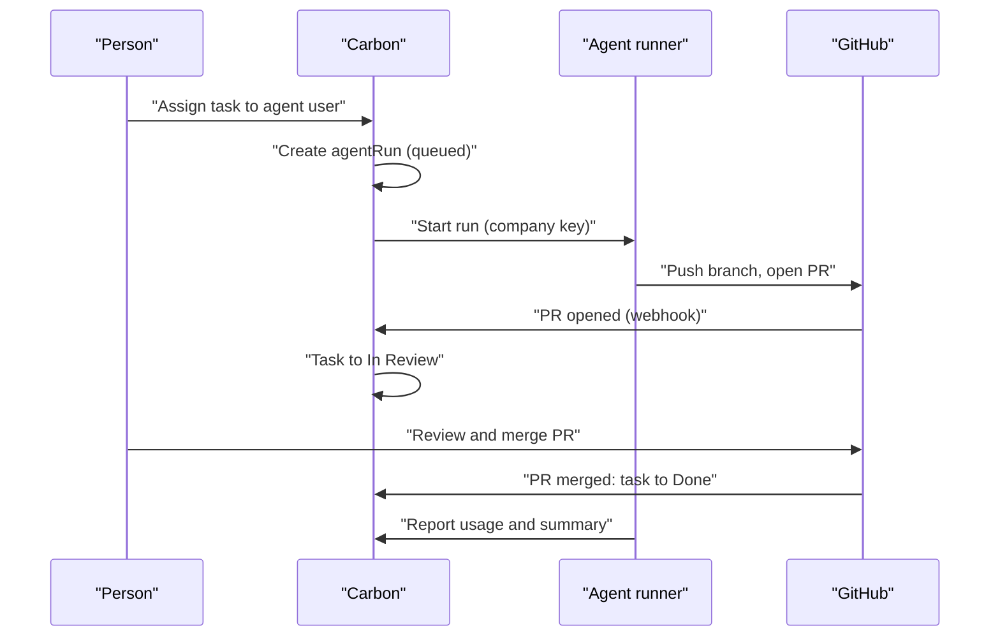
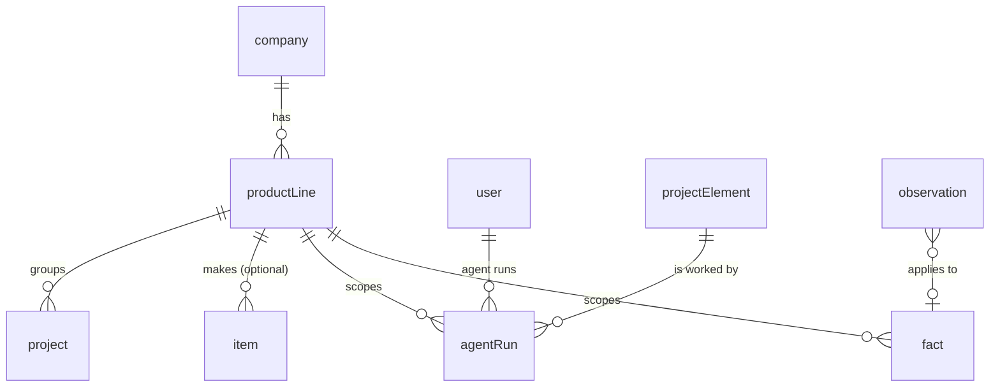

# Product Lines and Agent Members

> Status: draft
> Author: barbinbrad
> Date: 2026-10-31
> Plan: `.ai/plans/2026-10-31-product-lines-and-agents.md`
> Related: `.ai/specs/2026-10-17-issue-tracker-sync.md`, `.ai/specs/in-app-agent.md`, `apps/erp/app/modules/projects/AGENTS.md`

## TLDR

A team designs a product as code in a git repository, and agents keep that code up to date as the team learns.
Today one person runs this on one computer: tasks, questions and part numbers live in JSON files, and one
Claude Code session does all the agent work. This spec moves the shared state into Carbon and makes agents
members of a company. It has five phases:

1. **Phase 1** adds the `productLine` record, agent users, the `agentRun` record and a GitHub integration.
2. **Phase 2** adds the `observation` record and the `fact` ledger.
3. **Phase 3** adds suspect links from facts, the outbox and inbox, and part-number minting.
4. **Phase 4** adds the `Decision` element type and a "Run agent" workflow action.
5. **Phase 5** connects the order, job, NCR and change request loop.

One Carbon instance holds many companies. A company holds many product lines. Each company brings its own
Claude account, so Carbon pays nothing for agent runs.

## Overview diagram



## Problem Statement

Two company repositories (`racks`, OCP data centre racks, and `hotice`, trailers) follow one method:
research, spec, configurator, engineering, items, fixtures, line, planning, and one work queue. The method
works for one person. It does not work for a team, for these reasons:

| Problem | Example today |
|---------|---------------|
| State lives in git as JSON | `factory/work/tasks.json`, `history.jsonl`, `questions.json`, `replies.json`. Each status change is a commit, so two people conflict. |
| Part numbers come from a local checkout | `register-data.ts` mints `RF000077`. Two branches can mint the same number. `pnpm carbon:claim` is a workaround. |
| One session does all agent work | A person runs `pnpm work daily`, then starts one subagent per brief by hand. Nothing runs when the laptop is closed. |
| No user model | Roles are a fixed list. "GM" is the owner. Email templates carry one person's signature. |
| Carbon has no product line | A company with trailers and racks cannot separate projects, made parts, facts or agent work by line. |
| Agents are not members | A task cannot be assigned to an agent. An API key acts as the user who created it (`apiKey.createdBy`). |

The racks repository already maps one work task to one `projectElement` with links, states, members,
milestones and comments (`racks/packages/work/src/carbon.ts`). Its Carbon store waits on this branch.

## Proposed Solution

Carbon holds the shared state. Git holds the design code and the written reasoning. Agents are users of one
company. They run in a sandbox paid for by that company's own Claude account, and they report back to Carbon
and GitHub.

| Data | Lives in | How many people work at once |
|------|----------|------------------------------|
| Product definition (geometry, rules, options, generators) | Company git repository | Branches and PRs; CI runs the checks |
| Reasoning (decisions, learnings, principles) | Company git repository | PRs |
| Tasks, status, assignees, questions, replies, approvals, part numbers | Carbon | Row edits; no merge conflicts |
| Operational numbers (prices, lead times, routing times, rates) | Carbon native fields, mirrored to the `fact` ledger | Row edits |
| Numbers that only the model has (stand-up, ramp, finance terms) | Carbon `fact` ledger | Row edits |
| Generated output (digests, briefs, reports) | Not stored in git | The runner makes them on demand |

### Tenancy

```
Carbon instance
└─ company              (existing tenant; may sit in a companyGroup)
   └─ productLine       (new)
      ├─ projects            (project.productLineId)
      ├─ made items          (item.productLineId; bought items stay company-wide)
      ├─ agent runs, observations, facts
      └─ repository + path   (where the design code of the line lives)
```

- An agent user belongs to exactly one company.
- A company repository holds all product lines of that company, at `products/<line>/`.
- Two companies never share a repository.

### Running agents: bring your own Claude account

Carbon does not pay for model use. Each company connects its own account. Two run modes use the same
`agentRun` record:

| Mode | Who pays | How it runs |
|------|----------|-------------|
| **Push** | The Anthropic API key of the company (stored as a Carbon integration secret) | Carbon starts a Claude Managed Agents session with the company key. The session mounts the company repository and calls Carbon MCP with the key of the agent user. |
| **Pull** | The Claude subscription of a team member | A person runs Claude Code with the Carbon MCP connector. Claude Code claims the next queued run, does the work, and reports the result. |

Push mode facts (from the Managed Agents reference):

- A session mounts a GitHub repository as a `github_repository` resource. A git proxy adds the token, so the sandbox never sees it.
- A session needs the GitHub MCP server to open a PR. A vault credential holds its token.
- A vault `static_bearer` credential holds the Carbon API key of the agent user for the Carbon MCP server.
- A session takes a hard dollar `budget`. `usage.list_cost` reports the spend.
- Webhooks register only in the Anthropic Console, so Carbon polls session status from an Inngest job.

### Design Decisions

| Decision | Choice | Rationale |
|----------|--------|-----------|
| How an agent exists | A `user` row with `"isAgent" = true`, `userToCompany.role = 'employee'`, one company only | It reuses employee permissions, RLS and the assignee pickers without change. A new `role` value would break every `get_companies_with_employee_*` policy. |
| How an agent authenticates | A new `apiKey."userId"` column. `requirePermissions` in `packages/auth/src/services/auth.server.ts` sets `userId` to `apiKeyData.userId ?? apiKeyData.createdBy`. | Today a key acts as `createdBy`. A person creates the key, and the key acts as the agent, so the audit trail stays correct. |
| Login for an agent | No `auth.users` row | The key path uses `getCarbonAPIKeyClient`, and RLS resolves the company with `get_company_id_from_api_key()`, not `auth.uid()`. The `user` table has no FK to `auth.users`. With no auth row, an agent cannot log in. |
| Agent permissions | The scopes on the key of the agent | The key path checks `apiKey.scopes`, not `userPermission`. One key per agent user holds its scopes. |
| Agent email | `<code>@agents.invalid`, unique per company | `user.email` is NOT NULL. The `.invalid` domain never receives mail (RFC 2606). |
| Who pays for model use | The company: an Anthropic API key (push) or a team member's subscription (pull) | Carbon cannot pay for all agent use (Brad, 2026-10-31). |
| Where product lines live | Open core (`productLine` table, `productLineId` columns) | A product line is a plain ERP concept. |
| Where agent features live | `packages/ee` (agent runs, GitHub integration, facts, outbox), gated by a new `AGENTS` feature in `packages/ee/src/plan.ts` | Workflows and issue-sync already live there. |
| Permissions | No new permission module. Agent runs use `projects`. Product lines and agent settings use `settings`. Agent users use `users`. | A new value in the `module` enum touches every employee type and the permission UI. The existing modules already match who does this work. |
| Agent setup in the Anthropic account | On install, the `anthropic` integration creates one environment and one agent in the company account and stores their ids in `companyIntegration.metadata` | Managed Agents reuses an agent and an environment for many sessions. |
| Vault per agent user | `createAgentApiKey` creates a vault for that agent user with two `static_bearer` credentials: the Carbon MCP URL (the new raw key) and the GitHub MCP URL (the company token) | The raw Carbon key exists only at creation. The vault keeps it out of Carbon and out of the sandbox. |
| What a push session is told | One first message: run `pnpm work brief <work id>` in the repository, do the work, push a branch, open a PR, and call `agents_reportAgentRun` | The brief stays in the repository. Carbon does not copy the brief logic. |
| New dependency | `@anthropic-ai/sdk` in `packages/ee` | The Managed Agents API has no other client. The in-app agent uses the Vercel AI SDK, which has no Managed Agents support. |
| Which side holds operational numbers | Carbon native fields. The `fact` ledger mirrors them with an evidence level. | A buyer edits a supplier price in Carbon. The ledger must not fight normal ERP editing. |
| Which side holds model-only numbers | The `fact` ledger | No native field exists for them. |
| Item product line | Nullable `item.productLineId` | Made parts belong to one line. Bought parts serve many lines. |
| GitHub connection | A `github` integration per company: a fine-grained personal access token and a webhook signing secret, both in the vault. Links go in `externalIntegrationMapping`. | A PR is not an issue: it has no status, assignee or priority to sync both ways, so the issue-sync engine does not fit. The Linear webhook route and `externalIntegrationMapping` do fit. A GitHub App comes later, when a second company needs it. |
| Daily orchestrator | A push run each day, paid by the company key | Brad, 2026-10-31. The queue moves without a person at a keyboard. |
| Run status source | Carbon polls Managed Agents from Inngest | Anthropic webhooks register only in the Console. Polling needs no setup by the company. |
| Where the brief comes from | The company repository (`pnpm work brief <task>`); Carbon stores a copy on the run | The brief reads the design code. Carbon does not duplicate that logic. |
| Decision records | Phase 4 adds `Decision` to `projectElementType`. The text stays in git. | Decisions need links (`needs`, `unlocks`) to tasks. Long text reads best in a PR review. |

## Data Model Changes



### Phase 1

```sql
CREATE TABLE "productLine" (
  "id" TEXT NOT NULL DEFAULT id('pl'),
  "companyId" TEXT NOT NULL,
  "name" TEXT NOT NULL,
  "code" TEXT NOT NULL,                -- short code, e.g. RACK
  "itemPrefix" TEXT,                   -- part-number prefix, e.g. R
  "ownerId" TEXT REFERENCES "user"("id"),
  "repositoryUrl" TEXT,                -- https://github.com/<org>/<repo>
  "repositoryPath" TEXT,               -- e.g. products/racks
  "active" BOOLEAN NOT NULL DEFAULT true,
  "createdBy" TEXT NOT NULL REFERENCES "user"("id"),
  "createdAt" TIMESTAMP WITH TIME ZONE NOT NULL DEFAULT NOW(),
  "updatedBy" TEXT REFERENCES "user"("id"),
  "updatedAt" TIMESTAMP WITH TIME ZONE,
  "customFields" JSONB,
  CONSTRAINT "productLine_pkey" PRIMARY KEY ("id", "companyId"),
  CONSTRAINT "productLine_code_companyId_key" UNIQUE ("code", "companyId"),
  CONSTRAINT "productLine_companyId_fkey" FOREIGN KEY ("companyId") REFERENCES "company"("id") ON DELETE CASCADE ON UPDATE CASCADE
);

ALTER TABLE "project" ADD COLUMN "productLineId" TEXT;
ALTER TABLE "item" ADD COLUMN "productLineId" TEXT;
-- Composite FKs ("productLineId","companyId") -> "productLine"("id","companyId"), ON DELETE SET NULL.

ALTER TABLE "user" ADD COLUMN "isAgent" BOOLEAN NOT NULL DEFAULT false;
ALTER TABLE "user" ADD COLUMN "agentOwnerId" TEXT REFERENCES "user"("id");
ALTER TABLE "user" ADD COLUMN "agentVaultId" TEXT;   -- Managed Agents vault of the agent (push mode)
-- A trigger refuses a second userToCompany row for a user with "isAgent" = true.

ALTER TABLE "apiKey" ADD COLUMN "userId" TEXT REFERENCES "user"("id");
-- The key acts as COALESCE("userId", "createdBy").

CREATE TYPE "agentRunStatus" AS ENUM ('Queued', 'Claimed', 'Running', 'Succeeded', 'Failed', 'Needs Review', 'Cancelled');
CREATE TYPE "agentRunMode" AS ENUM ('Push', 'Pull');

CREATE TABLE "agentRun" (
  "id" TEXT NOT NULL DEFAULT id('ar'),
  "companyId" TEXT NOT NULL,
  "productLineId" TEXT,
  "projectElementId" TEXT,                   -- NULL for an orchestrator run
  "kind" TEXT NOT NULL DEFAULT 'Task',        -- Task or Orchestrator
  "agentUserId" TEXT NOT NULL REFERENCES "user"("id"),
  "status" "agentRunStatus" NOT NULL DEFAULT 'Queued',
  "mode" "agentRunMode" NOT NULL,
  "claimedBy" TEXT REFERENCES "user"("id"),   -- the person whose Claude Code claimed a pull run
  "claimExpiresAt" TIMESTAMP WITH TIME ZONE,
  "prompt" TEXT,                              -- the first message sent to the session
  "brief" TEXT,                               -- copy of the brief the run used
  "externalSessionId" TEXT,                   -- Managed Agents session id (push)
  "branch" TEXT,
  "pullRequestUrl" TEXT,
  "budgetCents" INTEGER,
  "costCents" INTEGER,
  "inputTokens" BIGINT,
  "outputTokens" BIGINT,
  "summary" TEXT,
  "error" TEXT,
  "startedAt" TIMESTAMP WITH TIME ZONE,
  "finishedAt" TIMESTAMP WITH TIME ZONE,
  "createdBy" TEXT NOT NULL REFERENCES "user"("id"),
  "createdAt" TIMESTAMP WITH TIME ZONE NOT NULL DEFAULT NOW(),
  "updatedBy" TEXT REFERENCES "user"("id"),
  "updatedAt" TIMESTAMP WITH TIME ZONE,
  CONSTRAINT "agentRun_pkey" PRIMARY KEY ("id", "companyId"),
  CONSTRAINT "agentRun_companyId_fkey" FOREIGN KEY ("companyId") REFERENCES "company"("id") ON DELETE CASCADE ON UPDATE CASCADE
  -- Composite FKs to projectElement and productLine.
);

CREATE TABLE "agentSettings" (
  "companyId" TEXT NOT NULL PRIMARY KEY REFERENCES "company"("id") ON DELETE CASCADE,
  "pushEnabled" BOOLEAN NOT NULL DEFAULT false,
  "maxConcurrentRuns" INTEGER NOT NULL DEFAULT 2,
  "defaultRunBudgetCents" INTEGER NOT NULL DEFAULT 500,
  "monthlyBudgetCents" INTEGER,
  "orchestratorUserId" TEXT REFERENCES "user"("id"),
  "orchestratorCron" TEXT NOT NULL DEFAULT '0 11 * * 1-5',
  "updatedBy" TEXT REFERENCES "user"("id"),
  "updatedAt" TIMESTAMP WITH TIME ZONE
);
```

- The Anthropic API key is a `companyIntegration` secret. Add `anthropic: ["apiKey"]` to `SECRET_KEYS` in `packages/ee/src/integrations/secrets.ts`.
- Write the RLS rules in `packages/database/src/authz/manifest.ts`. `agentRun` uses `company("projects")`. `agentSettings` and `productLine` use `company("settings")`.

### Phase 2

```sql
CREATE TYPE "evidenceLevel" AS ENUM ('Assumed', 'Published', 'Derived', 'Quoted', 'Measured');

CREATE TABLE "fact" (
  "id" TEXT NOT NULL DEFAULT id('fact'),
  "companyId" TEXT NOT NULL,
  "productLineId" TEXT,                -- NULL = company-wide (labor rate, work center rate)
  "key" TEXT NOT NULL,                 -- e.g. op.weld-frame.labor-minutes
  "value" NUMERIC,
  "valueJson" JSONB,
  "unit" TEXT,
  "evidence" "evidenceLevel" NOT NULL,
  "sourceDocumentId" TEXT,
  "sourceUrl" TEXT,
  "observationId" TEXT,
  "supplierPartId" TEXT,               -- set when a native field is the source
  "methodOperationId" TEXT,
  "workCenterId" TEXT,
  "validFrom" DATE NOT NULL DEFAULT CURRENT_DATE,
  "supersededById" TEXT,
  "createdBy" TEXT NOT NULL REFERENCES "user"("id"),
  "createdAt" TIMESTAMP WITH TIME ZONE NOT NULL DEFAULT NOW(),
  CONSTRAINT "fact_pkey" PRIMARY KEY ("id", "companyId")
);
-- One current row per (companyId, productLineId, key): a partial unique index WHERE "supersededById" IS NULL.

CREATE TYPE "observationStatus" AS ENUM ('New', 'Triaged', 'Applied', 'Rejected');

CREATE TABLE "observation" (
  "id" TEXT NOT NULL DEFAULT id('obs'),
  "companyId" TEXT NOT NULL,
  "productLineId" TEXT,
  "content" JSON NOT NULL,             -- rich text, as projectElementComment stores it
  "source" TEXT NOT NULL,              -- Person, Email, MES, NCR, Quote, Meeting
  "evidence" "evidenceLevel" NOT NULL,
  "status" "observationStatus" NOT NULL DEFAULT 'New',
  "projectElementId" TEXT,
  "itemId" TEXT,
  "supplierPartId" TEXT,
  "factId" TEXT,
  "appliedPullRequestUrl" TEXT,
  "createdBy" TEXT NOT NULL REFERENCES "user"("id"),
  "createdAt" TIMESTAMP WITH TIME ZONE NOT NULL DEFAULT NOW(),
  "updatedBy" TEXT REFERENCES "user"("id"),
  "updatedAt" TIMESTAMP WITH TIME ZONE,
  CONSTRAINT "observation_pkey" PRIMARY KEY ("id", "companyId")
);
```

- Triggers on `supplierPart` and the routing operation tables write a new mirrored `fact` row when a price, a lead time or a time changes.
- A scheduled Inngest job turns MES `productionEvent` durations into `Measured` facts for each operation, with the sample size in `valueJson`.

### Phase 3

- `factConsumer`: (`companyId`, `productLineId`, `consumerKey`, `factKey`, `projectElementId`). The repository uploads this table on each merge.
- `outboundMessage`: a draft email linked to a `projectElement` and a supplier contact, with a `[ref]` tag, a `status` (Draft, Approved, Sent) and an approval.
- `sequence` rows for each product-line prefix (`RF`, `RA`, `FIX`, `TOOL`).

### Phase 4

- `ALTER TYPE "projectElementType" ADD VALUE 'Decision';`

## API / Service Changes

All operations are `defineServiceFn` in `<module>.server.ts`. Each one tagged `@mcp` becomes a Carbon MCP tool.

### Phase 1

| Module | Operation | Purpose |
|--------|-----------|---------|
| `settings` | `getProductLines`, `upsertProductLine`, `deactivateProductLine` | Manage product lines |
| `users` | `createAgentUser`, `getAgentUsers`, `createAgentApiKey` | Make an agent user and a key that acts as it |
| `agents` (new) | `getAgentRuns`, `getAgentRun` | List and read runs |
| `agents` | `queueAgentRun` | Queue a run for an element. Assigning an element to an agent user calls it. |
| `agents` | `claimAgentRun` (`@mcp`) | Pull mode: claim the oldest queued run the caller may work. Set a 30-minute claim lease. |
| `agents` | `reportAgentRun` (`@mcp`) | Write status, branch, PR URL, usage and summary. Add a comment to the element. |
| `agents` | `cancelAgentRun` | Cancel a run. In push mode, interrupt the session. |

Inngest functions in `packages/jobs/src/inngest/functions/agents/`:

1. `agent-run-dispatch`: on a new `agentRun` with `mode = 'Push'`:
   1. Check `agentSettings` concurrency and the monthly budget.
   2. Get a GitHub installation token.
   3. Create a Managed Agents session with the company key.
   4. Set `externalSessionId` and move the run to `Running`.
2. `agent-run-poll`: every 2 minutes, read each `Running` push session:
   1. Copy `usage.list_cost` to `costCents`.
   2. When the session is idle or terminated, set the final status.
3. `agent-run-expire-claims`: every 5 minutes, return pull runs with an expired lease to `Queued`.
4. `agent-orchestrator-daily`: every hour, find each company whose `orchestratorCron` is due. Queue one push run of kind `Orchestrator` for each active product line with a repository. That run executes `pnpm work daily` in the line path and assigns the next tasks.

### GitHub integration

- Add `packages/ee/src/github/` (config, hooks, webhook verification) and `apps/erp/app/routes/api+/webhook.github.$companyId.ts`, copied from Linear.
- Store each PR link in `externalIntegrationMapping` (`entityType` = `projectElement`, `integration` = `github`, `externalId` = the PR URL).
- Map a PR to a `projectElement` by the element `readableId` in the branch name or the PR body.
- Map the repository path of a PR to a product line through `productLine.repositoryPath`.

| GitHub event | Element change |
|--------------|----------------|
| PR opened or ready for review | State moves to In Review; comment with the PR link |
| PR merged | State moves to Done; `agentRun.status` moves to Succeeded |
| PR closed without merge | State moves back to Todo; `agentRun.status` moves to Failed |
| Check run failed | Comment with the failing check |

## Closest Sibling

- **`productLine`:** the closest sibling is `planningGroup` (a company-level grouping that projects point to). Copy `x+/projects+/planning-groups` routes and `ui/` for the list and the form. Deviation: product lines live under Settings, because items use them too.
- **`agentRun`:** no sibling exists. The nearest shape is the in-app agent thread (`apps/erp/app/modules/agent/`). That module records a chat, not a unit of work with a lifecycle, so `agentRun` is a new record type.
- **GitHub integration:** the sibling is the Linear integration. Copy `packages/ee/src/linear/config.tsx`, `packages/ee/src/linear/hooks.server.ts` and `apps/erp/app/routes/api+/webhook.linear.$companyId.ts`.

## UI Changes

| Page | Archetype | Change |
|------|-----------|--------|
| Settings → Product Lines | List + drawer form (sibling: planning groups) | New |
| Settings → Agents | Settings form | New. Holds the Anthropic key, push on or off, concurrency and budgets. Lists the agent users and their keys. |
| Users → Employees | Existing list | Shows agent users with an "Agent" badge. Refuses login actions for them. |
| Project element view | Existing | Adds a "Runs" panel: status, mode, cost, PR link, summary. Adds a "Run agent" button when the owner is an agent user. |
| Project and item forms | Existing | Add a Product Line select |

## Acceptance Criteria

### Phase 1

- [ ] An admin creates the product lines "Trailers" and "Racks" in one company. Each project and each made item can take one of them.
- [ ] An admin creates the agent user `agent:sourcing` and a key for it. A call with that key writes rows with `createdBy` = the agent user.
- [ ] A login attempt with the email of an agent user fails, because the agent has no `auth.users` row.
- [ ] A second `userToCompany` row for an agent user fails with a clear error.
- [ ] An element assigned to an agent user gets one `Queued` `agentRun`.
- [ ] With push mode off, `claimAgentRun` through Carbon MCP returns the run with its prompt and sets `Claimed`. A second claim returns nothing.
- [ ] A claim with an expired lease returns to `Queued` within 5 minutes.
- [ ] With push mode on, a queued run starts a Managed Agents session billed to the company key. `costCents` updates while the session runs.
- [ ] A run stops at its budget. Its status moves to `Needs Review` with the reason in `error`.
- [ ] A PR that names the element `readableId` moves the element to In Review. A merge moves it to Done.
- [ ] RLS test: a key of an agent user in company A reads zero `agentRun`, `productLine` and `projectElement` rows of company B.
- [ ] No Anthropic or GitHub secret appears in `companyIntegration.metadata`, in `agentRun`, or in a sandbox environment variable.

### Phase 2

- [ ] A buyer changes a supplier part price. A new `Quoted` fact supersedes the earlier fact for that key.
- [ ] `facts_snapshot` for a product line returns the line facts plus the company-wide facts, and one content hash.
- [ ] `facts_upsert` refuses a lower evidence level when no reason is given.
- [ ] "Record as learning" on a comment creates an `observation` with status `New`.

## Risks

| Risk | Severity | Mitigation |
|------|----------|------------|
| An agent key reads another company's data | High | Agent users belong to one company. Keys carry scopes. Phase 1 adds cross-company RLS tests. |
| A runaway run spends the company's money | High | A per-run `budget` on every session, a monthly cap in `agentSettings`, and a concurrency limit |
| `@anthropic-ai/sdk` is a new production dependency | Med | Root `AGENTS.md` puts a new dependency in Ask First. The plan stops for approval before it adds the package. |
| Managed Agents is a beta API | Med | `agentRun` does not depend on the runner. Pull mode works without it. |
| GitHub tokens leak into the sandbox | Med | Use the `github_repository` git proxy and vault credentials only. Never put a token in an environment variable. |
| Parallel agent PRs conflict | Med | Small PRs, a merge queue, and re-running a run on the new main when it conflicts |
| Mirror triggers on `supplierPart` slow down purchasing writes | Low | The triggers insert one row. Measure in Phase 2. |
| `isAgent` users break features that expect a person (email, login, timesheets) | Med | Filter agent users out of login, invites, timesheets and notifications. List each feature in the Phase 1 plan. |

## Open Questions

- [x] How does an agent exist in Carbon? — **Answer:** an agent user type that belongs to exactly one company, cannot log in, has a human owner and an API key bound to it. It can be assigned tasks, and its writes carry its name. (Brad, 2026-10-31)
- [x] Where do agent runs execute? — **Answer:** bring your own Claude account: "carbon can't foot the bill for all of this" (Brad, 2026-10-31). Push mode uses the Anthropic key of the company. Pull mode uses the Claude subscription of a team member.
- [x] Commercial or open core? — **Answer:** `productLine` in open core. Agent runs, the GitHub integration, facts and the outbox in `packages/ee`. (Brad, 2026-10-31)
- [x] Which side holds operational numbers? — **Answer:** Carbon native fields. The `fact` ledger mirrors them. Model-only numbers live only in the ledger. (Brad, 2026-10-31)
- [x] Does Carbon support many companies with many product lines on one instance? — **Answer:** yes. Companies already exist. This spec adds product lines. (Brad, 2026-10-31)
- [x] Does an agent user need a Supabase `auth.users` row? — **Answer:** no. The key path never calls `getUserScopedClient`. It uses `getCarbonAPIKeyClient`, and RLS reads the company from the key. The agent user is a `user` row and a `userToCompany` row only. (Settled from the code, 2026-10-31)
- [x] Is the orchestrator a push run each day, or a pull run? — **Answer:** a push run each day, paid by the company key. (Brad, 2026-10-31)
- [x] Are racks and trailers two companies or one? — **Answer:** one company with two product lines, Trailers and Racks. (Brad, 2026-10-31)

## Changelog

- 2026-10-31: Created
- 2026-10-31: Planning corrections: no new permission module; a `github` webhook integration instead of an issue-sync tracker; `agentRun.projectElementId` is nullable for orchestrator runs; one vault per agent user; `@anthropic-ai/sdk` as a new dependency.
- 2026-10-31: Resolved the last three open questions: no auth row for agents, a daily push orchestrator, one company with two product lines.
