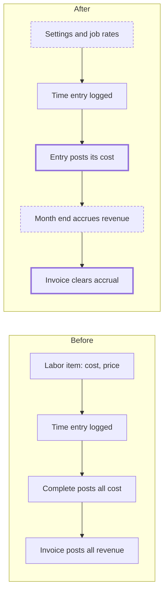

# Service Labor Rates, Time Posting and Revenue Recognition

> Status: in-progress
> Author: Claude (with Brad Barbin)
> Date: 2026-10-31

## TLDR

Service labor gets two plain rates instead of a labor item. The company sets a
cost rate and a default bill rate in **Settings → Service**. Each service job
copies the default bill rate and can change it. The estimate shows it.

The accounting follows ASC 606. Each time entry posts its cost to Cost of
Service when it closes. Revenue is earned over time: at month end the revenue
recognition run accrues what each open Billable job has earned and not billed
(Dr Contract Assets / Cr Service Revenue). The job's invoice clears that
accrual. All service job revenue posts to a new Service Revenue account, and
accounting sync sends it to that account.

The UI shows each rule before a click fails, so the user cannot make the
mistake.

## Overview diagram



## Problem Statement

1. **The rate is hidden in an item.** The cost per hour is the Unit Cost on a
   Service item, and the bill rate is its Unit Sale Price. The item is chosen in
   Settings → Invoicing. A user who looks at a service job cannot see or change
   the rate. Brad did not find it.
2. **Time is not in the ledger until Complete.** SJ000003 has 7.76 h logged,
   0 cost and no journal. Production and maintenance labor post when each
   entry ends.
3. **Revenue is not compliant with ASC 606.** A repair improves an asset the
   customer controls, so the revenue is earned over time (606-10-25-27(b)).
   Today revenue posts only when the invoice posts. Service revenue also sits
   in the sales account with product revenue, so it cannot be disaggregated by
   timing (606-10-50-5).
4. **Rules fail after the click.** A labor item with no cost is refused at
   Complete. A Fixed Price job with no price is refused at Create Invoice, and
   no field sets the price. A running clock is refused at Complete.

## Proposed Solution

### 1. Rates

1. `companySettings` gets `serviceLaborCostRate` and `serviceLaborBillRate`.
   Both are per hour, in the company's base currency.
2. A new page, **Settings → Service**, edits them.
3. `serviceJob` gets `laborBillRate`. A new job copies `serviceLaborBillRate`
   into it. Every create path does this: ERP New, MES New, the RMA receipt and
   the demo data.
4. The job's bill rate is editable while the job is not locked and its estimate
   is not Sent or Accepted.
5. Each time row stores the cost rate it posted at in `unitCost`. A later
   change to the company cost rate does not change a posted row.
6. The labor item is removed. `serviceJobTime.laborItemId` and
   `companySettings.serviceLaborItemId` are dropped.

### 2. Time cost posts as it happens

The posting copies maintenance labor (`postMaintenanceEvent`,
`resources.service.ts`).

1. `post-service-job` gets a new action, `post-time`. It reconciles the time
   cost of one job.
2. `post-time` locks the job and reads every closed entry: `hours` > 0 and
   no running clock.
3. For each entry it builds the desired pair: Dr the job's coverage account,
   Cr `laborAbsorptionAccount`, at hours × the entry's rate.
4. The entry's rate is its stored `unitCost`. An entry with no `unitCost`
   takes `serviceLaborCostRate` and stores it.
5. It reads the prior lines: `documentLineReference =
   journalReference.to.serviceJobTime(id)`.
6. It posts the difference (`diffLaborGroups`) in journals with `sourceType`
   `'Service Job'`. Each entry's lines are dated on its `entryDate`, unless
   that period is Closed or Locked. Then they are dated today. Each posting
   date gets one journal.
7. A deleted entry has no desired lines, so its prior lines reverse.
8. A coverage change needs no special code. The next reconcile moves the
   posted cost to the new coverage account.
9. An entry posted before the accounting cutover cannot change
   (`TIME_ENTRY_BEFORE_CUTOVER_ERROR`).

Every write to `serviceJobTime` runs the reconcile:

| Write | Where the reconcile runs |
|---|---|
| ERP My Time (`setServiceJobDayHours`) | In the same Kysely transaction |
| ERP job page create, edit, delete (`upsertServiceJobTime`, `deleteServiceJobTime`) | After the write, as the system. A failure returns a warning |
| ERP stop clock (new `stopServiceJobClock`) | After the write |
| MES clock Stop and MES My Time | After the write, through `erpPosting` |
| Coverage change (`set-coverage`) | In the same transaction |
| Complete | In the Complete transaction. Complete refuses if it fails |

`complete` writes no journal. `reopen` voids no journal.
`completionJournalId` is dropped.

### 3. Revenue is earned over time

1. A new synthesizer, `synthesizeServiceJobRevenue`, joins the Revenue
   Recognition run (`runRowSynthesizers`). The proposal lock covers it.
2. It reads every Billable job that is not Cancelled and has no posted invoice.
   A job whose invoice is Draft or Pending counts as unbilled.
3. It computes the job's **earned to date** at the run's `periodEnd`:

   | Billing | Earned to date |
   |---|---|
   | Time and Materials | Σ billable closed hours (`entryDate` ≤ `periodEnd`) × `laborBillRate`, plus Σ billable Part and Charge lines × their price |
   | Fixed Price | `fixedPrice` × min(1, closed hours ÷ the accepted estimate's labor hours) |
   | Fixed Price, Completed on or before `periodEnd` | `fixedPrice` |
   | Fixed Price, no labor hours on the estimate | 0 until the job is Completed, then `fixedPrice` |
   | No `fixedPrice` | 0 |
   | Not Billable any more, or Cancelled, before the invoice posts | 0, so the open accruals reverse |

4. It subtracts the sum of the job's unbilled Accrual rows (any status). A
   non-zero difference becomes one new Accrual row:
   `serviceJobId`, `type` `'Accrual'`, `status` `'Planned'`,
   `scheduledDate` = `periodEnd`, Dr `contractAssetAccount` /
   Cr `serviceRevenueAccount`. A negative difference is a negative row.
5. `postRevenueRecognitionRun` posts the row with `documentType`
   `'Service Job'` and the Customer and Location dimensions.
6. A Warranty or Contract job earns no revenue. Its cost goes to Warranty
   Expense or Cost of Service, as today.

### 4. The invoice and Service Revenue

1. An estimate line with no item is a **Labor** line. Its quantity is hours.
   Its `unitPrice` is the job's `laborBillRate`. The estimate PDF shows the
   rate.
2. When the job's bill rate changes, the same Kysely transaction sets
   `unitPrice` on the job's Labor estimate lines.
3. A Time and Materials invoice gets one labor line: billable hours × the
   job's `laborBillRate` at invoicing. The line has `invoiceLineType`
   `'Service'`, no item, the description "Labor" and the unit `EA`. Parts and
   Charges keep their lines. The invoice shows the description as the line's
   name.
4. Every invoice line with a `serviceJobId` credits revenue through legs:
   1. **Contract Assets** for its share of the job's unbilled accrual. The
      job's lines take the accrual in sort order, each up to its own
      revenue (`planServiceJobRevenue`).
   2. **Service Revenue** for the rest of the line.
   3. If accrual is left after the job's last line, that line writes a
      reclass that sums to 0: Cr Contract Assets / Dr Service Revenue. That
      is the revenue true-up.
5. Posting stamps the cleared Accrual rows with `billedBySalesInvoiceLineId`.
   A void clears the stamp.
6. `serviceRevenueAccount` is a new account default. If it is empty, it falls
   back to `salesAccount` (`DEFAULT_FALLBACKS`). The run's accrual needs
   `contractAssetAccount`; the synthesizer refuses with a message when it is
   empty.

### 5. Accounting sync

1. The Service Revenue leg has the description "Service Revenue".
2. `classifyAccountingPostingRole` maps it to a new role, `ServiceRevenue`.
3. `loadSalesInvoices` returns the service revenue account next to the sales
   account.
4. Each invoice component carries its `serviceJobId`. A component with one
   uses the service revenue account. If no Service Revenue line posted (the
   accrual covered every line), sync reads the credit account of the Accrual
   rows that the invoice cleared.
5. QuickBooks, Xero and Rillet each map that component to the service revenue
   account: QuickBooks and Rillet through a second sales item or product,
   Xero through the line's account code.
6. The revenue recognition run journals stay unsynced (`defaultEnabled:
   false`), as today.

### 6. Rules shown before the click

| Rule | What the UI does |
|---|---|
| No cost rate in Settings → Service | The MES clock Start, the job time form and My Time refuse the entry. The message links to Settings → Service. |
| No cost rate, or no bill rate on the job | The service job page (ERP and MES) shows a warning with a link to Settings → Service. |
| The job's bill rate after the estimate is Sent or Accepted | The field is read-only and says why. |
| A Fixed Price job with no price | The job has an editable Fixed Price field. Complete and Create Invoice ask for the price in their dialog. |
| A running clock at Complete in the ERP | The dialog offers **Stop clock and complete**. |
| Cancel on a job with time or parts | Cancel is disabled. Its tooltip says to remove the time and return the parts first. |
| No Contract Assets default | The run refuses with "Set the Contract Assets account default before recognizing service revenue." |

### Design Decisions

| Decision | Choice | Rationale |
|---|---|---|
| Rate model | A company cost rate, and a bill rate on the job that defaults from the company | Brad (Q1, Q2). A rate in an item was hidden. |
| Rates per employee | No | Not asked for. |
| Bill rate after time is logged | The invoice uses the job's rate at invoicing | Brad (Q8). |
| Bill rate lock | Locked once the estimate is Sent or Accepted | Brad (Q3). The customer approved that price. |
| Cost rate on a posted entry | Stored in `unitCost`; never re-rated | Brad (Q4). A posted cost must not move. |
| Charges and Fixed Price billing | Charges stay item-based. Fixed Price bills one plain line with no item, "Fixed price service", at `fixedPrice` | Brad (Q9). The billed item was an extra field that blocked the invoice. |
| No cost rate | Time is refused; the job shows a warning with a link | Brad (Q10). |
| Where time cost posts | Straight to the coverage account; no Service WIP | Brad (Q7). The customer owns the unit, so nothing is capitalized (ASC 340-40). |
| Cost posting shape | One reconcile per job, keyed per entry | Copies maintenance. A delete and a coverage change need no extra code. |
| Revenue timing | Over time, accrued by the revenue recognition run | Brad (Q11). ASC 606-10-25-27(b). |
| T&M progress | Right-to-invoice: billable amounts as performed | ASC 606-10-55-18. |
| Fixed Price progress | Input method: hours logged ÷ the accepted estimate's labor hours, capped at 100% | Brad (Q12). |
| Accrual shape | Cumulative: earned to date minus accrued, one row per run | Hours can change after an accrual posts. Contract revenue already writes catch-up rows. |
| Revenue account | A new `serviceRevenueAccount` for every line of a service job invoice | Brad (Q11, Q13). Disaggregation by timing (606-10-50-5). |
| Parts on a service job | Service Revenue, not product revenue | A part installed in a repair is not distinct from the repair. The job is one performance obligation. |
| Invoice relief | The invoice clears the whole unbilled accrual; Service Revenue takes the difference | Nothing stays on Contract Assets after the job is billed. |
| Sync | A `ServiceRevenue` role and a per-component account in all three providers | Today sync allows one revenue account per invoice. |
| Where the cost reconcile lives | A `post-time` action on `post-service-job` | The MES may already call `post-service-job` (`MES_POSTINGS`). |
| Labor estimate line | An estimate line with `itemId` NULL | No new table. |
| Labor invoice line | `salesInvoiceLineType` `'Service'`, no item, description "Labor" | A plain hours × rate line. The line type is the title when a line has no item, and "Service" names what was billed (Brad, 2026-11-01). The `'Labor'` enum value stays for old rows. |
| Existing data | No migration | Brad (Q6). |
| Competitor research | Not done | The rules come from ASC 606 and Carbon's own maintenance labor and rental accrual code. |
| Multi-tenancy (heuristic 1) | No new table | — |
| Service shape (heuristic 2) | Operations in `service.server.ts`, building blocks in `service.service.ts` | `module-files.md`. |
| RLS (heuristic 3) | No new table, so no new policy | — |
| Permissions (heuristic 4) | Settings → Service: `update: settings`. Job rate and fixed price: `update: service`. | Same as the sibling pages. |
| Forms (heuristic 5) | `ValidatedForm` + zod in `settings.models.ts` and `service.models.ts` | `conventions-forms.md`. |
| Module layout (heuristic 6) | No new module | — |
| Backward compatibility (heuristic 7) | `post-service-job` gains `post-time`. The `upsertServiceJobTime` MCP input loses `laborItemId`. | An MCP caller that sends `laborItemId` must stop. |

## Data Model Changes

```sql
-- Migration 1 (enum only; the value cannot be used in the same transaction)
ALTER TYPE "salesInvoiceLineType" ADD VALUE IF NOT EXISTS 'Labor';

-- Migration 2
ALTER TABLE "companySettings"
  ADD COLUMN IF NOT EXISTS "serviceLaborCostRate" NUMERIC,
  ADD COLUMN IF NOT EXISTS "serviceLaborBillRate" NUMERIC,
  DROP COLUMN IF EXISTS "serviceLaborItemId";

ALTER TABLE "serviceJob"
  ADD COLUMN IF NOT EXISTS "laborBillRate" NUMERIC,
  DROP COLUMN IF EXISTS "completionJournalId";

ALTER TABLE "serviceJobTime"
  DROP COLUMN IF EXISTS "laborItemId";

ALTER TABLE "serviceJobEstimateLine"
  ALTER COLUMN "itemId" DROP NOT NULL;

ALTER TABLE "accountDefault"
  ADD COLUMN IF NOT EXISTS "serviceRevenueAccount" TEXT;
-- FK to "account" ON DELETE RESTRICT ON UPDATE CASCADE, and an index,
-- copying "costOfServiceAccount" in 20261023071039_service-jobs.sql.

ALTER TABLE "revenueRecognitionSchedule"
  ADD COLUMN IF NOT EXISTS "serviceJobId" TEXT;
-- FK ("serviceJobId", "companyId") REFERENCES "serviceJob"("id", "companyId")
-- ON DELETE SET NULL ("serviceJobId"), and an index ("companyId", "serviceJobId"),
-- copying the contract line FK in 20261006221301_contracts.sql.
```

Rates are NUMERIC with no scale (`numeric-precision.md`). A rate displays with
the Rate kind.

## API / Service Changes

| Change | File |
|---|---|
| `post-time` action (the cost reconcile); `complete` and `reopen` write no journal; `set-coverage` reconciles | `apps/erp/app/modules/service/service.service.ts`, `packages/api/src/postings.ts` |
| `buildServiceTimeCostGroups`: the desired groups per entry | `apps/erp/app/modules/service/service-job-plan.ts` |
| `journalReference.to.serviceJobTime(id)` | `packages/database/src/utils.ts` |
| `withoutSupersededEntries`: accepts a set of expense accounts | `apps/erp/app/modules/resources/resources.service.ts` |
| Time writes: no labor item; refuse with no cost rate; run the reconcile | `service.server.ts`, `service.service.ts`, `apps/mes/app/services/service.service.ts`, `apps/mes/app/routes/x+/service-time.tsx`, `service.new.tsx` |
| `stopServiceJobClock` (ERP) | `service.server.ts`, `service.service.ts` |
| `updateServiceJob`: `laborBillRate` and `fixedPrice` | `service.server.ts`, `service.service.ts`, `service.models.ts` |
| `createServiceInvoice`: one labor line (Service, no item) | `service.service.ts`, `service-job-invoice-plan.ts` |
| `synthesizeServiceJobRevenue`; `runRowSynthesizers`; run posting branch | `apps/erp/app/modules/accounting/accounting.service.ts`, `packages/database/src/run-journals.ts` |
| Service job invoice legs, accrual relief, void | `apps/erp/app/modules/invoicing/invoicing.service.ts`, `packages/database/src/sales-posting-amounts.ts` |
| `serviceRevenueAccount` default | `accounting.models.ts`, `AccountDefaultsForm.tsx`, `journal-posting-status.ts`, `accounting-cutover/shared.ts`, `account-import.ts` |
| Sync `ServiceRevenue` role and per-component account | `packages/database/src/accounting-posting.ts`, `packages/ee/src/accounting/core/`, three providers |
| Settings → Service | `apps/erp/app/routes/x+/settings+/service.tsx`, `settings.models.ts`, `settings.server.ts` |
| Demo data | `packages/database/src/datasets/` |

## Closest Sibling

| Part | Sibling | Files copied |
|---|---|---|
| Time cost posting | Maintenance dispatch labor | `postMaintenanceEvent`, `diffLaborGroups`, `withoutSupersededEntries`, `postMaintenanceLabor`, `deleteMaintenanceEvent` (`resources.service.ts`, `resources.server.ts`); MES `apps/mes/app/services/maintenance.service.ts` |
| Revenue accrual | Rental accruals | `synthesizeRentalAccruals` (`accounting.service.ts`), `planRentalLine` relief and the `billedBySalesInvoiceLineId` stamp (`invoicing.service.ts`) |
| Settings page | Settings → Time | `apps/erp/app/routes/x+/settings+/time.tsx` |

Deviations:
- The accrual is cumulative, not one row per period slice. Hours change.
- The invoice clears the whole accrual, not up to the line amount.
- ERP My Time and Complete reconcile in their own transaction.

## UI Changes

| Screen | Change |
|---|---|
| Settings → Service (new; copies Settings → Time) | Cost rate per hour, default bill rate per hour |
| Settings → Invoicing | Remove Service Labor Item |
| Accounting → Defaults | Add Service Revenue to "Sales & Revenue" |
| ERP service job properties | Bill Rate and Fixed Price fields; the bill rate is read-only with a reason once the estimate is Sent or Accepted |
| ERP and MES service job page | Warning with a link when the cost rate or the job's bill rate is missing |
| ERP time entry form | Remove the labor item field |
| ERP estimate line form | A Labor choice: hours only, the rate from the job |
| Estimate PDF | A Labor line shows hours × rate |
| ERP Complete and Create Invoice | A dialog. It asks for the price on a Fixed Price job with none. Complete offers Stop clock and complete. |
| ERP job ⋯ menu | Cancel disabled with a reason when the job has time or parts |
| Sales invoice | A Service line with no item shows its description ("Labor", "Fixed price service") as its name |

## Acceptance Criteria

- [ ] In Settings → Service, a user sets the cost rate to 40 and the bill rate to 95. A new service job shows a bill rate of 95.
- [ ] A user changes that job's bill rate to 110. An estimate with a 2 h Labor line shows 110 per hour and 220.
- [ ] After Send Estimate, the bill rate field is read-only and says why.
- [ ] A technician clocks 1.5 h in the MES and stops. A journal exists at once: Dr Cost of Service 60 / Cr Labor Absorption 60, referencing that entry.
- [ ] The user edits the entry to 2 h. A journal posts Dr Cost of Service 20 / Cr Labor Absorption 20.
- [ ] The user deletes the entry. A journal reverses 80. The net for the entry is 0.
- [ ] The company cost rate changes to 50. Posted entries stay at 40. A new entry posts at 50.
- [ ] The job's coverage changes from Billable to Warranty. The posted cost moves to Warranty Expense in one journal.
- [ ] Complete and Reopen write no time journal.
- [ ] A Billable T&M job has 3 billable hours at 95 by 31 October and no invoice. The October revenue recognition run accrues Dr Contract Assets 285 / Cr Service Revenue 285.
- [ ] One more hour is logged in November. The November run accrues 95 more. Deleting an October hour instead makes the November row −95.
- [ ] The job is invoiced for 4 h at 95 (380) and the invoice posts. Contract Assets is credited 380, Service Revenue 0, and the accrual rows carry the invoice line.
- [ ] A Fixed Price job of 1,000 with an accepted estimate of 10 labor hours has 4 hours logged at month end. The run accrues 400.
- [ ] A Warranty job's run accrues nothing.
- [ ] With no cost rate, the MES clock Start refuses with a link to Settings → Service, and the job page shows the warning.
- [ ] A service job invoice syncs to QuickBooks and Xero with its lines on the Service Revenue account and a part sale on the Sales account of another invoice.
- [ ] On a Fixed Price job with no price, Complete asks for the price.
- [ ] In the ERP, Complete with a running clock offers Stop clock and complete, and both happen.
- [ ] Cancel is disabled on a job with time and shows the reason.
- [ ] `pnpm db:check:datasets` passes for all four datasets.

## Risks

| Risk | Severity | Mitigation |
|---|---|---|
| Post-after-write paths can leave an entry unposted when the posting fails | Med | The next reconcile posts it. Complete reconciles and refuses on failure. |
| `buildSalesPostingLines` may refuse a negative last leg | Med | Test it first. If it refuses, cap the relief at the line revenue and leave the rest to the next run, as rental does. |
| Sync providers book each component to one account today | High | Build and test the `ServiceRevenue` mapping in all three providers before release. |
| The run journals do not sync, so the external ledger books revenue at invoice | Low | Unchanged behavior. A company that syncs runs gets the accruals. |
| `ALTER TYPE … ADD VALUE` cannot run in the same transaction as its use | Low | A separate migration. |
| Demo data posts time at completion and has no accruals | Med | Tier 09 and the validator change in the same work. |

## Open Questions

> HARD STOP: Do not proceed with implementation until these are answered.

- [x] Q1. One rate or two? — **Answer:** Two: a bill rate and a cost rate per hour. (Brad, 2026-10-31.)
- [x] Q2. Which rate can a job change? — **Answer:** The bill rate, defaulted from Settings → Service. The cost rate is company-wide. (Brad, 2026-10-31.)
- [x] Q3. When does the job's bill rate lock? — **Answer:** Once the estimate is Sent or Accepted. (Brad, 2026-10-31.)
- [x] Q4. What happens to posted time when the cost rate changes? — **Answer:** Nothing. Each row stores its rate. (Brad, 2026-10-31.)
- [x] Q5. How does labor appear on the estimate and the invoice? — **Answer:** A Labor line with no item, at hours × the job's bill rate. (Brad, 2026-10-31.)
- [x] Q6. What about existing data? — **Answer:** No migration. (Brad, 2026-10-31.)
- [x] Q7. Does open time cost post to the coverage account or a Service WIP account? — **Answer:** The coverage account. (Brad, 2026-10-31.)
- [x] Q8. Can the bill rate change after time is logged? — **Answer:** Yes until the estimate is Sent. The invoice uses the job's rate at invoicing. (Brad, 2026-10-31.)
- [x] Q9. Do Charges and Fixed Price billing stay item-based? — **Answer:** Yes. (Brad, 2026-10-31.) Changed 2026-11-01 (Brad): Fixed Price bills a plain line with no item. Charges stay item-based.
- [x] Q10. What happens with no cost rate? — **Answer:** Time is refused, and the job shows a warning with a link to Settings → Service. (Brad, 2026-10-31.)
- [x] Q11. Where does service revenue post, and when? — **Answer:** Be compliant with ASC 606: earned over time, accrued by the revenue recognition run, to a separate Service Revenue account, with sync support. (Brad, 2026-11-01.)
- [x] Q12. Fixed Price progress now or later? — **Answer:** Now, by hours ÷ the accepted estimate's labor hours. (Brad, 2026-11-01.)
- [x] Q13. Do Charges post to Service Revenue? — **Answer:** Yes. (Brad, 2026-11-01.)

## Implementation Notes (2026-11-01)

The code differs from the design above in eight places. The code wins.

| # | Design | Implementation | Why |
|---|---|---|---|
| 1 | The job's first invoice line clears the whole accrual | The accrual spreads over the job's lines in sort order, each up to its own revenue. Accrual left after the last line becomes a reclass on that line: Cr Contract Assets / Dr Service Revenue, sum 0 | `buildSalesPostingLines` refuses a revenue leg larger than its line |
| 2 | Fixed Price earns by hours; only a job with no estimate labor hours earns all of `fixedPrice` at completion | A Fixed Price job Completed on or before `periodEnd` earns all of `fixedPrice` | Completed work is fully earned, whatever the hours were |
| 3 | Not specified | A job that leaves Billable, or is Cancelled, before its invoice posts earns 0. The next run reverses its open accruals | Revenue must not stay accrued on work that will not be billed |
| 4 | Sync maps the Service Revenue leg | When the accrual covered every line, the journal has no Service Revenue line. Sync falls back to the credit account of the Accrual rows that the invoice stamped | Otherwise the invoice names no service revenue account and sync refuses it |
| 5 | A Labor invoice line has no item | It also carries the unit `EA` | An invoice line needs a unit |
| 6 | Create Invoice asks for a missing fixed price | `createServiceInvoice` takes an optional `fixedPrice` and saves it inside the invoice transaction. The Complete route saves it with `updateServiceJob` before it completes | The price and the invoice are saved together or not at all |
| 7 | The time difference posts in one journal, dated the company's today | Each entry's lines are dated on its `entryDate`, unless that period is Closed or Locked, or the day is before the cutover. Then, and for a deleted entry, they are dated today. Each posting date gets one journal (`serviceTimePostingDates`) | The revenue run counts hours by `entryDate`. A cost dated today put the cost and the revenue of one entry in different months |
| 8 | The labor line and the Fixed Price line have `invoiceLineType` `'Labor'` | Both are `'Service'` with no item (`planServiceJobInvoiceLines`). The invoice line form, explorer, summary, PDF and email name an item-less Service line by its description. `isDirectItemLine` needs an item, so the line ships nothing. Old `'Labor'` rows render and post as Service lines; the form saves them as Service | The type is the line's title when there is no item, and "Labor" was wrong for a Fixed Price line (Brad) |

## Changelog

- 2026-10-31: Created. Replaces decisions 9 and 10 and answer Q3 of `2026-10-22-service-jobs-and-returns.md` (labor items; time posts at completion).
- 2026-11-01: Added ASC 606 revenue recognition, the Service Revenue account, sync support, the Fixed Price field and the ERP stop clock.
- 2026-11-01: Implemented (Tasks 1–20, commit 527277fce3). Status in-progress. Added Implementation Notes: the accrual spreads over the job's invoice lines with a reclass for the excess, a Completed Fixed Price job earns all of `fixedPrice`, a job that leaves Billable or is Cancelled reverses its accruals, sync falls back to the accrual rows' credit account, the Labor line uses unit `EA`, and Create Invoice saves a missing fixed price inside its transaction. Docs and rules updated (Task 21).
- 2026-11-01: Fixed Price bills one plain `'Labor'` line with no item: "Fixed price service", 1 × `fixedPrice`, unit `EA` (Brad). The job's Billed Item field is gone. Migration `20261102011400_drop-service-job-service-item.sql` drops `serviceJob.serviceItemId`.
- 2026-11-01: item-less service job lines bill as type Service (Brad); 'Labor' kept only for old rows. Implementation Note 8.
