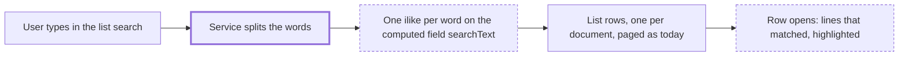

# Deep search on order and quote lists

> Status: implemented
> Author: Claude, with the requester
> Date: 2026-11-02
> Research: `.ai/research/2026-11-02-deep-list-search.md`

## TLDR

- The search box on 8 order and quote lists also finds a document by a value on its lines: part number, item name, customer or supplier part number, line description.
- Search ignores case, spaces and punctuation, and every word must match. "brk 514" finds BRK-514.
- While a search is active, each matching row opens and shows only the lines that matched, with the match highlighted.
- With no search, the lists look and work exactly as today.
- Inventory → Receiving is removed. The Purchase Orders list replaces it.
- Receive on a purchase order opens its Draft receipt when one exists, instead of starting a second receipt.

## Overview diagram



## Problem Statement

A buyer or a receiver often knows a part number, not a document number. The
packing slip shows the supplier part number. A customer calls about their own
part number. Today the 8 lists search only the document number and one
reference field (research §3). So the user cannot find the order from the
value they have.

Inventory → Receiving (#2044) solved this for open purchase orders only, on a
separate page. Two pages now find purchase orders in two different ways.

Concrete examples on the satellite dataset:

- Search "CEX Q 4471 battery" on Purchase Orders. Today: no result. Wanted: the PO that has that line.
- Search "brk-514" when a line's supplier part number is BRK514. Today: no result. Wanted: the PO.

## Proposed Solution

### Scope

These 8 lists get the deep search:

| Module | List | Source view |
|---|---|---|
| Purchasing | Purchase Orders | `purchaseOrders` |
| Purchasing | Supplier Quotes | `supplierQuotes` |
| Purchasing | Purchasing RFQs | `purchasingRfqs` |
| Invoicing | Purchase Invoices | `purchaseInvoices` |
| Sales | Sales Orders | `salesOrders` |
| Sales | Sales Quotes | `quotes` |
| Sales | Sales RFQs | `salesRfqs` |
| Invoicing | Sales Invoices | `salesInvoices` |

### How the search works

1. A migration adds a PostgREST computed field `"searchText"` to each of the 8 views.
2. The field is a SQL function that takes the view's row type and returns one text value.
3. The text holds the document's header values and the values of each line.
4. Each value is lower-cased and loses every character that is not a letter or a digit.
5. A `|` joins the values, so one match never spans two values. This is the Receiving rule.
6. The service splits the user's input into words with the shared `searchTerms` helper.
7. The service adds one `.ilike("searchText", "%word%")` per word. PostgREST joins them with AND.

A computed field is not part of `select=*`. So the detail pages and every
other reader of the 8 views do not pay for it. PostgREST runs it only when a
query filters on it or selects it.

### Values in `searchText`

| List | Header values | Line values |
|---|---|---|
| Purchase Orders | PO number, supplier name, supplier reference, delivery tracking number, job readable id | item readable id, item name, line description, the part number (the line's own supplier part number, else the `supplierPart` one) |
| Supplier Quotes | quote number, supplier name, supplier reference | item readable id, item name, line description, line supplier part number |
| Purchasing RFQs | RFQ number, names of the RFQ's suppliers | item readable id, item name, line description |
| Purchase Invoices | invoice number, supplier name, supplier reference | item readable id, item name, line description, PO readable id, `supplierPart` part number |
| Sales Orders | SO number, customer name, customer reference, shipment tracking number | item readable id, item name, line description, `customerPartToItem` part number |
| Sales Quotes | quote number, customer name, customer reference | item readable id, item name, line description, line customer part number |
| Sales RFQs | RFQ number, customer name, customer reference | item readable id, item name, line description, line customer part number |
| Sales Invoices | invoice number, customer name, customer reference | item readable id, item name, line description, SO readable id, `customerPartToItem` part number |

Every join to `supplier`, `customer`, `supplierPart` and `customerPartToItem`
is a `LEFT JOIN`. An invoicing-only user cannot read `supplier` or `customer`
(research §4). With a `LEFT JOIN` the name is only absent from that user's
text. An `INNER JOIN` would hide the whole invoice from that user.

### Matched lines under each row

1. A second computed field, `"searchLines"`, returns the document's lines as a JSON array.
2. Each element holds the values the row shows: item readable id, item name, description, part number, quantity.
3. The service selects `searchLines` only while a search is active.
4. The list table passes the search to `expandRowsFor`. The shared `Table` then opens every expandable row (`Table.tsx:206-209`).
5. The expanded row shows only the lines whose values match a word. The shared `searchMatches` helper highlights each match.
6. If only header values matched, the row has no matching line. `canExpandRow` returns false for it, and the row shows no chevron.

The lines come in the same query as the rows. So cursor paging, infinite
scroll, the count and the bulk actions keep working with no change.

### Removing Inventory → Receiving

Remove each of these:

1. The route `apps/erp/app/routes/x+/inventory+/receiving.tsx`.
2. The component folder `apps/erp/app/modules/inventory/ui/Receiving/`.
3. The nav entry in `useInventorySubmodules.tsx` and `path.to.receiving`.
4. The service functions `getPurchaseOrderLinesToReceive`, `getOpenPurchaseOrdersForItems` and `getDraftReceiptsForPurchaseOrders`, if no other caller uses them.
5. The Receiving types in `apps/erp/app/modules/inventory/types.ts`.
6. The view `purchaseOrderLinesToReceive`, with a `DROP VIEW` in the new migration.
7. The Receiving text in the inventory `AGENTS.md`, `.claude/rules/shipments-receipts-ui-patterns.md` and `docs/content/docs/reference/receipts.mdx`.

`receivingSearchTerms` and `receivingSearchMatches` move to a shared util as
`searchTerms` and `searchMatches`. Their tests move with them.

### Receive opens the Draft receipt

1. `createReceipt` gets a purchase order as its source document.
2. It looks for a receipt of that order with status `Draft`.
3. If one exists, it returns the oldest one and creates nothing.
4. If none exists, it creates the receipt as today.

The PO page's Receive button and the list's right-click Receive both call
`createReceipt`. So both get the same rule.

### Design Decisions

| Decision | Choice | Rationale |
|---|---|---|
| Where the search text lives | PostgREST computed field per view | Not in `select=*`, so detail pages pay nothing. No view is rebuilt, so no clobber risk on 8 large views. Filtering works (PostgREST docs: "Horizontal filtering can be applied to computed fields"). |
| Fallback if a computed field on a view does not filter | Add `searchText` as the last column of the view | The PostgREST docs show computed fields on tables only. Plan step 1 proves it on `purchaseOrders` before any other work. |
| Index | None | The user accepted the speed risk: these searches are rare. A stored column with a trigram index can come later with no UI change. |
| Word rule | Every word must match, punctuation ignored | Same as Receiving. One search behavior for every list. |
| Function security | `STABLE`, `SECURITY INVOKER`, unnamed parameter | RLS on lines, items and parties applies to the caller. An unnamed parameter keeps the function off `/rpc` (PostgREST docs). |
| Party joins | `LEFT JOIN` | An invoicing-only user still sees every invoice (research §4). |
| Match hint | Expand matching rows while a search is active | User choice. The shared `Table` supports it with `expandRowsFor`. |
| Line data for the expanded row | Second computed field `searchLines`, selected only during a search | One query per page. Paging and export stay unchanged. |
| CSV export | Unchanged, one row per document, no lines | Export shows the visible columns only. The expanded lines are not columns. |
| Receiving page | Removed | User choice. The PO list now finds the same orders. |
| Draft receipt reuse | In `createReceipt`, for both the list and the PO page | User choice. One rule in one place. |
| Copy | Lingui for every new string | Project rule. |

## Data Model Changes

No table changes. One migration:

```sql
-- One pair per list view. Example for purchase orders.
CREATE OR REPLACE FUNCTION "searchText"("purchaseOrders")
RETURNS TEXT
LANGUAGE sql STABLE SECURITY INVOKER
AS $$
  SELECT concat_ws('|',
    regexp_replace(lower($1."purchaseOrderId"), '[^[:alnum:]]+', '', 'g'),
    -- supplier name, supplier reference, tracking number, job ...
    (SELECT string_agg(concat_ws('|',
        regexp_replace(lower(i."readableIdWithRevision"), '[^[:alnum:]]+', '', 'g'),
        regexp_replace(lower(i."name"), '[^[:alnum:]]+', '', 'g'),
        regexp_replace(lower(pl."description"), '[^[:alnum:]]+', '', 'g'),
        regexp_replace(lower(pl."supplierPartId"), '[^[:alnum:]]+', '', 'g')
      ), '|')
     FROM "purchaseOrderLine" pl
     LEFT JOIN "item" i ON i."id" = pl."itemId"
     WHERE pl."purchaseOrderId" = $1."id")
  );
$$;

CREATE OR REPLACE FUNCTION "searchLines"("purchaseOrders")
RETURNS JSONB
LANGUAGE sql STABLE SECURITY INVOKER
AS $$ /* json array of the lines the row shows */ $$;

DROP VIEW IF EXISTS "purchaseOrderLinesToReceive";
```

Two functions with the same name and different parameter types are legal
overloads. Postgres picks the function by the row type.

## API / Service Changes

| Function | Change |
|---|---|
| `getPurchaseOrders`, `getSupplierQuotes`, `getPurchasingRFQs`, `getPurchaseInvoices`, `getSalesOrders`, `getQuotes`, `getSalesRFQs`, `getSalesInvoices` | Replace the current search filter with one `.ilike("searchText", …)` per word. Add `searchLines` to the select while a search is active. |
| `searchTerms`, `searchMatches` | Move from `inventory.utils.ts` to a shared util. Rename from `receiving*`. |
| `createReceipt` | Return the oldest Draft receipt of the purchase order when one exists. |
| Receiving service functions | Delete (see the removal list). |

`pnpm run generate:types` runs after the migration. The 4 lists that used a raw
`ilike` without `escapeLike` lose that code path. The terms hold only letters
and digits, so they need no escaping.

## Closest Sibling

Inventory → Receiving: `purchaseOrderLinesToReceive` (search text rule),
`inventory.utils.ts` (`receivingSearchTerms`, `receivingSearchMatches`) and
`ReceivingTable.tsx` (expanded lines with highlights). This feature copies its
search rule and its expanded-line look. It differs in 3 ways, each a Design
Decision above: a computed field instead of a line view, expand only during a
search, and cursor paging kept.

## UI Changes

Page archetype: list page, the same archetype each of the 8 lists has today.

- No search: no visible change.
- Search active: each row with a matching line opens. The expanded row lists the matching lines in the Receiving style: item readable id, item name, part number, description, quantity. The matched text is highlighted.
- The user can close an opened row. It stays closed until the search changes (current `Table` behavior).
- The Inventory nav loses "Receiving" under Shipping & Receiving.

## Acceptance Criteria

Seed: `pnpm db:seed:dev -- --dataset satellite`.

- [ ] On Purchase Orders, "CEX Q 4471 battery" finds the PO that has that line. The row opens and shows the matching line with the words highlighted.
- [ ] A PO line has supplier part number BRK514. "brk-514" finds that PO.
- [ ] On each of the 8 lists, a search for an item readable id that is on exactly one document's lines returns that document.
- [ ] On each of the 8 lists, a search for the document number still returns that document. The row does not open, because no line matched.
- [ ] A search for "word1 word2", where only word1 occurs in a document, does not return that document.
- [ ] Sales Orders: a search for a customer part number from `customerPartToItem` finds the order.
- [ ] A user with invoicing view and no purchasing view sees the same number of rows on Purchase Invoices as before the change, with no search.
- [ ] With no search, the response of each list does not contain `searchText` or `searchLines`.
- [ ] Infinite scroll loads page 2 of a search, and its rows open with their matching lines.
- [ ] The CSV export of a searched list has one row per document and the same columns as before.
- [ ] `/x/inventory/receiving` returns 404. The Inventory nav has no Receiving item.
- [ ] Receive on a PO with a Draft receipt opens that receipt. The receipt count of the PO does not change.
- [ ] Receive on a PO with no Draft receipt creates a receipt as today.
- [ ] The scoped typecheck, the unit tests for `searchTerms` and `searchMatches`, and Biome pass.

## Risks

| Risk | Severity | Mitigation |
|---|---|---|
| PostgREST does not filter a computed field on a view | Med | Plan step 1 proves it on `purchaseOrders`. If it fails, add the column to the view instead. |
| A search is slow on a company with many documents | Low | Accepted. Measure with `EXPLAIN ANALYZE` on the largest seed. A stored, indexed column can follow. |
| JS `\p{L}\p{N}` and SQL `[[:alnum:]]` differ for non-ASCII letters | Low | Same as Receiving today. Note it in the shared util. |
| Removing Receiving breaks a link or a doc page | Low | Grep for `receiving` routes and docs before the delete. Update docs in the same PR. |
| A user relied on phrase search ("abc def" as one string) | Low | Every-word match returns a superset of the phrase match. |

## Open Questions

> All resolved before this spec was written.

- [x] Which lists get the deep search? — **Answer:** the 8 order and quote lists (Purchase Orders, Supplier Quotes, Purchasing RFQs, Purchase Invoices, Sales Orders, Sales Quotes, Sales RFQs, Sales Invoices).
- [x] How does the user see why a row matched? — **Answer:** the matching rows open while a search is active and show only the matched lines, highlighted. With no search the list is unchanged.
- [x] What happens to Inventory → Receiving? — **Answer:** remove it.
- [x] Which Receiving extras move to the PO list? — **Answer:** only Draft receipt reuse. "Also open on" is dropped.
- [x] Does Draft receipt reuse apply to the PO page too? — **Answer:** yes, both the list and the PO page, through `createReceipt`.
- [x] Is the speed risk of an unindexed search acceptable? — **Answer:** yes, these searches are rare.

## Changelog

- 2026-11-02: Created.
- 2026-11-02: Implemented on `feat/deep-list-search`. Two migrations instead of one (the spike file was already applied). `Table.tsx` keeps the Expand column first while rows can expand.
- 2026-11-02: Review fixes. One migration (the spike folded in). `searchText` is built from `searchLines` (`search_normalize`, `search_lines_text`), so every line match shows a line; invoice lines carry `orderNumber`. A purchase order line's master supplier part number is searched only when the line has none. The 8 tables share `useMatchingLineRows`. `deep-list-search.test.ts` covers the search through PostgREST.
- 2026-11-02: Line items always available. Every row with lines has a collapsed Expand; opening it shows all its lines. A search still opens only the rows with a matching line (`Table` prop `expandRowByDefault`). The lines load only for the table on screen (`forScreen`, set by `fetchListPage`), never for an export, a bulk action or the API. Measured on the satellite seed: a page of purchase orders 1.8 ms → 2.3 ms, sales orders 0.8 ms → 3.1 ms.
- 2026-11-03: Review feedback. Lines load with the list only for a search on screen; without a search an opened row loads its lines (`api+/document-lines.$list.$id.ts`, skeleton while loading), so a list with no search reads what it read before. Every line and party lookup in the SQL functions matches the document's `companyId` (the list routes read with `bypassRls`). The view `purchaseOrderLinesToReceive` is no longer dropped here: the app version that still serves Inventory → Receiving reads it during the deploy. Follow-up: drop it in a later release. Search speed is unchanged (searches are infrequent).
- 2026-11-04: Search speed. The per-row `searchText` filter took about 700 ms at 1,800 purchase orders in one company, because Postgres built every row's text before it dropped one. Each list now has an SQL function `search<List>(company_id, terms)`. The function finds the matching ids from the company's headers and lines in one pass, then reads the view for those ids. The service calls it in place of the view when there is a search word. Measured on the same data: 52–66 ms for one or two words. `searchText` and `search_lines_text` are removed. On the seed data, the new functions return the same rows as `searchText` for 13,699 searches across the 8 lists.
