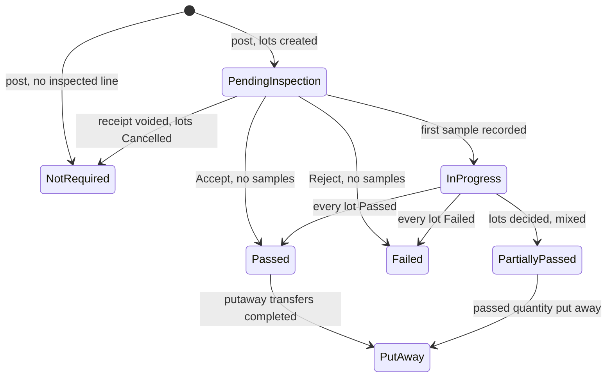

# Goods-In Inspection Hold

> Status: in-progress
> Author: naveenkash
> Date: 2026-11-03
> Research: `.ai/research/2026-11-03-goods-in-inspection-hold.md`

## TLDR

A received part with a receipt inspection plan goes to an inspection storage unit and
stays held there until quality decides. Each location gets an inspection
storage unit and an optional rejected storage unit, set in Settings → Quality.
The receipt line defaults to the inspection storage unit and carries an
"Inspection required" flag. The receipt keeps its `Posted` status. A new
`inspectionStatus` rolls up from its inspection lots: Pending Inspection,
Inspection In Progress, Inspection Passed, Inspection Failed, Partially Passed
and Put Away. One database guard on `itemLedger` refuses any move
of held stock, for serial, batch and untracked parts. A "Put Away" button on the
receipt creates a stock transfer that moves the passed quantity to its normal
storage unit. Rejected stock moves to the rejected storage unit at reject time.

## Overview diagram



The states are values of the new `receipt.inspectionStatus`. `receipt.status`
stays `Posted` through every state.

## Problem Statement

A part with a receipt inspection plan gets an inspection lot when its receipt
posts. But the stock is not held in a reliable way:

1. **Untracked stock is not held.** A part with tracking type `Inventory` is
   pickable, consumable and shippable as soon as the receipt posts. Only a
   Reject writes it off.
2. **Serial and batch holds leak.** `On Hold` units can move through a stock
   transfer, an adjustment bin move, an inventory count and server-side
   picking. A stock transfer unpick sets any unit to `Available`
   (`inventory.service.ts:9650-9662`), which releases held stock.
3. **No QC area.** The receipt line takes the PO line's storage unit or the
   part's default. Held stock sits in a normal, nettable bin, so MRP counts it
   as supply.
4. **No visibility.** The receipt goes to `Posted` at once. Only a small mark on
   each line shows that a part needs inspection. Stores cannot list receipts
   that wait for inspection or for putaway.
5. **No putaway step.** After a pass, stores make a stock transfer by hand.
   Nothing links it to the receipt.
6. **Rejected stock has no home.** An untracked reject writes off from "no
   storage unit" (`quality.service.ts:5884`). The receiving bin keeps its
   stock and the unassigned bin goes negative.
7. **A voided receipt leaves its lot `Pending`.** Nothing closes the lot.

Example: a company receives 100 untracked bolts that need inspection. The
bolts post to bin A-01. A picker takes 40 for a job the same afternoon. Two
days later quality rejects the lot and writes off 100 bolts, but only 60 are
still there.

## Proposed Solution

### 1. Location settings

Settings → Quality gets a "Goods-in storage" card with one row per location.
Each row has two `StorageUnit` pickers, filtered to that location:

| Field | Required | Rule |
|---|---|---|
| Inspection storage unit | Required before an inspected part can be received there | Must be non-nettable (`effectiveNettable = false`) |
| Rejected storage unit | Optional | Must be non-nettable |

The settings action refuses a nettable unit with "Choose a non-nettable storage
unit." It also refuses a unit from another location.

### 2. Receipt line defaults and flags

When `createDocument` builds a receipt line:

1. Set `receiptLine.requiresInspection` to true when the part has a `Receipt`
   row in `itemInspectionDocumentAssignment` and the source is a Purchase
   Order. The flag is a snapshot: a later plan change does not rewrite it.
2. Choose the storage unit in this order:
   1. If `requiresInspection` is true and the location has an inspection
      storage unit, use that unit.
   2. If the source is a Sales Return Order and the location has an inspection
      storage unit, use that unit.
   3. Else use the PO line's storage unit.
   4. Else use the `pickMethod` default.

The receiver may change the storage unit of an inspected line, but only to
another non-nettable unit at the same location.

### 3. Post checks

Before `postReceipt` sets `Pending`, it checks every line with
`requiresInspection = true` and `receivedQuantity > 0`:

1. If the location has no inspection storage unit, refuse the post with
   "{Location} has no inspection storage unit. Set one in Settings → Quality."
2. If the line's storage unit is nettable or at another location, refuse the
   post with "{Part} needs inspection. Choose a non-nettable storage unit at
   {Location}."

The post then works as today. It also stamps `inspection.storageUnitId` with the
line's storage unit.

### 4. The hold

Two kinds of stock are held:

| Stock | Held while | Mark |
|---|---|---|
| Serial or batch unit | Its status is `On Hold` | `trackedEntity.status` (existing) |
| Untracked (`Inventory`) quantity | Its lot is `Pending` or `In Progress`, or its lot is `Partial` and the linked NCR is not closed | `inspection_held_quantity(companyId, itemId, storageUnitId)` |

The held quantity of an untracked part at one storage unit is:

- the `lotSize` of every open lot (`Pending`, `In Progress`) whose
  `storageUnitId` is that unit, plus
- `lotSize - acceptedQuantity` of every `Partial` lot whose `storageUnitId` is
  that unit and whose NCR is not closed.

**One guard enforces it.** A statement handler on `itemLedger`
(`check_inspection_hold`) checks each INSERT statement once, after its rows
are in, for the rows with `quantity < 0`. One refused row refuses the whole
statement:

1. If the transaction has set `app.inspection_release`, allow the row.
2. If the row has a `trackedEntityId` whose status is `On Hold`, refuse it.
3. If the row has no `trackedEntityId` and a `storageUnitId` with a held
   quantity above 0, compute the on-hand at that unit after the statement. If
   it is below the held quantity, refuse it.

The error reads "{Part} is held for inspection in {storage unit}. Quality must
decide its inspection lot before it can move." A fast path skips step 3 when no
open hold names the row's storage unit.

`withInspectionRelease` sets `app.inspection_release` for one step only: the
write that IS the release. Stock moves and write-offs after that step run with
the guard on. `post-nonconformance` sets no flag. Two posting families set the
flag for the whole transaction (`setInspectionRelease`):

| Posting | Scope | Why |
|---|---|---|
| `dispositionInspection` | The lot's own update | The decision ends the hold |
| `closeIssue` | The NCR's status update | The close ends a Partial lot's hold |
| Purchase receipt void | The update that cancels open lots | A cancelled lot holds nothing |
| `postInventoryCount` | Whole transaction | Records where stock really is (see below) |
| `Sales Return Shipment` and `Purchase Return Shipment` | Whole transaction | RMA return flows ship `On Hold` units today (`shippableEntityStatuses`) |

**Inventory counts record reality.** A count may move held stock on the books.
A serial or batch unit keeps `On Hold`, so its hold travels with it. An
untracked hold stays keyed to its storage unit, and the guard caps it at the
on-hand there. When a count moves held stock, the count post shows a warning: "{Part}
is held for inspection and was found outside {storage unit}." Stores then move
it back.

The stock transfer unpick leaves the unit's status alone, so a held unit stays
`On Hold`.

### 5. Disposition changes

| Decision | Serial or batch | Untracked |
|---|---|---|
| Accept | Non-failed units → `Available`, failed units → `Rejected` | Lot → `Passed`; the hold ends |
| Reject | Existing: units → `Rejected`. New: a `Transfer` moves them to the rejected storage unit, when one is set | Write-off through `post-nonconformance`, in the decision's transaction, booked from `inspection.storageUnitId` instead of `null` |
| Partial | Serial only: a batch lot is accepted or rejected as a whole. Needs a failed unit, a passed sample and complete sampling. Every unit that did not fail becomes `Available`, as on Accept (sampled and unsampled); failed units become `Rejected`, and a `Transfer` moves them to the rejected storage unit | New: the dialog asks for the accepted quantity and requires an NCR. The rejected remainder moves to the rejected storage unit by `Transfer` and stays held until the NCR closes |

A sample verdict does not change a receipt unit's status: the unit stays
`On Hold` until the decision.

When the rejected move runs, `inspection.storageUnitId` changes to the
rejected storage unit, so the hold follows the stock. With no rejected storage
unit set, the stock stays in the inspection storage unit.

### 6. Put Away

The receipt header shows a "Put Away" button when passed quantity sits in an
inspection storage unit and no linked transfer covers it. It creates one
stock transfer, status Released (the status `createStockTransfer` and the
kanban replenishment use):

- `stockTransfer.receiptId` = the receipt.
- One line per passed quantity, with `receiptLineId` set:
  - From: the receipt line's storage unit (where the stock was received).
  - To: the part's nettable `pickMethod` default (`getNettableDefaultStorageUnitId`).
    If there is none, To is blank and stores choose.
  - Serial and batch parts: only units with status `Available`.
  - Untracked parts: `lotSize` for a `Passed` lot, `acceptedQuantity` for a
    `Partial` lot, minus the quantity already on linked transfer lines that
    are not cancelled.

Stores complete it with the existing stock transfer flow. A second press after
more lots pass creates a second transfer for the new quantity only. Sales
return receipts have no Put Away button: the RMA disposition releases returned
units, and stores move them with an ordinary stock transfer.

### 7. Receipt inspection status

`receipt.inspectionStatus` is a stored column. One SQL function,
`refresh_receipt_inspection_status(receiptId)`, computes it from the
receipt's lots, ignoring `Cancelled` lots:

| Value | Rule, in order |
|---|---|
| `Not Required` | No lot |
| `Pending Inspection` | Every lot is `Pending` |
| `Inspection In Progress` | At least one lot is `Pending` or `In Progress` |
| `Put Away` | Every lot is decided, at least one lot has passed quantity, and completed linked transfer lines cover all passed quantity |
| `Inspection Failed` | Every lot is `Failed` |
| `Inspection Passed` | Every lot is `Passed` |
| `Partially Passed` | Every lot is decided, and the results are mixed or at least one lot is `Partial` |

After-interceptors call the function when an `inspection` row changes `status`
or `acceptedQuantity`, and when a `stockTransfer` with a `receiptId` becomes
`Completed`.

### 8. Receipt void

Voiding a purchase receipt sets each open lot to `Cancelled`. A cancelled lot
holds nothing, and the roll-up ignores it. The roll-up also ignores every lot of
a voided receipt, so the receipt reads `Not Required`. The existing refusal stays: the void
refuses once a lot has acted (`assertNoRejectedUntrackedLot` and the
existing checks).

### 9. Stores queue

The receipts list gets an "Inspection" column with a filter on
`inspectionStatus`. The Inventory sidebar gets three links to the receipts list,
each with a preset filter:

| Link | `inspectionStatus` values |
|---|---|
| Pending inspection | `Pending Inspection`, `Inspection In Progress` |
| Ready for putaway | `Inspection Passed`, `Partially Passed` |
| Inspection failed | `Inspection Failed` |

### Design Decisions

| Decision | Choice | Rationale |
|----------|--------|-----------|
| Receipt status model | New `receipt.inspectionStatus`; `receiptStatus` unchanged | User answer. Every surveyed ERP posts the receipt at once and keeps the open state on the lot. `Posted` drives the GL, invoicing and voids |
| Untracked hold | Quantity hold from open lots, per (item, storage unit) | User answer. Other stock in the same unit stays free |
| Where the hold is enforced | One statement handler on `itemLedger`, with a transaction GUC for releases | Every move writes a negative `itemLedger` row, including the SQL backflush (`backflush_job_materials`). A check in each TypeScript path would miss that one. The GUC follows `app.sync_in_progress` and `app.storage_unit_nettable_refresh` |
| Where held stock sits | `inspection.storageUnitId`, set at post and changed by the rejected move | The hold must follow the stock to the rejected storage unit |
| Changing an inspected line's unit | Allowed to non-nettable units only, checked at post | User answer. Keeps MRP and picking right and allows an overflow QC area |
| Location with no inspection storage unit | Refuse the post of an inspected line | User answer: otherwise held stock counts as supply in a normal unit |
| Settings unit must be non-nettable | Yes | User answer |
| Where the settings live | Columns on `location`, card on Settings → Quality | Sibling: `location.responsibleEmployee` and `ResponsibleEmployeeCard`. Quality owns inspection setup (`samplingStandard`) |
| Deleting a configured storage unit | FK `NO ACTION DEFERRABLE INITIALLY DEFERRED` | A silent `SET NULL` would make the next inspected receipt fail with no clue why. Deferred, because a restore or company delete loads and clears `location` and `storageUnit` in one transaction |
| Inspection flag on the line | Stored snapshot `receiptLine.requiresInspection` | Epicor pattern. A later plan change does not rewrite a past receipt |
| Header flag | Derived (`EXISTS` over lines) in the loader | No second copy to keep in step |
| Putaway | "Put Away" button creates a Released stock transfer linked by `stockTransfer.receiptId` and `stockTransferLine.receiptLineId` | User answer. Sibling: `stockTransfer.kanbanId`. Reuses pick, scan and post |
| Partial on untracked | Dialog asks for the accepted quantity and requires an NCR; the remainder stays held until the NCR closes | User answer. An NCR is the only record that can release the remainder |
| Rejected stock | `Transfer` to the rejected storage unit at reject time | User answer. The QC area then only holds stock that waits for a decision |
| Sales returns | Default to the inspection storage unit; no inspection lot; the RMA disposition releases | User answer. The RMA module already holds returned units `On Hold` |
| Inbound transfers | Unchanged | User answer. They move stock the company already accepted |
| Inventory counts | Allowed to move held stock, with a warning | User answer. Refusing would leave the books wrong |
| Untracked hold after a count | Stays on its storage unit, capped at on-hand | Untracked stock has no identity, so the count cannot say which units moved |
| Inspection status storage | Stored column, refreshed by SQL interceptors | Cheap to filter in the list. One function owns the rule |
| Voided receipt | Open lots → `Cancelled` | SAP `LTCA` pattern. Ends the hold and the orphan `Pending` lot |
| Multi-tenancy (heuristic 1) | No new table. New columns sit on tables that already have `companyId` | — |
| Service shape (heuristic 2) | New operations are `defineServiceFn` in `inventory.server.ts`, `quality.server.ts` and `settings.server.ts`; building blocks take `db` | `.claude/rules/module-files.md` |
| RLS (heuristic 3) | No new table, so no new policy. The SQL functions run `SECURITY INVOKER` except the interceptors, which follow the existing interceptor pattern | — |
| Permissions (heuristic 4) | Settings card: `settings_update` plus `resources_update`. Put Away: `inventory_create`. Partial dialog: `quality_update` (existing) | Matches the sibling routes |
| Forms (heuristic 5) | Settings rows save through `useAction`, like `ResponsibleEmployeeCard`. The new Partial Lot modal copies `RejectLotModal` | The ERP has no Partial dialog today: `$id.partial.tsx` exists, but no button calls it |
| Module layout (heuristic 6) | No new module files and no barrel | — |
| Backward compatibility (heuristic 7) | `inspectionStatusType` gains `Cancelled`. Readers that switch on lot status must handle it | Additive enum value |

## Data Model Changes

```sql
-- 1. Location settings
ALTER TABLE "location"
  ADD COLUMN "inspectionStorageUnitId" TEXT,
  ADD COLUMN "rejectedStorageUnitId" TEXT;
-- FKs to "storageUnit", NO ACTION DEFERRABLE INITIALLY DEFERRED. The plan confirms the
-- storageUnit key columns and the same-location rule (enforced in the action).

-- 2. Receipt inspection roll-up
CREATE TYPE "receiptInspectionStatus" AS ENUM (
  'Not Required',
  'Pending Inspection',
  'Inspection In Progress',
  'Inspection Passed',
  'Inspection Failed',
  'Partially Passed',
  'Put Away'
);
ALTER TABLE "receipt"
  ADD COLUMN "inspectionStatus" "receiptInspectionStatus" NOT NULL DEFAULT 'Not Required';
CREATE INDEX "receipt_companyId_inspectionStatus_idx"
  ON "receipt" ("companyId", "inspectionStatus");

-- 3. Line flag (snapshot)
ALTER TABLE "receiptLine"
  ADD COLUMN "requiresInspection" BOOLEAN NOT NULL DEFAULT false;

-- 4. Lot changes
ALTER TYPE "inspectionStatusType" ADD VALUE 'Cancelled';
ALTER TABLE "inspection"
  ADD COLUMN "storageUnitId" TEXT,       -- where the held stock sits
  ADD COLUMN "acceptedQuantity" NUMERIC; -- Partial on an untracked lot
CREATE INDEX "inspection_hold_idx"
  ON "inspection" ("storageUnitId", "itemId")
  WHERE "status" IN ('Pending', 'In Progress', 'Partial');

-- 5. Putaway link (sibling: stockTransfer.kanbanId)
ALTER TABLE "stockTransfer"     ADD COLUMN "receiptId" TEXT;
ALTER TABLE "stockTransferLine" ADD COLUMN "receiptLineId" TEXT;

-- 6. Functions and interceptors
-- inspection_held_quantity(companyId, itemId, storageUnitId) RETURNS NUMERIC
-- check_inspection_hold()            statement handler on "itemLedger"
-- refresh_receipt_inspection_status(receiptId)
--   called by AFTER interceptors on "inspection" and "stockTransfer"
```

Backfill in the same migration:

1. Set `receiptLine.requiresInspection` to true for every line that has an
   `inspection` row (`sourceDocument = 'Receipt'`).
2. Set `inspection.storageUnitId` from the receipt line of each Receipt lot.
3. Set `Cancelled` on every open lot whose receipt is `Voided`.
4. Run `refresh_receipt_inspection_status` for every receipt that has a lot.

After the migration, run `pnpm run generate:types`.

**Demo datasets.** Tier 01 seeds a non-nettable "QC-Inspection" and an
"MRB-Hold" storage unit at every location that receives inspected parts, and
sets both on `location`. Without them, every seeded inspected receipt fails the
new post check. `pnpm db:check:datasets` proves it. The coverage floors gain
the new columns where a tier writes them.

## API / Service Changes

| Operation or building block | File | Change |
|---|---|---|
| `setLocationGoodsInStorage` (new building block, called from `updateQualitySettings`) | `settings.service.ts` | Writes the two location columns. Refuses a nettable unit or a unit from another location |
| `createDocument` (receipt branch) | `shared.service.ts:12027-12115`, `:12450-12490` | Sets `requiresInspection` and the new storage unit order |
| `postReceipt` | `inventory.server.ts:348`, `inventory.service.ts:11540` | The post checks. Stamps `inspection.storageUnitId` |
| Purchase receipt void | `inventory.service.ts:12608` | Sets open lots `Cancelled` under `withInspectionRelease`. The reversal runs with the guard on |
| `dispositionInspection` | `packages/database/src/quality.ts:417` | Partial: `acceptedQuantity`, NCR required for an untracked remainder. Reject and Partial: the rejected `Transfer` and the new `inspection.storageUnitId`. Runs the lot's own update under `withInspectionRelease` |
| `postNonconformance` | `quality.service.ts:5884` | Books from `inspection.storageUnitId`, not `null`. Sets no release flag |
| `createReceiptPutAway` (new operation) | `inventory.server.ts` | Builds the transfer with `insertStockTransfer` (`inventory.service.ts:6205`), extended to take `receiptId` and `receiptLineId` |
| `unpickStockTransferLine` | `inventory.service.ts:9650-9662` | Leaves the unit's status alone |
| `postInventoryCount` | `inventory.service.ts:8187` | Sets `app.inspection_release`. Returns the held-stock warnings |
| Return shipments | `postShipment` (`Sales Return Order`, `Purchase Return Order` branches) | Set `app.inspection_release` |
| `getReceipts` | `inventory.service.ts:942` | Reads `inspectionStatus` (already `select *`) |
| Receipt loader | `x+/receipt+/$receiptId.tsx` | Returns the header flag and the putaway-ready quantity |

## Closest Sibling

No new record type. The feature extends existing records and copies these
siblings:

| Part | Sibling it copies |
|---|---|
| Per-location settings columns and card | `location.responsibleEmployee`, `ResponsibleEmployeeCard.tsx`, `setLocationResponsibleEmployee` in `settings.server.ts` |
| Putaway link on a stock transfer | `stockTransfer.kanbanId` |
| Transaction GUC that lets a release pass a guard | `app.storage_unit_nettable_refresh` (`util.refresh_storage_unit_nettable`) |
| Stored roll-up on a header from its children | `itemStockQuantities.quantityNonNettable`, kept by an interceptor |
| Status badge and filter on the receipts list | `ReceiptStatus.tsx`, the Status filter in `ReceiptsTable.tsx` |

Deviation: the settings card writes two pickers per row, not one. That is a
Design Decision row above.

## UI Changes

Page archetypes stay as they are: the receipt is a document detail page, and
the receipts list is a list table.

- **Settings → Quality** (`x+/settings+/quality.tsx`): new "Goods-in storage"
  card. One row per location, with an inspection storage unit picker and a
  rejected storage unit picker. A missing inspection storage unit shows as
  "Not set".
- **Receipt header** (`ReceiptHeader.tsx:101`):
  - an inspection status badge beside the receipt status, when the value is not
    `Not Required`;
  - an "Inspection required" badge before posting, when any line has
    `requiresInspection`;
  - the "Put Away" button, when there is passed quantity to put away. A link
    lists the receipt's putaway transfers.
- **Receipt lines** (`ReceiptLines.tsx:785`): an "Inspection required" badge
  next to `ReceiptLineInspectionMark`. The storage unit picker of an inspected
  line shows a warning when a nettable unit is chosen.
- **Inspection page** (`InspectionView.tsx`): a new "Partial" button between
  Reject Lot and Accept Lot. It opens a new `PartialLotModal`, copied from
  `RejectLotModal`, with an "Accepted quantity" field and a required NCR type
  for untracked lots. `x+/inspection+/$id.partial.tsx` moves to the new route
  shape and calls a `partialInspection` operation.
- **Receipts list** (`ReceiptsTable.tsx`): an "Inspection" column with a badge
  and a filter.
- **Inventory sidebar**: three preset links (see Proposed Solution 9).
- **Inventory count post**: shows the held-stock warnings.

Every new string goes through Lingui.

## Acceptance Criteria

- [ ] An admin sets QC-01 (non-nettable) as Plant 1's inspection storage unit.
      The settings action refuses a nettable unit with "Choose a non-nettable
      storage unit."
- [ ] A PO receipt for a part with a receipt inspection plan creates a line on
      QC-01 with an "Inspection required" badge. The header shows the badge
      before posting.
- [ ] The receiver changes that line to nettable bin A-01 and posts. Carbon
      refuses the post and names the part.
- [ ] At Plant 2, which has no inspection storage unit, Carbon refuses the post
      of the same part and names Plant 2.
- [ ] Posting at Plant 1 sets the receipt to `Posted` and `inspectionStatus` to
      `Pending Inspection`. The receipts list shows it under "Pending
      inspection".
- [ ] 100 untracked bolts are held at QC-01, and 20 other bolts also sit there.
      Carbon refuses a stock transfer of 30 bolts out of QC-01. It allows a
      transfer of 20.
- [ ] An `On Hold` serial cannot leave through a stock transfer, an adjustment
      bin move, a picking list post, a shipment or a job issue. Each refusal
      names the part and the storage unit.
- [ ] Carbon refuses a job completion backflush that names QC-01 for held
      untracked stock.
- [ ] Picking a held serial on a stock transfer and then unpicking it leaves
      the serial `On Hold`.
- [ ] An inventory count that finds a held serial in Bay-12 posts, keeps the
      serial `On Hold`, and shows the warning.
- [ ] Recording the first sample moves the receipt to `Inspection In Progress`.
- [ ] Accepting every lot moves the receipt to `Inspection Passed`. The "Put
      Away" button creates one stock transfer from QC-01 to each part's
      default storage unit, linked to the receipt.
- [ ] Completing that transfer moves the receipt to `Put Away`.
- [ ] Partial on 100 untracked bolts with 92 accepted: the dialog requires an
      NCR. 8 bolts move to the rejected storage unit by `Transfer` and stay
      held. Put Away offers 92. Closing the NCR releases the 8.
- [ ] Rejecting a serial lot moves its `Rejected` units to the rejected storage
      unit. The receipt shows `Inspection Failed`.
- [ ] Rejecting an untracked lot writes off the stock from QC-01, not from "no
      storage unit". The QC-01 on-hand drops by the lot size.
- [ ] Voiding a receipt with a `Pending` lot sets the lot to `Cancelled` and the
      receipt's `inspectionStatus` to `Not Required`. The held stock is
      reversed.
- [ ] A sales return receipt line defaults to QC-01 and creates no inspection
      lot.
- [ ] `pnpm db:check:datasets` passes for all five datasets.

## Risks

| Risk | Severity | Mitigation |
|------|----------|------------|
| The `itemLedger` guard refuses a legitimate path not in the release list | High | Test every outbound posting against held stock (one test per path in Acceptance Criteria). The error names the part and storage unit, so a missed path is easy to see |
| The guard slows high-volume ledger inserts | Med | The fast path checks the partial index `inspection_hold_idx` first. Only rows at a storage unit with an open hold compute on-hand |
| Existing companies with plans but no inspection storage unit cannot receive inspected parts after the upgrade | Med | The error names the setting. Changelog and docs explain the new required setting |
| Purchase-invoice receipts (`invoicing.service.ts:16171`) post `Posted` at once and create no lot | Med | Out of scope. Listed under Later phases |
| A crash between the lot decision and the rejected `Transfer` | Low | Both run in one Kysely transaction in `dispositionInspection` |
| A count moves untracked held stock out of its unit, and the hold no longer matches the stock | Low | The count warning tells stores to move it back. The guard caps the hold at on-hand, so it never blocks stock that is not there |

## Later phases

These came out of the research and are not part of this spec:

1. Urgent release (AS9100D 8.4.2): release held stock before the decision, with
   the approver recorded.
2. Skip lot and supplier exemption per part and supplier.
3. Refuse a receipt post until a user attaches a certificate of conformance.
4. Send only the sample quantity to QC.
5. Count held stock as expected supply in MRP.
6. Dock-to-stock and lot-age reports, and a supplier receiving score.
7. A "QC HOLD" label at receipt.
8. Inspection lots for purchase-invoice receipts.

## Open Questions

> All resolved with the user on 2026-11-03 (grill record:
> `.ai/runs/2026-11-03-grill-goods-in-inspection-hold.md`).

- [x] Should the inspection states be new `receiptStatus` values or a separate field? — **Answer:** A separate field, `receipt.inspectionStatus`. The receipt stays `Posted`, so the GL, invoicing and void readers do not change.
- [x] How does Carbon hold untracked stock? — **Answer:** A quantity hold. An open lot holds its quantity at its storage unit. Other stock in the same unit stays free.
- [x] Can the receiver change an inspected line's storage unit before posting? — **Answer:** Yes, but only to another non-nettable unit at the same location. The post refuses a nettable unit.
- [x] Must the inspection storage unit chosen in settings be non-nettable? — **Answer:** Yes.
- [x] What happens when an inspected line posts at a location with no inspection storage unit? — **Answer:** Carbon refuses the post, so held stock never counts as supply in a normal unit. The demo datasets seed a unit at every location.
- [x] Who creates the putaway, and what does it do? — **Answer:** A "Put Away" button on the receipt creates one Draft stock transfer for the passed quantity not yet on a linked transfer. Rejected and `On Hold` units never go on it.
- [x] What does Partial do for an untracked lot? — **Answer:** The dialog asks for the accepted quantity. The accepted quantity goes on Put Away. The rest stays held until the NCR closes.
- [x] What ships in v1? — **Answer:** The `On Hold` gap fixes, `Cancelled` lots on void, the stores queue, sales-return handling and the rejected storage unit.
- [x] How do sales-return and inbound-transfer receipts take part? — **Answer:** Sales returns default to the inspection storage unit, and the RMA disposition releases them. No lot. Inbound transfers are unchanged.
- [x] When does stock move into the rejected storage unit? — **Answer:** At reject time, by `Transfer`. The hold follows the stock. A full untracked Reject keeps the write-off, booked from the inspection storage unit.
- [x] Can an inventory count move held stock? — **Answer:** Yes, with a warning. A serial or batch unit keeps `On Hold`.

## Changelog

- 2026-11-03: Created after research and a grill with the user.
- 2026-11-03: Planning found that the ERP has no Partial dialog. The spec now adds a Partial button and a `PartialLotModal`. Plan: `.ai/plans/2026-11-03-goods-in-inspection-hold.md`.
- 2026-11-03: Implemented (plan `.ai/plans/2026-11-03-goods-in-inspection-hold.md`).
  Changes from the design:
  - The Put Away transfer is Released, not Draft. `createStockTransfer` and the
    kanban replenishment create Released transfers, and a Draft needs one more
    click before stores can pick it.
  - A serial or batch Partial lot records the quantity of its Available units as
    `acceptedQuantity`. Without it the receipt could never reach Put Away.
  - `closeIssue` treats the NCR of an untracked Partial receipt lot apart from a
    Reject's: Scrap writes the held remainder off from its unit, and Use As Is
    books nothing (closing the NCR releases the hold). A Reject's NCR keeps its
    old behavior, and so does every MES job-operation NCR.
  - The rejected move is booked as `Direct Transfer`. An `Inbound Inspection`
    row would make `post-nonconformance`'s once-per-lot check skip a later
    write-off.
  - The post check also catches a part whose plan was assigned after its line
    was created, the same test the posting uses to open a lot, and the posting
    sets that line's `requiresInspection`.
  - The sales return receipt void sets no release flag. It opens no lot, so it
    runs with the guard on.
  - The batch-split child status is left as it is. The guard already refuses a
    pick of an `On Hold` batch, so no `On Hold` lot reaches the split.
  - The MES closed-status checks are unchanged: a job-operation lot is never
    `Cancelled`.
  - The count warning reaches the user in the success message. `respond` has no
    warning flash.
- 2026-11-04: Self-review fixes:
  - Put Away is judged per receipt line. A line counts the picked quantity of
    its completed linked transfer lines. Before, the receipt summed across its
    lines, and a transfer completed short stalled the putaway for good.
  - A serial or batch Partial accepts every unit that did not fail, as Accept
    does. Before, its unsampled units stayed `On Hold` on a closed lot, and
    the guard refused every move of them.
  - A Partial receipt lot refuses a second decision. Before, a Reject through
    the API wrote off the whole lot again.
  - `partialInspection` checks the NCR prerequisites (an issue type, a default
    location) before the lot closes. Before, a refused NCR left the remainder
    held with nothing to release it.
  - The guard refuses an `On Hold` unit only while its receipt line's lot is
    open, so an RMA return can still be scrapped or corrected. Its slow path
    takes an advisory lock per (company, item, unit).
  - Lots that were open before this feature hold nothing unless their unit is
    non-nettable. Without that, their stock in ordinary bins would refuse picks
    and backflush on the day this deploys. The demo datasets seed the same way.
  - The post check follows the part's current plan, and the posting clears
    `requiresInspection` on a line that got no lot.
  - Known limits kept: sales-return lines of every item default to the
    inspection unit, and stores move a released return out with an ordinary
    stock transfer. A return-shipment transaction sets the release flag for its
    whole transaction, so it can ship held stock; returning stock to the
    supplier before inspection is a legitimate case.
- 2026-11-05: CodeRabbit review fixes:
  - The guard counts on-hand only from untracked rows, and reads held and
    on-hand in one statement after its lock.
  - The roll-up counts only lots in a non-nettable unit. This also undoes the
    first backfill for lots in nettable bins.
  - A location's goods-in units must belong to that location
    (`check_location_goods_in_storage_units`).
  - The receipt post check runs again inside the posting transaction, refuses
    a unit of another location, and receipt line edits lock the Draft receipt.
  - Put Away runs the storage rules and plans and inserts its transfer in one
    transaction, with the receipt locked.
  - An untracked Partial or Reject is refused when the held unit cannot cover
    the rejected quantity. A Partial whose NCR did not open can open it later
    (Open NCR on the inspection page). The NCR opens at the receipt location.
  - A count sends serial and batch units with an open lot to Quality, not to a
    stock transfer.
- 2026-11-05: The guard is now a statement handler on `itemLedger`, not a row
  interceptor. Each ledger row paid for the interceptor call, but the guard acts
  only on negative INSERT rows. Now it checks each INSERT statement once. The
  rules, the message and the lock key do not change. The rows of one statement
  at one (item, unit) now net, so a move in and a move out in one statement
  pass whatever their order. The generated handler migrations were not
  deployed, so they are replaced by one generated handler migration (now
  `20261105231600`), and no migration ships the old signature.
- 2026-11-05: The PR's migrations are squashed to three, since none was ever
  deployed: `20261110041000` (enum values, which must commit on their own),
  `20261110041024` (columns, functions, the receipt-line index and one
  backfill) and `20261105231600` (every handler and event trigger, generated by
  `authz migration`). No migration drops a function.
- 2026-11-05: Second review fixes:
  - A receipt lot is decided once. The engine refuses a decision on a closed
    lot (Passed, Failed, Partial or Cancelled). Reject repeated on a Failed lot
    is the one exception: it retries the write-off, flips no unit and moves no
    stock. Before, a second decision through the API could hold phantom units,
    write stock off twice or drive the inspection unit negative.
  - An untracked Partial or Reject is refused when it takes more than the
    untracked stock at the held unit. This check now runs with or without a
    rejected unit, and for Reject too.
  - Quantities are rounded (`round`) and compared with `EPSILON`.
  - The rejected move and the write-offs keep the project stripe. Untracked
    stock is taken stripe by stripe, the lot's own stripes first. A serial or
    batch unit moves on its own stripe.
  - Put Away offers an untracked line no more than is free in its unit. A line
    capped this way never reaches "Put Away". This is accepted.
  - A serial or batch Partial whose NCR did not open can open it (Open NCR).
    This opens an NCR. It does not decide the lot again.
  - Direct edits cannot release the hold. New BEFORE interceptors refuse a
    change to a receipt lot's status, unit or accepted quantity, a change of a
    held unit's `On Hold` status, and a change that makes a goods-in storage
    unit nettable, outside a release posting.
  - Samples and measurements lock the receipt as a decision does, so two lots
    of one receipt can be saved at the same time.
  - A company restore or import sets `app.inspection_release` in its load
    transaction.
  - A partial index serves the guard's on-hand read.
  - MES shows the posting's refusal on Adjust Inventory and on the
    maintenance part issue.
  - The handler migration was generated again. The PR still has three
    migrations.
- 2026-11-06: Third review fixes:
  - A PO line its project consumes at receipt opens no lot. The posting
    receives and issues it at once, so no stock stays for a lot to hold. The
    post checks do not ask such a line for a held unit.
  - A serial or batch Partial needs a failed unit, a passed sample and the
    sampling Accept asks for (each feature's sample size, or the lot's sample
    size with no features). Without them it is an Accept with no checks.
  - A sample verdict leaves a receipt unit On Hold. The decision sets each
    unit: Accept and Partial make the units that did not fail Available and
    the failed units Rejected; Reject makes every unit Rejected. Samples and
    measurements no longer set the release flag. Job Operation lots do not
    change.
  - The ERP Reject posts the untracked write-off in the decision's
    transaction. If the write-off fails, the lot stays open and holds its
    stock.
  - A receipt lot that holds stock refuses a direct DELETE.
    `check_nonconformance_inspection_release` refuses a direct close of the
    NCR that holds a Partial lot's remainder. `closeIssue` sets the release
    flag.
  - A goods-in storage unit cannot be deactivated
    (`check_goods_in_storage_unit`, renamed from
    `check_goods_in_storage_unit_nettable`). A location names only an active,
    non-nettable unit.
  - A company restore or import sets `app.inspection_release`, not
    `app.sync_in_progress`, in its load transaction. The sync flag also stops
    the event queue and other handlers. Every hold interceptor honours both
    flags.
  - A return shipment refuses stock an open lot holds
    (`refuseShippingOpenLotStock`). A Partial lot's remainder still ships to
    the supplier while its NCR is open.
  - A receipt line storage unit must be the company's and at the receipt's
    location.
  - One SQL predicate, `inspection_lot_holds`, says whether a lot holds stock.
    The guard, `inspection_held_quantity` and the interceptors use it.
  - Put Away asks to acknowledge a warning storage rule. Open NCR asks for the
    issue type.
- 2026-11-06: Regression and browser round fixes:
  - A return shipment checks the hold only where an open lot holds stock. A
    return from any other bin posts, even when it leaves the bin below zero.
  - A posted count reports an On Hold unit only when its receipt lot is open.
    An RMA unit On Hold is not reported. Untracked stock counted short in its
    inspection unit gets its own message: Reject writes off what is there.
  - An untracked Reject writes off what the lot can still claim in its held
    unit. It never writes off more than is there, and other open lots keep
    their stock. A short untracked Partial is still refused, and the message
    says a Reject is possible.
  - Deleting a company or a subsidiary is never refused. The lot, NCR and link
    checks return when the company row is gone. A lot with no storage unit
    holds no untracked stock, so a direct delete of it passes.
  - `check_nonconformance_inspection_link` guards the link of a Partial lot's
    held remainder. It refuses a link to a Closed NCR, a changed link and a
    removed link. The NCR check also refuses deleting that NCR. A failed NCR
    open deletes its own NCR under the release flag.
  - A goods-in storage unit cannot move to another location.
  - A repeated Reject keeps the NCR the lot already has.
  - A failed NCR after a committed Partial says the lot is marked partial and
    the NCR did not open. A read error no longer reads as "not found". A
    second submit that finds the lot already partial returns that decision.
  - Use As Is or Rework on a rejected lot's NCR puts the stock back in the
    unit and project stripe the reject wrote it off from.
  - A putaway pick cannot take more untracked stock than its source unit still
    has. An ordinary transfer pick does not change.
  - Update Inventory asks the hold before a storage rule asks for an
    acknowledgement. An adjustment of a batch or serial unit held under an
    open lot is refused.
  - A receipt line that needs inspection refuses a negative received
    quantity, except on a return line (a negative order quantity). Other
    lines keep main's behavior.
  - A batch lot is accepted or rejected as a whole. An untracked Partial needs
    an accepted quantity above 0.
  - The UI shows the refusals of a return shipment post, an MES Issue Material
    and every MES Remove Inventory. A tracked lot's Open NCR is a secondary
    action with neutral wording. The picking list marks a non-nettable source
    unit.
  - The handler migration was generated again as `20261110041037`. The PR
    still has three migrations.
- 2026-11-06: Browser round 2 fixes:
  - Use As Is or Rework on a receipt lot's NCR restores no more than the
    Reject wrote off. A lot counted short no longer gets back stock that was
    never there.
  - A voided receipt reads `Not Required`, so it leaves the putaway queue.
  - The count warning for stock counted short names the quantity left in the
    unit and the quantity the lots hold.
  - A repeated Reject or Partial says it opened an NCR only when it did.
- 2026-11-06: Code review fixes:
  - A receipt void refuses an untracked Partial lot. Its remainder stays held
    under its NCR, which the void cannot close.
  - A return to a customer cannot ship a Partial lot's held remainder. A
    supplier return still can.
  - `closeIssue` posts the write-off inside its status-flip transaction. It
    restores the write-off of every lot the NCR holds.
  - A Set Quantity of one project stripe counts the other stripes in the unit.
  - A Partial lot whose NCR is closed no longer blocks edits of its storage
    unit, such as the unit's delete.
  - `inspection_untracked_on_hand` is the one untracked on-hand read.
    `inspection_held_quantity` takes `p_open_lots_only`.
- 2026-11-06: Second code review fixes:
  - The release flag covers only the write that IS the release
    (`withInspectionRelease`): a lot's decision, an NCR's close, a void's
    cancelled lots. Stock moves and unit changes after it run with the guard
    on. An NCR close can no longer scrap units of an open lot. A void can no
    longer take what another receipt's lot holds.
  - An untracked Partial claims only what other lots do not hold in the unit.
  - A Partial lot's Scrap writes off no more than its remainder.
  - A unit stays protected while a lot holds stock in it, even when Settings
    no longer names it.
  - Sample, measurement, document and gauge saves read the lot's status again
    under its lock.
  - `inspection_line_lot_open` and `inspection_holds_at` are the one
    definition of each hold test.
- 2026-11-09: Final review fixes:
  - The PR's migrations have new timestamps: `20261110041000`,
    `20261110041024` and `20261110041037`.
  - A receipt lot belongs to one NCR. A Partial lot must be the only lot on its
    NCR. `closeIssue` refuses an NCR with a Partial lot beside another lot.
  - `closeIssue` refuses a Partial untracked lot's NCR that has no disposition
    row for the lot's item.
  - `check_nonconformance_inspection_release` refuses a reopen of a Closed NCR
    that released a Partial untracked lot's remainder.
  - `check_item_inspection_hold` refuses a change of `itemTrackingType` while a
    receipt lot holds stock. `check_tracked_entity_inspection_hold` also
    refuses a DELETE of an `On Hold` unit under an open lot.
  - A Partial lot holds stock only when its item is `Inventory`, so a serial
    Partial with no NCR holds no unit.
  - An Accept of a serial or batch lot with failed units records the passed
    units as `acceptedQuantity`. The roll-up reads
    `COALESCE(acceptedQuantity, lotSize)` for a `Passed` lot.
  - The roll-up ignores Non-Inventory lots. A Non-Inventory part needs no held
    unit, its lot has no `storageUnitId`, and its lot cannot be Partial.
  - A repeated Reject on a `Failed` lot writes off no new stock, because the
    write-off is atomic with the decision. It keeps the lot's notes,
    `dispositionedBy` and `dispositionedAt`, and adds no `inspectionHistory`
    row. It can still open a missing NCR. A lot from before the hold, with no
    `storageUnitId`, still returns its lot size, and `post-nonconformance`
    books that once per lot.
  - A Put Away line with no To storage unit cannot be picked. Pick All shows
    the hold's refusal. A receipt void deletes an unpicked Put Away, refuses
    one with picked stock, and reverses the rejected moves of serial and batch
    units.
  - A serial Partial with `createNcr` checks the NCR prerequisites before the
    lot closes. Open NCR refuses a voided receipt.
  - The `location` goods-in FKs are `NO ACTION DEFERRABLE INITIALLY DEFERRED`.
  - `receiptLinesOpeningLots` decides the Draft "Inspection required" marks.
    `getReceiptInspectedItemIds` is gone.
  - The goods-in pickers need `resources` update.
  - A foreign restore remaps `trackedEntity.attributes` `Receipt` and
    `Receipt Line` (`rewriteTrackedEntityReceiptRefs`).

## Amendment 2026-11-10: goods-in units may be nettable

The inspection and rejected storage units are ordinary storage units. Settings,
`check_location_goods_in_storage_units` and `postReceipt` no longer refuse a
nettable unit, and `check_goods_in_storage_unit` no longer refuses making a
goods-in unit nettable. Whether held stock counts as supply is the unit's own
Non-nettable setting; `check_inspection_hold` keeps held stock from moving in
any unit. The roll-up counts every lot that records a unit, and a Failed lot
with none only when its line's unit is non-nettable
(`20261110084113_goods-in-storage-any-nettable.sql`, which also clears the
unit of Passed lots from before the hold that sit in a nettable unit). This
supersedes the "must be non-nettable" answers and rows above.
