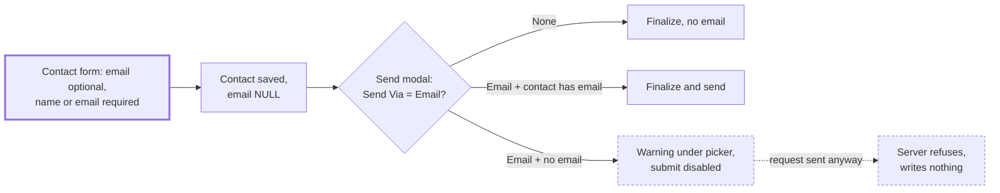

# Optional contact email

> Status: Approved
> Author: Aashu
> Date: 2026-11-03

## TLDR

- A supplier contact or a customer contact no longer needs an email.
- A contact still needs a first name, a last name or an email. It must have at least one of the three.
- An "Email" send with a contact that has no email shows a warning. The send is blocked. The user can pick "None" and still finalize.
- The server refuses the same send. Before this change, it sent only to the internal user and reported success.
- The CSV import follows the same rule.
- The database does not change. `contact.email` is already nullable.

## Overview diagram

## Problem Statement

A buyer cannot finalize a purchase order for a supplier whose contacts have no email. The contact form requires an email. Supplier lists from other systems often have contact names but no emails.

A PO still needs a contact. The Ramp integration reads the contact on the PO. So the contact must exist, but its email must be optional.

The database allows a NULL email since migration `20251224160904_contacts_simplifications.sql`. Only the shared form rule (`apps/erp/app/types/validators.ts:29-32`) blocks it.

Some send paths already assume an email exists. With no email, they send only to the internal user and report success. The sales invoice path also marks the invoice as sent. See the audit in `.ai/research/optional-contact-email.md`.

## Proposed Solution

1. Make `email` optional in the shared `contact` schema.
2. Require a first name, a last name or an email on each contact.
3. Show a warning in each send modal when the selected contact has no email.
4. Disable the modal's submit button while "Email" is selected and the contact has no email.
5. Make each server send path refuse a contact with no email before it writes anything.
6. Relax the CSV import in the same way.

### Design Decisions

| Decision | Choice | Rationale |
|----------|--------|-----------|
| Scope | Supplier contacts and customer contacts | User answer. Both validators spread the shared `contact` object, and the database allows NULL for both. |
| Email field shape | `zfd.text(z.string().email(...).optional())` | `zfd.text` turns `""` into `undefined`. The edit loaders send `""`, and a bare `.email()` rejects it. |
| Name rule | A `.refine` on `supplierContactValidator` and `customerContactValidator` that requires `firstName`, `lastName` or `email` | User answer. Without it, a contact shows as "Unknown" in every picker. |
| Where the name rule error shows | On the `firstName` field, with the message "Enter a name or an email" | `firstName` is the first field of the form. The user sees the error first. |
| Modal behavior with no email | Warning under the contact picker. Submit disabled while Send Via is "Email". | User answer. The user can switch Send Via to "None" or pick another contact. |
| Server behavior with no email | Refuse before any write, with a clear message | Defense in depth. It also fixes the false "sent" results in the audit (A1, A2). |
| Purchasing RFQ finalize | Warn per supplier row, but do not block. The server creates every quote and skips the email for a contact with no email. | One RFQ goes to many suppliers. One contact with no email must not block the others. The success message counts the emails sent. |
| PO release after approval (background) | Log a warning and skip the email | No user is present at that moment to see a message. The PO still releases, as it does today. |
| Ramp | No change | `resolveOrCreateRampSpendVendor` already returns `null` with no email. A PO still pushes without `vendor_id`. A bill is skipped, as the Ramp docs already say. |
| Contact picker label | Use `\|\|` in place of `??` for `fullName`, then `email`, then "Unknown" | `??` does not catch an empty string. |
| CSV import | Email optional. A row needs a name or an email. | User answer. Supplier lists without emails then import. |

## Data Model Changes

N/A. `contact.email` is already nullable (`20251224160904_contacts_simplifications.sql:5`). The partial unique index on email ignores NULL rows.

## API / Service Changes

| Path | File | Change |
|------|------|--------|
| Shared contact schema | `apps/erp/app/types/validators.ts:24` | Email becomes optional. Add a shared refine helper for the name rule. |
| Supplier contact validator | `purchasing.models.ts:418` | Apply the name rule. |
| Customer contact validator | `sales.models.ts:78` | Apply the name rule. |
| PO finalize | `purchasing.server.ts` (`finalizePurchaseOrderAndNotify`) | If the notification is "Email" and the contact has no email, return an error before the finalize. |
| PO approval with email | `purchasing.server.ts` (approval route action) | Same check before the approval writes. |
| PO release after approval | `purchasing.service.ts` (`releaseApprovedPurchaseOrder`) | Log a warning when it skips the email. |
| Supplier quote send | `purchasing.server.ts` (`sendSupplierQuoteToSupplier`) | Return an error when the contact has no email. |
| Quote finalize | `sales.server.ts`, `sales.service.ts` (`emailQuote`) | Return an error before the finalize. |
| Sales order confirm and quote-to-order | `shared.service.ts` (`sendSalesOrderEmail`), `sales.server.ts` | Return an error before the confirm. |
| Sales invoice post with email | `invoicing.service.ts` | Fail before the post. Reuse the `INVOICE_SEND_NO_EMAIL` wording. |
| CSV import | `imports.models.ts`, `shared.service.ts` (`isContactValid`) | Email optional. A row needs a name or an email. |

Use one shared check for "does this contact have an email". `isEmailableContact` in `packages/lib/src/party-contact.ts:66-68` already trims and tests the email. Reuse it.

## Closest Sibling

Rental agreement and contract "Post and Email" already refuse a contact with no email (`sales.service.ts:8563-8567`, `:9658-9662`). Their UI hides the email option when the contact has no email. This spec copies the refusal on the server. It shows a warning in the modal instead of hiding the option, per the user's answer.

## UI Changes

- **Contact forms** (`SupplierContactForm.tsx`, `CustomerContactForm.tsx`): the email field is optional. The name rule error shows on the first name field.
- **Contact pickers** (`Form/SupplierContact.tsx`, `Form/CustomerContact.tsx`): take a new optional prop that turns on the no-email warning. With the prop on, the picker shows "This contact has no email" under the field when the selected contact has no email. This includes the contact the modal selects by default.
- **Send modals**: turn on the warning. Disable the submit button while Send Via is "Email" and the contact has no email. The modals are:
  1. `PurchaseOrderFinalizeModal.tsx`
  2. `PurchaseOrderApprovalModal.tsx`
  3. `SupplierQuoteSendModal.tsx`
  4. `FinalizeRFQModal.tsx` (one picker per supplier row; warning only, the button stays enabled)
  5. `QuoteFinalizeModal.tsx`
  6. `QuoteToOrderDrawer.tsx`
  7. `SalesOrderHeader.tsx` (confirm modal)
  8. `SalesInvoicePostModal.tsx`
- All new copy uses Lingui (`t` or `<Trans>`).
- Page archetype: unchanged. These are existing modals.

## Acceptance Criteria

- [ ] A user creates a supplier contact with first name "Test" and no email. The save succeeds. The contact shows as "Test" in the supplier contact picker.
- [ ] A user tries to save a contact with no first name, no last name and no email. The form shows "Enter a name or an email" and does not save.
- [ ] A user edits a contact and clears its email. The save succeeds and `contact.email` is NULL.
- [ ] A user opens the PO finalize modal with a no-email contact and Send Via "Email". The modal shows "This contact has no email" and Finalize is disabled.
- [ ] In the same modal, the user switches Send Via to "None". Finalize is enabled. The PO finalizes with no email sent.
- [ ] A POST to the PO finalize action with "Email" and a no-email contact returns an error. The PO stays in its old status.
- [ ] The same warning, disabled submit and server refusal hold for the other 6 modals in UI Changes. The RFQ modal shows the warning only.
- [ ] A sales invoice post with "Email" and a no-email contact fails. The invoice does not get `sentAt`.
- [ ] A finalized PO with a no-email contact still pushes to Ramp, without `vendor_id` when no Ramp vendor matches.
- [ ] A supplier CSV import with a row that has a name and no email imports that contact.
- [ ] A supplier CSV import with a row that has no name and no email skips that row.
- [ ] All new user-facing copy is wrapped in Lingui.

## Risks

| Risk | Severity | Mitigation |
|------|----------|------------|
| A send path the audit missed still sends only to the internal user | Med | The audit covered 50 references. Each server path in the table gets the shared check. |
| The `.refine` changes the validator type from `ZodObject` to `ZodEffects` | Low | No caller uses `.extend`, `.omit` or `.shape` on the two validators. Callers use `z.infer`, which still works. |
| Old rows store `""` as the email | Low | The shared check trims and tests for an empty value. The pickers use `\|\|`. |
| Users expect "Email" to fall back to CC recipients only | Low | The warning text says what to do: pick another contact or choose "None". |

## Open Questions

- [x] Should email become optional for customer contacts too, or only for supplier contacts? — **Answer:** Both. One rule change, and the database already allows it for both.
- [x] If the email is blank, must a contact still have a name? — **Answer:** Yes. A contact needs a first name, a last name or an email.
- [x] What does a send modal do when the selected contact has no email and Send Via is "Email"? — **Answer:** Show a warning and block the email send. The user can choose "None" and still finalize, or pick another contact.
- [x] Should the CSV import also accept contacts with no email? — **Answer:** Yes, with the same name-or-email rule.

## Changelog

- 2026-11-03: Created
- 2026-11-03: Approved. Implemented on `feat/optional-contact-email`.
- 2026-11-03: RFQ finalize no longer blocks on a contact with no email. It warns, creates every quote and skips that email, as before this change.
