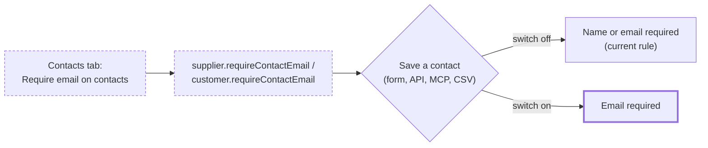

# Require email on contacts (per supplier and per customer)

> **Revised 2026-11-04:** the switch is now two company settings, not one per
> partner: `companySettings.requireSupplierContactEmail` (Settings → Purchasing)
> and `companySettings.requireCustomerContactEmail` (Settings → Sales), beside the
> existing contact-and-location rules. Where this document says "the supplier's
> switch", read "the company setting". The per-partner columns, the Contacts-tab
> switch and the `set*RequireContactEmail` operations were removed.

> Status: Approved
> Author: Aashu
> Date: 2026-11-03

## TLDR

- Each supplier and each customer gets a switch: **Require email on contacts**. It is off by default.
- When the switch is on, a contact of that supplier or customer cannot be saved without an email. This is the behavior before `2026-11-03-optional-contact-email.md`.
- The switch sits in the header of the Contacts tab, next to **Add**. It saves when it is toggled.
- Existing contacts are not changed when the switch is turned on. The rule applies the next time a contact is saved.
- The CSV contact import follows the switch.
- The send-email checks from the earlier spec do not change.

## Overview diagram



## Problem Statement

`2026-11-03-optional-contact-email.md` made the contact email optional for every supplier and customer. Some companies still want an email on every contact of some partners. For example, a company emails every purchase order to one supplier and wants that supplier's contact list to stay complete.

Today no setting brings the old rule back. The choice belongs to the supplier or customer, not to the whole company. One company can have a supplier whose list has no emails and another supplier where emails are mandatory.

## Proposed Solution

1. Add a boolean column `requireContactEmail` to `supplier` and to `customer`. The default is `false`.
2. Show a switch in the Contacts tab header of the supplier page and of the customer page.
3. When the switch is on, every save of a contact of that supplier or customer requires an email. This covers the contact form, the API, MCP and the CSV import.
4. The contact form shows the Email field as required when the switch is on.

### Design Decisions

| Decision | Choice | Rationale |
|----------|--------|-----------|
| Scope of the switch | One switch per supplier and one per customer | User answer. |
| Default | Off | User answer. The current optional-email behavior stays the default. |
| Placement | Contacts tab header, next to **Add**. It saves when it is toggled. | User answer. The rule applies to the list on that tab. |
| Existing contacts when the switch is turned on | Not changed. The rule applies on the next save of each contact. | User answer. Turning it on never fails. |
| CSV contact import | Follows the switch. A row without email for a partner with the switch on is an error row. | User answer. |
| Where the server enforces the rule | In the building blocks that write a contact: `insertSupplierContact`, `updateSupplierContact`, `insertCustomerContact`, `updateCustomerContact` | Every app writer goes through them: the routes, the `defineServiceFn` operations (API and MCP), and the invoice Stripe write-back. One check covers all of them. The CSV import writes through Kysely, so it gets its own check from the same rule. |
| Integration syncs | Not enforced. The Xero, QuickBooks Online, Rillet and Paperless Parts syncs write contacts directly and keep doing so. | They copy contacts from another system. A refusal there would stop the sync, and the user cannot fix the contact in Carbon first. |
| Column name | `requireContactEmail` on `supplier` and `customer` | It says what the switch decides. It matches the naming of `requireSupplierContactAndLocation` in `companySettings`. |
| Views | Not changed | The Contacts tab loader reads `requireContactEmail` from the base table, the only reader. Recreating the `suppliers` and `customers` views for one unused column was risk with no gain. |
| Who can change the switch | `update: purchasing` for a supplier, `update: sales` for a customer | The same permission as editing the supplier or customer record. |
| Send checks | No change | The send modals and server refusals already handle a contact with no email. |

## Data Model Changes

```sql
ALTER TABLE "supplier" ADD COLUMN "requireContactEmail" BOOLEAN NOT NULL DEFAULT false;
ALTER TABLE "customer" ADD COLUMN "requireContactEmail" BOOLEAN NOT NULL DEFAULT false;
```

No backfill. Every existing supplier and customer starts with the switch off. This matches the behavior after the earlier spec.

## API / Service Changes

| Path | Change |
|------|--------|
| `insertSupplierContact`, `updateSupplierContact` (`purchasing.service.ts`) | If the supplier's `requireContactEmail` is true and the email is blank, refuse with "This supplier requires an email on every contact." |
| `insertCustomerContact`, `updateCustomerContact` (`sales.service.ts`) | Same, with "This customer requires an email on every contact." |
| `insertSupplierContact`, `updateSupplierContact`, `insertCustomerContact`, `updateCustomerContact` operations (API and MCP) | The input no longer requires `email`. The earlier change missed these. The building blocks now apply the rule. |
| New operations `setSupplierRequireContactEmail` and `setCustomerRequireContactEmail` | Set the column for one supplier or customer. Gated by `update: purchasing` and `update: sales`. |
| CSV import (`importCsvTable`, contact branches) | Read the switch of each row's partner in one query. A row without an email for a partner with the switch on goes to `errors` with the same message. |
| The four contact routes (`$supplierId.contacts.new`, `$supplierId.contacts.$supplierContactId` and the customer pair) | Show the building block's refusal as a field error on `email`. |

## Closest Sibling

The company settings `requireSupplierContactAndLocation` and `requireCustomerContactAndLocation` (`packages/lib/src/party-contact.ts`). They are boolean "require" rules on contacts, checked at a document boundary. This switch is the same kind of rule, held on the partner and checked when a contact is saved.

## UI Changes

- **Supplier Contacts tab** (`SupplierContacts.tsx`): add a `Switch` labelled "Require email on contacts" to the card header, before **Add**. Toggling it posts to the new operation. Users without `update: purchasing` see it disabled.
- **Customer Contacts tab** (`CustomerContacts.tsx`): the same, with `update: sales`.
- **Contact forms** (`SupplierContactForm.tsx`, `CustomerContactForm.tsx`): take the switch value. When it is on, the Email field is required and has no "Optional" label. The form validator refuses a blank email.
- **Contact pickers** that create a contact inline (`Form/SupplierContact.tsx`, `Form/CustomerContact.tsx`) do not read the switch. The server refusal shows as an error on Email.
- All new copy uses Lingui.

## Acceptance Criteria

- [ ] A new supplier shows "Require email on contacts" off on its Contacts tab.
- [ ] With the switch off, a supplier contact with only a first name saves.
- [ ] A user turns the switch on. It stays on after a page reload.
- [ ] With the switch on, the contact form shows Email as required. Saving without an email shows an error on Email and saves nothing.
- [ ] With the switch on, an existing contact with no email still shows in the list. Editing it and saving without an email is refused.
- [ ] With the switch on, a call to the `insertSupplierContact` operation (API) without an email is refused.
- [ ] A supplier contact CSV import row without an email, for a supplier with the switch on, is reported as an error row. The other rows import.
- [ ] The same five checks pass for a customer.
- [ ] A user without `update: purchasing` cannot change a supplier's switch.

## Risks

| Risk | Severity | Mitigation |
|------|----------|------------|
| An app writer bypasses the building blocks | Med | The plan lists every write to `contact`. The CSV import gets its own check. The integration syncs are out of scope on purpose. |
| A user does not see why an old contact cannot be saved | Low | The error names the switch: "This supplier requires an email on every contact." |

## Open Questions

- [x] Where does the switch sit? — **Answer:** In the Contacts tab header, next to **Add**. It saves when it is toggled.
- [x] What happens if some contacts have no email when the switch is turned on? — **Answer:** The switch turns on. Existing contacts stay. The rule applies on each contact's next save.
- [x] Does the CSV contact import follow the switch? — **Answer:** Yes. A row without an email for such a partner is an error row.
- [x] One switch for both, or one per partner type? — **Answer:** One per supplier and one per customer.

## Changelog

- 2026-11-03: Created
- 2026-11-03: Approved and implemented. The views are not recreated. The API contact inputs no longer require an email.
