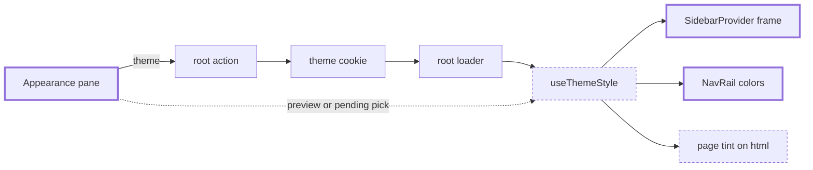

# Theme colors — solid and gradient colors for the app frame and page

> Status: in-progress
> Author: naveenkash
> Date: 2026-11-03

## TLDR

A user can color the frame of the ERP and the MES: the navigation rail and the
gutter around the content card. The user picks a solid theme, a gradient
theme, or a custom pair of colors with an optional gradient. The page takes a
tint of the frame's hue, so the page and the frame match. These are themes,
beside the 8 color themes: one choice, stored in the existing `theme` cookie.
A color theme renders exactly as it did before.

## Overview diagram

## Problem Statement

Carbon has 8 theme colors (`themes` in `packages/utils/src/themes.ts`). A theme
color sets the accent: buttons, the active item, focus rings. It does not
change the frame. Every company and every user therefore sees the same grey
frame. A user who works in 2 companies, or on 2 screens, cannot tell them
apart at a glance.

A reference team chat app solves this with themes that color the frame (see
`.ai/research/2026-11-03-theme-colors.md`). The user picks a frame color or a
gradient. The message pane stays neutral.

## Proposed Solution

### Model

A preset or custom theme has 3 values, its `colors`:

| Value | Meaning |
|-------|---------|
| `base` | The frame color. The reference app calls it "Background". |
| `highlight` | The color of the selected item in the rail. The reference app calls it "Selected items". |
| `gradient` | If true, the frame blends `base` into `highlight` towards the bottom right. |

A preset or custom theme is a theme. `Theme.colors` holds its 3 values, and the `theme`
cookie holds its name, as for every theme:

| `theme` cookie | Meaning |
|----------------|---------|
| `zinc`, `red`, … | A color theme. No `colors`: the frame looks as it does today. |
| `forge`, `graphite`, … | A preset theme from `presetThemes` (built from `THEME_PRESETS`). |
| `custom:7c2d12:ea580c:g` | A custom theme: `base`, `highlight`, then `g` (gradient) or `s` (solid). |

A theme with `colors` takes the default theme's (`zinc`) `cssVars`, with its
own accent: `themeAccent` sets `--primary`, `--primary-foreground` and
`--ring` from the highlight. Buttons and focus rings take the theme's color,
as with a color theme.
`isThemeName` is the one test of a stored name. An unknown or malformed value
reads as the default theme. So removing a preset never breaks a browser that
still holds its name.

### Presets

`THEME_PRESETS` in `packages/utils/src/theme-colors.ts` holds 16 presets in 2
groups.

| Group | Presets |
|-------|---------|
| Gradient | Forge, Anodized, Patina, Brass, Oxide, Aurora, Tidewater |
| Solid | Graphite, Plum, Ember, Jade, Lagoon, Cobalt, Garnet, Linen, Mist |

As the reference app's presets are, the picked colors are vivid mid-tones, each its own
hue, and a gradient's 2 colors contrast. Light mode shows them; dark mode
deepens them. Tidewater is the user's own reference pair (`#0071A4`, `#9BC339`).
Linen and Mist are light frames with dark text. The other presets carry
white text. A swatch shows the frame of the current mode.

### Colors in the frame

`themeStyle(theme)` returns 3 style objects and a tone. All are pure
functions of the 3 values, so the server and the browser render the same thing.

| Style | Applied to | Sets |
|-------|-----------|------|
| `frame` | `SidebarProvider` in the ERP and MES shells | `background`: `base`, or the gradient flow ("The gradient" below) |
| `rail` | the desktop `<nav>` of `NavRail` | `background: transparent`, `color: hsl(var(--foreground))`, and the rail's CSS variables (table below) |

The rail sets the existing theme variables again, inside the rail only:

| Variable | Value |
|----------|-------|
| `--foreground` | White or near-black, whichever has the better WCAG contrast against the frame |
| `--muted-foreground` | `--foreground` blended 35% towards `base` |
| `--active` | A translucent tile: the rail's text color at 14% opacity. If that costs the text its 4.5:1 contrast on a gradient end, black at 22% opacity. |
| `--active-foreground` | `--foreground` |
| `--accent`, `--card`, `--border`, `--input` | `--foreground` blended 8% to 18% over `base` |
| `--background` | `base` |

The rail sets `color` too. Text with no color class inherits its color from
`<body>`, and `<body>` resolves `--foreground` before the rail sets it again.

The rail's classes do not change. They read the same variables, so a rail
without `colors` renders as it does today. Popovers, tooltips and the
mobile drawer render in a portal, outside the rail. So they keep the normal
colors.

### The gradient

The first gradient was one straight sRGB line from `base` to a blend with
`highlight`. A blend in sRGB passes through grey between distant hues: blue to
lime went muddy olive. The reference app's gradient does 4 things that one line does not:

1. It blends in a perceptual color space, so blue to lime passes through teal.
2. It deepens and mutes the picked colors. The frame never shows them raw.
3. It moves over the whole window: a lift at the top, a glow at the far corner.
4. Its channel list flows too, from the top hue to the bottom hue.

`gradientFlow` (`theme-colors.ts`) builds 3 stops in OKLCH: OKLab read as
lightness, chroma and hue. A blend moves the hue the shorter way round the
wheel. A straight line through OKLab still crosses grey between opposite hues.
Round the wheel, red goes through plum to navy, as the reference app's gradient does.

The numbers come from pixels sampled in the user's reference screenshots
(2026-11-05), with the gradient on and off. The samples cover 2 pairs:
`#921D21` with `#36C5F0`, and `#228B07` with `#FF81AA`.

The reference app's frame depends on the mode. In light mode it keeps the picked colors,
muted: `#228B07` shows as `#448627`. The corners are the highlight at 93% of
its lightness: `#9E0B2E` shows as `#83252C`. `frameBase` keeps the picked
color at 80% chroma. It darkens the color only as far as the rail's labels
need for AA. The rail draws an unselected label at 70% opacity, so
`labelReadsOn` measures that label, not the full text color. The reference `#448627`
gives white text 4.4:1, so Carbon's diagonal is a deeper green (`#136300`).
Every frame color and gradient stop goes through `readableUnder`. If its
lightness steps run out, it moves the color towards black or white, so any
custom color reads at AA.

In dark mode the reference app never paints a picked frame color as it is. It deepens it
to OKLab lightness 0.336: `#921D21` shows as `#631A18`, and `#228B07` as `#223F18`.
The further a color moves, the more the reference app mutes it. `deepFrame` does the same
before anything else reads the frame color. A color already that deep stays
as it is. A light frame (Linen, Mist) keeps its own lightness, because the reference app
has no light frame to copy.

| Stop | Color |
|------|-------|
| `base` | The deepened frame color: the diagonal from the top-left to the bottom-right corner |
| `mid` | Halfway from `base` to `end`, at 60% chroma |
| `end`, dark mode | 80% from `base` to `highlight`, at 60% of the base's lightness and 35% chroma: the top-right and bottom-left corners |
| `end`, light mode | 95% from `base` to `highlight`, at 93% of the highlight's lightness and 74% chroma |
| `mid`, light mode | Halfway from `base` to `end`, no lighter than either, at 45% chroma |

`themeBackground` paints one gradient that mirrors round the diagonal,
as the reference app does: `linear-gradient(to top right, end 0%, mid 28%, base 50%, mid
72%, end 100%)`. With `to top right`, the 50% line passes through the top-left
and bottom-right corners. So on the frame:

| Edge | Runs |
|------|------|
| Rail (left) | `base` at the top to `end` at the bottom |
| Top | `base` at the left to `end` at the right |
| Right | `end` at the top to `base` at the bottom |
| Bottom | `end` at the left to `base` at the right |

With the gradient off, the frame is the flat `base`. With the base the reference app
paints, the flow matches the reference samples within a few RGB steps at every edge
point.

A gradient theme's module sidebar flows too. `--card-end` is the panel tint
in the hue of `end`, at the same lightness. The sidebar paints `--card` to
`--card-end` from top to bottom. The picker's swatch shows the same pattern.

The selected item in a dark sidebar follows the reference app too. The reference app paints `#FF81AA`
on a green frame as `#A52943`, and `#36C5F0` on a red frame as `#2F6EA8`.
`selectedOnDark` moves the highlight a fifth of the way towards the frame's
hue. Then it deepens the color until white text reads at 6:1. That gives
`#A73D32` and `#2960A4`. A light sidebar keeps the wash of the highlight: its
hover blend must carry the same text color.

`themeStyle` returns `frame` and `rail` per mode, as it does `content`
and `panel`. The rail's text is fixed by the picked color: dark on a light
frame (Linen, Mist), else white, as the reference app's rail always is. The frame moves to
suit the text, never the other way round.

Then every stop, `base` included, moves away from the text, 0.015 OKLab L at
a time, until the rail's label reads at AA (`readableUnder`). The label is the
text at 70% opacity, as the rail draws it. `base` moves only as far as that
needs, so the frame stays as close to the user's own color as AA allows.

`tone` is `dark` when the frame takes light text, else `light`. The rail picks
the company logo by `tone`, not by the mode. A dark frame in light mode needs
the logo made for a dark background.

### Colors in the page

`content` holds the page's surface and text variables, one set per mode:
`--background`, `--card`, `--popover`, `--secondary`, `--muted`, `--accent`,
`--active`, `--border`, `--input` and their `-foreground` pairs. Each one takes
the hue of `base`. Its saturation is a fixed fraction of the saturation of
`base`, so Graphite leaves the page almost neutral and Plum gives a clear plum
cast. Its lightness stays close to the default theme, so contrast stays the
same.

The root `Document` sets `content` on `<html>` after the theme's own
variables, so the tint wins. Dialogs, popovers and tooltips render in a portal
under `<body>`, so they take the tint too. `useThemeContent(mode)` sets
it only inside the signed-in app (`isAppPath`). Sign-in, shared links and
onboarding keep the plain theme.

`content` does not touch `--primary`, `--destructive`, `--success` or `--ring`.
The theme color and the status colors keep their meaning.

The page takes the lightest tint. The reference app's message pane is the calmest part of
the window, and Carbon's page holds dense tables and forms.

`panel` holds a stronger tint for the module sidebar (`CollapsibleSidebar`),
one set per mode. It sits between the frame and the page, as the reference app's channel
list does. It is pale with dark text in light mode, and deep with light text in
dark mode. The sidebar sets `panel` on its own element, as the rail does.

So a theme with `colors` has 3 layers, from strongest to lightest:

| Layer | Carbon element | Reference app element |
|-------|----------------|---------------|
| Frame | `SidebarProvider` and the rail | The window background and the workspace rail |
| Panel | The module sidebar | The channel list |
| Page | The content card, dialogs, popovers | The message pane |

`theme-colors.test.ts` holds every preset, in both modes, to 4.5:1 for
`--foreground` and `--muted-foreground` on each surface of the page and the
panel. It holds `--active-foreground` on `--active` to 4.5:1 too.

### Read and write

The flow is the theme's own flow. Nothing new reaches the server:

1. The Appearance pane posts `theme` to the host app's root action (`/`).
2. The root action validates it with `themeColorValidator` (`isThemeName`).
   Then it writes the `theme` cookie (`themeCookieWrites`).
3. The root loader returns `theme` (`getTheme`), which resolves a preset
   theme or a custom one like any theme. The save re-runs only the root loader
   (`ROOT_ACTION_SAVE`: `defaultShouldRevalidate: false`; each root's
   `rootShouldRevalidate` opts in, and a shell's own `shouldRevalidate` defers
   with `deferRootActionPost`).
4. `useThemeValue()` (`@carbon/react`) reads a preview first, then any pending
   `theme` pick, then the loader data. `useThemeStyle()` returns the styles of
   that theme's `colors`, or `null` for a color theme.
5. The ERP and MES shells apply `frame` and pass the style down with
   `ThemeStyleProvider`. `NavRail` reads it (`useShellThemeStyle`) and applies
   `rail`. The root `Document` applies `content`.

Because step 4 reads the pending pick, the app changes as soon as the user
clicks. A color drag uses the preview: `setThemePreview` paints each
pointer move without a save. The pane saves once, 400 ms after the last move
(`createTrailingCall`, `@carbon/utils`).
If the user closes the pane first, the pane saves the last color as it closes.

### Design Decisions

| Decision | Choice | Rationale |
|----------|--------|-----------|
| What `colors` paints | The frame (`SidebarProvider` and the desktop `NavRail`) in full color, and a tint of the frame's hue on the page. | The user asked for a page that matches the frame, not a plain black or white page (2026-11-03). A tint, not the full color, keeps dense tables and forms readable. A test holds the page text at AA. |
| A second setting or a theme | A kind of theme, beside the color themes. One choice, one `theme` cookie. | The user asked for one setting, so the app manages one cookie and one resolver (2026-11-05). The cost: a user can no longer combine a color theme's accent with a colored frame. |
| Where the choice is stored | The `theme` cookie, per browser. | Every theme is a per-browser cookie on the host app (`packages/account/AGENTS.md`). A new column is a schema change, which `AGENTS.md` puts in Ask First. |
| The accent of a theme with `colors` | The highlight, from `themeAccent`. A button takes white text when white has 2.5:1 or more on the highlight, else dark text. The fill then moves only until its text reads at AA and the fill stands out from the page at 3:1. | The user asked for buttons in the theme's color, as with a color theme (2026-11-10). It replaced a neutral `zinc` accent. The color themes also use white text on all but the lightest colors. A test holds every preset and 400 custom themes to both ratios. |
| The avatar menu and the mobile profile sheet | They list no themes. Their Appearance item opens Account → Appearance. | 24 themes crowd a compact menu, and one picker keeps one place to learn (2026-11-05). |
| Light mode and dark mode | One preset per theme, painted per mode: light mode keeps the picked color, muted; dark mode deepens it (`deepFrame`). | The reference app does this (measured 2026-11-05, see the Changelog). One color per preset halves the preset data. |
| Text color in the frame | Computed by WCAG contrast, never stored. | A custom color can be light or dark. A stored text color could go stale when the user edits the frame color. |
| Status colors | Not customizable. | `success` and `destructive` carry meaning across Carbon (research finding 3). |
| Animated mesh gradient | Not used. Gradients are static CSS. | A WebGL shader behind every page costs GPU and battery all day. The mesh stays on onboarding. |
| Where the colors apply | Through the existing CSS variables, not new Tailwind tokens: on the rail for the rail, on `<html>` for the page. | No class changes, so the default app cannot drift. The page variables sit on `<html>`, so portals match the page. |
| Rail hover and selected item | A translucent tile of the rail's text color, not the highlight. The hover is the same tile at 60%. | The reference app's rail does this. A solid highlight tile sat badly on a gradient frame. A tile works on any frame. |
| Where the highlight shows | The module sidebar's selected item: a 45% wash of `highlight` over the panel. | The reference app puts "Selected items" on the channel list. A full-strength fill failed AA on its 60% hover blend for most presets. The wash keeps the text at 4.5:1 on both. |
| The module sidebar | A `panel` tint, stronger than the page and lighter than the frame. | The user's reference screenshots (2026-11-03): the channel list is a tinted panel between the frame and a calm message pane. 3 layers read as one theme. |
| The company logo in the rail | Picked by the frame's `tone`, not by the mode. | The logo sits on the frame. A dark frame in light mode would show the logo made for a light background. |
| Preview | A click: the pending `theme` submission, from any fetcher. A color drag: `setThemePreview`, a store that `useThemeValue` reads first. | Each save is a request and re-runs the root loader. Before the root-only save, a drag that saved every 150 ms ran about 20 full revalidations in 3 seconds. |
| Custom color pickers | `ColorPicker` (`@carbon/react`). The pane saves once, 400 ms after the last change, and on close. | An existing component. One save per drag. |
| Accent preview of a theme with `colors` | `useThemePreview` skips the variables that `content` sets. | The accent preview paints `<body>`, which outranks `<html>`. Without the skip, the tint drops while the preview shows. |
| Apps | ERP and MES. The starter hides the section. | The ERP and the MES shells both use `NavRail` inside `SidebarProvider`. The starter's shell has no rail. |
| Where the presets live | `packages/utils/src/theme-colors.ts`, beside `themes.ts` and `ui-scale.ts`. | Server code (root loaders) and browser code (`@carbon/react`, `@carbon/account`) both read them. |
| Preset labels | Plain strings, not translated. | The theme color labels ("Modern", "Cherry") are not translated either. They are names. |
| Heuristic 1, multi-tenancy | N/A. No table. | The cookie holds a display preference of one browser. It holds no company data. |
| Heuristic 2, service shape | N/A. No service function. | The root action writes a cookie, as it does for text size. |
| Heuristic 3, RLS | N/A. No table. | No data reaches the database. |
| Heuristic 4, permissions | N/A. | Every signed-in user can change their own appearance. The root action has no permission check for mode or text size. |
| Heuristic 5, form pattern | A fetcher posts to `/`, as the rest of the Appearance pane does. | The pane has no form to submit. Each control saves on change. |
| Heuristic 6, module layout | N/A. No ERP module. | The code lives in shared packages and the app roots. |
| Heuristic 7, backward compatibility | No frozen surface changes. With no cookie, every app renders as before. | The rail variables apply only when the theme has `colors`. |

## Data Model Changes

N/A. The feature adds no table and no column. It stores the choice in a
cookie.

## API / Service Changes

| Place | Change |
|-------|--------|
| `packages/utils/src/theme-colors.ts` (new) | `THEME_PRESETS`, `parseThemeColors`, `serializeThemeColors`, `themeStyle`, `themeTextColors`, `themeSwatch`, `themeMesh`, `randomThemeColors`. Color math only, no cookies. |
| `packages/utils/src/themes.ts` | `Theme` gets `colors?`. New `presetThemes` and `isThemeName`. `storedTheme` and `themeByName` resolve preset themes and `custom:` names. |
| `packages/utils/src/types.ts` | `themeColorValidator` accepts every `isThemeName`. |
| `packages/utils/src/theme-colors.test.ts` (new) | Parsing, round trips, contrast choices, style output, preset themes read from the `theme` cookie |
| `packages/react/src/hooks/useThemeStyle.tsx` (new) | `useThemeValue`, `useThemeStyle`, `useThemeContent`, `setThemePreview`, `ThemeStyleProvider`, `useShellThemeStyle` |
| `packages/utils/src/revalidate.ts` | `ROOT_ACTION_SAVE`, `rootShouldRevalidate`, `deferRootActionPost` |
| `packages/utils/src/trailing-call.ts` (new) | `createTrailingCall`: the color drag's one save after the pointer rests |
| `packages/react/src/NavRail.tsx` | Applies `rail` to the desktop `<nav>` |
| ERP and MES `root.tsx` | `Document` sets `content` on `<html>`. The loader and the action are the theme's own. |
| ERP and MES `routes/x+/_layout.tsx` | Applies `frame` to `SidebarProvider` and provides the style (`ThemeStyleProvider`) |

## Closest Sibling

The color themes (`themes.ts`): a preset or custom theme is one more kind of theme. It
uses the theme cookie, the theme validator, the theme resolvers and the root
action's theme branch with no copy. The preview copies text size and density
(`useUiScale` reads a pending pick first).

Deviation: a color theme styles `<html>` only. A theme with `colors` also styles 3
elements of the shell (the frame, the rail, the module sidebar), because the
frame takes the full color. That deviation is the "What `colors` paints"
decision.

## UI Changes

Archetype: a settings pane section (`AccountSettingsSection` in
`packages/account/src/ui/AppearanceSettings.tsx`), `ThemeSettings`. It
replaces the "Theme color" section.

1. Section "Theme". Description: "A color sets the accent. Gradient and solid
   themes also color the navigation, the sidebar and the page."
2. 2 tabs in the section header, beside the title, as the reference app does: "Themes"
   and "Custom theme". The tabs keep the pane short. The section opens on
   "Custom theme" when a custom theme is in use, else on "Themes".
3. Tab "Themes" holds 3 groups in a 2-column grid (4 columns from `sm`). Each
   card has a round swatch and the theme name. The selected card has the
   primary border.
   1. "Color": the 8 color themes (`pickableThemes`, the seasonal theme first
      while in season).
   2. "Gradient": 7 cards. The swatch shows the gradient flow.
   3. "Solid": 9 cards. The swatch is one flat circle of the frame color. A
      circle split into 2 halves read as a two-tone frame.
4. Tab "Custom theme" holds the custom theme editor. It has no card of its
   own: an edit, the gradient switch or "Surprise me" makes the custom theme
   the one in use.
   1. A "Surprise me" button: it picks a random dark base and a lighter
      highlight of a nearby hue.
   2. 2 `ColorPicker` fields: "Background" and "Selected items".
   3. A `Switch`: "Gradient", with the hint "Blend the
      background into the selected items color."
5. If the user selects a preset theme, the custom fields show its colors. An
   edit turns them into a custom theme.

`AccountSettingsConfig` gets `themePresets?: boolean`. The ERP and the MES set
it. The starter does not, so its section has no tabs and lists the color themes
only.

## Acceptance Criteria

- [ ] With a color theme, the ERP and MES shells render with the same classes
      and styles as before. The rail `<nav>` has no `style`.
- [ ] A user picks "Plum". The `theme` cookie holds `plum`. No other cookie
      changes.
- [ ] A user picks "Plum" in Account → Appearance. The frame and the rail turn
      plum at once, before the save returns. The page, the tables and the
      dialogs take a plum tint in light mode and in dark mode.
- [ ] Every preset keeps the page text at a WCAG contrast of at least 4.5:1 in
      both modes (`theme-colors.test.ts`).
- [ ] A user drags a custom color for 3 seconds. The frame follows the pointer.
      The browser sends 1 save after the drag, not 1 per move.
- [ ] The sign-in page shows no tint for a browser that holds a preset theme.
- [ ] A user picks "Tidewater" on a module page. The module sidebar is a pale
      blue-green panel in light mode and a deep blue-green panel in dark mode.
      The page is almost white or almost black.
- [ ] After a reload, the frame is still plum. The server renders it, so the
      page shows no flash of the grey frame.
- [ ] A user picks "Forge". The frame shows a gradient from dark orange to a
      lighter orange towards the bottom right.
- [ ] A user picks "Linen". The rail text is dark and has a WCAG contrast of at
      least 4.5:1 against the frame.
- [ ] A user sets custom colors `#DC540C` and `#F89B6C` with "Gradient"
      on. The `theme` cookie holds `custom:dc540c:f89b6c:g`. The frame shows the gradient.
- [ ] The selected rail item is a translucent tile. Its text contrast is at
      least 4.5:1 on every preset.
- [ ] The selected module sidebar item takes the highlight's hue. Its text
      contrast is at least 4.5:1, selected and under the pointer.
- [ ] The CompanySwitcher dropdown and the rail tooltips keep the normal
      popover colors.
- [ ] A user picks "Modern". The `theme` cookie holds `zinc`. The frame is grey again.
- [ ] The root action refuses `theme=custom:zzz` with status 400.
- [ ] The starter's Appearance pane shows no "Custom theme" tab.
- [ ] The MES shows the same frame as the ERP for the same cookie.

## Risks

| Risk | Severity | Mitigation |
|------|----------|------------|
| A custom pair gives low contrast on a selected or hovered item | Low | `themeStyle` picks the rail tile and the panel text for contrast on the fill and on the 60% hover blend. The user chose the colors and sees the result at once. |
| A shell element inside the rail sets a hard-coded color (`text-white`, `bg-zinc-…`) | Low | Check the ERP and MES rails in the browser with a light and a dark preset. |
| The cookie value carries CSS into a style attribute | High | `parseThemeColors` accepts only a known preset name or `custom:` + 2 six-digit hex codes + `g`/`s`. Every other value reads as the default. Unit tests pin this. |
| A frame color makes the content card's edge hard to see | Low | The card keeps its border and `shadow-md`. |
| The page tint lowers the contrast of page text | Med | The tint keeps the default lightness. A test holds every preset at 4.5:1 in both modes. |
| A custom color gives a strong tint | Low | The tint takes a fraction of the color's saturation, and the user sees the result at once. |

## Open Questions

> HARD STOP: Do not proceed with implementation until these are answered.

The user asked for an autonomous run ("take best decision, don't stop to wait
for me"). So the agent decided each question below: first by codebase
precedent, then by the research, then by the recommended answer.

- [x] Is the choice per browser or per user? — **Autonomous:** per browser, a
      cookie. Every other appearance setting is a per-browser cookie. A per-user
      column is a schema change, which is Ask First.
- [x] Does the top bar inside the content card take the frame color, as the reference app's
      search bar does? — **Autonomous:** no. The top bar is inside the card, and
      the card stays neutral. Moving the top bar out of the card is a layout
      change outside this feature.
- [x] Does the MES get the feature, or only the ERP? — **Autonomous:** both. The
      Appearance pane is shared, and the 2 shells have the same structure. A
      setting that shows in the MES pane and does nothing there would be a bug.
- [x] Does the mobile drawer take the frame color? — **Autonomous:** no. It is
      a sheet over the page, like a popover. Below `md` the content card fills
      the screen, so the frame does not show.
- [x] Do the presets include the reference app's "Vision assistive" group? —
      **Autonomous:** no, not in v1. The reference app's assistive presets change status
      colors, which Carbon keeps fixed. Every preset meets 4.5:1 text contrast
      already.
- [x] Are frame colors a second setting, or a kind of theme? — **User:** a
      kind of theme, in the `theme` cookie, "so we don't manage different
      cookies or variables" (2026-11-05). It replaces the autonomous first
      decision, a separate cookie.
- [x] Does the page take the theme's `colors`, or only the frame? —
      **User:** the page too. The user asked for the page background and text
      to match the theme, not to show plain black. The agent first decided
      "frame only" from the reference app's model. The user's answer replaces it.
- [x] Do the reference app's "Share" and "Import" buttons come in v1? — **Autonomous:** no.
      The custom value is a short cookie string. "Surprise me" is in v1
      because it needs no new surface.

## Changelog

- 2026-11-05: The frame carries the rail's 70% labels at AA, not only the
  full text color. Light-mode frames are deeper than the reference samples as a
  result; dark mode does not change. A seeded test covers 400 custom themes.
- 2026-11-05: The code and the copy say "theme", never "window theme".
  `Theme.window` is `Theme.colors`, `WINDOW_THEMES` is `THEME_PRESETS`,
  `windowThemes` is `presetThemes`, and `window-themes.ts` is
  `theme-colors.ts`. The custom fields read "Background" and "Gradient".
- 2026-11-05: The avatar menus list no themes. Appearance opens Account →
  Appearance. A theme save re-runs only the root loader.
- 2026-11-05: Light mode keeps the picked frame colors, as the reference app does; only
  dark mode deepens them. The presets are vivid mid-tones, so they differ in
  the picker. The Custom tab has no card.
- 2026-11-05: Fitted to pixels sampled from the user's reference screenshots. The
  base runs along the top-left to bottom-right diagonal, and the end fills the
  other 2 corners. The frame color deepens to the reference depth. A dark sidebar's
  selected item is the deepened highlight.
- 2026-11-05: The gradient follows pixels sampled from the user's reference
  screenshots. It runs from the base to a deep, muted end in the highlight's
  hue. The bottom-left bloom and the top-right lift are gone.
- 2026-11-05: The bloom comes from the bottom-left corner and the base fills
  the top right, as in the reference app. Blends go round the hue wheel (OKLCH), so
  opposite hues pass through violet, not grey. The bloom is a touch darker
  than the base.
- 2026-11-05: The Theme section splits into 2 tabs, "Themes" and "Custom
  theme", so the pane does not run long.
- 2026-11-05: The gradient flows as the reference app's does: 4 OKLab stops, deepened and
  muted, in 3 layers; the module sidebar flows too. Every stop holds the text
  at AA.
- 2026-11-05: A solid theme's swatch is the flat frame color, not a split
  circle.
- 2026-11-05: Preset and custom themes are themes. The separate cookie, its
  validator, its root action branch and its loader field are gone. One
  "Theme" section lists color, gradient, solid and custom themes.
- 2026-11-03: The rail's hover and selected item are a translucent tile, as in
  the reference app's rail. The highlight moves to the module sidebar's selected item.
- 2026-11-03: The module sidebar takes a `panel` tint, and the page tint is
  lighter, to match the 3 layers of the user's reference screenshots. New gradient
  preset Tidewater, close to the user's reference theme.
- 2026-11-03: The page takes a tint of the frame's hue, on the user's request.
  Review fixes: the rail logo follows the frame's tone, a color drag saves once,
  and closing the pane mid-drag saves the last color.
- 2026-11-03: Implemented on the branch. The AA test in
  `theme-colors.test.ts` made 7 preset highlights darker. The browser check
  covered the ERP and the MES in light and dark mode. It also covered a
  gradient, a light frame, a custom theme, Default, a reload and a phone.
- 2026-11-03: Created. Autonomous run; the 6 resolutions above are assumed
  decisions for review at the PR.
