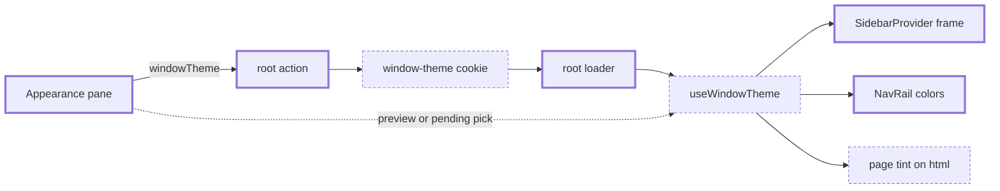

# Window themes — solid and gradient colors for the app frame and page

> Status: in-progress
> Author: naveenkash
> Date: 2026-11-03

## TLDR

A user can color the frame of the ERP and the MES: the navigation rail and the
gutter around the content card. The user picks a solid preset, a gradient
preset, or a custom pair of colors with an optional gradient. The page takes a
tint of the frame's hue, so the page and the frame match. The choice is a per-browser cookie
(`window-theme`), the same as mode, theme color, text size and density. With no
cookie, the app looks exactly as it does today.

## Overview diagram

## Problem Statement

Carbon has 8 theme colors (`themes` in `packages/utils/src/themes.ts`). A theme
color sets the accent: buttons, the active item, focus rings. It does not
change the frame. Every company and every user therefore sees the same grey
frame. A user who works in 2 companies, or on 2 screens, cannot tell them
apart at a glance.

Slack solves this with window themes (see
`.ai/research/2026-11-03-window-themes.md`). The user picks a frame color or a
gradient. The message pane stays neutral.

## Proposed Solution

### Model

A window theme has 3 values:

| Value | Meaning |
|-------|---------|
| `base` | The frame color. Slack calls it "Window background". |
| `highlight` | The color of the selected item in the rail. Slack calls it "Selected items". |
| `gradient` | If true, the frame blends `base` into `highlight` towards the bottom right. |

A window theme is a preset name or a custom value. The cookie holds one of:

| Cookie value | Meaning |
|--------------|---------|
| no cookie | Default. The frame looks as it does today. |
| `forge`, `graphite`, … | A preset from `WINDOW_THEMES`. |
| `custom:7c2d12:ea580c:g` | A custom theme: `base`, `highlight`, then `g` (gradient) or `s` (solid). |

An unknown or malformed value reads as the default. So removing a preset never
breaks a browser that still holds its name.

### Presets

`WINDOW_THEMES` in `packages/utils/src/window-themes.ts` holds 16 presets in 2
groups.

| Group | Presets |
|-------|---------|
| Gradient | Forge, Anodized, Patina, Brass, Oxide, Aurora, Tidewater |
| Solid | Graphite, Plum, Ember, Jade, Lagoon, Cobalt, Garnet, Linen, Mist |

Linen and Mist are light frames with dark text. The other presets are dark
frames with light text.

### Colors in the frame

`windowThemeStyle(theme)` returns 3 style objects and a tone. All are pure
functions of the 3 values, so the server and the browser render the same thing.

| Style | Applied to | Sets |
|-------|-----------|------|
| `frame` | `SidebarProvider` in the ERP and MES shells | `background`: `base`, or a linear gradient from `base` to a blend of `base` and `highlight` |
| `rail` | the desktop `<nav>` of `NavRail` | `background: transparent`, `color: hsl(var(--foreground))`, and the rail's CSS variables (table below) |

The rail sets the existing theme variables again, inside the rail only:

| Variable | Value |
|----------|-------|
| `--foreground` | White or near-black, whichever has the better WCAG contrast against the frame |
| `--muted-foreground` | `--foreground` blended 35% towards `base` |
| `--active` | A translucent tile: the rail's text color at 14% opacity. If that costs the text its 4.5:1 contrast on a gradient end, black at 22% opacity. |
| `--active-foreground` | `--foreground` |
| `--accent`, `--card`, `--border`, `--input` | `--foreground` blended 8% to 18% over `base` |
| `--background` | `base` |

The rail sets `color` too. Text with no color class inherits its color from
`<body>`, and `<body>` resolves `--foreground` before the rail sets it again.

The rail's classes do not change. They read the same variables, so a rail
without a window theme renders as it does today. Popovers, tooltips and the
mobile drawer render in a portal, outside the rail. So they keep the normal
colors.

For a gradient, `windowThemeStyle` checks the text color against both ends of
the gradient. It takes the color whose lower contrast is higher.

`tone` is `dark` when the frame takes light text, else `light`. The rail picks
the company logo by `tone`, not by the mode. A dark frame in light mode needs
the logo made for a dark background.

### Colors in the page

`content` holds the page's surface and text variables, one set per mode:
`--background`, `--card`, `--popover`, `--secondary`, `--muted`, `--accent`,
`--active`, `--border`, `--input` and their `-foreground` pairs. Each one takes
the hue of `base`. Its saturation is a fixed fraction of the saturation of
`base`, so Graphite leaves the page almost neutral and Plum gives a clear plum
cast. Its lightness stays close to the default theme, so contrast stays the
same.

The root `Document` sets `content` on `<html>` after the theme's own
variables, so the tint wins. Dialogs, popovers and tooltips render in a portal
under `<body>`, so they take the tint too. `useWindowThemeContent(mode)` sets
it only inside the signed-in app (`isAppPath`). Sign-in, shared links and
onboarding keep the plain theme.

`content` does not touch `--primary`, `--destructive`, `--success` or `--ring`.
The theme color and the status colors keep their meaning.

The page takes the lightest tint. Slack's message pane is the calmest part of
the window, and Carbon's page holds dense tables and forms.

`panel` holds a stronger tint for the module sidebar (`CollapsibleSidebar`),
one set per mode. It sits between the frame and the page, as Slack's channel
list does. It is pale with dark text in light mode, and deep with light text in
dark mode. The sidebar sets `panel` on its own element, as the rail does.

So a window theme has 3 layers, from strongest to lightest:

| Layer | Carbon element | Slack element |
|-------|----------------|---------------|
| Frame | `SidebarProvider` and the rail | The window background and the workspace rail |
| Panel | The module sidebar | The channel list |
| Page | The content card, dialogs, popovers | The message pane |

`window-themes.test.ts` holds every preset, in both modes, to 4.5:1 for
`--foreground` and `--muted-foreground` on each surface of the page and the
panel. It holds `--active-foreground` on `--active` to 4.5:1 too.

### Read and write

The flow copies text size and density (`packages/utils/src/ui-scale.ts`):

1. The Appearance pane posts `windowTheme` to the host app's root action (`/`).
2. The root action validates it with `windowThemeValidator`. Then it writes the
   `window-theme` cookie. `default` deletes the cookie.
3. The root loader returns `windowTheme` from the cookie.
4. `useWindowTheme()` (`@carbon/react`) reads a preview first, then a pending
   pick, then the loader data. It returns the styles, or `null` for the default.
5. `NavRail` applies `rail`. The ERP and MES shells apply `frame`. The root
   `Document` applies `content`.

Because step 4 reads the pending pick, the app changes as soon as the user
clicks. A color drag uses the preview: `setWindowThemePreview` paints each
pointer move without a save. The pane saves once, 400 ms after the last move.
If the user closes the pane first, the pane saves the last color as it closes.

### Design Decisions

| Decision | Choice | Rationale |
|----------|--------|-----------|
| What a window theme colors | The frame (`SidebarProvider` and the desktop `NavRail`) in full color, and a tint of the frame's hue on the page. | The user asked for a page that matches the frame, not a plain black or white page (2026-11-03). A tint, not the full color, keeps dense tables and forms readable. A test holds the page text at AA. |
| Window theme or theme color | A second, separate setting. | A theme color sets the accent; a window theme sets the frame. A user can combine Mint accents with a Plum frame. Adding gradients to `themes` would mix the 2. |
| Where the choice is stored | The `window-theme` cookie, per browser. | Mode, theme color, text size and density are all per-browser cookies on the host app (`packages/account/AGENTS.md`). A new column is a schema change, which `AGENTS.md` puts in Ask First. |
| Cookie name | A new name, `window-theme`. | `.ai/lessons.md` → "A cookie that was only ever written is not a stored preference". |
| Light mode and dark mode | The same frame colors in both modes. | Slack does this (research finding 4). It halves the preset data, and a dark frame around a white card is the look users know from Slack. |
| Text color in the frame | Computed by WCAG contrast, never stored. | A custom color can be light or dark. A stored text color could go stale when the user edits the frame color. |
| Status colors | Not customizable. | `success` and `destructive` carry meaning across Carbon (research finding 3). |
| Animated mesh gradient | Not used. Gradients are static CSS. | A WebGL shader behind every page costs GPU and battery all day. The mesh stays on onboarding. |
| Where the colors apply | Through the existing CSS variables, not new Tailwind tokens: on the rail for the rail, on `<html>` for the page. | No class changes, so the default app cannot drift. The page variables sit on `<html>`, so portals match the page. |
| Rail hover and selected item | A translucent tile of the rail's text color, not the highlight. The hover is the same tile at 60%. | Slack's rail does this. A solid highlight tile sat badly on a gradient frame. A tile works on any frame. |
| Where the highlight shows | The module sidebar's selected item: a 45% wash of `highlight` over the panel. | Slack puts "Selected items" on the channel list. A full-strength fill failed AA on its 60% hover blend for most presets. The wash keeps the text at 4.5:1 on both. |
| The module sidebar | A `panel` tint, stronger than the page and lighter than the frame. | The user's Slack screenshots (2026-11-03): the channel list is a tinted panel between the frame and a calm message pane. 3 layers read as one theme. |
| The company logo in the rail | Picked by the frame's `tone`, not by the mode. | The logo sits on the frame. A dark frame in light mode would show the logo made for a light background. |
| Preview | A click: the pending fetcher submission, as `useUiScale` does. A color drag: `setWindowThemePreview`, a store that `useWindowThemeValue` reads first. | Each save revalidates every loader on the page. A drag that saved every 150 ms ran about 20 full revalidations in 3 seconds. |
| Custom color pickers | `ColorPicker` (`@carbon/react`). The pane saves once, 400 ms after the last change, and on close. | An existing component. One save per drag. |
| Theme color preview with a window theme | `useThemePreview` skips the variables that `content` sets. | The theme color preview paints `<body>`, which outranks `<html>`. Without the skip, the tint drops while the preview shows. |
| Apps | ERP and MES. The starter hides the section. | The ERP and the MES shells both use `NavRail` inside `SidebarProvider`. The starter's shell has no rail. |
| Where the presets live | `packages/utils/src/window-themes.ts`, beside `themes.ts` and `ui-scale.ts`. | Server code (root loaders) and browser code (`@carbon/react`, `@carbon/account`) both read them. |
| Preset labels | Plain strings, not translated. | The theme color labels ("Modern", "Cherry") are not translated either. They are names. |
| Heuristic 1, multi-tenancy | N/A. No table. | The cookie holds a display preference of one browser. It holds no company data. |
| Heuristic 2, service shape | N/A. No service function. | The root action writes a cookie, as it does for text size. |
| Heuristic 3, RLS | N/A. No table. | No data reaches the database. |
| Heuristic 4, permissions | N/A. | Every signed-in user can change their own appearance. The root action has no permission check for mode or text size. |
| Heuristic 5, form pattern | A fetcher posts to `/`, as the rest of the Appearance pane does. | The pane has no form to submit. Each control saves on change. |
| Heuristic 6, module layout | N/A. No ERP module. | The code lives in shared packages and the app roots. |
| Heuristic 7, backward compatibility | No frozen surface changes. With no cookie, every app renders as before. | The rail variables apply only when a window theme is set. |

## Data Model Changes

N/A. The feature adds no table and no column. It stores the choice in a
cookie.

## API / Service Changes

| Place | Change |
|-------|--------|
| `packages/utils/src/window-themes.ts` (new) | `WINDOW_THEMES`, `WINDOW_THEME_COOKIE`, `windowThemeValidator`, `parseWindowTheme`, `serializeWindowTheme`, `getWindowThemeFromCookies`, `windowThemeStyle`, `windowThemeTextColors`, `windowThemeSwatch`, `randomWindowTheme` |
| `packages/utils/src/window-themes.test.ts` (new) | Parsing, round trips, contrast choices, style output |
| `packages/react/src/hooks/useWindowTheme.tsx` (new) | `useWindowTheme`, `useWindowThemeValue`, `useWindowThemeContent`, `setWindowThemePreview` |
| `packages/react/src/NavRail.tsx` | Applies `rail` to the desktop `<nav>` |
| ERP and MES `services/mode.server.ts` | `getWindowTheme(request)`, `setWindowTheme(value)` |
| ERP and MES `root.tsx` | The loader returns `windowTheme`. The action handles the `windowTheme` field. `Document` sets `content` on `<html>`. |
| ERP and MES `routes/x+/_layout.tsx` | Applies `frame` to `SidebarProvider` |

## Closest Sibling

Text size and density, the newest per-browser appearance setting:

| Sibling file | This feature's copy |
|--------------|---------------------|
| `packages/utils/src/ui-scale.ts` | `packages/utils/src/window-themes.ts` |
| `packages/react/src/hooks/useUiScale.tsx` | `packages/react/src/hooks/useWindowTheme.tsx` |
| `getUiScale` / `setUiScale` in `services/mode.server.ts` | `getWindowTheme` / `setWindowTheme` in the same file |
| The `textSize` branch of each root action | A `windowTheme` branch |
| The "Text size" section of `AppearanceSettings` | A "Window theme" section |

Deviation: text size styles `<html>` only. A window theme styles `<html>` for
the page tint. It also styles 2 elements of the shell, because the frame takes
the full color. That deviation is the "What a
window theme colors" decision.

## UI Changes

Archetype: a settings pane section (`AccountSettingsSection` in
`packages/account/src/ui/AppearanceSettings.tsx`), under "Theme color".

1. Section "Window theme". Description: "Colors the navigation and the frame
   around each page."
2. A first row with 2 cards:
   1. "Default". Its swatch is a fixed dark and light split: the plain app.
   2. "Custom". Its swatch shows the custom colors. A click saves the colors
      that the custom fields show.
3. Group "Gradient": 7 preset cards in a 2-column grid (3 columns from `sm`).
   Each card has a round swatch and the preset name. The selected card has the
   primary border, as in the "Theme color" grid.
4. Group "Solid": 9 preset cards, same grid.
5. Group "Custom":
   1. 2 `ColorPicker` fields: "Window background" and "Selected items".
   2. A `Switch`: "Window gradient", with the hint "Blend the window
      background into the selected items color."
   3. A "Surprise me" button: it picks a random dark base and a lighter
      highlight of the same hue.
6. If the user selects a preset, the custom fields show its colors. An edit turns
   them into a custom theme.

`AccountSettingsConfig` gets `windowTheme?: boolean`. The ERP and the MES set
it. The starter does not, so the section does not show there.

## Acceptance Criteria

- [ ] With no `window-theme` cookie, the ERP and MES shells render with the
      same classes and styles as before. The rail `<nav>` has no `style`.
- [ ] A user picks "Plum" in Account → Appearance. The frame and the rail turn
      plum at once, before the save returns. The page, the tables and the
      dialogs take a plum tint in light mode and in dark mode.
- [ ] Every preset keeps the page text at a WCAG contrast of at least 4.5:1 in
      both modes (`window-themes.test.ts`).
- [ ] A user drags a custom color for 3 seconds. The frame follows the pointer.
      The browser sends 1 save after the drag, not 1 per move.
- [ ] The sign-in page shows no tint for a browser that holds a window theme.
- [ ] A user picks "Tidewater" on a module page. The module sidebar is a pale
      blue-green panel in light mode and a deep blue-green panel in dark mode.
      The page is almost white or almost black.
- [ ] After a reload, the frame is still plum. The server renders it, so the
      page shows no flash of the grey frame.
- [ ] A user picks "Forge". The frame shows a gradient from dark orange to a
      lighter orange towards the bottom right.
- [ ] A user picks "Linen". The rail text is dark and has a WCAG contrast of at
      least 4.5:1 against the frame.
- [ ] A user sets custom colors `#DC540C` and `#F89B6C` with "Window gradient"
      on. The cookie holds `custom:dc540c:f89b6c:g`. The frame shows the gradient.
- [ ] The selected rail item is a translucent tile. Its text contrast is at
      least 4.5:1 on every preset.
- [ ] The selected module sidebar item takes the highlight's hue. Its text
      contrast is at least 4.5:1, selected and under the pointer.
- [ ] The CompanySwitcher dropdown and the rail tooltips keep the normal
      popover colors.
- [ ] A user picks "Default". The root action deletes the cookie. The frame is grey again.
- [ ] The root action refuses `windowTheme=custom:zzz` with status 400.
- [ ] The starter's Appearance pane shows no "Window theme" section.
- [ ] The MES shows the same frame as the ERP for the same cookie.

## Risks

| Risk | Severity | Mitigation |
|------|----------|------------|
| A custom pair gives low contrast on a selected or hovered item | Low | `windowThemeStyle` picks the rail tile and the panel text for contrast on the fill and on the 60% hover blend. The user chose the colors and sees the result at once. |
| A shell element inside the rail sets a hard-coded color (`text-white`, `bg-zinc-…`) | Low | Check the ERP and MES rails in the browser with a light and a dark preset. |
| The cookie value carries CSS into a style attribute | High | `parseWindowTheme` accepts only a known preset name or `custom:` + 2 six-digit hex codes + `g`/`s`. Every other value reads as the default. Unit tests pin this. |
| A frame color makes the content card's edge hard to see | Low | The card keeps its border and `shadow-md`. |
| The page tint lowers the contrast of page text | Med | The tint keeps the default lightness. A test holds every preset at 4.5:1 in both modes. |
| A custom color gives a strong tint | Low | The tint takes a fraction of the color's saturation, and the user sees the result at once. |

## Open Questions

> HARD STOP: Do not proceed with implementation until these are answered.

The user asked for an autonomous run ("take best decision, don't stop to wait
for me"). So the agent decided each question below: first by codebase
precedent, then by the research, then by the recommended answer.

- [x] Is the choice per browser or per user? — **Autonomous:** per browser, a
      cookie. Every other appearance setting is a per-browser cookie. A per-user
      column is a schema change, which is Ask First.
- [x] Does the top bar inside the content card take the frame color, as Slack's
      search bar does? — **Autonomous:** no. The top bar is inside the card, and
      the card stays neutral. Moving the top bar out of the card is a layout
      change outside this feature.
- [x] Does the MES get the feature, or only the ERP? — **Autonomous:** both. The
      Appearance pane is shared, and the 2 shells have the same structure. A
      setting that shows in the MES pane and does nothing there would be a bug.
- [x] Does the mobile drawer take the frame color? — **Autonomous:** no. It is
      a sheet over the page, like a popover. Below `md` the content card fills
      the screen, so the frame does not show.
- [x] Do the presets include Slack's "Vision assistive" group? —
      **Autonomous:** no, not in v1. Slack's assistive presets change status
      colors, which Carbon keeps fixed. Every preset meets 4.5:1 text contrast
      already.
- [x] Does the page take the window theme's color, or only the frame? —
      **User:** the page too. The user asked for the page background and text
      to match the theme, not to show plain black. The agent first decided
      "frame only" from Slack's model. The user's answer replaces it.
- [x] Do Slack's "Share" and "Import" buttons come in v1? — **Autonomous:** no.
      The custom value is a short cookie string. "Surprise me" is in v1
      because it needs no new surface.

## Changelog

- 2026-11-03: The rail's hover and selected item are a translucent tile, as in
  Slack's rail. The highlight moves to the module sidebar's selected item.
- 2026-11-03: The module sidebar takes a `panel` tint, and the page tint is
  lighter, to match the 3 layers of the user's Slack screenshots. New gradient
  preset Tidewater, close to the user's Slack theme.
- 2026-11-03: The page takes a tint of the frame's hue, on the user's request.
  Review fixes: the rail logo follows the frame's tone, a color drag saves once,
  and closing the pane mid-drag saves the last color.
- 2026-11-03: Implemented on the branch. The AA test in
  `window-themes.test.ts` made 7 preset highlights darker. The browser check
  covered the ERP and the MES in light and dark mode. It also covered a
  gradient, a light frame, a custom theme, Default, a reload and a phone.
- 2026-11-03: Created. Autonomous run; the 6 resolutions above are assumed
  decisions for review at the PR.
