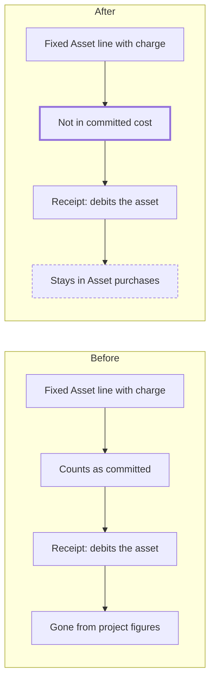

# Project Asset Purchases

> Status: draft
> Author: Brad
> Date: 2026-11-04

## TLDR

A Fixed Asset line on a purchase order can carry a charge number. Its cost goes to the asset, and it writes no `projectLedger` row. Today the project shows the line as committed until receipt, and then the amount leaves the project's figures with no trace. This spec adds an **Asset purchases** group on the project's Costs page and an amount on the task's row, both outside project cost. It also takes these lines out of committed cost and out of budget control. No posting changes, and no table changes.

## Overview diagram



## Problem Statement

A user buys a $50,000 machine from a task with **Add Purchase Order**, on the Fixed Asset tab. The posting is correct: the asset's account takes the debit, and the project takes no cost. But the reader of the project sees 3 wrong things:

1. Before receipt, the $50,000 counts as committed. So it uses up the budget, and budget control can refuse or warn on the line.
2. After receipt, the $50,000 leaves the project's figures. Nothing on the Costs page says that the purchase happened.
3. The task's row shows the purchase with no amount, so the row and the Costs page do not explain each other.

The research file `.ai/research/project-accounting-fixed-assets.md` covers this case. SAP debits the asset and adds a statistical line on the project. Settlement ignores that line, so the money is never counted twice.

## Proposed Solution

This spec uses one term: a **statistical line** is a Fixed Asset line on a purchase order with a charge number. It shows on the project and is not project cost. The UI calls the group **Asset purchases**.

1. **Read, do not post.** A new read returns the project's statistical lines from `purchaseOrderLine`. No posting changes, and `projectLedger` gets no new row.
2. **Costs page.** A new **Asset purchases** section sits under the cost tree. It shows only when the project has a statistical line.
3. **Task row.** `ElementPurchaseOrderLines` shows the amount and "Not in project cost" on a statistical line.
4. **Committed cost.** `get_project_cost_summary` and the budget check leave out statistical lines.
5. **Budget control.** The two purchase order line routes skip the budget check for a Fixed Asset line. **Add Purchase Order** already skips it.
6. **Modal note.** The Fixed Asset tab of `AddPurchaseOrderModal` says that the cost goes to the asset and not to the project. On a Contract project it adds that a direct contract cost uses the Item or GL Account tab.

### Design Decisions

| Decision | Choice | Rationale |
|----------|--------|-----------|
| Where the data comes from | A read of `purchaseOrderLine` | No posting change. A `projectLedger` row would need a new exclusion in every reader that sums the table: cost summary, burden bases, cost relief, billable items and earned value. |
| Which lines count | `purchaseOrderLineType = 'Fixed Asset'` with a `projectId`, on an order that is not Rejected | The task's row already leaves out Rejected orders (`getProjectElementPage`). |
| The amounts | Ordered is `purchaseQuantity` × `unitPrice`. Received is `quantityReceived` × `unitPrice`. | `unitPrice` is the base currency column that `get_project_cost_summary` already uses. The difference is what stays to receive, so the commitment stays visible. An invoice price variance does not show here. The asset page holds the real cost. |
| Budget | Shown beside the budget, and does not use it up | The cost never reaches the project. Brad accepted this recommendation on 2026-11-04. SAP compares statistical amounts with budget, so a later setting could add that comparison. |
| Where the section shows | Only when the project has a statistical line | The projects rule: a feature shows only when it is used. |
| Project Overview and project list | No change | They read `get_project_cost_summary`, so they lose the amount with no other edit. The Costs page is the one place that explains it. |
| License | Community | Project cost is community code. The budget check is in `packages/ee`, and only its query changes. |
| Heuristic: multi-tenancy | Every read filters on `companyId` | No new table. |
| Heuristic: service shape | `getProjectAssetPurchases(client, companyId, projectId)` returns `{ data, error }` | The building block shape of `projects.service.ts`. |
| Heuristic: RLS | N/A, no new table | The read uses the caller's client, as the task's job list does. |
| Heuristic: permission | The Costs route keeps `view: "projects"` | No new route. |
| Heuristic: forms | N/A, no new form | The modal gets a note only. |
| Heuristic: module layout | Building block in `projects.service.ts`, UI in `ui/Costs/` | One service file per module, no barrel. |
| Heuristic: compatibility | `get_project_cost_summary` keeps its signature, and its `committed` value falls for statistical lines | Before 2026-11-04 the UI offered no Charge Number on a Fixed Asset line. So few existing rows change. |

## Data Model Changes

No table or column changes. One migration replaces one function.

`get_project_cost_summary` gets one new condition in its `commitments` CTE. Its newest definition is `20261023031213_milestone-shop-hours.sql`. Copy that whole definition, so no other branch drops out.

```sql
commitments AS (
  SELECT pol."projectElementId",
    SUM(GREATEST(pol."purchaseQuantity" - COALESCE(pol."quantityReceived", 0), 0) * COALESCE(pol."unitPrice", 0)) AS v
  FROM "purchaseOrderLine" pol
  JOIN "purchaseOrder" po ON po."id" = pol."purchaseOrderId"
  WHERE pol."projectId" = p_project_id AND pol."companyId" = p_company_id
    AND pol."purchaseOrderLineType" <> 'Fixed Asset'
    AND po."status" IN ('To Receive', 'To Receive and Invoice', 'To Invoice', 'Planned')
  GROUP BY pol."projectElementId"
),
```

The signature does not change, so `pnpm run generate:types` gives no diff.

## API / Service Changes

| Change | File |
|---|---|
| New `getProjectAssetPurchases(client, companyId, projectId)`: one query, ordered by `createdAt`. It embeds the order and the element's `readableId` and `name`. | `projects.service.ts` |
| `getProjectElementPage` adds `unitPrice` to its `purchaseOrderLines` select. | `projects.service.ts` |
| The Costs loader calls the new read in its `Promise.all` and logs an error as it does for burden. | `x+/project+/$projectId.costs.tsx` |
| The commitments query adds `pol.purchaseOrderLineType != 'Fixed Asset'`. | `packages/ee/src/project-control/service.server.ts` |
| Skip `checkProjectBudget` when `d.purchaseOrderLineType` is Fixed Asset. | `x+/purchase-order+/$orderId.new.tsx`, `$orderId.$lineId.details.tsx` |

## Closest Sibling

**The burden section of the Costs page** is the closest sibling: a read-only group under the cost tree that shows only when it has rows. The new section copies `ui/Costs/ProjectBurdenByPool.ee.tsx` and its place in `ProjectCostsTree.tsx`. There are 2 deviations:

1. The new file has no `.ee` in its name, because the feature is community code.
2. Each row links to its purchase order, because a statistical line is a document and a pool is not.

The task's row stays in `ElementPurchaseOrderLines`, which copies `ElementJobs`.

SAP's statistical commitment and statistical actual give the accounting pattern (research file, pattern 1).

## UI Changes

The page archetype is the sibling's: a read-only section on a record's page.

**Costs page.** A section titled **Asset purchases**, with the text "These purchases go to the asset. They are not project cost." under the title.

| Column | Value |
|---|---|
| Asset | `description` |
| Purchase Order | `purchaseOrderId`, linked to the order |
| Element | `readableId` and `name`, or nothing for the project root |
| Ordered | Money |
| Received | Money |
| Status | `PurchasingStatus` |

The last row holds the totals of Ordered and Received.

**Task row.** On a statistical line, `ElementPurchaseOrderLines` shows the Ordered amount and the muted text "Not in project cost". The other line types do not change.

**Modal.** The Fixed Asset tab shows the note from Proposed Solution step 6. The modal reads the project's cost treatment from `ElementView`, which already has `project`.

## Acceptance Criteria

- [ ] A user adds a Fixed Asset line of $1,000 to a task. The project's committed cost does not change.
- [ ] A project has a budget of $500 and Block control. **Add Purchase Order** takes that line with no refusal. The purchase order line form does too.
- [ ] The Costs page shows the line under **Asset purchases** with Ordered $1,000 and Received $0.
- [ ] After receipt, the same row shows Received $1,000, and the project's actual cost does not change.
- [ ] An order in Rejected status does not show in the section.
- [ ] A project with no statistical line shows no section.
- [ ] A Part line and a G/L Account line still count as committed and still reach budget control.
- [ ] A live database test pins the committed figure of `get_project_cost_summary` and of the budget check. It uses a Fixed Asset line and a G/L Account line.

## Risks

| Risk | Severity | Mitigation |
|------|----------|------------|
| A user with `projects_view` and no `purchasing_view` sees no section, because RLS hides the lines. | Low | The task's job list has the same limit. It hides a read, and it shows no wrong figure. |
| The Asset purchases amount differs from the asset's cost after an invoice price variance. | Low | The section says Ordered and Received, and the order and the asset hold the real figures. |
| A forked SQL function drops a branch added since its base (`.ai/lessons.md`). | Med | Copy the newest definition. Check that the existing `get_project_cost_summary` tests still pass. |
| Known gap: a plain PO line with no charge number can name a project's Under Construction asset. It adds CIP cost with no `projectLedger` row. | Med | Left open on purpose (see Open Questions). The projects spec keeps this path, and the `chargeNumberError` guard covers only charged lines. |
| Known gap: a Fixed Asset purchase on an invoice with no PO stays off the project. | Low | The Add Invoice work adds it (see Open Questions). |

## Open Questions

> Every question below is resolved.

- [x] Does a statistical line count against the project budget? — **Answer:** No. It shows beside the budget and does not use it up, because the cost never reaches the project. Brad, 2026-11-04.
- [x] Does the group cover a Fixed Asset purchase on an invoice with no PO? — **Answer:** Not in this spec. It covers purchase order lines only, and the Add Invoice work adds the rest. Brad, 2026-11-04.
- [x] What happens to a plain PO line with no charge number that names a project's Under Construction asset? — **Answer:** Leave it, and record it as a known gap. Purchasing keeps working as it does today. Brad, 2026-11-04.

## Changelog

- 2026-11-04: Created. Research: `.ai/research/project-accounting-fixed-assets.md`. The Capitalize guard in `chargeNumberError` is already built and is not part of this spec.
