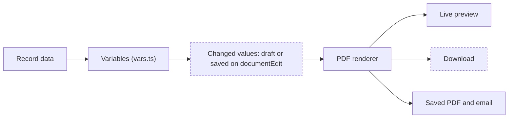

# Change a document's values

> Status: implemented on `feat/document-editor-edits`
> Date: 2026-11-05
> Builds on: `.ai/specs/2026-11-04-per-document-edits.md`, and the values-as-variables work on `feat/document-editor-edits` (review: `.ai/plans/2026-11-05-document-variables-review.md`)
> Research: N/A. This extends an internal editor; `.ai/research/2026-11-04-per-document-edits-market.md` covers how other products treat one-document text.

## TLDR

- In "Edit document", a user changes a value on this one document (a line's description, an address, a reference).
- Save keeps the changed values on that document, so its PDF, Carbon's emails and later reopens all match.
- "Download" gives the PDF as it stands, saved or not.
- The record itself never changes. Every other document still prints the record's real values.
- Amounts and quantities cannot be changed, so a document always adds up. A locked record stays read-only.
- Rich text prints bold, underline and strikethrough. A block can no longer land between the line table and the Summary.

## Overview diagram



## Problem Statement

Variables made every value visible in the editor, but a chip's text applies to every row and always prints what the record says. A user still cannot change one line's description on one invoice.

- Rental invoice lines are generated and cannot be edited on the record (`RentalInvoiceLineSummary.tsx`). Their whole description is one variable.
- A user who needs other words on this one invoice ("Smallsat Bus Loaner Per Month") or a vehicle ID on a line has no way to print them.
- Bold text in a Rich Text block prints plain: `Note.tsx` ignores text marks.
- A block dragged below Line Items can print between the table and the totals, while the editor's list shows it below the Summary.

## Goals

1. In document mode, every value a block prints can be changed, except amounts and quantities.
2. The preview shows changed values as the user types.
3. Save stores changed values on this document only. Every later render of it prints them: the PDF route, the PDF saved at send time, the email attachment.
4. "Download" gives the PDF with the draft's words and values, saved or not.
5. A click on a printed value in the preview jumps to that value's box.
6. Rich text prints bold, underline and strikethrough in every document.
7. The Summary always prints directly after Line Items, in new and saved templates.

## Non-goals

- Carrying changed values to the next generated invoice.
- Writing changed values back to the record. A rental line's stored description stays as generated.
- A description or vehicle ID stored on a rental agreement line. This is the lasting fix for repeating invoices and is a later piece of work.
- A record of who downloaded what, or a history of earlier values. The edit row holds who changed it last and when.
- Changed values in the company template editor, which has no record.
- Italic in PDFs. No italic font face is bundled (`pdf/fonts.ts`), so italic text keeps printing upright.
- Tracking labels.

## Proposed Solution

### API / Service Changes: values

`@carbon/documents` gets one small module, `template/values.ts`:

```ts
/** Changed values of one document. A row is `<prefix>:<record id>`, like `line:abc`. */
type ValueEdits = { document: Record<string, string>; rows: Record<string, Record<string, string>> };
```

- `MergeField` gains `fixed?: true`, set on quantity tokens and on a packing slip's per-entity serial, which the table fills itself. `isEditableValue(field)` is false for an `amount` or a `fixed` field.
- `valueEditsSchema` parses the posted changes. `validateTemplateText` refuses (`valueLocked`) any token that cannot change.
- `valueEdits` is part of the document's settings, so `applyDocumentEdit` puts it on the printed template and every driver reads it from `settings`. The editor's draft, preview, save and `isDirty` handle it the way they handle `settings.text`. A company template save drops it.
- A renderer also takes an optional collector. The driver builds one `documentValues(settings.valueEdits, collector)` and puts it on the data bag.
- `values.document(vars)` applies the document-level changes over the driver's variables.
- Each table row calls `data.values.row("line", line.id, buildLineVars(...))`, which reports the row to the collector and applies that row's changes. There are 18 such sites.
- A row with no record id cannot be told from another such row, so it prints the record's values and takes no changes.

### Reading the current values

The browser needs the values to show them. Only a render holds them, because row variables are built while blocks render.

- New route `api+/document-edit.$type.$id.values.ts` renders the document once with a collector and answers `{ document, rows: [{ key, label, values }] }`. Row `label` is "Line 1".
- The modal asks for it after it opens; chips gain their pencils when it lands.
- It renders with every block visible, so a block the user shows later already has its values.

### Preview and download

- `api+/document-edit.$type.$id.preview.ts` accepts `valueEdits` next to `blocks` and `settings`.
- The route needs update rights on the record's module. A locked record prints its saved edits and ignores the draft.
- It refuses a figure problem (`isFigureProblem`). A token the document does not offer is ignored by the render.
- `intent=download` also runs `validateTemplateText` on the draft, because a download must not carry a typed figure in place of an amount. On-screen preview stays permissive while the user types.
- `saveDocumentEdit` applies the same refusals and stores `valueEdits` in the same transaction as the words and notes.
- The modal saves the response as a file named with the record's readable id.

### UI Changes: the editor

- In document mode, a chip in the block's text editor shows a pencil when this document can change its value. Amounts, quantities, a hidden row and a locked record show none.
- The pencil opens a small popover beside the chip with the value in a multi-line box. A value printed per table row lists one box per row ("Line 1", "Line 2"), because one chip stands for every row.
- A changed value has a button to put the record's value back. There is no other marker of a change.
- Changing a value re-renders the preview and enables Save, the same way changing a word does. Only changed values are kept.
- The top bar gets "Download", which prints the draft as it stands, unsaved changes included.
- Cancel discards unsaved values, as it does unsaved words. "Reset to template" also clears changed values.

### Clicks

With the values on hand, `findPrintedValue` can match a value literally. In document mode, a click on a run that equals a value, ends with one after a label, or is a piece of one shows the text whose words print it in the panel. When several rows hold the same text, the n-th such run is the n-th row. Otherwise the current rules apply.

### Rich text marks

`Note.tsx` prints a text node's marks: `bold` as `fontWeight: "bold"`, `underline` and `strike` as `textDecoration`. This covers notes, terms, rich text, shared sections, line notes and the header and footer sections, which all print through `Note`. Bold is already a registered face for every family.

### Summary placement

- `keepSummaryWithLineItems(blocks)` in `template/defaults.ts` moves the Summary directly after Line Items. It leaves every other block in order, and does nothing for a document without both.
- `resolveTemplate` applies it on read, which corrects saved templates when they next print.
- The editor's `reorder` applies it after each move, so what is saved matches the list.

### Design Decisions

| Decision | Choice | Rationale |
|---|---|---|
| Whether changed values are saved | Save keeps them on `documentEdit` | Decided. Carbon's own send and PDF route then match what the user sees, and the row records who changed it. |
| Where saved values live | `documentEdit.settings.valueEdits`, no new column | The edit row already has its RLS, lock and copy rules, and `settings` already flows through every renderer. No migration and no change to any render path. |
| How the browser learns the values | One render with a collector, in a route of its own | Row variables only exist during a render. A header on the PDF response would overflow on long documents. |
| Where the row hook sits | One `values.row` call at each of the 18 row sites | The row id is only known there, and `makeText` does not know which row it prints. |
| Which values change | All but amounts, quantities and the `fixed` fields | Decided. The document always adds up. Dates can still change. A `fixed` value has no pencil, but the words holding it can still be retyped; the owner kept this. |
| Locked records | Read-only | Decided. Saved values keep printing, and a sent document gets no differing copy. |
| Where values are edited | A small popover from a pencil on the chip | Changed after using the first version, a list in the right panel. It keeps the panel to the words, and the value sits next to the chip that prints it. |
| Download validation | Only on `intent=download` | A preview must render mid-edit; a file leaving the system must not carry a typed amount. |
| Saved templates in the wrong order | Corrected on read | Same read-time normalizing `resolveTemplate` already does. No data migration, and old rows stay untouched until saved. |
| Italic | Stays upright | Adding italic faces changes the bundled fonts, which `packages/documents/AGENTS.md` says to ask about first, and it was not requested. |

## Data Model Changes

None, and no migration. Changed values live in the existing `documentEdit.settings` JSONB, next to `text` and `hidden`:

`{ "valueEdits": { "document": { "<token>": "<text>" }, "rows": { "<prefix>:<record id>": { "<token>": "<text>" } } } }`

RLS, the unique key and the lock are unchanged. An edit with no words and no values still deletes the row.

## Closest Sibling

N/A: this adds no record type. The words panel (`TextConfig.tsx`) is the pattern for the Values section.

## Risks

- **A document can differ from its record.** Its PDF can differ in everything but amounts and quantities, including dates. Retyping the words around a `fixed` value can also replace the invoice number, a tax percent or a currency. The edit row shows who changed it last, but an unsaved download leaves no trace. Accepted.
- **A saved value stops following the record.** If a customer's address changes later, that document keeps the old one until someone puts the record's value back.
- **Repeating invoices.** A generated rental invoice starts with the record's text each period, so the user retypes changes every time. A stored description on the agreement line is the lasting fix.
- **Row ids in JSON.** Row values are keyed by line id. A quote revision and a company restore rewrite the keys. A removed line's entry is ignored.
- **A template that placed a block between the table and the Summary on purpose** moves it below the Summary. The editor never showed that order, so this reads as the bug it is.

## Acceptance Criteria

1. On a draft invoice, the pencil on the Line Details chip opens a small editor listing "Line 1" with its description. Changing it updates the preview.
2. "Download" gives a PDF with the changed description before Save. Cancel then leaves the record's PDF route printing the original, and no database row changed.
3. After Save, the PDF route, the PDF saved at send time and the email attachment print the changed description. Reopening shows it. The invoice line's own description is unchanged, and another invoice is unaffected.
4. No amount or quantity chip has a pencil. A request that changes `{line.unitPrice}` or `{line.quantity}` is refused.
5. A rental invoice line's description can be changed and spans two lines in the PDF.
6. Two lines can hold different descriptions on one document.
7. A user with view rights only gets a refusal when posting `valueEdits`. A locked record refuses them, shows no pencils, and still downloads as saved.
8. A download whose draft words replaced an amount is refused with the amount's message.
9. Clicking an address line or one of two "Contact:" rows jumps to the row that prints it.
10. Bold text in a Rich Text block, the Notes, the Terms and a line note prints bold in the PDF. Underline and strikethrough print too. Italic text prints upright and nothing fails.
11. Dragging a block below Line Items prints it after the Summary. A saved template with a block between them prints the Summary directly after the table, and the block next.
12. All 11 document types read their values and download with a changed value.
13. "Put back" on a changed value and Save leaves no entry for it. "Reset to template" removes all changed values, and an edit left empty deletes its row.
14. Typecheck, Biome, `@carbon/documents` tests and the editor tests pass. New copy goes through Lingui, in all 12 languages.

## Open Questions

- [x] Where is a value edited? — **Answer:** a small popover from a pencil on the chip. This replaced a list in the right panel after trying it.
- [x] Which values can change? — **Answer:** all but amounts and quantities.
- [x] Can a locked record's values change for a download? — **Answer:** no, it stays read-only.
- [x] Are changed values saved? — **Answer:** yes, Save keeps them on that document. This replaced the first answer, download only, after weighing manual sending against saving.

## Changelog

- 2026-11-05 — Draft after the interview.
- 2026-11-05 — Changed values are saved with the document: no close warning, every render prints them.
- 2026-11-05 — After trying it: the Values list in the panel became a pencil on each chip that opens a small popover.
- 2026-11-05 — While building: a changed row makes the line table wrap, so a multi-line value is not cut off on a document set to truncate.
- 2026-11-05 — While planning: saved in `documentEdit.settings` rather than a new column, so no migration is needed.
