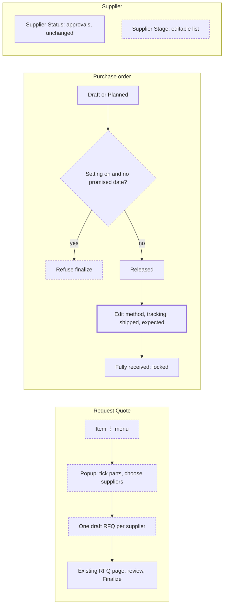

# Purchasing and supplier improvements

> Status: in-progress
> Author: Aashu
> Date: 2026-11-05

## TLDR

- A buyer can raise draft RFQs from an item's three-dot menu, for the item or for the parts in its Bill of Material.
- The popup creates one draft RFQ per supplier, so a supplier sees only the parts that the supplier quotes.
- Purchase orders get Shipped Date and Expected Receipt Date.
- Shipping Method, Tracking Number and the two new dates stay editable on the Shipping card after finalize.
- A new company setting, off by default, refuses to finalize a purchase order that has no promised date.
- Suppliers get an editable Stage list with four default values. Supplier Status and approvals do not change.

## Overview diagram



## Problem Statement

**RFQ entry point.** A buyer can start a purchasing RFQ only from the New button on the RFQ list. `purchasing-rfq+/new.tsx` reads no query string. To quote a Bill of Material, the buyer must remember each part and add each line by hand.

**Purchase order shipping data.** A purchase order has no Shipped Date and no Expected Receipt Date. Shipping Method and Tracking Number exist on `purchaseOrderDelivery`. A supplier usually gives this data after the order is released, so the buyer has nowhere to enter it.

**Promised date.** A purchase order can leave Draft with no promised date. A company that buys against firm dates wants Carbon to refuse this. A company that gets the promised date after it sends the order needs the current flow, and Carbon supports it. One rule for all companies would break the second flow.

**Supplier lifecycle.** A buyer cannot record where a supplier is in onboarding. `supplierStatusType` is a fixed enum: Active, Inactive, Pending, Rejected (`20260309211117_supplier-status-enums.sql:4`). Approvals and the purchase order gates depend on these values, so new values cannot go in this enum. The same migration removed the editable `supplierStatus` table.

## Proposed Solution

The three features are independent. Each one is a phase and can ship alone.

### Phase 1: Supplier Stage

Copy the customer status feature. A company manages stages at `/x/purchasing/supplier-stages`. The sidebar shows **Stages** under Configure. The supplier form gets a Stage field that can create a new stage inline. The suppliers table gets a Stage column and filter. The supplier header shows the stage.

Every company starts with Prospect, Sampling, Qualified and Production. A company can rename, delete or add stages. A stage has no effect on approvals, purchase orders or the supplier picker.

### Phase 2: Purchase order shipping and promised date

**Shipping.** The Shipping card shows two new date fields: Shipped Date and Expected Receipt Date. Main already lets a user edit this card on a released order, through `updatePurchaseOrderDelivery` and `amendPurchaseOrder`. The card locks in Needs Approval, Completed and Closed.

The purchase order list gets Shipped Date and Expected Receipt Date columns.

**Air, rail and sea.** A company adds these as shipping methods at the existing Shipping Methods page, with carrier Other. This spec adds no transport mode column.

**Promised date rule.** A new toggle at Settings → Purchasing: "Require a promised date to finalize purchase orders". It is off by default. When it is on, finalize refuses an order where a non-Comment line has no promised date. The check uses `promisedDateOf` (line date, then order date), so one date on the order satisfies all lines.

### Phase 3: Request Quote from an item

**Entry point.** The item header menu gets **Request Quote**, above Create Change Notice. It shows on Part, Material, Tool, Consumable and Service. It needs `create` on `purchasing`, and the user must be an employee. The Bill of Material menus and the page body do not change.

**Popup, item with a Bill of Material.** The popup opens on the Bill of Material:

- A list of the parts to buy, all ticked, with Part, Used in, Qty, Unit and Supplier.
- A Builds field, default 1. Qty is the rolled-up quantity × Builds.
- A search field that filters the rows.
- A Supplier dropdown on each row, with one supplier per row.
- A switch to **This part only**.

**Popup, item with no Bill of Material.** The popup shows the item, a Quantity field and a supplier picker that accepts more than one supplier. It creates one RFQ.

**How the list is built.** A pure function reads `get_method_tree` for the item's active make method, or the latest version when no version is active:

1. It walks into each `Make to Order` line and does not list that line.
2. It lists each other line, unless the item's `replenishmentSystem` is `Make`. It skips the contents of a part pulled from stock.
3. It multiplies each child quantity by its parent quantity.
4. It merges repeats of the same item into one row and sums the quantity. "Used in" names the parent, or shows "N places".

**Supplier default.** The row uses `preferredSupplierId`. If that is empty and the item has exactly one supplier part, the row uses that supplier. Otherwise the row is empty.

**Create.** The Create button stays disabled until the user ticks at least one row and each ticked row has a supplier. The footer states the result: "19 parts → 5 draft RFQs, one per supplier". One operation creates all RFQs in one transaction, with `rfqDate` today and status Draft. Nothing goes to a supplier until the buyer selects Finalize on each RFQ.

**Landing.** One RFQ opens its page. More than one RFQ opens the RFQ list, filtered to the new RFQs, with a flash message.

### Design Decisions

| Decision | Choice | Rationale |
|----------|--------|-----------|
| Supplier lifecycle storage | New `supplierStage` table and a nullable FK on `supplier` | `supplierStatusType` drives approvals. A supplier in Sampling would fail the `Active` gates. The user chose editable defaults over a custom field. |
| Field name | Stage (`supplierStage`) | "Supplier Status" already exists on the same form. A second "status" would confuse users. |
| New supplier default | Empty | Matches customer status. Existing suppliers also stay empty, because Carbon cannot know their stage. |
| Stage colour | Same derived colour as customer status (`Enumerable`) | Copies the sibling. No colour column. |
| Default stages for existing companies | The migration inserts them for each company | Seed code runs only at company creation (`.ai/lessons.md`, seed paths). |
| Promised date rule scope | Company setting, off by default | The user chose this. Existing companies keep their current flow. |
| Where the rule runs | `finalizePurchaseOrderAndNotify`, before the approval fork, and again when an approver approves | Finalize covers the page, planning, HTTP and MCP. `Needs Approval` is not locked, so the date can be cleared during approval. |
| Draft to Planned | Not gated | Planning creates Planned orders with no promised date. Finalize from Planned is gated. |
| Fields editable after release | The whole Shipping card, as main allows | Main changed the edit rules after this spec started. The user chose the card over a separate panel. |
| Expected Receipt Date and planning | Display only | MRP keeps `purchaseOrderLineArrivalDate` (`packages/planning/src/mrp/supply-date.ts:38`). This spec preserves planning behaviour. |
| Expected Receipt Date value | Entered by hand | Carbon has no transit time per shipping method. |
| RFQ grouping | One RFQ per supplier | The user approved this version. `finalizePurchasingRfq` gives each supplier a quote with every line, so one shared RFQ would send every part to every supplier. |
| Suppliers per row | One | Keeps the popup simple. A buyer can add suppliers to a draft RFQ on the existing page, to compare quotes. |
| Link from RFQ to the source item | None | No feature reads it. RFQ tables do not change. |
| Item types | All five item headers | `PurchasingRFQLineForm` already accepts all item types, including Service. |

## Data Model Changes

```sql
-- Copies "customerStatus". RLS comes from the authz manifest, not the migration.
CREATE TABLE "supplierStage" (
    "id" TEXT NOT NULL DEFAULT id('sstg'),
    "name" TEXT NOT NULL,
    "companyId" TEXT NOT NULL,
    "createdAt" TIMESTAMP WITH TIME ZONE NOT NULL DEFAULT NOW(),
    "createdBy" TEXT NOT NULL,
    "updatedBy" TEXT,
    "updatedAt" TIMESTAMP WITH TIME ZONE,
    CONSTRAINT "supplierStage_pkey" PRIMARY KEY ("id", "companyId"),
    CONSTRAINT "supplierStage_name_unique" UNIQUE ("name", "companyId"),
    CONSTRAINT "supplierStage_companyId_fkey" FOREIGN KEY ("companyId") REFERENCES "company"("id") ON UPDATE CASCADE ON DELETE CASCADE
);

ALTER TABLE "supplier" ADD COLUMN "supplierStageId" TEXT;
-- FK to ("id", "companyId"). Deleting a stage clears the column on its suppliers.

INSERT INTO "supplierStage" ("name", "companyId", "createdBy")
SELECT stage, c."id", 'system'
FROM "company" c
CROSS JOIN unnest(ARRAY['Prospect', 'Sampling', 'Qualified', 'Production']) AS stage;

ALTER TABLE "purchaseOrderDelivery"
  ADD COLUMN "shippedDate" DATE,
  ADD COLUMN "expectedReceiptDate" DATE;

ALTER TABLE "companySettings"
  ADD COLUMN "requirePromisedDateToFinalizePurchaseOrder" BOOLEAN NOT NULL DEFAULT false;
```

The migration must recreate the `suppliers` and `purchaseOrders` views to expose the new columns. `searchLines` in `20261102105641_deep-list-search.sql` is typed on the `purchaseOrders` view, so the plan must check it.

New-company seeds: `seed-data.ts`, `settings.service.ts` and `packages/database/src/datasets/bootstrap.ts`, at the same places as `customerStatuses`.

Registrations: `authz/manifest.ts` (`supplierStage: company("purchasing")`), `audit.config.ts` and the backup manifest.

## API / Service Changes

| Operation | Change |
|-----------|--------|
| `getSupplierStages`, `getSupplierStagesList`, `upsertSupplierStage`, `deleteSupplierStage` | New. Copies the customer status functions. |
| `upsertSupplier`, supplier validators | Accept `supplierStageId`. |
| `getSuppliers` | Filter by stage. |
| `updatePurchaseOrderDelivery` | Accept `shippedDate` and `expectedReceiptDate`. |
| `isPurchaseOrderMissingPromisedDate`, `requiredPromisedDateRefusal` | New pure function in `purchasing.models.ts`, and the helper that applies the setting. |
| `finalizePurchaseOrderAndNotify`, `decidePurchaseOrderApproval` | Apply the refusal when the setting is on. |
| `settings.purchasing.update` | Accept the new toggle. |
| `getRfqLinesFromMethod`, `groupRequestQuoteLines` | New pure functions: tree to rows, and rows to one group per set of suppliers. |
| `requestQuoteFromItem` | New `defineServiceFn` with `@mcp`. Input: lines of item, quantity and supplier. Creates all RFQs, suppliers and lines in one `ctx.transaction`. Converts quantity to the purchase unit, as `.claude/rules/purchasing-conversion-factors.md` requires. |
| `getRequestQuoteRows`, `api+/purchasing.request-quote.$itemId.ts` | New operation and route. They return the rows and supplier defaults for the popup. |

Generated files come from their commands: `generate:types`, `generate:mcp`, `db:check:backups` and `lingui:extract`.

## Closest Sibling

- **Supplier Stage copies customer status.**
  - Routes: `routes/x+/sales+/customer-statuses*`, `routes/api+/sales.customer-statuses.ts`.
  - UI: `modules/sales/ui/CustomerStatuses/`, `components/Form/CustomerStatus.tsx`.
  - Deviation: none beyond the name and the composite primary key that current conventions require.
- **Request Quote** copies the modal from a record's menu in `ItemRecordHeader.tsx` (`CreateChangeNoticeModal`).
- **Shipping fields** extend `PurchaseOrderDeliveryForm`. No new record type.

## UI Changes

| Surface | Change |
|---------|--------|
| Purchasing sidebar | Configure → Stages. |
| Stages pages | List and form, same archetype as customer statuses. |
| `SupplierForm` | Stage field beside Supplier Status. |
| `SuppliersTable` | Stage column and filter. |
| `SupplierHeader` | Stage shown near the status. |
| `PurchaseOrderDeliveryForm` | Two new date fields. |
| `PurchaseOrdersTable` | Two new columns, also added to `PURCHASE_ORDER` list columns in `purchasing.service.ts`. |
| `PurchaseOrderFinalizeModal` | When the setting is on and a date is missing, the modal shows the reason and disables its Finalize button. The planning pages do not compute the reason, so they show the server refusal. |
| Settings → Purchasing | New toggle card. |
| `ItemRecordHeader` | Request Quote menu item and popup. |

All new text uses Lingui. New data entry uses `ValidatedForm` and ⌘Enter to submit. The popup uses `react-hotkeys-hook` if it needs a listener.

## Acceptance Criteria

**Supplier Stage**

- [ ] A new company has Prospect, Sampling, Qualified and Production. An existing company has them after the migration.
- [ ] A user adds "On Hold" at Stages and selects it on a supplier. The table filter finds that supplier.
- [ ] A user creates a stage inline from the supplier form.
- [ ] Deleting a stage clears it from its suppliers and does not change their Supplier Status.
- [ ] With supplier approval on, a Pending supplier with stage Production still cannot be used on a finalized purchase order.
- [ ] A company cannot read or change the stages of another company, and a supplier portal account cannot read them.

**Purchase order shipping**

- [ ] On a To Receive order, a user edits Shipping Method, Tracking Number, Shipped Date and Expected Receipt Date on the Shipping card.
- [ ] On a Needs Approval, Completed or Closed order, the server refuses a change to the Shipping card.
- [ ] The list shows Shipped Date and Expected Receipt Date, and CSV export includes them when they are visible.
- [ ] Editing Expected Receipt Date does not change the MRP arrival date.

**Promised date rule**

- [ ] With the setting off, an order with no promised date finalizes as today.
- [ ] With the setting on, Carbon refuses an order with no promised date from the page, planning Finalize and the service function.
- [ ] With the setting on, one order-level promised date allows finalize.
- [ ] With the setting on, Carbon refuses an order where one line has no date and the order has no date.
- [ ] With the setting on, clearing the date during Needs Approval makes the approve action refuse.
- [ ] Draft to Planned works with the setting on.

**Request Quote**

- [ ] The menu item is disabled for a user with no `create` permission on `purchasing`.
- [ ] On SAT-1000, the popup lists 19 parts and MAT-KAPTON shows 12 YD across 5 places.
- [ ] Builds set to 2 shows MAT-KAPTON as 24 YD.
- [ ] Make to Order sub-assemblies such as SAW-001 do not appear as rows.
- [ ] A row with no default supplier blocks Create until the user chooses a supplier or unticks the row.
- [ ] With 5 suppliers across the ticked rows, Create makes 5 Draft RFQs. Each RFQ has only its supplier and that supplier's lines.
- [ ] If one insert fails, the operation creates no RFQ.
- [ ] BAT-LIION-48V, which has no Bill of Material, creates one RFQ with one line.
- [ ] No supplier receives an email or a quote until a user selects Finalize.
- [ ] A line in a different purchase unit shows the converted quantity on the RFQ.

## Non-goals

- Quote, order and receipt status across a Bill of Material.
- Editing shipping on a finalized sales quote.
- A Ship Ready Date field. The term does not exist in the code, and this spec does not add it.
- Transport mode as structured data.
- Automatic Expected Receipt Date from transit times.
- Shipped Date, Expected Receipt Date or Tracking Number on the purchase order PDF and email.
- Supplier stage in CSV import and workflow rule conditions.
- Request Quote from a job or from a single Bill of Material row.

## Risks

| Risk | Severity | Mitigation |
|------|----------|------------|
| The promised date rule does not cover `insertPurchaseOrder` with a status, or accounting sync that writes a status | Low | The setting is about the finalize flow. The module `AGENTS.md` will record the limit. |
| The PDF prints only the order-level promised date, so an order with only line dates passes the rule and prints no promise | Low | Accepted for this version. The rule still sees a date for each line. |
| Tests that finalize an order assume no setting | Low | The default is off, so they keep their behaviour. |
| A large Bill of Material makes a slow popup | Med | One `get_method_tree` call and one supplier query with `.in()`. No query in a loop. |
| A company adds a Stage with the name of a Status and users confuse the two | Low | The labels stay separate. Stage has no gates. |
| Recreating `purchaseOrders` drops a dependent object | Med | Follow `.claude/rules/database-migration-patterns.md`. Read the latest view definition first. |

## Research

N/A for external research. These are changes inside existing Carbon flows, and the code and the user's answers settle each decision.

## Open Questions

All questions are resolved.

- [x] How do suppliers get lifecycle values? — **Answer:** A separate editable list with default values, and the ability to add more. Approvals do not change.
- [x] Does the promised date rule apply to all companies? — **Answer:** No. A company setting, off by default.
- [x] Which shipping fields stay editable after finalize? — **Answer:** The Shipping card, under the edit rules main now has. This replaces an earlier answer that named four fields.
- [x] What does Request Quote do? — **Answer:** The user approved the clickable design. It covers the part or its Bill of Material, and creates one draft RFQ per supplier.

## Changelog

- 2026-11-05: Created
- 2026-11-05: Implemented. The finalize reason shows in the modal, not on a disabled button. The list skips the contents of a part pulled from stock.
- 2026-11-06: Rebased on main, which made the Shipping card editable on a released order. The separate shipping edit path is gone.
- 2026-11-05: Review changes. Stages are employee only, with no custom fields. Stage routes call operations. Filters use ids. Request Quote checks the location, rounds quantities and keeps a service at EA.
