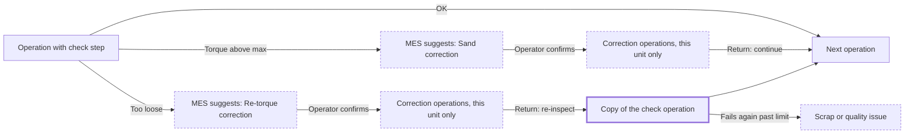

# Conditional corrections

> Status: in-progress (all phases built; not yet run against a database)
> Author: Dane Albaugh (drafted with Claude)
> Date: 2026-11-10
> Research: `.ai/research/2026-11-10-conditional-corrections.md`

## TLDR

A make method can define **corrections**: small routings of their own
operations, steps and materials that normal units never run. A step result
maps to a correction: a List or Inspection value, or a Measurement below its
minimum or above its maximum. When an operator records a mapped result, MES
suggests the correction and the operator confirms it. Carbon then adds the
correction's operations to the job for that unit only, and afterwards sends
the unit back to re-inspect or on to the next operation. An optional attempt
limit escalates a unit that keeps failing to Scrap or a quality issue. The
same change scopes rework operations to the units sent into them, which fixes
today's rework.

## Overview diagram



## Problem Statement

An assembly step often ends with a check whose outcome decides the next work.
A nut that is too loose is re-torqued, which is its own set of steps. A nut
that is too tight means another part is sanded, which is a different set of
steps, possibly at another station. Carbon cannot express this:

- No operation or step is conditional. Every unit is expected at every
  operation of its make method.
- Rework only sends a unit back to an **earlier** operation that every unit
  already runs. A correction that only failing units need has nowhere to live.
- The operator has to know which earlier operation to pick, and nothing
  records which result led to the rework.
- Rework operations are not scoped to the reworked units. Every open unit of
  the make method shows as not done at them in MES
  (`getTrackedEntitiesByMakeMethodId` filters by make method only;
  `isSerialEntityIncompleteForOperation` treats a new operation id as not done
  for every unit).

## Proposed Solution

1. **Define corrections on the make method.** A correction has a name, a
   return rule (re-inspect, the default, or continue), an optional attempt
   limit, an ordered sequence of one or more operations with their own steps,
   tools, parameters and work centers, and materials. A sequence can start
   with preparation before the rework itself, for example "Tear down" then
   "Clean" then "Re-torque", each at its own work center. Operations run in
   order (`After Previous`) or alongside the one before (`With Previous`),
   as in the normal routing.
2. **Map step results to corrections.** On a List or Inspection step, each
   value can name a correction. On a Measurement step, "below minimum" and
   "above maximum" can each name one.
3. **Snapshot at job creation.** Creating a job's method copies the
   corrections and their mappings onto the job, so later method edits don't
   change open jobs.
4. **Suggest and confirm in MES.** Recording a mapped result opens a prompt
   with the mapped correction selected. The operator confirms it, picks
   another correction of that operation, or chooses none.
5. **Instantiate for the unit.** Confirming adds the correction's operations
   and materials to the job after the triggering operation, scoped to the
   unit. With re-inspect, a copy of the triggering operation follows them.
   This reuses the rework copy mechanics and the `rework` record.
6. **Escalate past the limit.** When a unit has used a correction its limit
   number of times, MES offers only Scrap or Quality Issue for it.
7. **Scope operations to units.** Correction and rework operations list only
   the units sent into them.
8. **Inspection lots.** The Reject/Rework picker on an inspection lot offers
   the operation's corrections beside the earlier operations. Lot
   measurements do not suggest corrections in v1.

### Design Decisions

| Decision | Choice | Rationale |
|----------|--------|-----------|
| What a correction is | Its own operations (work center, steps, times, materials), not extra steps inside the checking operation | User decision. Matches SAP NC routings and AVEVA dynamic routing. A correction can run at another station and is timed and costed. |
| Operations per correction | One or more, ordered by `order`, each `After Previous` or `With Previous`; instantiated with the same dependency wiring as the normal routing | User requirement: a unit may need several operations (teardown, clean, then the rework) before the rework proper. |
| Corrections inside corrections | A correction operation's steps do not map to corrections in v1; the re-inspection copy of the triggering operation can still suggest one | Keeps the trigger graph one level deep, so a correction cannot start another correction mid-sequence. The attempt limit bounds the re-inspect loop. |
| Trigger | Suggest and confirm | User decision. Carbon already refuses to auto-post on inspection results so a mistyped result needs no compensating transaction (`inspection-system.md`, "Complete (n passed)"). |
| Trigger sources | List/Inspection values; Measurement below min or above max | User decision. Covers pass/fail checks and gauge readings. |
| Return rule | Per correction: re-inspect (default) or continue | User decision. Re-inspect reuses the rework pattern of copying the triggering operation. |
| Where defined | On the make method, versioned with it | User decision. Changes go through method versions and change notices. |
| Job snapshot | Copied when the job's method is created | User decision. An open job keeps the corrections it was built with. |
| Unit scope | Correction and rework operations list only their units; batch and untracked parts stay quantity-based | User decision. Fixes the existing rework bug instead of building on it. |
| Loop guard | Optional attempt limit per correction, then Scrap or Quality Issue only | User decision. |
| Materials | Allowed; added to the job only when the correction is used | User decision. Normal units never draw them; the job's cost shows the correction's consumption. |
| Inspection lots | Rework picker offers corrections; lot results don't suggest | User decision, v1 scope. |
| Storing correction operations on the method | Reuse `methodOperation` and `methodMaterial` with a nullable `methodCorrectionId` | Keeps the operation form, steps, tools, parameters, procedures and assembly instructions for free. Every reader of the normal routing and BOM must exclude these rows (see Risks). |
| Storing the job snapshot | `jobCorrection` header plus a `definition` JSONB, not template `jobOperation` rows | Template `jobOperation` rows would leak into scheduling, completion triggers, MES lists and costing, which all read `jobOperation`. The JSONB is written and read through one zod schema. |
| Planning | Corrections are invisible to MRP and scheduling until used; then their operations schedule like rework operations | Codebase precedent: the scheduler already handles rework operations (`scheduling-engine.ts`). |
| Quotes | Not copied to quotes in v1 | Corrections are exceptional work; quotes estimate the normal routing. |
| Which result triggered it | The correction instance records the step record and value | Traceability: the job shows why each correction ran. |

## Data Model Changes

```sql
-- A correction on a make method.
CREATE TABLE "methodCorrection" (
    "id" TEXT NOT NULL DEFAULT id('mcor'),
    "companyId" TEXT NOT NULL,
    "makeMethodId" TEXT NOT NULL,
    "name" TEXT NOT NULL,
    "description" JSONB,
    "returnTo" "correctionReturnTo" NOT NULL DEFAULT 'Re-inspect',
    "maxAttempts" INTEGER CHECK ("maxAttempts" IS NULL OR "maxAttempts" > 0),
    "createdBy" TEXT NOT NULL REFERENCES "user"("id"),
    "createdAt" TIMESTAMP WITH TIME ZONE NOT NULL DEFAULT NOW(),
    "updatedBy" TEXT REFERENCES "user"("id"),
    "updatedAt" TIMESTAMP WITH TIME ZONE,
    PRIMARY KEY ("id", "companyId"),
    FOREIGN KEY ("companyId") REFERENCES "company"("id") ON DELETE CASCADE,
    FOREIGN KEY ("makeMethodId") REFERENCES "makeMethod"("id") ON DELETE CASCADE
);
CREATE TYPE "correctionReturnTo" AS ENUM ('Re-inspect', 'Continue');

-- Correction operations and materials reuse the method tables.
ALTER TABLE "methodOperation" ADD COLUMN "methodCorrectionId" TEXT;
ALTER TABLE "methodMaterial" ADD COLUMN "methodCorrectionId" TEXT;
-- (FKs to methodCorrection, ON DELETE CASCADE; indexed.)

-- A step result that suggests a correction.
CREATE TABLE "methodCorrectionTrigger" (
    "id" TEXT NOT NULL DEFAULT id('mctr'),
    "companyId" TEXT NOT NULL,
    "methodOperationStepId" TEXT NOT NULL,
    "methodCorrectionId" TEXT NOT NULL,
    "listValue" TEXT,                                -- List / Inspection steps
    "measurementCondition" "measurementCondition",   -- Measurement steps
    -- audit columns
    PRIMARY KEY ("id", "companyId"),
    CHECK (("listValue" IS NULL) <> ("measurementCondition" IS NULL))
);
CREATE TYPE "correctionMeasurementCondition" AS ENUM ('Below Minimum', 'Above Maximum');
-- One correction per result: UNIQUE (methodOperationStepId, listValue)
-- and UNIQUE (methodOperationStepId, measurementCondition).

-- The job's snapshot of a correction, copied with the job's method.
CREATE TABLE "jobCorrection" (
    "id" TEXT NOT NULL DEFAULT id('jcor'),
    "companyId" TEXT NOT NULL,
    "jobId" TEXT NOT NULL,
    "jobMakeMethodId" TEXT NOT NULL,
    "methodCorrectionId" TEXT,          -- provenance; SET NULL if the method row goes
    "name" TEXT NOT NULL,
    "returnTo" "correctionReturnTo" NOT NULL,
    "maxAttempts" INTEGER,
    "definition" JSONB NOT NULL,        -- operations, steps, tools, parameters, materials
    -- audit columns
    PRIMARY KEY ("id", "companyId")
);

-- The job's snapshot of the result mappings.
CREATE TABLE "jobCorrectionTrigger" (
    "id" TEXT NOT NULL DEFAULT id('jctr'),
    "companyId" TEXT NOT NULL,
    "jobOperationStepId" TEXT NOT NULL,
    "jobCorrectionId" TEXT NOT NULL,
    "listValue" TEXT,
    "measurementCondition" "measurementCondition",
    -- audit columns
    PRIMARY KEY ("id", "companyId")
);

-- A use of a correction extends the existing rework record.
ALTER TABLE "rework" ADD COLUMN "jobCorrectionId" TEXT;
ALTER TABLE "rework" ADD COLUMN "jobOperationStepRecordId" TEXT;  -- the result that triggered it

-- Which units an operation applies to. No rows = every unit (today's behaviour).
-- Shipped in phase 1: 20261110152714_job-operation-tracked-entity.sql.
-- Written only by the system (posting), so RLS is select-only, like
-- jobOperationDependency.
CREATE TABLE "jobOperationTrackedEntity" (
    "jobOperationId" TEXT NOT NULL,
    "trackedEntityId" TEXT NOT NULL,
    "companyId" TEXT NOT NULL,
    -- audit columns
    PRIMARY KEY ("jobOperationId", "trackedEntityId")
);
```

RLS for every new table goes in `packages/database/src/authz/manifest.ts`:
method tables under `parts`, job tables under `production`, with
`create: "employee"` on `jobOperationTrackedEntity` and the rework extension
because MES operators write them. Run
`pnpm --filter @carbon/database authz migration <name>`.

Attempt count: the number of `rework` rows with the unit's `jobCorrectionId`
whose operations are scoped to the unit.

## API / Service Changes

- **ERP method editing** (`items.service.ts` / `items.server.ts`):
  `upsertMethodCorrection`, `deleteMethodCorrection`, and trigger
  upserts. Operation and material upserts accept `methodCorrectionId`.
- **Normal routing and BOM readers exclude correction rows.** Audit every
  reader of `methodOperation` and `methodMaterial`: `getMethod` /
  `upsertJobMethod`, quote copies, costing rollups, MRP explosion, BOM and
  Bill of Process views, change-notice diffs, method version copy (which
  must copy corrections too), datasets and the configurator.
- **Job creation:** `upsertJobMethod` writes `jobCorrection` and
  `jobCorrectionTrigger` from the method version it copies.
- **New posting `trigger-correction`** (sibling of `trigger-rework`, through
  `packages/api/src/postings.ts` and `apps/erp/app/modules/postings.server.ts`).
  Input: jobId, triggeredAtJobOperationId, jobCorrectionId, quantity,
  trackedEntityIds?, jobOperationStepRecordId?, reason?. It:
  1. refuses past `maxAttempts` for any named unit;
  2. inserts the `rework` row with `jobCorrectionId`;
  3. inserts the correction's `jobOperation` rows, steps, tools and
     parameters after the triggering operation, from `definition`;
  4. with `Reinspect`, also copies the triggering operation after them;
  5. adds the correction's materials to the job make method;
  6. wires dependencies: each `After Previous` operation in the sequence
     depends on every operation of the group before it, a `With Previous`
     operation joins the group of the one before it, the re-inspection copy
     (or, with `Continue`, every operation that depended on the triggering
     one) depends on the whole last group. Today's rework chains its copies
     one after another; the sequence wiring is new;
  7. writes `jobOperationTrackedEntity` rows for the named units;
  8. writes the Rework `productionQuantity` on the triggering operation;
  9. reschedules, then the caller recalculates job requirements.
- **`cloneReworkOperations`** writes `jobOperationTrackedEntity` rows when
  `trackedEntityIds` are passed.
- **MES unit lists honour `jobOperationTrackedEntity` without narrowing the
  list.** Step records are keyed by a unit's position in the full unit list,
  so the list stays whole. `getTrackedEntitiesForOperation` loads it with an
  `inOperationScope` flag per unit, and `isSerialEntityIncompleteForOperation`
  and `getNextIncompleteSerialEntity` skip units outside the scope. The
  operation, assembly, start, end and inspection loaders use it, and so does
  inspection-lot completion (`quality.server.ts`), so accepting a lot on a
  rework copy completes only the reworked units.
- **The ERP `jobOperationSerialComplete` posting refuses a unit outside the
  operation's scope.**
- **MES record route** (`x+/record.tsx`): after saving a record, returns the
  matching `jobCorrectionTrigger`, if any, so the view can prompt.
- **New MES route** `x+/trigger-correction.tsx`, sibling of
  `x+/trigger-rework.tsx`.
- **Inspection disposition** (`x+/inspection-lot.$id.disposition.tsx`): the
  rework allocation may name a `jobCorrectionId` instead of a target
  operation.

## Closest Sibling

**Rework.** Copy:

- posting: `triggerRework` / `cloneReworkOperations` / `findReworkPath`
  (`apps/erp/app/modules/production/production.service.ts`), its input schema
  in `packages/api/src/postings.ts`, dispatch in `postings.server.ts`;
- MES route `apps/mes/app/routes/x+/trigger-rework.tsx` and
  `components/JobOperation/components/ReworkModal.tsx`;
- record: `rework` table, `jobOperation.reworkId`, the
  `complete_rework_on_operation_done` trigger.

Deviations: the operations come from the job's correction snapshot instead of
the upstream path; the triggering operation is copied only with `Reinspect`;
operations are scoped to units.

For the ERP editor the sibling is **operations on the Bill of Process**:
`apps/erp/app/modules/items/ui/Item/BillOfProcess.tsx` (`OperationForm`,
`AttributesForm`) and the `x+/items+/methods+/operation.*` routes.

## UI Changes

- **ERP, Bill of Process** (sibling's archetype): a **Corrections** section
  below the operations. Each correction shows its name, return rule and
  attempt limit, and lists its operations and materials, edited with the
  existing operation and material forms.
- **ERP, step form** (`AttributesForm`): on a List or Inspection step, each
  value gets an optional "Correction" select. On a Measurement step,
  "Below minimum" and "Above maximum" each get one. Only the method's
  corrections are offered.
- **ERP, job Bill of Process:** shows the job's corrections read-only and
  marks correction operations with their correction name, like rework
  operations.
- **MES, operation view:** recording a mapped result opens a
  **Correction** prompt (sibling: `ReworkModal`) with the mapped correction
  selected, the operation's other corrections, and "No correction". Past the
  attempt limit the prompt offers only Scrap and Quality Issue.
- **MES, correction operations** show the correction name and the units they
  apply to.
- **MES, inspection lot disposition:** the rework target picker lists the
  operation's corrections after the earlier operations.

## Acceptance Criteria

- [ ] A make method can have corrections with operations, steps and
      materials; normal job creation, BOM, costing, MRP and quotes ignore them.
- [ ] A List or Inspection value, or a Measurement below min / above max, can
      map to one correction.
- [ ] A new job snapshots its corrections; editing the method afterwards
      doesn't change the job's corrections.
- [ ] Recording a mapped result in MES opens the prompt with the mapped
      correction selected; confirming adds its operations after the
      triggering operation, scoped to the unit; choosing none adds nothing.
- [ ] A correction with several operations instantiates all of them in
      order, honouring `With Previous`; the unit must finish the whole
      sequence before the re-inspection copy (or the next operation) starts.
- [ ] With re-inspect, a copy of the triggering operation follows the
      correction and the unit must pass it; with continue, the next operation
      waits on the last correction operation.
- [ ] Correction materials join the job only when the correction is used.
- [ ] Past `maxAttempts`, the prompt offers only Scrap and Quality Issue, and
      the posting refuses another attempt.
- [ ] Correction and rework operations list only their units in MES; other
      units are not shown as not done there.
- [ ] The job shows which step result triggered each correction.
- [ ] The inspection-lot rework picker offers corrections.
- [ ] A job with several units and one correction completes with the right
      quantity (`sync_finish_job_operation` terminal-operation rule).

## Risks

| Risk | Severity | Mitigation |
|------|----------|------------|
| A reader of `methodOperation` / `methodMaterial` misses the exclusion and correction rows leak into jobs, costing, MRP or quotes | High | Audit every reader in phase 2 with a list in the PR; add a helper or view for "routing operations" and "BOM materials"; tests on job creation, costing and MRP for a method with corrections. |
| The `definition` JSONB drifts from the operation/step/material columns | Med | One zod schema writes and reads it; a version field; tests that a snapshot instantiates every field. |
| Scoping changes which units MES expects at existing rework operations | Med | Scope rows are written only by new reworks; old rework operations have none and keep today's behaviour. |
| Job completion counts a correction's re-inspection copy wrongly | Med | Correction operations carry `reworkId`, so the existing terminal-operation rule applies; extend `job-completion-terminal-operations.test.sql`. |
| A Draft method edited mid-job | Low | The job's snapshot is fixed at creation; "Get Method" on a job re-copies, as it does for operations. |
| Step records are stored by unit position, not serial | Low | The trigger maps the record's index to the unit as MES already does (`operations.service.ts`). |

## Phases

1. **Unit scoping.** `jobOperationTrackedEntity`, rework writes it, MES honours
   it. Ships alone and fixes today's rework.
2. **Method corrections.** Tables, method-reader exclusions, method version
   copy, ERP Corrections section and step mapping.
3. **Job snapshot and trigger.** `jobCorrection`, `upsertJobMethod` copy,
   `trigger-correction` posting, MES prompt and route.
4. **Limits, measurements, lots.** Attempt limit and escalation, measurement
   triggers, inspection-lot picker.

## Open Questions

- [x] How is a correction defined? — **Answer:** its own operations with work
      center, steps, times and materials, attached to the make method and
      keyed to a result. Not extra steps inside the checking operation.
- [x] What happens when a mapped result is recorded? — **Answer:** suggest and
      confirm; the operator can pick another correction or none.
- [x] Which results can trigger? — **Answer:** List/Inspection values, and
      Measurement below min or above max.
- [x] Where does the unit go afterwards? — **Answer:** per correction,
      re-inspect (default) or continue to the next operation.
- [x] Where are corrections defined? — **Answer:** per make method, versioned
      with it; each job keeps a snapshot.
- [x] Which units do correction operations apply to? — **Answer:** only the
      units sent into them; fix today's rework the same way; batch and
      untracked parts stay quantity-based.
- [x] Is there a loop limit? — **Answer:** optional per-correction attempt
      limit; past it, only Scrap or Quality Issue.
- [x] Can corrections use materials? — **Answer:** yes, added to the job only
      when the correction is used.
- [x] Do inspection lots take part in v1? — **Answer:** their rework picker
      offers corrections; lot results don't suggest corrections.

## Changelog

- 2026-11-10: Created after resolving the open questions with Dane.
- 2026-11-10: Phase 4 implemented. Past a correction's attempt limit the
  prompt offers Scrap unit and Raise quality issue (the operation and
  assembly views pass their scrap and quality-issue actions to the record
  window). The inspection-lot rework picker lists the operation's
  corrections after the earlier operations (`rework-targets` returns them;
  a `correction:` target goes to trigger-correction). Correction steps keep
  their slides through the job snapshot. Decision: the batch record window
  does not prompt, since batch mode already hides Scrap and Rework (batch
  completion records per member). Still open: corrections in the
  change-notice diff, material-to-step links on correction materials, MCP
  tools, and an attempt limit for non-serial parts.
- 2026-11-10: Phase 3 implemented (job snapshot, posting, MES prompt).
  `jobCorrection` (definition JSONB: the job operation, step, tool and
  parameter rows job creation builds, with rates frozen, plus materials per
  unit) and `jobCorrectionTrigger`, written per method level by both
  job-creation paths (`snapshotJobCorrections`; getting a job's method again
  replaces the level's snapshot). `trigger-correction` posting
  (`triggerCorrection`): checks job, operation, correction level and units;
  refuses past `maxAttempts` per serial unit; writes a `rework` row with
  `jobCorrectionId` (its target is the triggering operation and its reason is
  the recorded result, instead of the spec's step-record link); inserts the
  correction's operations after the triggering one, wired in groups
  (`correction-groups.ts`); with Re-inspect a copy of the triggering operation
  whose steps keep their result mappings; scope rows; materials; a Rework
  production quantity; reschedule. MES: the record route returns a
  suggestion (`getCorrectionSuggestion`), and the record window turns into
  the correction prompt (`CorrectionPrompt.tsx`), which posts to
  `x+/trigger-correction`. Each prompt sends one unit (quantity 1). Not yet:
  the batch record window, correction-operation step slides in the snapshot,
  and the escalation buttons (the prompt says to scrap or raise an issue).
- 2026-11-10: Phase 2b implemented (ERP editor). A **Corrections** card on the
  part, tool and service make method pages (`MethodCorrections.tsx`): create,
  edit and delete corrections (name, description, return rule, attempt
  limit); each correction's operations and materials are edited with the
  existing `BillOfProcess` / `BillOfMaterial` editors, which take an optional
  `methodCorrectionId` (new rows are created in the correction) and `title`.
  Result mappings are a table under the corrections (operation · step ·
  result → correction) rather than controls inside the step form. Routes:
  `x+/items+/methods+/correction.{new,$id,delete.$id,trigger}.tsx`; edits are
  refused unless the make method is a draft and not release-locked. Not
  rendered in a browser yet (no local stack).
- 2026-11-10: Phase 2a implemented (data model, exclusions, version copy,
  services). Shipped names: enums `correctionReturnTo` ('Re-inspect',
  'Continue') and `correctionMeasurementCondition` ('Below Minimum',
  'Above Maximum'); `methodCorrection.order` for display order. Correction
  rows are excluded from `get_method_tree` (forked), job and quote creation,
  costing, MRP, strict backflush, BOM/BOP getters and lists, BOM exports,
  project build trees, the issue-material picker, assembly-instruction BOMs,
  the change-notice diff (v1) and Onshape sync. Every "replace the routing"
  delete (copy method, version copy, job/quote saved back to the item,
  Onshape) keeps correction rows. A new version copies corrections with their
  operations, steps, slides, tools, parameters, materials and remapped
  result mappings (`copyMethodCorrections`); copying a method from another
  item does not copy corrections and keeps the target's. Membership in a
  correction is fixed at create. Not yet: change-notice diff of corrections,
  correction material step links, MCP tools.
- 2026-11-10: Phase 1 implemented: `jobOperationTrackedEntity`, rework
  copies scoped to their serial units, MES and the serial-complete posting
  honour the scope. Not run against a database yet.
- 2026-11-10: Dane approved the three implementation decisions (reuse the
  method tables with `methodCorrectionId`; job snapshot as `jobCorrection`
  JSONB; corrections invisible to planning and quotes). Made explicit that a
  correction is a sequence of one or more operations (preparation before the
  rework proper), with `With Previous` support; correction-operation steps
  don't trigger nested corrections in v1.
