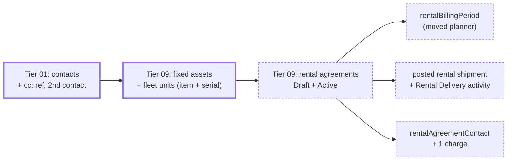

# Rental agreements in the demo datasets

> Status: Approved
> Author: aashu
> Date: 2026-11-10

## TL;DR

- Every demo company (all five datasets) gets rental agreements: one Draft, one Active.
- The Active one has one unit On Rent (a posted rental shipment delivered it) and one unit Pending. It also has two contacts, billing periods and one unbilled charge.
- The units are existing serial items with new fleet serials, each a "Rental Fleet" fixed asset.
- No money is posted: no rental invoices, no deposits, no Sale (sales-type lease) lines.
- The billing-period and classification math moves from `@carbon/utils` into `@carbon/database`, so the seed writes exactly what activation writes.
- Schema stays the same. Only the dataset engine, its data, its checks and two pure modules move.

## Overview diagram



## Problem Statement

No dataset seeds a rental agreement (`packages/database/src/datasets` has no match for "rental").
A fresh demo company has an empty rentals list, an empty fleet screen (the `fleetAssets` view
needs `fixedAsset.itemId`, and no seeded asset has one) and no way to show the agreement page,
its contacts card, billing periods or charges. A bug on that page (the Contacts card crashed
for every Active agreement) went unseen because no demo or dev company had one.

Research: `.ai/research/2026-11-10-rental-agreement-seed-shape.md` (what each rental action
writes) and `.ai/research/2026-11-10-dataset-engine-rental-fit.md` (where it fits in the engine).
Domain research (competitors) is N/A: this seeds an existing feature's rows in the shape the
app already writes; no new domain logic.

## Goals

- Each of the five datasets seeds one Draft and one Active rental agreement.
- Every seeded row matches what the app writes for the same state (create, activate, deliver).
- The fleet screen lists the seeded fleet units.
- `pnpm db:check:datasets` passes, including the re-apply with `wipeFirst`.

## Non-goals

- Rental invoices (Draft or Posted), deposits, credit memos, lease runs.
- Sale (sales-type) lines and their `'Lease'` journals.
- Closed or Cancelled agreements, returned units (`receiptFixedAssetLine`).
- Item or customer rental rate cards (`itemRentalRate`, `customerItemRentalRate`).
- Depreciation postings for the fleet assets (none are posted for any seeded asset today).

## Proposed Solution

### 1. Move the pure rental math into `@carbon/database`

`packages/utils/src/rental-periods.ts` and `packages/utils/src/lessor-lease.ts` import only
`@carbon/database/*` modules and each other (`rental-periods.ts:5-17`, `lessor-lease.ts:5-20`).
1. Move both files to `packages/database/src/`.
2. Export them as `./rental-periods` and `./lessor-lease` in `packages/database/package.json`.
3. Replace each `@carbon/utils` file with a one-line re-export.

This follows the `revenue-schedule` precedent (`packages/utils/src/revenue-schedule.ts:5-6`). No caller changes.

### 2. Data contract (`datasets/types.ts`)

- `FixedAssetSpec` gains optional `item` (readableId) and `serial` (readableId). Both or neither.
- `CustomerContactSpec` gains optional `sharesLocation: true`. Tier 01 then reuses the
  customer's existing "Billing" location and does not overwrite `cloc:<customer>`.
- `SalesData` gains `rentalAgreements: RentalAgreementSpec[]`:

```typescript
type RentalAgreementSpec = {
  ref: string;                    // "ra:<key>"
  customer: string;
  primaryContact: string;         // customer contact lastName
  contacts?: { contact: string; role?: string }[];
  status: "Draft" | "Active";
  startOffset: DayOffset;
  endOffset?: DayOffset;          // open-ended when absent
  billingCycle: "Calendar Month" | "Monthly" | "28 Days";
  billingTiming: "Advance" | "Arrears";
  lines: {
    fixedAsset: string;           // FixedAssetSpec.key, a fleet unit
    rateUnit: "Day" | "Week" | "Month";
    rate: number;
    fairValue: number;
    economicLifeMonths: number;
    deliveredOffset?: DayOffset;  // Active only: delivered by a posted rental shipment
  }[];
  charges?: { line: number; description: string; amount: number; dateOffset: DayOffset }[];
};
```

### 3. Engine (tiers)

- **Tier 01** stores `ctx.refs.contacts["cc:<customer>:<lastName>"]` = `customerContact.id`
  (mirrors `sc:<supplier>`), and honours `sharesLocation`.
- **Tier 09**, in the fixed-asset block: a spec with `item` + `serial` mints a Consumed
  `trackedEntity` (the `seedCustomerAssets` shape, `tiers/04-sales.ts:942-949`) and sets
  `fixedAsset.itemId`, `trackedEntityId`, `quantity = 1`, class "Rental Fleet".
- **Tier 09**, right after the fixed assets, `seedRentalAgreements`:
  - Header: `nextSequence(ctx, "rentalAgreement")`, customer, `customerContactId` (primary),
    terms, `invoiceAutomation = 'Draft Only'`; Active also gets `activatedAt`.
  - `rentalAgreementContact` rows for the non-primary contacts.
  - Lines: fleet asset, item, serial, rate, fair value, economic life. Active lines also get
    `lessorClassification` and `classificationInputs` from `classifyRentalLine` (moved module).
  - Active: `rentalBillingPeriod` rows from `generateRentalBillingPeriods` with the activation
    horizon (`billingHorizon(cycle, anchor)`), all `Pending`.
  - Delivered lines: one Posted `shipment` (`sourceDocument 'Rental Agreement'`, shipment
    sequence) with one `shipmentFixedAssetLine` per delivered unit; the line set to `On Rent`
    with `deliveredAt`; a `Rental Delivery` `trackedActivity` + `trackedActivityInput` (qty 1).
    The same shape as `postRentalShipment`. No item ledger, cost ledger or journal (it writes none).
  - `rentalAgreementCharge` rows, unbilled.
  - Publishes `ctx.refs.documents["ra:<key>"]`.

### 4. Wipe

Add `shipmentFixedAssetLine` to `PARENT_CHECK_TABLES` (its CHECK needs one of two nullable FKs,
which the nulling pass would empty). Every other rental table has `companyId` and cascades
from the agreement, so the wipe needs nothing else.

### 5. Checks

- `validate.ts`: register `ra:<key>` in `documentRefs` after the fixed assets; add
  `sales.rentalAgreements` to the non-empty list; a rentals rule: the customer and contacts
  exist and belong to that customer; the primary contact is not in `contacts`; every line's
  fixed asset is a fleet unit (item + serial, Rental Fleet, Active); one live line per asset
  across all agreements; `rate > 0`; `endOffset > startOffset`; `deliveredOffset` only on
  Active, between start and today; charges point at a real line.
- `coverage.ts`: floors for `rentalAgreement` (2), `rentalAgreementLine`, `rentalBillingPeriod`,
  `rentalAgreementContact`, `rentalAgreementCharge`, `shipmentFixedAssetLine`; raise `fixedAsset`.

### 6. Data, per dataset

Each dataset adds these rows:

1. Three fleet units on existing serial items.
2. A second contact for the renting customer, with `sharesLocation: true`.
3. An Active agreement: open-ended, started 45 days ago, billed Calendar Month in Advance.
   It has 2 lines (1 On Rent, delivered 40 days ago; 1 Pending) and 1 delivery-fee charge.
4. A Draft agreement: a 12-month term that starts in 14 days, with 1 line on the third unit.

| Dataset | Fleet items (3 units in total) |
|---------|---------------|
| satellite | `SAT-1000` engineering-model bus, `RW-010` reaction wheel |
| robotics | `ROB-2000` Vertex 10 robot arm |
| precision | `HMA-4000` HPU manifold assembly |
| motor | `MTR-4500` / `MTR-9000` servo motor assemblies |
| defense | `ISR4-SYS` UAS system, `GCS-100` ground control station |

Serials are new (`<item>-RNT-001` style), never an `onHandTracked` serial.

### Design Decisions

| Decision | Choice | Rationale |
|----------|--------|-----------|
| Depth | Draft + Active, no money posted | User answer. Posted invoices / deposits need new journal builders and wipe changes (a Posted deposit cannot be deleted). |
| Billing periods + classification | Move `rental-periods.ts` and `lessor-lease.ts` to `@carbon/database` | User answer (planner). Classification follows: `classificationInputs` is the full record `classifyRentalLine` builds and the UI reads it; hand-writing it would drift. |
| Datasets | All five | User answer. |
| Fleet units | Existing serial items, new Consumed serials | User answer. No new items or thumbnails; stock and the on-hand ledger are untouched. |
| Active progress | Units On Rent via a posted rental shipment, one Pending | User answer. |
| Contacts | Primary + one extra, reusing the billing location | User answer. `sharesLocation` keeps `cloc:` readers unchanged. |
| Tier | 09, right after fixed assets | Fixed assets do not exist before tier 09. |
| Invoice automation | `'Draft Only'` on every seeded agreement | The nightly `recurring-billing` job drafts every due Pending period; the company default `'Post and Email'` would post and email them. Draft Only keeps it to draft invoices, which is also a useful demo. |
| Active term | Open-ended | `classifyRentalLine` always returns `Rental` for an open-ended term (`lessor-lease.ts:161-163`), so no seeded line can turn into a Sale. |
| Lines' classification | `Rental` only | Follows "no money posted": a `Sale` line writes a `'Lease'` journal the wipe does not void. |

## Data Model Changes

N/A. No migration. Only types in `datasets/types.ts` (seed contract, not DB).

## API / Service Changes

`@carbon/database` gains exports `./rental-periods`, `./lessor-lease`. `@carbon/utils` keeps
its exports as re-exports.

## UI Changes

N/A. The existing rental screens show the seeded rows.

## Acceptance Criteria

- [ ] `pnpm db:check:datasets` passes for all five datasets (validator, apply, floors, re-apply with `wipeFirst`).
- [ ] After `pnpm db:seed:dev -- --dataset <key>`, the rental agreements list shows one Draft and one Active agreement.
- [ ] The Active agreement's details page loads. It shows 2 contacts, billing periods from the start date, 1 unbilled charge, 1 unit On Rent and 1 unit Pending.
- [ ] The fleet screen lists the 3 fleet units. The delivered unit shows On Rent.
- [ ] Opening the Draft agreement as an editor redirects to its setup wizard.
- [ ] `@carbon/utils`, `@carbon/database`, `erp` and `@carbon/jobs` typecheck; existing rental-periods / lessor-lease tests pass from their new home.

## Open Questions

- [x] How much rental data per demo company? — **Answer:** Draft + Active, no money posted.
- [x] How to build billing periods? — **Answer:** move the planner into `@carbon/database`.
- [x] Which datasets? — **Answer:** all five.
- [x] What gets rented out? — **Answer:** existing serial items with new fleet serials.
- [x] How far along is the Active agreement? — **Answer:** units On Rent via a posted rental shipment, one unit Pending.
- [x] Contacts on the agreements? — **Answer:** primary + one extra contact, reusing the billing location.

## Changelog

- 2026-11-10: draft, all questions resolved with the user.
