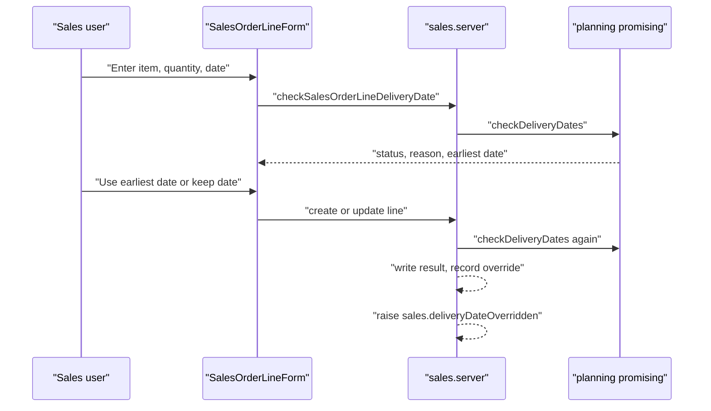

# Sales order delivery date check (order promising)

> Status: in-progress
> Author: naveenkash (with Claude)
> Date: 2026-11-10
> Research: `.ai/research/order-promising-time-fence.md`
> Related: `.ai/specs/2026-09-22-quote-lead-time-prediction.md` (the capacity engine this spec reuses); `.ai/specs/2026-08-22-mrp-v2-planned-order-generation.md` (the planning time fence, a different fence)

## TLDR

A sales order line gets a delivery date check. The check answers one question: can the company deliver this quantity by the promised date?

A company picks one of 4 check levels in Settings → Sales: `None`, `Lead Time`, `Stock` or `Capacity`. An item can override the level for each location. The check runs only inside the fence. The fence is the cumulative lead time of the item through its BOM.

If the date fails, the form shows a warning with the reason and the earliest date. The user can use the earliest date or keep the typed date. The check never blocks the save. If the user keeps a failing date, the system records who kept it and when. Then the system raises the workflow moment `sales.deliveryDateOverridden`. A quote conversion runs the check on each new line and flags each line that fails.

## Overview diagram



## Problem Statement

A user types `salesOrderLine.promisedDate` by hand. Quote conversion sets it to today + `quoteLinePrice.leadTime` (`shared.service.ts`, `convertDocument`). Nothing checks the date against the lead time, the stock or the capacity. MRP then uses that date as the demand date (`packages/planning/src/mrp/plan-company.ts:568`). So a wrong promise becomes wrong demand.

Example: the lead time of an assembly through its BOM is 26 days. A user promises it in 7 days. The order saves. After the next MRP run, the planner sees a red Latest Order Date. The customer already has a promise that the factory cannot keep.

A customer asked for this case: show an exception message to the person who adds an order inside the fixed near-term window. The message must say why: the material is already ordered, the resources are already booked, or the lead time is too short. The research shows that this is a standard ERP feature, order promising, so Carbon builds it for every company.

## Proposed Solution

### 1. The check level

`companySettings."deliveryDateControl"` holds the company level. `itemPlanning."deliveryDateControl"` holds an optional override for one item at one location. NULL means "use the company level". The default company level is `None`, so no current company sees a change.

| Level | What the check uses |
|---|---|
| `None` | No check |
| `Lead Time` | The cumulative lead time only |
| `Stock` | Free stock by week (ATP), then the cumulative lead time |
| `Capacity` | Free stock by week, then a finite simulation of the item's routing (CTP) |

### 2. The cumulative lead time and the fence

The cumulative lead time of an item is:

- For a `Buy` item: `itemReplenishment.leadTime`.
- For a `Make` or `Buy and Make` item: its own `itemReplenishment.leadTime` + the largest cumulative lead time of the components of its active make method (`activeMakeMethods`).

A make item's `leadTime` is its own build time ("from job release to completion", glossary term `item-manufacturing-lead-time`), so the components add to it. An item without an `itemReplenishment` row uses 7 days, the same default as MRP.

The fence date is today + the cumulative lead time. "Today" is the day at the line's location. If the promised date is on or after the fence date, the line passes without more checks. After the fence, the factory has time to buy and make the part (SAP replenishment lead time, Oracle infinite fence).

### 3. The check per line method

The check reads the method of the line (`salesOrderLine.methodType`):

| Line method | `Lead Time` | `Stock` | `Capacity` |
|---|---|---|---|
| Pull from Inventory | fence | ATP, then fence | ATP; if short and the item has a routing, CTP for the shortfall |
| Make to Order | fence | fence | CTP for the full quantity |
| Purchase to Order | fence (own lead time, no BOM) | fence | fence |

- A Make to Order or Purchase to Order line does not ship from stock, so ATP does not apply to it.
- If CTP finds no routing (no active make method, or no operations), the check uses the fence.
- A Make to Order line that already has an open job gets no check. The job's schedule decides its date, and `JobsProjectedLate` already reports a late job.

### 4. ATP: free stock by week, with look-ahead

The check uses weekly periods, as MRP does. A week starts on Sunday (`startOfWeek(today, "en-US")`). Week 0 is the current week. The last week is the week of the fence date.

The check reads live data in 5 queries for all the items of the request:

| Input | Source | Week |
|---|---|---|
| On hand | `itemStockQuantities`, `quantityOnHand − quantityNonNettable`, common stock (`projectId = ''`) | — |
| PO supply | `openPurchaseOrderLines` | `purchaseOrderLineArrivalDate` |
| Job supply | `openProductionOrders` | `jobCompletionDate` |
| Sales demand | `openSalesOrderLines`, without the line under check | `promisedDate`, else today |
| Job material demand | `openJobMaterialLines` | `dueDate − leadTime`, as MRP |

1. The balance of week `w` is the on-hand quantity + the supply − the demand of weeks 0 to `w`.
2. The free stock of week `w` is the smallest balance of weeks `w` to the last week, but not less than 0. This is the "look-ahead": a new order cannot take stock that a later order already has.
3. If the free stock of the promised week is equal to or more than the quantity of the line, the line passes.
4. Otherwise, the earliest date is the start of the first week with enough free stock. If no such week exists, the earliest date is the fence date.

A date before today and a past-due row go to week 0, as in MRP. The quantity of the line is `saleQuantity − quantitySent`, in the same unit that MRP uses.

### 5. CTP: the quote lead-time engine, fed the item's routing

`runQuoteLeadTimeWhatIf` gets an optional `routing` input. If the caller gives a routing, the engine does not read the quote tables. A new loader, `loadItemRouting`, reads the active make method tree of the item. It maps the rows onto the quote row types:

- One method occurrence for each Make to Order material, with ids from its path, so that a sub-assembly used twice gets 2 occurrences.
- `methodMaterial` → `QuoteMaterialRow`, `methodOperation` → `QuoteOperationRow` (`operationLeadTime ?? 0`).

The check uses the "end of queue" answer (`queued`), because the promise must hold without a change to other jobs. The earliest date is today + `queued.leadTimeDays`. The cause sentence of the engine goes into the warning.

### 6. When the check runs

| Moment | What runs | What it writes |
|---|---|---|
| The form changes item, quantity, location, method or promised date | `checkSalesOrderLineDeliveryDate` (read only) | nothing |
| `createSalesOrderLine`, `updateSalesOrderLine` | the check, after the save | the result columns; the override when the date fails |
| `convertQuote`, `acceptDigitalQuote` | the check for every line of the new order | the result columns, no override |

These lines get no check, and their result columns are NULL:

- a line with no item or no promised date;
- a line whose type is not Part, Material, Tool or Consumable;
- a line whose level is `None`.

### 7. Keeping a failing date

The form shows the warning before the save. If the user saves with a failing date, the user keeps the date:

1. The server sets `deliveryDateOverriddenBy` = the user and `deliveryDateOverriddenAt` = now.
2. The server stores the optional reason from the form in `deliveryDateOverrideReason`.
3. The server raises the moment `sales.deliveryDateOverridden` after the write.

If a later save passes the check, the server clears the 3 override columns. A converted line that fails has no override. The sales order shows it as "Date not confirmed" until a user saves the line.

### Design Decisions

| Decision | Choice | Rationale |
|---|---|---|
| Where the check runs | Sales order line only; no RFQ check; the quote keeps its lead-time simulation | Every product surveyed checks the sales order line; none checks an RFQ (research pattern 1) |
| Check levels | `None`, `Lead Time`, `Stock`, `Capacity` | D365 `Delivery date control`, Oracle promising modes (research pattern 2) |
| Where the level lives | `companySettings` default + `itemPlanning` override per item and location, NULL = inherit | Copies `defaultPlanningHorizonDays` / `itemPlanning.planningHorizonDays`; the line has a location |
| The fence | The cumulative lead time through the BOM; no separate fence setting | The user decided; SAP RLT and Oracle infinite fence; no setup; no clash with `planningTimeFenceDays` |
| Meaning of a make item's `leadTime` | Its own build time; components add to it | Glossary `item-manufacturing-lead-time` defines it so |
| Days or weeks for ATP | Weeks, Sunday start, as MRP | The user decided; the check and MRP agree |
| ATP method | Cumulative with look-ahead | D365, NetSuite, APICS; protects later promises (research pattern 6) |
| ATP data | Live open lines, not the stored MRP output | Stored output lags up to 3 hours and holds the line's old quantity, which the check cannot remove per line |
| CTP answer | End of queue (`queued`) | A promise must hold without a change to other jobs |
| CTP engine | `runQuoteLeadTimeWhatIf` with an optional `routing` | One engine for quotes and orders; the quote path does not change |
| Block or warn | Warn only; the save never stops | No product surveyed hard-blocks; the user decided (research pattern 5) |
| UI of the warning | An inline alert under Promised Date, with "Use earliest date"; no modal | The sales-rule modal (`useRuleViolations`) treats any non-violation payload as success and is commercial-licence code; an inline alert needs no resubmit |
| Who may keep a failing date | Any user who can save the line; no new permission | The user decided; no RBAC change |
| Record of a kept date | `deliveryDateOverriddenBy`, `deliveryDateOverriddenAt`, optional `deliveryDateOverrideReason` | The user decided |
| Notification | The moment `sales.deliveryDateOverridden`; each company builds its own workflow | The user decided; no hard-coded recipient |
| Quote conversion | Check every new line after the conversion; flag failures; never stop the conversion | The user decided; SAP checks again at order creation |
| Holding stock or capacity | Not in this spec | Research pattern 7: only a supply order holds capacity; ATP subtraction already stops a double promise of stock; MRP v2 planned orders are the designed way to hold supply |
| Requested date | New `salesOrderLine."requestedDate"`; a new line defaults it from `salesOrder.receiptRequestedDate` | SAP, D365, Oracle and NetSuite keep the requested date apart from the promised date |
| Line with an open job | No check | The job schedule decides the date; `JobsProjectedLate` already reports it |
| Multi-tenancy (heuristic 1) | No new table; every new column sits on a company-scoped table | — |
| Service shape (heuristic 2) | Operations are `defineServiceFn` consts; the engine lives in `@carbon/planning` | `module-files.md` |
| RLS (heuristic 3) | No new table; Kysely writes carry `companyId` | Lesson "Kysely writes in a server function bypass RLS" |
| Permission (heuristic 4) | The check: `{ view: "sales" }`; line writes keep `{ create: "sales" }` | Same as the quote lead-time route |
| Form pattern (heuristic 5) | The line form keeps `ValidatedForm`; the settings card copies `PlanningHorizonCard` | `conventions-forms.md` |
| Module layout (heuristic 6) | Operations in `sales.server.ts`, building blocks in `sales.service.ts`, models in `sales.models.ts`; no barrel | `module-files.md` |
| Backward compatibility (heuristic 7) | New optional inputs only; the migration recreates the line view with the same columns plus the new ones | No published field changes or goes away |

## Data Model Changes

One migration, `delivery-date-check`:

```sql
CREATE TYPE "deliveryDateControl" AS ENUM ('None', 'Lead Time', 'Stock', 'Capacity');
CREATE TYPE "deliveryDateConstraint" AS ENUM ('Lead Time', 'Stock', 'Capacity');
CREATE TYPE "deliveryDateStatus" AS ENUM ('Met', 'Missed');

ALTER TABLE "companySettings"
  ADD COLUMN "deliveryDateControl" "deliveryDateControl" NOT NULL DEFAULT 'None';

ALTER TABLE "itemPlanning"
  ADD COLUMN "deliveryDateControl" "deliveryDateControl";  -- NULL = company level

ALTER TABLE "salesOrderLine"
  ADD COLUMN "requestedDate" DATE,
  ADD COLUMN "deliveryDateStatus" "deliveryDateStatus",
  ADD COLUMN "deliveryDateConstraint" "deliveryDateConstraint",
  ADD COLUMN "earliestDeliveryDate" DATE,
  ADD COLUMN "deliveryDateCheckedAt" TIMESTAMP WITH TIME ZONE,
  ADD COLUMN "deliveryDateOverriddenBy" TEXT REFERENCES "user"("id"),
  ADD COLUMN "deliveryDateOverriddenAt" TIMESTAMP WITH TIME ZONE,
  ADD COLUMN "deliveryDateOverrideReason" TEXT;

CREATE INDEX "salesOrderLine_deliveryDateOverriddenBy_idx"
  ON "salesOrderLine" ("deliveryDateOverriddenBy");

-- "salesOrderLines" selects sl.*; recreate it from its newest definition
-- (20261006220201_revenue-recognition-core.sql) so the new columns show.
DROP VIEW IF EXISTS "salesOrderLines";
CREATE VIEW "salesOrderLines" WITH(SECURITY_INVOKER=true) AS ( ...same body... );
```

- Every new column is nullable, except the company level, which has a default. Every reader treats NULL as "not checked" (lesson "A nullable column added by migration needs a reader that tolerates NULL").
- `deliveryDateStatus` NULL means "not checked". `Missed` with `deliveryDateOverriddenBy` NULL means "not confirmed".
- No column holds a row id without a foreign key, so `ID_REF_COLUMNS` does not change. No table is renamed or dropped.

## API / Service Changes

| Where | Change |
|---|---|
| `packages/planning/src/promising/cumulative-lead-time.ts` | New. Pure `cumulativeLeadTimes(items, edges)`; loader `loadCumulativeLeadTimes(db, companyId, itemIds)` with one recursive query over `activeMakeMethods` and `methodMaterial` |
| `packages/planning/src/promising/available-to-promise.ts` | New. Pure `weeklyFreeStock(...)` and `earliestWeekWithStock(...)`; loader `loadSupplyAndDemand(db, companyId, keys)` |
| `packages/planning/src/promising/item-routing.ts` | New. `loadItemRouting(db, companyId, itemId)` → the quote row types |
| `packages/planning/src/promising/delivery-date-check.ts` | New. Pure `decideDeliveryDate(...)` (the table in section 3); orchestrator `checkDeliveryDates({ db, client, companyId, userId, lines })` |
| `packages/planning/src/scheduling/quote-lead-time.ts` | `runQuoteLeadTimeWhatIf` accepts an optional `routing`; export the `QuoteLineRouting` type |
| `packages/planning/src/index.ts` | Export `checkDeliveryDates` and its types |
| `sales.service.ts` | New `writeDeliveryDateResults(ctx, results)` (one Kysely `UPDATE … FROM (VALUES …)`, scoped by `companyId`); new `checkSalesOrderDeliveryDates(ctx, { salesOrderId, lineIds?, overrideReason? , recordOverride })` |
| `sales.server.ts` | New `checkSalesOrderLineDeliveryDate` (`{ view: "sales" }`, `@mcp read`); `createSalesOrderLine` / `updateSalesOrderLine` run the check after the save; `convertQuote` / `acceptDigitalQuote` run it after the conversion |
| `sales.models.ts` | `salesOrderLineValidator` gains `requestedDate` and `deliveryDateOverrideReason`; new `deliveryDateCheckValidator` |
| `settings.server.ts` | `updateSalesSettings` accepts `deliveryDateControl` |
| `items.models.ts` / `items.server.ts` | `itemPlanningValidator` and `updateItemPlanning` accept `deliveryDateControl` |
| Route `x+/sales-order+/$orderId.delivery-date.tsx` | New action. It calls `api.sales.checkSalesOrderLineDeliveryDate` |
| Workflow catalog | New moment `sales.deliveryDateOverridden` (`packages/workflows-core/src/moments.ts`, `packages/ee/src/workflows/catalog/moments.ts`, `pnpm run generate:workflow-catalog`) |

## Closest Sibling

The quote lead-time check (`.ai/specs/2026-09-22-quote-lead-time-prediction.md`): a read-only what-if on a sales document line, with the same engine and the same permission.

| This feature | Copies |
|---|---|
| Check route `$orderId.delivery-date.tsx` | `routes/x+/quote+/$quoteId.$lineId.lead-time.tsx` |
| JSON fetcher in the form | `QuoteLeadTimeModal.tsx` (fetcher posting JSON) |
| Settings card | `settings/ui/Planning/PlanningHorizonCard.tsx` |
| Item override | `itemPlanning.planningHorizonDays` in `ItemPlanningForm.tsx` |
| Line flag in the explorer | `QuoteLineStatusIcon` in `QuoteExplorer.tsx` |
| Moment | `sales.quoteAccepted` |

Deviations, each a Design Decision above: an inline alert instead of a modal; the check runs on save, not only on demand.

## UI Changes

The page archetypes are the sibling's: the sales order record page (explorer + line form) and a settings page.

1. **Settings → Sales**: a new card "Delivery Date Check" with a Select of the 4 levels and one sentence for each level.
2. **Part (and Material, Tool, Consumable) → Planning**: a Select "Delivery Date Check" with "Company default" + the 4 levels.
3. **Sales order line form** (item tab, not for a Service line):
   - A new date field "Requested Date" beside "Promised Date".
   - Under "Promised Date", an alert with the result of the live check:
     - Lead time: "The lead time is 26 days. The earliest delivery date is Dec 6, 2026."
     - Stock: "Only 40 are free by Nov 17, 2026. The earliest delivery date is Nov 29, 2026."
     - Capacity: "The shop cannot finish this by Nov 17, 2026. The earliest delivery date is Dec 1, 2026." + the engine's cause.
   - A button "Use Dec 6, 2026" sets Promised Date to the earliest date.
   - An optional text field "Reason for keeping this date".
4. **Sales order explorer**: a calendar icon on a line whose status is `Missed`. Amber: "Date not confirmed". Muted: "Date kept by {user}". The tooltip shows the earliest date.

## Acceptance Criteria

- [ ] With the company level `None`, a new sales order line saves as today and its result columns stay NULL.
- [ ] With `Lead Time`: an assembly has an own lead time of 5 days. Its Make to Order sub-assembly has 7 days, and the bought part inside it has 14 days. The cumulative lead time is 26 days. A line promised for today + 10 shows the warning with earliest date today + 26. A line promised for today + 30 shows no warning.
- [ ] Clicking "Use {date}" sets Promised Date to the earliest date, and the warning goes away.
- [ ] Saving the line with a failing date stores `deliveryDateStatus = Missed`, the earliest date, the user and the time, and the reason when given. The server raises the moment `sales.deliveryDateOverridden` once.
- [ ] Saving the line later with a passing date clears the 3 override columns.
- [ ] With `Stock`: 100 on hand, another order for 80 due next week, and no supply. A Pull from Inventory line for 30 due this week fails with 20 free. Its earliest date is the fence date. A line for 20 passes.
- [ ] With `Stock`: a PO for 50 arrives in week 2. A line for 60 due this week (on hand 20, no other demand) gets the start of week 2 as its earliest date.
- [ ] With `Capacity`: a Make to Order line for an item with a routing returns the end-of-queue finish of the quote engine as its earliest date. An item with no routing falls back to the fence.
- [ ] An item override at the line's location wins over the company level.
- [ ] Converting a quote with 2 lines, one inside its fence, flags that line "Date not confirmed" on the new order. The conversion does not stop.
- [ ] A Make to Order line with an open job gets no check.
- [ ] The quote lead-time simulation still returns the same result for a quote line (its tests pass unchanged).

## Risks

| Risk | Severity | Mitigation |
|---|---|---|
| CTP takes seconds for a large routing, and the form calls it on each change | Med | Call the check only when a field changes, cancel a stale call, and show a spinner. Run CTP only inside the fence. |
| Quote conversion with many Make to Order lines runs CTP once per line | Med | CTP runs only for lines inside their fence. Each run reuses the engine's per-company cache. |
| The recreated `salesOrderLines` view drifts from its newest definition | High | Copy the body from `20261006220201_revenue-recognition-core.sql` unchanged; check that no later migration changed it. |
| A cumulative lead time from a deep BOM looks too long | Low | The warning shows the number; a user can fix the lead times. |
| The stored result gets old as time passes | Low | `deliveryDateCheckedAt` shows its age; the next save checks again. |

## Open Questions

- [x] Days or weeks for ATP? — **Answer:** weeks, as MRP, so both give the same answer (user, 2026-11-10).
- [x] Which lead time applies to a make item? — **Answer:** the cumulative lead time through its BOM (user, 2026-11-10).
- [x] Who may keep a failing date, and is a reason required? — **Answer:** any user who can save the line. The system records who and when. The reason is optional. A moment lets each company add approval or alerts (user accepted the suggestion, 2026-11-10).
- [x] Does the check run on converted lines? — **Answer:** yes, without a stop; failures get a flag (user accepted the suggestion, 2026-11-10).
- [x] Must an accepted line hold stock or capacity? — **Answer:** no; ATP with look-ahead subtracts it; MRP v2 planned orders hold supply later (user accepted the suggestion, 2026-11-10).
- [x] Does a make item's `leadTime` include its components? — **Autonomous:** no; the glossary defines it as the own build time, so the components add to it.
- [x] Does the fence need its own setting and name? — **Autonomous:** no; the fence is the calculated cumulative lead time, so nothing clashes with the MRP v2 `planningTimeFenceDays`.
- [x] Modal or inline warning? — **Autonomous:** inline; the sales-rule modal treats any other payload as success, and the check never blocks.
- [x] Where does the item override live? — **Autonomous:** `itemPlanning`, per item and location, as `planningHorizonDays`.
- [x] Does a line with an open job get a check? — **Autonomous:** no; its job schedule decides the date.

## Changelog

- 2026-11-10: Created. It has 5 autonomous resolutions:
  1. the meaning of a make item's `leadTime`;
  2. no separate fence setting;
  3. an inline warning;
  4. the override on `itemPlanning`;
  5. no check for a line with an open job.
