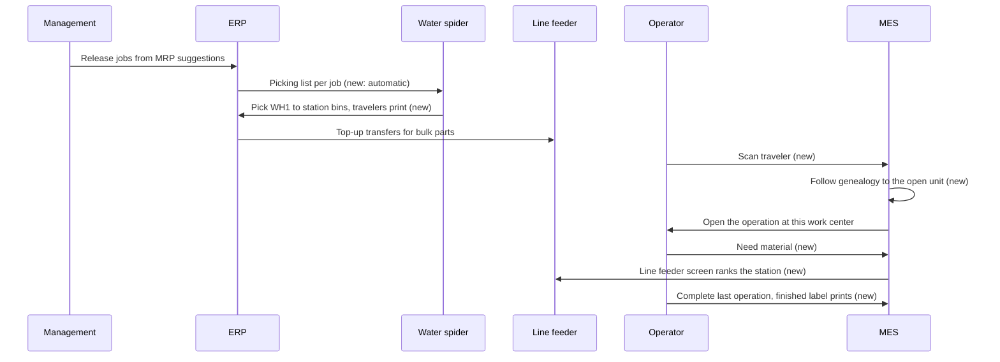

# Serial traveler and line flow

> Status: in-progress
> Author: Dane Albaugh
> Date: 2026-11-12

## TLDR

One printed label follows a serial unit from the pick in Warehouse 1 to the finished good. An operator scans the label on any MES screen. MES follows the unit's genealogy to the unit it is now part of, and opens the right operation. Around the scan, slice 1 adds the line flow. It makes a picking list at job release and prints travelers at the pick. It prints a finished-good label at the last operation. It adds a "Need material" signal and a line feeder screen. An optional rule blocks completion until the operator scans in every traced part. Slice 2 links each job to its MRP suggestion and its releaser, and creates jobs below safety stock. Slice 3 adds defect pattern dashboards. This spec defers capacity scenarios.

Shareable process page: https://claude.ai/artifact/GKoCC7X4s8rKMo8pcbHJHf. Run record: `.ai/runs/2026-11-12-serial-traveler.md`. Plan: `.ai/plans/2026-11-12-serial-traveler-line-flow.md`.

## Overview diagram



## Problem Statement

A manufacturer of a small turbojet builds each engine on 3 lines in one building. Line A and Line B start at the far ends of Warehouse 2 and work inward. They meet in the middle, and the final line moves up the factory to the finished engine. The fuel injector assembly and the combustion chamber are separate serial jobs. The engine is a serial job.

Carbon cannot run this flow today, for 6 reasons:

1. A serial label holds the raw `trackedEntityId`. The MES keyboard wedge acts only on MES or ERP links (`apps/mes/app/routes/x+/_layout.tsx:441-447`). Outside the issue screen, a scan of a serial label shows "Nothing on this page uses that barcode".
2. No code walks the genealogy forward. When a fuel injector assembly goes into a combustion chamber, its label no longer finds the work.
3. The `trackedEntitiesToOperation` posting accepts a unit of the wrong item. It adds a new `jobMaterial` with estimated quantity 0 (`apps/erp/app/modules/inventory/inventory.service.ts:29095-29140`).
4. Only the client warns about unissued serial or batch materials (`QuantityModal.tsx:165-171`). The server never checks, and no setting blocks completion.
5. A person creates each picking list by hand, and the MES Picking screen shows only lists assigned to the user.
6. Nothing tells a line feeder which station waits for material.

## Proposed Solution

The solution has 3 slices. This spec designs all 3. The plan builds slice 1 first, so the user can test it locally and iterate.

### Slice 1 — the line

**S1. The traveler link.** The default tracked-entity label template encodes `{MES_URL}/x/traveler/{trackedEntityId}` in its QR code. The MES keyboard wedge already opens MES links, so the scan works on every MES screen and with a phone camera. A label template that a company edited keeps its own QR content. The ZPL renderer sizes the QR from the length of its value, because the link needs QR version 4.

**S2. Raw IDs from old labels.** The MES wedge can get a scan that it does not recognize. Before it shows the toast, it asks a new resource route, `x+/traveler.resolve.tsx`. If the scan matches one `trackedEntity.id` or `readableId` of the company, MES opens `/x/traveler/<id>`. If it matches 2 or more units, MES shows "This barcode matches more than one unit". Otherwise MES shows the toast, as today. The wedge keeps the scan pending while the resolve call runs, so a second scan of the same label does nothing.

**S3. The genealogy walk.** A new SQL function `get_traveler_target(p_tracked_entity_id, p_company_id)` starts at the scanned unit. While the unit's status is `Consumed`, it follows the newest `Consume` activity edge that has no later `Unconsume` for the same pair. It returns the first unit that is not `Consumed`, with its status, `attributes->>'Job'` and `attributes->>'Job Make Method'`. It stops after 20 steps and returns the last unit it reached.

**S4. The traveler route.** The MES route `x+/traveler.$trackedEntityId.tsx` calls `get_traveler_target` and acts on the result:

| Result unit | What MES does |
|-------------|---------------|
| `Reserved`, in a job (a unit in production) | Find the open operations of the unit's job make method. Open the one at the operator's work center for the day (`getMyPeopleAssignment`). If there is none, open the next open operation in routing order. If 2 or more match, show a short list. The link is `/x/operation/<id>?trackedEntityId=<unit>`. |
| `Available` (a finished sub-assembly in stock) | Show the open operations at this location that still need the unit's item. For a serial job, "still need" means the operation's next unit does not yet hold its quantity of the item (the S5 rule). The operator's work center comes first, then the earliest job due date. MES preselects the first row. One tap issues the unit and opens that operation. |
| `Available`, and no open operation needs its item | Show the unit's readable ID, item and bin, with a link to the ERP traceability graph. |
| Any other status (`On Hold`, `Rejected`, `Scrapped`) | Show the status, and do nothing else. |
| Not found in the company | Show "This label does not belong to a unit in this company". |

**S5. Scan into the open operation.** On the job operation screen (`JobOperation.tsx`, `AssemblyView.tsx`), a traveler scan of an `Available` unit issues it into the open operation. The screen calls the existing route `issue-tracked-entity.tsx` with `parentTrackedEntityId` set to the operation's current unit. Before the issue, MES refuses a unit whose item has no `jobMaterial` on the operation's job make method. The message is "This job does not use <item>". MES also refuses a unit when no material of its item still needs it. The rule has 2 cases:

| Parent | A material still needs the item while |
|--------|---------------------------------------|
| A serial unit | Its quantity per unit is more than the item consumed into that unit. `Consume` edges count, less the parts an `Unconsume` gave back and less scrapped parts. |
| Any other parent | `estimatedQuantity - quantityIssued` is more than 0. |

The message is "This unit already has its <item>" for a serial unit, and "This job already has all its <item>" for any other parent. The server makes this check (`resolveTravelerMaterial`). The traveler route's chooser (S4) applies the same rule, so it never offers an operation that the issue then refuses. A failed read refuses the issue with "Could not check this unit. Try again.". A failed label lookup shows "Could not look up this label. Try again.", not "not found". A traveler scan of a unit that is already inside this job's unit opens that operation, with no issue. A traveler scan of a batch lot does not issue it: MES sends the operator to the Issue dialog, so a scan never consumes a whole lot. The MES layout wedge leaves traveler links alone on `/x/operation/` and `/x/assembly/`, so the operation screen gets them first.

**S6. Labels at the pick and at the finish.**

1. When a picking list leaves `Draft`, Carbon prints one traveler for each output unit of each job on the list. The move can come from a status change or from a pick (the `update_picking_list_status` trigger). A pick that resolves every line takes the list straight to `Completed` or `Partial`, and that move prints too. The printer is the location's `inventory` printer context, through a new print source `PickingList`.
   - The column `pickingList."travelersPrintedAt"` records the print. After each status change and each pick, one conditional UPDATE sets it (`claimTravelerPrint`, `@carbon/database/travelers`).
   - The UPDATE changes the row only when the column is null and the status is not `Draft` or `Cancelled`. Only the call that changes the row prints. So two picks at the same moment print once, and a list that returns to `In Progress` prints nothing.
   - If `travelerLabels` is off, Carbon does not set the column. So a company that turns the setting on later still gets travelers for a list that has not printed.
2. The picking list gets a "Print travelers" action, for a lost or damaged label.
3. When the last operation of a job's top-level make method completes, Carbon prints the unit's serial label. This happens only when the item's `itemSerialSequence.printLabelOnCompletion` is true. The printer is the work center's printer context.
4. A company with `travelerLabels` on stops the existing first-operation print (`autoPrintFirstOperationLabel`). A company with it off keeps today's behavior.

**S7. Required scans.** A new company setting `requireTrackedMaterialsIssued` is off by default. When it is on, MES refuses to complete an operation while a serial or batch `jobMaterial` of that operation has `quantityIssued` below its requirement. A material with no `jobOperationId` belongs to the first open operation of its make method (lowest `order`, then id), where the picking list stages it and the line feed counts it. The server checks in every completion route, before it records anything:

1. `complete.tsx`, `end.$operationId.tsx` and `finish.tsx`.
2. The inspection lot routes `inspection-lot.$id.complete-passed.tsx` and `inspection-lot.$id.disposition.tsx`. A serial lot checks each unit it completes. The disposition route checks before it closes the lot.
3. Batch completion `batch.$batchId.complete.tsx`. It checks every member and refuses the whole batch. The message names each member that is short. A batch pick adds to the member's `quantityIssued` and does not scan into one unit, so the check counts `quantityIssued` for every member, also a serial member.

A failed read refuses with "Could not check the scanned parts". The client and the server use one shared helper. `QuantityModal` shows the missing parts and disables the button, in place of today's confirm checkbox. An operation with 2 or more serial sub-assemblies follows the same setting.

**S8. Automatic picking lists.** A new company setting `autoPickingListOnRelease` is off by default. When it is on, `releaseCheckedJobs` calls the `generatePickingList` building block once for each released job, after the job is `Ready`. The picking list keeps today's destination: the lineside storage unit of each work center that uses the part. Water spiders carry the parts from Warehouse 1 to the stations. A failure to generate a list does not undo the release. Carbon adds a paragraph to `job.notes`, logs the error and returns a release warning. The MES Picking screen also shows unassigned lists at the operator's location, because a list made at release has no assignee.

**S9. "Need material".** The MES job operation screen and the assembly screen get a "Need material" action. The MES reaches ERP operations only through postings, so the create and resolve building blocks live in `@carbon/database/material-request`. The operator picks a part (optional) and writes a note (optional). MES writes a `materialRequest` row with status `Open`. The line feeder resolves it from the line feeder screen.

**S10. The line feeder screen.** A new MES route `x+/line-feed.tsx` shows one list for the location, in this order:

1. Open `materialRequest` rows, oldest first.
2. Computed shortages: a station bin holds less of a part than the queued operations at that work center still need. A new SQL function `get_line_feed_shortages(p_location_id, p_company_id)` computes them. A station bin is a storage unit with `workCenterId` set.
3. Open stock transfers whose destination is a station bin, for example the top-ups that Transfer kanbans create for bulk parts. The MES has no stock transfer screen, so each transfer row links to the ERP page.

Each row shows the station, the part, the quantity short or requested, and the age. A shortage has no age, because Carbon computes it and does not store it. A request row has a "Resolve" button.

**S11. Test data.** A new dev-only dataset `motor-line` copies the `motor` dataset and adds an anonymized turbojet line. `motor` is a live onboarding template (`industryId: "automotive_precision"`), so it stays unchanged. Section "Test data" below gives the shape.

### Slice 2 — the plan

**S12. Who released the job.** A new column `job.releasedBy` holds the user who flipped the job to `Ready`. `releaseCheckedJobs` writes it. For a system release, it writes the `onBehalfOf` user.

**S13. The MRP suggestion behind the job.** A new nullable column `job.planningActionId` references the Make `planningAction` that the planner turned into the job. `orderPlannedJobs` writes it. The reference uses `ON DELETE SET NULL`.

**S14. Jobs below safety stock.** A new `itemPlanning` flag `autoCreateJobsBelowSafetyStock` is off by default. After each MRP run, a system process reads the open Make actions for flagged items whose cause is the safety stock floor. It creates each job with `orderPlannedJobs` and releases it with `releaseCheckedJobs`, on behalf of a new company setting `autoJobUserId`. MRP nets open jobs as supply, so a job that management already created is not created again.

### Slice 3 — the answers

**S15. Defect patterns.** A new ERP page under Quality lists the serials of one item that have a nonconformance in a date range. For each factor, it compares the share of defective serials with the share of all serials of the item. The factors are: component lot, operator, work center, shift date, and released-by user. The page sorts the factors by the gap. It reads the genealogy, `productionEvent`, and the slice 2 columns. Each row links to the traceability graph.

### Design Decisions

| Decision | Choice | Rationale |
|----------|--------|-----------|
| One label or a new label per job | One label per unit, followed through the genealogy | The user's choice, after a review of open-mrp/api (`FindNextAvailableBatchInFlow` walks closed batches downstream to the open batch) |
| What the QR holds | An MES link, `/x/traveler/<trackedEntityId>` | The wedge already opens MES links. Grill Q1. |
| Old raw-ID labels | A resolve call before the "unrecognized" toast | Labels already printed keep working (S2) |
| Which operation opens | Operator's work center, then the next open operation, then a short list | MES has no device-station concept. Grill Q2. |
| Kits | No kit items. Stations take loose parts from station bins | User decision, Grill Q3a |
| Warehouses | One location. Warehouse 1 and the station bins are storage units | User decision, Grill Q3b |
| Pick orders | Automatic at release, one picking list per job, behind `autoPickingListOnRelease` | Grill Q3c. Off by default keeps other companies unchanged. |
| Pick destination | Today's destination: each work center's lineside storage unit | Grill Q12. A pick also points the job material at its destination bin (`pointJobMaterialAtLineside`), so a staging destination would make jobs consume from staging. |
| Station top-ups | Existing Transfer kanbans with `replenishmentLevel`, for bulk parts that no job picks | Grill Q3e and Q12. No new replenishment engine. |
| Waiting on material | A computed shortage and a "Need material" request; the request ranks first | Grill Q3f |
| Where labels print | Travelers at the pick; the finished-good label at the last operation | Grill Q4. A sub-assembly prints no label at completion. |
| How a company turns the label points on | Company setting `travelerLabels` for the pick print and the first-operation print; `itemSerialSequence.printLabelOnCompletion` for the finish label | Default for v1, revisit after testing. Keeps other companies on today's first-operation print. A per-item flag separates the finished good from a sub-assembly. |
| Fuel injector inside the chamber job | No. The injector, the chamber and the engine stay 3 jobs, so Line A carries 2 travelers | Default for v1, revisit after testing. It keeps a serial for each sub-assembly. |
| Which job gets a sub-assembly from stock | The open operation on screen. Else a short list: the operator's work center first, then the earliest due date | Default for v1, revisit after testing (S4, S5) |
| Wrong item | The traveler scan refuses an item that the job make method does not use | The posting accepts it today. The check sits in the traveler path only, so other issue paths keep their behavior. |
| The 2-or-more sub-assembly rule | Part of `requireTrackedMaterialsIssued` | Default for v1, revisit after testing. Off by default keeps other companies unchanged. The test data turns it on. |
| Where the required-scan check runs | Server, in every completion route; the client only shows it | A client-only check is easy to skip (Problem 4) |
| Genealogy walk | One SQL function, `Consume` edges only, newest edge without a later `Unconsume`, 20 steps at most | Scrap writes a second edge to the same parent; a re-issue writes a second `Consume` edge |
| Test data | A dev-only dataset `motor-line` = `motor` plus the AJ-3 line | `motor` is a live onboarding template. A copy inherits its full status matrix (`validate.ts`, `MIN_JOBS = 18`) at no extra cost. |
| Jobs below safety stock | Create and release, on behalf of `autoJobUserId` | Default for v1, revisit before the slice 2 plan. The user wants items that "never run out". |
| New print source | `PickingList` in the printing registry, with context `inventory` | The `Entity` source prints one unit and maps to the `default` or `workCenter` context. The printing package lists a new source under Ask First; the user approved it with the plan. |
| Heuristic 1, multi-tenancy | `materialRequest` has `companyId`, composite PK `("id", "companyId")`, `id('mreq')` | `.claude/rules/conventions-database.md` |
| Heuristic 2, service shape | New operations are `defineServiceFn` consts in `{module}.server.ts`; building blocks take `db` or `client` | `.claude/rules/module-files.md` |
| Heuristic 3, RLS | `materialRequest`: SELECT any employee, INSERT any employee, UPDATE `inventory_update` or the creator, DELETE `inventory_delete` | Operators create requests; line feeders resolve them. Declared in `packages/database/src/authz/manifest.ts`, never as a policy statement in a migration. |
| Heuristic 4, permissions | Traveler route: `requirePermissions(request, {})` like other MES routes; line feeder screen: `view: inventory` | MES routes check membership; the issue posting checks its own permission |
| Heuristic 5, forms | Settings toggles use `settingsToggle`; "Need material" uses `ValidatedForm` + `validator(materialRequestValidator)` | `.claude/rules/conventions-forms.md` |
| Heuristic 6, module layout | Inventory operations in `inventory.server.ts`; production in `production.server.ts`; no barrel | `.claude/rules/module-files.md` |
| Heuristic 7, backward compatibility | Every new behavior is behind a setting that is off by default, except the new default label QR, the raw-ID resolve and unassigned picking lists in the MES | Existing customers keep today's behavior. A changed default QR only affects new prints, and old labels still resolve. |

## Data Model Changes

Slice 1 (migrations `*_serial-traveler-schema.sql`, `*_get-traveler-target.sql`, `*_get-line-feed-shortages.sql`, `*_serial-traveler-authz.sql`):

```sql
-- Settings (companySettings)
ALTER TABLE "companySettings"
  ADD COLUMN "travelerLabels" BOOLEAN NOT NULL DEFAULT false,
  ADD COLUMN "requireTrackedMaterialsIssued" BOOLEAN NOT NULL DEFAULT false,
  ADD COLUMN "autoPickingListOnRelease" BOOLEAN NOT NULL DEFAULT false;

-- Finished-good label per item; the "itemSerialSequences" view is rebuilt to carry it
ALTER TABLE "itemSerialSequence"
  ADD COLUMN "printLabelOnCompletion" BOOLEAN NOT NULL DEFAULT false;

-- "Need material" requests
CREATE TYPE "materialRequestStatus" AS ENUM ('Open', 'Resolved');

CREATE TABLE "materialRequest" (
    "id" TEXT NOT NULL DEFAULT id('mreq'),
    "companyId" TEXT NOT NULL,
    "locationId" TEXT NOT NULL,     -- composite FK to "location"
    "workCenterId" TEXT,            -- composite FK to "workCenter"
    "jobOperationId" TEXT,          -- FK to "jobOperation", SET NULL
    "itemId" TEXT,                  -- FK to "item", SET NULL
    "note" TEXT,
    "status" "materialRequestStatus" NOT NULL DEFAULT 'Open',
    "resolvedBy" TEXT REFERENCES "user"("id"),
    "resolvedAt" TIMESTAMP WITH TIME ZONE,  -- CHECK: set exactly when Resolved
    "createdBy" TEXT NOT NULL REFERENCES "user"("id"),
    "createdAt" TIMESTAMP WITH TIME ZONE NOT NULL DEFAULT NOW(),
    "updatedBy" TEXT REFERENCES "user"("id"),
    "updatedAt" TIMESTAMP WITH TIME ZONE,
    CONSTRAINT "materialRequest_pkey" PRIMARY KEY ("id", "companyId")
);
-- RLS from the authz manifest; realtime through broadcast_table_changes.

-- Functions
-- get_traveler_target(p_tracked_entity_id TEXT, p_company_id TEXT)
--   RETURNS TABLE ("trackedEntityId", "status", "jobId", "jobMakeMethodId", "itemId", "depth")
-- get_line_feed_shortages(p_location_id TEXT, p_company_id TEXT)
--   RETURNS TABLE ("workCenterId", "storageUnitId", "itemId", "required", "onHand", "short")
```

Slice 2:

```sql
ALTER TABLE "job"
  ADD COLUMN "releasedBy" TEXT REFERENCES "user"("id"),
  ADD COLUMN "planningActionId" TEXT;
-- planningActionId: composite FK to "planningAction" ("id", "companyId") ON DELETE SET NULL.
ALTER TABLE "itemPlanning"
  ADD COLUMN "autoCreateJobsBelowSafetyStock" BOOLEAN NOT NULL DEFAULT false;
ALTER TABLE "companySettings"
  ADD COLUMN "autoJobUserId" TEXT REFERENCES "user"("id");
```

Slice 3 adds no tables. It reads the genealogy, `productionEvent`, the nonconformance tables and the slice 2 columns.

🛑 `job` and `itemPlanning` are core tables (slice 2). Every new column is nullable or has a default, so existing rows and existing writes stay valid. Run `pnpm run generate:types` after each migration, and run `pnpm db:check:backups`.

## API / Service Changes

| Change | File | Slice |
|--------|------|-------|
| Default label QR becomes the traveler link | `packages/documents/src/template/defaults.ts`, `pdf/blocks/trackingLabel/vars.ts`, `zpl/ProductLabelZPL.tsx` | 1 |
| A scan stays pending while `onUnrecognized` runs | `packages/react/src/hooks/useKeyboardWedge.ts` | 1 |
| Resolve route for raw IDs; wedge `onUnrecognized` calls it | `apps/mes/app/routes/x+/traveler.resolve.tsx`, `apps/mes/app/routes/x+/_layout.tsx` | 1 |
| `get_traveler_target` | new migration | 1 |
| Traveler route and chooser | `apps/mes/app/routes/x+/traveler.$trackedEntityId.tsx` | 1 |
| Traveler scan on the operation screen, with the wrong-item refusal | `JobOperation.tsx`, `AssemblyView.tsx`, `issue-tracked-entity.tsx` | 1 |
| IssueMaterialModal Scan tab reads the ID out of a traveler link | `IssueMaterialModal.tsx` | 1 |
| Required-scan check | `apps/mes/app/services/operations.service.ts`; `complete.tsx`, `end.$operationId.tsx`, `finish.tsx`, `inspection-lot.$id.complete-passed.tsx`, `inspection-lot.$id.disposition.tsx`, `batch.$batchId.complete.tsx`; `QuantityModal.tsx` | 1 |
| Travelers at the pick, "Print travelers" | `packages/printing` registry, print-job resolver `PickingList`, picking status and pick routes | 1 |
| Finish label | `apps/mes/app/services/printing.server.ts` | 1 |
| Picking list at release, through the `generatePickingList` building block | `releaseCheckedJobs` (`production.server.ts:278`), `production.service.ts` | 1 |
| Unassigned picking lists in the MES | `apps/mes/app/services/picking.service.ts` | 1 |
| `materialRequest` create and resolve | `packages/database/src/material-request.ts`; ERP operations in `inventory.server.ts` | 1 |
| Line feeder screen and `get_line_feed_shortages` | `apps/mes/app/routes/x+/line-feed.tsx`, new migration | 1 |
| Settings toggles | `apps/erp/app/routes/x+/settings+/production.tsx`, `settings.server.ts` (`updateProductionSettings`) | 1 |
| "Print label on completion" | `ItemSerialSequenceForm.tsx` (Settings → Serial Numbers) | 1 |
| `releasedBy`, `planningActionId` writes | `releaseCheckedJobs`, `orderPlannedJobs` | 2 |
| Jobs below safety stock | new Inngest function after the MRP run (`packages/jobs`) | 2 |
| Defect patterns page and its reads | `apps/erp/app/routes/x+/quality+/`, `quality.server.ts` | 3 |

## Closest Sibling

| New part | Sibling it copies | Files |
|----------|-------------------|-------|
| Traveler route (a scan that redirects to an MES operation) | Kanban scan routes | `apps/erp/app/routes/api+/kanban.start.$id.tsx`, `kanban.complete.$id.tsx`, MES `end.$operationId.tsx` |
| Traveler scan on the operation screen | The kanban-complete wedge handler | `JobOperation.tsx:717-748`, `apps/mes/app/utils/kanban.ts` |
| Required-scan setting | Strict backflush (`requireBackflushStorageUnit`) | `20261015163040_strict-backflush.sql`, `checkStrictBackflush` in `apps/mes/app/services/quality.server.ts:656` |
| Line feeder screen | The MES picking list index | `apps/mes/app/routes/x+/picking._index.tsx` |
| "Need material" action | The MES quality issue action on an operation | `apps/mes/app/routes/x+/quality-issue.new.tsx` |
| Auto print at a step | `autoPrintFirstOperationLabel` | `apps/mes/app/services/printing.server.ts:32` |
| Defect patterns page (slice 3) | The Quality index KPI charts | `apps/erp/app/routes/x+/quality+/_index.tsx`, `api+/quality.kpi.$key.ts` |

Deviations: the traveler route resolves through genealogy, where the kanban routes resolve through `kanban.jobId`. Each deviation is in Design Decisions.

## UI Changes

| Screen | Archetype | Precedent |
|--------|-----------|-----------|
| Traveler chooser (2 or more operations, or a sub-assembly in stock) | MES list of operation cards | The operations board cards (`apps/mes/app/routes/x+/operations.tsx`) |
| "Need material" | MES modal | The quality issue modal |
| Line feeder screen | MES list page | `picking._index.tsx` |
| Required-scan block | MES modal content | `QuantityModal.tsx` warning block |
| Settings → Production: a "Line Flow" card with 3 toggles | Settings card with switches | The "Shop Floor" card in `production.tsx` |
| Settings → Serial Numbers drawer: "Print label on completion" | Form switch | The Timing field in `ItemSerialSequenceForm.tsx` |

Each UI task in the plan names its precedent and passes the screenshot check (`.ai/lessons.md` → "Every UI task names its precedent screen").

## Test data

The dev-only dataset `motor-line` holds the `motor` data plus an anonymized turbojet line, "AJ-3". It uses no customer names, part numbers or quantities.

| Part | Shape |
|------|-------|
| Items | AJ-3 engine (Serial, Make); combustion chamber (Serial, Make); fuel injector assembly (Serial, Make); 2 bearings (Batch, Buy); 12 bought parts (Inventory, Buy) |
| Methods | Injector: 4 operations; chamber: 5 operations, uses the injector; engine: 12 operations, the chamber at the merge operation, 2 bearings at operation 2 |
| Bins | Warehouse 1 racks; one station bin per work center (tier 01 already makes "<work center> Floor" with `workCenterId` set) |
| Work centers | A1–A4, B1–B4, M, F1–F6 |
| Settings | `travelerLabels`, `requireTrackedMaterialsIssued` and `autoPickingListOnRelease` on; the engine's `printLabelOnCompletion` on |
| Stock and jobs | Bought parts on hand in Warehouse 1, bearings in batch lots; 2 engine, 2 chamber and 2 injector jobs `Ready`, and 1 engine job `Planned` to release |
| Kanbans | Transfer kanbans for 3 bulk parts from Warehouse 1 to station bins, with a `replenishmentLevel` |

Five dataset tiers need a change: a BOM line names its operation (`methodOperationId`); a lot writes its own opening ledger row, so pick and issue screens see it; a serial job splits into one unit per serial; a serial sequence sets its timing and `printLabelOnCompletion`; and the foundation tier writes the 3 company settings. The sub-assembly BOM lines use `methodType: "Pull from Inventory"`, so each sub-assembly stays its own job.

## Acceptance Criteria

Slice 1:

- [ ] A tester prints a serial label from the default template. Its QR decodes to `<MES_URL>/x/traveler/<trackedEntityId>`.
- [ ] On the MES operations board, a scan of an engine traveler opens the engine's open operation at the tester's assigned work center.
- [ ] With no work-center assignment, the same scan opens the engine's next open operation in routing order.
- [ ] A scan of a raw `trackedEntityId` (an old label) on the board opens the same operation.
- [ ] On the merge operation screen, a scan of a completed combustion chamber traveler issues the chamber into the engine. The ERP traceability graph shows the chamber under the engine serial.
- [ ] After that issue, a scan of the chamber traveler opens the engine's open operation. So does a scan of the fuel injector traveler.
- [ ] On the merge operation screen, a tester scans a unit of an item that the engine does not use. MES shows "This job does not use <item>" and issues nothing.
- [ ] With `requireTrackedMaterialsIssued` on, a tester completes the merge operation before scanning in the chamber. The server refuses, and MES lists the missing chamber.
- [ ] With `requireTrackedMaterialsIssued` off, the same completion shows today's warning and succeeds after the confirm.
- [ ] With `autoPickingListOnRelease` on, a tester releases the Planned engine job. Carbon creates one picking list. Its lines go to the lineside storage units of the work centers that use the parts, and it shows on the MES Picking screen with no assignee.
- [ ] Starting that picking list prints one traveler per engine unit at the location's `inventory` printer context. "Print travelers" prints them again.
- [ ] With `travelerLabels` on, completing the first operation prints no label. Completing the engine's last operation prints its serial label. Completing the chamber's last operation prints no label.
- [ ] "Need material" on an operation creates an `Open` request. It shows first on the line feeder screen, and "Resolve" closes it.
- [ ] A station bin with less of a part than its queued operations need shows as a shortage on the line feeder screen.
- [ ] `pnpm db:seed:dev -- --email <dev email> --dataset motor-line` loads the AJ-3 data, and `pnpm db:check:datasets` passes for every dataset.

Slice 2:

- [ ] Releasing a job writes `job.releasedBy`.
- [ ] A job created from a Make suggestion has `job.planningActionId` set.
- [ ] An item has `autoCreateJobsBelowSafetyStock` on and stock below its safety stock floor. After an MRP run, it has a released job for the suggested quantity. A second MRP run creates no second job.

Slice 3:

- [ ] For an item with 5 nonconformance serials that share one bearing lot, the defect patterns page lists that lot first.

## Risks

| Risk | Severity | Mitigation |
|------|----------|------------|
| Serial number timing `production` leaves a unit without a readable number at the pick, so the traveler shows no number | Med | The QR holds the `trackedEntityId`, so the scan still works. The test data uses `jobCreation`. |
| A genealogy edge from a scrap or a re-issue sends the walk to the wrong unit | Med | Follow only `Consume` edges. Take the newest edge without a later `Unconsume`. A database test covers both cases. |
| A changed default QR breaks a scanner flow outside MES that reads raw IDs | Low | Only the default template changes. The IssueMaterialModal Scan tab reads both shapes. |
| Picking list generation fails at release, so Carbon releases the job without picks | Med | The release stays. Carbon writes a job note and logs the error, and the planner can create the list by hand. |
| The shortage function is slow on a busy location | Low | It reads one location's open operations and station bins. The indexes it needs exist. |
| A large dataset change breaks `db:check:datasets` | Med | Add `motor-line` as a copy; run the check and a real `db:seed:dev`, as `.ai/lessons.md` says. |
| The tier changes for lots and serial splits alter how the other datasets load | Med | Each change runs only when the new optional field is set. `db:check:datasets` runs for all datasets. |

## Open Questions

> HARD STOP: Do not proceed with implementation until these are answered.

- [x] Q1. What does the serial label QR hold? — **Answer:** an MES link, `<MES>/x/traveler/<trackedEntityId>`. MES also accepts a raw ID from old labels. (User, 2026-11-12)
- [x] Q2. Which operation does a traveler scan open? — **Answer:** the open operation at the operator's work center for the day. Else the next open operation. A short list when 2 or more match. (User, 2026-11-12)
- [x] Q3a. Do kits stay? — **Answer:** no. Stations take loose parts from station bins. (User, 2026-11-12)
- [x] Q3b. Are Warehouse 1 and Warehouse 2 two locations? — **Answer:** no. They are storage units of one location. (User, 2026-11-12)
- [x] Q3c. How do water spiders get pick orders? — **Answer:** a picking list per job, made automatically at release. (User, 2026-11-12)
- [x] Q3d. One move or two? — **Answer:** two: water spiders move parts from Warehouse 1 to staging, and the line feeder tops up station bins. (User, 2026-11-12) Q12 later replaced the staging move with picks straight to station bins.
- [x] Q3e. How does the line feeder know what to top up? — **Answer:** Transfer kanbans with a minimum level, ranked on a new screen. (User, 2026-11-12)
- [x] Q3f. How does Carbon know an operator waits? — **Answer:** a computed shortage and a "Need material" button; the button ranks first. (User, 2026-11-12)
- [x] Q4. Where do labels print? — **Answer:** travelers at the pick; the finished-good label at the last operation; no label when a sub-assembly completes. (User, 2026-11-12)
- [x] Q5. Should the label print points be a setting? — **Answer:** default for v1: company setting `travelerLabels` plus the per-item `printLabelOnCompletion`. The user chose to test first and iterate. (User, 2026-11-12: "some of these questions are hard to answer until I see this working")
- [x] Q6. Which job gets a sub-assembly from stock? — **Answer:** default for v1: the operation on screen, else a short list sorted by work center and due date. Same user decision as Q5.
- [x] Q7. Is the 2-or-more rule always on? — **Answer:** default for v1: part of `requireTrackedMaterialsIssued`, off by default, on in the test data. Same user decision as Q5.
- [x] Q8. One traveler per line on Line A? — **Answer:** default for v1: no. The injector stays its own job. Same user decision as Q5.
- [x] Q9. How is the test data made? — **Answer:** a dev-only dataset `motor-line`, a copy of `motor` plus the AJ-3 line. The v1 default was "extend `motor`"; planning found that `motor` is a live onboarding template, so the default changed to keep other companies unchanged (2026-11-12).
- [x] Q10. Jobs below safety stock: planned or released? — **Answer:** default: created and released. Revisit before the slice 2 plan. Same user decision as Q5.
- [x] Q11. Which defect dashboard comes first? — **Answer:** default: defect patterns by factor (S15). Revisit before the slice 3 plan. Same user decision as Q5.
- [x] Q12. Where do picks go? — **Answer:** straight to the station: each job's picking list moves parts from Warehouse 1 to the lineside storage unit of the work center that uses them. A pick to a staging bin would make jobs consume from staging. (User, 2026-11-12)

## Changelog

- 2026-11-12: Created. Questions Q1–Q4 answered by the user in the grill. Q5–Q11 take v1 defaults at the user's request, to revisit after the first test.
- 2026-11-12: Planning corrections. Q12 answered by the user: picks go to station bins, so no staging column on `location`. Test data moves to the dev-only dataset `motor-line`. Added: the `PickingList` print source, the first-pick print trigger, unassigned picking lists in the MES, the batch-lot refusal, the wedge order, the ZPL QR size, the ambiguous raw-ID message, and the `materialRequest` foreign keys.
- 2026-11-12: Rebuilt after the untracked `.ai` files were lost during execution; content unchanged. Status set to in-progress.
- 2026-11-12: S6 item 1 changed after code review. The `travelersPrintedAt` claim replaces the Draft → In Progress rule. A pick that completes the list now prints, and two picks at once print once.
- 2026-11-12: S7 changed after code review. A failed read of the next operation now refuses. The inspection lot routes and batch completion now run the required-scan check.
- 2026-11-12: S4 and S5 changed after code review. A traveler scan no longer issues a part that the unit already has. The server refuses it with "This unit already has its <item>", and the S4 chooser follows the same rule. A failed label lookup now shows a retry message, not "not found".
