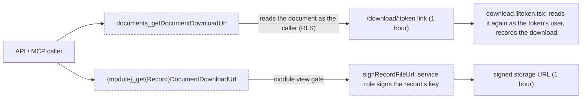

# Document and record file download links over the API and MCP

> Status: implemented
> Author: Claude (dev queue 2026-11-14)
> Date: 2026-11-14

## TLDR

An API or MCP caller can upload a file but cannot get one back. This spec adds
7 READ operations that return a link to a file, never the bytes.
`documents_getDocumentDownloadUrl` returns the same `/download/:token` link
that the documents list gives each row. Six record operations, one for each
record upload operation, return a signed storage URL that is valid for one
hour.

## Overview diagram

## Problem Statement

- An API or MCP caller uploads a document with `documents_createDocumentUploadUrl` and `documents_insertUploadedDocument`.
- No published operation returns the file or a link to it. `documents_getDocument` returns the metadata and the storage path only.
- Files on a record's Files tab have the same gap. The upload URL operations exist: `items_createItemDocumentUploadUrl`, `production_createJobDocumentUploadUrl`, `sales_createOpportunityDocumentUploadUrl`, `sales_createOpportunityLineDocumentUploadUrl`, `purchasing_createSupplierInteractionDocumentUploadUrl`, `purchasing_createSupplierInteractionLineDocumentUploadUrl`. No download operation exists.
- Example: an agent must read a drawing PDF that is attached to a part, or a script copies one company's documents into another company.

## Proposed Solution

### Documents

`documents_getDocumentDownloadUrl({ documentId })`, gated on `documents_view`:

1. Read the `document` row as the caller (row-level security), scoped to `ctx.company.id`.
2. If no row comes back, refuse with `notFound`. If the row has no `path`, refuse with `notFound`.
3. Mint the token with `generateDownloadToken({ userId: ctx.auditUserId, companyId: ctx.company.id, documentId }, { expiresInSeconds: FILE_LINK_SECONDS })`.
4. Return `{ documentId, name, url, expiresIn }`. `url` is `${ERP_URL}/download/<token>`, the same form as the link the documents list CSV export writes. `expiresIn` is `FILE_LINK_SECONDS` (3600).

The existing route `download.$token.tsx` serves the link. It reads the document again as the token's user, downloads the file with the service role and writes the "Download" transaction (`recordDocumentDownload`). If the token has expired, `verifyDownloadToken` throws `DownloadTokenExpiredError`, and the route sends the caller to `/download/error?reason=expired`.

### Record files

One operation for each record upload operation. Each takes the record id and the file name, the same input as its upload sibling:

| Operation | Folder | Gate |
|---|---|---|
| `items_getItemDocumentDownloadUrl({ itemId, name })` | `parts` | `parts_view` |
| `production_getJobDocumentDownloadUrl({ jobId, name })` | `job` | `production_view` |
| `sales_getOpportunityDocumentDownloadUrl({ opportunityId, name })` | `opportunity` | `sales_view` |
| `sales_getOpportunityLineDocumentDownloadUrl({ lineId, name })` | `opportunity-line` | `sales_view` |
| `purchasing_getSupplierInteractionDocumentDownloadUrl({ interactionId, name })` | `supplier-interaction` | `purchasing_view` |
| `purchasing_getSupplierInteractionLineDocumentDownloadUrl({ lineId, name })` | `supplier-interaction-line` | `purchasing_view` |

Each operation calls one building block, `signRecordFileUrl` (`documents.service.ts`):

1. Build the key with `buildDocumentUploadPath`, the function the upload operations use. The same record and name give the same key.
2. Refuse a key outside the company or with unsafe syntax (`refuseForeignPath`, `validation`).
3. Sign the key in the company bucket with the service role, for `FILE_LINK_SECONDS` (3600).
4. If storage has no object at the key, refuse with `notFound`.
5. Add `download=<file name>` to the URL, as `signItemFile` does, so a browser saves the file under its name.
6. Return `{ path, signedUrl, expiresIn }`.

### Design Decisions

| Decision | Choice | Rationale |
|----------|--------|-----------|
| The user the document token names | `ctx.auditUserId` | The API path records this user on every write. For an API key it is the key's creator (`auditUserIdOf`, `service-fn.server.ts`). For an OAuth connector it is the user. For a workflow it is the user the run acts for. |
| Document link expiry | 3600 seconds (`FILE_LINK_SECONDS`), set on the token (`expiresInSeconds`); the documents list's tokens keep none | The token names an API key's creator, not the key, so a link with no expiry kept working after the key was revoked (self-test 2026-11-17). An hour bounds a link copied into a log or a transcript. An expired link opens `/download/error?reason=expired`. |
| Who a key's document link works for | The intersection of the key and its creator | The operation reads the document as the key, so it makes no link for a document the key cannot see. The route reads it again as the creator. A document that a key sees through `has_valid_api_key_for_company` but its creator cannot see (read groups) gets a link that opens the "unavailable" page. This is narrower than the key; it never gives the key more. |
| Record file access check | The module's view permission, then the service role signs | The record's file list (`getItemFiles`, `getJobDocuments`, `getOpportunityDocuments`, `getSupplierInteractionDocuments`) gates on that permission. The app's file route (`file+/preview+/$bucket.$.tsx`) checks the caller, then reads with the service role. An API key is not a storage user, so a link signed with its own client is refused (`mcp-tools-reference.md` → File uploads). |
| Record file link expiry | 3600 seconds | The app's file route streams the file to a signed-in session and has no link to expire. A signed URL is a bearer credential, so it needs a short life. The closest signed link to a record's file is the supplier quote share page (`signItemFile(…, 3600)`). 3600 is narrower than the 7-day email attachment links (`EMAIL_ATTACHMENT_URL_SECONDS`). |
| One operation per record type, not one generic operation | Per record type | The upload operations are per record type for the same reason (`.ai/plans/2026-09-16-mcp-file-uploads.md`, decision 1). Each gates on one module, so the manifest shows the real permission and the classification is READ. A generic operation would gate on `{}` and check the module in `run`, which the permissions test allows only for `shared` tools. |
| Line record types | Included | `getJobDocuments` lists opportunity line files on a job's Files tab, and both line upload operations exist. Without them, a file uploaded to a line has no download. |
| Record existence | Not checked | The upload operations and the file lists do not check that the record exists. The key is built inside the company and the module's folder, so the caller reaches only files that the module's file list shows. |
| Bytes in the response | Never | A link keeps the MCP response small, as the uploads keep the bytes out of the dispatch. |

## Data Model Changes

None.

## API / Service Changes

- `documents.server.ts`: `getDocumentDownloadUrl`.
- `items.server.ts`: `getItemDocumentDownloadUrl`.
- `production.server.ts`: `getJobDocumentDownloadUrl`.
- `sales.server.ts`: `getOpportunityDocumentDownloadUrl`, `getOpportunityLineDocumentDownloadUrl`.
- `purchasing.server.ts`: `getSupplierInteractionDocumentDownloadUrl`, `getSupplierInteractionLineDocumentDownloadUrl`.
- `documents.service.ts`: building blocks `documentDownloadUrl`, `signRecordFileUrl` and the constant `FILE_LINK_SECONDS`.
- `tool-manifest.digest.json`: 7 new READ lines.

## Closest Sibling

- The documents list loader (`routes/x+/documents+/search.tsx`), which mints the download token per row.
- The record upload URL operations (`create*DocumentUploadUrl`), whose inputs, folders and key builder the record operations copy.
- `listItemSupplierFiles` and `signItemFile` (`purchasing`), which sign a record's files with the service role after the operation's own gate.

## UI Changes

None.

## Acceptance Criteria

- [x] A caller without the module's view permission is refused (`forbidden`), for each of the 7 operations.
- [x] A caller who cannot read the document gets `notFound` and no link.
- [x] A document of another company gets `notFound`, also for a caller whose client can see it.
- [x] The document link's token names the caller's company, the document and `ctx.auditUserId`; a token edited to name another company does not verify.
- [x] The 7 operations are in the generated manifest as READ, each on its module's view permission.
- [x] `pnpm check:manifest` passes with the new digest.
- [x] A document link stops working 3600 seconds after the operation mints it, and opens the "expired" error page. A token with no expiry (the documents list's) still verifies.

## Risks

| Risk | Severity | Mitigation |
|------|----------|------------|
| A document link can be forwarded within its hour. | Low | It expires after `FILE_LINK_SECONDS`. The route checks access again as the token's user at each download. |
| A record file link works for anyone who holds it, for one hour. | Low | The link is short-lived, and the caller already had the module's view permission. |
| A key's document link fails for a document that only the key can see. | Low | Stated in the operation's description; the refusal page names it "unavailable". |

## Open Questions

- [x] Which user does a token minted for an API key name? — Answer: `ctx.auditUserId`, the key's creator (decision taken in the brief; confirmed in `auditUserIdOf`).
- [x] Does a link minted for a key expire? — Answer: yes, 3600 seconds for both document links and record files (decided 2026-11-18: a link with no expiry outlived the revoked key that minted it).

## Changelog

- 2026-11-14: Created and implemented on `feat/document-download-link-api`.
- 2026-11-18: Document links expire after `FILE_LINK_SECONDS` (3600). The self-test on a local stack showed that a link with no expiry still downloaded after its API key was revoked. `RECORD_FILE_URL_SECONDS` is renamed `FILE_LINK_SECONDS` and serves both link types.
