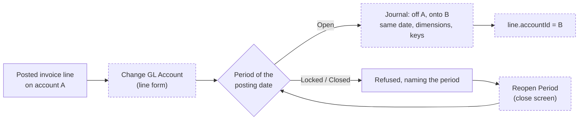

# Change the GL account of a posted invoice line, and reopen a closed period

> Status: implemented
> Author: Claude (for review)
> Date: 2026-11-14

## TLDR

An accountant who finds a posted invoice line coded to the wrong account can change it from the line: **Change GL Account** posts a correcting journal that moves the line's posted amount to the new account, dated on the invoice's posting date in its period, and records the new account on the line. The period must be Open. A Closed period can now be reopened from the period's close screen (**Reopen Period**), so a correction in a historical month is: reopen the later periods back to that month, change the line's account, then lock and close the periods again.

## Overview diagram

## Problem Statement

- A company that moves its books into Carbon must make Carbon's ledger match its prior system line for line. A posted invoice line coded to the wrong account cannot be corrected today: a posted invoice is read-only, and voiding it reposts every line dated today.
- The only override, the document force delete, goes through an admin approval request. An account change is not a protected action and needs no approval.
- `reopenAccountingPeriod` exists, but no operation, route or button calls it. A Closed period cannot be reopened, so nothing can post into a historical month again.

## Proposed Solution

### Changing a line's account

- **Where:** a **Change GL Account** button on the line form of a posted sales or purchase invoice. It opens a modal with an account picker and posts to `x+/{sales,purchase}-invoice+/$invoiceId.$lineId.account.tsx`.
- **Operations:** `changeSalesInvoiceLineAccount`, `changePurchaseInvoiceLineAccount` (`invoicing.server.ts`, `@mcp`), both calling the building block `changeInvoiceLineAccount` (`invoicing.service.ts`).
- **Which lines:** a sales line whose revenue posted to the Sales account (`postingLineRevenue(line).book === "sales"`); a purchase **G/L Account** line. Deferred, contract, rental, service job, fixed asset, item and lease lines post through accounts that schedules, positions, inventory or assets read, so they are refused.
- **Target account:** an active account of the company group that is not a group, of class Revenue (sales) or Expense (purchase): the classes the posting and the line form use.
- **Finding the posted amount:** a posting writes no link from a journal line to its invoice line. `findInvoiceLinePosition` matches the line's journal group (`journalLineReference`) on what the posting copies from the line: the account the amount is on now, the quantity, the order line reference, the line's dimensions and the amount the posting computed (`roundSalesPostingAmounts` / `calculatePurchasePostingAmounts`), and only a group that still holds that amount on that account. A sole group is checked the same way. No match, or more than one, refuses the change: a group the change cannot prove is the line's is never moved.
- **The journal:** one journal, `sourceType` the invoice's own (`Sales Invoice` / `Purchase Invoice`, as its void), description `Account change <Sales|Purchase> Invoice <id>`, dated on the original posting's date. Two lines, both `Account change: <original description>`: the amount off the old account (with the original's stand-in role) and onto the new one. Both copy the original line's document keys (`documentType`, `documentId`, `documentLineReference`, `journalLineReference`) and its dimensions (`copyJournalLineDimensions`).
- **Line record:** `accountId` is set to the new account, with `updatedBy`; the entity audit log records it (`salesInvoiceLine` / `purchaseInvoiceLine` are audited), and the journal is audited as a Journal Entry.
- **Void:** an invoice void reverses every `Invoice` line of the document, so it reverses the change with the posting. Both voids lock the invoice `FOR UPDATE` and read those lines under the lock, the lock the change holds while it writes, so a change in flight is reversed too.
- **Repeats:** a second change finds the amount on the account the first moved it to.

### Refusals

| Case | Message |
|---|---|
| Period Closed | "Accounting period FY2026 · Period 3 is closed. Reopen it before changing the account." |
| Period Locked | "Accounting period FY2026 · Period 3 is locked. Unlock it before changing the account." |
| Before the cutover date | "This invoice is from before your accounting cutover. Record a journal entry to correct it instead." |
| Draft, Pending or Voided invoice | "Only a posted invoice's lines can change account…" / "A voided invoice's lines cannot change account." |
| Line charged to a project | "This line is charged to a project, which posted it to the project's account. Record a journal entry to correct it instead." |
| Intercompany elimination reads the line | "Intercompany eliminations read this line's posted account, so it cannot change…" |
| Same account | "The line is already posted to this account." |
| New account already holds another leg of the line (a sales line's shipping account) | "This line's posting already has another amount on 4050 Shipping Revenue, so the line cannot move there. Choose another account." |

### Reopening a period

- **Operation:** `reopenPeriod` (`accounting.server.ts`, `@mcp`) runs `reopenAccountingPeriod`: Closed only, reverse-sequential, deletes the snapshots, back to Open, in one Kysely transaction. It and the close take the company's period lifecycle lock first and check the neighbouring periods under it.
- **UI:** the close screen of a Closed period (Accounting → Periods → View Period) shows **Reopen Period** instead of **Close Period**, for a user with accounting update and delete.
- **Reverse-sequential rule kept:** a reopened month between two Closed months would let a posting change a balance a later Closed period's snapshot already embeds.

### Design Decisions

| Decision | Choice | Rationale |
|---|---|---|
| Account change permission | `update: ["invoicing", "accounting"]` | Invoicing update posts and voids invoices; accounting update because the change writes the ledger. No approval request. |
| Reopen permission | `update` and `delete: accounting` | The period-closing spec (`2026-07-02-period-closing.md`) gated reopen on `delete: accounting`; update is needed for the RLS writes. |
| Period | Open only | An account change is an operational correction of the document; Locked refuses operational postings. |
| Source type | The invoice's own | Mirrors the invoice void; no new enum value. |
| Line descriptions | Prefixed `Account change: ` | The provider role readers match descriptions exactly, so the change takes no AR/AP/revenue role. |

## Data Model Changes

None. No migration.

## API / Service Changes

- `invoicing_changeSalesInvoiceLineAccount`, `invoicing_changePurchaseInvoiceLineAccount`: `{ invoiceId, lineId, accountId }`.
- `accounting_reopenPeriod`: `{ periodId }`.

## Out of scope

- Provider sync of the change. A synced invoice keeps its original account in the provider; the AR replay reads only the posting's "Sales Account" lines, the bill replay reads every Posted Purchase Invoice journal line of the bill.
- Changing the account of other line kinds.

## Addendum 2026-11-15: fixes from testing in the app

- **Button placement:** Change GL Account sits in the line card header's `CardAction`, clear of the card's collapse chevron, as the quote and RFQ line forms place their header actions.
- **Current account in the dialog:** the dialog shows "Current account: <number> <name>", the account the line's amount is posted to now.
  - Derived from the journal match the change moves, never from `salesInvoiceLine.accountId`: sales posting credits `accountDefault.salesAccount`, and convert copies the order line's account into the column, so it can name an account never posted to.
  - Read operations `getSalesInvoiceLinePostedAccount` / `getPurchaseInvoiceLinePostedAccount` (`view: ["invoicing", "accounting"]`, not `@mcp`), served by `api+/{sales,purchase}-invoice.$invoiceId.$lineId.account.ts` and read only when the dialog opens, so the line page loads nothing extra.
  - A line that cannot change account shows the change's own refusal in the dialog; the change still refuses it on submit.
  - The change's refusals that do not depend on the new account now run before the new account is checked.
- **Closed period checklist:** Accounting → Accounting Periods → View Period on a Closed period shows the checklist read-only: title "Closed <period>", no "Cannot close yet" banner, no task actions (Create Run, Compute Burden, Close Earned Value, Mark Done, Skip) and no run prompts. **Reopen Period** stays.
