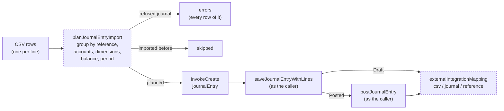

# Journal entry CSV import

> Status: in-progress
> Author: Claude (dev queue 2026-11-14)
> Date: 2026-11-14

## TLDR

A company that moves to Carbon from another accounting system needs that
system's journals in Carbon, so the two sets of books agree. The CSV import
gets a **Journal Entries** type: one row per journal line, the rows that share
a Journal Reference are one journal entry. The building blocks of a manual
journal entry create, save and post each journal. So the journal gets the
number, the Manual source, the period rules and the audit trail of a manual
entry. The import writes a journal whole or not at all.

## Overview diagram

## Problem Statement

Carbon's CSV import has no journal entry type. A company that brings its
general ledger from another system has to type each journal into the manual
journal entry form.

## Proposed Solution

Add the table `journalEntry` to the import system in the places the payroll
totals import uses:

1. `fieldMappings` and `importSchemas`.
2. `importPermissions` and `importRequiresCreate`.
3. The `importCsvInput` table enum.
4. One `case` in `importCsvTable`.
5. The `importCSV` prop on the Journal Entries table.

### Columns

| Field | Column | Rule |
|---|---|---|
| `journalReference` | Journal Reference (required) | Groups rows into one journal |
| `postingDate` | Posting Date (required) | A real `YYYY-MM-DD`; same on every row of a journal |
| `accountNumber` | Account Number (required) | An active, non-group account of the company group |
| `debit`, `credit` | Debit, Credit | Exactly one above 0; no comma (`parseTrialBalanceAmount`) |
| `description` | Line Description | The line's description |
| `journalDescription` | Journal Description | The journal's description; blank → the reference |
| `status` | Status (enum) | `Draft` (default) or `Posted`; same on every row of a journal |
| `dimension1..3` | Dimension 1..3 (enum) | An active dimension of the group (`dimensionFetcher`) |
| `dimension1..3Value` | Dimension 1..3 Value | The value by the name the journal form shows |

### Design Decisions

| Decision | Choice | Rationale |
|----------|--------|-----------|
| Write path | `invokeCreate(ctx, { type: "journalEntry" })`, `saveJournalEntryWithLines` and `postJournalEntry` on the caller's client, one journal at a time | The manual entry's path (`createJournalEntry`, `saveJournalEntry`): same numbering, source type, period rules and audit. |
| Draft or Posted | Status enum, default Draft | A new manual entry is a Draft; the form offers Save (Draft) and Post. The wizard's Default sets the whole file. |
| Locked period | Accepted | A manual journal posts as an `accounting` source: `periodPostingRefusal` refuses only Closed for it. |
| Closed period | Refused with "Accounting period is closed. Reopen it before posting.", for a Draft too | No bypass; a Draft that could never post is not left behind. |
| On or before the latest closing snapshot | Refused: "dated on or before <date>, the end of the latest closed period. Reopen the periods back to this date first.", for a Draft too | Balances start from the newest snapshot and add only later journals; added 2026-11-15 from self-review. |
| Balance | Every journal, Draft too, `isBalanced` with `JOURNAL_BALANCE_TOLERANCE` | The file is another system's books; an unbalanced journal there is an error. |
| Currency | Base currency only | Manual journal lines carry no currency. |
| Dimensions | Three slots, dimension chosen as an enum Default | The wizard's fields are fixed per table; a company's dimensions are not. |
| Whole journal | A refused row puts every row of its journal in `errors` | The results download of rows to fix then holds whole journals. |
| Re-import | Skip a reference whose mapped journal exists (`externalIntegrationMapping`, `csv`, `journal`) | The import system's idempotency; importing a file twice would double the books. |
| Amount format | Comma refused | The trial balance import's rule (`parseTrialBalanceAmount`): `1,234` is ambiguous. |
| MCP / API | Not added | `importCsvFile` is not tagged `@mcp`: CSV import is not published. |

## Data Model Changes

None. Mappings use the existing `externalIntegrationMapping` table.

## API / Service Changes

- `apps/erp/app/modules/shared/journal-entry-import.ts`: `readJournalEntryRow`,
  `planJournalEntryImport` (pure), `importJournalEntries` (reads, writes).
- `importCsvTable` (`shared.service.ts`): `case "journalEntry"`.
- `importCsvFile` gate: `update` and `create` on `accounting`.

## Closest Sibling

- The payroll totals import (`payroll-total-import.ts`): one file per import
  type, a pure row reader, its test file.
- The manual journal entry (`createJournalEntry`, `saveJournalEntry` in
  `accounting.server.ts`): the write path and its line rule.
- The trial balance CSV (`trial-balance-csv.ts`, activation step): the amount
  parser and the account filter.

## UI Changes

The Journal Entries list (`JournalEntriesTable`) shows the Bulk Import menu
with "Import Journal Entries CSV" to a user with `create` and `update` on
accounting. The import uses the existing wizard.

## Acceptance Criteria

- [x] Rows group by Journal Reference into one journal each.
- [x] An unknown account number refuses its row and its journal.
- [x] An unbalanced journal is refused whole, naming the reference.
- [x] A Closed period refuses the journal with the period message.
- [x] Draft by default; Posted posts through `postJournalEntry`.
- [x] Importing the same file again skips its journals.
- [x] The docs page lists the type.

## Addendum 2026-11-15: dimension steps follow their Value column

- Found in a test of the running app: a file with no dimension columns walked
  through five wizard steps (Field Mapping, Status, Dimension 1, 2 and 3), each
  Dimension step asking which dimension its Value column tags.
- The wizard now asks for Dimension N only while Dimension N Value is mapped.
  The Status step stays.
- Mechanism, shared by every import: an enum field's `enumData.askWhenMapped`
  names another field of the table (`isEnumStepAsked`,
  `ImportCSVModal/enumSteps.ts`). A skipped step sends no enum mapping.
- Server: unchanged. `readJournalEntryRow` already ignores a slot with no
  value, so an absent Dimension N default needs no rule.
- [x] A file without Dimension Value columns shows Field Mapping and Status only.
