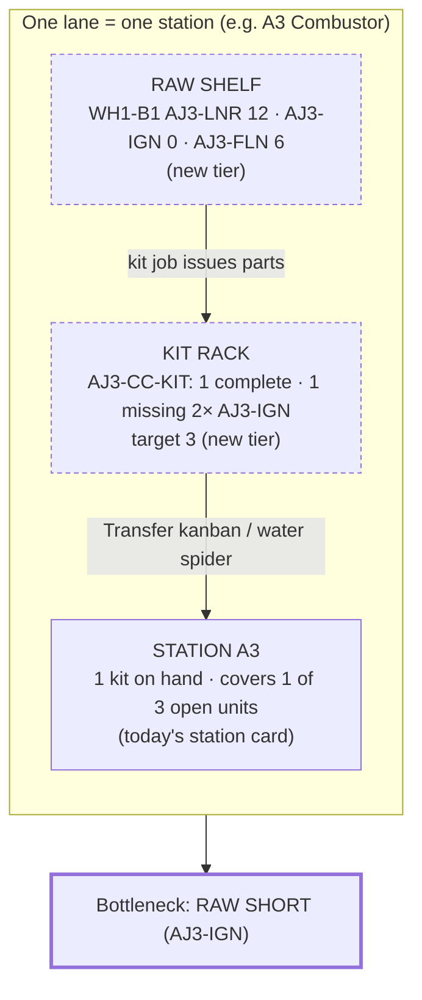

# Line feed lanes: raw shelf → kit rack → station

> Status: draft
> Author: Dane Albaugh
> Date: 2026-11-16

## TLDR

The line feed shows one vertical lane per station. Each lane has three tiers.
The top tier is the raw-material shelf: the received bins, labeled with the
supplier serial or lot. The middle tier is the kit rack: complete kits,
incomplete kits and what each incomplete kit is missing. The bottom tier is the
station: what the operator has and what they are short of. A lane names its
bottleneck in one word: **Deliver**, **Finish kit**, **Build kit**,
**Raw short** or **OK**. A summary strip across the top counts each one, so a
lead sees at a glance what to do next and where the line will starve.

To make the middle tier possible, a kit becomes real stock. A kit is a Make item
(for example `AJ3-CC-KIT Combustor Kit`) that a kit job builds. The kit job
issues raw parts from the shelf and receives the finished kit into a kit-rack
storage unit. Water spiders move kits to the station with a Transfer kanban.
Incomplete kits are open kit jobs with unissued materials, and they sit at the
kit job's storage unit, so the system always knows where they are.

## Overview diagram



## Problem Statement

Material moves through three places on the AJ-3 line:

1. **Raw shelf.** Bins against the wall. Receiving prints a label with the
   supplier serial or lot (a `trackedEntity`), and the parts go into a bin per
   item.
2. **Kit rack.** People pick raw parts into discrete kits per operation (for
   example a combustor kit). We want a small buffer of ready kits.
3. **Station.** Water spiders bring kits line side when the operator runs out.

Today the line feed (`apps/mes/app/routes/x+/line-feed.tsx`, built on
`buildStationBoard` in `apps/mes/app/services/line-feed.ts`) shows only tier 3.
It shows station shortages from `get_line_feed_shortages`, open material
requests and transfers in transit. Four gaps follow from that:

- **Kits are not stock.** Nothing in the data says "this is a kit". The
  existing `kit` flag on `methodMaterial` and `jobMaterial` means a Make-to-Order
  child that ships as a kit. It does not mean a stocked, picked kit. So
  "3 combustor kits: 2 complete, 1 missing igniters" cannot be answered.
- **Incomplete kits have no location.** Parts picked into a half-built kit leave
  the raw bin, but no record says where they went. The kit is invisible until
  someone walks the rack.
- **The raw shelf is not tied to the station it feeds.** A bin can be empty
  while the line still runs on kits. Nobody sees that the line will starve two
  kits from now.
- **No single answer to "why is this station short?"** The cause can be "kit
  ready but not delivered", "kit started but missing parts", "no kit started"
  or "the shelf is empty". Each cause needs a different person: the water
  spider, the kitter, or purchasing. Today you work that out by walking the
  floor.

### Worked example (the acceptance scenario)

Three combustor kits get built. Kit 1 is missing 2× `AJ3-IGN` because the bin
ran out. Kits 2 and 3 are complete. Kit 2 goes to station A3, and kit 3 stays on
the rack. The A3 lane must show:

- Station: 1 kit on hand, 2 more open units need kits.
- Kit rack: 1 complete (kit 3), 1 incomplete (kit 1, missing 2× AJ3-IGN, at
  storage unit `KIT-RACK-1`).
- Raw shelf: `AJ3-IGN` at WH1-B1 is **empty**. Its Buy kanban shows whether a
  PO is already open.
- Bottleneck: **Raw short: AJ3-IGN**. The station is still fed (1 kit, 1 more on
  the rack), so the lane is amber, not red.

## Proposed Solution

### The lane

A **lane** is one active work center at the location that has a lineside
storage unit, the same set `buildStationBoard` uses. A lane has three tiers.
All tiers are computed for the items that lane's open job operations consume.

**Station tier (bottom).** This is today's station card. Add:

- Kits on hand at the station's bins, per kit item, by serial.
- Coverage: on hand ÷ open demand at this station, shown as "covers N of M
  units".
- Kits in transit to the station: Released or In Progress stock transfer lines
  for a kit item. These already appear as transfer rows.

**Kit rack tier (middle).** For each kit item the station consumes:

- **Complete** kits: on-hand of the kit item in kit-rack storage units, listed by
  serial and storage unit.
- **Incomplete** kits: open kit jobs (`Ready`, `In Progress`, `Paused`) for the
  kit item whose materials are not fully issued. Each shows its storage unit
  (`job.storageUnitId`) and its missing lines (`estimatedQuantity −
  quantityIssued` per `jobMaterial`).
- **Target**: the kit item's Make kanban `quantity` and `replenishmentLevel` at
  the rack, if one exists. The tier is `low` when complete + incomplete is below
  the level.

When the station consumes raw parts directly (no kit), the tier reads
"Fed directly" and the raw tier shows the parts the station consumes.

**Raw shelf tier (top).** For each component of the lane's kit items (from the
kit item's active make method), or each direct part:

- The source bin: `pickMethod.defaultStorageUnitId` for the item at the
  location, or the Transfer kanban's `fromStorageUnitId` for direct parts.
- On hand in that bin. Rejected and Scrapped tracked entities are excluded, the
  same rule as `get_line_feed_shortages`.
- Need: the quantity the incomplete kits are missing, plus one kit's quantity
  per kit below the rack target.
- Status: `empty` (0), `short` (on hand < need), `low` (below the bin's Buy
  kanban level or below one kit's quantity), or `ok`.
- Replenishment in flight: an open Buy kanban PO line or Make kanban job, so
  "empty, PO due Nov 20" differs from "empty, nothing ordered".

### The bottleneck verdict

Each lane gets one verdict. The first rule that matches wins:

| # | Condition | Verdict | Who acts |
|---|-----------|---------|----------|
| 1 | Station short, and a complete kit is on the rack | **Deliver** | Water spider |
| 2 | Station short or rack below target, an incomplete kit exists, and raw covers its missing lines | **Finish kit** | Kitter |
| 3 | Rack below target, no incomplete kit, and raw covers one kit | **Build kit** | Kitter |
| 4 | Any needed raw line is `empty` or `short` | **Raw short: \<items\>** | Purchasing / receiving |
| 5 | Otherwise | **OK** | — |

Severity colors the lane: **red** when the station is `out`, **amber** when the
station is `low` or the verdict is not OK, and **green** otherwise. A lane can be
OK at the station and still show "Raw short" in amber. That is the early warning
the current board lacks.

### The board

- **Summary strip** at the top: `N stations out · N kits to deliver · N kits to
  finish · N kits to build · N raw bins short`. Tapping a count highlights the
  lanes it covers.
- **Lanes** run left to right in line order. The order is the lowest open
  `jobOperation.order` at the work center, then the name. A toggle keeps
  today's "worst first" order.
- **Tiers** stack top to bottom: raw, kit rack, station. Each tier has a status
  chip and collapses to its chip when everything in it is ok.
- **Phones and tablets**: lanes scroll horizontally with snap, one lane per
  screen on a phone.
- **Actions** reuse what exists: resolve a request; open the transfer; open the
  kit job to issue the missing parts; open the kanban.
- Realtime: add `job`, `jobMaterial` and `kanban` to `handle.realtime`.

### Design Decisions

| Decision | Choice | Rationale |
|----------|--------|-----------|
| What a kit is | A Make item built by a kit job, received into a kit-rack storage unit | Kits are built ahead of demand, so they cannot hang off a production job's picking list. A job gives incomplete kits a status, a location (`job.storageUnitId`) and a missing-parts list for free. A Make kanban at the rack drives the buffer. |
| Kit tracking | Serial (one label per kit) | Each kit has an identity, so we know which kit is at the rack and which is at the station. The kit's genealogy keeps the supplier serials of its parts, and the traveler scan (serial traveler spec) works on it. |
| How we know a storage unit is a kit rack | New `storageUnit."kitRack" BOOLEAN` | Explicit and cheap. A storage type name match would be magic. A work-center link already means "lineside", so it cannot be reused. |
| Lane unit | Work center, not operation | Matches the existing station board and its lineside bins. A work center that runs two operations shows two kit items in one lane. |
| Where to compute | One new SQL function for the rack and raw tiers, plus a pure TS `buildLaneBoard` | Same split as `get_line_feed_shortages` + `buildStationBoard`. The verdict logic is unit-testable. |
| Name clash | Do not reuse the `jobMaterial.kit` flag | That flag means a Make-to-Order child shipped as a kit, which is a different idea. |

## Data Model Changes

```sql
-- A storage unit that holds built kits.
ALTER TABLE "storageUnit" ADD COLUMN "kitRack" BOOLEAN NOT NULL DEFAULT FALSE;

-- A kit rack is never lineside.
ALTER TABLE "storageUnit" ADD CONSTRAINT "storageUnit_kitRack_not_lineside"
  CHECK (NOT ("kitRack" AND "workCenterId" IS NOT NULL));
```

A **kit item** at a location is an item whose
`pickMethod.defaultStorageUnitId` at that location is a kit rack. No item
column is needed. Configuring a kit is three steps:

1. Create the Make item, with a one-operation make method at a kitting work
   center and the raw parts as Pull-from-Inventory materials.
2. Set its default storage unit to a kit-rack bin.
3. Optionally add a Make kanban for the buffer, and a Transfer kanban from the
   rack to the station.

New function, `SECURITY INVOKER`, the same shape as `get_line_feed_shortages`:

```sql
get_line_feed_lanes(p_location_id TEXT, p_company_id TEXT)
RETURNS TABLE (
  "workCenterId" TEXT,
  "tier" TEXT,            -- 'kit' | 'raw'
  "itemId" TEXT,          -- kit item or raw component
  "parentKitItemId" TEXT, -- raw rows: the kit they feed (NULL = direct)
  "storageUnitId" TEXT,
  "jobId" TEXT,           -- kit rows: the incomplete kit job
  "trackedEntityId" TEXT, -- kit rows: the complete kit's serial
  "state" TEXT,           -- 'complete' | 'incomplete' | 'missing' | 'bin'
  "quantity" NUMERIC,     -- on hand, or missing quantity
  "need" NUMERIC,
  "target" NUMERIC,       -- rack kanban level / bin kanban level
  "replenishing" BOOLEAN  -- open kanban PO or job in flight
)
```

Index check: the raw tier reads `itemLedger` by `storageUnitId` and `itemId`.
It uses the same `IN (subquery)` pattern as the shortages function, so the
storage-unit index drives the read.

## API / Service Changes

- `apps/mes/app/services/inventory.service.ts` → `getLineFeed`: add the
  `get_line_feed_lanes` call to the existing `Promise.all`. Return `lanes`
  next to `stations` during rollout.
- `apps/mes/app/services/line-feed.ts`: add `buildLaneBoard({ stations, laneRows
  })` → `Lane[]`, with `{ workCenterId, name, severity, verdict, raw[], kit:
  { complete[], incomplete[], target }, station: StationCard }`. Add
  `laneVerdict()` as a pure function for the table above.
- `apps/mes/app/services/line-feed.test.ts`: cover the worked example and each
  verdict row.
- ERP: add a "Kit rack" switch to the storage unit form.

## Closest Sibling

The current station board: `apps/mes/app/routes/x+/line-feed.tsx`,
`buildStationBoard` and `get_line_feed_shortages`. A lane wraps a
`StationCard` as its bottom tier, and the same `StationCard` component renders
it. Deviations: lanes are columns, not a grid of cards; there are two new tiers;
there is a verdict.

## UI Changes

The MES line feed route keeps the queue page archetype and replaces the card
grid with a horizontal lane strip. Follow `.claude/rules/mes-job-operation-ui.md`
for MES density and touch targets. Take screenshots with
`node scripts/harness-shot.mjs --app mes`.

## Out of Scope

- Creating kit jobs automatically. A Make kanban at the rack already does this.
- MRP netting of kits against the components.
- A separate kitting screen. Kitters use the kit job's issue screen.

## Open Questions

1. Are kits built ahead of demand only, or also per production job? The
   recommendation is ahead of demand (Make item + kit job). Per-job kits would
   fit a picking list staged to the rack instead.
2. One kit-rack storage unit for the whole rack, or a slot per kit item? Both
   work with the design. A slot per item makes the rack tier easier to read on
   the floor.
3. Should the station consume the kit item (1× kit per unit), or the raw parts
   with the kit as a container? The recommendation is the kit item. It keeps
   station shortages in kits, and genealogy still links back to the supplier
   serials.

## Acceptance Criteria

- [ ] A storage unit can be marked "Kit rack". An item whose default storage
      unit is a kit rack shows as a kit in the lane of every station that
      consumes it.
- [ ] Worked example: the A3 lane shows 1 kit at the station, 1 complete kit
      on the rack, 1 incomplete kit at `KIT-RACK-1` missing 2× AJ3-IGN, and
      WH1-B1 AJ3-IGN empty. Its verdict is **Raw short: AJ3-IGN**, in amber.
- [ ] Deliver the rack kit and consume the station kit: the verdict follows the
      table at each step, live, without a reload.
- [ ] A station fed directly (no kit) shows "Fed directly" and its raw source
      bins from the Transfer kanban.
- [ ] The summary strip counts match the lanes, and tapping a count highlights
      them.
- [ ] Rejected and Scrapped units never count as on hand in any tier.
- [ ] A phone shows one lane per screen with horizontal snap.
- [ ] `buildLaneBoard` and `laneVerdict` have unit tests for every verdict row.
